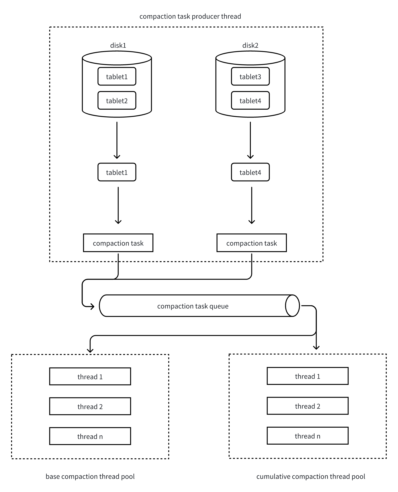

---
{
    "title": "Compaction Principles",
    "language": "en",
    "description": "Apache Doris uses an LSM-Tree based storage engine where data is appended sequentially to new data files during writes,"
}
---

## 1. The Role of Compaction

Apache Doris uses an LSM-Tree based storage engine where data is appended sequentially to new data files during writes, rather than directly updating existing files.
This design ensures high write performance, but over time, data files of different versions and sizes accumulate, leading to the following issues:
- Query performance degradation: Queries require multi-way merge sorting across multiple files
- Storage space waste: Contains data marked for deletion or duplicate data

Compaction (data compression and organization) is the key mechanism to solve these problems. It automatically merges and rewrites data files in the background, aggregating data with the same primary key or adjacent ranges into fewer, more ordered files, and cleans up deleted or expired data.
This maintains high query performance while optimizing storage space utilization.

In Doris, Compaction is a continuous and automatic process that doesn't require manual triggering. However, understanding its principles and operational status helps with performance tuning in high-concurrency and big data scenarios.

### 1.1 Improving Query Performance

Doris's data import mechanism: Each import generates a rowset for each tablet in the target partition.
- Each rowset contains 0 to n segments
- Each segment corresponds to an ordered file on disk

During queries, the storage layer needs to return aggregated or deduplicated results, so it performs multi-way merge sorting on data from multiple rowsets/segments.
As the number of rowsets increases, the number of merge paths also increases, leading to decreased query efficiency.

Compaction's role:
- BE nodes continuously merge these rowsets in the background, reducing the number of merge paths, thereby improving query efficiency
- Compaction is executed at the tablet granularity

### 1.2 Data Cleaning

In addition to performance improvement, Compaction also handles data cleaning responsibilities:
1. Cleaning marked-for-deletion data
   - Doris DELETE operations don't immediately delete data; instead, they generate a delete rowset (containing only delete predicates, not actual data). During Compaction, data matching these predicates is filtered and actually deleted
   - For Merge-on-Write type tables, data marked with delete signs is also cleaned during the Compaction phase
2. Removing duplicate data
   - Aggregate model: Aggregates rows with the same key
   - Unique model: Only keeps the latest data for the same key

This ensures both data correctness and reduces storage space usage.

## 2. Key Concepts

### 2.1 Compaction Score

Compaction Score is an indicator that measures the degree of data disorder in a tablet, and it's also the basis for determining Compaction priority.
It's equivalent to the number of merge paths that the tablet needs to participate in during query execution.
- Higher Score means higher query overhead
- Therefore, Compaction prioritizes tablets with higher Scores

Example:
```
"rowsets": [
    "[0-100] 3 DATA NONOVERLAPPING 0200000000001c30804822f519cf378fbe6f162b7de393a6 500.32 MB",
    "[101-101] 2 DATA OVERLAPPING 02000000000021d0804822f519cf378fbe6f162b7de393a6 180.46 MB",
    "[102-102] 1 DATA NONOVERLAPPING 0200000000002211804822f519cf378fbe6f162b7de393a6 50.59 MB"
]
```
- The [0-100] rowset has 3 segments but no overlap → occupies 1 path
- The [101-101] rowset has 2 segments with overlap → occupies 2 paths
- The [102-102] rowset occupies 1 path
Therefore, this tablet's Compaction Score = 4.

### 2.2 Compaction Types

The following candidate ranges describe rowset selection on a storage-compute coupled BE.

- Cumulative Compaction: merges eligible incremental rowsets on the incremental side of the cumulative point.
- Base Compaction: merges eligible historical rowsets before the cumulative point; one task may select only part of that history.
- Full Compaction: merges the complete local version chain after continuity and completeness checks.
- Cumulative Point: separates the Base and Cumulative candidate ranges.

## 3. Compaction Strategy

### 3.1 Tablet Selection Strategy

Since Compaction's goal is to improve query performance, it prioritizes tablets with the highest Compaction Score.

### 3.2 Rowset Selection Strategy

After choosing a tablet, the selected compaction policy chooses a continuous set of eligible rowsets. The tablet's total score is not a fixed rowset-count limit for every task.

- **Cumulative**: the `size_based` and `time_series` policies have different size, score, and time conditions. For the size-based policy, `cumulative_compaction_min_deltas` and `cumulative_compaction_max_deltas` are score parameters, while promotion size controls movement of the cumulative point. Reaching promotion size is not a prerequisite for every cumulative merge.
- **Base**: after filtering candidates and applying the score budget, the task can become eligible if the candidate count exceeds `base_compaction_min_rowset_num`, the total size of the remaining candidates divided by the base-rowset size exceeds `base_compaction_min_data_ratio`, or the base-rowset age exceeds `base_compaction_interval_seconds_since_last_operation`. These are alternative conditions; a universal “Score > 5” rule is incorrect.
- **Resource limits**: the Base score budget is `base_compaction_max_compaction_score`, or `mow_base_compaction_max_compaction_score` for merge-on-write Unique Key tablets. A rowset can contribute more than one score unit, and whole rowsets are selected, so these budgets must not be described as strict counts of 20 or 1000 rowsets.


## 4. Compaction Process



Compaction execution follows a producer-consumer model:
1. Tablet scanning and task generation
   - Compaction task producer threads periodically scan all tablets and calculate their Compaction Scores
   - Each round selects the tablet with the highest Score from each disk
   - Base Compaction is selected every 10 rounds, with the other 9 rounds being Cumulative Compaction
2. Concurrency control
   - Check if the current disk's Compaction task count exceeds the configured limit
   - If not exceeded, allow the tablet to enter Compaction
3. Rowset selection
   - Select continuous rowsets with similar sizes as input
   - Avoid inefficient multi-way merges due to significant data volume disparities
4. Task submission
   - Package the tablet and candidate rowsets into a Compaction Task
   - Submit to the corresponding thread pool queue based on task type (Base/Cumulative)
5. Task execution
   - Compaction thread pool retrieves tasks from the queue
   - Execute multi-way merge sorting, merging multiple rowsets into a new rowset

### 5. Common Compaction Parameters

| Parameter Name | Meaning | Default Value |
|---|---|---|
| cumulative_compaction_rounds_for_each_base_compaction_round | How many rounds of cumulative compaction tasks are generated before one base compaction task is generated. Adjusting this parameter can control the ratio between cumulative and base compaction tasks | 9 |
| compaction_task_num_per_fast_disk | Maximum number of concurrent compaction tasks per SSD disk | 8 |
| compaction_task_num_per_disk | Maximum number of concurrent compaction tasks per HDD disk | 4 |
| max_base_compaction_threads | Number of worker threads in the Base compaction thread pool | 4 |
| max_cumu_compaction_threads | Cumulative thread-pool size. On a storage-compute coupled BE, -1 uses the larger of the data-directory count and CPU cores / 6 (at least 1); this is not a CPU quota | -1 |
| base_compaction_min_rowset_num | Base candidate-count trigger threshold, as an alternative to the data-ratio and age conditions | 5 |
| base_compaction_max_compaction_score | Base candidate score budget except for MOW Unique Key tablets; whole rowsets are selected, not a strict rowset-count limit | 20 |
| mow_base_compaction_max_compaction_score | Base candidate score budget for MOW Unique Key tablets | 200 |
| cumulative_compaction_min_deltas | Minimum compaction score for rowsets participating in a cumulative compaction | 5 |
| cumulative_compaction_max_deltas | Maximum compaction score for rowsets participating in a cumulative compaction | 1000 |

## Choosing and Manually Triggering Compaction

Background compaction is normally sufficient. Before intervening, inspect the tablet's rowsets, `cumulative point`, current tasks, and errors with the [Compaction status API](../open-api/be-http/compaction-status). Choose the operation based on the rowsets to merge:

The rowset ranges and local-version-chain checks below describe the **storage-compute coupled BE** implementation. Storage-compute separated deployments use Cloud Compaction; the complete-local-chain rule must not be applied to that path. See the SQL version/deployment scope at the end of this section.

| Operation | Appropriate use | Limits |
| --- | --- | --- |
| Cumulative | Reduce small incremental rowsets on the incremental side of the cumulative point | Uses the table's compaction policy and its rowset selection rules; it does not merge the entire history |
| Base | Merge eligible historical rowsets before the cumulative point | Candidate filtering and score budgets can select only part of the history; one Base task need not produce a single rowset for the whole tablet |
| Full | Deliberately merge the tablet's complete local version chain | Requires a complete, continuous chain; cannot recreate missing data. It rewrites more data and can consume substantial CPU, I/O, and memory |

Base and Full are therefore not interchangeable. Even after repeated Base tasks, newer incremental rowsets can remain beyond the cumulative point. Full selects the input chain for that task; loads that arrive afterward can create new rowsets again.

A low score does not mean that only one rowset remains or that no merge is possible. Automatic selection balances read cost against write amplification, size, time, and resource limits. For example, Base can become eligible through a rowset-count condition, the ratio of cumulative data to base data, **or** elapsed time. There is no universal rule that all compaction stops when a tablet's score is 5 or below. Manually requesting Base or Cumulative still runs their selection checks; a request can report that no suitable versions exist. Use Full only when merging the complete chain is justified and resources permit it, rather than lowering thresholds or forcing Full after every load.

### Manual HTTP example

For a storage-compute coupled cluster, use an account with ADMIN privileges and a reachable BE HTTP endpoint. First identify the tablet and the BE hosting the replica using `SHOW TABLETS FROM db_name.table_name`, `SHOW TABLET tablet_id`, and `SHOW BACKENDS`. The BE HTTP request acts on the replica hosted by that BE, not all replicas in the cluster.

```shell
# Inspect the rowsets and cumulative point before choosing an operation.
curl -u '<user>:<password>' \
  'http://<be-host>:8040/api/compaction/show?tablet_id=<tablet-id>'

# Example: merge the complete chain, after checking its continuity and resources.
curl -u '<user>:<password>' -X POST \
  'http://<be-host>:8040/api/compaction/run?tablet_id=<tablet-id>&compact_type=full'

# Check the manual task and then inspect rowsets again.
curl -u '<user>:<password>' \
  'http://<be-host>:8040/api/compaction/run_status?tablet_id=<tablet-id>'
```

The run endpoint supports `base`, `cumulative`, and `full`. A successful submission is not proof that compaction has finished: check the task status, resulting rowsets, and BE logs. A version gap, a conflicting task, or no useful input can prevent the requested merge. See the [manual Compaction API](../open-api/be-http/compaction-run) for response fields.

Since Doris 4.1.1, partition-level `ADMIN COMPACT TABLE` also accepts `FULL` and supports both deployment modes; in 4.0 and 4.1.0 it is limited to Base/Cumulative in storage-compute coupled clusters. Since 4.1.4, `ADMIN COMPACT TABLET <tablet_id> WHERE TYPE='FULL'` can also target a single tablet in either mode. See [COMPACT TABLE](../../sql-manual/sql-statements/table-and-view/data-and-status-management/COMPACT-TABLE) for syntax, privileges, and version limits.
