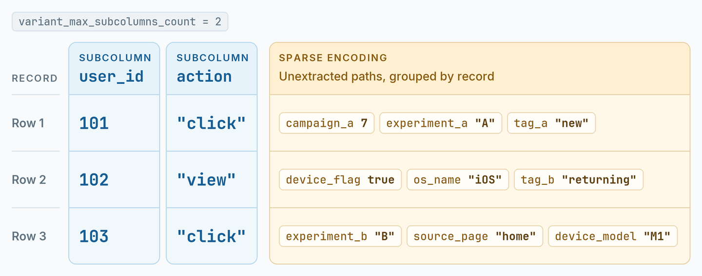
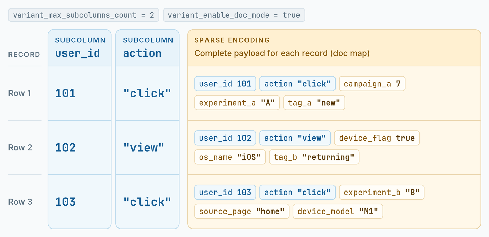

---
{
    "title": "VARIANT Storage and Tuning",
    "language": "en",
    "description": "How VARIANT stores JSON paths as subcolumns or in sparse encoding, and how to set its subcolumn limit, row threshold and DOC mode for each scenario."
}
---

VARIANT stores and queries JSON without defining every field in advance. To balance query speed against write cost, Doris extracts some frequently occurring fields into subcolumns of their own and stores the other fields in sparse encoding, which balances storage space and performance. Users still access all of the data through the same VARIANT column.

Basic VARIANT tuning answers three questions: how many subcolumns to extract at most, when to extract them, and whether to also keep the complete document. With few fields, extract early to get the benefit of columnar queries. With a very large number of fields, limit or defer the extraction to control the cost of loads and compaction.

## 1. How VARIANT stores and reads data

### 1.1 One JSON document, two ways to store its fields

Suppose there are three event records:

```json
{"user_id": 101, "action": "click", "campaign_a": 7, "experiment_a": "A", "tag_a": "new"}
{"user_id": 102, "action": "view",  "device_flag": true, "os_name": "iOS", "tag_b": "returning"}
{"user_id": 103, "action": "click", "experiment_b": "B", "source_page": "home", "device_model": "M1"}
```

`user_id` and `action` appear in every record; the other fields appear only in some records. With an extraction limit of 2, the layout can look like this:



"Sparse encoding" here means that the paths that are not extracted, together with their values, are encoded into sparse columns; queries can still read them by path. The Doris table itself still uses columnar storage.

A subcolumn organizes the data of one path as a column. A query of `payload['user_id']` reads that subcolumn and does not read the other business fields. Fields that are not extracted can still be queried by path, but the paths and values in the sparse encoding have to be parsed, which usually means reading and processing more data.

Therefore, **the extraction limit controls the physical storage layout, not the total number of JSON fields that can be written.** Paths beyond the limit are stored in sparse encoding; they are not dropped or rejected just because they exceed the limit.

The system chooses the candidates for automatic extraction from the path statistics of the data. "Frequent" here refers to how often a field occurs in the data; the system does not identify business hot spots from the history of SQL queries.

### 1.2 Three basic properties: how many, when, and whether to keep the complete document

| Property | Question it answers | Main effect of changing it |
| --- | --- | --- |
| `variant_max_subcolumns_count` | How many subcolumns are extracted at most? | A larger limit gives more paths the chance to be stored as columns, and adds write, metadata and compaction cost; `0` turns automatic extraction off |
| `variant_doc_materialization_min_rows` | When does automatic extraction start? | A higher threshold saves the extraction work for data files with few rows; path queries on that data may read more from the sparse encoding |
| `variant_enable_doc_mode` | Is the complete document also kept? | When enabled, queries of whole documents read the document representation directly; this adds storage and write cost |

The three independent examples below show how the properties change the result. The values explain the rules; they are not recommended defaults.

**How many: `variant_max_subcolumns_count`.** Suppose a data file that qualifies for extraction has 20 distinct paths. With `variant_max_subcolumns_count` set to `2`, at most 2 subcolumns are extracted and at least the other 18 paths are stored in sparse encoding. With `8`, at most 8 are extracted and at least the other 12 paths stay in sparse encoding. With `0`, nothing is extracted automatically and all 20 paths are stored in sparse encoding, except paths declared in a Schema Template, which are still extracted into subcolumns.

:::note
`0` turns automatic extraction off only for columns created by version 4.2 or later. A column created before version 4.2 keeps its behavior after the upgrade: `0` means no limit, and every dynamic path is extracted into a subcolumn. See [Sparse columns](./VARIANT.md#sparse-columns).
:::

**When: `variant_doc_materialization_min_rows`.** With `variant_doc_materialization_min_rows = 0`, extraction is tried when data is written. With `1000000`, a data file of 500,000 rows is written without automatic extraction, and extraction is tried when a later compaction writes a data file of 1,200,000 rows. This property decides when extraction happens, not how many subcolumns are extracted in the end. Despite the doc in its name, it applies without DOC mode too; before version 4.2 it applied only with DOC mode.

**Whether to keep the complete document: `variant_enable_doc_mode`.** Suppose `payload` already has 128 extracted subcolumns and queries often run `SELECT payload`. With `variant_enable_doc_mode = false`, the whole document has to be rebuilt from the subcolumns and the data in the sparse encoding. With `variant_enable_doc_mode = true`, Doris also stores a complete representation of the document and queries read it directly, at the cost of more storage space and write work.

The row threshold is evaluated for each single data file to be written; it does not apply to the cumulative rows of the table or to the total rows of one load job. Loads and compaction follow the same threshold and the same subcolumn limit; dynamic paths that do not meet the row condition or exceed the subcolumn limit are stored in sparse encoding. Different data files may end up with different subcolumn layouts.

### 1.3 The query pattern decides the value of extraction

Subcolumns usually pay off when queries read only a few paths. For example:

```sql
SELECT
    CAST(payload['action'] AS STRING) AS action,
    COUNT(*)
FROM events
GROUP BY CAST(payload['action'] AS STRING);
```

To return the complete JSON, query the whole VARIANT column. For example, to fetch the record with `user_id = 101` from the sample data above:

```sql
SELECT payload
FROM events
WHERE CAST(payload['user_id'] AS BIGINT) = 101;
```

The filter can read the `user_id` subcolumn, but `SELECT payload` has to restore the complete document of the row. Without a copy of the complete document, Doris also reads the `action` subcolumn and `campaign_a`, `experiment_a` and `tag_a` from the sparse encoding, and merges these paths and values into one JSON result. If a document has thousands of extracted subcolumns, returning the whole document reads and merges more subcolumns as well.

So more subcolumns help queries that access only a few paths, and also add write and compaction cost. When `SELECT payload` is frequent, also weigh the cost of rebuilding whole documents and whether to enable `variant_enable_doc_mode`.

## 2. Choose a configuration by scenario

The examples below use append-only event data, with complete `CREATE TABLE` statements and typical queries, to show how to choose a configuration. `DUPLICATE KEY` suits the append-only writes of the examples; `BUCKETS 8` is only an example value for a medium-sized table, so choose the number of buckets by the data volume and the size of the cluster. The examples omit partitions and the number of replicas and use the defaults of the cluster.

### 2.1 A moderate number of fields: columnar queries on frequently used paths

**Data.** A user behavior event has dozens of fairly stable fields, such as `user_id`, `event_type`, `duration_ms` and `page`. Most records have these fields, and analytical queries access a few of the paths again and again. For example, a `payload` is `{"user_id":101,"event_type":"click","duration_ms":35,"page":"home"}`.

**Table.** Try extraction when data is written, and give dynamic paths a limited subcolumn budget:

```sql
CREATE TABLE event_analysis (
    event_time DATETIME NOT NULL,
    event_id   BIGINT NOT NULL,
    payload    VARIANT<PROPERTIES(
        "variant_max_subcolumns_count" = "128",
        "variant_doc_materialization_min_rows" = "0",
        "variant_enable_doc_mode" = "false"
    )>
)
DUPLICATE KEY(event_time, event_id)
DISTRIBUTED BY HASH(event_id) BUCKETS 8;
```

**Typical query.** Count the events of each event type within one day that take at least 30 milliseconds, reading only the paths the query uses:

```sql
SELECT CAST(payload['event_type'] AS STRING) AS event_type,
       COUNT(*) AS event_count
FROM event_analysis
WHERE event_time >= '2026-11-04 00:00:00'
  AND event_time <  '2026-11-05 00:00:00'
  AND CAST(payload['duration_ms'] AS BIGINT) >= 30
GROUP BY CAST(payload['event_type'] AS STRING);
```

`variant_doc_materialization_min_rows = 0` means extraction is not deferred because of the number of rows in a data file; `variant_max_subcolumns_count = 128` means at most 128 dynamic subcolumns are extracted. Once the queried paths are subcolumns, a higher limit usually does not make them faster. Consider a larger limit only when more frequently queried paths are still in sparse encoding and path queries become the bottleneck.

Compare query latency, scanned data and load throughput with the actual filter and aggregation SQL; do not choose the subcolumn limit from the number of JSON keys alone.

### 2.2 Sparse wide tables: extract common fields, keep long-tail fields in sparse encoding

**Data.** All device records together have tens of thousands of attributes, but each record has only a few dozen. Fields such as `region` and `model` appear in most records, while fields such as `sensor_x17` and `firmware_ext_b` appear only on a few devices. For example, two records contain `{"region":"east","model":"M1","sensor_x17":8.2}` and `{"region":"west","model":"M2","firmware_ext_b":"r7"}`. The table is "wide" because the union of paths is large, not because each record is large.

Creating a subcolumn for every path produces a large number of sparse physical columns. Every subcolumn still needs its share of write, metadata and compaction work, even if it holds only a few values.

**Table.** Limit the number of automatic subcolumns, so that common fields can be stored as columns and long-tail fields are stored in sparse encoding:

```sql
CREATE TABLE device_events_sparse (
    event_time DATETIME NOT NULL,
    device_id  BIGINT NOT NULL,
    attributes VARIANT<PROPERTIES(
        "variant_max_subcolumns_count" = "128",
        "variant_doc_materialization_min_rows" = "0",
        "variant_enable_doc_mode" = "false"
    )>
)
DUPLICATE KEY(event_time, device_id)
DISTRIBUTED BY HASH(device_id) BUCKETS 8;
```

**Typical queries.** Business reports mostly aggregate by common paths, and occasionally read a long-tail path of a single device:

```sql
SELECT CAST(attributes['region'] AS STRING) AS region,
       COUNT(*) AS event_count
FROM device_events_sparse
WHERE event_time >= '2026-11-04 00:00:00'
  AND event_time <  '2026-11-05 00:00:00'
GROUP BY CAST(attributes['region'] AS STRING);

SELECT device_id,
       CAST(attributes['sensor_x17'] AS DOUBLE) AS sensor_x17
FROM device_events_sparse
WHERE device_id = 101;
```

Suppose a data file has 20,000 distinct paths. With a limit of 128, the vast majority of long-tail paths are stored in sparse encoding. If `region` occurs frequently, it is more likely to become a subcolumn; if `sensor_x17` occurs only in a few records, reading it usually parses the data in the sparse encoding. The automatic choice follows the distribution of paths in the data, not how often the SQL above runs.

If the business really needs more paths stored as columns, compare limits such as 128, 512 and 1024. A higher limit may speed up frequently queried paths, and may also add pressure on loads, metadata and compaction.

### 2.3 Very wide records and slow loads: defer or turn off automatic extraction

**Data.** Every collected record has thousands of fields. For example, the `payload` of a device snapshot holds `source` and `metric_0001` to `metric_5000`, and `snapshot_id` is a separate column of the table. Most `metric_*` fields are rarely used in filters, and with small batches written continuously, building subcolumns or the following compaction already slows down the loads. This differs from the sparse scenario of the previous section, where the union of paths across the table is large but each row is narrow.

First decide between two goals: no extraction only while small batches are written, or no automatic extraction for the whole life of the data.

**Goal 1: no extraction for data files with few rows, extraction once they reach a threshold.** Raise the row threshold when creating the table:

```sql
CREATE TABLE wide_snapshots_deferred (
    snapshot_time DATETIME NOT NULL,
    snapshot_id   BIGINT NOT NULL,
    payload       VARIANT<PROPERTIES(
        "variant_max_subcolumns_count" = "128",
        "variant_doc_materialization_min_rows" = "1000",
        "variant_enable_doc_mode" = "false"
    )>
)
DUPLICATE KEY(snapshot_time, snapshot_id)
DISTRIBUTED BY HASH(snapshot_id) BUCKETS 8;
```

For example, when a data file of 500 rows is written, the dynamic paths are first stored in sparse encoding; extraction is tried when a later compaction produces a data file of 1,200 rows, and at most 128 subcolumns are extracted. When each row is very wide, a data file usually holds fewer rows, so `1000` is only an example threshold; adjust it to the actual number of rows and the row width of your data files.

**Goal 2: no automatic extraction for the whole life of the data.** Set the subcolumn limit to `0`:

```sql
CREATE TABLE wide_snapshots_row_only (
    snapshot_time DATETIME NOT NULL,
    snapshot_id   BIGINT NOT NULL,
    payload       VARIANT<PROPERTIES(
        "variant_max_subcolumns_count" = "0",
        "variant_doc_materialization_min_rows" = "0",
        "variant_enable_doc_mode" = "false"
    )>
)
DUPLICATE KEY(snapshot_time, snapshot_id)
DISTRIBUTED BY HASH(snapshot_id) BUCKETS 8;
```

Neither loads nor compaction extract dynamic subcolumns, and the paths are stored in sparse encoding. This saves the extraction work on very wide data; filters and aggregations by path then have to parse the data in the sparse encoding and may be slower. Whether `variant_enable_doc_mode` also keeps the complete document is a separate setting.

**Typical query.** Both tables can run the SQL below; replace the table name to compare the configurations:

```sql
SELECT snapshot_id,
       CAST(payload['source'] AS STRING) AS source
FROM wide_snapshots_deferred
WHERE snapshot_time >= '2026-11-04 00:00:00'
  AND snapshot_time <  '2026-11-05 00:00:00'
  AND CAST(payload['source'] AS STRING) = 'collector-a';
```

Compare three configurations: immediate extraction, deferred extraction, and automatic extraction turned off. Record the query latency right after the loads and after compaction, and under continuous writes record the throughput, the compaction cost and the size on disk; measuring only the speed of a short load may miss the background cost.

### 2.4 Complete JSON returned often: decide whether to keep a copy of the complete document

Take the three event records from before: every `payload` has `user_id` and `action`, and each also has its own campaign, device or experiment fields. The application often finds a record by `user_id` and returns the whole `payload`, and also aggregates by `action`.



**Table.** Set the automatic subcolumn limit to `2`, assuming `user_id` and `action` are extracted into subcolumns. `variant_enable_doc_mode = true` makes the sparse encoding keep all paths and values of every record, including the extracted `user_id` and `action`:

```sql
CREATE TABLE event_documents (
    event_id BIGINT NOT NULL,
    payload  VARIANT<PROPERTIES(
        "variant_max_subcolumns_count" = "2",
        "variant_doc_materialization_min_rows" = "0",
        "variant_enable_doc_mode" = "true"
    )>
)
DUPLICATE KEY(event_id)
DISTRIBUTED BY HASH(event_id) BUCKETS 8;
```

**Typical query.** Filter by `user_id` and return the complete document:

```sql
SELECT payload
FROM event_documents
WHERE CAST(payload['user_id'] AS BIGINT) = 101;
```

If `user_id` and `action` are already subcolumns, the filter of this SQL can read the `user_id` subcolumn, and `payload` is returned by reading the complete document from the sparse encoding directly.

## 3. Advanced settings

**`variant_doc_hash_shard_count`: the number of shards of the sparse encoding.** This property sets the number of physical shards that the sparse encoding uses; paths that are not extracted are mapped to a shard by hash. The default is 1. It is unrelated to the BUCKETS of the table and to the number of tablets. With `variant_enable_doc_mode`, the complete document is split into the same number of shards. Despite the doc in its name, it applies without DOC mode too; versions 4.0 and 4.1 set the shard count without DOC mode with `variant_sparse_hash_shard_count`, which is ignored from version 4.2.

For example, 18 long-tail paths are stored in sparse encoding. With `4`, these paths are mapped to 4 available shards; with `16`, to 16 available shards. To query one long-tail path, Doris can locate the shard that holds it and read less data of other paths. Querying a whole document may still read several shards.
