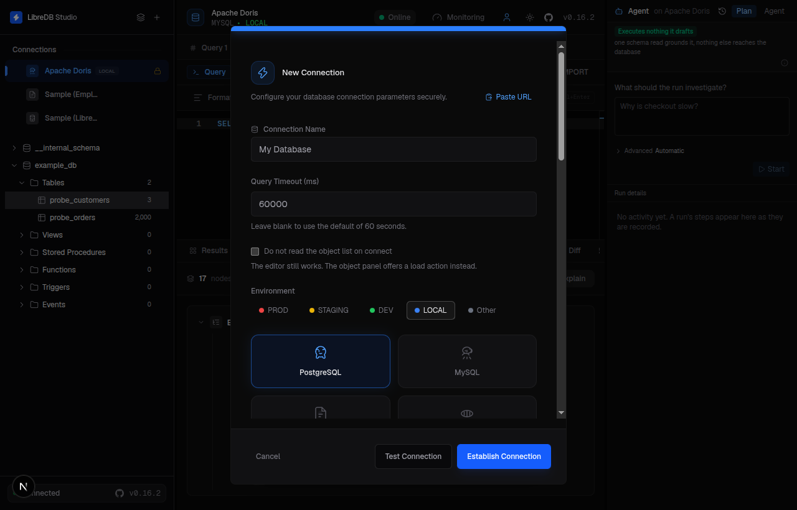
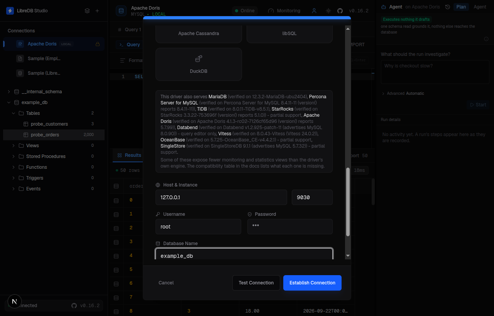
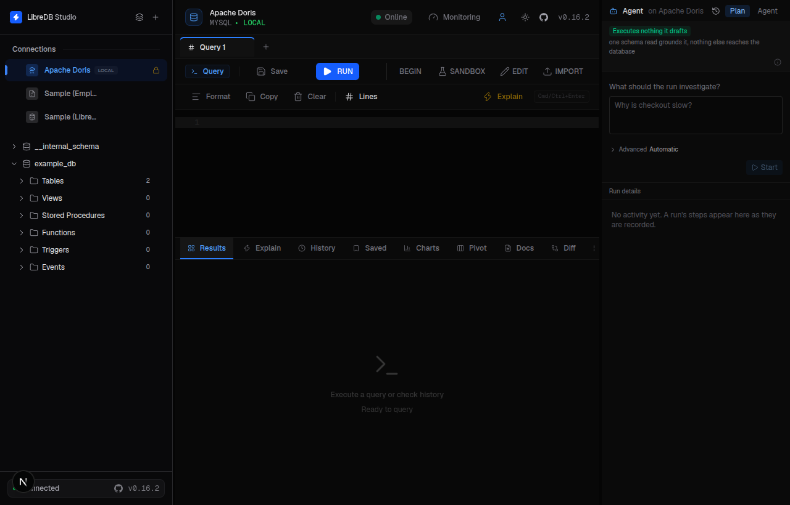
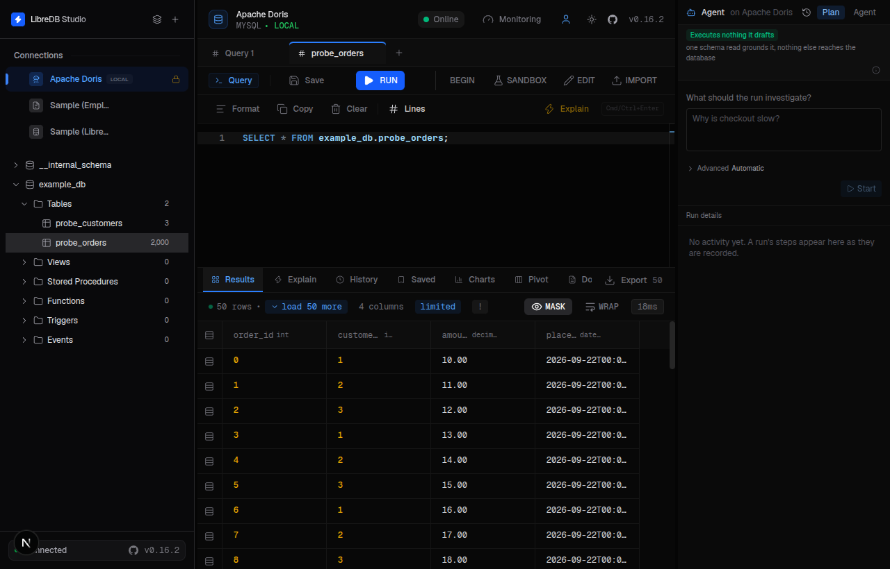

---
{
    "title": "LibreDB Studio",
    "language": "ja",
    "description": "LibreDB Studio を MySQL ワイヤプロトコルで Apache Doris に接続し、スキーマの参照、クエリの実行、クラスタの監視を行う方法と、現時点の制約を説明します。"
}
---

<!-- Knowledge type: Scenario description -->
<!-- Applicable scenario: Use LibreDB Studio to connect to and query Apache Doris -->

## 概要 {#overview}

[LibreDB Studio](https://libredb.org) は、デスクトップアプリケーションとしてインストールせずにブラウザで使用できる、MIT ライセンスのオープンソース SQL IDE です。Docker イメージ、Helm チャート、npm パッケージとして提供されています。Doris 専用のドライバーはないため、MySQL 接続タイプを使用し、MySQL ワイヤプロトコルで Apache Doris に接続します。

この記事を読むと、次のことができるようになります。

- LibreDB Studio を起動し、MySQL 接続タイプを使用して Doris への接続を作成する。
- internal catalog のデータベースとテーブルを参照し、Doris に対して SQL を実行する。
- Doris が公開しない値とその理由を把握したうえで、パネルの表示を利用する。

## 前提条件 {#prerequisites}

<!-- Knowledge type: Prerequisites -->
<!-- Applicable scenario: Check the LibreDB Studio and Doris connection requirements before connecting -->

- LibreDB Studio が起動していること。最も手軽な方法は Docker を使うことです。

```sh
docker run --name libredb-studio -p 3000:3000 ghcr.io/libredb/libredb-studio:latest
```

`http://localhost:3000` を開きます。初期管理者パスワードはコンテナのログに出力されます（`docker logs libredb-studio`）。

  Helm チャートと npm パッケージ（`npx @libredb/studio`）も利用できます。詳しくは [LibreDB Studio のリポジトリ](https://github.com/libredb/libredb-studio)を参照してください。
- LibreDB Studio のサーバーまたはコンテナから FE に到達できること。コンテナ内の `localhost` はそのコンテナ自身を指します。Doris がホスト上で動作している場合は、コンテナから到達できるホストのアドレスを使用してください。Doris ユーザーには、対象のデータベースとテーブルに必要な権限を付与してください。
- Doris クラスタの接続情報が用意されていること。FE のホストアドレス、FE の MySQL プロトコルポート（デフォルトは `9030`）、対象のデータベース、ユーザー名、パスワードが必要です。

## Doris に接続する {#connect-to-doris}

<!-- Knowledge type: Procedure -->
<!-- Applicable scenario: Create a Doris connection in LibreDB Studio -->

### 1. 接続を追加する {#1-add-a-connection}

ブラウザで LibreDB Studio を開いてサインインし、**+** ボタンをクリックして新しい接続を追加します。



### 2. Doris への接続を設定する {#2-configure-the-doris-connection}

接続タイプに **MySQL** を選択し、次の項目を入力します。Doris は MySQL ワイヤプロトコルを使用するため、接続タイプの一覧に Doris 専用の項目はありません。

| 項目 | 説明 |
| --- | --- |
| Host | Doris クラスタの FE ホストアドレス。 |
| Port | FE の MySQL プロトコルポート。デフォルトは `9030` です（MySQL の `3306` ではありません）。 |
| Database | Doris クラスタの internal catalog にある対象のデータベース。 |
| User | Doris クラスタのユーザー名。 |
| Password | Doris クラスタのパスワード。 |



### 3. 接続をテストして確立する {#3-test-and-establish-the-connection}

**Test Connection** をクリックして接続を確認し、続けて **Establish Connection** をクリックして保存します。Test Connection では `Connected successfully` と表示されます。Establish Connection を一度クリックすると接続が保存され、ヘッダーのバッジに **Online** と表示されます。



### 4. 参照とクエリを実行する {#4-browse-and-query}

オブジェクトブラウザで接続を展開すると、Doris のデータベースとテーブルを確認できます。SQL エディタを使用して internal catalog に対するクエリを実行します。例：

```sql
SELECT 1 AS connection_test;
```

```text
+-----------------+
| connection_test |
+-----------------+
|               1 |
+-----------------+
```



## 既知の制約 {#known-limitations}

Apache Doris は専用の接続タイプではなく、MySQL 接続タイプのフォーク対応先として扱われます。そのため、LibreDB Studio は MySQL、MariaDB、TiDB と同じコード経路で Doris に接続します。以下の結果は当初 Doris 4.1.3 で検証しました。dev 版との違いは明記しています。また、表示されるパネルは LibreDB Studio のバージョンにも依存します。

| 項目 | 状態 | 詳細 |
| --- | --- | --- |
| 行数とバイト数 | 正確 | Doris のバックグラウンド統計が更新された後は、行数とバイト数の両方が Doris 自身の `SHOW DATA` の出力と完全に一致しました。 |
| クエリのキャンセル | 正常 | Doris 4.1.3 での検証では、`SELECT sleep(8)` がキャンセルされ、LibreDB Studio に「Query Cancelled: Query execution was cancelled.」と表示されました。 |
| 権限エラー | 正常 | あるテーブルに対する `SELECT_PRIV` だけを付与されたロールには、オブジェクトブラウザでそのテーブルだけが表示されました。別のテーブルへのクエリでは Doris 自身のエラーメッセージが返されました。ここでは、具体的なロール名、データベース名、テーブル名、列名をプレースホルダーに置き換えています：`Permission denied: user ['role'@'%'] does not have privilege for [...] command on [internal].[db].[table].[column]`。 |
| 概要パネルとヘルスパネル | 公開されない値を明示 | どちらのパネルも応答します。概要パネルには実際のビルド情報が表示されます。これは `version()` ではなく `@@version_comment` から取得されます。`version()` が返すのは、Doris が通知する MySQL のバージョンです。Doris は条件を付けない `SHOW STATUS` に対して行を返さず、`max_connections` 変数も公開しません。そのため、サーバーの稼働時間と接続数は `0` ではなく `N/A, not published` と表示されます。 |
| インデックス一覧 | バージョンに依存 | Doris 4.1.3 の `information_schema.statistics` は空です。dev 版では、このテーブルを通じて MySQL 互換の主キー、一意キー、インデックスのメタデータが公開されるため、クライアントから検出できます。使用する Doris ビルドの動作を確認してください。 |
| 外部キー | 制約は強制されず、メタデータはバージョンに依存 | `ALTER TABLE ... ADD CONSTRAINT` で宣言し、`SHOW CONSTRAINTS` で一覧を確認できます。Doris 4.1.3 では `information_schema.KEY_COLUMN_USAGE` にこれらの情報が公開されません。dev 版では、宣言された制約のメタデータがこのテーブルに公開されます。ブラウザに表示されるかどうかは Doris のビルドに依存します。Doris は外部キー制約を強制しないため、アプリケーション側でデータが制約を満たすようにする必要があります。 |
| Explain | 正常 | Explain ボタンをクリックすると、Doris 自身の Nereids プランが返されます。Doris では `EXPLAIN FORMAT='json'` が解析エラー（`mismatched input '='`）になるため、LibreDB Studio はこのエンジンに通常の `EXPLAIN` を送信します。 |
| メンテナンス操作 | 一部のみ対応 | `Analyze` は実行できます。`Optimize` と `Check` は Doris の文法に存在せず、解析エラーとして拒否されます。 |
| ロード直後のテーブル | 一時的にゼロと表示 | 2000 行をデータロードした直後、テーブルには 0 行、0 B と表示されました。約 1 分後、Doris のバックグラウンド統計が更新されると実際の値が表示されました。これは Doris 自身の統計更新の遅れであり、接続が古くなったためではありません。 |

LibreDB Studio の詳しい使い方については、[LibreDB Studio のリポジトリ](https://github.com/libredb/libredb-studio)を参照してください。
