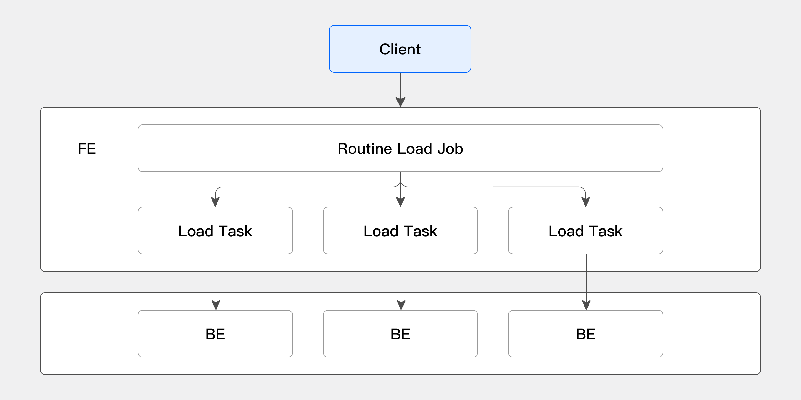

---
{
    "title": "Routine Load",
    "language": "ja",
    "description": "Apache Doris Routine Load は Kafka からデータを継続的に取り込みます。CSV/JSON 形式、Exactly-Once セマンティクス、SSL/Kerberos 認証、ジョブのライフサイクル管理、トラブルシューティングについて説明します。",
    "keywords": [
        "Routine Load",
        "Kafka リアルタイムインポート",
        "Doris ストリーミングインポート",
        "継続的なインポート",
        "Exactly-Once",
        "Kafka SSL",
        "Kafka Kerberos",
        "Kafka SASL",
        "SASL_PLAINTEXT",
        "SASL_SSL",
        "JSON インポート",
        "CSV インポート",
        "動的テーブルインポート",
        "単一ストリームから複数テーブルへのインポート",
        "柔軟な部分列更新",
        "UPDATE_FLEXIBLE_COLUMNS",
        "PAUSED",
        "Routine Load PAUSED",
        "out of range",
        "kafka_broker_version_fallback",
        "property.broker.version.fallback",
        "desired_concurrent_number",
        "max_filter_ratio",
        "ErrorLogUrls",
        "ALTER ROUTINE LOAD",
        "PAUSE ROUTINE LOAD",
        "RESUME ROUTINE LOAD",
        "STOP ROUTINE LOAD"
    ]
}
---

<!-- Knowledge type: Procedures + Configuration parameters + Examples + FAQ -->
<!-- Applicable scenarios: Continuously consume data from Kafka into Doris / Real-time data ingestion / CDC streaming sync -->

Routine Load は、Apache Doris が提供する**ストリーミングインポート**ジョブです。Kafka トピックからデータを継続的に読み取り、Doris テーブルに書き込みます。Routine Load ジョブを送信すると、Doris はインポートジョブを継続して実行し、Kafka クラスター内の指定されたトピックからメッセージを読み取るインポートタスクをリアルタイムで生成します。また、データの欠落や重複を防ぐ **Exactly-Once** セマンティクスを提供します。

## クイックナビゲーション {#quick-navigation}

目的に応じて、該当するセクションに直接移動できます。

| 目的 | セクション |
| ------- | ------- |
| 最小構成の例をすぐに実行する | [クイックスタート](#quick-start) |
| 仕組み、状態遷移、自動復旧の仕組みを理解する | [基本原理](#basic-principles) |
| 設定可能なパラメータ（FE/BE/ジョブ/Kafka）を調べる | [リファレンスマニュアル](#reference-manual) |
| シナリオ別の例（障害許容、フィルタリング、JSON、Kerberos など）を探す | [インポート例](#import-examples) |
| ジョブが `PAUSED` になる、`out of range` が報告される、または SSL エラーが発生する | [よくある質問（FAQ）](#frequently-asked-questions-faq) |

## ユースケース {#use-cases}

<!-- Knowledge type: Scenario description -->

Routine Load は、次のシナリオに適しています。

- Kafka トピックのリアルタイムデータを Doris に継続的に同期する。
- データの欠落や重複を避けるために **Exactly-Once** セマンティクスが必要な場合。
- インポートするデータに対して列マッピング、フィルタリング、派生列の計算などの変換を行う場合。
- 単一の Kafka トピックから複数の Doris テーブルにデータを動的に振り分ける場合（単一ストリーム、複数テーブル）。

### サポートされるデータソースと形式 {#supported-data-sources-and-formats}

Routine Load がデータを読み取れるのは **Kafka クラスター**のみで、次のメッセージ形式をサポートします。

| 形式 | 説明 |
| ---- | ---- |
| CSV  | 各メッセージは単一行で、行末に改行文字を**含めません**。 |
| JSON | 単一の JSON オブジェクト、または複数のオブジェクトを含む JSON 配列。 |

CSV 形式をインポートする際は、NULL 値と空文字列を明確に区別してください。

- NULL 値は `\n` で表します。たとえば `a,\n,b` は、中央の列が NULL 値であることを示します。
- 空文字列は、データをそのまま空に設定します。たとえば `a,,b` は、中央の列が空文字列（`''`）であることを示します。

### 制限事項 {#limitations}

Routine Load で Kafka からデータを読み取る場合、次の制限があります。

| 制限 | 説明 |
| ------ | ---- |
| メッセージ形式 | CSV と JSON のテキスト形式のみをサポートします。各 CSV メッセージは単一行で、行末に改行文字を**含めません**。 |
| Kafka のバージョン | デフォルトでは Kafka 0.10.0.0 以降をサポートします。Kafka 0.10.0.0 より前のバージョン（0.9.0、0.8.2、0.8.1、0.8.0）を使用するには、BE 設定の `kafka_broker_version_fallback` を互換性を持たせたい旧バージョンに変更するか、ジョブ作成時に `property.broker.version.fallback` を直接設定します。旧バージョンを使用すると、時刻を指定して Kafka パーティションのオフセットを設定する機能など、Routine Load の一部の新機能が利用できない場合があります。 |

## 基本原理 {#basic-principles}

Routine Load は Kafka トピックからデータを継続的に読み取り、Doris に書き込みます。Doris で Routine Load ジョブを作成すると、複数のインポートタスクを含む常駐のインポートジョブが生成されます。

- **Load Job**: Routine Load Job は、データソースからデータを継続的に読み取る常駐のインポートジョブです。
- **Load Task**: インポートジョブは、実際のデータ読み取りを行う複数のインポートタスクに分割されます。各タスクは独立したトランザクションです。

Routine Load の詳細なフローを次の図に示します。



全体の流れは次のとおりです。

1. クライアントが Routine Load ジョブの作成要求を FE に送信します。FE は Routine Load Manager を通じて、常駐のインポートジョブ（Routine Load Job）を生成します。
2. FE は Job Scheduler を通じて Routine Load Job を複数の Routine Load Task に分割します。その後、Task Scheduler がタスクを BE ノードに割り当てます。
3. BE 上で Routine Load Task がインポートを終えると、FE にトランザクションをコミットし、ジョブのメタデータを更新します。
4. Routine Load Task のコミット後、新しいタスクを生成するか、タイムアウトしたタスクを再試行します。
5. 新しく生成された Routine Load Task は Task Scheduler によって繰り返しスケジュールされます。

### 自動復旧の仕組み {#auto-recovery-mechanism}

<!-- Knowledge type: State machine / Operations rules -->

ジョブの高可用性を確保するため、Routine Load には自動復旧の仕組みがあります。ジョブが予期せず一時停止した場合、Routine Load Scheduler スレッドが自動復旧を試みます。Kafka 側の予期しない停止などで処理を続行できなくなった場合でも、Kafka が復旧すれば、手動操作なしでインポートジョブの通常運転を再開できます。

次の表に、自動復旧するケースと手動対応が必要なケースを示します。

| 一時停止の原因 | 自動復旧 | 推奨される対応 |
| -------------- | ------------ | -------- |
| Kafka broker に一時的に接続できない、ネットワークが不安定 | はい | Scheduler が `period_of_auto_resume_min` の間隔で自動的に再試行します。 |
| ユーザーが `PAUSE ROUTINE LOAD` を手動で実行した | いいえ | `RESUME ROUTINE LOAD` を手動で実行します。 |
| データ品質の問題（`max_filter_ratio` または `max_error_number` を超過） | いいえ | `ErrorLogUrls` を調査し、データまたはパラメータを調整してから `RESUME` します。 |
| データベースやテーブルの削除など、復旧できないメタデータの例外 | いいえ | テーブルを再作成するか、ジョブを作り直します。 |

## クイックスタート {#quick-start}

<!-- Knowledge type: Procedures -->

このセクションでは、最小構成で実行できる例を通じて、Kafka からの Routine Load ジョブの作成と、ジョブの表示、一時停止、再開、変更、停止の基本操作を説明します。

### インポートジョブの作成 {#create-an-import-job}

[CREATE ROUTINE LOAD](../../../sql-manual/sql-statements/data-modification/load-and-export/CREATE-ROUTINE-LOAD) コマンドで、常駐の Routine Load インポートタスクを作成できます。Routine Load は CSV データと JSON データを読み取れます。

#### CSV データのインポート {#import-csv-data}

1. Kafka のサンプルデータを用意します。

    ```bash
    kafka-console-consumer.sh --bootstrap-server localhost:9092 --topic test-routine-load-csv --from-beginning
    1,Emily,25
    2,Benjamin,35
    3,Olivia,28
    4,Alexander,60
    5,Ava,17
    6,William,69
    7,Sophia,32
    8,James,64
    9,Emma,37
    10,Liam,64
    ```

2. インポート先のテーブルを作成します。

    ```sql
    CREATE TABLE testdb.test_routineload_tbl(
        user_id            BIGINT       NOT NULL COMMENT "user id",
        name               VARCHAR(20)           COMMENT "name",
        age                INT                   COMMENT "age"
    )
    DUPLICATE KEY(user_id)
    DISTRIBUTED BY HASH(user_id) BUCKETS 10;
    ```

3. Routine Load インポートジョブを作成します。

    ```sql
    CREATE ROUTINE LOAD testdb.example_routine_load_csv ON test_routineload_tbl
    COLUMNS TERMINATED BY ",",
    COLUMNS(user_id, name, age)
    FROM KAFKA(
        "kafka_broker_list" = "192.168.88.62:9092",
        "kafka_topic" = "test-routine-load-csv",
        "property.kafka_default_offsets" = "OFFSET_BEGINNING"
    );
    ```

#### JSON データのインポート {#import-json-data}

1. Kafka のサンプルデータを用意します。

    ```bash
    kafka-console-consumer.sh --bootstrap-server localhost:9092 --topic test-routine-load-json --from-beginning
    {"user_id":1,"name":"Emily","age":25}
    {"user_id":2,"name":"Benjamin","age":35}
    {"user_id":3,"name":"Olivia","age":28}
    {"user_id":4,"name":"Alexander","age":60}
    {"user_id":5,"name":"Ava","age":17}
    {"user_id":6,"name":"William","age":69}
    {"user_id":7,"name":"Sophia","age":32}
    {"user_id":8,"name":"James","age":64}
    {"user_id":9,"name":"Emma","age":37}
    {"user_id":10,"name":"Liam","age":64}
    ```

2. インポート先のテーブルを作成します。

    ```sql
    CREATE TABLE testdb.test_routineload_tbl(
        user_id            BIGINT       NOT NULL COMMENT "user id",
        name               VARCHAR(20)           COMMENT "name",
        age                INT                   COMMENT "age"
    )
    DUPLICATE KEY(user_id)
    DISTRIBUTED BY HASH(user_id) BUCKETS 10;
    ```

3. Routine Load インポートジョブを作成します。

    ```sql
    CREATE ROUTINE LOAD testdb.example_routine_load_json ON test_routineload_tbl
    COLUMNS(user_id,name,age)
    PROPERTIES(
        "format"="json",
        "jsonpaths"="[\"$.user_id\",\"$.name\",\"$.age\"]"
    )
    FROM KAFKA(
        "kafka_broker_list" = "192.168.88.62:9092",
        "kafka_topic" = "test-routine-load-json",
        "property.kafka_default_offsets" = "OFFSET_BEGINNING"
    );
    ```

:::info 注記
JSON ファイルのルートにある JSON オブジェクトをインポートするには、`jsonpaths` を `$.` に設定します。例: `PROPERTIES("jsonpaths"="$. ")`。
:::

### インポート状態の確認 {#view-import-status}

Routine Load の状態は、次の観点から確認できます。

- **Load Job**: インポート先テーブル、サブタスク数、インポートの遅延状況、インポート設定、インポート結果などを確認します。
- **Load Task**: インポートサブタスクの状態、読み取りの進捗、タスクの割り当て先 BE ノードを確認します。

#### Load Job の確認 {#view-the-load-job}

[SHOW ROUTINE LOAD](../../../sql-manual/sql-statements/data-modification/load-and-export/SHOW-ROUTINE-LOAD) コマンドで Load Job を確認します。このコマンドは、インポート先テーブル、遅延状況、設定、エラー情報など、現在のジョブの基本状態を表示します。

次のコマンドは `testdb.example_routine_load_csv` のジョブ状態を表示します。

```sql
mysql> SHOW ROUTINE LOAD FOR testdb.example_routine_load\G
*************************** 1. row ***************************
                  Id: 12025
                Name: example_routine_load
          CreateTime: 2024-01-15 08:12:42
           PauseTime: NULL
             EndTime: NULL
              DbName: default_cluster:testdb
           TableName: test_routineload_tbl
        IsMultiTable: false
               State: RUNNING
      DataSourceType: KAFKA
      CurrentTaskNum: 1
       JobProperties: {"max_batch_rows":"200000","timezone":"America/New_York","send_batch_parallelism":"1","load_to_single_tablet":"false","column_separator":"','","line_delimiter":"\n","current_concurrent_number":"1","delete":"*","partial_columns":"false","merge_type":"APPEND","exec_mem_limit":"2147483648","strict_mode":"false","jsonpaths":"","max_batch_interval":"10","max_batch_size":"104857600","fuzzy_parse":"false","partitions":"*","columnToColumnExpr":"user_id,name,age","whereExpr":"*","desired_concurrent_number":"5","precedingFilter":"*","format":"csv","max_error_number":"0","max_filter_ratio":"1.0","json_root":"","strip_outer_array":"false","num_as_string":"false"}
DataSourceProperties: {"topic":"test-topic","currentKafkaPartitions":"0","brokerList":"192.168.88.62:9092"}
    CustomProperties: {"kafka_default_offsets":"OFFSET_BEGINNING","group.id":"example_routine_load_73daf600-884e-46c0-a02b-4e49fdf3b4dc"}
           Statistic: {"receivedBytes":28,"runningTxns":[],"errorRows":0,"committedTaskNum":3,"loadedRows":3,"loadRowsRate":0,"abortedTaskNum":0,"errorRowsAfterResumed":0,"totalRows":3,"unselectedRows":0,"receivedBytesRate":0,"taskExecuteTimeMs":30069}
            Progress: {"0":"2"}
                 Lag: {"0":0}
ReasonOfStateChanged:
        ErrorLogUrls:
            OtherMsg:
                User: root
             Comment:
1 row in set (0.00 sec)
```

#### Load Subtask の確認 {#view-the-load-subtasks}

[SHOW ROUTINE LOAD TASK](../../../sql-manual/sql-statements/data-modification/load-and-export/SHOW-ROUTINE-LOAD-TASK) コマンドでインポートサブタスクを確認します。`WHERE JobName = <job_name>` または `FOR [<db>.]<job_name>` で Routine Load ジョブを指定できます（`<db>` を省略すると、現在のデータベースを使用します）。このコマンドは、サブタスクの状態や割り当て先の BE ID など、現在のジョブに属するサブタスクの情報を表示します。

次のコマンドは `testdb.example_routine_load_csv` のサブタスク情報を表示します。

```sql
mysql> SHOW ROUTINE LOAD TASK WHERE jobname = 'example_routine_load_csv';
+-----------------------------------+-------+-----------+-------+---------------------+---------------------+---------+-------+----------------------+
| TaskId                            | TxnId | TxnStatus | JobId | CreateTime          | ExecuteStartTime    | Timeout | BeId  | DataSourceProperties |
+-----------------------------------+-------+-----------+-------+---------------------+---------------------+---------+-------+----------------------+
| 8cf47e6a68ed4da3-8f45b431db50e466 | 195   | PREPARE   | 12177 | 2024-01-15 12:20:41 | 2024-01-15 12:21:01 | 20      | 10429 | {"4":1231,"9":2603}  |
| f2d4525c54074aa2-b6478cf8daaeb393 | 196   | PREPARE   | 12177 | 2024-01-15 12:20:41 | 2024-01-15 12:21:01 | 20      | 12109 | {"1":1225,"6":1216}  |
| cb870f1553864250-975279875a25fab6 | -1    | NULL      | 12177 | 2024-01-15 12:20:52 | NULL                | 20      | -1    | {"2":7234,"7":4865}  |
| 68771fd8a1824637-90a9dac2a7a0075e | -1    | NULL      | 12177 | 2024-01-15 12:20:52 | NULL                | 20      | -1    | {"3":1769,"8":2982}  |
| 77112dfea5e54b0a-a10eab3d5b19e565 | 197   | PREPARE   | 12177 | 2024-01-15 12:21:02 | 2024-01-15 12:21:02 | 20      | 12098 | {"0":3000,"5":2622}  |
+-----------------------------------+-------+-----------+-------+---------------------+---------------------+---------+-------+----------------------+
```

次の構文も使用できます。

```sql
mysql> SHOW ROUTINE LOAD TASK FOR testdb.example_routine_load_csv;
```

### インポートジョブの一時停止 {#pause-an-import-job}

[PAUSE ROUTINE LOAD](../../../sql-manual/sql-statements/data-modification/load-and-export/PAUSE-ROUTINE-LOAD) コマンドでインポートジョブを一時停止できます。一時停止後、ジョブは `PAUSED` 状態になりますが、終了はしません。`RESUME ROUTINE LOAD` コマンドで再開できます。

```sql
PAUSE ROUTINE LOAD FOR testdb.example_routine_load_csv;
```

### インポートジョブの再開 {#resume-an-import-job}

`PAUSED` 状態のインポートジョブは、[RESUME ROUTINE LOAD](../../../sql-manual/sql-statements/data-modification/load-and-export/RESUME-ROUTINE-LOAD) コマンドで再開できます。

```sql
RESUME ROUTINE LOAD FOR testdb.example_routine_load_csv;
```

### インポートジョブの変更 {#modify-an-import-job}

作成済みのインポートジョブは、[ALTER ROUTINE LOAD](../../../sql-manual/sql-statements/data-modification/load-and-export/ALTER-ROUTINE-LOAD) コマンドで変更できます。変更前に `PAUSE ROUTINE LOAD` でジョブを一時停止し、変更後に `RESUME ROUTINE LOAD` で再開します。

たとえば、希望する並行処理数を表すパラメータ `desired_concurrent_number` と Kafka トピックの情報を変更するには、次のようにします。

```sql
ALTER ROUTINE LOAD FOR testdb.example_routine_load_csv
PROPERTIES(
    "desired_concurrent_number" = "3"
)
FROM KAFKA(
    "kafka_broker_list" = "192.168.88.60:9092",
    "kafka_topic" = "test-topic"
);
```

### インポートジョブの取り消し {#cancel-an-import-job}

[STOP ROUTINE LOAD](../../../sql-manual/sql-statements/data-modification/load-and-export/STOP-ROUTINE-LOAD) コマンドで Routine Load インポートジョブを停止し、削除できます。**削除したインポートジョブは復旧できず**、`SHOW ROUTINE LOAD` コマンドでも表示できません。

```sql
STOP ROUTINE LOAD FOR testdb.example_routine_load_csv;
```

### Compute Group のバインド {#bind-a-compute-group}

**ストレージとコンピュートの分離モード**では、Routine Load の Compute Group は次の優先順位で選択されます。

1. `use db@cluster` ステートメントで指定された Compute Group を選択します。
2. ユーザープロパティ `default_compute_group` で指定された Compute Group を選択します。
3. 現在のユーザーにアクセス権限がある Compute Group から選択します。

**ストレージとコンピュートの統合モード**では、ユーザープロパティ `resource_tags.location` で指定された Compute Group を選択します。ユーザープロパティに指定がない場合は、`default` という名前の Compute Group を使用します。

:::caution 注意
Routine Load ジョブの Compute Group は**作成時にしか指定できません**。ジョブ作成後に、バインドされた Compute Group を変更することはできません。
:::

## リファレンスマニュアル {#reference-manual}

<!-- Knowledge type: Configuration parameters + Syntax reference -->

### インポートコマンドの構文 {#import-command-syntax}

常駐の Routine Load インポートジョブを作成する構文は次のとおりです。

```sql
CREATE ROUTINE LOAD [<db_name>.]<job_name> [ON <tbl_name>]
[merge_type]
[load_properties]
[job_properties]
FROM KAFKA [data_source_properties]
[COMMENT "<comment>"]
```

各モジュールの説明は次のとおりです。

| モジュール | 説明 |
| ---------------------- | ------------------------------------------------------------ |
| db_name | インポートタスクを作成するデータベースを指定します。 |
| job_name | 作成するインポートタスクの名前を指定します。同じデータベース内に同名のタスクは作成できません。 |
| tbl_name | データのインポート先テーブル名を指定します。省略可能です。省略すると動的テーブル方式になり、Kafka のデータにテーブル名を含める必要があります。 |
| merge_type | データのマージ方式です。デフォルトは APPEND です。<p>次の選択肢があります。</p><p>- APPEND: 追加インポート。</p><p>- MERGE: マージインポート。</p><p>- DELETE: インポートするすべてのデータを削除対象とします。</p> |
| load_properties | インポートの記述モジュールで、次の要素を含みます。<p>- column_separator 句</p><p>- columns_mapping 句</p><p>- preceding_filter 句</p><p>- where_predicates 句</p><p>- partitions 句</p><p>- delete_on 句</p><p>- order_by 句</p> |
| job_properties | Routine Load に共通するインポートパラメータを指定します。 |
| data_source_properties | Kafka データソースのプロパティを記述します。 |
| comment | インポートジョブのコメントを記述します。 |

### インポートパラメータの説明 {#import-parameter-description}

#### FE 設定パラメータ {#fe-configuration-parameters}

| パラメータ | デフォルト | 動的変更 | FE Master のみ | 説明 |
| -------- | ------ | -------- | ------------------ | -------- |
| max_routine_load_task_concurrent_num | 256 | はい | はい | Routine Load インポートジョブのサブタスクの最大並行実行数を制限します。デフォルト値の維持を推奨します。値が大きすぎると、並行タスクが増えすぎてクラスターのリソースを消費する場合があります。 |
| max_routine_load_task_num_per_be | 1024 | はい | はい | 各 BE で同時に実行できる Routine Load タスクの最大数です。`max_routine_load_task_num_per_be` は `routine_load_thread_pool_size` より小さくしてください。 |
| max_routine_load_job_num | 100 | はい | はい | NEED_SCHEDULED、RUNNING、PAUSE 状態のジョブを含め、Routine Load ジョブの最大数を制限します。 |
| max_tolerable_backend_down_num | 0 | はい | はい | BE が停止すると、Routine Load は自動復旧できません。一定の条件を満たすと、Doris は PAUSED 状態のタスクを再スケジュールし、RUNNING 状態に切り替えることができます。値が 0 の場合、すべての BE ノードが稼働しているときにのみ再スケジュールできます。 |
| period_of_auto_resume_min | 5（分） | はい | はい | Routine Load の自動復旧を試みる間隔です。 |

#### BE 設定パラメータ {#be-configuration-parameters}

| パラメータ | デフォルト | 動的変更 | 説明 |
| -------- | ------ | -------- | ---- |
| max_consumer_num_per_group | 3 | はい | 単一のサブタスクがデータの読み取り用に生成できる consumer の最大数です。 |

#### インポート設定パラメータ {#import-configuration-parameters}

Routine Load ジョブを作成する際、`CREATE ROUTINE LOAD` コマンドの各モジュールでインポート設定パラメータを指定できます。

##### tbl_name 句 {#tbl_name-clause}

インポート先のテーブル名を指定します。省略可能です。

省略すると**動的テーブル**方式になり、Kafka のデータにテーブル名を含める必要があります。現在、動的なテーブル名は Kafka の Value から抽出する方式のみをサポートしており、データは所定の形式に従う必要があります。JSON の場合は `table_name|{"col1": "val1", "col2": "val2"}` です。ここで `tbl_name` はテーブル名、`|` はテーブル名とテーブルデータの区切り文字です。CSV 形式のデータも同様で、たとえば `table_name|val1,val2,val3` となります。

:::caution 注意
ここでの `table_name` は Doris のテーブル名と完全に一致する必要があります。一致しないとインポートに失敗します。動的テーブルでは `column_mapping` をサポートしません。
:::

##### merge_type 句 {#merge_type-clause}

`merge_type` モジュールでデータのマージ方式を指定できます。選択肢は次のとおりです。

- **APPEND**: 追加インポート。
- **MERGE**: マージインポート。Unique Key モデルにのみ適用できます。Delete Flag 列を指定するため、`[DELETE ON]` モジュールと併用する必要があります。
- **DELETE**: インポートするすべてのデータを削除対象とします。

##### load_properties 句 {#load_properties-clause}

`load_properties` モジュールでインポートデータのプロパティを記述できます。構文は次のとおりです。

```sql
[COLUMNS TERMINATED BY <column_separator>,]
[COLUMNS (<column1_name>[, <column2_name>, <column_mapping>, ...]),]
[WHERE <where_expr>,]
[PARTITION(<partition1_name>, [<partition2_name>, <partition3_name>, ...]),]
[DELETE ON <delete_expr>,]
[ORDER BY <order_by_column1>[, <order_by_column2>, <order_by_column3>, ...]]
```

各モジュールのパラメータは次のとおりです。

| サブモジュール | パラメータ | 説明 |
| --------------------- | ------------------ | ------------------------------------------------------------ |
| COLUMNS TERMINATED BY | `<column_separator>` | 列区切り文字を指定します。デフォルトは `\t` です。たとえばカンマを指定する場合は `COLUMN TERMINATED BY ","` とします。NULL 値の扱いには注意してください。<p>- NULL 値は `\n` で表します。`a,\n,b` は中央の列が NULL 値であることを示します。</p><p>- 空文字列はデータをそのまま空に設定します。`a,,b` は中央の列が空文字列（`''`）であることを示します。</p> |
| COLUMNS | `<column_name>` | 対応する列名を指定します。インポートする列を `(k1, k2, k3)` とする場合は `COLUMNS(k1, k2, k3)` と指定します。次の場合、COLUMNS 句は省略できます。<p>- CSV 内の列がテーブルの列と一対一に対応する場合。</p><p>- JSON 内のキー名がテーブルの列名と同じ場合。</p> |
| &nbsp; | `<column_mapping>` | インポート時に列マッピングを使って列をフィルタリング、変換できます。たとえば、対象列 k4 を k3 列から式 k3+1 で計算する場合は `COLUMNS(k1, k2, k3, k4 = k3 + 1)` とします。詳しくは[データ変換](../../import/load-data-convert)を参照してください。 |
| WHERE | `<where_expr>` | 条件によってインポート元のデータをフィルタリングします。たとえば age > 30 のデータだけをインポートする場合は `WHERE age > 30` とします。 |
| PARTITION | `<partition_name>` | インポート先テーブルのパーティションを指定します。省略すると、データは対応するパーティションに自動的にインポートされます。たとえば p1 と p2 にインポートする場合は `PARTITION(p1, p2)` とします。 |
| DELETE ON | `<delete_expr>` | MERGE インポートモードで `delete_expr` を使用し、削除対象の列を指定します。たとえば MERGE 中に age > 30 の列を削除する場合は `DELETE ON age > 30` とします。 |
| ORDER BY | `<order_by_column>` | Unique Key モデルでのみ有効です。データの順序を保証するため、インポートデータ内の Sequence Column を指定します。たとえば `create_time` を Sequence Column に指定する場合は `ORDER BY create_time` とします。詳しくは[データ更新 / Sequence Column](../../../data-operate/update/update-of-unique-model)を参照してください。 |

##### job_properties 句 {#job_properties-clause}

Routine Load インポートジョブの作成時に、`job_properties` 句でジョブのプロパティを指定できます。構文は次のとおりです。

```sql
PROPERTIES ("<key1>" = "<value1>"[, "<key2>" = "<value2>" ...])
```

`job_properties` 句で指定できるパラメータは次のとおりです。

**バージョン履歴:**

- Doris 2.1.1 で、`max_batch_size` の上限が 1 GB から 10 GB に引き上げられました。
- Doris 2.1.5 および 3.0.0 で、デフォルト値が 100 MB から 1 GB に引き上げられました。
- 3.x、4.x、dev では、上限 10 GB、デフォルト値 1 GB が適用されます。

| パラメータ | 説明 |
| ---- | ---- |
| desired_concurrent_number | <p>デフォルト値: 256</p><p>単一のインポートタスクに対して希望する並行処理数です。インポート時、希望するサブタスクの並行処理数と実際の数は一致しない場合があります。実際の並行処理数は次の式で計算します。</p><p>`min(topic_partition_num, desired_concurrent_number, max_routine_load_task_concurrent_num)`。各項目は次のとおりです。</p><p>- `topic_partition_num`: Kafka トピックのパーティション数。</p><p>- `desired_concurrent_number`: このパラメータの値。</p><p>- `max_routine_load_task_concurrent_num`: FE で設定した Routine Load タスクの最大並列数。</p> |
| max_batch_interval | 各サブタスクの最大実行時間です。単位は秒で、0 より大きい値が必要です。デフォルト値は 60 です。`max_batch_interval`、`max_batch_rows`、`max_batch_size` を合わせてサブタスクの実行しきい値とします。いずれかに達すると、インポートサブタスクは終了し、新しいサブタスクが生成されます。 |
| max_batch_rows | 各サブタスクが読み取れる最大行数です。200000 以上の値が必要です。デフォルトは 20000000 です。`max_batch_interval`、`max_batch_rows`、`max_batch_size` を合わせてサブタスクの実行しきい値とします。いずれかに達すると、インポートサブタスクは終了し、新しいサブタスクが生成されます。 |
| max_batch_size | 各サブタスクが読み取れる最大バイト数です。単位はバイトで、範囲は 100 MB～10 GB（104857600～10737418240 バイト、両端を含む）、デフォルトは 1 GB です。`max_batch_interval`、`max_batch_rows`、`max_batch_size` を合わせてサブタスクの実行しきい値とします。いずれかに達すると、インポートサブタスクは終了し、新しいサブタスクが生成されます。 |
| max_error_number | サンプリングウィンドウ内で許容するエラー行の最大数です。0 以上の値が必要で、デフォルトは 0（エラー行を許容しない）です。サンプリングウィンドウは `max_batch_rows * 10` です。ウィンドウ内のエラー行数が `max_error_number` を超えると Routine Load ジョブは一時停止します。データ品質の問題は手動で調査する必要があります。[SHOW ROUTINE LOAD](../../../sql-manual/sql-statements/data-modification/load-and-export/SHOW-ROUTINE-LOAD) コマンドの `ErrorLogUrls` フィールドから調査できます。where 条件で除外された行はエラー行に数えません。 |
| strict_mode | 厳格モードを有効にするかどうかを指定します。デフォルトでは無効です。厳格モードでは、インポート時の列の型変換を厳密にフィルタリングします。有効にすると、元の値が NULL ではないのに型変換後に NULL になるデータが除外されます。<p>フィルタリングの規則:</p><p>- Strict Mode は派生列（関数による変換で生成された列）には影響しません。</p><p>- 列の型変換が必要な場合、型が正しくないデータは除外されます。[SHOW ROUTINE LOAD](../../../sql-manual/sql-statements/data-modification/load-and-export/SHOW-ROUTINE-LOAD) の `ErrorLogUrls` で確認できます。</p><p>- インポート先の列の型に範囲制限があり、元のデータが型変換に成功しても範囲制限を満たさない場合、厳格モードは影響しません。たとえば型が `decimal(1,0)` で元のデータが 10 の場合、型変換は成功しますが、列に宣言された範囲には収まりません。詳しくは[厳格モード](../../../data-operate/import/handling-messy-data#strict-mode-strict_mode)を参照してください。</p> |
| timezone | インポートジョブで使用するタイムゾーンを指定します。デフォルトはセッションのタイムゾーンパラメータです。インポートで使用する、タイムゾーンに関係するすべての関数の結果に影響します。 |
| format | インポートデータの形式を指定します。デフォルトは CSV です。JSON 形式もサポートします。 |
| jsonpaths | インポートデータの形式が JSON の場合、`jsonpaths` で JSON データから抽出するフィールドを指定できます。例: `"jsonpaths" = "[\"$.userid\",\"$.username\",\"$.age\",\"$.city\"]"` |
| json_root | インポートデータの形式が JSON の場合、`json_root` で JSON データのルートノードを指定できます。Doris は `json_root` で指定されたルートノードの要素を抽出して解析します。デフォルトは空です。例: `"json_root" = "$.RECORDS"` |
| strip_outer_array | インポートデータの形式が JSON の場合、`strip_outer_array` を true に設定すると、JSON データを配列として扱い、各要素を個別の行として処理します。デフォルトは false です。Kafka 内の JSON データは、最外層が `[]` で囲まれた配列である場合があります。その場合は `"strip_outer_array" = "true"` を指定できます。たとえば次のデータは 2 行として解析されます: `[{"user_id":1,"name":"Emily","age":25},{"user_id":2,"name":"Benjamin","age":35}]` |
| send_batch_parallelism | バッチデータを送信する際の並列数を設定します。値が BE 設定の `max_send_batch_parallelism_per_job` を超える場合、コーディネーターとして動作する BE は `max_send_batch_parallelism_per_job` の値を使用します。 |
| load_to_single_tablet | タスクからのデータを対応するパーティションの単一の tablet にのみインポートできます。デフォルトは false です。このパラメータを設定できるのは、ランダムバケットを使用する OLAP テーブルにインポートする場合だけです。 |
| partial_columns | 部分列更新を有効にするかどうかを指定します。デフォルトは false です。テーブルモデルが Unique で Merge on Write を使用する場合にのみ設定できます。単一ストリームから複数テーブルへのインポートではサポートしません。詳しくは[部分列更新](../../../data-operate/update/partial-column-update.md)を参照してください。 |
| unique_key_update_mode | Unique Key テーブルの更新モードを指定します。選択肢は次のとおりです。<ul><li>`UPSERT`（デフォルト）: 行全体を標準的な方法で挿入または更新します。</li><li>`UPDATE_FIXED_COLUMNS`: すべての行で同じ列を更新する部分列更新です。`partial_columns=true` と同等です。</li><li>`UPDATE_FLEXIBLE_COLUMNS`: 行ごとに異なる列を更新できる柔軟な部分列更新です。JSON 形式を使用し、テーブルに `enable_unique_key_skip_bitmap_column=true` を設定する必要があります。`jsonpaths`、`fuzzy_parse`、`COLUMNS` 句、`WHERE` 句とは併用できません。</li></ul>詳しくは[部分列更新](../../../data-operate/update/partial-column-update#flexible-column-update)を参照してください。 |
| partial_update_new_key_behavior | Unique Merge on Write テーブルで部分列更新を行う際に、新規挿入行をどう扱うかを指定します。`APPEND` と `ERROR` の二種類があります。<br/>- `APPEND`: 新しい行の挿入を許可します。<br/>- `ERROR`: 新しい行を挿入するとインポートが失敗し、エラーを報告します。 |
| max_filter_ratio | サンプリングウィンドウ内で許容する最大フィルタリング率です。0 以上 1 以下でなければなりません。デフォルト値は 1.0 で、エラー行を許容します。サンプリングウィンドウは `max_batch_rows * 10` です。ウィンドウ内のエラー行数を総行数で割った値が `max_filter_ratio` を超えると、Routine Load ジョブは一時停止します。データ品質の問題は手動で調査する必要があります。where 条件で除外された行はエラー行に数えません。 |
| enclose | 囲み文字を指定します。CSV データのフィールドに行区切り文字や列区切り文字が含まれる場合、意図しない分割を防ぐため、単一バイトの文字を囲み文字に指定できます。たとえば列区切り文字が `,`、囲み文字が `'` の場合、`a,'b,c'` の `b,c` は単一のフィールドとして解析されます。 |
| escape | エスケープ文字を指定します。フィールド内で囲み文字と同じ文字をエスケープするために使用します。たとえば囲み文字が `'` でデータが `a,'b,'c'` の場合、`b,'c` を単一のフィールドとして解析するには、単一バイトのエスケープ文字（`\` など）を指定し、データを `a,'b,\'c'` に変更する必要があります。 |

#### data_source_properties 句 {#data_source_properties-clause}

Routine Load インポートジョブの作成時に、`data_source_properties` 句で Kafka データソースのプロパティを指定できます。構文は次のとおりです。

```sql
FROM KAFKA ("<key1>" = "<value1>"[, "<key2>" = "<value2>" ...])
```

`data_source_properties` 句で指定できるパラメータは次のとおりです。

| パラメータ | 説明 |
| ---- | ---- |
| kafka_broker_list | Kafka broker の接続情報を指定します。形式は `<kafka_broker_ip>:<kafka port>` です。複数の broker はカンマで区切ります。例: `"kafka_broker_list" = "<broker1_ip>:9092,<broker2_ip>:9092"` |
| kafka_topic | サブスクライブする Kafka トピックを指定します。単一のインポートジョブが読み取れる Kafka トピックは一つだけです。 |
| kafka_partitions | サブスクライブする Kafka パーティションを指定します。省略すると、デフォルトですべてのパーティションを読み取ります。 |
| kafka_offsets | 読み取る Kafka パーティションの開始オフセットです。時刻を指定すると、その時刻以降で最も近いオフセットから読み取りを開始します。オフセットには 0 以上の具体的な値、または次の形式を指定できます。<p>- `OFFSET_BEGINNING`: データが存在する位置からサブスクライブします。</p><p>- `OFFSET_END`: 末尾からサブスクライブします。</p><p>- 時刻形式。例: `"2021-05-22 11:00:00"`。</p><p>省略すると、デフォルトでトピックの全パーティションを `OFFSET_END` からサブスクライブします。開始オフセットを複数指定する場合は、カンマで区切ります。例: `"kafka_offsets" = "101,0,OFFSET_BEGINNING,OFFSET_END"` または `"kafka_offsets" = "2021-05-22 11:00:00,2021-05-22 11:00:00"`。</p><p>注意: 時刻形式と OFFSET 形式は混在させられません。</p> |
| property | カスタム Kafka パラメータを指定します。Kafka シェルの `--property` パラメータに相当します。パラメータ値がファイルの場合は、値の先頭に `FILE:` を付けます。ファイルの作成については [CREATE FILE](../../../sql-manual/sql-statements/security/CREATE-FILE) コマンドを参照してください。サポートされるその他のカスタムパラメータについては、librdkafka の公式 [CONFIGURATION](https://github.com/confluentinc/librdkafka/blob/master/CONFIGURATION.md) 文書のクライアント側設定を参照してください。例: `"property.client.id" = "12345"`、`"property.group.id" = "group_id_0"`、`"property.ssl.ca.location" = "FILE:ca.pem"`。 |

`data_source_properties` で Kafka の property パラメータを設定すると、安全なアクセスのためのオプションを設定できます。現在、Doris は plaintext（デフォルト）、SSL、PLAIN、Kerberos など、複数の Kafka セキュリティプロトコルをサポートしています。

### インポート状態 {#import-status}

`SHOW ROUTINE LOAD` コマンドでインポートジョブの状態を確認できます。

```sql
SHOW [ALL] ROUTINE LOAD [FOR jobName];
```

結果の例:

```sql
mysql> SHOW ROUTINE LOAD FOR testdb.example_routine_load\G
*************************** 1. row ***************************
                  Id: 12025
                Name: example_routine_load
          CreateTime: 2024-01-15 08:12:42
           PauseTime: NULL
             EndTime: NULL
              DbName: default_cluster:testdb
           TableName: test_routineload_tbl
        IsMultiTable: false
               State: RUNNING
      DataSourceType: KAFKA
      CurrentTaskNum: 1
       JobProperties: {"max_batch_rows":"200000","timezone":"America/New_York","send_batch_parallelism":"1","load_to_single_tablet":"false","column_separator":"','","line_delimiter":"\n","current_concurrent_number":"1","delete":"*","partial_columns":"false","merge_type":"APPEND","exec_mem_limit":"2147483648","strict_mode":"false","jsonpaths":"","max_batch_interval":"10","max_batch_size":"104857600","fuzzy_parse":"false","partitions":"*","columnToColumnExpr":"user_id,name,age","whereExpr":"*","desired_concurrent_number":"5","precedingFilter":"*","format":"csv","max_error_number":"0","max_filter_ratio":"1.0","json_root":"","strip_outer_array":"false","num_as_string":"false"}
DataSourceProperties: {"topic":"test-topic","currentKafkaPartitions":"0","brokerList":"192.168.88.62:9092"}
    CustomProperties: {"kafka_default_offsets":"OFFSET_BEGINNING","group.id":"example_routine_load_73daf600-884e-46c0-a02b-4e49fdf3b4dc"}
           Statistic: {"receivedBytes":28,"runningTxns":[],"errorRows":0,"committedTaskNum":3,"loadedRows":3,"loadRowsRate":0,"abortedTaskNum":0,"errorRowsAfterResumed":0,"totalRows":3,"unselectedRows":0,"receivedBytesRate":0,"taskExecuteTimeMs":30069}
            Progress: {"0":"2"}
                 Lag: {"0":0}
ReasonOfStateChanged:
        ErrorLogUrls:
            OtherMsg:
                User: root
             Comment:
1 row in set (0.00 sec)
```

結果の各列について説明します。

| 結果の列 | 説明 |
| -------------------- | ------------------------------------------------------------ |
| Id | Doris が自動生成するジョブ ID。 |
| Name | ジョブ名。 |
| CreateTime | ジョブの作成時刻。 |
| PauseTime | ジョブが最後に一時停止した時刻。 |
| EndTime | ジョブの終了時刻。 |
| DbName | 対応するデータベース名。 |
| TableName | 対応するテーブル名。複数テーブルを扱うジョブ（動的テーブル）の場合、具体的なテーブル名の代わりに `multi-table` が表示されます。 |
| IsMultiTable | 複数テーブルを扱うジョブ（単一ストリーム、複数テーブル）かどうか。 |
| State | ジョブの実行状態。状態は 5 種類あります。後述の[ジョブの状態遷移](#job-state-machine)を参照してください。 |
| DataSourceType | データソースの種類: KAFKA。 |
| CurrentTaskNum | 現在のサブタスク数。 |
| JobProperties | ジョブ設定の詳細。 |
| DataSourceProperties | データソース設定の詳細。 |
| CustomProperties | カスタム設定。 |
| Statistic | ジョブの実行状態に関する統計。 |
| Progress | ジョブの実行進捗。Kafka データソースの場合、各パーティションで現在読み取り済みのオフセットを表示します。たとえば `{"0":"2"}` は、Kafka パーティション 0 の読み取り進捗が 2 であることを示します。 |
| Lag | ジョブの遅延状況。Kafka データソースの場合、各パーティションの読み取り遅延を表示します。たとえば `{"0":10}` は、Kafka パーティション 0 の読み取り遅延が 10 であることを示します。 |
| ReasonOfStateChanged | ジョブの状態が変わった理由。 |
| ErrorLogUrls | フィルタリングされた低品質データを確認するための URL。 |
| OtherMsg | その他のエラー情報。 |

### ジョブの状態遷移 {#job-state-machine}

<!-- Knowledge type: State machine -->

Routine Load ジョブには 5 種類の状態があります。状態間の遷移は次のとおりです。

| 状態 | 意味 | 発生条件 | 次に遷移し得る状態 |
| ---- | ---- | -------- | -------------- |
| `NEED_SCHEDULE` | ジョブはスケジュール待ちです。 | `CREATE ROUTINE LOAD` または `RESUME ROUTINE LOAD` の後の初期状態です。 | `RUNNING` |
| `RUNNING` | ジョブは実行中で、Kafka から継続的にデータを読み取っています。 | スケジュールに成功すると遷移します。 | `PAUSED` / `STOPPED` |
| `PAUSED` | ジョブは一時停止していますが、終了していません。 | 手動の `PAUSE ROUTINE LOAD`、または例外による自動停止で遷移します。 | `NEED_SCHEDULE`（手動の `RESUME` または自動復旧）/ `CANCELLED` |
| `STOPPED` | ジョブは停止しており、**再開できません**。 | `STOP ROUTINE LOAD` で遷移します。 | 終了状態。 |
| `CANCELLED` | ジョブは取り消されています。 | データベースやテーブルの削除、その他の例外で遷移します。 | 終了状態。 |

## インポート例 {#import-examples}

<!-- Knowledge type: Procedures + Examples -->

このセクションの代表的な例を用途別に示します。各例へすぐに移動できます。

| カテゴリ | シナリオ | 対象となる課題 |
| ---- | ---- | -------- |
| データ品質とフィルタリング | [インポート時の最大エラー許容値を設定する](#set-maximum-import-fault-tolerance) | 品質が不安定なデータに含まれる不正なデータを許容する。 |
| データ品質とフィルタリング | [インポートのフィルター条件を設定する](#set-import-filter-conditions) | 条件を満たすデータだけをインポートする。 |
| データ品質とフィルタリング | [厳格モードでインポートする](#strict-mode-import) | 型変換エラーを厳密に除外する。 |
| データ読み取りの制御 | [指定したオフセットからデータを読み取る](#consume-data-from-a-specified-offset) | Kafka オフセットを正確に制御する。 |
| データ読み取りの制御 | [Consumer Group の group.id と client.id を指定する](#specify-the-groupid-and-clientid-of-the-consumer-group) | Kafka consumer の識別子をカスタマイズする。 |
| データ書き込みの制御 | [指定したパーティションにデータをインポートする](#import-data-into-a-specified-partition) | 対象テーブルの指定したパーティションだけに書き込む。 |
| データ書き込みの制御 | [インポート時のタイムゾーンを設定する](#set-the-import-timezone) | 異なるタイムゾーンにまたがる時刻フィールドを扱う。 |
| データ書き込みの制御 | [merge_type を設定する](#set-merge_type) | Unique Key テーブルでデータの削除やマージ書き込みを行う。 |
| データ変換 | [インポート時に列マッピングと派生列を計算する](#column-mapping-and-derived-column-computation-in-import) | インポート時にフィールドを計算する。 |
| データ変換 | [囲み文字を含むデータをインポートする](#import-data-with-enclosing-characters) | CSV フィールドに区切り文字が含まれる。 |
| 複雑な形式 | [JSON 形式でインポートする](#json-format-import) | Kafka のデータが JSON 形式である。 |
| 複雑な形式 | [複雑な型をインポートする](#import-complex-types) | Array、Map、Bitmap、HLL などの型を扱う。 |
| セキュリティと複数テーブル | [Kafka のセキュリティ認証](#kafka-security-authentication) | SSL、Kerberos、PLAIN などで認証する。 |
| セキュリティと複数テーブル | [単一ストリームから複数テーブルにインポートする](#single-stream-multi-table-import) | 一つのトピックから複数の Doris テーブルに書き込む。 |

### インポート時の最大エラー許容値を設定する {#set-maximum-import-fault-tolerance}

1. インポートするサンプルデータ:

    ```sql
    1,Benjamin,18
    2,Emily,20
    3,Alexander,dirty_data
    ```

2. テーブル定義:

    ```sql
    CREATE TABLE demo.routine_test01 (
        id       INT             NOT NULL   COMMENT "User ID",
        name     VARCHAR(30)     NOT NULL   COMMENT "Name",
        age      INT                        COMMENT "Age"
    )
    DUPLICATE KEY(`id`)
    DISTRIBUTED BY HASH(`id`) BUCKETS 1;
    ```

3. インポートコマンド:

    ```sql
    CREATE ROUTINE LOAD demo.kafka_job01 ON routine_test01
            COLUMNS TERMINATED BY ","
            PROPERTIES
            (
                "max_filter_ratio"="0.5",
                "max_error_number" = "100",
                "strict_mode" = "true"
            )
            FROM KAFKA
            (
                "kafka_broker_list" = "10.16.10.6:9092",
                "kafka_topic" = "routineLoad01",
                "property.kafka_default_offsets" = "OFFSET_BEGINNING"
            );
    ```

4. インポート結果:

    ```sql
    mysql> select * from routine_test01;
    +------+------------+------+
    | id   | name       | age  |
    +------+------------+------+
    |    1 | Benjamin   |   18 |
    |    2 | Emily      |   20 |
    +------+------------+------+
    2 rows in set (0.01 sec)
    ```

### 指定したオフセットからデータを読み取る {#consume-data-from-a-specified-offset}

1. インポートするサンプルデータ:

    ```sql
    1,Benjamin,18
    2,Emily,20
    3,Alexander,22
    4,Sophia,24
    5,William,26
    6,Charlotte,28
    ```

2. テーブル定義:

    ```sql
    CREATE TABLE demo.routine_test02 (
        id       INT             NOT NULL   COMMENT "User ID",
        name     VARCHAR(30)     NOT NULL   COMMENT "Name",
        age      INT                        COMMENT "Age"
    )
    DUPLICATE KEY(`id`)
    DISTRIBUTED BY HASH(`id`) BUCKETS 1;
    ```

3. インポートコマンド:

    ```sql
    CREATE ROUTINE LOAD demo.kafka_job02 ON routine_test02
            COLUMNS TERMINATED BY ","
            FROM KAFKA
            (
                "kafka_broker_list" = "10.16.10.6:9092",
                "kafka_topic" = "routineLoad02",
                "kafka_partitions" = "0",
                "kafka_offsets" = "3"
            );
    ```

4. インポート結果:

    ```sql
    mysql> select * from routine_test02;
    +------+--------------+------+
    | id   | name         | age  |
    +------+--------------+------+
    |    4 | Sophia       |   24 |
    |    5 | William      |   26 |
    |    6 | Charlotte    |   28 |
    +------+--------------+------+
    3 rows in set (0.01 sec)
    ```

### Consumer Group の group.id と client.id を指定する {#specify-the-groupid-and-clientid-of-the-consumer-group}

1. インポートするサンプルデータ:

    ```sql
    1,Benjamin,18
    2,Emily,20
    3,Alexander,22
    ```

2. テーブル定義:

    ```sql
    CREATE TABLE demo.routine_test03 (
        id       INT             NOT NULL   COMMENT "User ID",
        name     VARCHAR(30)     NOT NULL   COMMENT "Name",
        age      INT                        COMMENT "Age"
    )
    DUPLICATE KEY(`id`)
    DISTRIBUTED BY HASH(`id`) BUCKETS 1;
    ```

3. インポートコマンド:

    ```sql
    CREATE ROUTINE LOAD demo.kafka_job03 ON routine_test03
            COLUMNS TERMINATED BY ","
            FROM KAFKA
            (
                "kafka_broker_list" = "10.16.10.6:9092",
                "kafka_topic" = "routineLoad01",
                "property.group.id" = "kafka_job03",
                "property.client.id" = "kafka_client_03",
                "property.kafka_default_offsets" = "OFFSET_BEGINNING"
            );
    ```

4. インポート結果:

    ```sql
    mysql> select * from routine_test03;
    +------+------------+------+
    | id   | name       | age  |
    +------+------------+------+
    |    1 | Benjamin   |   18 |
    |    2 | Emily      |   20 |
    |    3 | Alexander  |   22 |
    +------+------------+------+
    3 rows in set (0.01 sec)
    ```

### インポートのフィルター条件を設定する {#set-import-filter-conditions}

1. インポートするサンプルデータ:

    ```sql
    1,Benjamin,18
    2,Emily,20
    3,Alexander,22
    4,Sophia,24
    5,William,26
    6,Charlotte,28
    ```

2. テーブル定義:

    ```sql
    CREATE TABLE demo.routine_test04 (
        id       INT             NOT NULL   COMMENT "User ID",
        name     VARCHAR(30)     NOT NULL   COMMENT "Name",
        age      INT                        COMMENT "Age"
    )
    DUPLICATE KEY(`id`)
    DISTRIBUTED BY HASH(`id`) BUCKETS 1;
    ```

3. インポートコマンド:

    ```sql
    CREATE ROUTINE LOAD demo.kafka_job04 ON routine_test04
            COLUMNS TERMINATED BY ",",
            WHERE id >= 3
            FROM KAFKA
            (
                "kafka_broker_list" = "10.16.10.6:9092",
                "kafka_topic" = "routineLoad04",
                "property.kafka_default_offsets" = "OFFSET_BEGINNING"
            );
    ```

4. インポート結果:

    ```sql
    mysql> select * from routine_test04;
    +------+--------------+------+
    | id   | name         | age  |
    +------+--------------+------+
    |    4 | Sophia       |   24 |
    |    5 | William      |   26 |
    |    6 | Charlotte    |   28 |
    +------+--------------+------+
    3 rows in set (0.01 sec)
    ```

### 指定したパーティションにデータをインポートする {#import-data-into-a-specified-partition}

1. インポートするサンプルデータ:

    ```sql
    1,Benjamin,18,2024-02-04 10:00:00
    2,Emily,20,2024-02-05 11:00:00
    3,Alexander,22,2024-02-06 12:00:00
    ```

2. テーブル定義:

    ```sql
    CREATE TABLE demo.routine_test05 (
        id      INT            NOT NULL  COMMENT "ID",
        name    VARCHAR(30)    NOT NULL  COMMENT "Name",
        age     INT                      COMMENT "Age",
        date    DATETIME                 COMMENT "Date"
    )
    DUPLICATE KEY(`id`)
    PARTITION BY RANGE(`id`)
    (PARTITION partition_a VALUES [("0"), ("1")),
    PARTITION partition_b VALUES [("1"), ("2")),
    PARTITION partition_c VALUES [("2"), ("3")))
    DISTRIBUTED BY HASH(`id`) BUCKETS 1;
    ```

3. インポートコマンド:

    ```sql
    CREATE ROUTINE LOAD demo.kafka_job05 ON routine_test05
            COLUMNS TERMINATED BY ",",
            PARTITION(partition_b)
            FROM KAFKA
            (
                "kafka_broker_list" = "10.16.10.6:9092",
                "kafka_topic" = "routineLoad05",
                "property.kafka_default_offsets" = "OFFSET_BEGINNING"
            );
    ```

4. インポート結果:

    ```sql
    mysql> select * from routine_test05;
    +------+----------+------+---------------------+
    | id   | name     | age  | date                |
    +------+----------+------+---------------------+
    |    1 | Benjamin |   18 | 2024-02-04 10:00:00 |
    +------+----------+------+---------------------+
    1 rows in set (0.01 sec)
    ```

### インポート時のタイムゾーンを設定する {#set-the-import-timezone}

1. インポートするサンプルデータ:

    ```sql
    1,Benjamin,18,2024-02-04 10:00:00
    2,Emily,20,2024-02-05 11:00:00
    3,Alexander,22,2024-02-06 12:00:00
    ```

2. テーブル定義:

    ```sql
    CREATE TABLE demo.routine_test06 (
        id      INT            NOT NULL  COMMENT "id",
        name    VARCHAR(30)    NOT NULL  COMMENT "name",
        age     INT                      COMMENT "age",
        date    DATETIME                 COMMENT "date"
    )
    DUPLICATE KEY(id)
    DISTRIBUTED BY HASH(id) BUCKETS 1;
    ```

3. インポートコマンド:

    ```sql
    CREATE ROUTINE LOAD demo.kafka_job06 ON routine_test06
            COLUMNS TERMINATED BY ","
            PROPERTIES
            (
                "timezone" = "Asia/Shanghai"
            )
            FROM KAFKA
            (
                "kafka_broker_list" = "10.16.10.6:9092",
                "kafka_topic" = "routineLoad06",
                "property.kafka_default_offsets" = "OFFSET_BEGINNING"
            );
    ```

4. インポート結果:

    ```sql
    mysql> select * from routine_test06;
    +------+-------------+------+---------------------+
    | id   | name        | age  | date                |
    +------+-------------+------+---------------------+
    |    1 | Benjamin    |   18 | 2024-02-04 10:00:00 |
    |    2 | Emily       |   20 | 2024-02-05 11:00:00 |
    |    3 | Alexander   |   22 | 2024-02-06 12:00:00 |
    +------+-------------+------+---------------------+
    3 rows in set (0.00 sec)
    ```

### merge_type を設定する {#set-merge_type}

#### merge_type を指定して削除する {#specify-merge_type-to-perform-delete}

1. インポートするサンプルデータ:

    ```sql
    3,Alexander,22
    5,William,26
    ```

    インポート前のテーブルデータ:

    ```sql
    mysql> SELECT * FROM routine_test07;
    +------+----------------+------+
    | id   | name           | age  |
    +------+----------------+------+
    |    1 | Benjamin       |   18 |
    |    2 | Emily          |   20 |
    |    3 | Alexander      |   22 |
    |    4 | Sophia         |   24 |
    |    5 | William        |   26 |
    |    6 | Charlotte      |   28 |
    +------+----------------+------+
    ```

2. テーブル定義:

    ```sql
    CREATE TABLE demo.routine_test07 (
        id      INT            NOT NULL  COMMENT "id",
        name    VARCHAR(30)    NOT NULL  COMMENT "name",
        age     INT                      COMMENT "age"
    )
    UNIQUE KEY(id)
    DISTRIBUTED BY HASH(id) BUCKETS 1;
    ```

3. インポートコマンド:

    ```sql
    CREATE ROUTINE LOAD demo.kafka_job07 ON routine_test07
            WITH DELETE
            COLUMNS TERMINATED BY ","
            FROM KAFKA
            (
                "kafka_broker_list" = "10.16.10.6:9092",
                "kafka_topic" = "routineLoad07",
                "property.kafka_default_offsets" = "OFFSET_BEGINNING"
            );
    ```

4. インポート結果:

    ```sql
    mysql> SELECT * FROM routine_test07;
    +------+----------------+------+
    | id   | name           | age  |
    +------+----------------+------+
    |    1 | Benjamin       |   18 |
    |    2 | Emily          |   20 |
    |    4 | Sophia         |   24 |
    |    6 | Charlotte      |   28 |
    +------+----------------+------+
    ```

#### merge_type を指定してマージする {#specify-merge_type-to-perform-merge}

1. インポートするサンプルデータ:

    ```sql
    1,xiaoxiaoli,28
    2,xiaoxiaowang,30
    3,xiaoxiaoliu,32
    4,dadali,34
    5,dadawang,36
    6,dadaliu,38
    ```

    インポート前のテーブルデータ:

    ```sql
    mysql> SELECT * FROM routine_test08;
    +------+----------------+------+
    | id   | name           | age  |
    +------+----------------+------+
    |    1 | Benjamin       |   18 |
    |    2 | Emily          |   20 |
    |    3 | Alexander      |   22 |
    |    4 | Sophia         |   24 |
    |    5 | William        |   26 |
    |    6 | Charlotte      |   28 |
    +------+----------------+------+
    6 rows in set (0.01 sec)
    ```

2. テーブル定義:

    ```sql
    CREATE TABLE demo.routine_test08 (
        id      INT            NOT NULL  COMMENT "id",
        name    VARCHAR(30)    NOT NULL  COMMENT "name",
        age     INT                      COMMENT "age"
    )
    UNIQUE KEY(id)
    DISTRIBUTED BY HASH(id) BUCKETS 1;
    ```

3. インポートコマンド:

    ```sql
    CREATE ROUTINE LOAD demo.kafka_job08 ON routine_test08
            WITH MERGE
            COLUMNS TERMINATED BY ",",
            DELETE ON id = 2
            FROM KAFKA
            (
                "kafka_broker_list" = "10.16.10.6:9092",
                "kafka_topic" = "routineLoad08",
                "property.kafka_default_offsets" = "OFFSET_BEGINNING"
            );
    ```

4. インポート結果:

    ```sql
    mysql> SELECT * FROM routine_test08;
    +------+-------------+------+
    | id   | name        | age  |
    +------+-------------+------+
    |    1 | xiaoxiaoli  |   28 |
    |    3 | xiaoxiaoliu |   32 |
    |    4 | dadali      |   34 |
    |    5 | dadawang    |   36 |
    |    6 | dadaliu     |   38 |
    +------+-------------+------+
    5 rows in set (0.00 sec)
    ```

#### マージインポート用の Sequence Column を指定する {#specify-the-sequence-column-for-merge-imports}

1. インポートするサンプルデータ:

    ```sql
    1,xiaoxiaoli,28
    2,xiaoxiaowang,30
    3,xiaoxiaoliu,32
    4,dadali,34
    5,dadawang,36
    6,dadaliu,38
    ```

    インポート前のテーブルデータ:

    ```sql
    mysql> SELECT * FROM routine_test09;
    +------+----------------+------+
    | id   | name           | age  |
    +------+----------------+------+
    |    1 | Benjamin       |   18 |
    |    2 | Emily          |   20 |
    |    3 | Alexander      |   22 |
    |    4 | Sophia         |   24 |
    |    5 | William        |   26 |
    |    6 | Charlotte      |   28 |
    +------+----------------+------+
    6 rows in set (0.01 sec)
    ```

2. テーブル定義:

    ```sql
    CREATE TABLE demo.routine_test08 (
        id      INT            NOT NULL  COMMENT "id",
        name    VARCHAR(30)    NOT NULL  COMMENT "name",
        age     INT                      COMMENT "age"
    )
    UNIQUE KEY(id)
    DISTRIBUTED BY HASH(id) BUCKETS 1
    PROPERTIES (
        "function_column.sequence_col" = "age"
    );
    ```

3. インポートコマンド:

    ```sql
    CREATE ROUTINE LOAD demo.kafka_job09 ON routine_test09
            WITH MERGE
            COLUMNS TERMINATED BY ",",
            COLUMNS(id, name, age),
            DELETE ON id = 2,
            ORDER BY age
            PROPERTIES
            (
                "desired_concurrent_number"="1",
                "strict_mode" = "false"
            )
            FROM KAFKA
            (
                "kafka_broker_list" = "10.16.10.6:9092",
                "kafka_topic" = "routineLoad09",
                "property.kafka_default_offsets" = "OFFSET_BEGINNING"
            );
    ```

4. インポート結果:

    ```sql
    mysql> SELECT * FROM routine_test09;
    +------+-------------+------+
    | id   | name        | age  |
    +------+-------------+------+
    |    1 | xiaoxiaoli  |   28 |
    |    3 | xiaoxiaoliu |   32 |
    |    4 | dadali      |   34 |
    |    5 | dadawang    |   36 |
    |    6 | dadaliu     |   38 |
    +------+-------------+------+
    5 rows in set (0.00 sec)
    ```

### インポート時の列マッピングと派生列の計算 {#column-mapping-and-derived-column-computation-in-import}

1. インポートするサンプルデータ:

    ```sql
    1,Benjamin,18
    2,Emily,20
    3,Alexander,22
    ```

2. テーブル定義:

    ```sql
    CREATE TABLE demo.routine_test10 (
        id      INT            NOT NULL  COMMENT "id",
        name    VARCHAR(30)    NOT NULL  COMMENT "name",
        age     INT                      COMMENT "age",
        num     INT                      COMMENT "number"
    )
    DUPLICATE KEY(`id`)
    DISTRIBUTED BY HASH(`id`) BUCKETS 1;
    ```

3. インポートコマンド:

    ```sql
    CREATE ROUTINE LOAD demo.kafka_job10 ON routine_test10
            COLUMNS TERMINATED BY ",",
            COLUMNS(id, name, age, num=age*10)
            FROM KAFKA
            (
                "kafka_broker_list" = "10.16.10.6:9092",
                "kafka_topic" = "routineLoad10",
                "property.kafka_default_offsets" = "OFFSET_BEGINNING"
            );
    ```

4. インポート結果:

    ```sql
    mysql> SELECT * FROM routine_test10;
    +------+----------------+------+------+
    | id   | name           | age  | num  |
    +------+----------------+------+------+
    |    1 | Benjamin       |   18 |  180 |
    |    2 | Emily          |   20 |  200 |
    |    3 | Alexander      |   22 |  220 |
    +------+----------------+------+------+
    3 rows in set (0.01 sec)
    ```

### 囲み文字を含むデータのインポート {#import-data-with-enclosing-characters}

1. インポートするサンプルデータ:

    ```sql
    1,"Benjamin",18
    2,"Emily",20
    3,"Alexander",22
    ```

2. テーブル定義:

    ```sql
    CREATE TABLE demo.routine_test11 (
        id      INT            NOT NULL  COMMENT "id",
        name    VARCHAR(30)    NOT NULL  COMMENT "name",
        age     INT                      COMMENT "age",
        num     INT                      COMMENT "number"
    )
    DUPLICATE KEY(`id`)
    DISTRIBUTED BY HASH(`id`) BUCKETS 1;
    ```

3. インポートコマンド:

    ```sql
    CREATE ROUTINE LOAD demo.kafka_job11 ON routine_test11
            COLUMNS TERMINATED BY ","
            PROPERTIES
            (
                "desired_concurrent_number"="1",
                "enclose" = "\""
            )
            FROM KAFKA
            (
                "kafka_broker_list" = "10.16.10.6:9092",
                "kafka_topic" = "routineLoad12",
                "property.kafka_default_offsets" = "OFFSET_BEGINNING"
            );
    ```

4. インポート結果:

    ```sql
    mysql> SELECT * FROM routine_test11;
    +------+----------------+------+------+
    | id   | name           | age  | num  |
    +------+----------------+------+------+
    |    1 | Benjamin       |   18 |  180 |
    |    2 | Emily          |   20 |  200 |
    |    3 | Alexander      |   22 |  220 |
    +------+----------------+------+------+
    3 rows in set (0.02 sec)
    ```

### JSON 形式でのインポート {#json-format-import}

#### シンプルモードで JSON データをインポートする {#import-json-data-in-simple-mode}

1. インポートするサンプルデータ:

    ```sql
    { "id" : 1, "name" : "Benjamin", "age":18 }
    { "id" : 2, "name" : "Emily", "age":20 }
    { "id" : 3, "name" : "Alexander", "age":22 }
    ```

2. テーブル定義:

    ```sql
    CREATE TABLE demo.routine_test12 (
        id      INT            NOT NULL  COMMENT "id",
        name    VARCHAR(30)    NOT NULL  COMMENT "name",
        age     INT                      COMMENT "age"
    )
    DUPLICATE KEY(`id`)
    DISTRIBUTED BY HASH(`id`) BUCKETS 1;
    ```

3. インポートコマンド:

    ```sql
    CREATE ROUTINE LOAD demo.kafka_job12 ON routine_test12
            PROPERTIES
            (
                "format" = "json"
            )
            FROM KAFKA
            (
                "kafka_broker_list" = "10.16.10.6:9092",
                "kafka_topic" = "routineLoad12",
                "property.kafka_default_offsets" = "OFFSET_BEGINNING"
            );
    ```

4. インポート結果:

    ```sql
    mysql> select * from routine_test12;
    +------+----------------+------+
    | id   | name           | age  |
    +------+----------------+------+
    |    1 | Benjamin       |   18 |
    |    2 | Emily          |   20 |
    |    3 | Alexander      |   22 |
    +------+----------------+------+
    3 rows in set (0.02 sec)
    ```

#### マッチモードで複雑な JSON データをインポートする {#import-complex-json-data-in-match-mode}

1. インポートするサンプルデータ:

    ```sql
    { "name" : "Benjamin", "id" : 1, "num":180 , "age":18 }
    { "name" : "Emily", "id" : 2, "num":200 , "age":20 }
    { "name" : "Alexander", "id" : 3, "num":220 , "age":22 }
    ```

2. テーブル定義:

    ```sql
    CREATE TABLE demo.routine_test13 (
        id      INT            NOT NULL  COMMENT "id",
        name    VARCHAR(30)    NOT NULL  COMMENT "name",
        age     INT                      COMMENT "age",
        num     INT                      COMMENT "num"
    )
    DUPLICATE KEY(`id`)
    DISTRIBUTED BY HASH(`id`) BUCKETS 1;
    ```

3. インポートコマンド:

    ```sql
    CREATE ROUTINE LOAD demo.kafka_job13 ON routine_test13
            COLUMNS(name, id, num, age)
            PROPERTIES
            (
                "format" = "json",
                "jsonpaths" = "[\"$.name\",\"$.id\",\"$.num\",\"$.age\"]"
            )
            FROM KAFKA
            (
                "kafka_broker_list" = "10.16.10.6:9092",
                "kafka_topic" = "routineLoad13",
                "property.kafka_default_offsets" = "OFFSET_BEGINNING"
            );
    ```

4. インポート結果:

    ```sql
    mysql> select * from routine_test13;
    +------+----------------+------+------+
    | id   | name           | age  | num  |
    +------+----------------+------+------+
    |    1 | Benjamin       |   18 |  180 |
    |    2 | Emily          |   20 |  200 |
    |    3 | Alexander      |   22 |  220 |
    +------+----------------+------+------+
    3 rows in set (0.01 sec)
    ```

#### JSON のルートノードを指定してデータをインポートする {#import-data-with-a-specified-json-root-node}

1. インポートするサンプルデータ:

    ```sql
    {"id": 1231, "source" :{ "id" : 1, "name" : "Benjamin", "age":18 }}
    {"id": 1232, "source" :{ "id" : 2, "name" : "Emily", "age":20 }}
    {"id": 1233, "source" :{ "id" : 3, "name" : "Alexander", "age":22 }}
    ```

2. テーブル定義:

    ```sql
    CREATE TABLE demo.routine_test14 (
        id      INT            NOT NULL  COMMENT "id",
        name    VARCHAR(30)    NOT NULL  COMMENT "name",
        age     INT                      COMMENT "age"
    )
    DUPLICATE KEY(`id`)
    DISTRIBUTED BY HASH(`id`) BUCKETS 1;
    ```

3. インポートコマンド:

    ```sql
    CREATE ROUTINE LOAD demo.kafka_job14 ON routine_test14
            PROPERTIES
            (
                "format" = "json",
                "json_root" = "$.source"
            )
            FROM KAFKA
            (
                "kafka_broker_list" = "10.16.10.6:9092",
                "kafka_topic" = "routineLoad14",
                "property.kafka_default_offsets" = "OFFSET_BEGINNING"
            );
    ```

4. インポート結果:

    ```sql
    mysql> select * from routine_test14;
    +------+----------------+------+
    | id   | name           | age  |
    +------+----------------+------+
    |    1 | Benjamin       |   18 |
    |    2 | Emily          |   20 |
    |    3 | Alexander      |   22 |
    +------+----------------+------+
    3 rows in set (0.01 sec)
    ```

#### インポート時の列マッピングと派生列の計算（JSON） {#column-mapping-and-derived-column-computation-in-import-json}

1. インポートするサンプルデータ:

    ```sql
    { "id" : 1, "name" : "Benjamin", "age":18 }
    { "id" : 2, "name" : "Emily", "age":20 }
    { "id" : 3, "name" : "Alexander", "age":22 }
    ```

2. テーブル定義:

    ```sql
    CREATE TABLE demo.routine_test15 (
        id      INT            NOT NULL  COMMENT "id",
        name    VARCHAR(30)    NOT NULL  COMMENT "name",
        age     INT                      COMMENT "age",
        num     INT                      COMMENT "num"
    )
    DUPLICATE KEY(`id`)
    DISTRIBUTED BY HASH(`id`) BUCKETS 1;
    ```

3. インポートコマンド:

    ```sql
    CREATE ROUTINE LOAD demo.kafka_job15 ON routine_test15
            COLUMNS(id, name, age, num=age*10)
            PROPERTIES
            (
                "format" = "json"
            )
            FROM KAFKA
            (
                "kafka_broker_list" = "10.16.10.6:9092",
                "kafka_topic" = "routineLoad15",
                "property.kafka_default_offsets" = "OFFSET_BEGINNING"
            );
    ```

4. インポート結果:

    ```sql
    mysql> select * from routine_test15;
    +------+----------------+------+------+
    | id   | name           | age  | num  |
    +------+----------------+------+------+
    |    1 | Benjamin       |   18 |  180 |
    |    2 | Emily          |   20 |  200 |
    |    3 | Alexander      |   22 |  220 |
    +------+----------------+------+------+
    3 rows in set (0.01 sec)
    ```

#### 柔軟な部分列更新 {#flexible-partial-column-update}

この例では、行ごとに異なる列を更新できる柔軟な部分列更新の使い方を示します。変更レコードに含まれるフィールドが異なることのある **CDC シナリオ**で役立ちます。

1. インポートするサンプルデータ（各 JSON レコードが異なる列を更新します）:

    ```json
    {"id": 1, "balance": 150.00, "last_active": "2024-01-15 10:30:00"}
    {"id": 2, "city": "Shanghai", "age": 28}
    {"id": 3, "name": "Alice", "balance": 500.00, "city": "Beijing"}
    {"id": 1, "age": 30}
    {"id": 4, "__DORIS_DELETE_SIGN__": 1}
    ```

2. テーブルを作成します（Merge-on-Write と skip bitmap 列を有効にする必要があります）。

    ```sql
    CREATE TABLE demo.routine_test_flexible (
        id           INT            NOT NULL  COMMENT "id",
        name         VARCHAR(30)              COMMENT "name",
        age          INT                      COMMENT "age",
        city         VARCHAR(50)              COMMENT "city",
        balance      DECIMAL(10,2)            COMMENT "balance",
        last_active  DATETIME                 COMMENT "last active time"
    )
    UNIQUE KEY(`id`)
    DISTRIBUTED BY HASH(`id`) BUCKETS 1
    PROPERTIES (
        "replication_num" = "1",
        "enable_unique_key_merge_on_write" = "true",
        "enable_unique_key_skip_bitmap_column" = "true"
    );
    ```

3. 初期データを挿入します。

    ```sql
    INSERT INTO demo.routine_test_flexible VALUES
    (1, 'John', 25, 'Shenzhen', 100.00, '2024-01-01 08:00:00'),
    (2, 'Jane', 30, 'Guangzhou', 200.00, '2024-01-02 09:00:00'),
    (3, 'Bob', 35, 'Hangzhou', 300.00, '2024-01-03 10:00:00'),
    (4, 'Tom', 40, 'Nanjing', 400.00, '2024-01-04 11:00:00');
    ```

4. インポートコマンド:

    ```sql
    CREATE ROUTINE LOAD demo.kafka_job_flexible ON routine_test_flexible
            PROPERTIES
            (
                "format" = "json",
                "unique_key_update_mode" = "UPDATE_FLEXIBLE_COLUMNS"
            )
            FROM KAFKA
            (
                "kafka_broker_list" = "10.16.10.6:9092",
                "kafka_topic" = "routineLoadFlexible",
                "property.kafka_default_offsets" = "OFFSET_BEGINNING"
            );
    ```

5. インポート結果:

    ```sql
    mysql> SELECT * FROM demo.routine_test_flexible ORDER BY id;
    +------+-------+------+-----------+---------+---------------------+
    | id   | name  | age  | city      | balance | last_active         |
    +------+-------+------+-----------+---------+---------------------+
    |    1 | John  |   30 | Shenzhen  |  150.00 | 2024-01-15 10:30:00 |
    |    2 | Jane  |   28 | Shanghai  |  200.00 | 2024-01-02 09:00:00 |
    |    3 | Alice |   35 | Beijing   |  500.00 | 2024-01-03 10:00:00 |
    +------+-------+------+-----------+---------+---------------------+
    3 rows in set (0.01 sec)
    ```

    :::info 注記
    `id=4` の行は `__DORIS_DELETE_SIGN__` によって削除されます。各行では、対応する JSON レコードに含まれる列だけが更新されます。
    :::

### 複雑な型のインポート {#import-complex-types}

#### Array 型のインポート {#import-array-data-type}

1. インポートするサンプルデータ:

    ```sql
    { "id" : 1, "name" : "Benjamin", "age":18, "array":[1,2,3,4,5]}
    { "id" : 2, "name" : "Emily", "age":20, "array":[6,7,8,9,10]}
    { "id" : 3, "name" : "Alexander", "age":22, "array":[11,12,13,14,15]}
    ```

2. テーブル定義:

    ```sql
    CREATE TABLE demo.routine_test16
    (
        id      INT             NOT NULL  COMMENT "id",
        name    VARCHAR(30)     NOT NULL  COMMENT "name",
        age     INT                       COMMENT "age",
        array   ARRAY<int(11)>  NULL      COMMENT "test array column"
    )
    DUPLICATE KEY(`id`)
    DISTRIBUTED BY HASH(`id`) BUCKETS 1;
    ```

3. インポートコマンド:

    ```sql
    CREATE ROUTINE LOAD demo.kafka_job16 ON routine_test16
            PROPERTIES
            (
                "format" = "json"
            )
            FROM KAFKA
            (
                "kafka_broker_list" = "10.16.10.6:9092",
                "kafka_topic" = "routineLoad16",
                "property.kafka_default_offsets" = "OFFSET_BEGINNING"
            );
    ```

4. インポート結果:

    ```sql
    mysql> select * from routine_test16;
    +------+----------------+------+----------------------+
    | id   | name           | age  | array                |
    +------+----------------+------+----------------------+
    |    1 | Benjamin       |   18 | [1, 2, 3, 4, 5]      |
    |    2 | Emily          |   20 | [6, 7, 8, 9, 10]     |
    |    3 | Alexander      |   22 | [11, 12, 13, 14, 15] |
    +------+----------------+------+----------------------+
    3 rows in set (0.00 sec)
    ```

#### Map 型のインポート {#import-map-data-type}

1. インポートするサンプルデータ:

    ```sql
    { "id" : 1, "name" : "Benjamin", "age":18, "map":{"a": 100, "b": 200}}
    { "id" : 2, "name" : "Emily", "age":20, "map":{"c": 300, "d": 400}}
    { "id" : 3, "name" : "Alexander", "age":22, "map":{"e": 500, "f": 600}}
    ```

2. テーブル定義:

    ```sql
    CREATE TABLE demo.routine_test17 (
        id      INT                 NOT NULL  COMMENT "id",
        name    VARCHAR(30)         NOT NULL  COMMENT "name",
        age     INT                           COMMENT "age",
        map     Map<STRING, INT>    NULL      COMMENT "test column"
    )
    DUPLICATE KEY(`id`)
    DISTRIBUTED BY HASH(`id`) BUCKETS 1;
    ```

3. インポートコマンド:

    ```sql
    CREATE ROUTINE LOAD demo.kafka_job17 ON routine_test17
        PROPERTIES
            (
                "format" = "json"
            )
            FROM KAFKA
            (
                "kafka_broker_list" = "10.16.10.6:9092",
                "kafka_topic" = "routineLoad17",
                "property.kafka_default_offsets" = "OFFSET_BEGINNING"
            );
    ```

4. インポート結果:

    ```sql
    mysql> select * from routine_test17;
    +------+----------------+------+--------------------+
    | id   | name           | age  | map                |
    +------+----------------+------+--------------------+
    |    1 | Benjamin       |   18 | {"a":100, "b":200} |
    |    2 | Emily          |   20 | {"c":300, "d":400} |
    |    3 | Alexander      |   22 | {"e":500, "f":600} |
    +------+----------------+------+--------------------+
    3 rows in set (0.01 sec)
    ```

#### Bitmap 型のインポート {#import-bitmap-data-type}

1. インポートするサンプルデータ:

    ```sql
    { "id" : 1, "name" : "Benjamin", "age":18, "bitmap_id":243}
    { "id" : 2, "name" : "Emily", "age":20, "bitmap_id":28574}
    { "id" : 3, "name" : "Alexander", "age":22, "bitmap_id":8573}
    ```

2. テーブル定義:

    ```sql
    CREATE TABLE demo.routine_test18 (
        id        INT            NOT NULL      COMMENT "id",
        name      VARCHAR(30)    NOT NULL      COMMENT "name",
        age       INT                          COMMENT "age",
        bitmap_id INT                          COMMENT "test",
        device_id BITMAP         BITMAP_UNION  COMMENT "test column"
    )
    AGGREGATE KEY (`id`,`name`,`age`,`bitmap_id`)
    DISTRIBUTED BY HASH(`id`) BUCKETS 1;
    ```

3. インポートコマンド:

    ```sql
    CREATE ROUTINE LOAD demo.kafka_job18 ON routine_test18
            COLUMNS(id, name, age, bitmap_id, device_id=to_bitmap(bitmap_id))
            PROPERTIES
            (
                "format" = "json"
            )
            FROM KAFKA
            (
                "kafka_broker_list" = "10.16.10.6:9092",
                "kafka_topic" = "routineLoad18",
                "property.kafka_default_offsets" = "OFFSET_BEGINNING"
            );
    ```

4. インポート結果:

    ```sql
    mysql> select id, BITMAP_UNION_COUNT(pv) over(order by id) uv from(
        ->    select id, BITMAP_UNION(device_id) as pv
        ->    from routine_test18
        -> group by id
        -> ) final;
    +------+------+
    | id   | uv   |
    +------+------+
    |    1 |    1 |
    |    2 |    2 |
    |    3 |    3 |
    +------+------+
    3 rows in set (0.00 sec)
    ```

#### HLL 型のインポート {#import-hll-data-type}

1. インポートするサンプルデータ:

    ```sql
    2022-05-05,10001,Test01,Beijing,windows
    2022-05-05,10002,Test01,Beijing,linux
    2022-05-05,10003,Test01,Beijing,macos
    2022-05-05,10004,Test01,Hebei,windows
    2022-05-06,10001,Test01,Shanghai,windows
    2022-05-06,10002,Test01,Shanghai,linux
    2022-05-06,10003,Test01,Jiangsu,macos
    2022-05-06,10004,Test01,Shaanxi,windows
    ```

2. テーブル定義:

    ```sql
    create table demo.routine_test19 (
        dt        DATE,
        id        INT,
        name      VARCHAR(10),
        province  VARCHAR(10),
        os        VARCHAR(10),
        pv        hll hll_union
    )
    Aggregate KEY (dt,id,name,province,os)
    distributed by hash(id) buckets 10;
    ```

3. インポートコマンド:

    ```sql
    CREATE ROUTINE LOAD demo.kafka_job19 ON routine_test19
            COLUMNS TERMINATED BY ",",
            COLUMNS(dt, id, name, province, os, pv=hll_hash(id))
            FROM KAFKA
            (
                "kafka_broker_list" = "10.16.10.6:9092",
                "kafka_topic" = "routineLoad19",
                "property.kafka_default_offsets" = "OFFSET_BEGINNING"
            );
    ```

4. インポート結果:

    ```sql
    mysql> select * from routine_test19;
    +------------+-------+----------+----------+---------+------+
    | dt         | id    | name     | province | os      | pv   |
    +------------+-------+----------+----------+---------+------+
    | 2022-05-05 | 10001 | Test01   | Beijing     | windows | NULL |
    | 2022-05-06 | 10001 | Test01   | Shanghai    | windows | NULL |
    | 2022-05-05 | 10002 | Test01   | Beijing     | linux   | NULL |
    | 2022-05-06 | 10002 | Test01   | Shanghai    | linux   | NULL |
    | 2022-05-05 | 10004 | Test01   | Heibei      | windows | NULL |
    | 2022-05-06 | 10004 | Test01   | Shanxi      | windows | NULL |
    | 2022-05-05 | 10003 | Test01   | Beijing     | macos   | NULL |
    | 2022-05-06 | 10003 | Test01   | Jiangsu     | macos   | NULL |
    +------------+-------+----------+----------+---------+------+
    8 rows in set (0.01 sec)

    mysql> SELECT HLL_UNION_AGG(pv) FROM routine_test19;
    +-------------------+
    | hll_union_agg(pv) |
    +-------------------+
    |                 4 |
    +-------------------+
    1 row in set (0.01 sec)
    ```

### Kafka のセキュリティ認証 {#kafka-security-authentication}

Doris は次の Kafka セキュリティプロトコルによるアクセスをサポートします。以下にインポート例とパラメータの説明を示します。

#### SSL 認証を使用した Kafka データのインポート {#import-kafka-data-with-ssl-authentication}

インポートコマンドの例:

```sql
CREATE ROUTINE LOAD demo.kafka_job20 ON routine_test20
        PROPERTIES
        (
            "format" = "json"
        )
        FROM KAFKA
        (
            "kafka_broker_list" = "192.168.100.129:9092",
            "kafka_topic" = "routineLoad21",
            "property.security.protocol" = "ssl",
            "property.ssl.ca.location" = "FILE:ca.pem",
            "property.ssl.certificate.location" = "FILE:client.pem",
            "property.ssl.key.location" = "FILE:client.key",
            "property.ssl.key.password" = "ssl_passwd"
        );
```

パラメータの説明:

| パラメータ | 説明 |
| --------------------------------- | ------------------------------------------------------------ |
| property.security.protocol | 使用するセキュリティプロトコル。上の例では SSL を使用します。 |
| property.ssl.ca.location | CA（Certificate Authority）証明書の場所。 |
| property.ssl.certificate.location | Kafka サーバー側でクライアント認証を有効にしている場合にのみ必要です。クライアントの公開鍵の場所。 |
| property.ssl.key.location | Kafka サーバー側でクライアント認証を有効にしている場合にのみ必要です。クライアントの秘密鍵の場所。 |
| property.ssl.key.password | Kafka サーバー側でクライアント認証を有効にしている場合にのみ必要です。クライアントの秘密鍵のパスワード。 |

#### Kerberos 認証を使用した Kafka データのインポート {#import-kafka-data-with-kerberos-authentication}

インポートコマンドの例:

```sql
CREATE ROUTINE LOAD demo.kafka_job21 ON routine_test21
        PROPERTIES
        (
            "format" = "json"
        )
        FROM KAFKA
        (
            "kafka_broker_list" = "192.168.100.129:9092",
            "kafka_topic" = "routineLoad21",
            "property.security.protocol" = "SASL_PLAINTEXT",
            "property.sasl.kerberos.service.name" = "kafka",
            "property.sasl.kerberos.keytab"="/opt/third/kafka/kerberos/kafka_client.keytab",
            "property.sasl.kerberos.principal" = "clients/stream.dt.local@EXAMPLE.COM"
        );
```

パラメータの説明:

| パラメータ | 説明 |
| ----------------------------------- | --------------------------------------------------- |
| property.security.protocol | 使用するセキュリティプロトコル。上の例では SASL_PLAINTEXT を使用します。 |
| property.sasl.kerberos.service.name | broker のサービス名を指定します。デフォルトは Kafka です。 |
| property.sasl.kerberos.keytab | keytab ファイルの場所。 |
| property.sasl.kerberos.principal | Kerberos principal を指定します。 |

:::tip ヒント
`krb5.conf` に `rdnbs=true` を設定することを推奨します。設定しないと、次のエラーが発生する場合があります: `Server kafka/15.5.4.68@EXAMPLE.COM not found in Kerberos database`
:::

#### PLAIN 認証を使用した Kafka クラスターのインポート {#import-a-kafka-cluster-with-plain-authentication}

インポートコマンドの例:

```sql
CREATE ROUTINE LOAD demo.kafka_job22 ON routine_test22
        PROPERTIES
        (
            "format" = "json"
        )
        FROM KAFKA
        (
            "kafka_broker_list" = "192.168.100.129:9092",
            "kafka_topic" = "routineLoad22",
            "property.security.protocol"="SASL_PLAINTEXT",
            "property.sasl.mechanism"="PLAIN",
            "property.sasl.username"="admin",
            "property.sasl.password"="admin"
        );
```

パラメータの説明:

| パラメータ | 説明 |
| -------------------------- | --------------------------------------------------- |
| property.security.protocol | 使用するセキュリティプロトコル。上の例では SASL_PLAINTEXT を使用します。 |
| property.sasl.mechanism | SASL 認証メカニズムを PLAIN に指定します。 |
| property.sasl.username | SASL ユーザー名。 |
| property.sasl.password | SASL パスワード。 |

#### 暗号化認証を使用する Kafka サービスへの接続（StreamNative の例） {#connect-to-a-kafka-service-with-encrypted-authentication-streamnative-example}

StreamNative のメッセージングサービスに接続する例を示します。

```sql
CREATE ROUTINE LOAD example_db.test1 ON example_tbl
COLUMNS(user_id, name, age)
FROM KAFKA (
    "kafka_broker_list" = "pc-xxxx.aws-mec1-test-xwiqv.aws.snio.cloud:9093",
    "kafka_topic" = "my_topic",
    "property.security.protocol" = "SASL_SSL",
    "property.sasl.mechanism" = "PLAIN",
    "property.sasl.username" = "user",
    "property.sasl.password" = "token:eyJhbxxx",
    "property.group.id" = "my_group_id_1",
    "property.client.id" = "my_client_id_1",
    "property.enable.ssl.certificate.verification" = "false"
);
```

:::caution 注意
- BE 側に信頼済み CA 証明書のパスを設定していない場合、`"property.enable.ssl.certificate.verification" = "false"` を設定すると、サーバー証明書の検証をスキップできます。
- それ以外の場合は、信頼済み CA 証明書のパスを設定します: `"property.ssl.ca.location" = "/path/to/ca-cert.pem"`。
:::

### 単一ストリームから複数テーブルへのインポート {#single-stream-multi-table-import}

`example_db` に `test1` という名前の Kafka 動的複数テーブルインポートタスクを作成します。デフォルトで全パーティションを自動的に読み取り、データが存在する位置（`OFFSET_BEGINNING`）からサブスクライブします。

Kafka のデータを `example_db` の `tbl1` と `tbl2` にインポートする場合を考えます。`test1` という Routine Load タスクを作成すると、Kafka トピック `my_topic` のデータを `tbl1` と `tbl2` の両方にインポートできます。

```sql
CREATE ROUTINE LOAD example_db.test1
FROM KAFKA
(
    "kafka_broker_list" = "broker1:9092,broker2:9092,broker3:9092",
    "kafka_topic" = "my_topic",
    "property.kafka_default_offsets" = "OFFSET_BEGINNING"
);
```

この場合、Kafka のデータにテーブル名を含める必要があります。現在、動的なテーブル名は Kafka の Value から抽出する方式のみをサポートしており、データは所定の形式に従う必要があります。JSON の場合は `table_name|{"col1": "val1", "col2": "val2"}` です。ここで `tbl_name` はテーブル名、`|` はテーブル名とテーブルデータの区切り文字です。CSV 形式のデータも同様で、たとえば `table_name|val1,val2,val3` となります。

:::caution 注意
ここでの `table_name` は Doris のテーブル名と完全に一致する必要があります。一致しないとインポートに失敗します。動的テーブルでは `column_mapping` をサポートしません。
:::

### 厳格モードでのインポート {#strict-mode-import}

`example_db` の `example_tbl` に対して、厳格モードを有効にした `test1` という Kafka Routine Load タスクを作成します。

```sql
CREATE ROUTINE LOAD example_db.test1 ON example_tbl
COLUMNS(k1, k2, k3, v1, v2, v3 = k1 * 100),
PRECEDING FILTER k1 = 1,
WHERE k1 < 100 and k2 like "%doris%"
PROPERTIES
(
    "strict_mode" = "true"
)
FROM KAFKA
(
    "kafka_broker_list" = "broker1:9092,broker2:9092,broker3:9092",
    "kafka_topic" = "my_topic"
);
```

## よくある質問（FAQ） {#frequently-asked-questions-faq}

<!-- Knowledge type: FAQ / Troubleshooting -->
<!-- Applicable scenarios: Troubleshooting / Error diagnosis -->

### Routine Load ジョブが自動的に PAUSED 状態になった場合はどうすればよいですか？ {#what-should-i-do-if-a-routine-load-job-automatically-enters-the-paused-state}

通常、データ品質の問題か Kafka 側の例外が原因です。

1. `SHOW ROUTINE LOAD FOR <job_name>` を実行し、`ReasonOfStateChanged` と `ErrorLogUrls` を確認します。
2. 不正なデータが原因なら、必要に応じて `max_filter_ratio` と `max_error_number` を増やします。
3. Kafka の例外が原因なら、broker と topic に接続できることを確認してから `RESUME ROUTINE LOAD` を実行して復旧します。

### `Offset out of range` または `out of range` エラーにはどう対処すればよいですか？ {#how-to-handle-the-offset-out-of-range-or-out-of-range-error}

通常、記録されたオフセットが Kafka の保持期間によりすでに削除されたことを意味します。

1. `PAUSE ROUTINE LOAD FOR <job_name>` でジョブを一時停止します。
2. `ALTER ROUTINE LOAD` で `kafka_offsets` を有効な位置（`OFFSET_BEGINNING` や具体的なオフセット）にリセットします。
3. `RESUME ROUTINE LOAD` を実行してジョブを復旧します。

### `Server kafka/xxx@EXAMPLE.COM not found in Kerberos database` が表示された場合は？ {#server-kafkaxxxexamplecom-not-found-in-kerberos-database}

Kerberos 認証を使用する場合は、`krb5.conf` に `rdnbs=true` を設定します。

### `Server certificate verification failed` などの SSL エラーが発生した場合は？ {#server-certificate-verification-failed-or-other-ssl-errors}

BE 側に信頼済み CA 証明書を設定していない場合は、`"property.enable.ssl.certificate.verification" = "false"` を設定するか、`"property.ssl.ca.location" = "/path/to/ca-cert.pem"` を明示的に指定します。

### 希望する並行処理数（`desired_concurrent_number`）が反映されない場合は？ {#the-desired-concurrency-desired_concurrent_number-does-not-take-effect}

実際の並行処理数は、次の項目の最小値で決まります。

```text
min(topic_partition_num, desired_concurrent_number, max_routine_load_task_concurrent_num)
```

Kafka トピックのパーティション数と FE 設定の `max_routine_load_task_concurrent_num` を確認してください。

### 古い Kafka バージョン（< 0.10.0.0）を使用するには？ {#how-to-use-an-older-kafka-version--01000}

BE 設定で `kafka_broker_version_fallback` を設定するか、ジョブ作成時に `property.broker.version.fallback` で互換バージョンを指定します。

### 単一ストリームから複数テーブルへのインポートで、対象テーブルを指定するには？ {#how-to-specify-the-target-table-for-single-stream-multi-table-import}

Kafka メッセージの Value に `table_name|<data>` の形式でテーブル名を含めます。テーブル名は Doris のテーブル名と厳密に一致する必要があります。動的テーブルでは `column_mapping` をサポートしません。

### インポートに失敗した不正なデータを確認するには？ {#how-to-view-the-dirty-data-that-failed-to-import}

`SHOW ROUTINE LOAD FOR <job_name>` を実行し、結果の `ErrorLogUrls` フィールドを確認します。その URL にブラウザーまたは `wget` でアクセスすると、フィルタリングされたエラーデータのサンプルとエラーの原因を取得できます。

### Routine Load ジョブを変更する前に一時停止する必要がありますか？ {#must-i-pause-a-routine-load-job-before-modifying-it}

はい。`ALTER ROUTINE LOAD` コマンドを実行するには、ジョブが `PAUSED` 状態である必要があります。変更手順は `PAUSE ROUTINE LOAD` → `ALTER ROUTINE LOAD` → `RESUME ROUTINE LOAD` です。

## その他のヘルプ {#more-help}

- SQL マニュアル: [CREATE ROUTINE LOAD](../../../sql-manual/sql-statements/data-modification/load-and-export/CREATE-ROUTINE-LOAD)
- クライアントのコマンドラインで `HELP ROUTINE LOAD` を実行すると、さらに詳しいヘルプを確認できます。
