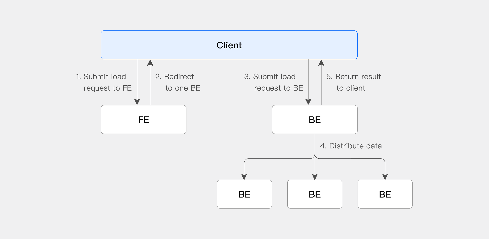

---
{
    "title": "Stream Load",
    "language": "ja",
    "description": "Stream Load は、HTTP 経由でローカルファイルやデータストリームを Doris に同期的にインポートします。CSV/JSON/Parquet/ORC 形式に対応し、アトミックなロードを保証します。",
    "keywords": [
        "Stream Load",
        "Doris データインポート",
        "HTTP インポート",
        "CSV インポート",
        "JSON インポート",
        "同期インポート",
        "Doris Streamloader",
        "curl インポート",
        "アトミックなインポート"
    ]
}
---

<!-- Knowledge type: Operation guide + Configuration parameter reference -->
<!-- Applicable scenario: Data import / Local file import / Streaming data write -->

Stream Load は、HTTP 経由でローカルファイルやデータストリームを Doris にインポートできます。Stream Load は同期インポート方式です。実行後にインポート結果が返されるため、レスポンスから成功したかどうかを判断できます。一般に、Stream Load は 10 GB 未満のファイルのインポートに使用できます。それより大きいファイルは、先に分割してから各部分を Stream Load でインポートしてください。Stream Load は、一連のインポートタスクのアトミック性を保証します。すべての行が正常にインポートされるか、どの行もインポートされないかのいずれかです。

:::tip

`curl` を直接使用する単一並列のインポートよりも、専用のインポートツール Doris Streamloader の使用を推奨します。Doris にデータをインポートするための専用クライアントツールであり、**複数並列でのインポート**に対応しているため、大量のデータのインポートにかかる時間を短縮できます。使用方法と実践的な詳細については、[Doris Streamloader のドキュメント](../../../connection-integration/data-integration/doris-streamloader)を参照してください。

:::

## ユースケース {#use-cases}

Stream Load は、次のような用途に適しています。

- ローカルまたはリモートの CSV、JSON、Parquet、ORC ファイルを Doris にインポートする。
- プログラム（Java、Go、Python など）から HTTP ストリームを介して継続的にデータを書き込む。
- 単一のインポートジョブについて、すべての行が成功するか、すべて失敗するかというアトミック性が必要な場合。
- 通常、10 GB 未満の単一ファイル。それより大きいファイルは、インポート前に分割するか、Doris Streamloader を使用する。

CSV ファイルをインポートする際は、NULL 値と空文字列を明確に区別してください。

- NULL 値（null）：`\N` で表します。たとえば、`a,\N,b` の中央の列は null です。
- 空文字列：区切り文字の間に文字がない場合、その値は空文字列です。たとえば、`a,,b` ではコンマの間に文字がないため、中央の列は空文字列です。

## 基本原理 {#basic-principles}

<!-- Knowledge type: Architecture principles -->

Stream Load では、HTTP 経由で FE ノードにインポートジョブを送信します。FE は負荷分散のため、リクエストをラウンドロビン方式で BE ノードにリダイレクトします。特定の BE ノードに HTTP リクエストを直接送信することもできます。Stream Load では、Doris がノードを Coordinator として指定します。Coordinator ノードはデータを受信し、ほかのノードに分配します。

次の図は、Stream Load の主な処理の流れを示します。



実行の流れは次のとおりです。

1. Client が Stream Load インポートジョブのリクエストを FE に送信します。
2. FE はインポートジョブのスケジューリングを担当する BE をラウンドロビン方式で Coordinator ノードとして選択し、Client に HTTP リダイレクトを返します。
3. Client は Coordinator の BE ノードに接続し、インポートリクエストを送信します。
4. Coordinator の BE は対応する BE ノードにデータを分配します。インポートが完了すると、結果を Client に返します。
5. Client が BE ノードを Coordinator として直接指定し、そのノードにインポートジョブを分配させることもできます。

## クイックスタート {#quick-start}

<!-- Knowledge type: Operational steps -->

Stream Load の送信と転送には HTTP を使用します。以下では、curl ツールを使って Stream Load のインポートジョブを送信する方法を示します。

### 前提条件 {#prerequisites}

Stream Load には、対象テーブルに対する INSERT 権限が必要です。ユーザーに INSERT 権限がない場合は、[GRANT](../../../sql-manual/sql-statements/account-management/GRANT-TO) コマンドで付与してください。

### インポートジョブの作成 {#create-an-import-job}

#### CSV データのインポート {#import-csv-data}

1. インポートデータを作成する

    次の内容で CSV ファイル `streamload_example.csv` を作成します。

    ```sql
    1,Emily,25
    2,Benjamin,35
    3,Olivia,28
    4,Alexander,60
    5,Ava,17
    6,William,69
    7,Sophia,32
    8,James,64
    9,Emma,37
    10,Liam,64
    ```

2. インポート先の Doris テーブルを作成する

    次のステートメントで Doris にインポート先のテーブルを作成します。

    ```sql
    CREATE TABLE testdb.test_streamload(
        user_id            BIGINT       NOT NULL COMMENT "user id",
        name               VARCHAR(20)           COMMENT "name",
        age                INT                   COMMENT "age"
    )
    DUPLICATE KEY(user_id)
    DISTRIBUTED BY HASH(user_id) BUCKETS 10;
    ```

3. インポートジョブを開始する

    `curl` コマンドで Stream Load インポートジョブを送信できます。

    ```shell
    curl --location-trusted -u <doris_user>:<doris_password> \
        -H "Expect:100-continue" \
        -H "column_separator:," \
        -H "columns:user_id,name,age" \
        -T streamload_example.csv \
        -XPUT http://<fe_ip>:<fe_http_port>/api/testdb/test_streamload/_stream_load
    ```

    Stream Load は同期インポート方式であり、インポート結果はユーザーに直接返されます。

    ```sql
    {
        "TxnId": 3,
        "Label": "123",
        "Comment": "",
        "TwoPhaseCommit": "false",
        "Status": "Success",
        "Message": "OK",
        "NumberTotalRows": 10,
        "NumberLoadedRows": 10,
        "NumberFilteredRows": 0,
        "NumberUnselectedRows": 0,
        "LoadBytes": 118,
        "LoadTimeMs": 173,
        "BeginTxnTimeMs": 1,
        "StreamLoadPutTimeMs": 70,
        "ReadDataTimeMs": 2,
        "WriteDataTimeMs": 48,
        "CommitAndPublishTimeMs": 52
    }
    ```

4. インポートしたデータを確認する

    ```sql
    mysql> select count(*) from testdb.test_streamload;
    +----------+
    | count(*) |
    +----------+
    |       10 |
    +----------+
    ```

#### JSON データのインポート {#import-json-data}

1. インポートデータを作成する

    次の内容で JSON ファイル `streamload_example.json` を作成します。

    ```sql
    [
    {"userid":1,"username":"Emily","userage":25},
    {"userid":2,"username":"Benjamin","userage":35},
    {"userid":3,"username":"Olivia","userage":28},
    {"userid":4,"username":"Alexander","userage":60},
    {"userid":5,"username":"Ava","userage":17},
    {"userid":6,"username":"William","userage":69},
    {"userid":7,"username":"Sophia","userage":32},
    {"userid":8,"username":"James","userage":64},
    {"userid":9,"username":"Emma","userage":37},
    {"userid":10,"username":"Liam","userage":64}
    ]
    ```

2. インポート先の Doris テーブルを作成する

    次のステートメントで Doris にインポート先のテーブルを作成します。

    ```sql
    CREATE TABLE testdb.test_streamload(
        user_id            BIGINT       NOT NULL COMMENT "user id",
        name               VARCHAR(20)           COMMENT "name",
        age                INT                   COMMENT "age"
    )
    DUPLICATE KEY(user_id)
    DISTRIBUTED BY HASH(user_id) BUCKETS 10;
    ```

3. インポートジョブを開始する

    `curl` コマンドで Stream Load インポートジョブを送信できます。

    ```shell
    curl --location-trusted -u <doris_user>:<doris_password> \
        -H "label:124" \
        -H "Expect:100-continue" \
        -H "format:json" -H "strip_outer_array:true" \
        -H "jsonpaths:[\"$.userid\", \"$.username\", \"$.userage\"]" \
        -H "columns:user_id,name,age" \
        -T streamload_example.json \
        -XPUT http://<fe_ip>:<fe_http_port>/api/testdb/test_streamload/_stream_load
    ```

    :::info 注記

    JSON ファイルの内容が JSON 配列ではなく、各行に JSON オブジェクトがある形式の場合は、ヘッダー `-H "strip_outer_array:false"` と `-H "read_json_by_line:true"` を追加します。
    JSON ファイルのルートノードにある JSON オブジェクトをインポートするには、`jsonpaths` を `$.` に設定します。例：`-H "jsonpaths:[\"$.\"]"`。

    :::

    Stream Load は同期インポート方式であり、インポート結果はユーザーに直接返されます。

    ```sql
    {
        "TxnId": 7,
        "Label": "125",
        "Comment": "",
        "TwoPhaseCommit": "false",
        "Status": "Success",
        "Message": "OK",
        "NumberTotalRows": 10,
        "NumberLoadedRows": 10,
        "NumberFilteredRows": 0,
        "NumberUnselectedRows": 0,
        "LoadBytes": 471,
        "LoadTimeMs": 52,
        "BeginTxnTimeMs": 0,
        "StreamLoadPutTimeMs": 11,
        "ReadDataTimeMs": 0,
        "WriteDataTimeMs": 23,
        "CommitAndPublishTimeMs": 16
    }
    ```

### インポートジョブの確認 {#view-import-jobs}

デフォルトでは、Stream Load は Client に同期的に結果を返すため、システムは Stream Load の過去のジョブを記録しません。記録を有効にするには、`be.conf` に設定 `enable_stream_load_record=true` を追加します。詳細は[BE の設定](../../../admin-manual/config/be-config)を参照してください。

設定後は、`show stream load` コマンドで完了した Stream Load タスクを確認できます。

```sql
mysql> show stream load from testdb;
+-------+--------+-----------------+---------------+---------+---------+------+-----------+------------+--------------+----------------+-----------+-------------------------+-------------------------+------+---------+
| Label | Db     | Table           | ClientIp      | Status  | Message | Url  | TotalRows | LoadedRows | FilteredRows | UnselectedRows | LoadBytes | StartTime               | FinishTime              | User | Comment |
+-------+--------+-----------------+---------------+---------+---------+------+-----------+------------+--------------+----------------+-----------+-------------------------+-------------------------+------+---------+
| 12356 | testdb | test_streamload | 192.168.88.31 | Success | OK      | N/A  | 10        | 10         | 0            | 0              | 118       | 2023-11-29 08:53:00.594 | 2023-11-29 08:53:00.650 | root |         |
+-------+--------+-----------------+---------------+---------+---------+------+-----------+------------+--------------+----------------+-----------+-------------------------+-------------------------+------+---------+
1 row in set (0.00 sec)
```

### インポートジョブのキャンセル {#cancel-an-import-job}

ユーザーは Stream Load を手動でキャンセルできません。タイムアウトまたはインポートエラーが発生すると、システムが自動的にキャンセルします。

### Compute Group のバインド {#bind-a-compute-group}

Stream Load を実行する Compute Group を指定できます。

**ストレージとコンピュートの分離モード**

ストレージとコンピュートの分離モードでは、次の方法で Compute Group を指定できます。

1. HTTP Header パラメータで指定します。

    ```text
    -H "cloud_cluster:cluster1"
    ```

    Doris 4.0.0 以降は、`compute_group` パラメータも使用できます。

    ```text
    -H "compute_group:cluster1"
    ```

    `compute_group` と `cloud_cluster` の両方を設定した場合は、`compute_group` が優先されます。

2. Stream Load に紐づくユーザープロパティで Compute Group を指定します。ユーザープロパティと HTTP Header の両方で指定した場合は、Header の指定が優先されます。

    ```text
    set property for user1 'default_compute_group'='cluster1';
    ```

3. ユーザープロパティと HTTP Header のどちらでも Compute Group を指定しなかった場合は、Stream Load に紐づくユーザーがアクセスできる Compute Group から選択されます。アクセス可能な Compute Group がなければ、インポートは失敗します。

:::info バージョンに関する注記（4.0.8 / 4.1.4）

Doris の 4.0 系では 4.0.8 以降、4.1 系では 4.1.4 以降で、ストレージとコンピュートの分離モードにおける Stream Load の Compute Group ルーティングと実行プランの不一致が修正されています。

- `compute_group` ヘッダーは `cloud_cluster` より優先されます。以前、FE は `cloud_cluster` のみを認識していました。
- 実行プランの作成には、**実際にリクエストを受信した BE** が属する Compute Group を使用します。これにより、実行場所とは異なる Compute Group にプランが配置されなくなります。
- この経路では、インポートに使用するアカウントの対象 Compute Group へのアクセス権、その Compute Group の存在、および状態も検証します。そのため、アップグレード後、実際にリクエストを処理する Compute Group にアクセス権がないアカウントのインポートは権限エラーで失敗し、対応する権限の付与が必要になります。

:::

:::info バージョンに関する注記（4.1.4）

バージョン 4.1.4 以降、BE の Stream Load エンドポイント（`PUT /api/{db}/{table}/_stream_load`、`PUT /api/_http_stream`、`PUT /api/{db}/_stream_load_2pc`）では、グローバルな `LOAD` 権限の事前チェックを行いません。認可は、実際の書き込み先データベースとテーブルに対して FE で一元的に処理されます。

そのため、グローバルな `LOAD` 権限を持たず、データベースまたはテーブルレベルの `LOAD_PRIV` のみを持つアカウントでも、Stream Load と 2PC の commit / abort を実行できます。

:::

**ストレージとコンピュートの統合モード**

ストレージとコンピュートの統合モードでは、Stream Load に紐づくユーザープロパティによってのみ Compute Group を指定できます。ユーザープロパティで指定しなかった場合は、`default` という名前の Compute Group が選択されます。

```text
set property for user1 'resource_tags.location'='group_1';
```

## リファレンス {#reference}

<!-- Knowledge type: Configuration parameter reference -->

### インポートコマンド {#import-command}

Stream Load のインポート構文は次のとおりです。

```shell
curl --location-trusted -u <doris_user>:<doris_password> \
  -H "Expect:100-continue" [-H ""...] \
  -T <file_path> \
  -XPUT http://fe_host:http_port/api/{db}/{table}/_stream_load
```

Stream Load は HTTP のチャンク転送によるインポートと、チャンク転送を使わないインポートの両方に対応します。チャンク転送を使わない場合は、アップロードする内容の長さを示す `Content-Length` を指定する必要があります。これによりデータの完全性が保証されます。

### インポート設定パラメータ {#import-configuration-parameters}

#### FE の設定 {#fe-configuration}

**1. stream_load_default_timeout_second**

| 項目 | 説明 |
| -------------------------- | ----------------------------------- |
| デフォルト値 | 259200 (s) |
| 動的設定 | はい |
| FE Master 専用の設定 | はい |

説明：Stream Load のデフォルトのタイムアウトです。インポートタスクのタイムアウトを秒単位で指定します。設定された `timeout` 以内にタスクが完了しない場合、システムがキャンセルし、タスクは CANCELLED 状態になります。指定時間内にソースファイルをインポートできない場合は、Stream Load リクエストで個別にタイムアウトを設定するか、FE パラメータ `stream_load_default_timeout_second` を調整してグローバルなデフォルト値を設定できます。

#### BE の設定 {#be-configuration}

**1. streaming_load_max_mb**

| 項目 | 説明 |
| --------------------- | -------------- |
| デフォルト値 | 102400 (MB) |
| 動的設定 | はい |

説明：Stream Load のリクエストボディの最大サイズです。ソースコード上のデフォルト値は 102400 MB（100 GB）です。実際に適用される上限は、デプロイ環境の BE 設定によって異なります。`read_json_by_line=true` を使用しない JSON のロードには、`streaming_load_json_max_mb` の制限も適用されます。

リクエストが実際の上限を超える場合は、データを小さいバッチに分割するか、管理者に設定の調整を依頼してください。

マネージドクラウドサービスでは、そのサービスが提供する設定方法を使用するか、管理者に連絡してください。BE ホストに直接アクセスする必要はありません。

**バージョン履歴：**

- 3.x 系では、Doris 3.0.2 で `streaming_load_max_mb` のデフォルト値が 10240 MB（10 GB）から 102400 MB（100 GB）に引き上げられました。Doris 3.0.0 と 3.0.1 のデフォルト値は 10 GB です。
- 2.1 系では、同じ変更が 2.1.7 から適用されました。
- Doris 4.x と dev でもデフォルト値は 100 GB です。実際に適用される値はデプロイ環境の設定によって異なります。

#### Header パラメータ {#header-parameters}

インポートパラメータは HTTP Header で渡せます。各パラメータの説明は次のとおりです。

| タグ | パラメータの説明 |
| ------------------------------- | ------------------------------------------------------------ |
| label | このインポートのラベルを指定します。同じラベルのデータを複数回インポートすることはできません。ラベルを指定しなかった場合、Doris が自動生成します。ラベルを指定することで、同じデータの重複インポートを回避できます。Doris はデフォルトでインポートジョブのラベルを三日間保持します。保持期間は `label_keep_max_second` で調整できます。たとえば、このインポートにラベル `123` を指定するには、`-H "label:123"` を使用します。ラベルを使うと、同じデータの重複インポートを防止できます。同じバッチのデータには同じラベルを使用することを強く推奨します。同じバッチの重複リクエストが一度だけ受け付けられ、At-Most-Once セマンティクスを保証できます。ラベルに対応するインポートジョブが CANCELLED 状態の場合、そのラベルは再使用できます。 |
| column_separator | インポートファイルの列区切り文字を指定します。デフォルトは `\t` です。不可視文字には `\x` を接頭辞として使用し、区切り文字を十六進数で表します。複数の文字を組み合わせて列区切り文字にすることもできます。たとえば、Hive ファイルの区切り文字 `\x01` を指定するには、`-H "column_separator:\x01"` を使用します。 |
| line_delimiter | インポートファイルの行区切り文字を指定します。デフォルトは `\n` です。複数の文字を組み合わせて行区切り文字にすることもできます。たとえば、行区切り文字に `\n` を指定するには、`-H "line_delimiter:\n"` を使用します。 |
| columns | インポートファイルの列とテーブルの列とのマッピングを指定します。ソースファイルの列がテーブルの列と完全に対応する場合、このフィールドを指定する必要はありません。ソースファイルがテーブルのスキーマと対応しない場合は、データ変換のためにこのフィールドが必要です。列には、インポートファイル内のフィールドに直接対応し、そのフィールド名をそのまま使用する形式と、`column_name = expression` という構文で派生列を表す形式があります。詳しい例は、[インポート時のデータ変換](../../../data-operate/import/load-data-convert)を参照してください。 |
| where | データの一部を抽出するために使用します。不要なデータを除外する場合は、このオプションを使用します。たとえば、列 k1 が 20180601 に等しいデータのみをインポートするには、`-H "where: k1 = 20180601"` を指定します。 |
| max_filter_ratio | フィルタリングされるデータ（形式が不正なデータなど）について許容する最大比率です。デフォルトでは許容しません。値の範囲は 0 から 1 です。インポートエラー率がこの値を超えると、インポートは失敗します。`where` 条件で除外された行は、不正なデータとして数えません。たとえば、正しいデータをできるだけすべてインポートするために 100% の許容率を設定するには、`-H "max_filter_ratio:1"` を指定します。 |
| partitions | このインポートの対象パーティションを指定します。データに対応するパーティションが分かる場合は、指定することを推奨します。指定したパーティションに該当しないデータは除外されます。たとえば、パーティション p1 と p2 にインポートするには、`-H "partitions: p1, p2"` を指定します。 |
| timeout | インポートのタイムアウトを秒単位で指定します。デフォルトは 600 秒です。有効範囲は 1 秒から 259200 秒です。たとえば、タイムアウトを 1200 秒に設定するには、`-H "timeout:1200"` を指定します。 |
| strict_mode | このインポートで厳格モードを有効にするかを指定します。デフォルトでは無効です。たとえば、有効にするには `-H "strict_mode:true"` を指定します。 |
| timezone | このインポートで使用するタイムゾーンを指定します。デフォルトはクラスタの現在のタイムゾーンです。このパラメータは、インポートで使用するすべてのタイムゾーン関連関数の結果に影響します。たとえば、タイムゾーンを Africa/Abidjan に設定するには、`-H "timezone:Africa/Abidjan"` を指定します。 |
| exec_mem_limit | インポートのメモリ上限です。デフォルトは 2 GB で、単位はバイトです。 |
| format | このインポートのデータ形式を指定します。デフォルトは CSV です。現在サポートされている形式は、CSV、JSON、arrow、csv_with_names（CSV ファイルの先頭行を除外できます）、csv_with_names_and_types（CSV ファイルの先頭二行を除外できます）、Parquet、ORC です。たとえば、JSON を指定するには、`-H "format:json"` を使用します。 |
| jsonpaths | JSON データのインポートには二つの方法があります。`jsonpaths` を指定しない場合はシンプルモードとなり、JSON データはオブジェクト型である必要があります。JSON データが比較的複雑で、`jsonpaths` パラメータによって対応する値を照合する必要がある場合はマッチングモードを使用します。シンプルモードでは、JSON のキーとテーブルの列名が一対一で対応している必要があります。たとえば、JSON データ `{"k1":1, "k2":2, "k3":"hello"}` では、k1、k2、k3 がそれぞれテーブルの列に対応する必要があります。 |
| strip_outer_array | `strip_outer_array` を true に設定すると、JSON データが配列オブジェクトで始まるものとして、その配列を展開します。デフォルトは false です。JSON データの最外層が `[]` で表される配列の場合は、true に設定します。たとえば、データ `[{"k1" : 1, "v1" : 2},{"k1" : 3, "v1" : 4}]` では、true に設定すると Doris へのインポート時に二行が生成されます。 |
| json_root | `json_root` は JSON ドキュメントのルートノードを指定する有効な `jsonpath` 文字列です。デフォルト値は "" です。 |
| merge_type | データのマージ種別です。次の三種類に対応します。<br/>- APPEND（デフォルト）：このバッチのすべてのデータを既存データに追加します。<br/>- DELETE：このバッチとキーが一致するすべての行を削除します。<br/>- MERGE：`delete` 条件と併用する必要があります。その条件に一致するデータは DELETE セマンティクスで、それ以外は APPEND セマンティクスで処理します。<br/>たとえば、MERGE モードを指定するには、`-H "merge_type: MERGE" -H "delete: flag=1"` を使用します。 |
| delete | MERGE と併用する場合のみ意味を持ち、データの削除条件を指定します。 |
| function_column.sequence_col | UNIQUE KEYS モデルにのみ適用されます。同じキー列の範囲で、値列が `source_sequence` 列の順序に従って REPLACE されることを保証します。`source_sequence` は、データソース内の列でもテーブルスキーマ内の列でもかまいません。 |
| fuzzy_parse | 真偽値です。true に設定すると、先頭行をスキーマとして JSON を解析します。有効にすると JSON のインポート効率を改善できますが、すべての JSON オブジェクトでキーの順序が先頭行と同じである必要があります。デフォルトは false です。JSON 形式にのみ使用します。 |
| num_as_string | 真偽値です。true に設定すると、JSON データの解析時に数値型を文字列に変換し、精度を失わずにインポートします。 |
| read_json_by_line | 真偽値です。true に設定すると、各行から JSON オブジェクトを一つずつ読み取ります。デフォルト値は false です。 |
| send_batch_parallelism | 整数です。バッチデータを送信する際の並列度を設定します。設定値が BE の `max_send_batch_parallelism_per_job` を超えた場合、Coordinator として動作する BE は `max_send_batch_parallelism_per_job` の値を使用します。 |
| hidden_columns | インポートデータに含まれる隠し列を指定します。Header に `Columns` が含まれない場合に有効です。複数の隠し列はコンマで区切ります。システムはユーザーが指定したデータを使用してインポートします。次の例では、インポートデータの最後の列が `__DORIS_SEQUENCE_COL__` です。`hidden_columns: __DORIS_DELETE_SIGN__,__DORIS_SEQUENCE_COL__` |
| load_to_single_tablet | 真偽値です。true に設定すると、単一タスクのデータを対応するパーティションの一つの tablet のみにロードできます。デフォルト値は false です。このパラメータは、ランダムバケッティングを使用する OLAP テーブルにデータをロードする場合にのみ設定できます。 |
| compress_type | ファイルの圧縮形式を指定します。現在、CSV ファイルの圧縮のみがサポートされています。対応形式は gz、lzo、bz2、lz4、lzop、deflate です。 |
| trim_double_quotes | 真偽値です。デフォルト値は false です。true に設定すると、CSV ファイルの各フィールドの最外側にある二重引用符を取り除きます。 |
| skip_lines | 整数です。デフォルト値は 0 です。CSV ファイルの先頭から指定した行数をスキップします。`format` が `csv_with_names` または `csv_with_names_and_types` の場合、このパラメータは無効です。 |
| comment | 文字列です。デフォルト値は空です。タスクに追加情報を付与します。 |
| enclose | 囲み文字を指定します。CSV データのフィールドに行区切り文字や列区切り文字が含まれる場合、意図しない分割を防ぐため、単一バイト文字を囲み文字として指定できます。たとえば、列区切り文字が `,`、囲み文字が `'`、データが `"a,'b,c'"` の場合、`b,c` は一つのフィールドとして解析されます。注記：`enclose` を `"` に設定する場合は、`trim_double_quotes` を true に設定する必要があります。 |
| escape | エスケープ文字を指定します。フィールド内に囲み文字と同じ文字が現れる場合、その文字をエスケープするために使用します。たとえば、データが `"a,'b,'c'"`、囲み文字が `'` で、`b,'c` を一つのフィールドとして解析するには、`\` などの単一バイトのエスケープ文字を指定し、データを `"a,'b,\'c'"` に変更します。 |
| memtable_on_sink_node | データのインポート時に MemTable forward を有効にするかを指定します。デフォルトは false です。 |
| unique_key_update_mode | Unique テーブルの更新モードです。現在は Merge-On-Write Unique テーブルでのみ有効です。`UPSERT`、`UPDATE_FIXED_COLUMNS`、`UPDATE_FLEXIBLE_COLUMNS` の三種類に対応します。`UPSERT`：upsert セマンティクスでデータをインポートします。`UPDATE_FIXED_COLUMNS`：[部分列更新](../../../data-operate/update/partial-column-update.md#column-update-on-the-unique-key-model)でデータをインポートします。`UPDATE_FLEXIBLE_COLUMNS`：[柔軟な部分列更新](../../../data-operate/update/partial-column-update.md#flexible-column-update)でデータをインポートします。 |
| partial_update_new_key_behavior | Unique テーブルで部分列更新または柔軟な部分列更新を行う際に、新しく挿入される行をどう扱うかを指定します。`APPEND` と `ERROR` の二種類があります。<br/>- `APPEND`：新しい行の挿入を許可します。<br/>- `ERROR`：新しい行を挿入しようとするとインポートが失敗し、エラーを報告します。 |

### インポートの戻り値 {#import-return-value}

Stream Load は同期インポート方式であり、次のように、インポートリクエストのレスポンスで結果がユーザーに返されます。

```sql
{
    "TxnId": 1003,
    "Label": "b6f3bc78-0d2c-45d9-9e4c-faa0a0149bee",
    "Status": "Success",
    "ExistingJobStatus": "FINISHED", // optional
    "Message": "OK",
    "NumberTotalRows": 1000000,
    "NumberLoadedRows": 1000000,
    "NumberFilteredRows": 1,
    "NumberUnselectedRows": 0,
    "LoadBytes": 40888898,
    "LoadTimeMs": 2144,
    "BeginTxnTimeMs": 1,
    "StreamLoadPutTimeMs": 2,
    "ReadDataTimeMs": 325,
    "WriteDataTimeMs": 1933,
    "CommitAndPublishTimeMs": 106,
    "ErrorURL": "http://192.168.1.1:8042/api/_load_error_log?file=__shard_0/error_log_insert_stmt_db18266d4d9b4ee5-abb00ddd64bdf005_db18266d4d9b4ee5_abb00ddd64bdf005"
}
```

戻り値の各パラメータは次のとおりです。

| パラメータ名 | 説明 |
| ---------------------- | ------------------------------------------------------------ |
| TxnId | インポートトランザクションの ID です。 |
| Label | インポートジョブのラベルです。`-H "label:<label_id>"` で指定します。 |
| Status | インポートの最終状態です。<br/>- Success：インポートに成功しました。<br/>- Publish Timeout：インポートは完了していますが、データが参照可能になるまで遅延する場合があります。再試行は不要です。<br/>- Label Already Exists：ラベルが重複しています。新しいラベルが必要です。<br/>- Fail：インポートに失敗しました。 |
| ExistingJobStatus | ラベルに対応する既存のインポートジョブの状態です。このフィールドは、`Status` が `Label Already Exists` の場合にのみ表示されます。この値から既存ラベルのジョブ状態を確認できます。`RUNNING` は実行中、`FINISHED` は成功を意味します。 |
| Message | インポートのエラーメッセージです。 |
| NumberTotalRows | インポートで処理した総行数です。 |
| NumberLoadedRows | 正常にインポートされた行数です。 |
| NumberFilteredRows | データ品質チェックに合格しなかった行数です。 |
| NumberUnselectedRows | `where` 条件で除外された行数です。 |
| LoadBytes | インポートされたバイト数です。 |
| LoadTimeMs | インポートの完了にかかった時間です。単位はミリ秒です。 |
| BeginTxnTimeMs | トランザクションの開始を FE にリクエストするのにかかった時間です。単位はミリ秒です。 |
| StreamLoadPutTimeMs | インポートデータの実行プランを FE にリクエストして取得するのにかかった時間です。単位はミリ秒です。 |
| ReadDataTimeMs | データの読み取りにかかった時間です。単位はミリ秒です。 |
| WriteDataTimeMs | データの書き込みにかかった時間です。単位はミリ秒です。 |
| CommitAndPublishTimeMs | トランザクションのコミットと公開を FE にリクエストするのにかかった時間です。単位はミリ秒です。 |
| ErrorURL | データ品質に問題がある場合、この URL にアクセスして具体的なエラー行を確認できます。 |

`ErrorURL` を使用すると、データ品質の問題でインポートに失敗したデータを確認できます。`curl "<ErrorURL>"` コマンドでエラーデータの情報を直接確認できます。

## インポート例 {#import-examples}

<!-- Knowledge type: Operation examples -->
<!-- Applicable scenario: Multi-scenario import practices -->

### インポートのタイムアウトと最大インポートサイズの設定 {#set-the-import-timeout-and-maximum-import-size}

インポートタスクのタイムアウトは秒単位です。設定した `timeout` 以内にタスクが完了しない場合、システムがキャンセルし、タスクは CANCELLED 状態になります。`timeout` パラメータを指定するか、`fe.conf` に `stream_load_default_timeout_second` パラメータを追加することで、Stream Load のインポートタイムアウトを調整できます。

インポート前にファイルサイズに基づいてタイムアウトを計算してください。たとえば、100 GB のファイルを推定速度 50 MB/s でインポートする場合は、次のとおりです。

```sql
Import time ~= 100GB / 50MB/s ~= 2048s
```

次のコマンドは、`timeout` を 3000 秒に設定した Stream Load インポートタスクを作成します。

```shell
curl --location-trusted -u <doris_user>:<doris_password> \
    -H "Expect:100-continue" \
    -H "timeout:3000" \
    -H "column_separator:," \
    -H "columns:user_id,name,age" \
    -T streamload_example.csv \
    -XPUT http://<fe_ip>:<fe_http_port>/api/testdb/test_streamload/_stream_load
```

### 許容するエラー率の上限の設定 {#set-the-maximum-tolerated-error-ratio}

Doris のインポートタスクでは、形式が不正なデータを一定割合まで許容できます。許容率は `max_filter_ratio` で設定します。デフォルトは 0 で、不正なデータが一行でもあるとインポートタスク全体が失敗します。問題のある行を一部無視したい場合は、このパラメータに 0 から 1 の間の値を設定します。Doris は形式が不正な行を自動的にスキップします。許容率の計算方法については、[データ変換](../../../data-operate/import/load-data-convert)のドキュメントを参照してください。

次のコマンドは、`max_filter_ratio` を 0.4 に設定した Stream Load インポートタスクを作成します。

```shell
curl --location-trusted -u <doris_user>:<doris_password> \
    -H "Expect:100-continue" \
    -H "max_filter_ratio:0.4" \
    -H "column_separator:," \
    -H "columns:user_id,name,age" \
    -T streamload_example.csv \
    -XPUT http://<fe_ip>:<fe_http_port>/api/testdb/test_streamload/_stream_load
```

### インポート時のフィルタ条件の設定 {#set-import-filter-conditions}

インポート中に `WHERE` パラメータを使用して、データを条件付きで除外できます。除外されたデータはフィルタ率の計算に含まれず、`max_filter_ratio` の設定には影響しません。インポート後は、`num_rows_unselected` で除外された行数を確認できます。

次のコマンドは、`WHERE` フィルタ条件を指定した Stream Load インポートタスクを作成します。

```sql
curl --location-trusted -u <doris_user>:<doris_password> \
    -H "Expect:100-continue" \
    -H "where:age>=35" \
    -H "column_separator:," \
    -H "columns:user_id,name,age" \
    -T streamload_example.csv \
    -XPUT http://<fe_ip>:<fe_http_port>/api/testdb/test_streamload/_stream_load
```

### 指定したパーティションへのデータのインポート {#import-data-into-specified-partitions}

ローカルファイルのデータをテーブルのパーティション p1 と p2 にインポートし、20% のエラー率を許容します。

```shell
curl --location-trusted -u <doris_user>:<doris_password> \
    -H "label:123" \
    -H "Expect:100-continue" \
    -H "max_filter_ratio:0.2" \
    -H "column_separator:," \
    -H "columns:user_id,name,age" \
    -H "partitions: p1, p2" \
    -T streamload_example.csv \
    -XPUT http://<fe_ip>:<fe_http_port>/api/testdb/test_streamload/_stream_load
```

### インポート時のタイムゾーンの指定 {#specify-the-import-time-zone}

`DATETIME` や `TIMESTAMP_NS` のようなタイムゾーンを持たない型にはタイムゾーン情報が含まれず、保存された値は Doris のシステムタイムゾーンが変わっても変化しません。そのため、タイムゾーン付きの入力は、インポート時に指定された対象タイムゾーンへ変換された後、タイムゾーンなしで保存されます。Doris では、対象タイムゾーンはセッション変数 `time_zone` で表されます。

インポート時には、`timezone` パラメータで対象タイムゾーンを指定します。このパラメータは、タイムゾーン変換時やタイムゾーンに依存する関数の評価時に、セッション変数 `time_zone` の代わりに使用されます。したがって、特別な事情がなければ、インポートトランザクションの `timezone` を現在の Doris クラスタの `time_zone` と一致させてください。これにより、タイムゾーン付きのすべての日時データがそのタイムゾーンに変換されます。

たとえば、Doris のシステムタイムゾーンが `+08:00` で、インポートデータの日時列に `2012-01-01 01:00:00+00:00` と `2015-12-12 12:12:12-08:00` が含まれる場合、インポートトランザクションで `-H "timezone: +08:00"` を指定すると、両方がそのタイムゾーンに変換され、`2012-01-01 09:00:00` と `2015-12-13 04:12:12` になります。

タイムゾーンの詳細については、[タイムゾーン](../../../admin-manual/cluster-management/time-zone)のドキュメントを参照してください。

### ストリーミングでのインポート {#import-using-streaming}

Stream Load は HTTP プロトコルに基づいているため、Java、Go、Python などのプログラムからストリームとしてデータを書き込めます。これが Stream Load という名前の由来です。

次の `bash` のパイプラインは、この方法を示します。インポートするデータはローカルファイルではなく、プログラムによって生成されます。

```shell
seq 1 10 | awk '{OFS="\t"}{print $1, $1 * 10}' | curl --location-trusted -u root -T - http://host:port/api/testDb/testTbl/_stream_load
```

### インポート時に CSV の先頭行をスキップする {#skip-the-first-line-of-a-csv-during-import}

ファイルのデータ：

```Plain
 id,name,age
 1,doris,20
 2,flink,10
```

`format=csv_with_names` を指定して、インポート時に先頭行をスキップします。

```Plain
curl --location-trusted -u root -T test.csv  -H "label:1" -H "format:csv_with_names" -H "column_separator:," http://host:port/api/testDb/testTbl/_stream_load
```

### merge_type を使用した Delete 操作 {#use-merge_type-to-perform-a-delete-operation}

Stream Load のインポート種別には APPEND、DELETE、MERGE の三種類があり、`merge_type` パラメータで指定できます。インポートデータとキーが一致する行をすべて削除するには、次のコマンドを使用します。

```shell
curl --location-trusted -u <doris_user>:<doris_password> \
    -H "Expect:100-continue" \
    -H "merge_type: DELETE" \
    -H "column_separator:," \
    -H "columns:user_id,name,age" \
    -T streamload_example.csv \
    -XPUT http://<fe_ip>:<fe_http_port>/api/testdb/test_streamload/_stream_load
```

インポート前のテーブルのデータが次の場合：

```sql
+--------+----------+----------+------+
| siteid | citycode | username | pv   |
+--------+----------+----------+------+
|      3 |        2 | tom      |    2 |
|      4 |        3 | bush     |    3 |
|      5 |        3 | helen    |    3 |
+--------+----------+----------+------+
```

インポートデータは次のとおりです。

```sql
3,2,tom,0
```

インポート後は、一致する行がテーブルから削除され、結果セットは次のようになります。

```sql
+--------+----------+----------+------+
| siteid | citycode | username | pv   |
+--------+----------+----------+------+
|      4 |        3 | bush     |    3 |
|      5 |        3 | helen    |    3 |
+--------+----------+----------+------+
```

### merge_type を使用した Merge 操作 {#use-merge_type-to-perform-a-merge-operation}

`merge_type` を MERGE に設定すると、インポートデータがテーブルにマージされます。MERGE セマンティクスは `DELETE` 条件と併用する必要があります。`DELETE` 条件に一致する行は DELETE セマンティクスで処理され、残りの行は APPEND セマンティクスでテーブルに追加されます。たとえば、次の操作は `siteid` が 1 の行を削除し、残りのデータをテーブルに追加します。

```shell
curl --location-trusted -u <doris_user>:<doris_password> \
    -H "Expect:100-continue" \
    -H "merge_type: MERGE" \
    -H "delete: siteid=1" \
    -H "column_separator:," \
    -H "columns:user_id,name,age" \
    -T streamload_example.csv \
    -XPUT http://<fe_ip>:<fe_http_port>/api/testdb/test_streamload/_stream_load
```

インポート前のデータが次の場合：

```sql
+--------+----------+----------+------+
| siteid | citycode | username | pv   |
+--------+----------+----------+------+
|      4 |        3 | bush     |    3 |
|      5 |        3 | helen    |    3 |
|      1 |        1 | jim      |    2 |
+--------+----------+----------+------+
```

インポートデータは次のとおりです。

```sql
2,1,grace,2
3,2,tom,2
1,1,jim,2
```

インポート後、`siteid = 1` の行は削除され、`siteid` が 2 と 3 の行がテーブルに追加されます。

```sql
+--------+----------+----------+------+
| siteid | citycode | username | pv   |
+--------+----------+----------+------+
|      4 |        3 | bush     |    3 |
|      2 |        1 | grace    |    2 |
|      3 |        2 | tom      |    2 |
|      5 |        3 | helen    |    3 |
+--------+----------+----------+------+
```

### インポート時の Merge 用 Sequence 列の指定 {#specify-the-sequence-column-for-merge-during-import}

Unique Key テーブルに Sequence 列が設定されている場合、同じキー列の範囲では、Sequence 列の値が REPLACE 集約関数による置換順序の基準になり、大きい値が小さい値を置き換えられます。このようなテーブルで `DORIS_DELETE_SIGN` に基づいて削除マークを付けるには、キーが同じで、Sequence 列の値が現在の値以上である必要があります。`function_column.sequence_col` パラメータを `merge_type: DELETE` とともに指定すると、削除操作を実行できます。

```sql
curl --location-trusted -u <doris_user>:<doris_password> \
    -H "Expect:100-continue" \
    -H "merge_type: DELETE" \
    -H "function_column.sequence_col: age" \
    -H "column_separator:," \
    -H "columns: name, gender, age" \
    -T streamload_example.csv \
    -XPUT http://<fe_ip>:<fe_http_port>/api/testdb/test_streamload/_stream_load
```

テーブルの構造が次の場合を考えます。

```sql
mysql> SET show_hidden_columns=true;
Query OK, 0 rows affected (0.00 sec)

mysql> DESC table1;
+------------------------+--------------+------+-------+---------+---------+
| Field                  | Type         | Null | Key   | Default | Extra   |
+------------------------+--------------+------+-------+---------+---------+
| name                   | VARCHAR(100) | No   | true  | NULL    |         |
| gender                 | VARCHAR(10)  | Yes  | false | NULL    | REPLACE |
| age                    | INT          | Yes  | false | NULL    | REPLACE |
| __DORIS_DELETE_SIGN__  | TINYINT      | No   | false | 0       | REPLACE |
| __DORIS_SEQUENCE_COL__ | INT          | Yes  | false | NULL    | REPLACE |
+------------------------+--------------+------+-------+---------+---------+
4 rows in set (0.00 sec)
```

元のテーブルのデータが次の場合を考えます。

```sql
+-------+--------+------+
| name  | gender | age  |
+-------+--------+------+
| li    | male   |   10 |
| wang  | male   |   14 |
| zhang | male   |   12 |
+-------+--------+------+
```

**1. Sequence パラメータが有効になる場合：インポートする Sequence 列の値がテーブル内の既存値以上**

インポートデータは次のとおりです。

```sql
li,male,10
```

`function_column.sequence_col: age` が指定され、`age` がテーブル内の既存の列値以上なので、元の行は削除され、テーブルのデータは次のようになります。

```sql
+-------+--------+------+
| name  | gender | age  |
+-------+--------+------+
| wang  | male   |   14 |
| zhang | male   |   12 |
+-------+--------+------+
```

**2. Sequence パラメータが有効にならない場合：インポートする Sequence 列の値がテーブル内の既存値以下**

インポートデータは次のとおりです。

```sql
li,male,9
```

`function_column.sequence_col: age` は指定されていますが、`age` がテーブル内の既存の列値より小さいため、DELETE 操作は有効になりません。テーブルのデータは変わらず、主キーが `li` の行も引き続き参照できます。

```sql
+-------+--------+------+
| name  | gender | age  |
+-------+--------+------+
| li    | male   |   10 |
| wang  | male   |   14 |
| zhang | male   |   12 |
+-------+--------+------+
```

行が削除されない理由は、内部の依存関係において、システムがまず同じキーを持つ行を調べ、Sequence 列の値が大きい行を外部に公開してから、その行の `DORIS_DELETE_SIGN` の値が 1 かどうかを確認するためです。値が 1 なら外部からは見えなくなり、0 なら引き続き読み取れます。

### 囲み文字を含むデータのインポート {#import-data-containing-enclosing-characters}

CSV データに行区切り文字や列区切り文字が含まれる場合は、意図しない分割を防ぐため、単一バイト文字を囲み文字として指定できます。

次のデータでは、列に区切り文字 `,` が含まれています。

```sql
Zhang San,30,'Shanghai City, Huangpu District, Dagu Road'
```

囲み文字として `'` を指定すると、「Shanghai City, Huangpu District, Dagu Road」を一つのフィールドとして扱えます。

```sql
curl --location-trusted -u <doris_user>:<doris_password> \
    -H "Expect:100-continue" \
    -H "column_separator:," \
    -H "enclose:'" \
    -H "columns:username,age,address" \
    -T streamload_example.csv \
    -XPUT http://<fe_ip>:<fe_http_port>/api/testdb/test_streamload/_stream_load
```

囲み文字もフィールド内に現れる場合、たとえば「Shanghai City, Huangpu District, 'Dagu Road」を一つのフィールドとして扱うには、先に列内の文字をエスケープします。

```sql
Zhang San,30,'Shanghai City, Huangpu District, \'Dagu Road'
```

`escape` パラメータを使用して、次の例の `\` のような単一バイトのエスケープ文字を指定できます。

```sql
curl --location-trusted -u <doris_user>:<doris_password> \
    -H "Expect:100-continue" \
    -H "column_separator:," \
    -H "enclose:'" \
    -H "escape:\\" \
    -H "columns:username,age,address" \
    -T streamload_example.csv \
    -XPUT http://<fe_ip>:<fe_http_port>/api/testdb/test_streamload/_stream_load
```

### DEFAULT CURRENT_TIMESTAMP フィールドを持つテーブルへのインポート {#import-data-into-a-table-with-default-current_timestamp-fields}

次の例では、`DEFAULT CURRENT_TIMESTAMP` を持つフィールドがあるテーブルにデータをインポートします。

テーブルスキーマ：

```sql
CREATE TABLE testDb.testTbl (
    `id` BIGINT(30) NOT NULL,
    `order_code` VARCHAR(30) DEFAULT NULL COMMENT '',
    `create_time` DATETIMEv2(3) DEFAULT CURRENT_TIMESTAMP
)
DUPLICATE KEY(id)
DISTRIBUTED BY HASH(id) BUCKETS 10;
```

JSON データ形式：

```Plain
{"id":1,"order_Code":"avc"}
```

インポートコマンド：

```shell
curl --location-trusted -u root -T test.json -H "label:1" -H "format:json" -H 'columns: id, order_code, create_time=CURRENT_TIMESTAMP()' http://host:port/api/testDb/testTbl/_stream_load
```

### シンプルモードでの JSON データのインポート {#import-json-data-in-simple-mode}

JSON のフィールドがテーブルの列名と一対一で対応している場合は、`"strip_outer_array:true"` と `"format:json"` を指定して JSON データをテーブルにインポートできます。

たとえば、テーブルの定義が次の場合：

```sql
CREATE TABLE testdb.test_streamload(
    user_id            BIGINT       NOT NULL COMMENT "user id",
    name               VARCHAR(20)           COMMENT "name",
    age                INT                   COMMENT "age"
)
DUPLICATE KEY(user_id)
DISTRIBUTED BY HASH(user_id) BUCKETS 10;
```

インポートデータのフィールド名は、テーブルのフィールド名と一対一で対応しています。

```sql
[
{"user_id":1,"name":"Emily","age":25},
{"user_id":2,"name":"Benjamin","age":35},
{"user_id":3,"name":"Olivia","age":28},
{"user_id":4,"name":"Alexander","age":60},
{"user_id":5,"name":"Ava","age":17},
{"user_id":6,"name":"William","age":69},
{"user_id":7,"name":"Sophia","age":32},
{"user_id":8,"name":"James","age":64},
{"user_id":9,"name":"Emma","age":37},
{"user_id":10,"name":"Liam","age":64}
]
```

次のコマンドで JSON データをテーブルにインポートできます。

```sql
curl --location-trusted -u <doris_user>:<doris_password> \
    -H "Expect:100-continue" \
    -H "format:json" \
    -H "strip_outer_array:true" \
    -T streamload_example.json \
    -XPUT http://<fe_ip>:<fe_http_port>/api/testdb/test_streamload/_stream_load
```

### マッチングモードでの複雑な JSON データのインポート {#import-complex-json-data-in-matching-mode}

JSON データが複雑でテーブルの列名と一対一で対応できない場合や、余分な列がある場合は、`jsonpaths` パラメータで列名をマッピングしてインポートできます。たとえば、次のデータの場合です。

```sql
[
{"userid":1,"hudi":"lala","username":"Emily","userage":25,"userhp":101},
{"userid":2,"hudi":"kpkp","username":"Benjamin","userage":35,"userhp":102},
{"userid":3,"hudi":"ji","username":"Olivia","userage":28,"userhp":103},
{"userid":4,"hudi":"popo","username":"Alexander","userage":60,"userhp":103},
{"userid":5,"hudi":"uio","username":"Ava","userage":17,"userhp":104},
{"userid":6,"hudi":"lkj","username":"William","userage":69,"userhp":105},
{"userid":7,"hudi":"komf","username":"Sophia","userage":32,"userhp":106},
{"userid":8,"hudi":"mki","username":"James","userage":64,"userhp":107},
{"userid":9,"hudi":"hjk","username":"Emma","userage":37,"userhp":108},
{"userid":10,"hudi":"hua","username":"Liam","userage":64,"userhp":109}
]
```

`jsonpaths` パラメータを指定すると、対象の列を対応付けられます。

```sql
curl --location-trusted -u <doris_user>:<doris_password> \
    -H "Expect:100-continue" \
    -H "format:json" \
    -H "strip_outer_array:true" \
    -H "jsonpaths:[\"$.userid\", \"$.username\", \"$.userage\"]" \
    -H "columns:user_id,name,age" \
    -T streamload_example.json \
    -XPUT http://<fe_ip>:<fe_http_port>/api/testdb/test_streamload/_stream_load
```

### インポートする JSON のルートノードの指定 {#specify-the-json-root-node-for-import}

JSON データに入れ子の JSON フィールドが含まれる場合は、インポート対象のルートノードを指定する必要があります。デフォルト値は "" です。

次のデータでは、`comment` 列の中にあるデータをテーブルへインポートします。

```sql
[
    {"user":1,"comment":{"userid":101,"username":"Emily","userage":25}},
    {"user":2,"comment":{"userid":102,"username":"Benjamin","userage":35}},
    {"user":3,"comment":{"userid":103,"username":"Olivia","userage":28}},
    {"user":4,"comment":{"userid":104,"username":"Alexander","userage":60}},
    {"user":5,"comment":{"userid":105,"username":"Ava","userage":17}},
    {"user":6,"comment":{"userid":106,"username":"William","userage":69}},
    {"user":7,"comment":{"userid":107,"username":"Sophia","userage":32}},
    {"user":8,"comment":{"userid":108,"username":"James","userage":64}},
    {"user":9,"comment":{"userid":109,"username":"Emma","userage":37}},
    {"user":10,"comment":{"userid":110,"username":"Liam","userage":64}}
    ]
```

まず `json_root` パラメータでルートノードを `comment` に設定し、次に `jsonpaths` パラメータで列名のマッピングを指定します。

```sql
curl --location-trusted -u <doris_user>:<doris_password> \
    -H "Expect:100-continue" \
    -H "format:json" \
    -H "strip_outer_array:true" \
    -H "json_root: $.comment" \
    -H "jsonpaths:[\"$.userid\", \"$.username\", \"$.userage\"]" \
    -H "columns:user_id,name,age" \
    -T streamload_example.json \
    -XPUT http://<fe_ip>:<fe_http_port>/api/testdb/test_streamload/_stream_load
```

### Array データ型のインポート {#import-array-data-type}

次のデータには配列型が含まれます。

```sql
1|Emily|[1,2,3,4]
2|Benjamin|[22,45,90,12]
3|Olivia|[23,16,19,16]
4|Alexander|[123,234,456]
5|Ava|[12,15,789]
6|William|[57,68,97]
7|Sophia|[46,47,49]
8|James|[110,127,128]
9|Emma|[19,18,123,446]
10|Liam|[89,87,96,12]
```

次のスキーマのテーブルにデータをインポートします。

```sql
CREATE TABLE testdb.test_streamload(
    typ_id     BIGINT          NOT NULL COMMENT "ID",
    name       VARCHAR(20)     NULL     COMMENT "name",
    arr        ARRAY<int(10)>  NULL     COMMENT "array"
)
DUPLICATE KEY(typ_id)
DISTRIBUTED BY HASH(typ_id) BUCKETS 10;
```

Stream Load タスクを使用すると、テキストファイルから ARRAY 型をテーブルへ直接インポートできます。

```sql
curl --location-trusted -u <doris_user>:<doris_password> \
    -H "Expect:100-continue" \
    -H "column_separator:|" \
    -H "columns:typ_id,name,arr" \
    -T streamload_example.csv \
    -XPUT http://<fe_ip>:<fe_http_port>/api/testdb/test_streamload/_stream_load
```

### Map データ型のインポート {#import-map-data-type}

次の例のように、インポートデータに Map 型が含まれる場合：

```sql
[
{"user_id":1,"namemap":{"Emily":101,"age":25}},
{"user_id":2,"namemap":{"Benjamin":102,"age":35}},
{"user_id":3,"namemap":{"Olivia":103,"age":28}},
{"user_id":4,"namemap":{"Alexander":104,"age":60}},
{"user_id":5,"namemap":{"Ava":105,"age":17}},
{"user_id":6,"namemap":{"William":106,"age":69}},
{"user_id":7,"namemap":{"Sophia":107,"age":32}},
{"user_id":8,"namemap":{"James":108,"age":64}},
{"user_id":9,"namemap":{"Emma":109,"age":37}},
{"user_id":10,"namemap":{"Liam":110,"age":64}}
]
```

次のスキーマのテーブルにデータをインポートします。

```sql
CREATE TABLE testdb.test_streamload(
    user_id            BIGINT       NOT NULL COMMENT "ID",
    namemap            Map<STRING, INT>  NULL     COMMENT "namemap"
)
DUPLICATE KEY(user_id)
DISTRIBUTED BY HASH(user_id) BUCKETS 10;
```

Stream Load タスクを使用すると、テキストファイルから Map 型をテーブルへ直接インポートできます。

```sql
curl --location-trusted -u <doris_user>:<doris_password> \
    -H "Expect:100-continue" \
    -H "format: json" \
    -H "strip_outer_array:true" \
    -T streamload_example.json \
    -XPUT http://<fe_ip>:<fe_http_port>/api/testdb/test_streamload/_stream_load
```

### Bitmap データ型のインポート {#import-bitmap-data-type}

インポート中に Bitmap 型のデータがある場合は、`to_bitmap` でデータを Bitmap に変換するか、`bitmap_empty` 関数で Bitmap を設定できます。

たとえば、インポートデータが次の場合：

```sql
1|koga|17723
2|nijg|146285
3|lojn|347890
4|lofn|489871
5|jfin|545679
6|kon|676724
7|nhga|767689
8|nfubg|879878
9|huang|969798
10|buag|97997
```

Bitmap 型を含む次のテーブルにデータをインポートします。

```sql
CREATE TABLE testdb.test_streamload(
    typ_id     BIGINT                NULL   COMMENT "ID",
    hou        VARCHAR(10)           NULL   COMMENT "one",
    arr        BITMAP  BITMAP_UNION  NOT NULL   COMMENT "two"
)
AGGREGATE KEY(typ_id,hou)
DISTRIBUTED BY HASH(typ_id,hou) BUCKETS 10;
```

`to_bitmap` を使用してデータを Bitmap 型に変換できます。

```sql
curl --location-trusted -u <doris_user>:<doris_password> \
    -H "Expect:100-continue" \
    -H "columns:typ_id,hou,arr,arr=to_bitmap(arr)" \
    -T streamload_example.csv \
    -XPUT http://<fe_ip>:<fe_http_port>/api/testdb/test_streamload/_stream_load
```

### HLL データ型のインポート {#import-hll-data-type}

`hll_hash` 関数を使用してデータを HLL 型に変換できます。次のデータを例にします。

```sql
1001|koga
1002|nijg
1003|lojn
1004|lofn
1005|jfin
1006|kon
1007|nhga
1008|nfubg
1009|huang
1010|buag
```

次のテーブルにインポートします。

```sql
CREATE TABLE testdb.test_streamload(
    typ_id           BIGINT          NULL   COMMENT "ID",
    typ_name         VARCHAR(10)     NULL   COMMENT "NAME",
    pv               hll hll_union   NOT NULL   COMMENT "hll"
)
AGGREGATE KEY(typ_id,typ_name)
DISTRIBUTED BY HASH(typ_id) BUCKETS 10;
```

`hll_hash` 関数を使用してインポートします。

```sql
curl --location-trusted -u <doris_user>:<doris_password> \
    -H "column_separator:|" \
    -H "columns:typ_id,typ_name,pv=hll_hash(typ_id)" \
    -T streamload_example.csv \
    -XPUT http://<fe_ip>:<fe_http_port>/api/testdb/test_streamload/_stream_load
```

### 列のマッピング、派生列、フィルタリング {#column-mapping-derived-columns-and-filtering}

Doris はインポートステートメントで多様な列変換とフィルタリングをサポートし、ほとんどの組み込み関数を使用できます。使用方法については、[データ変換](../../../data-operate/import/load-data-convert)のドキュメントを参照してください。

### インポートでの厳格モードの有効化 {#enable-strict-mode-for-import}

`strict_mode` プロパティは、インポートタスクを厳格モードで実行するかを設定します。このプロパティは、列のマッピング、変換、フィルタリングの結果に影響します。詳細は、[厳格モード](../handling-messy-data#strict-mode-strict_mode)のドキュメントを参照してください。

### インポート時の部分列更新または柔軟な部分列更新 {#perform-partial-column-update-or-flexible-partial-column-update-during-import}

インポート時に部分列更新を指定する方法については、[列の更新](../../../data-operate/update/partial-column-update.md)のドキュメントを参照してください。

## よくある質問 {#faq}

<!-- Knowledge type: Troubleshooting -->
<!-- Applicable scenario: Troubleshooting / FAQ -->

### Stream Load を手動でキャンセルできますか？ {#does-stream-load-support-manual-cancellation}

できません。タイムアウトまたはインポートエラーが発生すると、システムが Stream Load を自動的にキャンセルします。ユーザーは実行中の Stream Load ジョブを手動でキャンセルできません。

### 単一の Stream Load ファイルにサイズ制限はありますか？ {#is-there-a-size-limit-for-a-single-stream-load-file}

単一のインポートファイルは 10 GB 以下にすることを推奨します。それより大きいファイルは、インポート前に分割してください。BE 設定パラメータ `streaming_load_max_mb` を調整して単一インポートの上限を引き上げることも、[Doris Streamloader](../../../connection-integration/data-integration/doris-streamloader) を使って複数並列でインポートし、性能を向上させることもできます。

### 過去の Stream Load ジョブを照会するには？ {#how-do-i-query-historical-stream-load-jobs}

デフォルトでは、システムは Stream Load の過去のジョブを記録しません。`be.conf` に `enable_stream_load_record=true` を設定して再起動すると、`show stream load from <db>` で履歴を確認できます。

### 「Label Already Exists」エラーにはどう対処すればよいですか？ {#how-do-i-handle-the-label-already-exists-error}

このエラーは、同じラベルがすでに使用されていることを示します。レスポンスの `ExistingJobStatus` フィールドで既存ジョブの状態を確認できます。

- `RUNNING`：ジョブはまだ実行中です。完了するまで待ってください。
- `FINISHED`：ジョブは正常に完了しています。再試行は不要です。
- CANCELLED の場合は、同じラベルを使用して新しいインポートを開始できます。

At-Most-Once セマンティクスを保証し、重複インポートを避けるため、同じバッチのデータには常に同じラベルを使用することを推奨します。

### データ形式のエラーでインポートが失敗した場合は？ {#what-if-an-import-fails-because-of-data-format-errors}

次の方法で問題を特定し、対処できます。

1. レスポンスの `ErrorURL` フィールドを使って具体的なエラー行を確認します：`curl "<ErrorURL>"`。
2. 一部の不正なデータを許容するため、`max_filter_ratio`（範囲は 0 から 1）を適切に引き上げます。
3. CSV の NULL 値（`\N`）と空文字列（区切り文字の間に文字がない状態）が正しく使われているか確認します。
4. 列区切り文字、行区切り文字、囲み文字（`enclose`）、エスケープ文字（`escape`）の設定が、実際のファイル内容と一致しているか確認します。

### インポートのタイムアウト（CANCELLED）にはどう対処すればよいですか？ {#how-do-i-handle-import-timeouts-cancelled}

データ量に基づいて適切なタイムアウトを見積もります。

```text
Import time ~= File size / Estimated import speed (for example, 50MB/s)
```

タイムアウトは次の方法で調整できます。

- 個別のインポート：Header パラメータ `-H "timeout:3000"` を使用します。
- グローバル：FE パラメータ `stream_load_default_timeout_second` を調整します。

### CSV で NULL 値と空文字列を区別するには？ {#how-do-i-distinguish-null-values-from-empty-strings-in-csv}

| 種類 | 表現方法 | 例 | 中央の列の意味 |
| ------------- | ----------------------------------------- | -------- | ---------------------------- |
| NULL 値 | `\N` を使用 | `a,\N,b` | 中央の列は null |
| 空文字列 | 区切り文字の間に文字がない | `a,,b` | 中央の列は空文字列 |
