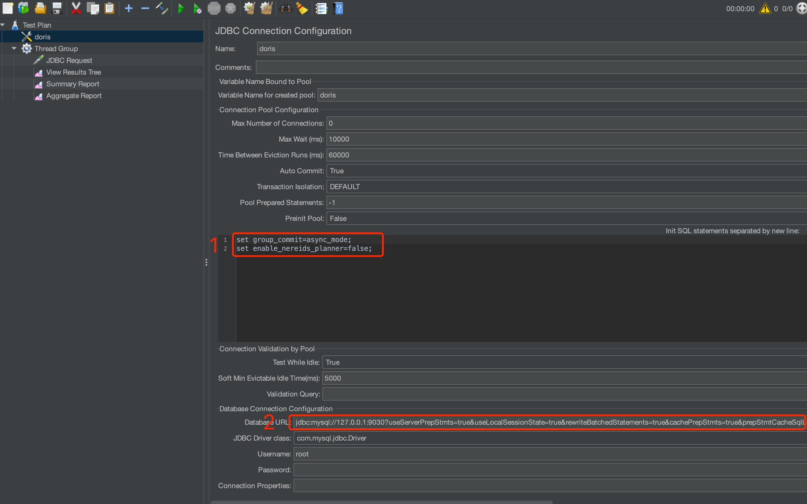
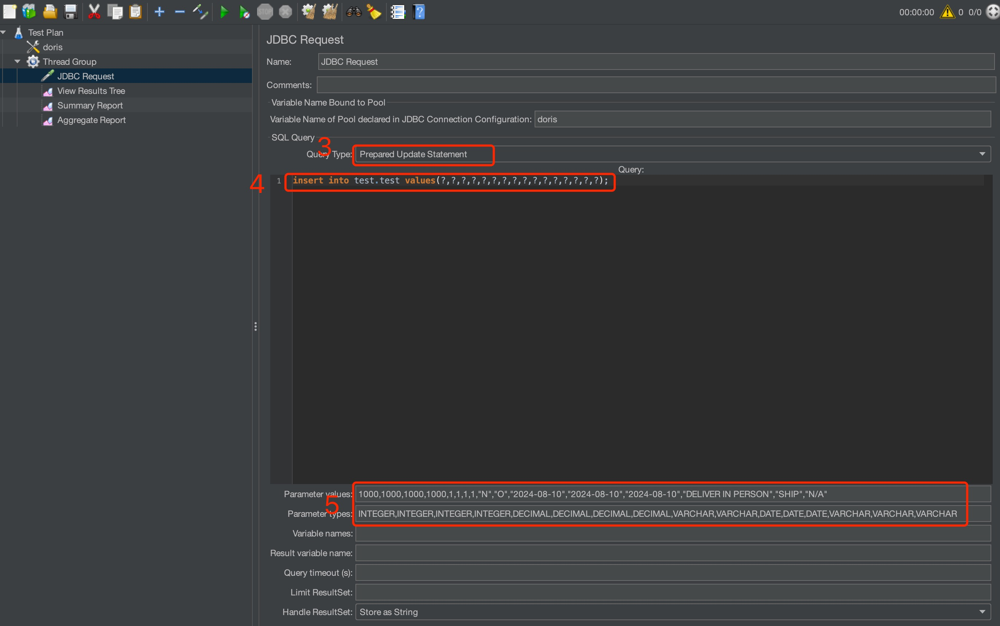

---
{
    "title": "高並行データロードの最適化（Group Commit）",
    "language": "ja",
    "description": "Doris Group Commit は、高頻度の小規模バッチ書き込みトランザクションを統合し、FE の解析処理とバージョン数の増加による負荷を抑えて、INSERT と Stream Load の高並行時の性能を向上させます。",
    "keywords": [
        "Group Commit",
        "高並行データロード",
        "高頻度の小規模バッチ書き込み",
        "INSERT INTO の最適化",
        "Stream Load の最適化",
        "Doris のデータロード性能",
        "PreparedStatement",
        "WAL"
    ]
}
---

<!-- 知識の種類: 機能 + 操作手順 + 設定パラメータ -->
<!-- 適用場面: 高並行の小規模バッチ書き込み / リアルタイムデータロード / 性能チューニング -->

高頻度の小規模バッチ書き込みでは、従来のデータロード方式に次の問題があります。

- データロードごとに独立したトランザクションが作成され、そのたびに FE で SQL の解析と実行計画の生成が必要になるため、全体の性能が低下します。
- データロードごとに新しいバージョンが生成されるため、バージョン数が急増し、バックグラウンドの Compaction にかかる負荷が増します。

これらの問題を解決するため、Doris は Group Commit を導入しています。Group Commit は新しいデータロード方式ではなく、既存のデータロード方式を最適化する拡張機能で、主に次を対象とします。

- `INSERT INTO tbl VALUES(...)` 文
- Stream Load

Group Commit は、複数の小規模バッチのデータロードをバックグラウンドで単一の大きなトランザクションにまとめてコミットし、高並行の小規模バッチ書き込みの性能を大幅に向上させます。PreparedStatement と組み合わせると、さらに高い性能向上が得られます。

## 適用場面とモードの選択 {#applicable-scenarios-and-selection}

| 場面 | 推奨モード | 説明 |
| --- | --- | --- |
| 完了直後にデータが参照可能であることを求める高並行書き込み | `sync_mode` | 複数のデータロードを単一のトランザクションにまとめ、コミット後に呼び出しが戻ります。 |
| 遅延に敏感な高頻度書き込み | `async_mode` | 先にデータを WAL に書き込んで呼び出しがすぐに戻り、バックグラウンドで非同期にコミットします。 |
| Group Commit が不要な場合 | `off_mode` | Group Commit を無効にし、通常のデータロード経路を使用します。 |

## Group Commit のモード {#group-commit-modes}

Group Commit による書き込みには、次の3つのモードがあります。

- **無効モード（`off_mode`）**

    Group Commit を無効にします。

- **同期モード（`sync_mode`）**

    Doris は負荷とテーブルの `group_commit_interval` プロパティに基づいて複数のデータロードを単一のトランザクションにまとめてコミットし、各データロードはコミット後に戻ります。データロードの完了直後にデータが参照可能であることを求める、高並行書き込みに適しています。

- **非同期モード（`async_mode`）**

    Doris はまずデータを WAL（`Write Ahead Log`）に書き込み、データロードはすぐに戻ります。その後、負荷とテーブルの `group_commit_interval` プロパティに基づいてデータを非同期にコミットし、コミット後にデータが参照可能になります。WAL によるディスク容量の過剰な使用を防ぐため、1回のデータロードで大量のデータを取り込む場合、Doris は自動的に `sync_mode` に切り替えます。遅延に敏感な高頻度書き込みに適しています。

    WAL ファイルの数は FE の HTTP インターフェースで確認できます。詳しくは[こちら](../../../admin-manual/open-api/fe-http/get-wal-size-action)を参照してください。BE のメトリクスで `wal` を検索することもできます。

## クイックスタート {#quick-start}

以下の例では、いずれも次のテーブル定義を使用します。

```sql
CREATE TABLE `dt` (
    `id` int(11) NOT NULL,
    `name` varchar(50) NULL,
    `score` int(11) NULL
) ENGINE=OLAP
DUPLICATE KEY(`id`)
DISTRIBUTED BY HASH(`id`) BUCKETS 1
PROPERTIES (
    "replication_num" = "1"
);
```

### テーブルプロパティの設定 {#table-property-configuration}

:::info
テーブルプロパティ `group_commit_mode` は、バージョン **4.1.0** 以降でサポートされます。
:::

テーブル単位で Group Commit のデフォルトモードを設定できます。Stream Load で `group_commit` HTTP Header を指定しなかった場合は、テーブルプロパティのモードが使用されます。

**1. テーブル作成時に設定する：**

```sql
CREATE TABLE `dt` (
    `id` int(11) NOT NULL,
    `name` varchar(50) NULL,
    `score` int(11) NULL
) ENGINE=OLAP
DUPLICATE KEY(`id`)
DISTRIBUTED BY HASH(`id`) BUCKETS 1
PROPERTIES (
    "replication_num" = "1",
    "group_commit_mode" = "async_mode"
);
```

**2. テーブルプロパティを変更する：**

```sql
# Change to sync mode
ALTER TABLE dt SET ("group_commit_mode" = "sync_mode");

# Disable Group Commit
ALTER TABLE dt SET ("group_commit_mode" = "off_mode");
```

**3. テーブルプロパティを確認する：**

`SHOW CREATE TABLE` には、値が `off_mode` の場合を除き、`group_commit_mode` プロパティが表示されます。

```sql
mysql> SHOW CREATE TABLE dt;
+-------+----------------------------------------------------------------------------------------------------------------------------------------------------------------------------------------------------------------------+
| Table | Create Table                                                                                                                                                                                                       |
+-------+----------------------------------------------------------------------------------------------------------------------------------------------------------------------------------------------------------------------+
| dt    | CREATE TABLE `dt` (
  `id` int(11) NOT NULL,
  `name` varchar(50) NULL,
  `score` int(11) NULL
) ENGINE=OLAP
DUPLICATE KEY(`id`)
DISTRIBUTED BY HASH(`id`) BUCKETS 1
PROPERTIES (
    "group_commit_mode" = "async_mode"
) |
+-------+----------------------------------------------------------------------------------------------------------------------------------------------------------------------------------------------------------------------+
1 row in set (0.00 sec)
```

**4. 優先順位：**

| データロード方式 | 優先順位（高い順） |
| --- | --- |
| Stream Load | `group_commit` HTTP Header > テーブルプロパティ `group_commit_mode` |
| INSERT INTO VALUES | セッション変数 `group_commit` > テーブルプロパティ `group_commit_mode` |

## 使用方法 {#usage}

### INSERT INTO VALUES {#insert-into-values}

セッション変数 `group_commit` を設定すると、Group Commit を有効にできます。セッション変数はテーブルプロパティより優先されます。

**非同期モード：**

```sql
# Set the session variable to enable group commit (default is off_mode), using async mode
mysql> set group_commit = async_mode;

# The returned label starts with group_commit, which tells you that group commit is in use
mysql> insert into dt values(1, 'Bob', 90), (2, 'Alice', 99);
Query OK, 2 rows affected (0.05 sec)
{'label':'group_commit_a145ce07f1c972fc-bd2c54597052a9ad', 'status':'PREPARE', 'txnId':'181508'}

# This label and txn_id match the previous one, indicating that the inserts are batched into the same load task
mysql> insert into dt(id, name) values(3, 'John');
Query OK, 1 row affected (0.01 sec)
{'label':'group_commit_a145ce07f1c972fc-bd2c54597052a9ad', 'status':'PREPARE', 'txnId':'181508'}

# The data is not immediately queryable
mysql> select * from dt;
Empty set (0.01 sec)

# After 10 seconds, the data is queryable. The data visibility delay is controlled by the table property group_commit_interval.
mysql> select * from dt;
+------+-------+-------+
| id   | name  | score |
+------+-------+-------+
|    1 | Bob   |    90 |
|    2 | Alice |    99 |
|    3 | John  |  NULL |
+------+-------+-------+
3 rows in set (0.02 sec)
```

**同期モード：**

```sql
# Set the session variable to enable group commit (default is off_mode), using sync mode
mysql> set group_commit = sync_mode;

# The returned label starts with group_commit, which tells you that group commit is in use. The load takes at least the value of the table property group_commit_interval.
mysql> insert into dt values(4, 'Bob', 90), (5, 'Alice', 99);
Query OK, 2 rows affected (10.06 sec)
{'label':'group_commit_d84ab96c09b60587_ec455a33cb0e9e87', 'status':'PREPARE', 'txnId':'3007', 'query_id':'fc6b94085d704a94-a69bfc9a202e66e2'}

# The data is queryable immediately
mysql> select * from dt;
+------+-------+-------+
| id   | name  | score |
+------+-------+-------+
|    1 | Bob   |    90 |
|    2 | Alice |    99 |
|    3 | John  |  NULL |
|    4 | Bob   |    90 |
|    5 | Alice |    99 |
+------+-------+-------+
5 rows in set (0.03 sec)
```

**無効モード：**

```sql
mysql> set group_commit = off_mode;
```

### JDBC（PreparedStatement）の使用 {#using-jdbc-preparedstatement}

JDBC の `insert into values` でデータを書き込む場合、SQL の解析と実行計画の生成にかかる負荷を減らすため、Doris は FE 側で MySQL プロトコルの `PreparedStatement` 機能をサポートします。`PreparedStatement` を使用すると、SQL とそのデータロード計画がセッション単位のメモリキャッシュに保存され、以降のデータロードではキャッシュされたオブジェクトが直接使用されるため、FE の CPU 使用量を抑えられます。

**1. JDBC URL を設定し、サーバー側で PreparedStatement を有効にする：**

```text
url = jdbc:mysql://127.0.0.1:9030/db?useServerPrepStmts=true&useLocalSessionState=true&rewriteBatchedStatements=true&cachePrepStmts=true&prepStmtCacheSqlLimit=99999&prepStmtCacheSize=500
```

**2. 次のいずれかの方法でセッション変数 `group_commit` を設定する：**

- JDBC URL に `sessionVariables=group_commit=async_mode` を追加する：

    ```text
    url = jdbc:mysql://127.0.0.1:9030/db?useServerPrepStmts=true&useLocalSessionState=true&rewriteBatchedStatements=true&cachePrepStmts=true&prepStmtCacheSqlLimit=99999&prepStmtCacheSize=500&sessionVariables=group_commit=async_mode,enable_nereids_planner=false
    ```

- SQL 文を実行する：

    ```java
    try (Statement statement = conn.createStatement()) {
        statement.execute("SET group_commit = async_mode;");
    }
    ```

**3. `PreparedStatement` でバッチ書き込みを行う：**

```java
private static final String JDBC_DRIVER = "com.mysql.jdbc.Driver";
private static final String URL_PATTERN = "jdbc:mysql://%s:%d/%s?useServerPrepStmts=true&useLocalSessionState=true&rewriteBatchedStatements=true&cachePrepStmts=true&prepStmtCacheSqlLimit=99999&prepStmtCacheSize=50&sessionVariables=group_commit=async_mode";
private static final String HOST = "127.0.0.1";
private static final int PORT = 9030;
private static final String DB = "db";
private static final String TBL = "dt";
private static final String USER = "root";
private static final String PASSWD = "";
private static final int INSERT_BATCH_SIZE = 10;

private static void groupCommitInsertBatch() throws Exception {
    Class.forName(JDBC_DRIVER);
    // add rewriteBatchedStatements=true and cachePrepStmts=true in JDBC url
    // set session variables by sessionVariables=group_commit=async_mode in JDBC url
    try (Connection conn = DriverManager.getConnection(
            String.format(URL_PATTERN, HOST, PORT, DB), USER, PASSWD)) {

        String query = "insert into " + TBL + " values(?, ?, ?)";
        try (PreparedStatement stmt = conn.prepareStatement(query)) {
            for (int j = 0; j < 5; j++) {
                // 10 rows per insert
                for (int i = 0; i < INSERT_BATCH_SIZE; i++) {
                    stmt.setInt(1, i);
                    stmt.setString(2, "name" + i);
                    stmt.setInt(3, i + 10);
                    stmt.addBatch();
                }
                int[] result = stmt.executeBatch();
            }
        }
    } catch (Exception e) {
        e.printStackTrace();
    }
}
```

:::tip
高頻度の `INSERT INTO` 文は大量の監査ログを出力し、最終的な性能に影響するため、PreparedStatement の監査ログ出力はデフォルトで無効です。セッション変数を設定すると、PreparedStatement の監査ログを出力するかどうかを制御できます。

```sql
# Set the session variable to enable audit logging for prepared statements. The default value is false, which disables audit logging for prepared statements.
set enable_prepared_stmt_audit_log=true;
```
:::

JDBC の使い方について詳しくは、[INSERT によるデータ同期](../import-way/insert-into-manual.md)を参照してください。

### Golang クライアントでのバッチ化 {#batching-with-the-golang-client}

Golang ではプリペアドステートメントのサポートに制限があるため、クライアント側で手動でバッチ化すると Group Commit の性能を向上させられます。次にプログラム例を示します。

```Golang
package main

import (
	"database/sql"
	"fmt"
	"math/rand"
	"strings"
	"sync"
	"sync/atomic"
	"time"

	_ "github.com/go-sql-driver/mysql"
)

const (
	host     = "127.0.0.1"
	port     = 9030
	db       = "test"
	user     = "root"
	password = ""
	table    = "async_lineitem"
)

var (
	threadCount = 20
	batchSize   = 100
)

var totalInsertedRows int64
var rowsInsertedLastSecond int64

func main() {
	dbDSN := fmt.Sprintf("%s:%s@tcp(%s:%d)/%s?parseTime=true", user, password, host, port, db)
	db, err := sql.Open("mysql", dbDSN)
	if err != nil {
		fmt.Printf("Error opening database: %s\n", err)
		return
	}
	defer db.Close()

	var wg sync.WaitGroup
	for i := 0; i < threadCount; i++ {
		wg.Add(1)
		go func() {
			defer wg.Done()
			groupCommitInsertBatch(db)
		}()
	}

	go logInsertStatistics()

	wg.Wait()
}

func groupCommitInsertBatch(db *sql.DB) {
	for {
		valueStrings := make([]string, 0, batchSize)
		valueArgs := make([]interface{}, 0, batchSize*16)
		for i := 0; i < batchSize; i++ {
		    valueStrings = append(valueStrings, "(?, ?, ?, ?, ?, ?, ?, ?, ?, ?, ?, ?, ?, ?, ?, ?)")
			valueArgs = append(valueArgs, rand.Intn(1000))
			valueArgs = append(valueArgs, rand.Intn(1000))
			valueArgs = append(valueArgs, rand.Intn(1000))
			valueArgs = append(valueArgs, rand.Intn(1000))
			valueArgs = append(valueArgs, sql.NullFloat64{Float64: 1.0, Valid: true})
			valueArgs = append(valueArgs, sql.NullFloat64{Float64: 1.0, Valid: true})
			valueArgs = append(valueArgs, sql.NullFloat64{Float64: 1.0, Valid: true})
			valueArgs = append(valueArgs, sql.NullFloat64{Float64: 1.0, Valid: true})
			valueArgs = append(valueArgs, "N")
			valueArgs = append(valueArgs, "O")
			valueArgs = append(valueArgs, time.Now())
			valueArgs = append(valueArgs, time.Now())
			valueArgs = append(valueArgs, time.Now())
			valueArgs = append(valueArgs, "DELIVER IN PERSON")
			valueArgs = append(valueArgs, "SHIP")
			valueArgs = append(valueArgs, "N/A")
		}
		stmt := fmt.Sprintf("INSERT INTO %s VALUES %s",
			table, strings.Join(valueStrings, ","))
		_, err := db.Exec(stmt, valueArgs...)
		if err != nil {
			fmt.Printf("Error executing batch: %s\n", err)
			return
		}
		atomic.AddInt64(&rowsInsertedLastSecond, int64(batchSize))
		atomic.AddInt64(&totalInsertedRows, int64(batchSize))
	}
}

func logInsertStatistics() {
	for {
		time.Sleep(1 * time.Second)
		fmt.Printf("Total inserted rows: %d\n", totalInsertedRows)
		fmt.Printf("Rows inserted in the last second: %d\n", rowsInsertedLastSecond)
		rowsInsertedLastSecond = 0
	}
}

```

### Stream Load {#stream-load}

Stream Load でデータをロードする場合は、HTTP Header に `group_commit` パラメータを設定して Group Commit を有効にできます。

:::note
`group_commit` Header を指定せず、テーブルプロパティに `group_commit_mode` が設定されている場合は、テーブルプロパティのモードが自動的に使用されます。
:::

`data.csv` の内容が次のとおりだとします。

```text
6,Amy,60
7,Ross,98
```

**非同期モード：**

```shell
# Add the "group_commit:async_mode" header during load

curl --location-trusted -u {user}:{passwd} -T data.csv -H "group_commit:async_mode"  -H "column_separator:,"  http://{fe_host}:{http_port}/api/db/dt/_stream_load
{
    "TxnId": 7009,
    "Label": "group_commit_c84d2099208436ab_96e33fda01eddba8",
    "Comment": "",
    "GroupCommit": true,
    "Status": "Success",
    "Message": "OK",
    "NumberTotalRows": 2,
    "NumberLoadedRows": 2,
    "NumberFilteredRows": 0,
    "NumberUnselectedRows": 0,
    "LoadBytes": 19,
    "LoadTimeMs": 35,
    "StreamLoadPutTimeMs": 5,
    "ReadDataTimeMs": 0,
    "WriteDataTimeMs": 26
}

# The returned GroupCommit is true, which means the load entered the group commit path
# The returned Label starts with group_commit and is the label associated with the load that actually consumes the data
```

**同期モード：**

```shell
# Add the "group_commit:sync_mode" header during load

curl --location-trusted -u {user}:{passwd} -T data.csv -H "group_commit:sync_mode"  -H "column_separator:,"  http://{fe_host}:{http_port}/api/db/dt/_stream_load
{
    "TxnId": 3009,
    "Label": "group_commit_d941bf17f6efcc80_ccf4afdde9881293",
    "Comment": "",
    "GroupCommit": true,
    "Status": "Success",
    "Message": "OK",
    "NumberTotalRows": 2,
    "NumberLoadedRows": 2,
    "NumberFilteredRows": 0,
    "NumberUnselectedRows": 0,
    "LoadBytes": 19,
    "LoadTimeMs": 10044,
    "StreamLoadPutTimeMs": 4,
    "ReadDataTimeMs": 0,
    "WriteDataTimeMs": 10038
}

# The returned GroupCommit is true, which means the load entered the group commit path
# The returned Label starts with group_commit and is the label associated with the load that actually consumes the data
```

Stream Load の構文とベストプラクティスについて詳しくは、[Stream Load](../import-way/stream-load-manual)を参照してください。

## 自動コミットの条件 {#auto-commit-conditions}

<!-- 知識の種類: 設定パラメータ -->

コミット間隔（デフォルトは10秒）が経過するか、蓄積データがデフォルトのサイズしきい値である128 MBに達すると、コミットが実行されます。ワークロードに応じて、テーブル単位の2つのしきい値を調整してください。

### コミット間隔の調整 {#adjusting-the-commit-interval}

デフォルトのコミット間隔は10秒です。テーブル設定を変更して調整できます。

```sql
# Change the commit interval to 2 seconds
ALTER TABLE dt SET ("group_commit_interval_ms" = "2000");
```

**チューニングの目安：**

| 設定例 | 利点 | 欠点 |
| --- | --- | --- |
| 短い間隔（例：2秒） | データが参照可能になるまでの遅延が小さく、リアルタイム性が求められる場合に適している | コミット頻度が増え、バージョン数がより速く増加し、バックグラウンドの Compaction の負荷が高まる |
| 長い間隔（例：30秒） | コミットするバッチが大きくなり、バージョン数の増加とシステム負荷を抑えられる | データが参照可能になるまでの遅延が大きくなる |

業務で許容できるデータの可視化遅延に基づいて設定してください。システムの負荷が高い場合は、必要に応じて間隔を長くできます。

### コミットするデータ量の調整 {#adjusting-the-commit-data-size}

**バージョン履歴：**

- テーブルプロパティ `group_commit_data_bytes` は Doris 2.1.0 で導入され、デフォルト値は134217728バイト（128 MB）です。
- 3.x、4.x、dev でも、このデフォルト値は変わりません。
- BE パラメータ `group_commit_queue_mem_limit` のデフォルト値は64 MBで、キューメモリのバックプレッシャーを制御します。コミットを起動するしきい値とは別の設定です。

Group Commit でコミットを起動するデータ量のデフォルトのしきい値は128 MBです。テーブル設定を変更して調整できます。

```sql
# Set the commit data-size trigger threshold to 256 MB
ALTER TABLE dt SET ("group_commit_data_bytes" = "268435456");
```

**チューニングの目安：**

| 設定例 | 利点 | 欠点 |
| --- | --- | --- |
| 小さいしきい値（例：32 MB） | メモリ使用量が少なく、リソースが限られた環境に適している | コミットするバッチが小さくなり、スループットが制限される可能性がある |
| 大きいしきい値（例：256 MB） | バッチコミットの効率とシステムのスループットが向上する | メモリ使用量が増える |

メモリリソースとデータの信頼性要件のバランスを考えて値を選択してください。メモリに余裕があり、より高いスループットが必要な場合は、256 MB以上に増やせます。

## 関連するシステム設定 {#related-system-configuration}

### BE の設定 {#be-configuration}

**`group_commit_wal_path`**

- 説明：Group Commit が WAL ファイルを保存するディレクトリです。
- デフォルト値：`storage_root_path` に設定された各ディレクトリの下に、`wal` というディレクトリが作成されます。設定例：

    ```text
    group_commit_wal_path=/data1/storage/wal;/data2/storage/wal;/data3/storage/wal
    ```

### コンピュートとストレージの分離モードでの Stream Load の転送 {#stream-load-forwarding-in-compute-storage-decoupled-mode}

コンピュートとストレージの分離モードで、ロードバランサーが Stream Load リクエストをランダムに振り分けると、同じテーブルへのリクエストが異なる BE ノードに届き、Group Commit で効率的にバッチ化できません。BE の転送を有効にすると、リクエストを受け取った BE がそのテーブルの転送先 BE にリクエストを転送するため、同じテーブルへのリクエストが1つの BE に集まります。

| 設定項目 | 設定先 | デフォルト値 | 説明 |
| --- | --- | --- | --- |
| `enable_group_commit_streamload_be_forward` | FE | `false` | Stream Load の BE 転送を有効にするかどうか。分離モードで、リクエストが Group Commit を使用する場合にのみ有効 |
| `enable_group_commit_streamload_be_forward` | BE | `false` | BE のエンドポイント `/api/{db}/{table}/_stream_load_forward` へのリクエストを許可するかどうか。**Doris 4.0 系列では4.0.8、Doris 4.1 系列では4.1.4で追加** |

この設定は FE と BE の**両方**で `true` にする必要があります。

:::caution 動作の変更（4.0.8 / 4.1.4）

Doris 4.0 系列の4.0.8以降、および Doris 4.1 系列の4.1.4以降、BE の `_stream_load_forward` エンドポイントには次の2つの制限があります。

- エンドポイントは BE の設定 `enable_group_commit_streamload_be_forward` で制御されます。`false`（デフォルト）の場合、リクエストには `Stream load forward is disabled` を伴う `403 Forbidden` が返されます。
- この設定を有効にした場合も、エンドポイントへのリクエストには認証とグローバルな `LOAD` 権限が必要です。

アップグレード前に FE でのみこの機能を有効にしていた場合、アップグレード後は転送に失敗します。すべての `be.conf` に `enable_group_commit_streamload_be_forward=true` を追加し、データロードに使用するアカウントに `LOAD` 権限があることを確認してください。

:::

### Follower FE への転送 {#forwarding-to-a-follower-fe}

> バージョン4.1.4以降でサポートされます。

上記の BE 転送に加えて、FE は Group Commit を使用する Stream Load リクエストをラウンドロビン方式で Follower FE に転送できます。これにより、バッチ化の負荷を複数の FE に分散できます。

| 設定項目 | 設定先 | デフォルト値 | 説明 |
| --- | --- | --- | --- |
| `enable_forward_group_commit_stream_load_to_follower` | FE | `false` | Group Commit を使用する Stream Load リクエストをラウンドロビン方式で Follower FE に転送するかどうか |

注：対象テーブルの `light_schema_change` が `false` の場合、この転送はサポートされず、リクエストはエラーになります。

### WAL ファイル数の制限 {#wal-count-limit}

> バージョン4.1.4以降でサポートされます。

`async_mode` の Group Commit は、まずデータを WAL に書き込み、非同期に再生します。WAL の再生が失敗し続けると、WAL ファイルが蓄積してディスク容量を使い切る可能性があります。バージョン4.1.4以降、BE の設定 `group_commit_max_wal_num_per_table` で、テーブルごとの WAL ファイル数を制限できます。

| 設定項目 | 設定先 | デフォルト値 | 説明 |
| --- | --- | --- | --- |
| `group_commit_max_wal_num_per_table` | BE | `10` | 1つのテーブルで許容される Group Commit の WAL ファイル数の上限。`0` は制限なしを意味する。動的に変更可能 |

上限を超えると、そのテーブルの `async_mode` による Group Commit のデータロードは、次のような `EXCEEDED_LIMIT` エラーで拒否されます。

```text
Too many group commit async WALs for table <table_name>
```

このエラーは、WAL の再生に問題（スキーマ変更やディスク障害など）が発生していることを示します。単に上限を引き上げるのではなく、原因を調査して WAL の再生を復旧してください。

## 制限事項 {#limitations}

### Group Commit が適用されなくなる場合 {#group-commit-fallback-scenarios}

| データロード方式 | Group Commit が適用されなくなる条件 |
| --- | --- |
| `INSERT INTO VALUES` | トランザクション書き込みを使用する（`Begin; INSERT INTO VALUES; COMMIT`）<br/>ラベルを指定する（`INSERT INTO dt WITH LABEL {label} VALUES`）<br/>VALUES に式が含まれる（`INSERT INTO dt VALUES (1 + 100)`）<br/>列更新による書き込み<br/>軽量スキーマ変更をサポートしないテーブル |
| `Stream Load` | 2フェーズコミットを使用する<br/>ラベルを指定する（`-H "label:my_label"`）<br/>列更新による書き込み<br/>軽量スキーマ変更をサポートしないテーブル |

### Unique モデル {#unique-model}

- Group Commit はコミット順序を保証しません。データの整合性を確保するには、Sequence 列を使用してください。

### WAL の制限 {#wal-limitations}

4.1.5以降、WAL の再生では、末尾の長さ情報またはペイロードが不完全な場合、それをファイルの終端として扱います。データブロックが完全であれば、末尾のチェックサムフィールドが最後まで書き込まれていなくても再生できます。書き込みが完了していない末尾のレコードは、完全なレコードとして復元されません。WAL ファイルが欠落または破損している場合も、データの完全性は保証できません。

- `async_mode` はデータを WAL に書き込み、成功時に WAL を削除し、失敗時には WAL から復旧します。
- WAL ファイルは単一レプリカで保存されます。対応するディスクが破損したり、ファイルが誤って削除されたりすると、データが失われる可能性があります。
- BE ノードを停止する際は、データ損失を防ぐために `DECOMMISSION` コマンドを使用してください。
- 次の場合、`async_mode` は自動的に `sync_mode` に切り替わります。
    - 1回のデータロードのデータ量が多すぎる場合（単一の WAL ディレクトリの容量の80%を超える場合）
    - データサイズが不明なチャンク化された Stream Load の場合
    - ディスクの空き容量が不足している場合
- 大規模な Schema Change の実行中は Group Commit による書き込みが拒否されるため、クライアントは再試行する必要があります。

## 性能 {#performance}

高並行かつデータ量が少ない場面での `group commit`（`async_mode` を使用）の書き込み性能を、`Stream Load` と `JDBC` でテストしました。

### Stream Load のログデータを使ったテスト {#stream-load-log-scenario-test}

**マシン構成：**

- FE 1台：Alibaba Cloud、8コア CPU、16 GBメモリ、100 GB ESSD PL1 クラウドディスク × 1
- BE 3台：Alibaba Cloud、16コア CPU、64 GBメモリ、1 TB ESSD PL1 クラウドディスク × 1
- テストクライアント1台：Alibaba Cloud、16コア CPU、64 GBメモリ、100 GB ESSD PL1 クラウドディスク × 1
- テストバージョン：Doris-3.0.1

**データセット：**

- `httplogs` データセット。合計31 GB、247 million行

**テストツール：**

- [doris-streamloader](../../../connection-integration/data-integration/doris-streamloader.md)

**テスト方法：**

- 同時実行ごとのデータ量と並行数を変えて `247249096` 行をロードし、`non-group_commit` モードと `group_commit` の `async_mode` を比較します。

**テスト結果：**

| データロード方式 | 同時実行ごとのデータ量 | 並行数 | 所要時間（秒） | データロード速度（行/秒） | データロードスループット（MB/秒） |
| --- | --- | --- | --- | --- | --- |
| `group_commit` | 10 KB | 10 | 2204 | 112,181 | 14.8 |
| `group_commit` | 10 KB | 30 | 2176 | 113,625 | 15.0 |
| `group_commit` | 100 KB | 10 | 283 | 873,671 | 115.1 |
| `group_commit` | 100 KB | 30 | 244 | 1,013,315 | 133.5 |
| `group_commit` | 500 KB | 10 | 125 | 1,977,992 | 260.6 |
| `group_commit` | 500 KB | 30 | 122 | 2,026,631 | 267.1 |
| `group_commit` | 1 MB | 10 | 119 | 2,077,723 | 273.8 |
| `group_commit` | 1 MB | 30 | 119 | 2,077,723 | 273.8 |
| `group_commit` | 10 MB | 10 | 118 | 2,095,331 | 276.1 |
| `non-group_commit` | 1 MB | 10 | 1883 | 131,305 | 17.3 |
| `non-group_commit` | 10 MB | 10 | 294 | 840,983 | 105.4 |
| `non-group_commit` | 10 MB | 30 | 118 | 2,095,331 | 276.1 |

上記の `group_commit` のテストでは、BE の CPU 使用率は10%から40%の範囲でした。

結果から、`group_commit` モードは少量データの並行データロードで性能を効果的に向上させるとともに、バージョン数を減らし、バックグラウンドでのデータ統合の負荷を軽減できることが分かります。

### JDBC {#jdbc}

**マシン構成：**

- FE 1台：Alibaba Cloud、8コア CPU、16 GBメモリ、100 GB ESSD PL1 クラウドディスク × 1
- BE 1台：Alibaba Cloud、16コア CPU、64 GBメモリ、500 GB ESSD PL1 クラウドディスク × 1
- テストクライアント1台：Alibaba Cloud、16コア CPU、64 GBメモリ、100 GB ESSD PL1 クラウドディスク × 1
- テストバージョン：Doris-3.0.1
- 性能向上のため、プリペアドステートメントの監査ログ出力は無効

**データセット：**

- TPC-H sf10 の `lineitem` テーブルのデータセット。30ファイル、合計約22 GB、180 million行

**テストツール：**

- [DataX](https://github.com/alibaba/DataX)

**テスト方法：**

- 並行数と `INSERT` あたりの行数を変え、`txtfilereader` から `mysqlwriter` にデータを書き込みます。

**テスト結果：**

| INSERT あたりの行数 | 並行数 | データロード速度（行/秒） | データロードスループット（MB/秒） |
| --- | --- | --- | --- |
| 100 | 10 | 160,758 | 17.21 |
| 100 | 20 | 210,476 | 22.19 |
| 100 | 30 | 214,323 | 22.92 |

上記のテストでは、FE の CPU 使用率は約60-70%、BE の CPU 使用率は約10-20%でした。

### INSERT INTO の同期モード：小規模バッチ {#insert-into-sync-mode-small-batches}

**マシン構成：**

- FE 1台：Alibaba Cloud、16コア CPU、64 GBメモリ、500 GB ESSD PL1 クラウドディスク × 1
- BE 5台：Alibaba Cloud、16コア CPU、64 GBメモリ、1 TB ESSD PL1 クラウドディスク × 1
- テストクライアント1台：Alibaba Cloud、16コア CPU、64 GBメモリ、100 GB ESSD PL1 クラウドディスク × 1
- テストバージョン：Doris-3.0.1

**データセット：**

- TPC-H sf10 の `lineitem` テーブルのデータセット。
- CREATE TABLE 文は次のとおりです。

    ```sql
    CREATE TABLE IF NOT EXISTS lineitem (
      L_ORDERKEY    INTEGER NOT NULL,
      L_PARTKEY     INTEGER NOT NULL,
      L_SUPPKEY     INTEGER NOT NULL,
      L_LINENUMBER  INTEGER NOT NULL,
      L_QUANTITY    DECIMAL(15,2) NOT NULL,
      L_EXTENDEDPRICE  DECIMAL(15,2) NOT NULL,
      L_DISCOUNT    DECIMAL(15,2) NOT NULL,
      L_TAX         DECIMAL(15,2) NOT NULL,
      L_RETURNFLAG  CHAR(1) NOT NULL,
      L_LINESTATUS  CHAR(1) NOT NULL,
      L_SHIPDATE    DATE NOT NULL,
      L_COMMITDATE  DATE NOT NULL,
      L_RECEIPTDATE DATE NOT NULL,
      L_SHIPINSTRUCT CHAR(25) NOT NULL,
      L_SHIPMODE     CHAR(10) NOT NULL,
      L_COMMENT      VARCHAR(44) NOT NULL
    )
    DUPLICATE KEY(L_ORDERKEY, L_PARTKEY, L_SUPPKEY, L_LINENUMBER)
    DISTRIBUTED BY HASH(L_ORDERKEY) BUCKETS 32
    PROPERTIES (
      "replication_num" = "3"
    );
    ```

**テストツール：**

- [Jmeter](https://jmeter.apache.org/)

設定する Jmeter のパラメータを次の図に示します。




1. テスト前の init 文として `set group_commit=async_mode` と `set enable_nereids_planner=false` を設定します。
2. JDBC PreparedStatement を有効にします。URL 全体は次のとおりです。

    ```text
    jdbc:mysql://127.0.0.1:9030?useServerPrepStmts=true&useLocalSessionState=true&rewriteBatchedStatements=true&cachePrepStmts=true&prepStmtCacheSqlLimit=99999&prepStmtCacheSize=50&sessionVariables=group_commit=async_mode,enable_nereids_planner=false`.
    ```

3. データロードの種類を prepared update statement に設定します。
4. データロード文を設定します。
5. 毎回ロードする値を設定します。各値が対応するデータ型と一致することを確認してください。

**テスト方法：**

- `Jmeter` を使用して `Doris` にデータを書き込みます。各並行処理で、`INSERT INTO` 1回につき1行を書き込みます。

**テスト結果（単位：行/秒）：**

以下では並行数30、100、500でテストします。

**並行数30、同期モード、5台の BE と3レプリカ：**

| Group Commit の間隔 | 10ms | 20ms | 50ms | 100ms |
| --- | --- | --- | --- | --- |
| `enable_nereids_planner=true` | 891.8 | 701.1 | 400.0 | 237.5 |
| `enable_nereids_planner=false` | 885.8 | 688.1 | 398.7 | 232.9 |

**並行数100、同期モード、5台の BE と3レプリカ：**

| Group Commit の間隔 | 10ms | 20ms | 50ms | 100ms |
| --- | --- | --- | --- | --- |
| `enable_nereids_planner=true` | 2427.8 | 2068.9 | 1259.4 | 764.9 |
| `enable_nereids_planner=false` | 2320.4 | 1899.3 | 1206.2 | 749.7 |

**並行数500、同期モード、5台の BE と3レプリカ：**

| Group Commit の間隔 | 10ms | 20ms | 50ms | 100ms |
| --- | --- | --- | --- | --- |
| `enable_nereids_planner=true` | 5567.5 | 5713.2 | 4681.0 | 3131.2 |
| `enable_nereids_planner=false` | 4471.6 | 5042.5 | 4932.2 | 3641.1 |

### INSERT INTO の同期モード：大規模バッチ {#insert-into-sync-mode-large-batches}

**マシン構成：**

- FE 1台：Alibaba Cloud、16コア CPU、64 GBメモリ、500 GB ESSD PL1 クラウドディスク × 1
- BE 5台：Alibaba Cloud、16コア CPU、64 GBメモリ、1 TB ESSD PL1 クラウドディスク × 1。注：テストでは BE をそれぞれ1台、3台、5台使用しました。
- テストクライアント1台：Alibaba Cloud、16コア CPU、64 GBメモリ、100 GB ESSD PL1 クラウドディスク × 1
- テストバージョン：Doris-3.0.1

**データセット：**

- TPC-H sf10 の `lineitem` テーブルのデータセット。
- CREATE TABLE 文は次のとおりです。

    ```sql
    CREATE TABLE IF NOT EXISTS lineitem (
      L_ORDERKEY    INTEGER NOT NULL,
      L_PARTKEY     INTEGER NOT NULL,
      L_SUPPKEY     INTEGER NOT NULL,
      L_LINENUMBER  INTEGER NOT NULL,
      L_QUANTITY    DECIMAL(15,2) NOT NULL,
      L_EXTENDEDPRICE  DECIMAL(15,2) NOT NULL,
      L_DISCOUNT    DECIMAL(15,2) NOT NULL,
      L_TAX         DECIMAL(15,2) NOT NULL,
      L_RETURNFLAG  CHAR(1) NOT NULL,
      L_LINESTATUS  CHAR(1) NOT NULL,
      L_SHIPDATE    DATE NOT NULL,
      L_COMMITDATE  DATE NOT NULL,
      L_RECEIPTDATE DATE NOT NULL,
      L_SHIPINSTRUCT CHAR(25) NOT NULL,
      L_SHIPMODE     CHAR(10) NOT NULL,
      L_COMMENT      VARCHAR(44) NOT NULL
    )
    DUPLICATE KEY(L_ORDERKEY, L_PARTKEY, L_SUPPKEY, L_LINENUMBER)
    DISTRIBUTED BY HASH(L_ORDERKEY) BUCKETS 32
    PROPERTIES (
      "replication_num" = "3"
    );
    ```

**テストツール：**

- [Jmeter](https://jmeter.apache.org/)

**テスト方法：**

- `Jmeter` を使用して `Doris` にデータを書き込みます。各並行処理で、`INSERT INTO` 1回につき1000行を書き込みます。

**テスト結果（単位：行/秒）：**

以下では並行数30、100、500でテストします。

**並行数30、同期モード、5台の BE と3レプリカ：**

| Group Commit の間隔 | 10ms | 20ms | 50ms | 100ms |
| --- | --- | --- | --- | --- |
| `enable_nereids_planner=true` | 9.1K | 11.1K | 11.4K | 11.1K |
| `enable_nereids_planner=false` | 157.8K | 159.9K | 154.1K | 120.4K |

**並行数100、同期モード、5台の BE と3レプリカ：**

| Group Commit の間隔 | 10ms | 20ms | 50ms | 100ms |
| --- | --- | --- | --- | --- |
| `enable_nereids_planner=true` | 10.0K | 9.2K | 8.9K | 8.9K |
| `enable_nereids_planner=false` | 130.4K | 131.0K | 130.4K | 124.1K |

**並行数500、同期モード、5台の BE と3レプリカ：**

| Group Commit の間隔 | 10ms | 20ms | 50ms | 100ms |
| --- | --- | --- | --- | --- |
| `enable_nereids_planner=true` | 2.5K | 2.5K | 2.3K | 2.1K |
| `enable_nereids_planner=false` | 94.2K | 95.1K | 94.4K | 94.8K |

## FAQ {#faq}

<!-- 知識の種類: FAQ / トラブルシューティング -->

**Q1：データロードに Group Commit が使われているか、どうすれば確認できますか？**

- INSERT INTO VALUES：返された結果の `label` が `group_commit_` で始まります。複数のデータロードで同じ `label` と `txnId` が共有される場合もあります。
- Stream Load：返された JSON の `GroupCommit` フィールドが `true` で、`Label` が `group_commit_` で始まります。

**Q2：`async_mode` を有効にした後、いつデータをクエリできますか？**

- データが参照可能になるまでの遅延は、テーブルプロパティ `group_commit_interval_ms`（デフォルトは10秒）と `group_commit_data_bytes`（デフォルトのコミット起動しきい値は128 MB）で決まります。いずれかのしきい値に達した時点でコミットが実行されます。

**Q3：`async_mode` が自動的に `sync_mode` に切り替わるのはいつですか？**

- 1回のデータロードのデータ量が、単一の WAL ディレクトリの容量の80%を超える場合。
- データサイズが不明なチャンク化された Stream Load の場合。
- ディスクの空き容量が不足している場合。

**Q4：`INSERT INTO VALUES` に Group Commit が適用されないのはなぜですか？**

- 明示的なトランザクション内か、ラベルが指定されているか、VALUES に式が含まれるか、列更新による書き込みか、またはテーブルが軽量スキーマ変更をサポートしていないかを確認してください。詳しくは[Group Commit が適用されなくなる場合](#group-commit-fallback-scenarios)を参照してください。

**Q5：`async_mode` を使用するとデータ損失のリスクがありますか？**

- WAL ファイルは単一レプリカで保存されます。対応するディスクが破損したり、ファイルが誤って削除されたりすると、データが失われる可能性があります。BE ノードを停止する際は、データ損失を防ぐために必ず `DECOMMISSION` コマンドを使用してください。

**Q6：Unique モデルで Group Commit を使用する際の注意点は何ですか？**

- Group Commit はコミット順序を保証しません。データの整合性を確保するには、Sequence 列を使用してください。
