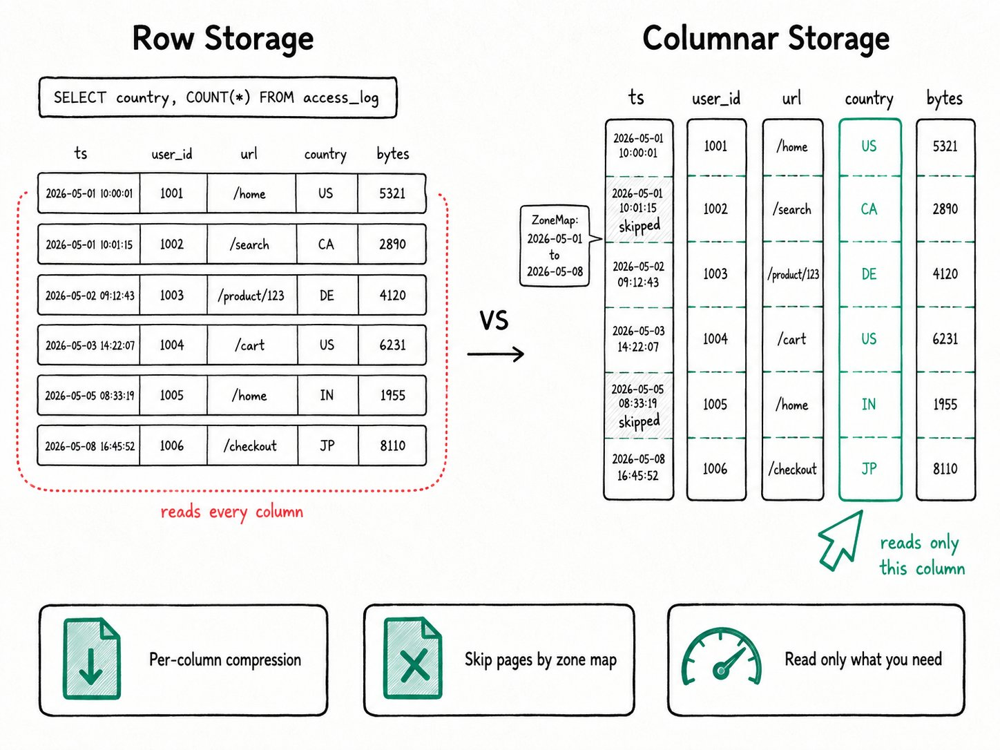

> **要約** Apache Doris のすべての OLAP テーブルは、データを列指向の Segment ファイルに書き込みます。各列にはそれぞれのエンコーディング（PLAIN、dictionary、RLE、bit-shuffle、frame-of-reference）が適用され、各ページは個別に圧縮されます（デフォルトは LZ4、オプションは ZSTD）。ページごとの zone map と bloom filter により、クエリはページをデコードせずに[スキップ](./data-pruning)できます。また、4.1 で追加された V3 フッターにより、列数の多いテーブルで Segment を開く際のレイテンシーが 16 倍改善します。


## Apache Doris でカラムナストレージを使う理由 {#why}

Apache Doris は、すべての OLAP テーブルを列指向の Segment ファイルに保存します。列指向のレイアウトなら、クエリが参照する列だけに I/O を絞り、列ごとに最適なコーデックを選び、スキップ用のインデックスを自然に配置できるためです。行指向のストレージで分析を行うと、次の問題が生じます。

- 50 列のテーブルで `GROUP BY country` を実行しても、残りの 49 列のデータまで読み込まれます。I/O コストはクエリが参照する列の幅ではなく、行の幅に比例します。
- 圧縮が効きにくくなります。隣接する行には無関係な型の値が混在するため、辞書、ランレングス、差分の各コーデックが効果を発揮できません。
- データをスキップしにくくなります。「この 64 KB ブロックには `ts >= '2026-05-01'` を満たす行がない」と判断するには列ごとの統計情報が必要ですが、行指向のレイアウトにはそれを置く自然な場所がありません。

列指向のレイアウトは、これらの問題を解決します。同じ列の値がディスク上でまとまるため、その型に適した変換をコーデックに選べます。また、ページインデックスを使えば、データを[展開する前](./vectorized-execution)にリーダーが述語を評価できます。

## Apache Doris のカラムナストレージとは？ {#what}

Apache Doris のカラムナストレージは、すべての OLAP テーブル（Duplicate、Unique、Aggregate）が共有する、ディスク上の Segment ファイル形式です。各データロードでは Segment ファイルが一つ以上生成されます。Segment 内では、ライターが列を個別に処理します。値を約 64 KB のページに流し込み、各ページをエンコードして圧縮し、スキップ用のインデックスを併せて書き込みます。ファイル末尾のフッターが、各要素の位置を示します。

**主な用語**

- **`Segment`**：ディスク上の変更不可なデータの単位で、マジックバイト `D0R1` で識別されます。デフォルト値は、ページが 64 KB、辞書ページが 256 KB、Segment の上限が 256 MB です。`be/src/storage/segment/segment.h` で定義されています。
- **`Page`**：一つの列の値の一部分です。圧縮と zone map 統計の両方に共通する粒度です。
- **`Encoding`**：圧縮前に列ごとに適用される変換です。一般的な数値には PLAIN、低カーディナリティの文字列には DICT、真偽値には RLE、整数列には BIT_SHUFFLE、日付には FOR（frame-of-reference）、V3 の文字列には BINARY_PLAIN_V2 を使用します。
- **`Page indexes`**：ordinal index、short key index、zone map（ページごとの最小値・最大値と NULL の有無）、bloom filter を指します。いずれもデータとともに Segment に書き込まれます。
- **`Footer`**：ファイル末尾にある protobuf レコードで、すべての列、エンコーディング、ページポインター、インデックスの位置を記述します。V3（4.1+）では列メタデータを外部化し、列数の多い Segment を開く際にそのすべてを読み込む必要がなくなりました。

## Apache Doris のカラムナストレージの仕組み {#how}

Apache Doris は Segment 内で列を個別に処理し、エンコード、約 64 KB のページへの分割、圧縮、インデックス作成、フッターの書き込みを行います。ディスク上での各列の処理は次のとおりです。

1. **エンコード。** ライターは列の型と値の分布に基づいてエンコーディングを選びます。低カーディナリティの `INT` 列には bit-shuffle を適用し、異なる値が少ない文字列列には、別の辞書ページに構築した辞書を使用します。
2. **ページ分割と圧縮。** エンコードされた値は、それぞれ約 64 KB のページに順次書き込まれます。各ページはデフォルトで LZ4F により圧縮されます。テーブルで `compression` を設定した場合は、ZSTD / Snappy / Zlib も使用できます。圧縮による削減率が 10% 未満なら、圧縮は省略されます。
3. **インデックス作成。** ページの書き込みに合わせて、Segment は ordinal index（行番号による二分探索用）、ページごとの zone map（最小値、最大値、NULL の有無）、および `bloom_filter_columns` に指定された列の bloom filter も書き込みます。short key index はテーブルのソートキーのプレフィックスを要約します。
4. **フッター。** ライターは、すべての列、ページポインター、インデックスを記述する `SegmentFooterPB` を末尾に追加します。V3 では、これを簡潔なフッターと `column_meta_entries` 領域に分け、後者はクエリが実際に参照する列についてのみ読み込みます。
5. **読み込み。** スキャンはフッターを開き、ordinal / short key / zone map / bloom を使って読み込み対象を絞ります。その後、残ったページだけを展開・デコードし、列指向のバッチを[ベクトル化エンジン](./vectorized-execution)に直接渡します。

Segment より上位の階層は `Tablet → Rowset → Segment → Column → Page` です。Compaction は Rowset をマージしますが、それより細かい粒度では書き換えません。すべてのクエリがデータを読み取るのは、その下位にある列と Page のレイアウトです。

## クイックスタート {#quick-start}

```sql
CREATE TABLE access_log (
  ts DATETIME,
  user_id BIGINT,
  url VARCHAR(512),
  country CHAR(2)
)
DUPLICATE KEY(ts, user_id)
DISTRIBUTED BY HASH(user_id) BUCKETS 4
PROPERTIES (
  "compression" = "zstd",
  "bloom_filter_columns" = "url",
  "storage_format" = "V3"
);

SELECT country, COUNT(*) AS hits
FROM access_log
WHERE ts >= '2026-05-01'
GROUP BY country
ORDER BY hits DESC;
```

**期待される結果**

```
+---------+--------+
| country | hits   |
+---------+--------+
| US      | 184320 |
| DE      |  62018 |
| ...     |        |
+---------+--------+
```

このクエリが読み込むのは `ts` 列と `country` 列だけです。リーダーは、展開処理を始める前に、zone map で `max(ts) < 2026-05-01` と判断できるページをスキップします。ZSTD は通常、テーブルを 5～10 倍圧縮し、V3 フッターは列数が増えても Segment を開くコストをほぼ一定に保ちます。

## Apache Doris のカラムナストレージを使う場面 {#when}

Apache Doris のカラムナストレージは、標準かつ唯一の OLAP 形式であり、すべての分析用テーブルで使われます。トレードオフが問題になるのは、高 QPS のポイントルックアップやコーデックの調整など、限られた場面です。

**適した用途**

- Apache Doris で運用するすべての分析用テーブル。カラムナストレージはオプションではなく、標準かつ唯一の OLAP 形式です。
- ワイドテーブルとダッシュボードのクエリ。テーブルの列数が多く、クエリが参照する列が少ないほど、行指向ストレージと比べた削減効果が大きくなります。
- データを頻繁にロードするテーブル。同じスキーマの下に行が増えるほど、列ごとの圧縮とページごとの zone map の両方が効果を発揮します。
- 数千列を持つワイドテーブル。`"storage_format" = "V3"`（4.1+）を設定すると、Segment を開く際のレイテンシーとメモリ使用量を抑えられます。

**適さない用途**

- 数千 QPS で実行する、主キーによる `SELECT *` のポイントルックアップ。列ごとに個別の読み込みが発生するため、ワイドテーブルの行を取得するクエリでは、列数 N に応じた I/O が必要です。[High-Concurrency Point Query（高同時実行ポイントクエリ）](./high-concurrency-point-query)の経路を使用してください。これは、Unique-Key Merge-on-Write テーブルに `"store_row_column" = "true"` を指定し、行形式の列を追加するものです。
- プロファイルを確認せずに `compression` や `storage_page_size` を調整すること。デフォルト値（LZ4F、64 KB）はほとんどのワークロードに適しています。ストレージコストが CPU コストより重要な場合にのみ ZSTD に切り替え、小さな列に対する展開処理が無駄になっている場合にのみページサイズを縮小してください。
- 「生の列を見る」ためにエンコーディングを無効にすること。生データ用のモードはありません。コーデックはファイル形式の一部であり、取り外せるレイヤーではありません。
- 行指向のスキーマで、取得する列が少ないポイントルックアップの解決策としてカラムナストレージを使うこと。すべてのクエリが `WHERE id = ?` で単一行を返すなら、別のシステムまたは行ストア拡張が適しています。圧縮コーデックを変えても解決しません。

## 性能と数値 {#performance}

- **ワイドテーブルの V3 フッター**：7,000 列、10,000 Segment のテーブルでは、Segment を開く時間が 65 秒から 4 秒に短縮され（16 倍高速化）、その際のメモリ使用量が 60 GB から 1 GB 未満に減少しました（60 倍の改善）。出典：[ストレージ形式 V3](../table-design/storage-format)。
- **ZSTD と従来のデフォルトとの比較**：25 GB / 110 百万行のテキストログデータセットでは、圧縮率が約 10 倍となり、従来のデフォルトより 53% 高く、読み込みから展開までの処理が 30% 高速化しました。出典：[Apache Doris 1.1.0 リリースノート](https://doris.apache.org/blog/release-note-1.1.0/)。

## 関連資料 {#further-reading}

- [ストレージ形式 V3](../table-design/storage-format)：ワイドテーブル向けのフッター最適化と、列ごとのメタデータの外部化について。
- [データプルーニング](./data-pruning)：Segment 内の ZoneMap、BloomFilter、ページごとのインデックスを使い、スキャン時にデータをスキップする仕組みについて。
- [ベクトル化実行](./vectorized-execution)：列リーダーがデコード済みのバッチを渡すエンジンについて。
- [VARIANT データ型](./variant-data-type)：JSON パスが、ここで説明した列ごとにエンコード、ページ分割、インデックス作成されるサブカラムに昇格する仕組みについて。
- [Apache Doris 1.1.0 リリースノート](https://doris.apache.org/blog/release-note-1.1.0/)：最初の ZSTD 圧縮ベンチマークと導入時の説明について。
