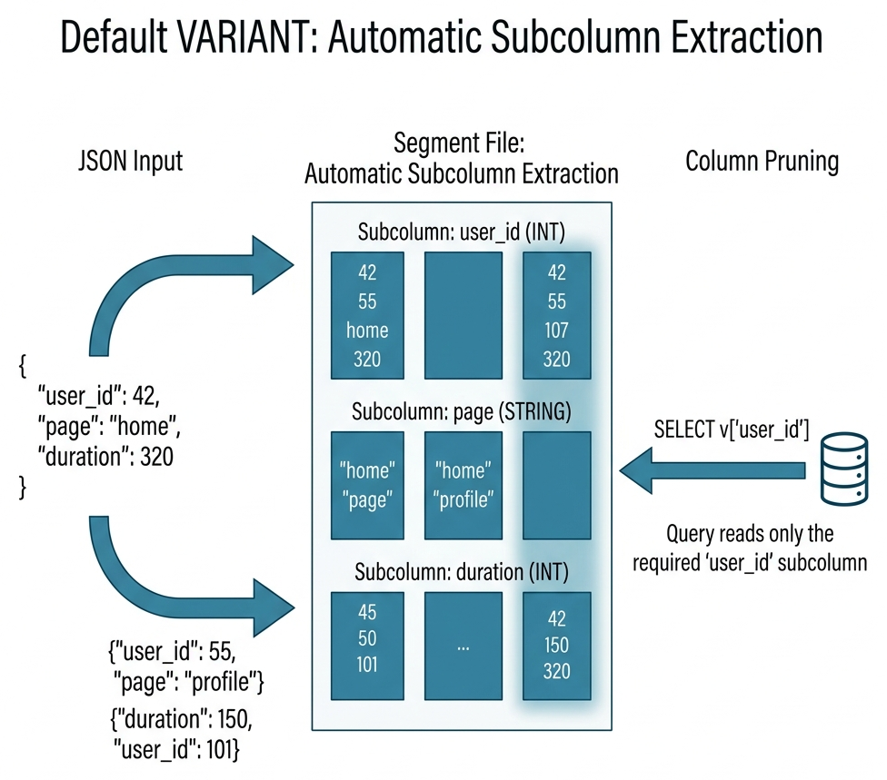
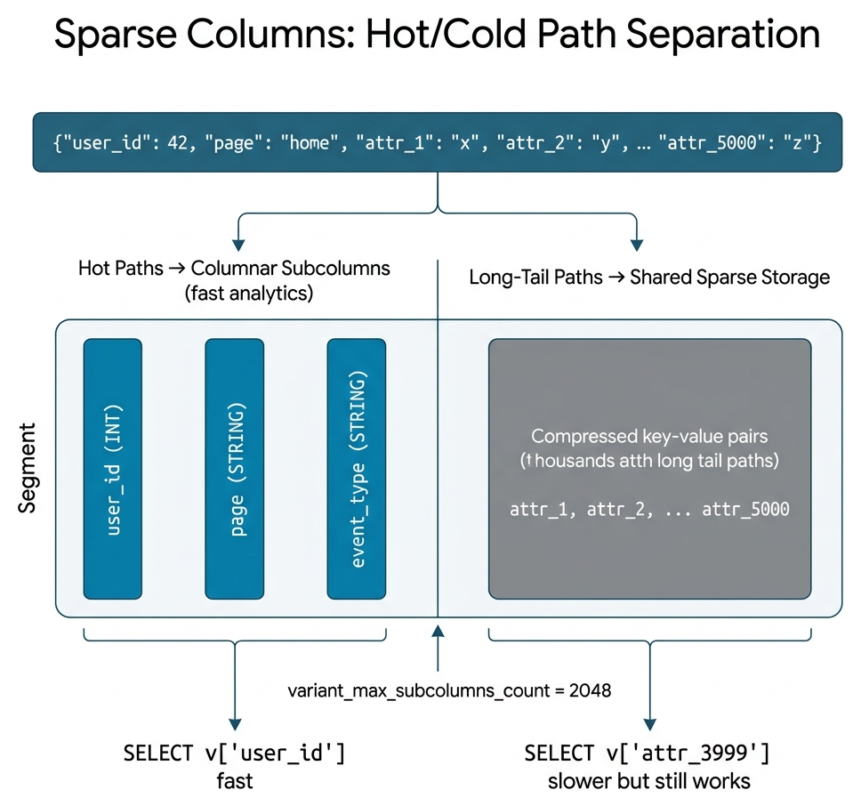
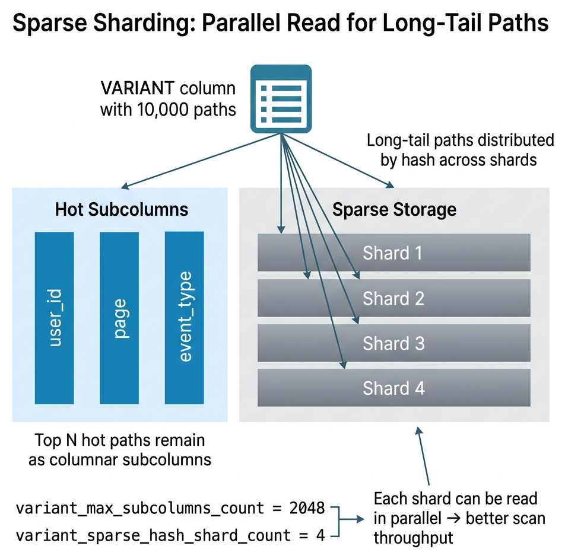
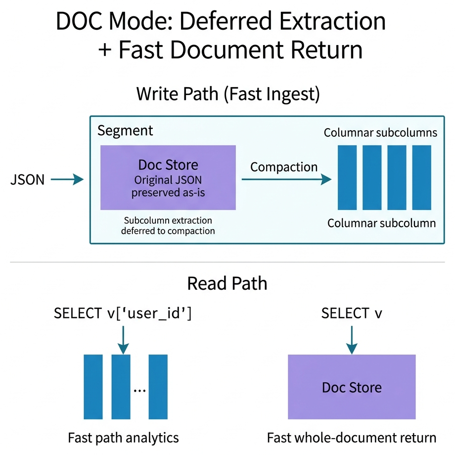
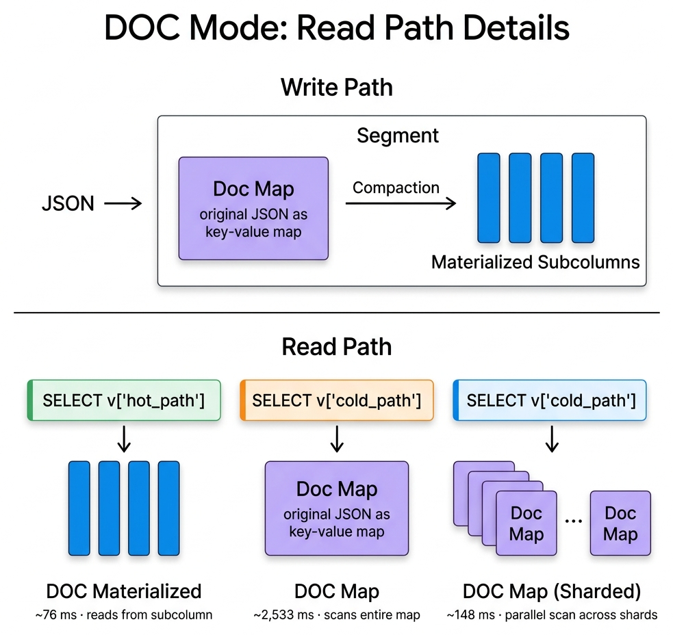
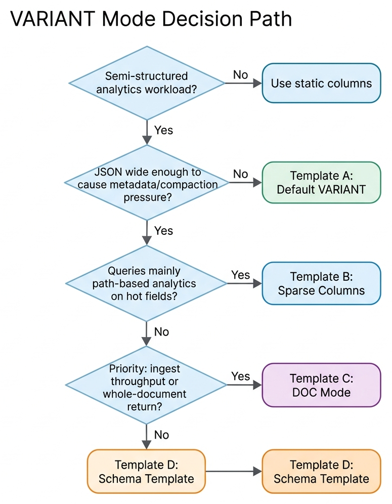
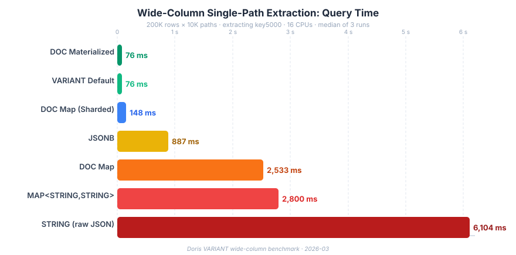

---
{
    "title": "VARIANT ワークロードガイド",
    "language": "ja",
    "description": "VARIANT を使う場面、デフォルトモード・Sparse・DOC mode・Schema Template の選び方、設定を始める際のポイントを示すガイド。"
}
---

## 概要 {#overview}

`VARIANT` は半構造化 JSON を格納し、よく使うパスに Subcolumnization を適用します。

新しい `VARIANT` ワークロードのデータモデルを決める際に、このガイドを使ってください。次のような疑問に答えます。

- このワークロードには `VARIANT` と静的な列のどちらを使うべきか？
- JSON のパスが非常に多い場合、デフォルトの動作、Sparse columns、DOC mode のどれから始めるべきか？
- どの設定をデフォルトのままにし、どの設定を先に変更すべきか？

`VARIANT` を使うことが決まっており、構文や型のルールだけを確認したい場合は、[VARIANT](./VARIANT.md) を参照してください。実行可能な最小限のインポート例が必要な場合は、[Variant データのインポート](../../../../data-operate/import/complex-types/variant.md) を参照してください。サブカラムと Sparse エンコーディングによるデータの格納方法や、シナリオごとのプロパティ設定については、[VARIANT のストレージとチューニング](./variant-storage-tuning.md) を参照してください。

:::tip VARIANT を選ぶ理由
`VARIANT` は JSON の柔軟性を保ちながら、Doris がよく使うパスに Subcolumnization を適用できるようにします。そのため、ドキュメント全体のスキーマを事前に固定せずに、一般的なフィルタリング、集約、パス単位のインデックスを効率よく利用できます。非常に多くのパスを持つ JSON でも、ストレージ層の最適化によって、大規模な Subcolumnization を実用的に運用できます。
:::

## VARIANT が適する場面 {#when-variant-fits}

次の条件の大半に当てはまる場合、通常は `VARIANT` が適しています。

- 入力が JSON などの半構造化データで、フィールドが時間とともに変化する。
- クエリは通常、各行のすべてのフィールドではなく、よく使う一部のパスにアクセスする。
- 列指向分析の性能を維持しながら、スキーマの柔軟性も確保したい。
- 一部のパスにはインデックスが必要だが、ほかの多くのパスは動的なままでよい。

次の条件が中心となる場合は、静的な列を優先してください。

- スキーマが安定しており、事前に分かっている。
- 主要なフィールドを結合キーやソートキーとして頻繁に使用する、または型を厳密に管理する必要がある。VARIANT 値も結合やソートに使用できますが、型付き列のほうが高速で、型に応じた意味づけも維持できます。
- 主な目的がパス単位の分析ではなく、生の JSON のアーカイブである。

## 最初に確認する四つの質問 {#four-questions-first}

設定を変更する前に、次の四つの質問に答えてください。

### 1. よく使うパスは明確か？ {#1-are-there-clear-hot-paths}

クエリが同じ JSON パスに繰り返しアクセスする場合、Doris はそれらのパスに継続して Subcolumnization を適用できます。これは `VARIANT` が特に効果を発揮する場面です。

### 2. 型やインデックスを固定する必要があるパスは少数か？ {#2-do-a-few-paths-need-fixed-types-or-stable-indexes}

該当する場合は、そのパスだけに Schema Template を使用します。Schema Template はビジネス上重要な少数のフィールド向けであり、ドキュメント全体を記述するためのものではありません。

### 3. JSON のパスが本当に増え続けているか？ {#3-is-this-really-becoming-wide-json}

パス数が増え続け、メタデータへの負荷、compaction への負荷、または目立ったクエリのオーバーヘッドが生じ始めたら、パス数の多い JSON を扱う際の問題が発生しています。

### 4. パス数の多い JSON では、よく使うパスの分析とドキュメント全体の返却のどちらが重要か？ {#4-for-wide-json-what-matters-more-hot-path-analytics-or-whole-document-return}

- 主な用途が、よく使うフィールドに対するパス単位のフィルタリング、集約、インデックス利用であれば、Sparse columns を優先して検討します。
- 主な用途が取り込み効率やドキュメント全体の返却であれば、DOC mode を優先して検討します。

## 主な概念 {#key-concepts}

以下のストレージモードを読む前に、これらの用語を確認してください。各用語を 2-3 行で説明します。実装の詳細は [VARIANT](./VARIANT.md) を参照してください。

**Subcolumnization。** `VARIANT` 列への書き込み時に、Doris は JSON パスを自動的に検出し、よく使うパスを独立した列指向のサブカラムとして抽出します。これにより、効率よく分析できます。



**Schema Template。** `VARIANT` 列で選択したパスの型を固定するための宣言です。型、インデックスの利用、動作を予測可能に保つ必要がある主要なビジネスフィールドに使用します。考えられるすべてのパスを列挙しないでください。

**パス数の多い JSON。** 異なるパスの数が増え続け、メタデータのサイズ、書き込みコスト、compaction コスト、またはクエリコストが増加し始めた状態です。

**Sparse columns。** パス数の多い JSON で、よく使うパスとそれ以外のパスが明確に分かれる場合、よく使うパスには Subcolumnization を適用し、あまり使わないロングテールのパスは共有の Sparse ストレージに格納します。Sparse ストレージは複数の物理列へのシャーディングをサポートし、読み取りの並列性を高めます。



上図のように、よく使うパス（`user_id`、`page` など）は独立した列指向のサブカラムとして残り、高速に分析できます。一方、数千に及ぶロングテールのパスは共有の Sparse ストレージにまとめられます。このしきい値は `variant_max_subcolumns_count` で制御します。

**Sparse sharding。** ロングテールのパスが非常に多い場合、単一の Sparse 列が読み取りのボトルネックになることがあります。Sparse sharding は、ロングテールのパスをハッシュに基づいて複数の物理列（`variant_doc_hash_shard_count`）に分散し、並列スキャンを可能にします。



**DOC mode。** 元の JSON を map 形式の格納フィールド（**doc map**）として追加で保存します。ドキュメント全体を取得するクエリはこれを直接読み取れますが、追加のストレージが必要です。デフォルトモードと同様に、Subcolumnization は `variant_max_subcolumns_count` と `variant_doc_materialization_min_rows` で制御します。データファイルが行数のしきい値に達すると、最大で `variant_max_subcolumns_count` 個のパスが抽出されます。行数のしきい値を大きくすると、小さなバッチでは doc map のみを書き込むため取り込みが速くなり、Subcolumnization は後続の compaction まで延期されます。



上図のように、書き込み時には JSON がそのまま Doc Store に保存され、取り込みが高速になります。行数のしきい値を設定した場合、サブカラムは後続の compaction 時に抽出されます。読み取り時には、パス単位のクエリ（`SELECT v['user_id']` など）はマテリアライズされたサブカラムから列指向の速度で読み取ります。一方、ドキュメント全体を取得するクエリ（`SELECT v`）は、サブカラムから再構築せずに Doc Store から直接読み取ります。

DOC mode には、クエリ対象のパスがマテリアライズされているかどうかに応じて、三つの異なる読み取り経路があります。



- **DOC Materialized**：クエリ対象のパスが、compaction 後、または `variant_doc_materialization_min_rows` の条件を満たした時点で、すでにサブカラムとして抽出されています。デフォルトの VARIANT と同じく、列指向の速度で読み取れます。
- **DOC Map**：クエリ対象のパスはまだマテリアライズされていません。値を見つけるために doc map 全体のスキャンにフォールバックするため、パス数の多い JSON では大幅に遅くなります。
- **DOC Map (Sharded)**：同じフォールバックを使用しますが、`variant_doc_hash_shard_count` によって doc map を複数の物理列に分散します。並列スキャンが可能になり、フォールバック時の読み取りが大幅に速くなります。

**Storage Format V3。** 列メタデータをセグメントフッターから分離します。数千のサブカラムが存在する場合のメタデータのボトルネックを解消できるため、特にパス数の多い JSON を扱う場合を含め、すべての `VARIANT` テーブルに推奨します。

## 推奨される選択手順 {#recommended-decision-path}



## ストレージモード {#storage-modes}

以下の表で出発点を選び、該当するセクションを読んでください。

| | 典型的なシナリオ | 推奨モード | 主な設定 |
|---|---|---|---|
| **A** | イベントログ、監査ログ | デフォルトの VARIANT + V3 | デフォルトを維持 |
| **B** | 広告・テレメトリ・ユーザープロファイル（パス数が多く、よく使うパスは少数） | Sparse + V3 | `variant_max_subcolumns_count`、`variant_doc_hash_shard_count` |
| **C** | モデル出力・トレース・アーカイブ（取り込み優先、またはドキュメント全体を返却） | DOC mode + V3 | `variant_enable_doc_mode`、`variant_doc_materialization_min_rows`、`variant_doc_hash_shard_count` |
| **D** | 注文・決済・デバイス（主要なパスに安定した型が必要） | Schema Template + A または B | 主要なパスだけを定義 |

### デフォルトモード {#default-mode}

新しい `VARIANT` ワークロードの大半では、これが最も確実な出発点です。

典型例は、クエリが少数の決まったパスに繰り返しアクセスするイベントログや監査データです。

```sql
CREATE TABLE IF NOT EXISTS event_log (
    ts DATETIME NOT NULL,
    event_id BIGINT NOT NULL,
    event_type VARCHAR(64),
    payload VARIANT
)
DUPLICATE KEY(`ts`, `event_id`)
DISTRIBUTED BY HASH(`event_id`) BUCKETS 16
PROPERTIES (
    "replication_num" = "1",
    "storage_format" = "V3"
);
```

Sparse columns や DOC mode が必要なほどパス数が多いかまだ分からず、主な用途がいくつかの共通パスでのフィルタリング、集約、グループ化である場合に使用します。

注意点：
- パスの増加による負荷がすでに生じている場合を除き、早い段階で `variant_max_subcolumns_count` を引き上げないでください。
- JSON のパス数が多くなければ、Sparse columns や DOC mode を有効にしても、メリットなく複雑さが増します。

### Sparse モード {#sparse-mode}

データのパス数が多くても、ほとんどのクエリが少数のよく使うパスを対象とする場合は、Sparse columns を選びます。

典型例は、任意の属性が数千あっても、定期的にクエリされるのは数十にとどまる広告、テレメトリ、プロファイルの JSON です。

```sql
CREATE TABLE IF NOT EXISTS telemetry_wide (
    ts DATETIME NOT NULL,
    device_id BIGINT NOT NULL,
    attributes VARIANT<
        'device_type' : STRING,
        'region' : STRING,
        properties(
            'variant_max_subcolumns_count' = '2048',
            'variant_doc_hash_shard_count' = '64'
        )
    >
)
DUPLICATE KEY(`ts`, `device_id`)
DISTRIBUTED BY HASH(`device_id`) BUCKETS 32
PROPERTIES (
    "replication_num" = "1",
    "storage_format" = "V3"
);
```

キーの総数が非常に多くても、主なワークロードがパス単位のフィルタリング、集約、インデックス利用である場合に使用します。

注意点：
- よく使うパスの分析がボトルネックなら、最初から DOC mode に切り替えないでください。
- `variant_max_subcolumns_count` のデフォルト値は `2048` で、大半のワークロードでは自動的な Subcolumnization の出発点として適切です。実質的にすべてのパスに Subcolumnization が適用されるほど大きく設定しないでください。抽出するサブカラムを本当に大規模に増やす必要がある場合は、[DOC mode](#doc-mode-template) を優先してください。

### DOC mode {#doc-mode-template}

ドキュメント全体の返却や取り込みのオーバーヘッド削減が、パス単位の分析の最適化より重要な場合は、DOC mode を選びます。

典型例は、完全なデータとして返却することが多いモデルの応答、トレースのスナップショット、アーカイブされた JSON ドキュメントです。

DOC mode が効果的な場面：

- Subcolumnization の規模が非常に大きくなり、10,000 パスに近づくと、ハードウェア要件が急速に高まります。この規模では DOC mode のほうが安定した選択肢です。
- デフォルトの即時 Subcolumnization と比較して、compaction 時のメモリ使用量を約三分の二削減できます。
- Sparse でパス数の多い列を取り込むワークロードでは、スループットが約 5–10 倍向上する場合があります。
- `VARIANT` 値全体を読み取るクエリ（`SELECT variant_col`）では、数千のサブカラムからドキュメントを再構築する必要がなくなり、桁違いの高速化が得られます。

**使い始めるには：**

```sql
CREATE TABLE IF NOT EXISTS trace_archive (
    ts DATETIME NOT NULL,
    trace_id VARCHAR(64) NOT NULL,
    span VARIANT<
        'service_name' : STRING,
        properties(
            'variant_enable_doc_mode' = 'true',
            'variant_doc_materialization_min_rows' = '10000',
            'variant_doc_hash_shard_count' = '64'
        )
    >
)
DUPLICATE KEY(`ts`, `trace_id`)
DISTRIBUTED BY HASH(`trace_id`) BUCKETS 32
PROPERTIES (
    "replication_num" = "1",
    "storage_format" = "V3"
);
```

取り込みスループットを最優先する場合、クエリで完全な JSON ドキュメントを頻繁に取得する場合、またはパス数が非常に多い列に対して `SELECT variant_col` を頻繁に実行する場合に使用します。

注意点：
- DOC mode が、パス数の多い JSON を扱うすべてのワークロードに適するわけではありません。よく使うパスの分析が中心なら、通常は Sparse columns のほうが適しています。
- DOC mode は `variant_max_subcolumns_count` および `variant_doc_hash_shard_count` と併せて設定できます。詳しくは [VARIANT のストレージとチューニング](./variant-storage-tuning.md) を参照してください。
- DOC mode のデフォルトのシャード数（`variant_doc_hash_shard_count`）は `1` です。パス数が非常に多い JSON で、まだマテリアライズされていないパスをクエリで頻繁に読み取る場合は、上の例の `64` のようにシャード数を明示的に設定してください。
- Schema Template を持つ列は、`DROP`、`RENAME`、コメントの変更を除いて変更できません。そのため、`variant_doc_materialization_min_rows` も後から変更できません。テーブル作成時に値を決めてください。

### Schema Template {#schema-template}

少数のパスに安定した型、安定した動作、またはパス固有のインデックスが必要な場合は、Schema Template を選びます。

典型例は、ビジネス上重要な少数のパスについて、型を維持し検索可能にする必要がある注文、決済、デバイスのデータです。

```sql
CREATE TABLE IF NOT EXISTS order_events (
    ts DATETIME NOT NULL,
    order_id BIGINT NOT NULL,
    detail VARIANT<
        'status' : STRING,
        'amount' : DECIMAL(18, 2),
        'currency' : STRING
    >,
    INDEX idx_status(detail) USING INVERTED PROPERTIES("field_pattern" = "status")
)
DUPLICATE KEY(`ts`, `order_id`)
DISTRIBUTED BY HASH(`order_id`) BUCKETS 16
PROPERTIES (
    "replication_num" = "1",
    "storage_format" = "V3"
);
```

ビジネス上重要なフィールドが少数で、それらのパスに厳密な型指定やパス単位のインデックス戦略が必要な場合に使用します。必要に応じて、Schema Template を Sparse columns またはデフォルトの `VARIANT` と組み合わせてください。

注意点：
- JSON スキーマ全体を静的なテンプレートにしないでください。`VARIANT` の利点が失われます。
- Schema Template の対象は主要なパスだけにし、それ以外は動的なままにします。
- 列の作成後に Schema Template を変更することはできません。本番データをロードする前に、主要なパスを決めてください。

## パフォーマンス {#performance}

以下の図は、10K パスを持つ列のデータセットで、単一パスを抽出するクエリの実行時間を比較したものです（200K 行、キーを一つ抽出、16 CPU、3 回の実行の中央値）。



| モード | クエリ時間 | ピークメモリ |
|---|---:|---:|
| DOC Materialized | 76 ms | 1 MiB |
| VARIANT デフォルト | 76 ms | 1 MiB |
| DOC Map (Sharded) | 148 ms | 1 MiB |
| JSONB | 887 ms | 32 GiB |
| DOC Map | 2,533 ms | 1 MiB |
| MAP\<STRING,STRING\> | 2,800 ms | 1 MiB |
| STRING (生の JSON) | 6,104 ms | 48 GiB |

主なポイント：

- **マテリアライズされたサブカラムが最速です。** デフォルトモードと DOC Materialized はいずれも約 76 ms で、生の STRING より 80 倍、JSONB より 12 倍高速です。
- **doc map のシャーディングは効果的です。** マテリアライズされていないパスのクエリ時間は、doc map をシャーディングすると 2.5 s から 148 ms に短縮されます。
- **JSONB と STRING はメモリを多く消費します。** VARIANT の各モードのピークメモリが 1 MiB であるのに対し、32–48 GiB を消費します。

## ベストプラクティス {#best-practices}

### インポート段階 {#import-phase}

- **新しい `VARIANT` テーブルでは Storage Format V3 から始めてください。** V3 は列メタデータをセグメントフッターから分離します。これを使わない場合、パス数の多い JSON を扱うワークロードでは、ファイルを開く処理が遅くなり、メモリのオーバーヘッドが大きくなります。
- **主要なパスは早い段階で Schema Template によって固定してください。** Schema Template がない場合、システムは型を自動的に推論します。同じパスの型がバッチ間で変わると（整数から文字列に変わる場合など）、JSONB に昇格し、そのパスのインデックスが失われます。
- **デフォルト設定から始め、問題に応じて調整してください。** 大半のワークロードではデフォルトで十分です。AI トレーニング、コネクテッドカー、ユーザータグシステムのように、非常に大規模な Subcolumnization と多数のパス単位のインデックスが必要な場合に限り、シナリオに応じて調整してください。初日から過剰に設定すると（`variant_max_subcolumns_count` を非常に大きくする、必要がないのに DOC mode を有効にするなど）、効果を確認できないまま複雑さが増します。

### クエリ段階 {#query-phase}

- **パス数が非常に多い `VARIANT` 列では、`SELECT *` を主なクエリパターンにしないでください。** DOC mode を使わない場合、`SELECT *` や `SELECT variant_col` ではすべてのサブカラムから大きな JSON を再構築する必要があり、`SELECT v['path']` のようにパスを指定する場合より大幅に遅くなります。
- **フィルタではサブパスを格納時の型に CAST してください。** `v['id'] = 123` のような比較では、パスが暗黙に CAST されて行ごとに評価されるため、zone map、BloomFilter、インデックスは使用されません。`CAST(v['id'] AS BIGINT) = 123` のように、パスの格納時の型を使って記述してください（`SET describe_extend_variant_column = true` を実行した後、`DESC` で確認できます）。文字列のパスを文字列リテラルと比較する場合、CAST は不要です。
- **適用される比較の意味づけを把握してください。** パスをリテラルと比較する場合、リテラルに基づいて選ばれた型にパスが CAST されます。一方、二つの VARIANT 値を比較する場合や、VARIANT 値でグループ化、結合、ソートする場合は、VARIANT の意味づけが適用されます。数値は文字列より前に並び、`1` が `"1"` と等しくなることはありません。[比較、グループ化、並び順](./VARIANT.md#comparison-grouping-and-ordering) を参照してください。

### 運用段階 {#operations-phase}

- **compaction への負荷を監視してください。** サブカラムが増えるとマージのコストが高まります。Compaction Score が上昇し続ける場合は、`variant_max_subcolumns_count` が高すぎないか、取り込み速度が速すぎないかを確認してください。
- **スキーマの変化を監視してください。** JSON の構造が頻繁に変わると、よく使うパスが Sparse ストレージに移され、クエリが急に遅くなることがあります。重要なパスは Schema Template で固定してください。
- **型の競合を監視してください。** 同じパスで型の競合が頻繁に起こる場合は、JSONB への昇格とインデックスの消失を防ぐため、Schema Template でそのパスを固定してください。

## 簡易確認 {#quick-verify}

テーブルを作成したら、次の最小限の手順で動作を確認してください。

```sql
-- Insert sample data. INSERT stores a plain string as a VARIANT string, so parse the JSON text.
INSERT INTO event_log VALUES
    ('2025-01-01 10:00:00', 1001, 'click', PARSE_TO_VARIANT('{"page": "home", "user_id": 42, "duration_ms": 320}')),
    ('2025-01-01 10:00:01', 1002, 'purchase', PARSE_TO_VARIANT('{"item": "widget", "price": 9.99, "user_id": 42}')),
    ('2025-01-01 10:00:02', 1003, 'click', PARSE_TO_VARIANT('{"page": "search", "user_id": 99, "query": "doris variant"}'));

-- Verify data
SELECT payload['user_id'], payload['page'] FROM event_log;

-- Check Subcolumnization results
SET describe_extend_variant_column = true;
DESC event_log;

-- Check the type of one path, row by row
SELECT variant_type(payload['user_id']) FROM event_log;
```

## 関連資料 {#related-reading}

- [VARIANT](./VARIANT.md)
- [Variant データのインポート](../../../../data-operate/import/complex-types/variant.md)
- [Storage Format V3](../../../../table-design/storage-format.md)
- [SEARCH 関数](../../../../table-design/index/inverted-index/search-function.md)
