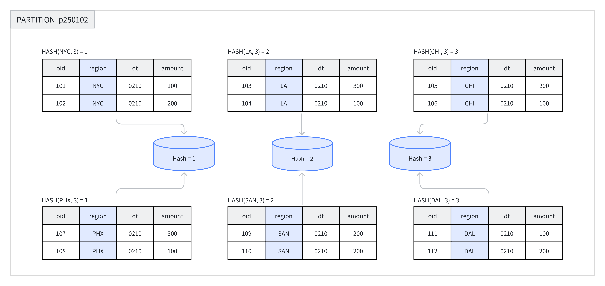
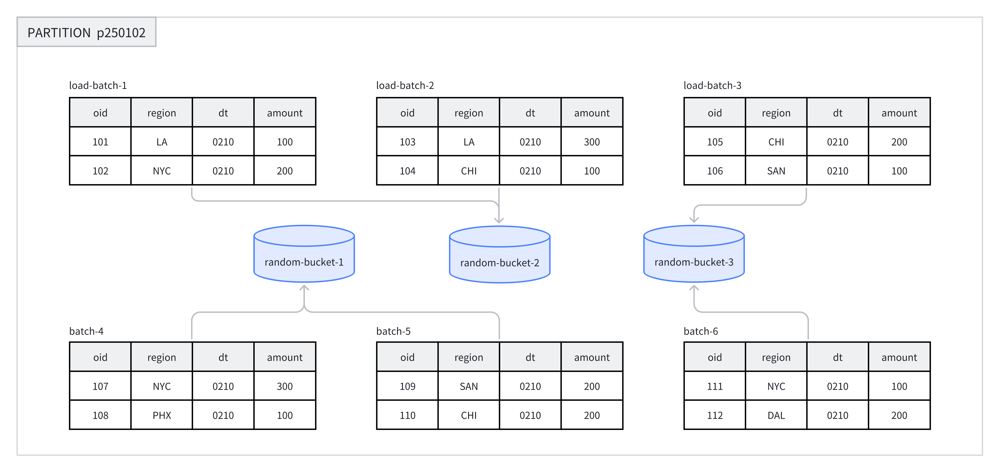

---
{
    "title": "データバケット化",
    "language": "ja",
    "description": "Doris データバケット化ガイド：クエリ性能を向上させ、データの偏りを回避するために、Hash と Random のバケット化方式、バケットキー、バケット数を選択する方法。",
    "keywords": [
        "Doris データバケット化",
        "Hash バケット化",
        "Random バケット化",
        "バケットキーの選択",
        "バケット数",
        "tablet",
        "データの偏り"
    ]
}
---

<!-- Knowledge type: Architecture decision / Configuration parameter -->
<!-- Applicable scenarios: Table design / Performance tuning / Data skew handling -->

パーティションは、ビジネス要件に応じて複数のデータバケットにさらに分割できます。各バケットは物理データシャード（Tablet）として保存されます。合理的なバケット化戦略により、クエリ時にスキャンするデータ量を効果的に削減し、クエリ性能を向上させ、同時処理能力を高められます。

本ドキュメントは、テーブル作成時の判断手順に沿って構成しています。まずバケット化方式を選び、次にバケットキーを選択し、最後にバケット数とその後のメンテナンス方法を決めます。

## クイック決定 {#quick-decision}

テーブルを作成するときは、次の順序でバケット化設計を完了できます。

| ステップ | 決定項目 | 主な考慮事項 |
|------|------|----------|
| 1 | バケット化方式を選択 | 高頻度のフィルター列があるか、データが均等か、テーブルモデル |
| 2 | バケットキーを選択（Hash バケット化のみ） | クエリのフィルター条件、列のカーディナリティ、クエリの同時実行数とスループット特性 |
| 3 | バケット数を決定 | Tablet あたりのデータサイズ、BE 数、ディスク数 |
| 4 | バケットメンテナンス戦略を計画 | データ増加の傾向、動的パーティションを使用するかどうか |

## 1. バケット化方式の選択 {#1-choose-the-bucketing-method}

Doris は **Hash バケット化**と **Random バケット化**の 2 つの方式をサポートしています。主な違いは次のとおりです。

| 比較項目 | Hash バケット化 | Random バケット化 |
|--------|----------|------------|
| データの分散方法 | バケットキーの Hash 値で分割 | ランダムかつ均等に分散 |
| バケットキーが必要か | 必要 | 不要 |
| バケットプルーニングをサポートするか | サポート | 非サポート |
| 適用可能なテーブルモデル | DUPLICATE / UNIQUE / AGGREGATE | DUPLICATE のみ |
| データスキューのリスク | バケットキーの選択による | 低い |
| 適用シナリオ | 特定の列で頻繁にフィルターするポイントクエリ | 任意のディメンションの分析、スキューが発生しやすいデータ |

### 1. Hash バケット化 {#1-hash-bucketing}

テーブルを作成するとき、または新しいパーティションを追加するときは、一つ以上の列をバケットキーとして選び、バケット数を明示的に指定する必要があります。同じパーティション内では、システムがバケットキーとバケット数に基づいて Hash 計算を行い、Hash 値が同じ行を同じバケットに割り当てます。

たとえば下図では、`p250102` パーティションが `region` 列によって 3 つのバケットに分割され、同じ Hash 値の行が同じバケットに配置されています。



**推奨シナリオ：**

- ビジネスで特定のフィールドによるフィルターを頻繁に行う場合、そのフィールドをバケットキーにして、バケットプルーニングによりクエリ効率を向上できます。
- テーブル内のデータが比較的均等に分布し、スキューが発生しにくい場合。

**例：** Hash バケット化を使用してテーブルを作成します。詳細な構文については、[CREATE TABLE](../../sql-manual/sql-statements/table-and-view/table/CREATE-TABLE.md) を参照してください。

以下の例では、`demo` データベースでテーブル名を修飾しています。クラスタに存在しない場合は、先に作成してください。

```sql
CREATE DATABASE IF NOT EXISTS demo;
```

```sql
CREATE TABLE demo.hash_bucket_tbl(
    oid         BIGINT,
    dt          DATE,
    region      VARCHAR(10),
    amount      INT
)
DUPLICATE KEY(oid)
PARTITION BY RANGE(dt) (
    PARTITION p250101 VALUES LESS THAN("2025-01-01"),
    PARTITION p250102 VALUES LESS THAN("2025-01-02")
)
DISTRIBUTED BY HASH(region) BUCKETS 8;
```

この例では、`DISTRIBUTED BY HASH(region)` が Hash バケット化の使用を指定し、`region` 列をバケットキーとして選択しています。`BUCKETS 8` は 8 個のバケットを作成することを指定します。

### 2. Random バケット化 {#2-random-bucketing}

Random バケット化では、各パーティション内でデータを各バケットにランダムに分散し、どのフィールドの Hash 値にも依存しません。この方式によりデータを均等に分散し、不適切なバケットキーの選択によるデータスキューを回避できます。

データロード時、単一のデータロードジョブに含まれる各バッチは Tablet にランダムに書き込まれ、データが均等に分散されます。たとえば下図では、8 バッチのデータが `p250102` パーティション下の 3 つのバケットにランダムに割り当てられています。



Random バケット化を使用するときは、単一 Tablet ロードモード（`load_to_single_tablet` を `true` に設定）を有効にして、単一バッチのデータを一つのデータシャードだけに書き込むことができます。これにより、次のことが可能になります。

- 大規模なデータロードの同時実行数とスループットを向上させる。
- データロードおよび Compaction 操作による書き込み増幅を削減する。
- クラスタの安定性を向上させる。

**推奨シナリオ：**

- 任意のディメンションの分析で、ビジネスに固定のフィルター列または結合列がない場合。
- 頻繁にクエリされる列または列の組み合わせのデータ分布が非常に不均一で、データスキューを避ける必要がある場合。

**不適切なシナリオ：**

- ポイントクエリのシナリオ：Random バケット化ではバケットキーに基づくプルーニングを実行できないため、該当パーティション内のすべてのデータをスキャンします。
- UNIQUE および AGGREGATE テーブル：Random バケット化をサポートするのは DUPLICATE テーブルだけです。

**例：** Random バケット化を使用してテーブルを作成します。詳細な構文については、[CREATE TABLE](../../sql-manual/sql-statements/table-and-view/table/CREATE-TABLE.md) を参照してください。

```sql
CREATE TABLE demo.random_bucket_tbl(
    oid         BIGINT,
    dt          DATE,
    region      VARCHAR(10),
    amount      INT
)
DUPLICATE KEY(oid)
PARTITION BY RANGE(dt) (
    PARTITION p250101 VALUES LESS THAN("2025-01-01"),
    PARTITION p250102 VALUES LESS THAN("2025-01-02")
)
DISTRIBUTED BY RANDOM BUCKETS 8;
```

この例では、`DISTRIBUTED BY RANDOM` が Random バケット化の使用を指定し、バケットキーを選択する必要がないことを示します。`BUCKETS 8` は 8 個のバケットを作成することを指定します。

## 2. バケットキーの選択 {#2-select-the-bucket-key}

:::tip ヒント

バケットキーの選択が必要なのは Hash バケット化だけです。Random バケット化では必要ありません。

:::

バケットキーは一つまたは複数の列で構成できます。テーブルモデルごとのバケットキーの制限は次のとおりです。

| テーブルモデル | 選択可能なバケットキー |
|--------|----------|
| DUPLICATE | 任意の Key 列または Value 列 |
| AGGREGATE / UNIQUE | Key 列である必要があります（正しいデータ集約を保証するため） |

### 選択原則 {#selection-principles}

ビジネスクエリの特性に基づき、バケットキーを選択するときは次の原則を参考にできます。

| 原則 | 説明 | 利点 |
|------|------|------|
| クエリのフィルター条件を活用 | クエリで頻繁にフィルターとして使用される列をバケットキーに選ぶ | バケットプルーニングをサポートし、スキャンするデータ量を削減 |
| 高カーディナリティ列を活用 | 個別の値が多い列をバケットキーに選ぶ | データが均等に分散され、スキューを回避 |
| 高同時実行のポイントクエリシナリオ | 単一列または少数の列をバケットキーに選ぶ | 単一クエリで 1 つのバケットだけがスキャンされ、クエリ間の IO 干渉を削減 |
| 高スループットのクエリシナリオ | 複数列をバケットキーに選ぶ | データがより均等に分散され、クエリ条件が等価条件に完全一致しない場合でも全体のスループットが向上 |

## 3. バケット数の決定 {#3-determine-the-number-of-buckets}

Doris では、各 Bucket は物理ファイル（Tablet）として保存されます。テーブル内の Tablet 総数は次のようになります。

```text
Total Tablets = partition_num × bucket_num
```

:::caution 注意

Partition のバケット数をいったん指定すると、変更できません。バケット数を決める際は、将来のマシン増設をあらかじめ計画してください。

:::

2.0 以降、Doris はマシンリソースとクラスタ情報に基づいて、パーティション内のバケット数を自動設定できます。見積もりに必要な精度に応じて、手動方式または自動方式を選択できます。

### 1. バケット数を手動で設定 {#1-manually-set-the-number-of-buckets}

`DISTRIBUTED` 句でバケット数を指定します。

```sql
-- Set hash bucket num to 8
DISTRIBUTED BY HASH(region) BUCKETS 8

-- Set random bucket num to 8
DISTRIBUTED BY RANDOM BUCKETS 8
```

#### 判断原則 {#decision-principles}

バケット数を決めるときは、次の二つの原則に従います。両者が矛盾する場合は、**サイズの原則を優先します**。

1. **サイズの原則**：各 Tablet の圧縮後データサイズ（インデックスを除く）は **1 GB から 20 GB** の範囲に保つことを推奨します。Unique Key テーブルでは **10 GB** 以下にしてください。
    - Tablet が小さすぎると、集約効果が低下し、メタデータ管理のオーバーヘッドが増加します。
    - Tablet が大きすぎると、レプリカの移行とリカバリが難しくなり、失敗した Schema Change の再試行コストが高くなります。
    - `SHOW TABLETS FROM your_table` を使用して実際の Tablet サイズを確認できます。

2. **数量の原則**：スケールアウトを考慮しない場合、テーブル内の Tablet 数はクラスタ全体のディスク数より少し多くすることを推奨します。

:::caution MOW Tablet の行数を考慮する

MOW Unique Key テーブルでは、圧縮後のデータサイズだけでなく、各 Tablet の物理行数も考慮してください。Base Compaction は、マージ対象となる物理入力行の rowid 変換マップを構築し、メインマッピングの格納に 1 行あたり約 8 バイトを使用します。幅の狭いテーブルや圧縮率の高いテーブルでは、Tablet サイズが上記の推奨値を満たしていても、行数が多いため Compaction 中にメモリ不足になることがあります。見積もりと対処方法については、[大規模な MOW Tablet の Compaction メモリオーバーヘッド](../../admin-manual/trouble-shooting/compaction.md#mow-compaction-memory) を参照してください。

:::

さらに、次の点にも注意してください。

- バケット数は BE 数の整数倍にして、データが均等に分散されるようにします。
- 単一パーティションのバケット数は通常 **128** を超えないようにします。これを超える場合は、先にテーブルをパーティション分割してください。

#### 推奨構成例 {#recommended-configuration-examples}

クラスタに 10 台の BE マシンがあり、各マシンに 1 台のディスクがあるとします。バケット数は次の表を参考に設定できます。

| パーティションの圧縮後データサイズ | 推奨バケット数 |
|-----------------|-----------------|
| < 1 GB | 1 バケット |
| 1 - 10 GB | 10 バケット |
| 10 - 200 GB | 10 - 20 バケット |
| > 200 GB | 先にテーブルをパーティション分割 |

:::tip ヒント

`SHOW DATA` コマンドでテーブルのデータサイズを確認できます。結果をレプリカ数で割ると、テーブルの実際のデータサイズになります。

:::

### 2. バケット数を自動で設定 {#2-automatically-set-the-number-of-buckets}

自動バケット推定機能は、最近の期間のパーティションサイズに基づいて将来のパーティションサイズを予測し、それに応じてバケット数を決定します。

```sql
-- Set hash bucket auto
DISTRIBUTED BY HASH(region) BUCKETS AUTO
properties("estimate_partition_size" = "20G")

-- Set random bucket auto
DISTRIBUTED BY RANDOM BUCKETS AUTO
properties("estimate_partition_size" = "20G")
```

`estimate_partition_size` プロパティは、初期のパーティションサイズの見積もりを調整するために使用します。

- このパラメータは任意です。指定しない場合のデフォルト値は `10GB` です。
- このパラメータは初期見積もりにのみ影響し、その後システムが履歴パーティションデータから推定する将来のパーティションサイズとは独立しています。

算出されたバケット数は、FE 設定 `autobucket_min_buckets` と `autobucket_max_buckets` の間に収められます。

| FE 設定 | デフォルト | 説明 |
|---|---|---|
| `autobucket_min_buckets` | 3 | 自動バケット化結果の下限。**4.0 系列では 4.0.8 から、4.1 系列では 4.1.4 から、デフォルトが `1` から `3` に変更されました** |
| `autobucket_max_buckets` | 128 | 自動バケット化結果の上限 |

:::caution 動作変更（4.0.8 / 4.1.4）

`autobucket_min_buckets` のデフォルト値は、4.0.8（4.0 系列）および 4.1.4（4.1 系列）で `1` から `3` に変更されました。以前は小さなパーティションが 1 つのバケットまで算出される可能性があり、並列度とデータ分散が不十分でした。変更後は、自動バケット化で 3 未満のバケットが生成されることはありません。

この変更の影響を受けるのはアップグレード**後に作成された**パーティションだけで、既存パーティションのバケット数は変わりません。以前の動作を維持するには、`autobucket_min_buckets` を明示的に `1` に戻してください。

:::

## 4. データバケット化のメンテナンス {#4-maintain-data-bucketing}

:::tip ヒント

現在、Doris がサポートしているのは、新しく追加されたパーティションのバケット数の変更だけです。次の操作はサポートされません。

1. バケット化タイプの変更はサポートされません。
2. バケットキーの変更はサポートされません。
3. 作成済みバケットのバケット数の変更はサポートされません。

:::

テーブル作成時に、`DISTRIBUTED` 句で各パーティションのバケット数を一律に指定します。データの増加または減少に対応するため、パーティションを動的に追加するときは、新しいパーティションのバケット数を個別に指定できます。

次の例では、`ALTER TABLE` コマンドを使用して、新しく追加されたパーティションのバケット数を変更する方法を示します。

```sql
-- Modify hash bucket table
ALTER TABLE demo.hash_bucket_tbl
ADD PARTITION p250103 VALUES LESS THAN("2025-01-03")
DISTRIBUTED BY HASH(region) BUCKETS 16;

-- Modify random bucket table
ALTER TABLE demo.random_bucket_tbl
ADD PARTITION p250103 VALUES LESS THAN("2025-01-03")
DISTRIBUTED BY RANDOM BUCKETS 16;

-- Modify dynamic partition table
ALTER TABLE demo.dynamic_partition_tbl
SET ("dynamic_partition.buckets"="16");
```

バケット数を変更した後は、`SHOW PARTITION` コマンドで結果を確認できます。
