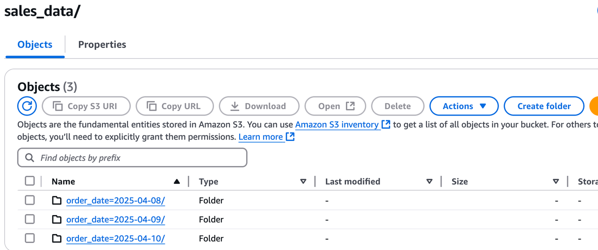
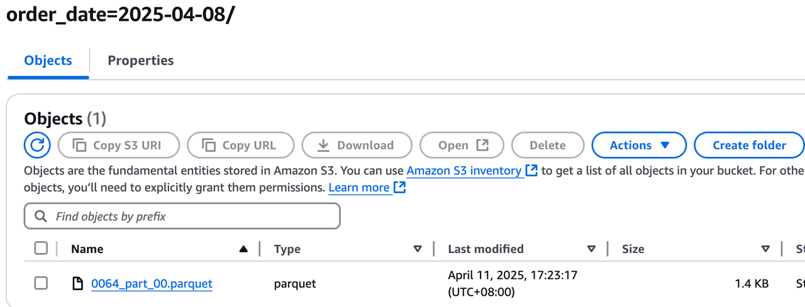

---
{
    "title": "Redshift",
    "language": "ja",
    "description": "Redshift UNLOAD で S3 にデータをエクスポートし、S3 Load で Doris に読み込む移行方法を説明します。テーブル作成、データ型の対応付け、エラー処理、バッチでのデータロードを扱います。",
    "keywords": [
        "Redshift から Doris への移行",
        "Redshift UNLOAD",
        "S3 Load",
        "Redshift のデータ型の対応付け",
        "Doris へのデータロード",
        "Parquet のデータロード",
        "ETL_QUALITY_UNSATISFIED"
    ]
}
---

<!-- Knowledge type: Procedure -->
<!-- Applicable scenario: Data migration / Redshift to Doris -->

Redshift から Apache Doris にデータを移行する際は、通常、Amazon S3 などのオブジェクトストレージを中継先として使用します。移行の流れは次のとおりです。

1. 移行元テーブルのスキーマに基づいて、Doris に移行先テーブルを作成します。
2. Redshift の [UNLOAD](https://docs.aws.amazon.com/redshift/latest/dg/r_UNLOAD.html) ステートメントで、データをオブジェクトストレージにエクスポートします。
3. Doris の S3 Load 機能でオブジェクトストレージからデータを読み込み、Doris にロードします。詳細は [S3 Load](./amazon-s3.md) を参照してください。

## 注意事項 {#notes}

移行を実行する前に、次の点を確認してください。

- **データモデルとパーティションの設計**：Redshift の移行元テーブルのスキーマに基づいて、適切な Doris の[データモデル](../../../table-design/data-model/intro.mdx)を選択し、[パーティション分割](../../../table-design/data-partitioning/dynamic-partitioning.md)と[バケット分割](../../../table-design/data-partitioning/data-bucketing.md)の方針を決めます。テーブル設計に関するその他の推奨事項は、[データロードのベストプラクティス](../load-best-practices/load-best-practices.md)を参照してください。
- **型変換**：Redshift の `TIME` 型をエクスポートする場合は、エクスポート前に `CAST` で `VARCHAR` に変換する必要があります。
- **複合型の制限**：複合型（Struct/Array/Map）を含む Parquet/ORC ファイルは、現時点では [TVF Load](./amazon-s3.md#method-2-load-with-tvf-synchronous) で読み込む必要があります。

## データ型の対応付け {#data-type-mapping}

<!-- Knowledge type: Configuration -->

移行前に、次の表に従って Redshift のデータ型を Doris のデータ型に対応付けます。

|     Redshift     |     Doris      |              備考              |
| ---------------- | -------------- | ------------------------------- |
| SMALLINT         | SMALLINT       |                                 |
| INTEGER          | INT            |                                 |
| BIGINT           | BIGINT         |                                 |
| DECIMAL          | DECIMAL        |                                 |
| REAL             | FLOAT          |                                 |
| DOUBLE PRECISION | DOUBLE         |                                 |
| BOOLEAN          | BOOLEAN        |                                 |
| CHAR             | CHAR           |                                 |
| VARCHAR          | VARCHAR/STRING | VARCHAR の最大長は 65533        |
| DATE             | DATE           |                                 |
| TIMESTAMP        | DATETIME       |                                 |
| TIME/TIMETZ      | STRING         |                                 |
| SUPER            | VARIANT        |                                 |
| OTHER            | UNSUPPORTED    |                                 |

## 移行手順 {#migration-steps}

### 1. Doris テーブルを作成する {#1-create-the-doris-table}

<!-- Knowledge type: Procedure -->

移行前に、対応する移行先テーブルを Doris に作成します。

**目的**：Redshift の移行元テーブルのスキーマに基づいて、Doris のデータモデル、パーティション分割、バケット分割の方針を決めます。

**Redshift の移行元テーブルの例**：

```SQL
CREATE TABLE sales_data (
    order_id      INTEGER,
    customer_name VARCHAR(128),
    order_date    DATE,
    amount        DECIMAL(10,2),
    country       VARCHAR(48)
)
DISTSTYLE AUTO;

INSERT INTO sales_data VALUES
(1, 'Alice', '2025-04-08', 99.99, 'USA'),
(2, 'Bob', '2025-04-08', 149.50, 'Canada'),
(3, 'Charlie', '2025-04-09', 75.00, 'UK'),
(4, 'Diana', '2025-04-10', 200.00, 'Australia');
```

**Doris の移行先テーブルの例**：上記のスキーマに基づき、`order_date` をパーティション列として日単位で分割する Unique Key パーティションテーブルを作成します。

```sql
CREATE TABLE `sales_data` (
  order_id      INT,
  order_date    DATE NOT NULL,
  customer_name VARCHAR(128),
  amount        DECIMAL(10,2),
  country       VARCHAR(48)
) ENGINE=OLAP
UNIQUE KEY(`order_id`,`order_date`)
PARTITION BY RANGE(`order_date`) (
PARTITION p20250408 VALUES [('2025-04-08'), ('2025-04-09')),
PARTITION p20250409 VALUES [('2025-04-09'), ('2025-04-10')),
PARTITION p20250410 VALUES [('2025-04-10'), ('2025-04-11'))
)
DISTRIBUTED BY HASH(`order_id`) BUCKETS 16
PROPERTIES (
 "dynamic_partition.enable" = "true",
 "dynamic_partition.time_unit" = "DAY",
 "dynamic_partition.end" = "5",
 "dynamic_partition.prefix" = "p",
 "dynamic_partition.buckets" = "16",
 "replication_num" = "1"
);
```

### 2. Redshift から S3 にデータをエクスポートする {#2-export-data-from-redshift-to-s3}

<!-- Knowledge type: Procedure -->

#### 2.1 UNLOAD で Parquet 形式にエクスポートする {#21-use-unload-to-export-as-parquet}

**目的**：Redshift のデータを Doris のパーティション列で分割した Parquet ファイルとしてエクスポートし、後からパーティションごとに読み込めるようにします。

**コマンド**：

```sql
unload ('select * from sales_data')
to 's3://mybucket/redshift/sales_data/'
iam_role 'arn:aws:iam::0123456789012:role/MyRedshiftRole'
PARQUET
PARTITION BY (order_date) INCLUDE
```

**注**：パーティションごとにバッチでデータをロードできるよう、Doris と同じパーティション列を使ってエクスポートすることを推奨します。

#### 2.2 S3 にエクスポートされたファイルを確認する {#22-verify-the-exported-files-on-s3}

エクスポート後、S3 にはパーティションごとにサブディレクトリが作成され、各ディレクトリに対応するパーティションのデータが格納されます。





### 3. Doris にデータをロードする {#3-load-data-into-doris}

<!-- Knowledge type: Procedure -->

データロードには **S3 Load** を使用します。S3 Load は非同期のデータロード方式で、ジョブを送信すると Doris がデータソースからデータを取得します。データソースには、[AWS S3](./amazon-s3.md)、[GCS](./google-cloud-storage.md)、[AZURE](./azure-storage.md) など、S3 互換のオブジェクトストレージを使用できます。

適用できる場面の比較：

| 場面                                              | 推奨方式                                        |
| ------------------------------------------------- | ----------------------------------------------- |
| データ量が多く、非同期で処理できる                | S3 Load                                         |
| 同期的なデータロードが必要                        | [TVF Load](./amazon-s3.md#method-2-load-with-tvf-synchronous)        |
| ファイルに複合型（Struct/Array/Map）が含まれる     | [TVF Load](./amazon-s3.md#method-2-load-with-tvf-synchronous) が必要 |

#### 3.1 単一のパーティションをロードする {#31-load-a-single-partition}

```sql
LOAD LABEL sales_data_2025_04_08
(
    DATA INFILE("s3://mybucket/redshift/sales_data/order_date=2025-04-08/*")
    INTO TABLE sales_data
    FORMAT AS "parquet"
    (order_id, order_date, customer_name, amount, country)
)
WITH S3
(
    "provider" = "S3",
    "s3.endpoint" = "https://s3.ap-southeast-1.amazonaws.com",
    "s3.access_key" = "<ak>",
    "s3.secret_key"="<sk>",
    "s3.region" = "ap-southeast-1"
);
```

#### 3.2 SHOW LOAD でジョブの状態を確認する {#32-check-job-status-with-show-load}

S3 Load のジョブは非同期で送信されるため、ジョブのラベルを指定して `SHOW LOAD` を実行すると、データロードの進行状況を確認できます。

```yaml
mysql> show load where label = "sales_data_2025_04_08"\G
*************************** 1. row ***************************
         JobId: 17956078
         Label: sales_data_2025_04_08
         State: FINISHED
      Progress: 100.00% (1/1)
          Type: BROKER
       EtlInfo: unselected.rows=0; dpp.abnorm.ALL=0; dpp.norm.ALL=2
      TaskInfo: cluster:s3.ap-southeast-1.amazonaws.com; timeout(s):3600; max_filter_ratio:0.0; priority:NORMAL
      ErrorMsg: NULL
    CreateTime: 2025-04-10 17:50:53
  EtlStartTime: 2025-04-10 17:50:54
 EtlFinishTime: 2025-04-10 17:50:54
 LoadStartTime: 2025-04-10 17:50:54
LoadFinishTime: 2025-04-10 17:50:54
           URL: NULL
    JobDetails: {"Unfinished backends":{"5eec1be8612d4872-91040ff1e7208a4f":[]},"ScannedRows":2,"TaskNumber":1,"LoadBytes":91,"All backends":{"5eec1be8612d4872-91040ff1e7208a4f":[10022]},"FileNumber":1,"FileSize":1620}
 TransactionId: 766228
  ErrorTablets: {}
          User: root
       Comment:
1 row in set (0.00 sec)
```

#### 3.3 データロード中のエラーに対処する {#33-handle-errors-during-the-load}

<!-- Knowledge type: Troubleshooting -->
<!-- Applicable scenario: Troubleshooting / Data quality errors -->

**ステップ 1**：失敗したデータロードジョブをクエリします。バッチでのデータロードに複数のジョブが含まれる場合は、次のステートメントで失敗したジョブのラベルと理由を絞り込めます。

```SQL
mysql> show load where state='CANCELLED' and label like "label_test%"\G
*************************** 1. row ***************************
         JobId: 18312384
         Label: label_test123
         State: CANCELLED
      Progress: 100.00% (3/3)
          Type: BROKER
       EtlInfo: unselected.rows=0; dpp.abnorm.ALL=4; dpp.norm.ALL=0
      TaskInfo: cluster:s3.ap-southeast-1.amazonaws.com; timeout(s):14400; max_filter_ratio:0.0; priority:NORMAL
      ErrorMsg: type:ETL_QUALITY_UNSATISFIED; msg:quality not good enough to cancel
    CreateTime: 2025-04-15 17:32:59
  EtlStartTime: 2025-04-15 17:33:02
 EtlFinishTime: 2025-04-15 17:33:02
 LoadStartTime: 2025-04-15 17:33:02
LoadFinishTime: 2025-04-15 17:33:02
           URL: http://10.16.10.6:28747/api/_load_error_log?file=__shard_2/error_log_insert_stmt_7602ccd7c3a4854-95307efca7bfe342_7602ccd7c3a4854_95307efca7bfe342
    JobDetails: {"Unfinished backends":{"7602ccd7c3a4854-95307efca7bfe341":[]},"ScannedRows":4,"TaskNumber":1,"LoadBytes":188,"All backends":{"7602ccd7c3a4854-95307efca7bfe341":[10022]},"FileNumber":3,"FileSize":4839}
 TransactionId: 769213
  ErrorTablets: {}
          User: root
       Comment:
```

**ステップ 2**：エラーの種類を確認します。上記の例は**データ品質エラー**（`ETL_QUALITY_UNSATISFIED`）です。出力された `URL` を開くと、エラーの詳細を確認できます。たとえば、次のエラーは、データの長さがスキーマで定義された `country` 列の長さを超えていることを示します。

```python
[root@VM-10-6-centos ~]$ curl "http://10.16.10.6:28747/api/_load_error_log?file=__shard_2/error_log_insert_stmt_7602ccd7c3a4854-95307efca7bfe342_7602ccd7c3a4854_95307efca7bfe342"
Reason: column_name[country], the length of input is too long than schema. first 32 bytes of input str: [USA] schema length: 1; actual length: 3; . src line [];
Reason: column_name[country], the length of input is too long than schema. first 32 bytes of input str: [Canada] schema length: 1; actual length: 6; . src line [];
Reason: column_name[country], the length of input is too long than schema. first 32 bytes of input str: [UK] schema length: 1; actual length: 2; . src line [];
Reason: column_name[country], the length of input is too long than schema. first 32 bytes of input str: [Australia] schema length: 1; actual length: 9; . src line [];
```

**ステップ 3**：エラー許容率を設定します（任意）。一部のエラー行をスキップしてもよい場合は、S3 Load の `PROPERTIES` でエラー許容率を設定します。詳細は[データロードの設定パラメータ](../../import/import-way/broker-load-manual.md#import-configuration-parameters)を参照してください。

#### 3.4 複数のパーティションをバッチでロードする {#34-load-multiple-partitions-in-batches}

大量の履歴データを移行する場合は、次の方針に従ってバッチでロードしてください。

- 各バッチには、Doris の単一のパーティション、または少数のパーティションを対応させます。
- システムへの負荷と、データロードに失敗した際の再試行コストを抑えるため、各バッチのサイズは **100 GB** を超えないようにします。
- [s3_load_demo.sh](https://github.com/apache/doris/blob/master/samples/load/shell/s3_load_demo.sh) スクリプトを参考にできます。このスクリプトは S3 上のパーティションディレクトリを順に処理し、バッチでロードするための S3 Load ジョブを Doris に自動送信します。

## よくある質問 {#faq}

<!-- Knowledge type: FAQ -->

**Q1: Redshift の TIME 型を Doris に直接ロードできないのはなぜですか？**

Doris は `TIME` 型をサポートしていません。Redshift の `TIME/TIMEZ` 型をエクスポートする場合は、エクスポート前に `CAST` で `VARCHAR` に変換し、Doris では `STRING` 型として保存する必要があります。

**Q2: Struct/Array/Map などの複合型を含む Parquet/ORC ファイルに S3 Load を使用できますか？**

いいえ。現時点では、複合型を含むファイルには [TVF Load](./amazon-s3.md#method-2-load-with-tvf-synchronous) を使用する必要があります。

**Q3: S3 Load は同期方式ですか、非同期方式ですか？結果はどのように確認できますか？**

S3 Load は**非同期**のデータロード方式です。ジョブの送信後に `SHOW LOAD WHERE label = "<your_label>"` を実行して、進行状況と結果を確認できます。

**Q4: `ETL_QUALITY_UNSATISFIED` エラーにはどう対処すればよいですか？**

このエラーは、データ品質が要件を満たしていないことを示します。次の手順で対処します。

1. `SHOW LOAD` の出力に含まれる `URL` を開き、詳細なエラーログを取得します。
2. エラーログに基づいて、Doris のテーブルスキーマまたは移行元データを調整します。たとえば、フィールド長の超過や型の不一致を修正します。
3. 一部のエラー行を許容できる場合は、S3 Load の `PROPERTIES` で `max_filter_ratio` エラー許容率を調整します。

**Q5: 大量のデータを移行する際、まとめてロードして失敗する事態を避けるにはどうすればよいですか？**

Doris のパーティション単位でバッチに分け、各バッチを 100 GB 未満に抑えてロードすることを推奨します。[s3_load_demo.sh](https://github.com/apache/doris/blob/master/samples/load/shell/s3_load_demo.sh) スクリプトを使用すると、バッチの送信を自動化できます。
