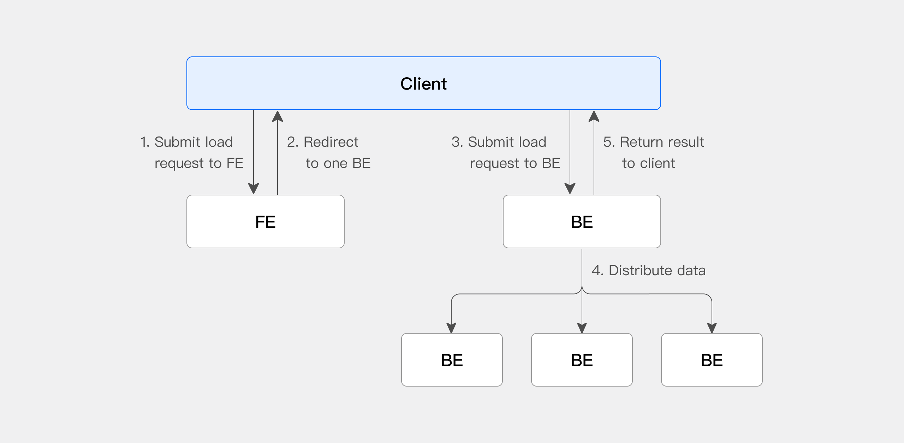

---
{
    "title": "Stream Load",
    "language": "ja",
    "description": "Stream Load は、HTTP 経由でローカルファイルやデータストリームを Doris に同期的にインポートします。CSV/JSON/Parquet/ORC 形式に対応し、インポートの原子性を保証します。",
    "keywords": [
        "Stream Load",
        "Doris データインポート",
        "HTTP インポート",
        "CSV インポート",
        "JSON インポート",
        "同期インポート",
        "Doris Streamloader",
        "curl インポート",
        "アトミックインポート"
    ]
}
---

<!-- Knowledge type: Operation guide + Configuration parameter reference -->
<!-- Applicable scenario: Data import / Local file import / Streaming data write -->

Stream Load は、HTTP 経由でローカルファイルやデータストリームを Doris にインポートできます。Stream Load は同期インポート方式です。実行後にインポート結果が返されるため、レスポンスから成功したかどうかを判断できます。一般に、Stream Load は 10 GB 未満のファイルのインポートに使用できます。それより大きいファイルは、先に分割してから各部分を Stream Load でインポートしてください。Stream Load は、インポートタスクのバッチ単位で原子性を保証します。すべての行が正常にインポートされるか、どの行もインポートされないかのいずれかです。

:::tip

`curl` を直接使用する単一同時実行のインポートと比べ、専用インポートツールの Doris Streamloader を推奨します。Doris にデータをインポートするための専用クライアントツールで、**複数の同時インポート**に対応し、大量のデータのインポートにかかる時間を短縮できます。使用方法と実践的な詳細については、[Doris Streamloader のドキュメント](../../../connection-integration/data-integration/doris-streamloader)を参照してください。

:::

## ユースケース {#use-cases}

Stream Load は、次のような場面に適しています。

- ローカルまたはリモートの CSV、JSON、Parquet、ORC ファイルを Doris にインポートする。
- プログラム（Java、Go、Python など）から HTTP ストリーム経由で継続的にデータを書き込む。
- 単一のインポートジョブに原子性が必要な場合（すべての行が成功するか、すべて失敗する）。
- 通常 10 GB 未満の単一ファイルをインポートする。それより大きいファイルは、インポート前に分割するか、Doris Streamloader を使用する。

CSV ファイルをインポートする際は、null 値と空文字列を明確に区別してください。

- null 値（null）：`\N` で表します。たとえば `a,\N,b` では、中央の列が null です。
- 空文字列：区切り文字の間に文字がない場合、その値は空文字列です。たとえば `a,,b` では、コンマの間に文字がないため、中央の列は空文字列です。

## 基本原理 {#basic-principles}

<!-- Knowledge type: Architecture principles -->

Stream Load では、HTTP 経由で FE ノードにインポートジョブを送信します。FE は負荷分散のため、ラウンドロビン方式でリクエストを BE ノードにリダイレクトします。特定の BE ノードに HTTP リクエストを直接送信することもできます。Doris は Stream Load で、いずれかのノードを Coordinator に指定します。Coordinator ノードはデータを受信し、ほかのノードに分配します。

次の図は、Stream Load の主な流れを示しています。



実行の流れは次のとおりです。

1. Client が FE に Stream Load インポートジョブのリクエストを送信します。
2. FE はラウンドロビン方式で BE を選び、インポートジョブのスケジュールを担当する Coordinator ノードに指定して、Client に HTTP リダイレクトを返します。
3. Client が Coordinator BE ノードに接続し、インポートリクエストを送信します。
4. Coordinator BE がデータを対応する BE ノードに分配します。インポートが完了すると、Client に結果を返します。
5. Client が BE ノードを Coordinator として直接指定し、インポートジョブを分配させることもできます。

## クイックスタート {#quick-start}

<!-- Knowledge type: Operational steps -->

Stream Load の送信と転送には HTTP を使用します。以下では、`curl` ツールを使って Stream Load インポートジョブを送信する方法を示します。

### 前提条件 {#prerequisites}

Stream Load には、対象テーブルに対する INSERT 権限が必要です。ユーザーに INSERT 権限がない場合は、[GRANT](../../../sql-manual/sql-statements/account-management/GRANT-TO) コマンドで付与してください。

### インポートジョブを作成する {#create-an-import-job}

#### CSV データをインポートする {#import-csv-data}

1. インポートするデータを作成する

    次の内容で CSV ファイル `streamload_example.csv` を作成します。

    ```sql
    1,Emily,25
    2,Benjamin,35
    3,Olivia,28
    4,Alexander,60
    5,Ava,17
    6,William,69
    7,Sophia,32
    8,James,64
    9,Emma,37
    10,Liam,64
    ```

2. インポート先の Doris テーブルを作成する

    次の文で、Doris にインポート先のテーブルを作成します。

    ```sql
    CREATE TABLE testdb.test_streamload(
        user_id            BIGINT       NOT NULL COMMENT "user id",
        name               VARCHAR(20)           COMMENT "name",
        age                INT                   COMMENT "age"
    )
    DUPLICATE KEY(user_id)
    DISTRIBUTED BY HASH(user_id) BUCKETS 10;
    ```

3. インポートジョブを開始する

    `curl` コマンドで Stream Load インポートジョブを送信できます。

    ```shell
    curl --location-trusted -u <doris_user>:<doris_password> \
        -H "Expect:100-continue" \
        -H "column_separator:," \
        -H "columns:user_id,name,age" \
        -T streamload_example.csv \
        -XPUT http://<fe_ip>:<fe_http_port>/api/testdb/test_streamload/_stream_load
    ```

    Stream Load は同期インポート方式であり、インポート結果がユーザーに直接返されます。

    ```sql
    {
        "TxnId": 3,
        "Label": "123",
        "Comment": "",
        "TwoPhaseCommit": "false",
        "Status": "Success",
        "Message": "OK",
        "NumberTotalRows": 10,
        "NumberLoadedRows": 10,
        "NumberFilteredRows": 0,
        "NumberUnselectedRows": 0,
        "LoadBytes": 118,
        "LoadTimeMs": 173,
        "BeginTxnTimeMs": 1,
        "StreamLoadPutTimeMs": 70,
        "ReadDataTimeMs": 2,
        "WriteDataTimeMs": 48,
        "CommitAndPublishTimeMs": 52
    }
    ```

4. インポートしたデータを確認する

    ```sql
    mysql> select count(*) from testdb.test_streamload;
    +----------+
    | count(*) |
    +----------+
    |       10 |
    +----------+
    ```

#### JSON データをインポートする {#import-json-data}

1. インポートするデータを作成する

    次の内容で JSON ファイル `streamload_example.json` を作成します。

    ```sql
    [
    {"userid":1,"username":"Emily","userage":25},
    {"userid":2,"username":"Benjamin","userage":35},
    {"userid":3,"username":"Olivia","userage":28},
    {"userid":4,"username":"Alexander","userage":60},
    {"userid":5,"username":"Ava","userage":17},
    {"userid":6,"username":"William","userage":69},
    {"userid":7,"username":"Sophia","userage":32},
    {"userid":8,"username":"James","userage":64},
    {"userid":9,"username":"Emma","userage":37},
    {"userid":10,"username":"Liam","userage":64}
    ]
    ```

2. インポート先の Doris テーブルを作成する

    次の文で、Doris にインポート先のテーブルを作成します。

    ```sql
    CREATE TABLE testdb.test_streamload(
        user_id            BIGINT       NOT NULL COMMENT "user id",
        name               VARCHAR(20)           COMMENT "name",
        age                INT                   COMMENT "age"
    )
    DUPLICATE KEY(user_id)
    DISTRIBUTED BY HASH(user_id) BUCKETS 10;
    ```

3. インポートジョブを開始する

    `curl` コマンドで Stream Load インポートジョブを送信できます。

    ```shell
    curl --location-trusted -u <doris_user>:<doris_password> \
        -H "label:124" \
        -H "Expect:100-continue" \
        -H "format:json" -H "strip_outer_array:true" \
        -H "jsonpaths:[\"$.userid\", \"$.username\", \"$.userage\"]" \
        -H "columns:user_id,name,age" \
        -T streamload_example.json \
        -XPUT http://<fe_ip>:<fe_http_port>/api/testdb/test_streamload/_stream_load
    ```

    :::info 注記

    JSON ファイルの内容が JSON 配列ではなく、各行に JSON オブジェクトがある形式の場合は、ヘッダー `-H "strip_outer_array:false"` と `-H "read_json_by_line:true"` を追加します。
    JSON ファイルのルートノードにある JSON オブジェクトをインポートするには、`jsonpaths` を `$.` に設定します。例：`-H "jsonpaths:[\"$.\"]"`。

    :::

    Stream Load は同期インポート方式であり、インポート結果がユーザーに直接返されます。

    ```sql
    {
        "TxnId": 7,
        "Label": "125",
        "Comment": "",
        "TwoPhaseCommit": "false",
        "Status": "Success",
        "Message": "OK",
        "NumberTotalRows": 10,
        "NumberLoadedRows": 10,
        "NumberFilteredRows": 0,
        "NumberUnselectedRows": 0,
        "LoadBytes": 471,
        "LoadTimeMs": 52,
        "BeginTxnTimeMs": 0,
        "StreamLoadPutTimeMs": 11,
        "ReadDataTimeMs": 0,
        "WriteDataTimeMs": 23,
        "CommitAndPublishTimeMs": 16
    }
    ```

### インポートジョブを確認する {#view-import-jobs}

デフォルトでは、Stream Load は Client に同期的に結果を返すため、システムは Stream Load の過去のジョブを記録しません。記録を有効にするには、`be.conf` に `enable_stream_load_record=true` を追加します。詳細については、[BE の設定](../../../admin-manual/config/be-config)を参照してください。

設定後は、`show stream load` コマンドで完了した Stream Load タスクを確認できます。

```sql
mysql> show stream load from testdb;
+-------+--------+-----------------+---------------+---------+---------+------+-----------+------------+--------------+----------------+-----------+-------------------------+-------------------------+------+---------+
| Label | Db     | Table           | ClientIp      | Status  | Message | Url  | TotalRows | LoadedRows | FilteredRows | UnselectedRows | LoadBytes | StartTime               | FinishTime              | User | Comment |
+-------+--------+-----------------+---------------+---------+---------+------+-----------+------------+--------------+----------------+-----------+-------------------------+-------------------------+------+---------+
| 12356 | testdb | test_streamload | 192.168.88.31 | Success | OK      | N/A  | 10        | 10         | 0            | 0              | 118       | 2023-11-29 08:53:00.594 | 2023-11-29 08:53:00.650 | root |         |
+-------+--------+-----------------+---------------+---------+---------+------+-----------+------------+--------------+----------------+-----------+-------------------------+-------------------------+------+---------+
1 row in set (0.00 sec)
```

### インポートジョブをキャンセルする {#cancel-an-import-job}

ユーザーは Stream Load を手動でキャンセルできません。タイムアウトまたはインポートエラーが発生した場合、システムが Stream Load を自動的にキャンセルします。

### Compute Group を関連付ける {#bind-a-compute-group}

Stream Load を実行する Compute Group を指定できます。

**ストレージとコンピュートの分離モード**

ストレージとコンピュートの分離モードでは、次の方法で Compute Group を指定できます。

1. HTTP Header パラメータで指定します。

    ```text
    -H "cloud_cluster:cluster1"
    ```

    Doris 4.0.0 以降では、`compute_group` パラメータも使用できます。

    ```text
    -H "compute_group:cluster1"
    ```

    `compute_group` と `cloud_cluster` の両方を設定した場合は、`compute_group` が優先されます。

2. Stream Load に関連付けられたユーザープロパティで Compute Group を指定します。ユーザープロパティと HTTP Header の両方で Compute Group を指定した場合は、Header の指定が優先されます。

    ```text
    set property for user1 'default_compute_group'='cluster1';
    ```

3. ユーザープロパティと HTTP Header のどちらでも Compute Group を指定しない場合、Stream Load に関連付けられたユーザーがアクセスできる Compute Group から選択されます。アクセス可能な Compute Group がない場合、インポートは失敗します。

:::info バージョンに関する注記（4.0.8 / 4.1.4）

Doris 4.0 系列では 4.0.8 以降、Doris 4.1 系列では 4.1.4 以降、ストレージとコンピュートの分離モードにおける Stream Load の Compute Group ルーティングと実行プランの不整合が修正されています。

- `compute_group` ヘッダーは `cloud_cluster` より優先されます。以前は FE が `cloud_cluster` しか認識しませんでした。
- 実行プランの作成時には、**実際にリクエストを受信した BE** の Compute Group を使用します。これにより、プランが実行場所と異なる Compute Group に配置されることはありません。
- この経路では、インポートに使用するアカウントの対象 Compute Group へのアクセス権限と、Compute Group の存在および状態も検証します。そのため、アップグレード後、実際にリクエストを処理する Compute Group への権限がアカウントにない場合、インポートは権限エラーで失敗します。対応する権限を付与してください。

:::

:::info バージョンに関する注記（4.1.4）

バージョン 4.1.4 以降、BE 上の Stream Load エンドポイント（`PUT /api/{db}/{table}/_stream_load`、`PUT /api/_http_stream`、`PUT /api/{db}/_stream_load_2pc`）では、グローバルな `LOAD` 権限の事前チェックを行いません。認可は、実際に書き込むデータベースとテーブルに対して FE 側で一元的に行われます。

そのため、グローバルな `LOAD` 権限がなく、データベースまたはテーブル単位の `LOAD_PRIV` のみを持つアカウントでも、Stream Load と 2PC の commit / abort を実行できます。

:::

**ストレージとコンピュートの統合モード**

ストレージとコンピュートの統合モードでは、Stream Load に関連付けられたユーザープロパティでのみ Compute Group を指定できます。ユーザープロパティで指定しない場合は、`default` という名前の Compute Group が選択されます。

```text
set property for user1 'resource_tags.location'='group_1';
```

## リファレンス {#reference}

<!-- Knowledge type: Configuration parameter reference -->

### インポートコマンド {#import-command}

Stream Load のインポート構文は次のとおりです。

```shell
curl --location-trusted -u <doris_user>:<doris_password> \
  -H "Expect:100-continue" [-H ""...] \
  -T <file_path> \
  -XPUT http://fe_host:http_port/api/{db}/{table}/_stream_load
```

Stream Load は、HTTP のチャンク転送を使用するインポートと使用しないインポートの両方に対応します。チャンク転送を使用しない場合は、アップロードする内容の長さを示す `Content-Length` を指定する必要があります。これにより、データの完全性が保証されます。

### インポート設定パラメータ {#import-configuration-parameters}

#### FE の設定 {#fe-configuration}

**1. stream_load_default_timeout_second**

| 項目                       | 説明                         |
| -------------------------- | ---------------------------- |
| デフォルト値               | 259200 (s)                   |
| 動的設定                   | はい                         |
| FE Master 専用の設定       | はい                         |

説明：Stream Load のデフォルトのタイムアウトです。インポートタスクのタイムアウトを秒単位で指定します。設定された `timeout` 内にタスクが完了しなければ、システムがキャンセルし、タスクは CANCELLED 状態になります。指定時間内にソースファイルをインポートできない場合は、Stream Load リクエストで個別のタイムアウトを設定するか、FE パラメータ `stream_load_default_timeout_second` を調整してグローバルなデフォルト値を変更できます。

#### BE の設定 {#be-configuration}

**1. streaming_load_max_mb**

| 項目       | 説明         |
| ---------- | ------------ |
| デフォルト値 | 102400 (MB) |
| 動的設定   | はい         |

説明：Stream Load のリクエスト本文の最大サイズです。ソースコード上のデフォルト値は 102400 MB（100 GB）です。実際の上限は、デプロイ環境の BE 設定によって決まります。`read_json_by_line=true` を使用しない JSON インポートには、`streaming_load_json_max_mb` の制限も適用されます。

リクエストが実際の上限を超える場合は、データを小さなバッチに分割するか、管理者に設定の調整を依頼してください。

マネージドクラウドサービスでは、サービスが提供する設定方法を使用するか、管理者に連絡してください。BE ホストへの直接アクセスは必要ありません。

**バージョン履歴：**

- 3.x 系列では、Doris 3.0.2 で `streaming_load_max_mb` のデフォルト値が 10240 MB（10 GB）から 102400 MB（100 GB）に引き上げられました。Doris 3.0.0 と 3.0.1 のデフォルト値は 10 GB です。
- 2.1 系列では、同じ変更が 2.1.7 で適用されました。
- Doris 4.x と dev では、デフォルト値 100 GB が維持されています。実際に適用される値はデプロイ環境の設定によって決まります。

#### Header パラメータ {#header-parameters}

インポートパラメータは HTTP Header で渡せます。各パラメータは次のとおりです。

| タグ | パラメータの説明 |
| --- | --- |
| label | このインポートのラベルを指定します。同じラベルのデータを複数回インポートすることはできません。指定しない場合、Doris が自動生成します。ラベルを指定すると、同じデータの重複インポートを回避できます。Doris はデフォルトでインポートジョブのラベルを 3 日間保持します。保持期間は `label_keep_max_second` で調整できます。たとえば、このインポートにラベル `123` を指定するには、`-H "label:123"` を使用します。ラベルを使用すると同じデータの重複インポートを防げます。同じバッチのデータには同じラベルを使用することを強く推奨します。同じバッチに対する重複リクエストが受け付けられるのは 1 回だけとなり、At-Most-Once セマンティクスを保証できます。ラベルに対応するインポートジョブが CANCELLED 状態の場合、そのラベルは再利用できます。 |
| column_separator | インポートファイルの列区切り文字を指定します。デフォルトは `\t` です。不可視文字には `\x` を接頭辞として付け、区切り文字を 16 進数で表します。複数の文字を組み合わせて列区切り文字にすることもできます。たとえば、Hive ファイルの区切り文字 `\x01` は `-H "column_separator:\x01"` で指定します。 |
| line_delimiter | インポートファイルの行区切り文字を指定します。デフォルトは `\n` です。複数の文字を組み合わせることもできます。たとえば、行区切り文字に `\n` を指定するには、`-H "line_delimiter:\n"` を使用します。 |
| columns | インポートファイルの列とテーブルの列との対応関係を指定します。ソースファイルの列がテーブルの列と完全に一致する場合、指定する必要はありません。ソースファイルがテーブルのスキーマと一致しない場合は、データ変換のために指定します。列には、インポートファイルのフィールドに直接対応し、そのフィールド名をそのまま使用する形式と、`column_name = expression` の構文で派生列を表す形式があります。詳しい例は、[インポート時のデータ変換](../../../data-operate/import/load-data-convert)を参照してください。 |
| where | データの一部を抽出するために使用します。不要なデータを除外する場合に指定します。たとえば、列 k1 が 20180601 に等しいデータのみをインポートするには、`-H "where: k1 = 20180601"` を指定します。 |
| max_filter_ratio | フィルタリングされるデータ（形式が不正なデータなど）の最大許容比率です。デフォルトでは許容しません。値の範囲は 0 から 1 です。インポートエラー率がこの値を超えると、インポートは失敗します。`where` 条件で除外された行は、不正なデータとして数えません。たとえば、正しいデータをできるだけすべてインポートするために 100% の許容率を指定するには、`-H "max_filter_ratio:1"` を使用します。 |
| partitions | このインポートに関係するパーティションを指定します。データに対応するパーティションが分かっている場合は、指定することを推奨します。指定したパーティションに該当しないデータは除外されます。たとえば、p1 と p2 にインポートするには、`-H "partitions: p1, p2"` を指定します。 |
| timeout | インポートのタイムアウトを秒単位で指定します。デフォルトは 600 秒です。指定可能な範囲は 1 秒から 259200 秒です。たとえば、タイムアウトを 1200 秒に設定するには、`-H "timeout:1200"` を指定します。 |
| strict_mode | このインポートで厳格モードを有効にするかどうかを指定します。デフォルトでは無効です。有効にするには、`-H "strict_mode:true"` を指定します。 |
| timezone | このインポートで使用するタイムゾーンを指定します。デフォルトはクラスターの現在のタイムゾーンです。このパラメータは、インポートに関係するすべてのタイムゾーン関連関数の結果に影響します。たとえば、Africa/Abidjan を指定するには、`-H "timezone:Africa/Abidjan"` を使用します。 |
| exec_mem_limit | インポート時のメモリ上限です。デフォルトは 2 GB で、単位はバイトです。 |
| format | このインポートのデータ形式を指定します。デフォルトは CSV です。現在対応する形式は、CSV、JSON、arrow、csv_with_names（CSV ファイルの先頭行を除外可能）、csv_with_names_and_types（CSV ファイルの先頭 2 行を除外可能）、Parquet、ORC です。たとえば、JSON を指定するには、`-H "format:json"` を使用します。 |
| jsonpaths | JSON データのインポートには 2 つの方法があります。`jsonpaths` を指定しない場合はシンプルモードとなり、JSON データはオブジェクト型である必要があります。JSON データが比較的複雑で、`jsonpaths` パラメータによる値の照合が必要な場合は、マッチングモードを使用します。シンプルモードでは、JSON のキーがテーブルの列名と一対一で対応している必要があります。たとえば、JSON データ `{"k1":1, "k2":2, "k3":"hello"}` の k1、k2、k3 は、テーブルの列に対応している必要があります。 |
| strip_outer_array | `strip_outer_array` を true にすると、配列オブジェクトで始まる JSON データの配列が展開されます。デフォルトは false です。JSON データの最外層が `[]` で表される配列の場合は、true に設定します。たとえば、`[{"k1" : 1, "v1" : 2},{"k1" : 3, "v1" : 4}]` に対して true に設定すると、Doris へのインポート時に 2 行が生成されます。 |
| json_root | `json_root` は、JSON ドキュメントのルートノードを指定する有効な `jsonpath` 文字列です。デフォルト値は "" です。 |
| merge_type | データのマージ方式です。次の 3 種類に対応します。<br/>- APPEND（デフォルト）：このバッチのすべてのデータを既存データに追加します。<br/>- DELETE：このバッチとキーが一致するすべての行を削除します。<br/>- MERGE：`delete` 条件と併用する必要があります。`delete` 条件に一致するデータは DELETE セマンティクスで、それ以外は APPEND セマンティクスで処理します。<br/>たとえば、MERGE モードを指定するには、`-H "merge_type: MERGE" -H "delete: flag=1"` を使用します。 |
| delete | MERGE と併用する場合のみ意味があり、データの削除条件を指定します。 |
| function_column.sequence_col | UNIQUE KEYS モデルにのみ適用されます。同じキー列内で、値列が `source_sequence` 列の順序に従って REPLACE されるようにします。`source_sequence` は、データソースの列でもテーブルスキーマの列でもかまいません。 |
| fuzzy_parse | 真偽値です。true にすると、先頭行をスキーマとして JSON を解析します。有効にすると JSON インポートの効率が向上する場合がありますが、すべての JSON オブジェクトでキーの順序が先頭行と同じである必要があります。デフォルトは false です。JSON 形式でのみ使用します。 |
| num_as_string | 真偽値です。true にすると、JSON データの解析時に数値型を文字列に変換し、精度を失わずにインポートします。 |
| read_json_by_line | 真偽値です。true にすると、各行から JSON オブジェクトを 1 つずつ読み取れます。デフォルトは false です。 |
| send_batch_parallelism | 整数値です。バッチデータ送信の並列度を設定します。設定値が BE の `max_send_batch_parallelism_per_job` を超える場合、Coordinator として動作する BE は `max_send_batch_parallelism_per_job` の値を使用します。 |
| hidden_columns | インポートデータに含まれる隠し列を指定します。Header に `Columns` が含まれていない場合に有効です。複数の隠し列はコンマで区切ります。システムはユーザーが指定したデータを使用してインポートします。次の例では、インポートデータの最後の列は `__DORIS_SEQUENCE_COL__` です。`hidden_columns: __DORIS_DELETE_SIGN__,__DORIS_SEQUENCE_COL__` |
| load_to_single_tablet | 真偽値です。true にすると、単一タスクのデータを対応するパーティションの 1 つの tablet にのみロードできます。デフォルトは false です。このパラメータは、ランダムバケットを使用する OLAP テーブルにデータをロードする場合にのみ設定できます。 |
| compress_type | ファイルの圧縮形式を指定します。現在、CSV ファイルの圧縮のみ対応しています。対応形式は gz、lzo、bz2、lz4、lzop、deflate です。 |
| trim_double_quotes | 真偽値です。デフォルトは false です。true にすると、CSV ファイルの各フィールドを囲む最外側の二重引用符を取り除きます。 |
| skip_lines | 整数値です。デフォルトは 0 です。CSV ファイルの先頭の指定行数をスキップします。`format` が `csv_with_names` または `csv_with_names_and_types` の場合、このパラメータは無効です。 |
| comment | 文字列です。デフォルトは空です。タスクに追加情報を付けます。 |
| enclose | 囲み文字を指定します。CSV データのフィールドに行区切り文字や列区切り文字が含まれる場合、意図しない分割を防ぐため、単一バイトの文字を囲み文字として指定できます。たとえば、列区切り文字が `,`、囲み文字が `'` で、データが `"a,'b,c'"` の場合、`b,c` は 1 つのフィールドとして解析されます。注：`enclose` を `"` に設定する場合は、`trim_double_quotes` を true に設定する必要があります。 |
| escape | エスケープ文字を指定します。フィールド内に囲み文字と同じ文字が現れる場合に使用します。たとえば、データが `"a,'b,'c'"`、囲み文字が `'` で、`b,'c` を 1 つのフィールドとして解析したい場合は、`\` のような単一バイトのエスケープ文字を指定し、データを `"a,'b,\'c'"` に変更します。 |
| memtable_on_sink_node | データのインポート時に MemTable forward を有効にするかどうかを指定します。デフォルトは false です。 |
| unique_key_update_mode | Unique テーブルでの更新モードです。現在は Merge-On-Write Unique テーブルでのみ有効です。対応する 3 種類は `UPSERT`、`UPDATE_FIXED_COLUMNS`、`UPDATE_FLEXIBLE_COLUMNS` です。`UPSERT` は upsert セマンティクスでデータをインポートします。`UPDATE_FIXED_COLUMNS` は[部分列更新](../../../data-operate/update/partial-column-update.md#column-update-on-the-unique-key-model)を使用します。`UPDATE_FLEXIBLE_COLUMNS` は[柔軟な部分列更新](../../../data-operate/update/partial-column-update.md#flexible-column-update)を使用します。 |
| partial_update_new_key_behavior | Unique テーブルで部分列更新または柔軟な列更新を行う際、新たに挿入される行の扱いを指定します。`APPEND` と `ERROR` の 2 種類があります。<br/>- `APPEND`：新しい行の挿入を許可します。<br/>- `ERROR`：新しい行を挿入しようとすると、インポートが失敗してエラーを報告します。 |

### インポートの戻り値 {#import-return-value}

Stream Load は同期インポート方式です。インポート結果は、次のようにインポートリクエストのレスポンスでユーザーに返されます。

```sql
{
    "TxnId": 1003,
    "Label": "b6f3bc78-0d2c-45d9-9e4c-faa0a0149bee",
    "Status": "Success",
    "ExistingJobStatus": "FINISHED", // optional
    "Message": "OK",
    "NumberTotalRows": 1000000,
    "NumberLoadedRows": 1000000,
    "NumberFilteredRows": 1,
    "NumberUnselectedRows": 0,
    "LoadBytes": 40888898,
    "LoadTimeMs": 2144,
    "BeginTxnTimeMs": 1,
    "StreamLoadPutTimeMs": 2,
    "ReadDataTimeMs": 325,
    "WriteDataTimeMs": 1933,
    "CommitAndPublishTimeMs": 106,
    "ErrorURL": "http://192.168.1.1:8042/api/_load_error_log?file=__shard_0/error_log_insert_stmt_db18266d4d9b4ee5-abb00ddd64bdf005_db18266d4d9b4ee5_abb00ddd64bdf005"
}
```

戻り値の各パラメータについて、次の表で説明します。

| パラメータ名 | 説明 |
| --- | --- |
| TxnId | インポートトランザクションの ID です。 |
| Label | インポートジョブのラベルです。`-H "label:<label_id>"` で指定します。 |
| Status | インポートの最終状態です。<br/>- Success：インポートに成功しました。<br/>- Publish Timeout：インポートは完了していますが、データが見えるまで遅延する場合があります。再試行は不要です。<br/>- Label Already Exists：ラベルが重複しています。新しいラベルが必要です。<br/>- Fail：インポートに失敗しました。 |
| ExistingJobStatus | ラベルに対応する既存のインポートジョブの状態です。`Status` が `Label Already Exists` の場合にのみ表示されます。この値から、既存ラベルのインポートジョブの状態を確認できます。`RUNNING` は実行中、`FINISHED` は成功を意味します。 |
| Message | インポートのエラーメッセージです。 |
| NumberTotalRows | インポートで処理した行の総数です。 |
| NumberLoadedRows | 正常にインポートされた行数です。 |
| NumberFilteredRows | データ品質チェックに合格しなかった行数です。 |
| NumberUnselectedRows | `where` 条件で除外された行数です。 |
| LoadBytes | インポートしたバイト数です。 |
| LoadTimeMs | インポートの完了にかかった時間です。単位はミリ秒です。 |
| BeginTxnTimeMs | FE にトランザクション開始を要求するのにかかった時間です。単位はミリ秒です。 |
| StreamLoadPutTimeMs | FE にインポートデータの実行プランの取得を要求するのにかかった時間です。単位はミリ秒です。 |
| ReadDataTimeMs | データの読み取りにかかった時間です。単位はミリ秒です。 |
| WriteDataTimeMs | データの書き込みにかかった時間です。単位はミリ秒です。 |
| CommitAndPublishTimeMs | FE にトランザクションの commit と publish を要求するのにかかった時間です。単位はミリ秒です。 |
| ErrorURL | データ品質の問題がある場合、この URL にアクセスして具体的なエラー行を確認できます。 |

`ErrorURL` を使用すると、データ品質の問題でインポートに失敗したデータを確認できます。`curl "<ErrorURL>"` コマンドでエラーデータの情報を直接確認してください。

## インポート例 {#import-examples}

<!-- Knowledge type: Operation examples -->
<!-- Applicable scenario: Multi-scenario import practices -->

### インポートのタイムアウトと最大インポートサイズを設定する {#set-the-import-timeout-and-maximum-import-size}

インポートタスクのタイムアウトは秒単位です。設定された `timeout` 内にタスクが完了しなければ、システムがキャンセルし、タスクは CANCELLED 状態になります。`timeout` パラメータを指定するか、`fe.conf` に `stream_load_default_timeout_second` パラメータを追加して、Stream Load のインポートタイムアウトを調整できます。

インポート前に、ファイルサイズに基づいてタイムアウトを計算してください。たとえば、100 GB のファイルを推定速度 50 MB/s でインポートする場合は、次のようになります。

```sql
Import time ~= 100GB / 50MB/s ~= 2048s
```

次のコマンドは、`timeout` を 3000 秒に設定して Stream Load インポートタスクを作成します。

```shell
curl --location-trusted -u <doris_user>:<doris_password> \
    -H "Expect:100-continue" \
    -H "timeout:3000" \
    -H "column_separator:," \
    -H "columns:user_id,name,age" \
    -T streamload_example.csv \
    -XPUT http://<fe_ip>:<fe_http_port>/api/testdb/test_streamload/_stream_load
```

### 許容するエラーの最大比率を設定する {#set-the-maximum-tolerated-error-ratio}

Doris のインポートタスクでは、形式が不正なデータを一定の割合まで許容できます。許容比率は `max_filter_ratio` で設定します。デフォルトは 0 で、不正なデータが 1 行でもあるとインポートタスク全体が失敗します。問題のある行を一部無視したい場合は、このパラメータを 0 から 1 の値に設定します。Doris は形式が不正な行を自動的にスキップします。許容比率の計算方法については、[データ変換](../../../data-operate/import/load-data-convert)のドキュメントを参照してください。

次のコマンドは、`max_filter_ratio` を 0.4 に設定して Stream Load インポートタスクを作成します。

```shell
curl --location-trusted -u <doris_user>:<doris_password> \
    -H "Expect:100-continue" \
    -H "max_filter_ratio:0.4" \
    -H "column_separator:," \
    -H "columns:user_id,name,age" \
    -T streamload_example.csv \
    -XPUT http://<fe_ip>:<fe_http_port>/api/testdb/test_streamload/_stream_load
```

### インポート時のフィルタ条件を設定する {#set-import-filter-conditions}

インポート中に `WHERE` パラメータを使用すると、条件に応じてデータを除外できます。除外されたデータはフィルタ比率の計算に含まれず、`max_filter_ratio` の設定に影響しません。インポート完了後、`num_rows_unselected` で除外された行数を確認できます。

次のコマンドは、`WHERE` フィルタ条件を指定して Stream Load インポートタスクを作成します。

```sql
curl --location-trusted -u <doris_user>:<doris_password> \
    -H "Expect:100-continue" \
    -H "where:age>=35" \
    -H "column_separator:," \
    -H "columns:user_id,name,age" \
    -T streamload_example.csv \
    -XPUT http://<fe_ip>:<fe_http_port>/api/testdb/test_streamload/_stream_load
```

### 指定したパーティションにデータをインポートする {#import-data-into-specified-partitions}

ローカルファイルのデータをテーブルの p1 と p2 パーティションにインポートし、20% のエラー率を許容します。

```shell
curl --location-trusted -u <doris_user>:<doris_password> \
    -H "label:123" \
    -H "Expect:100-continue" \
    -H "max_filter_ratio:0.2" \
    -H "column_separator:," \
    -H "columns:user_id,name,age" \
    -H "partitions: p1, p2" \
    -T streamload_example.csv \
    -XPUT http://<fe_ip>:<fe_http_port>/api/testdb/test_streamload/_stream_load
```

### インポート時のタイムゾーンを指定する {#specify-the-import-time-zone}

`DATETIME` 関連の型は絶対的な時点のみを表し、タイムゾーン情報は含みません。そのため、Doris システムのタイムゾーンが変わっても値は変化しません。タイムゾーン付きのデータをインポートする際は、指定した対象タイムゾーンのデータに変換して統一的に扱います。Doris システムでは、このタイムゾーンはセッション変数 `time_zone` で表されます。

インポート時の対象タイムゾーンは `timezone` パラメータで指定します。タイムゾーン変換やタイムゾーンに依存する関数の評価では、この値がセッション変数 `time_zone` に代わって使用されます。そのため、特別な事情がなければ、インポートトランザクションの `timezone` を現在の Doris クラスターの `time_zone` と一致させてください。これにより、タイムゾーン付きのすべての日時データがそのタイムゾーンに変換されます。

たとえば、Doris システムのタイムゾーンが `+08:00` で、インポートデータの日時列に `2012-01-01 01:00:00+00:00` と `2015-12-12 12:12:12-08:00` がある場合、`-H "timezone: +08:00"` を指定すると、それぞれ `2012-01-01 09:00:00` と `2015-12-13 04:12:12` に変換されます。

タイムゾーンの詳細については、[タイムゾーン](../../../admin-manual/cluster-management/time-zone)のドキュメントを参照してください。

### ストリーミングでインポートする {#import-using-streaming}

Stream Load は HTTP プロトコルに基づいているため、Java、Go、Python などのプログラムからストリームとしてデータを書き込めます。Stream Load という名前は、これに由来します。

次の `bash` パイプラインは、この使用方法を示します。インポートするデータはローカルファイルからではなく、プログラムによって生成されます。

```shell
seq 1 10 | awk '{OFS="\t"}{print $1, $1 * 10}' | curl --location-trusted -u root -T - http://host:port/api/testDb/testTbl/_stream_load
```

### インポート時に CSV の先頭行をスキップする {#skip-the-first-line-of-a-csv-during-import}

ファイルのデータ：

```Plain
 id,name,age
 1,doris,20
 2,flink,10
```

`format=csv_with_names` を指定すると、先頭行をスキップしてインポートできます。

```Plain
curl --location-trusted -u root -T test.csv  -H "label:1" -H "format:csv_with_names" -H "column_separator:," http://host:port/api/testDb/testTbl/_stream_load
```

### merge_type で Delete 操作を行う {#use-merge_type-to-perform-a-delete-operation}

Stream Load には APPEND、DELETE、MERGE の 3 種類のインポート方式があり、`merge_type` パラメータで指定できます。インポートデータとキーが一致するすべての行を削除するには、次のコマンドを使用します。

```shell
curl --location-trusted -u <doris_user>:<doris_password> \
    -H "Expect:100-continue" \
    -H "merge_type: DELETE" \
    -H "column_separator:," \
    -H "columns:user_id,name,age" \
    -T streamload_example.csv \
    -XPUT http://<fe_ip>:<fe_http_port>/api/testdb/test_streamload/_stream_load
```

インポート前のテーブルのデータが次のとおりだとします。

```sql
+--------+----------+----------+------+
| siteid | citycode | username | pv   |
+--------+----------+----------+------+
|      3 |        2 | tom      |    2 |
|      4 |        3 | bush     |    3 |
|      5 |        3 | helen    |    3 |
+--------+----------+----------+------+
```

インポートデータは次のとおりです。

```sql
3,2,tom,0
```

インポート後、一致する行がテーブルから削除され、結果セットは次のようになります。

```sql
+--------+----------+----------+------+
| siteid | citycode | username | pv   |
+--------+----------+----------+------+
|      4 |        3 | bush     |    3 |
|      5 |        3 | helen    |    3 |
+--------+----------+----------+------+
```

### merge_type で Merge 操作を行う {#use-merge_type-to-perform-a-merge-operation}

`merge_type` を MERGE に設定すると、インポートデータをテーブルにマージします。MERGE セマンティクスは `DELETE` 条件と併用する必要があります。`DELETE` 条件に一致する行は DELETE セマンティクスで処理され、それ以外は APPEND セマンティクスでテーブルに追加されます。たとえば、次の操作では `siteid` が 1 の行を削除し、残りのデータをテーブルに追加します。

```shell
curl --location-trusted -u <doris_user>:<doris_password> \
    -H "Expect:100-continue" \
    -H "merge_type: MERGE" \
    -H "delete: siteid=1" \
    -H "column_separator:," \
    -H "columns:user_id,name,age" \
    -T streamload_example.csv \
    -XPUT http://<fe_ip>:<fe_http_port>/api/testdb/test_streamload/_stream_load
```

インポート前のデータが次のとおりだとします。

```sql
+--------+----------+----------+------+
| siteid | citycode | username | pv   |
+--------+----------+----------+------+
|      4 |        3 | bush     |    3 |
|      5 |        3 | helen    |    3 |
|      1 |        1 | jim      |    2 |
+--------+----------+----------+------+
```

インポートデータは次のとおりです。

```sql
2,1,grace,2
3,2,tom,2
1,1,jim,2
```

インポート後、`siteid = 1` の行が削除され、`siteid` が 2 と 3 の行がテーブルに追加されます。

```sql
+--------+----------+----------+------+
| siteid | citycode | username | pv   |
+--------+----------+----------+------+
|      4 |        3 | bush     |    3 |
|      2 |        1 | grace    |    2 |
|      3 |        2 | tom      |    2 |
|      5 |        3 | helen    |    3 |
+--------+----------+----------+------+
```

### インポート時に Merge 用の Sequence 列を指定する {#specify-the-sequence-column-for-merge-during-import}

Unique Key テーブルに Sequence 列が設定されている場合、同じキー列内では、REPLACE 集約関数による置換順序が Sequence 列の値に基づいて決まります。大きい値は小さい値を置換できます。この種のテーブルで `DORIS_DELETE_SIGN` に基づいて削除マークを付けるには、キーが同じで、Sequence 列の値が現在の値以上である必要があります。`function_column.sequence_col` パラメータと `merge_type: DELETE` を併用すると、削除操作を実行できます。

```sql
curl --location-trusted -u <doris_user>:<doris_password> \
    -H "Expect:100-continue" \
    -H "merge_type: DELETE" \
    -H "function_column.sequence_col: age" \
    -H "column_separator:," \
    -H "columns: name, gender, age" \
    -T streamload_example.csv \
    -XPUT http://<fe_ip>:<fe_http_port>/api/testdb/test_streamload/_stream_load
```

テーブルの構造が次のとおりだとします。

```sql
mysql> SET show_hidden_columns=true;
Query OK, 0 rows affected (0.00 sec)

mysql> DESC table1;
+------------------------+--------------+------+-------+---------+---------+
| Field                  | Type         | Null | Key   | Default | Extra   |
+------------------------+--------------+------+-------+---------+---------+
| name                   | VARCHAR(100) | No   | true  | NULL    |         |
| gender                 | VARCHAR(10)  | Yes  | false | NULL    | REPLACE |
| age                    | INT          | Yes  | false | NULL    | REPLACE |
| __DORIS_DELETE_SIGN__  | TINYINT      | No   | false | 0       | REPLACE |
| __DORIS_SEQUENCE_COL__ | INT          | Yes  | false | NULL    | REPLACE |
+------------------------+--------------+------+-------+---------+---------+
4 rows in set (0.00 sec)
```

元のテーブルのデータが次のとおりだとします。

```sql
+-------+--------+------+
| name  | gender | age  |
+-------+--------+------+
| li    | male   |   10 |
| wang  | male   |   14 |
| zhang | male   |   12 |
+-------+--------+------+
```

**1. Sequence パラメータが有効になる場合：インポートする Sequence 列の値がテーブル内の既存値以上**

インポートデータは次のとおりです。

```sql
li,male,10
```

`function_column.sequence_col: age` を指定し、`age` がテーブル内の既存値以上であるため、元の行が削除されます。テーブルのデータは次のようになります。

```sql
+-------+--------+------+
| name  | gender | age  |
+-------+--------+------+
| wang  | male   |   14 |
| zhang | male   |   12 |
+-------+--------+------+
```

**2. Sequence パラメータが有効にならない場合：インポートする Sequence 列の値がテーブル内の既存値以下**

インポートデータは次のとおりです。

```sql
li,male,9
```

`function_column.sequence_col: age` を指定していても、`age` がテーブル内の既存値より小さいため、DELETE 操作は有効になりません。テーブルのデータは変わらず、主キーが `li` の行も引き続き表示されます。

```sql
+-------+--------+------+
| name  | gender | age  |
+-------+--------+------+
| li    | male   |   10 |
| wang  | male   |   14 |
| zhang | male   |   12 |
+-------+--------+------+
```

この行が削除されないのは、内部の処理で、まず同じキーの行を確認して Sequence 列の値が大きい行を外部に表示し、その行の `DORIS_DELETE_SIGN` が 1 かどうかを確認するためです。値が 1 なら外部には表示されず、0 なら引き続き読み取れます。

### 囲み文字を含むデータをインポートする {#import-data-containing-enclosing-characters}

CSV データに行区切り文字や列区切り文字が含まれる場合は、意図しない分割を防ぐため、単一バイトの囲み文字を指定できます。

次のデータでは、列に区切り文字 `,` が含まれています。

```sql
Zhang San,30,'Shanghai City, Huangpu District, Dagu Road'
```

囲み文字に `'` を指定すると、"Shanghai City, Huangpu District, Dagu Road" を 1 つのフィールドとして扱えます。

```sql
curl --location-trusted -u <doris_user>:<doris_password> \
    -H "Expect:100-continue" \
    -H "column_separator:," \
    -H "enclose:'" \
    -H "columns:username,age,address" \
    -T streamload_example.csv \
    -XPUT http://<fe_ip>:<fe_http_port>/api/testdb/test_streamload/_stream_load
```

囲み文字がフィールド内にも現れる場合、たとえば "Shanghai City, Huangpu District, 'Dagu Road" を 1 つのフィールドとして扱うには、先に列内の文字をエスケープします。

```sql
Zhang San,30,'Shanghai City, Huangpu District, \'Dagu Road'
```

`escape` パラメータでは、次の例の `\` のような単一バイトのエスケープ文字を指定できます。

```sql
curl --location-trusted -u <doris_user>:<doris_password> \
    -H "Expect:100-continue" \
    -H "column_separator:," \
    -H "enclose:'" \
    -H "escape:\\" \
    -H "columns:username,age,address" \
    -T streamload_example.csv \
    -XPUT http://<fe_ip>:<fe_http_port>/api/testdb/test_streamload/_stream_load
```

### DEFAULT CURRENT_TIMESTAMP フィールドを持つテーブルにデータをインポートする {#import-data-into-a-table-with-default-current_timestamp-fields}

次の例では、`DEFAULT CURRENT_TIMESTAMP` を含むフィールドを持つテーブルにデータをインポートします。

テーブルのスキーマ：

```sql
CREATE TABLE testDb.testTbl (
    `id` BIGINT(30) NOT NULL,
    `order_code` VARCHAR(30) DEFAULT NULL COMMENT '',
    `create_time` DATETIMEv2(3) DEFAULT CURRENT_TIMESTAMP
)
DUPLICATE KEY(id)
DISTRIBUTED BY HASH(id) BUCKETS 10;
```

JSON データ形式：

```Plain
{"id":1,"order_Code":"avc"}
```

インポートコマンド：

```shell
curl --location-trusted -u root -T test.json -H "label:1" -H "format:json" -H 'columns: id, order_code, create_time=CURRENT_TIMESTAMP()' http://host:port/api/testDb/testTbl/_stream_load
```

### シンプルモードで JSON データをインポートする {#import-json-data-in-simple-mode}

JSON のフィールドとテーブルの列名が一対一で対応している場合、`"strip_outer_array:true"` と `"format:json"` を指定して JSON データをテーブルにインポートできます。

たとえば、テーブルの定義は次のとおりです。

```sql
CREATE TABLE testdb.test_streamload(
    user_id            BIGINT       NOT NULL COMMENT "user id",
    name               VARCHAR(20)           COMMENT "name",
    age                INT                   COMMENT "age"
)
DUPLICATE KEY(user_id)
DISTRIBUTED BY HASH(user_id) BUCKETS 10;
```

インポートデータのフィールド名は、テーブルのフィールド名と一対一で対応しています。

```sql
[
{"user_id":1,"name":"Emily","age":25},
{"user_id":2,"name":"Benjamin","age":35},
{"user_id":3,"name":"Olivia","age":28},
{"user_id":4,"name":"Alexander","age":60},
{"user_id":5,"name":"Ava","age":17},
{"user_id":6,"name":"William","age":69},
{"user_id":7,"name":"Sophia","age":32},
{"user_id":8,"name":"James","age":64},
{"user_id":9,"name":"Emma","age":37},
{"user_id":10,"name":"Liam","age":64}
]
```

次のコマンドで JSON データをテーブルにインポートできます。

```sql
curl --location-trusted -u <doris_user>:<doris_password> \
    -H "Expect:100-continue" \
    -H "format:json" \
    -H "strip_outer_array:true" \
    -T streamload_example.json \
    -XPUT http://<fe_ip>:<fe_http_port>/api/testdb/test_streamload/_stream_load
```

### マッチングモードで複雑な JSON データをインポートする {#import-complex-json-data-in-matching-mode}

JSON データが複雑でテーブルの列名と一対一で対応しない場合や、余分な列がある場合は、`jsonpaths` パラメータで列名をマッピングしてインポートできます。たとえば、次のデータを使用します。

```sql
[
{"userid":1,"hudi":"lala","username":"Emily","userage":25,"userhp":101},
{"userid":2,"hudi":"kpkp","username":"Benjamin","userage":35,"userhp":102},
{"userid":3,"hudi":"ji","username":"Olivia","userage":28,"userhp":103},
{"userid":4,"hudi":"popo","username":"Alexander","userage":60,"userhp":103},
{"userid":5,"hudi":"uio","username":"Ava","userage":17,"userhp":104},
{"userid":6,"hudi":"lkj","username":"William","userage":69,"userhp":105},
{"userid":7,"hudi":"komf","username":"Sophia","userage":32,"userhp":106},
{"userid":8,"hudi":"mki","username":"James","userage":64,"userhp":107},
{"userid":9,"hudi":"hjk","username":"Emma","userage":37,"userhp":108},
{"userid":10,"hudi":"hua","username":"Liam","userage":64,"userhp":109}
]
```

`jsonpaths` パラメータを指定すると、指定した列を対応付けられます。

```sql
curl --location-trusted -u <doris_user>:<doris_password> \
    -H "Expect:100-continue" \
    -H "format:json" \
    -H "strip_outer_array:true" \
    -H "jsonpaths:[\"$.userid\", \"$.username\", \"$.userage\"]" \
    -H "columns:user_id,name,age" \
    -T streamload_example.json \
    -XPUT http://<fe_ip>:<fe_http_port>/api/testdb/test_streamload/_stream_load
```

### インポートする JSON のルートノードを指定する {#specify-the-json-root-node-for-import}

JSON データにネストした JSON フィールドがある場合、インポート対象の JSON のルートノードを指定する必要があります。デフォルト値は "" です。

次のデータでは、`comment` 列の中のデータをテーブルにインポートします。

```sql
[
    {"user":1,"comment":{"userid":101,"username":"Emily","userage":25}},
    {"user":2,"comment":{"userid":102,"username":"Benjamin","userage":35}},
    {"user":3,"comment":{"userid":103,"username":"Olivia","userage":28}},
    {"user":4,"comment":{"userid":104,"username":"Alexander","userage":60}},
    {"user":5,"comment":{"userid":105,"username":"Ava","userage":17}},
    {"user":6,"comment":{"userid":106,"username":"William","userage":69}},
    {"user":7,"comment":{"userid":107,"username":"Sophia","userage":32}},
    {"user":8,"comment":{"userid":108,"username":"James","userage":64}},
    {"user":9,"comment":{"userid":109,"username":"Emma","userage":37}},
    {"user":10,"comment":{"userid":110,"username":"Liam","userage":64}}
    ]
```

まず `json_root` パラメータでルートノードを `comment` に設定し、次に `jsonpaths` パラメータで列名のマッピングを指定します。

```sql
curl --location-trusted -u <doris_user>:<doris_password> \
    -H "Expect:100-continue" \
    -H "format:json" \
    -H "strip_outer_array:true" \
    -H "json_root: $.comment" \
    -H "jsonpaths:[\"$.userid\", \"$.username\", \"$.userage\"]" \
    -H "columns:user_id,name,age" \
    -T streamload_example.json \
    -XPUT http://<fe_ip>:<fe_http_port>/api/testdb/test_streamload/_stream_load
```

### Array データ型をインポートする {#import-array-data-type}

次のデータには配列型が含まれています。

```sql
1|Emily|[1,2,3,4]
2|Benjamin|[22,45,90,12]
3|Olivia|[23,16,19,16]
4|Alexander|[123,234,456]
5|Ava|[12,15,789]
6|William|[57,68,97]
7|Sophia|[46,47,49]
8|James|[110,127,128]
9|Emma|[19,18,123,446]
10|Liam|[89,87,96,12]
```

次のスキーマのテーブルにデータをインポートします。

```sql
CREATE TABLE testdb.test_streamload(
    typ_id     BIGINT          NOT NULL COMMENT "ID",
    name       VARCHAR(20)     NULL     COMMENT "name",
    arr        ARRAY<int(10)>  NULL     COMMENT "array"
)
DUPLICATE KEY(typ_id)
DISTRIBUTED BY HASH(typ_id) BUCKETS 10;
```

Stream Load タスクを使用すると、テキストファイルの ARRAY 型をテーブルに直接インポートできます。

```sql
curl --location-trusted -u <doris_user>:<doris_password> \
    -H "Expect:100-continue" \
    -H "column_separator:|" \
    -H "columns:typ_id,name,arr" \
    -T streamload_example.csv \
    -XPUT http://<fe_ip>:<fe_http_port>/api/testdb/test_streamload/_stream_load
```

### Map データ型をインポートする {#import-map-data-type}

次の例のように、インポートデータに Map 型が含まれる場合を考えます。

```sql
[
{"user_id":1,"namemap":{"Emily":101,"age":25}},
{"user_id":2,"namemap":{"Benjamin":102,"age":35}},
{"user_id":3,"namemap":{"Olivia":103,"age":28}},
{"user_id":4,"namemap":{"Alexander":104,"age":60}},
{"user_id":5,"namemap":{"Ava":105,"age":17}},
{"user_id":6,"namemap":{"William":106,"age":69}},
{"user_id":7,"namemap":{"Sophia":107,"age":32}},
{"user_id":8,"namemap":{"James":108,"age":64}},
{"user_id":9,"namemap":{"Emma":109,"age":37}},
{"user_id":10,"namemap":{"Liam":110,"age":64}}
]
```

次のスキーマのテーブルにデータをインポートします。

```sql
CREATE TABLE testdb.test_streamload(
    user_id            BIGINT       NOT NULL COMMENT "ID",
    namemap            Map<STRING, INT>  NULL     COMMENT "namemap"
)
DUPLICATE KEY(user_id)
DISTRIBUTED BY HASH(user_id) BUCKETS 10;
```

Stream Load タスクを使用すると、テキストファイルの Map 型をテーブルに直接インポートできます。

```sql
curl --location-trusted -u <doris_user>:<doris_password> \
    -H "Expect:100-continue" \
    -H "format: json" \
    -H "strip_outer_array:true" \
    -T streamload_example.json \
    -XPUT http://<fe_ip>:<fe_http_port>/api/testdb/test_streamload/_stream_load
```

### Bitmap データ型をインポートする {#import-bitmap-data-type}

インポート時に Bitmap 型のデータがある場合、`to_bitmap` でデータを Bitmap に変換するか、`bitmap_empty` 関数で Bitmap を設定できます。

たとえば、インポートデータは次のとおりです。

```sql
1|koga|17723
2|nijg|146285
3|lojn|347890
4|lofn|489871
5|jfin|545679
6|kon|676724
7|nhga|767689
8|nfubg|879878
9|huang|969798
10|buag|97997
```

次の Bitmap 型を含むテーブルにデータをインポートします。

```sql
CREATE TABLE testdb.test_streamload(
    typ_id     BIGINT                NULL   COMMENT "ID",
    hou        VARCHAR(10)           NULL   COMMENT "one",
    arr        BITMAP  BITMAP_UNION  NOT NULL   COMMENT "two"
)
AGGREGATE KEY(typ_id,hou)
DISTRIBUTED BY HASH(typ_id,hou) BUCKETS 10;
```

`to_bitmap` を使用してデータを Bitmap 型に変換できます。

```sql
curl --location-trusted -u <doris_user>:<doris_password> \
    -H "Expect:100-continue" \
    -H "columns:typ_id,hou,arr,arr=to_bitmap(arr)" \
    -T streamload_example.csv \
    -XPUT http://<fe_ip>:<fe_http_port>/api/testdb/test_streamload/_stream_load
```

### HLL データ型をインポートする {#import-hll-data-type}

`hll_hash` 関数でデータを HLL 型に変換できます。次のデータを使用します。

```sql
1001|koga
1002|nijg
1003|lojn
1004|lofn
1005|jfin
1006|kon
1007|nhga
1008|nfubg
1009|huang
1010|buag
```

次のテーブルにインポートします。

```sql
CREATE TABLE testdb.test_streamload(
    typ_id           BIGINT          NULL   COMMENT "ID",
    typ_name         VARCHAR(10)     NULL   COMMENT "NAME",
    pv               hll hll_union   NOT NULL   COMMENT "hll"
)
AGGREGATE KEY(typ_id,typ_name)
DISTRIBUTED BY HASH(typ_id) BUCKETS 10;
```

`hll_hash` 関数を使用してインポートします。

```sql
curl --location-trusted -u <doris_user>:<doris_password> \
    -H "column_separator:|" \
    -H "columns:typ_id,typ_name,pv=hll_hash(typ_id)" \
    -T streamload_example.csv \
    -XPUT http://<fe_ip>:<fe_http_port>/api/testdb/test_streamload/_stream_load
```

### 列のマッピング、派生列、フィルタリング {#column-mapping-derived-columns-and-filtering}

Doris は、インポート文でさまざまな列変換とフィルタリングに対応しており、ほとんどの組み込み関数を使用できます。この機能の使い方については、[データ変換](../../../data-operate/import/load-data-convert)のドキュメントを参照してください。

### インポート時に厳格モードを有効にする {#enable-strict-mode-for-import}

`strict_mode` プロパティは、インポートタスクを厳格モードで実行するかどうかを設定します。このプロパティは、列のマッピング、変換、フィルタリングの結果に影響します。詳細については、[厳格モード](../handling-messy-data#strict-mode-strict_mode)のドキュメントを参照してください。

### インポート時に部分列更新または柔軟な部分列更新を行う {#perform-partial-column-update-or-flexible-partial-column-update-during-import}

インポート時に部分列更新を指定する方法については、[列の更新](../../../data-operate/update/partial-column-update.md)のドキュメントを参照してください。

## FAQ {#faq}

<!-- Knowledge type: Troubleshooting -->
<!-- Applicable scenario: Troubleshooting / FAQ -->

### Stream Load は手動でキャンセルできますか？ {#does-stream-load-support-manual-cancellation}

できません。タイムアウトまたはインポートエラーが発生すると、システムが Stream Load を自動的にキャンセルします。ユーザーは実行中の Stream Load ジョブを手動でキャンセルできません。

### 単一の Stream Load ファイルにサイズ制限はありますか？ {#is-there-a-size-limit-for-a-single-stream-load-file}

インポートする単一ファイルのサイズは 10 GB 以下を推奨します。それより大きいファイルは、インポート前に分割してください。BE 設定パラメータ `streaming_load_max_mb` を調整して単一インポートの上限を引き上げることも、[Doris Streamloader](../../../connection-integration/data-integration/doris-streamloader) を使用して複数の同時インポートで性能を向上させることもできます。

### 過去の Stream Load ジョブをクエリするには？ {#how-do-i-query-historical-stream-load-jobs}

デフォルトでは、システムは Stream Load の過去のジョブを記録しません。`be.conf` に `enable_stream_load_record=true` を設定して再起動した後、`show stream load from <db>` で履歴を確認できます。

### 「Label Already Exists」エラーにはどう対処しますか？ {#how-do-i-handle-the-label-already-exists-error}

このエラーは、同じラベルがすでに使用されていることを示します。レスポンスの `ExistingJobStatus` フィールドで、既存ジョブの状態を確認できます。

- `RUNNING`：ジョブは実行中です。完了を待ってください。
- `FINISHED`：ジョブは正常に完了しています。再試行は不要です。
- CANCELLED の場合は、同じラベルを使用して新しいインポートを開始できます。

At-Most-Once セマンティクスを保証して重複インポートを避けるため、同じバッチのデータには常に同じラベルを使用することを推奨します。

### データ形式のエラーでインポートが失敗した場合は？ {#what-if-an-import-fails-because-of-data-format-errors}

次の手順で問題を特定し、対処できます。

1. レスポンスの `ErrorURL` フィールドを使用し、`curl "<ErrorURL>"` で具体的なエラー行を確認します。
2. 不正なデータを一部許容する場合は、`max_filter_ratio`（範囲は 0 から 1）を適切に引き上げます。
3. CSV の null 値（`\N`）と空文字列（区切り文字の間に文字がない状態）が正しく使われているか確認します。
4. 列区切り文字、行区切り文字、囲み文字（`enclose`）、エスケープ文字（`escape`）の設定が、実際のファイル内容と一致しているか確認します。

### インポートのタイムアウト（CANCELLED）にはどう対処しますか？ {#how-do-i-handle-import-timeouts-cancelled}

データ量に基づいて、適切なタイムアウトを見積もります。

```text
Import time ~= File size / Estimated import speed (for example, 50MB/s)
```

タイムアウトは次の方法で調整できます。

- 単一のインポート：Header パラメータ `-H "timeout:3000"` を使用します。
- グローバル設定：FE パラメータ `stream_load_default_timeout_second` を調整します。

### CSV で null 値と空文字列を区別するには？ {#how-do-i-distinguish-null-values-from-empty-strings-in-csv}

| 種類 | 表現方法 | 例 | 中央の列の意味 |
| --- | --- | --- | --- |
| null 値 | `\N` を使用する | `a,\N,b` | 中央の列は null |
| 空文字列 | 区切り文字の間に文字がない | `a,,b` | 中央の列は空文字列 |
