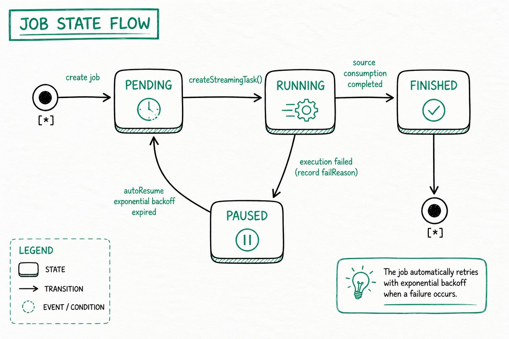

---
{
    "title": "継続データロードの概要",
    "language": "ja",
    "sidebar_label": "概要",
    "description": "Doris Streaming Job による MySQL、PostgreSQL、OceanBase、S3 の継続データロード、同期方法の選択、ジョブ状態、一般的な操作について説明します。",
    "keywords": [
        "Doris 継続データロード",
        "Streaming Job",
        "MySQL リアルタイム同期",
        "PostgreSQL リアルタイム同期",
        "OceanBase リアルタイム同期",
        "S3 継続データロード",
        "SQLマッピング同期",
        "自動テーブル作成同期",
        "exactly-once",
        "at-least-once",
        "autoResume"
    ]
}
---

:::caution 実験的機能

Doris の継続データロードは実験的機能であり、Doris 4.1.5 以降でサポートされます。

:::

<!-- Knowledge type: Feature overview + architecture selection decision -->
<!-- Applicable scenarios: Real-time data ingestion selection / continuous load operations -->

Doris は **Streaming Job** を通じて、複数のデータソースから Doris テーブルへデータを継続的にロードできます。Job を送信すると、Doris はロードジョブを実行し続け、ソースからデータをリアルタイムで読み取り、Doris テーブルに書き込みます。

このドキュメントでは、次の質問に答えます。

- 継続データロードでサポートされるデータソースと同期モードは何ですか？
- SQLマッピング同期と自動テーブル作成同期をどのように選択しますか？
- ジョブ状態はどのように遷移し、自動復旧はどのように機能しますか？
- 日常の運用でロードジョブを表示、停止、再開、削除するにはどうしますか？
- FE と Job の一般的な設定パラメータには何がありますか？

## サポートされるデータソースと同期モード {#supported-data-sources-and-sync-modes}

継続データロードでは、次のデータソースと同期モードがサポートされます。S3 通知ロードと一回限りのロードは Doris 4.1.6 以降でサポートされます。

| データソース | サポートされるバージョン | SQLマッピング同期                                                  | 自動テーブル作成同期                                                | 設定ガイド                                                                                                                       |
| :---------- | :----------------- | :---------------------------------------------------------------- | :---------------------------------------------------------------------- | :---------------------------------------------------------------------------------------------------------------------------------------- |
| MySQL       | 5.6, 5.7, 8.0.x    | [SQLマッピングによるMySQL CDC](./continuous-load-mysql-table.md)    | [自動テーブル作成によるMySQL CDC](./continuous-load-mysql-database.md) | [Amazon RDS MySQL](./prerequisites/amazon-rds-mysql.md) · [Amazon Aurora MySQL](./prerequisites/amazon-aurora-mysql.md)                   |
| PostgreSQL  | 14, 15, 16, 17     | [SQLマッピングによるPostgreSQL CDC](./continuous-load-postgresql-table.md) | [自動テーブル作成によるPostgreSQL CDC](./continuous-load-postgresql-database.md) | [Amazon RDS PostgreSQL](./prerequisites/amazon-rds-postgresql.md) · [Amazon Aurora PostgreSQL](./prerequisites/amazon-aurora-postgresql.md) |
| OceanBase   | MySQL 互換モード | -                                                           | [自動テーブル作成によるOceanBase CDC](./continuous-load-oceanbase-database.md) | -                                                                                                                                         |
| S3          | -                  | [S3 継続データロード](./continuous-load-s3.md)                     | -                                                                       | -                                                                                                                                         |

上流の列型を Doris 型にマッピングする方法については、[MySQL](./data-type-mapping-mysql.md)、[PostgreSQL](./data-type-mapping-postgresql.md)、[OceanBase](./data-type-mapping-oceanbase.md) のデータ型マッピングを参照してください。

## 同期方法の選択 {#how-to-choose-a-sync-method}

<!-- Knowledge type: Architecture selection decision -->

SQLマッピング同期と自動テーブル作成同期は、基盤となるメカニズムが**完全に異なる**2つの継続データロード方法です。違いは「テーブル数」ではありません。**自動テーブル作成同期では、`include_tables` を使って1つのテーブルだけを同期することもできます**。そのため、必要な機能に基づいて選択してください。

### 機能比較 {#capability-comparison}

| 機能         | SQLマッピング同期                                                | 自動テーブル作成同期                           |
| :----------------- | :-------------------------------------------------------------- | :------------------------------------------------- |
| 基盤となるメカニズム | Job + TVF（`INSERT INTO tbl SELECT * FROM tvf()`）             | Job + ネイティブなデータベース全体の DDL（`FROM src TO DATABASE db`） |
| 対象レベル       | 既存の Doris テーブル                                         | Doris データベースコンテナ                         |
| 同期範囲         | 1つのテーブル                                                  | 1つのテーブルから複数テーブル、データベース全体まで（`include_tables` で制御） |
| テーブルの自動作成 | テーブルを事前に作成する必要があります                                | 初回同期時に主キーテーブルを自動作成します |
| SQL の柔軟性    | 列マッピング、フィルタリング、変換（SELECT 句）をサポートします | そのままコピーし、ETL はサポートしません              |
| セマンティクスの保証 | exactly-once                                                    | at-least-once                                      |
| 必要な権限 | Load                                                           | Load + Create（テーブルを自動作成する場合） |
| 典型的なシナリオ  | 列の削除、フィールド名の変更、型変換、条件付きフィルタリングが必要なリアルタイム同期 | 下流のテーブルスキーマを上流に自動追従させたい、データベース全体または一連のテーブルのミラーリング |

### 選択の推奨事項 {#selection-recommendations}

- **データに SQL 処理を適用する必要がある場合、または exactly-once セマンティクスに厳しい要件がある場合** -> **SQLマッピング同期**を選択します
- **Doris にテーブルを自動作成させ、1つの設定で一連のテーブルを同期したい場合** -> **自動テーブル作成同期**を選択します
- **データソースが OceanBase の場合** -> 現在は MySQL 互換モードでの自動テーブル作成同期のみがサポートされます
- **データソースが S3 オブジェクトストレージの場合** -> SQLマッピング同期（S3 TVF を使用）のみがサポートされます

## ジョブ状態の遷移 {#job-state-transitions}

<!-- Knowledge type: Runtime mechanism -->

Streaming Job は実行中に次の状態間を遷移します。**SQLマッピング同期と自動テーブル作成同期は同じ状態マシンに従います**。



### 状態の説明 {#state-descriptions}

| 状態        | 意味                                                                                                                  |
| :----------- | :----------------------------------------------------------------------------------------------------------------------- |
| **PENDING**  | ジョブは作成されていますが、まだサブタスクはスケジュールされていません。次回のスケジューリングラウンドで `StreamingTask` が作成されるのを待機しています。 |
| **RUNNING**  | サブタスクが生成されて実行中です。ソースから増分データを読み取り、Doris に書き込んでいます。         |
| **FINISHED** | ソースの読み取りが完全に完了し、ジョブは終了しています。S3 TVF ジョブはすべてのファイルのロード後にこの状態になります。 |
| **PAUSED**   | サブタスクが失敗し、ジョブは自動的に一時停止され、`failReason` が記録されます。原因は `select * from jobs(...)` の `ErrorMsg` フィールドで確認できます。 |

### 自動復旧（autoResume） {#automatic-recovery-autoresume}

ジョブが `PAUSED` になると、スケジューラは**指数バックオフ戦略**を使って定期的に復旧を試みます。復旧するとジョブは `PENDING` に戻り、サブタスクの作成を続行します。**手動操作は必要ありません。ネットワークの揺らぎや短時間の上流停止など、一時的な障害は自動的に処理されます。**

シナリオに応じて、適切なコマンドを使用してください。

- **すぐに再開する場合、またはトラブルシューティング後に手動で開始する場合**: [`RESUME JOB`](#resume-a-load-job) を使用します
- **完全に停止して、以後スケジュールしない場合**: [`PAUSE JOB`](#pause-a-load-job)（手動で一時停止したジョブは autoResume によって起動されません）または [`DROP JOB`](#delete-a-load-job) を使用します

### CDC task identity and failure handling {#cdc-task-identity-and-failure-handling}

4.1.5 以降、Streaming CDC は、書き込み、テーブルメタデータのクエリ、スキーマ変更に固定の管理者 ID ではなく、ジョブ作成者の Doris ID を使用します。作成者には対象テーブルに対する `LOAD` 権限、自動テーブル作成には `CREATE` 権限、スキーマ同期には対応する `ALTER` 権限とテーブルを参照する権限が必要です。実行中に権限を取り消すと、後続のタスクにも影響します。ジョブに記録された作成者の権限を確認してください。

`cdc_stream()` に基づく Streaming INSERT タスクが失敗しても、通常のタスク再試行フローには入りません。`jobs()` と `tasks()` でエラーを確認し、ソースまたは権限の問題を修正したうえで、ジョブ状態に応じて再開してください。失敗したタスクが自動的に再実行されると想定しないでください。

## 一般的な操作 {#common-operations}

<!-- Knowledge type: Operational steps -->

### ロード状態の表示 {#view-load-status}

すべての Streaming タイプの Insert Job をクエリします。

```sql
select * from jobs("type"="insert") where ExecuteType = "STREAMING";
```

結果列:

| 列            | 説明                                                              |
| ----------------- | ------------------------------------------------------------------------ |
| ID                | Job ID                                                                   |
| NAME              | Job 名                                                                   |
| Definer           | Job の定義者                                                              |
| ExecuteType       | Job のスケジューリングタイプ: *ONE_TIME/RECURRING/STREAMING/MANUAL*               |
| RecurringStrategy | 繰り返し戦略。通常の Insert で使用され、ExecuteType=Streaming の場合は空です |
| Status            | Job の状態                                                               |
| ExecuteSql        | Job の Insert SQL 文                                      |
| CreateTime        | Job の作成時刻                                                        |
| SucceedTaskCount  | 成功したタスク数                                               |
| FailedTaskCount   | 失敗したタスク数                                                   |
| CanceledTaskCount | キャンセルされたタスク数                                                 |
| Comment           | Job のコメント                                                              |
| Properties        | Job のプロパティ                                                           |
| CurrentOffset     | Job が処理を完了したオフセット。ExecuteType=Streaming の場合のみ設定されます |
| EndOffset         | データソースから取得した最大の EndOffset。ExecuteType=Streaming の場合のみ設定されます |
| LoadStatistic     | Job の統計情報                                                           |
| ErrorMsg          | Job のエラーメッセージ                                                 |
| JobRuntimeMsg     | Job の実行時ヒント                                                 |
| LagBytes          | ソースログ（MySQL / OceanBase binlog または PostgreSQL WAL）における未処理バイト数。`-1` は現在値を利用できないことを示します。たとえば S3 データソースや完全スナップショット段階では利用できません。 |
| LastSourceEventTimestamp | コミット済みオフセットに記録された最新のソースイベントのタイムスタンプ（Unix 秒）。利用できない場合は空です。 |
| LastTaskSuccessTime | 直近の Task が正常に完了した時刻                  |

### タスク状態の表示 {#view-task-status}

Job ID で、その Job 配下のすべてのサブタスクをクエリします。

```sql
select * from tasks("type"="insert") where jobId='<job_id>';
```

結果列:

| 列        | 説明                                                          |
| ------------- | -------------------------------------------------------------------- |
| TaskId        | Task ID                                                              |
| JobID         | JobID                                                                |
| JobName       | Job 名                                                             |
| Label         | ロードに使用される Task のラベル                               |
| Status        | Task の状態                                                          |
| ErrorMsg      | Task の失敗メッセージ                                                 |
| CreateTime    | Task の作成時刻                                                   |
| StartTime     | Task の開始時刻                                                      |
| FinishTime    | Task の終了時刻                                                     |
| LoadStatistic | Task の統計情報                                                      |
| User          | Task の実行者                                                        |
| RunningOffset | Task が現在同期しているオフセット情報。Job.ExecuteType=Streaming の場合のみ設定されます |

### ロードジョブの一時停止 {#pause-a-load-job}

指定したジョブを手動で一時停止します（一時停止したジョブは autoResume によって起動されません）。

```sql
PAUSE JOB WHERE jobname = <job_name>;
```

### ロードジョブの再開 {#resume-a-load-job}

`PAUSED` 状態のジョブを再開します。

```sql
RESUME JOB WHERE jobName = <job_name>;
```

### ロードジョブの削除 {#delete-a-load-job}

指定したジョブを完全に削除します。削除後、ジョブはスケジュールされません。

```sql
DROP JOB WHERE jobName = <job_name>;
```

## 一般的なパラメータ {#common-parameters}

<!-- Knowledge type: Configuration parameters -->

### FE 設定パラメータ {#fe-configuration-parameters}

| パラメータ                            | デフォルト | 説明                                       |
| ------------------------------------ | ------- | ------------------------------------------------- |
| max_streaming_job_num                | 1024    | Streaming ジョブの最大数                  |
| job_streaming_task_exec_thread_num   | 10      | StreamingTask の実行に使用するスレッド数   |
| max_streaming_task_show_count        | 100    | メモリに保持する StreamingTask 実行レコードの最大数 |

### Job 共通ロード設定パラメータ {#job-common-load-configuration-parameters}

| パラメータ    | デフォルト | 説明                                            |
| ------------ | ------- | ------------------------------------------------------ |
| max_interval | 10      | 上流に新しいデータがない場合のアイドルスケジューリング間隔（秒）。整数（秒数）のみ受け付けます（例: `10`）。`10s` のような単位サフィックスはサポートされません。1 以上である必要があります。 |

## 制限事項 {#limitations}

<!-- Knowledge type: Limitations / unsupported boundaries -->

同期範囲、自動テーブル作成、セマンティクスの保証（exactly-once / at-least-once）については、[機能比較](#capability-comparison)で説明しています。このセクションでは、**サポートされない**制約と動作のみを示します。

### 主キーテーブル {#primary-key-tables}

**主キーを持つ**上流テーブルのみ同期できます（どちらの同期方法でも同じです）。対応する Doris テーブルは **Unique Key** テーブルです。自動テーブル作成同期ではこの形式で自動作成され、SQLマッピング同期ではユーザーが作成します。主キーのないテーブルはサポートされません。

### Schema Change（DDL） {#schema-change-ddl}

DDL 同期は**自動テーブル作成同期にのみ**適用されます。SQLマッピング（TVF）では DDL を一切同期しません。`cdc_stream()` テーブル関数は常に `schema_change_enabled` を `false` に強制します。

- **PostgreSQL**: `ADD COLUMN` と `DROP COLUMN` のみ同期されます。**列型の変更、`RENAME COLUMN`、制約 / インデックス / パーティションの変更は同期されません**。Doris で手動適用してください。
- **MySQL**: `ADD COLUMN` と `DROP COLUMN` のみ同期されます。**列型の変更、`RENAME COLUMN`、制約 / インデックス / パーティションの変更は同期されません**。Doris で手動適用してください。
- **OceanBase**: `ADD COLUMN` と `DROP COLUMN` のみ同期されます。**列型の変更、`RENAME COLUMN`、主キー / 制約 / インデックス / パーティションの変更は同期されません**。Doris で手動適用してください。

自動テーブル作成同期では、Schema Change Sync がデフォルトで有効になります。Doris 4.1 では、これを無効にする SQL プロパティは現在提供されていません。

:::caution Schema change behavior

- 追加された列には、上流列の `DEFAULT` 値は引き継がれません（MySQL、PostgreSQL、OceanBase）。Doris の新しい列にはデフォルト値がなく、履歴行へのバックフィルも行われません。
- PostgreSQL のスキーマ変更検出は Relation イベントによって行われます。認識されるのは `ADD COLUMN` と `DROP COLUMN` のみです。列の追加と削除を同時に行う変更（`RENAME` の可能性があります）はスキップされ、列型の変更もスキップされます。この機能は自動テーブル作成同期（at-least-once）パスにのみ適用され、TVF / exactly-once パスではサポートされません。

:::

## FAQ {#faq}

<!-- Knowledge type: FAQ / troubleshooting -->

### MySQL 接続エラー: Public Key Retrieval is not allowed {#mysql-connection-error-public-key-retrieval-is-not-allowed}

**原因:** 設定された MySQL ユーザーは SHA256 パスワード認証を使用しており、TLS などのプロトコル経由でパスワードを送信する必要があります。

**解決策 1:** JDBC URL に `allowPublicKeyRetrieval=true` パラメータを追加します。

```
jdbc:mysql://127.0.0.1:3306?allowPublicKeyRetrieval=true
```

**解決策 2:** MySQL ユーザーの認証方式を `mysql_native_password` に変更します。

```sql
ALTER USER 'username'@'%' IDENTIFIED WITH mysql_native_password BY 'password';
FLUSH PRIVILEGES;
```
