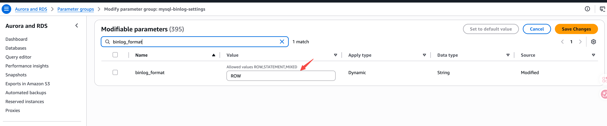

---
{
    "title": "Amazon RDS MySQL",
    "language": "ja",
    "description": "Doris のストリーミング取り込みに必要な事前設定として、Amazon RDS MySQL で Binlog を有効にし、パラメータグループを設定して、同期ユーザーを作成する方法を説明します。",
    "keywords": [
        "Amazon RDS MySQL",
        "Doris ストリーミング取り込み",
        "MySQL Binlog",
        "binlog_format ROW",
        "binlog_row_image FULL",
        "RDS パラメータグループ",
        "binlog retention hours",
        "CDC 同期"
    ]
}
---

:::caution 実験的機能

Doris の継続的データロードは実験的機能であり、Doris 4.1.5 以降でサポートされます。

:::

<!-- Knowledge type: Operational steps -->
<!-- Applicable scenario: Pre-deployment check / Environment configuration -->

Doris のストリーミング取り込みは、Amazon RDS MySQL からのデータ同期をサポートします。対応するバージョンは **MySQL 5.6、5.7、8.0.x** です。同期タスクを開始する前に、RDS インスタンスで Binlog が有効になっており、変更ログが正しい形式で記録されていることを確認してください。

このドキュメントは、ストリーミング取り込み（CDC）を使用して Amazon RDS MySQL から Doris にデータを同期するユーザーを対象としています。必要な事前設定を、作業の順序に沿って説明します。

## 事前確認チェックリスト {#prerequisite-checklist}

作業を始める前に、次の条件を確認してください。

| 確認項目 | 期待値 | 説明 |
| --- | --- | --- |
| `log_bin` | `ON` | Binlog が有効になっている |
| `binlog_format` | `ROW` | 変更が行単位で記録される |
| `binlog_row_image` | `FULL` | 完全な行イメージが記録される |
| 同期ユーザー | 作成済み | `SELECT`、`REPLICATION SLAVE`、`REPLICATION CLIENT` 権限を持つ |
| Binlog の保持期間 | 72 時間以上 | ログが早期に削除されて同期が中断するのを防ぐ |

条件を満たしていない項目がある場合は、以下の手順に従って設定してください。

## ステップ 1：現在の Binlog 設定を確認する {#step-1-check-the-current-binlog-configuration}

**目的**：RDS インスタンスの現在の Binlog の状態を確認し、パラメータグループの変更が必要かどうかを判断します。

RDS インスタンスに接続した後、次の SQL を実行します。

```sql
-- Check if binlog is enabled
SHOW VARIABLES LIKE 'log_bin';

-- Check binlog format
SHOW VARIABLES LIKE 'binlog_format';

-- Check binlog row image
SHOW VARIABLES LIKE 'binlog_row_image';
```

**結果の判断方法**：

-   `log_bin = ON`、`binlog_format = ROW`、`binlog_row_image = FULL` の場合、追加の設定は不要です。[ステップ 4：同期ユーザーを作成する](#step-4-create-a-sync-user)に進んでください。
-   いずれかの条件を満たしていない場合は、ステップ 2 とステップ 3 に進んでください。

## ステップ 2：パラメータグループを作成して設定する {#step-2-create-and-configure-a-parameter-group}

**目的**：AWS コンソールでカスタムパラメータグループを作成し、Binlog 関連のパラメータを Doris のストリーミング取り込みに必要な値に設定します。

手順は次のとおりです。

1.  [AWS RDS コンソール](https://console.aws.amazon.com/rds/)にログインします。
2.  左側のナビゲーションで **Parameter groups** を選択し、**Create parameter group** をクリックします。
3.  対象の MySQL バージョンに対応するファミリーを選択し、新しいパラメータグループを作成します。
4.  パラメータグループを編集し、`binlog_format` を検索して値を `ROW` に設定します。

    

5.  同様に `binlog_row_image` を検索し、値を `FULL` に設定します。
6.  **Save Changes** をクリックして保存します。

変更が必要なパラメータは次のとおりです。

| パラメータ | 設定値 | 目的 |
| --- | --- | --- |
| `binlog_format` | `ROW` | CDC 同期に必要な、行単位でのデータ変更の記録 |
| `binlog_row_image` | `FULL` | 各変更の前後における完全な行データの記録 |

## ステップ 3：パラメータグループを適用してインスタンスを再起動する {#step-3-apply-the-parameter-group-and-restart-the-instance}

**目的**：新しいパラメータグループを対象の RDS インスタンスに関連付け、再起動して設定を反映します。

手順は次のとおりです。

1.  RDS コンソールで対象のインスタンスを選択し、**Modify** をクリックします。
2.  **DB parameter group** で、新しく作成したパラメータグループを選択します。
3.  **Apply immediately** を選択して、変更を直ちに適用します。
4.  RDS インスタンスを再起動して設定を反映します。

:::caution
`binlog_format` パラメータの変更を反映するには、RDS インスタンスの再起動が必要です。利用が少ない時間帯に作業してください。
:::

## ステップ 4：同期ユーザーを作成する {#step-4-create-a-sync-user}

**目的**：最小権限の原則に従い、Doris のストリーミング取り込み専用のアカウントを作成します。

1.  専用ユーザーを作成します。

    ```sql
    CREATE USER 'doris_sync'@'%' IDENTIFIED BY '<password>';
    ```

2.  同期に必要な権限を付与します。

    ```sql
    GRANT SELECT, REPLICATION SLAVE, REPLICATION CLIENT ON *.* TO 'doris_sync'@'%';
    ```

必要な権限は次のとおりです。

| 権限 | 用途 |
| --- | --- |
| `SELECT` | 既存データの読み取り（全量データロードの段階） |
| `REPLICATION SLAVE` | レプリカとして Binlog を取得する |
| `REPLICATION CLIENT` | プライマリの Binlog の状態を照会する |

## ステップ 5：Binlog の保持期間を設定する {#step-5-configure-binlog-retention}

**目的**：デフォルトでは、Amazon RDS MySQL はバイナリログをできるだけ早く削除します。障害発生時にもレプリケーションに使用する Binlog ファイルを利用できるよう、Binlog の保持期間を **72 時間以上**に設定することを推奨します。

`mysql.rds_set_configuration` ストアドプロシージャを使用して、保持期間を設定します。

```sql
CALL mysql.rds_set_configuration('binlog retention hours', 72);
```

:::caution
この設定項目が未設定の場合や保持期間が短すぎる場合、バイナリログに欠落が生じ、Doris がレプリケーションを再開できなくなる可能性があります。
:::

## よくある質問（FAQ） {#frequently-asked-questions-faq}

**Q1：`binlog_format` を変更した後、インスタンスの再起動は必須ですか？**

はい。`binlog_format` は静的パラメータのため、変更を反映するには RDS インスタンスの再起動が必要です。利用が少ない時間帯に作業してください。

**Q2：`binlog_row_image` を `FULL` に設定する必要があるのはなぜですか？**

Doris のストリーミング取り込みでは、`UPDATE` と `DELETE` の操作を正しく再現するために、各変更の前後における完全な行データが必要です。`MINIMAL` または `NOBLOB` に設定すると、同期エラーやデータの欠落が発生します。

**Q3：同じパラメータグループを複数の RDS インスタンスで再利用できますか？**

はい。同じバージョンファミリーに属する複数の RDS インスタンスは、同じ Binlog 設定が必要であれば、パラメータグループを共有できます。

**Q4：Binlog の保持期間をさらに長く設定できますか？**

はい。`binlog retention hours` には 1～168 時間（最大 7 日間）を設定できます。保持期間を長くすると復旧可能な期間が延びますが、ストレージの使用量も増えます。

## トラブルシューティング {#troubleshooting}

| 症状 | 考えられる原因 | 対処方法 |
| --- | --- | --- |
| `SHOW VARIABLES LIKE 'log_bin'` が `OFF` を返す | インスタンスで自動バックアップが有効になっていないため、Binlog が有効になっていない | RDS コンソールでインスタンスの自動バックアップを有効にします。これにより Binlog が自動的に有効になります |
| 変更後も `binlog_format` が `MIXED` または `STATEMENT` のままである | インスタンスが再起動されていない、または関連付けられたパラメータグループが正しくない | 新しいパラメータグループが関連付けられていることを確認し、インスタンスを再起動します |
| Doris の同期で `binary log not found` というエラーが報告される | Binlog が削除されている | `binlog retention hours` を増やし、Doris の同期タスクを再起動します |
| 同期ユーザーが接続できない | ホストの許可リストまたはパスワードが正しくない | `'doris_sync'@'%'` のホスト指定が Doris ノードの送信元 IP アドレスに一致するか確認します |
| 権限不足のエラーが発生する | `REPLICATION SLAVE` などの権限が不足している | ステップ 4 の `GRANT` 文を再実行します |
