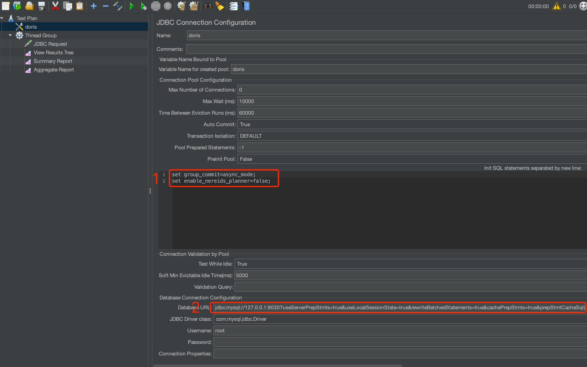
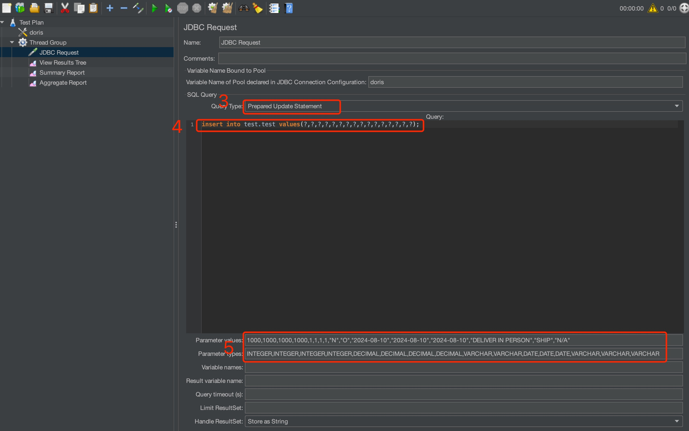

---
{
    "title": "高並行データロードの最適化（Group Commit）",
    "language": "ja",
    "description": "Doris Group Commit は高頻度の小バッチ書き込みトランザクションをまとめ、FE の解析負荷とバージョン数の増加を抑えることで、INSERT と Stream Load の高並行処理性能を向上させます。",
    "keywords": [
        "Group Commit",
        "高並行データロード",
        "高頻度の小バッチ書き込み",
        "INSERT INTO の最適化",
        "Stream Load の最適化",
        "Doris のデータロード性能",
        "PreparedStatement",
        "WAL"
    ]
}
---

<!-- Knowledge type: Feature capability + Operational steps + Configuration parameters -->
<!-- Applicable scenarios: High-concurrency small-batch writes / Real-time load / Performance tuning -->

高頻度の小バッチ書き込みでは、従来のデータロード方法に次の問題があります。

- データロードごとに独立したトランザクションが作成され、毎回 FE での SQL 解析と実行プランの生成が必要になるため、全体の性能が低下します。
- データロードごとに新しいバージョンが生成されるため、バージョン数が急増し、バックグラウンドの Compaction の負荷が高まります。

これらの問題を解決するため、Doris は Group Commit を導入しています。Group Commit は新しいデータロード方法ではなく、既存のデータロード方法を拡張して最適化する仕組みで、主に次の方法を対象とします。

- `INSERT INTO tbl VALUES(...)` ステートメント
- Stream Load

Group Commit は、複数の小バッチのデータロードをバックグラウンドでまとめ、単一の大きなトランザクションとしてコミットすることで、高並行の小バッチ書き込み性能を大幅に向上させます。PreparedStatement と組み合わせると、さらに高い性能向上が得られます。

## 適用シナリオとモードの選択 {#applicable-scenarios-and-selection}

| シナリオ | 推奨モード | 説明 |
| --- | --- | --- |
| 書き込み完了後すぐにデータを参照する必要がある高並行書き込み | `sync_mode` | 複数のデータロードを単一のトランザクションにまとめ、コミット後に呼び出しから戻ります。 |
| レイテンシーに敏感な高頻度書き込み | `async_mode` | まずデータを WAL に書き込んですぐに呼び出しから戻り、バックグラウンドで非同期にコミットします。 |
| Group Commit が不要な場合 | `off_mode` | Group Commit を無効にし、通常のデータロード処理を使用します。 |

## Group Commit のモード {#group-commit-modes}

Group Commit による書き込みには、次のモードがあります。

- **無効モード（`off_mode`）**

    Group Commit を無効にします。

- **同期モード（`sync_mode`）**

    Doris は負荷とテーブルの `group_commit_interval` プロパティに基づき、複数のデータロードを単一のトランザクションにまとめてコミットします。各データロードはトランザクションのコミット後に戻ります。このモードは、データロードの完了後すぐにデータを参照する必要がある高並行書き込みに適しています。

- **非同期モード（`async_mode`）**

    Doris はまずデータを WAL（`Write Ahead Log`）に書き込み、データロードはすぐに戻ります。その後、負荷とテーブルの `group_commit_interval` プロパティに基づいて非同期にコミットし、コミット後にデータを参照できるようになります。WAL がディスク領域を過度に占有しないよう、単一のデータロードで大量のデータを書き込む場合は、自動的に `sync_mode` に切り替わります。このモードは、レイテンシーに敏感な高頻度書き込みに適しています。

    WAL ファイルの数は FE の HTTP インターフェースで確認できます。詳しくは[こちら](../../../admin-manual/open-api/fe-http/get-wal-size-action)を参照してください。BE のメトリクスで `wal` を検索することもできます。

## クイックスタート {#quick-start}

以下の例では、すべて次のテーブル定義を使用します。

```sql
CREATE TABLE `dt` (
    `id` int(11) NOT NULL,
    `name` varchar(50) NULL,
    `score` int(11) NULL
) ENGINE=OLAP
DUPLICATE KEY(`id`)
DISTRIBUTED BY HASH(`id`) BUCKETS 1
PROPERTIES (
    "replication_num" = "1"
);
```

### テーブルプロパティの設定 {#table-property-configuration}

:::info
`group_commit_mode` テーブルプロパティは、バージョン **4.1.0** 以降でサポートされています。
:::

テーブル単位で Group Commit のデフォルトモードを設定できます。Stream Load で `group_commit` HTTP Header を設定しなかった場合は、テーブルプロパティのモードが使用されます。

**1. テーブル作成時に設定する：**

```sql
CREATE TABLE `dt` (
    `id` int(11) NOT NULL,
    `name` varchar(50) NULL,
    `score` int(11) NULL
) ENGINE=OLAP
DUPLICATE KEY(`id`)
DISTRIBUTED BY HASH(`id`) BUCKETS 1
PROPERTIES (
    "replication_num" = "1",
    "group_commit_mode" = "async_mode"
);
```

**2. テーブルプロパティを変更する：**

```sql
# Change to sync mode
ALTER TABLE dt SET ("group_commit_mode" = "sync_mode");

# Disable Group Commit
ALTER TABLE dt SET ("group_commit_mode" = "off_mode");
```

**3. テーブルプロパティを確認する：**

`SHOW CREATE TABLE` には、値が `off_mode` の場合を除き、`group_commit_mode` プロパティが表示されます。

```sql
mysql> SHOW CREATE TABLE dt;
+-------+----------------------------------------------------------------------------------------------------------------------------------------------------------------------------------------------------------------------+
| Table | Create Table                                                                                                                                                                                                       |
+-------+----------------------------------------------------------------------------------------------------------------------------------------------------------------------------------------------------------------------+
| dt    | CREATE TABLE `dt` (
  `id` int(11) NOT NULL,
  `name` varchar(50) NULL,
  `score` int(11) NULL
) ENGINE=OLAP
DUPLICATE KEY(`id`)
DISTRIBUTED BY HASH(`id`) BUCKETS 1
PROPERTIES (
    "group_commit_mode" = "async_mode"
) |
+-------+----------------------------------------------------------------------------------------------------------------------------------------------------------------------------------------------------------------------+
1 row in set (0.00 sec)
```

**4. 優先順位：**

| データロード方法 | 優先順位（高い順） |
| --- | --- |
| Stream Load | `group_commit` HTTP Header > テーブルプロパティ `group_commit_mode` |
| INSERT INTO VALUES | セッション変数 `group_commit` > テーブルプロパティ `group_commit_mode` |

## 使用方法 {#usage}

### INSERT INTO VALUES {#insert-into-values}

セッション変数 `group_commit` を設定して Group Commit を有効にします。セッション変数はテーブルプロパティより優先されます。

**非同期モード：**

```sql
# Set the session variable to enable group commit (default is off_mode), using async mode
mysql> set group_commit = async_mode;

# The returned label starts with group_commit, which tells you that group commit is in use
mysql> insert into dt values(1, 'Bob', 90), (2, 'Alice', 99);
Query OK, 2 rows affected (0.05 sec)
{'label':'group_commit_a145ce07f1c972fc-bd2c54597052a9ad', 'status':'PREPARE', 'txnId':'181508'}

# This label and txn_id match the previous one, indicating that the inserts are batched into the same load task
mysql> insert into dt(id, name) values(3, 'John');
Query OK, 1 row affected (0.01 sec)
{'label':'group_commit_a145ce07f1c972fc-bd2c54597052a9ad', 'status':'PREPARE', 'txnId':'181508'}

# The data is not immediately queryable
mysql> select * from dt;
Empty set (0.01 sec)

# After 10 seconds, the data is queryable. The data visibility delay is controlled by the table property group_commit_interval.
mysql> select * from dt;
+------+-------+-------+
| id   | name  | score |
+------+-------+-------+
|    1 | Bob   |    90 |
|    2 | Alice |    99 |
|    3 | John  |  NULL |
+------+-------+-------+
3 rows in set (0.02 sec)
```

**同期モード：**

```sql
# Set the session variable to enable group commit (default is off_mode), using sync mode
mysql> set group_commit = sync_mode;

# The returned label starts with group_commit, which tells you that group commit is in use. The load takes at least the value of the table property group_commit_interval.
mysql> insert into dt values(4, 'Bob', 90), (5, 'Alice', 99);
Query OK, 2 rows affected (10.06 sec)
{'label':'group_commit_d84ab96c09b60587_ec455a33cb0e9e87', 'status':'PREPARE', 'txnId':'3007', 'query_id':'fc6b94085d704a94-a69bfc9a202e66e2'}

# The data is queryable immediately
mysql> select * from dt;
+------+-------+-------+
| id   | name  | score |
+------+-------+-------+
|    1 | Bob   |    90 |
|    2 | Alice |    99 |
|    3 | John  |  NULL |
|    4 | Bob   |    90 |
|    5 | Alice |    99 |
+------+-------+-------+
5 rows in set (0.03 sec)
```

**無効モード：**

```sql
mysql> set group_commit = off_mode;
```

### JDBC（PreparedStatement）の使用 {#using-jdbc-preparedstatement}

JDBC の `insert into values` でデータを書き込む場合、SQL 解析とプラン生成の負荷を減らすため、Doris は FE 側で MySQL プロトコルの `PreparedStatement` 機能をサポートしています。`PreparedStatement` を使用すると、SQL とそのデータロードプランがセッション単位のメモリキャッシュに保存されます。以降のデータロードではキャッシュされたオブジェクトを直接使用するため、FE の CPU 使用率を抑えられます。

**1. JDBC URL を設定し、サーバー側で PreparedStatement を有効にする：**

```text
url = jdbc:mysql://127.0.0.1:9030/db?useServerPrepStmts=true&useLocalSessionState=true&rewriteBatchedStatements=true&cachePrepStmts=true&prepStmtCacheSqlLimit=99999&prepStmtCacheSize=500
```

**2. 次のいずれかの方法で `group_commit` セッション変数を設定する：**

- JDBC URL に `sessionVariables=group_commit=async_mode` を追加する：

    ```text
    url = jdbc:mysql://127.0.0.1:9030/db?useServerPrepStmts=true&useLocalSessionState=true&rewriteBatchedStatements=true&cachePrepStmts=true&prepStmtCacheSqlLimit=99999&prepStmtCacheSize=500&sessionVariables=group_commit=async_mode,enable_nereids_planner=false
    ```

- SQL ステートメントを実行する：

    ```java
    try (Statement statement = conn.createStatement()) {
        statement.execute("SET group_commit = async_mode;");
    }
    ```

**3. `PreparedStatement` でバッチ書き込みを行う：**

```java
private static final String JDBC_DRIVER = "com.mysql.jdbc.Driver";
private static final String URL_PATTERN = "jdbc:mysql://%s:%d/%s?useServerPrepStmts=true&useLocalSessionState=true&rewriteBatchedStatements=true&cachePrepStmts=true&prepStmtCacheSqlLimit=99999&prepStmtCacheSize=50&sessionVariables=group_commit=async_mode";
private static final String HOST = "127.0.0.1";
private static final int PORT = 9030;
private static final String DB = "db";
private static final String TBL = "dt";
private static final String USER = "root";
private static final String PASSWD = "";
private static final int INSERT_BATCH_SIZE = 10;

private static void groupCommitInsertBatch() throws Exception {
    Class.forName(JDBC_DRIVER);
    // add rewriteBatchedStatements=true and cachePrepStmts=true in JDBC url
    // set session variables by sessionVariables=group_commit=async_mode in JDBC url
    try (Connection conn = DriverManager.getConnection(
            String.format(URL_PATTERN, HOST, PORT, DB), USER, PASSWD)) {

        String query = "insert into " + TBL + " values(?, ?, ?)";
        try (PreparedStatement stmt = conn.prepareStatement(query)) {
            for (int j = 0; j < 5; j++) {
                // 10 rows per insert
                for (int i = 0; i < INSERT_BATCH_SIZE; i++) {
                    stmt.setInt(1, i);
                    stmt.setString(2, "name" + i);
                    stmt.setInt(3, i + 10);
                    stmt.addBatch();
                }
                int[] result = stmt.executeBatch();
            }
        }
    } catch (Exception e) {
        e.printStackTrace();
    }
}
```

:::tip
高頻度の `INSERT INTO` ステートメントでは大量の監査ログが出力され、最終的な性能に影響するため、prepared ステートメントの監査ログ出力はデフォルトで無効です。セッション変数を設定して、prepared ステートメントの監査ログを出力するかどうかを制御できます。

```sql
# Set the session variable to enable audit logging for prepared statements. The default value is false, which disables audit logging for prepared statements.
set enable_prepared_stmt_audit_log=true;
```
:::

JDBC の詳しい使用方法は、[INSERT によるデータの同期](../import-way/insert-into-manual.md)を参照してください。

### Golang クライアントでのバッチ化 {#batching-with-the-golang-client}

Golang では prepared ステートメントのサポートに制限があるため、クライアント側で手動でバッチ化すると Group Commit の性能を向上できます。以下はプログラムの例です。

```Golang
package main

import (
	"database/sql"
	"fmt"
	"math/rand"
	"strings"
	"sync"
	"sync/atomic"
	"time"

	_ "github.com/go-sql-driver/mysql"
)

const (
	host     = "127.0.0.1"
	port     = 9030
	db       = "test"
	user     = "root"
	password = ""
	table    = "async_lineitem"
)

var (
	threadCount = 20
	batchSize   = 100
)

var totalInsertedRows int64
var rowsInsertedLastSecond int64

func main() {
	dbDSN := fmt.Sprintf("%s:%s@tcp(%s:%d)/%s?parseTime=true", user, password, host, port, db)
	db, err := sql.Open("mysql", dbDSN)
	if err != nil {
		fmt.Printf("Error opening database: %s\n", err)
		return
	}
	defer db.Close()

	var wg sync.WaitGroup
	for i := 0; i < threadCount; i++ {
		wg.Add(1)
		go func() {
			defer wg.Done()
			groupCommitInsertBatch(db)
		}()
	}

	go logInsertStatistics()

	wg.Wait()
}

func groupCommitInsertBatch(db *sql.DB) {
	for {
		valueStrings := make([]string, 0, batchSize)
		valueArgs := make([]interface{}, 0, batchSize*16)
		for i := 0; i < batchSize; i++ {
		    valueStrings = append(valueStrings, "(?, ?, ?, ?, ?, ?, ?, ?, ?, ?, ?, ?, ?, ?, ?, ?)")
			valueArgs = append(valueArgs, rand.Intn(1000))
			valueArgs = append(valueArgs, rand.Intn(1000))
			valueArgs = append(valueArgs, rand.Intn(1000))
			valueArgs = append(valueArgs, rand.Intn(1000))
			valueArgs = append(valueArgs, sql.NullFloat64{Float64: 1.0, Valid: true})
			valueArgs = append(valueArgs, sql.NullFloat64{Float64: 1.0, Valid: true})
			valueArgs = append(valueArgs, sql.NullFloat64{Float64: 1.0, Valid: true})
			valueArgs = append(valueArgs, sql.NullFloat64{Float64: 1.0, Valid: true})
			valueArgs = append(valueArgs, "N")
			valueArgs = append(valueArgs, "O")
			valueArgs = append(valueArgs, time.Now())
			valueArgs = append(valueArgs, time.Now())
			valueArgs = append(valueArgs, time.Now())
			valueArgs = append(valueArgs, "DELIVER IN PERSON")
			valueArgs = append(valueArgs, "SHIP")
			valueArgs = append(valueArgs, "N/A")
		}
		stmt := fmt.Sprintf("INSERT INTO %s VALUES %s",
			table, strings.Join(valueStrings, ","))
		_, err := db.Exec(stmt, valueArgs...)
		if err != nil {
			fmt.Printf("Error executing batch: %s\n", err)
			return
		}
		atomic.AddInt64(&rowsInsertedLastSecond, int64(batchSize))
		atomic.AddInt64(&totalInsertedRows, int64(batchSize))
	}
}

func logInsertStatistics() {
	for {
		time.Sleep(1 * time.Second)
		fmt.Printf("Total inserted rows: %d\n", totalInsertedRows)
		fmt.Printf("Rows inserted in the last second: %d\n", rowsInsertedLastSecond)
		rowsInsertedLastSecond = 0
	}
}

```

### Stream Load {#stream-load}

Stream Load でデータをロードする場合は、HTTP Header に `group_commit` パラメータを設定して Group Commit を有効にできます。

:::note
`group_commit` Header を設定せず、テーブルプロパティに `group_commit_mode` を設定している場合は、テーブルプロパティのモードが自動的に使用されます。
:::

`data.csv` の内容を次のように想定します。

```text
6,Amy,60
7,Ross,98
```

**非同期モード：**

```shell
# Add the "group_commit:async_mode" header during load

curl --location-trusted -u {user}:{passwd} -T data.csv -H "group_commit:async_mode"  -H "column_separator:,"  http://{fe_host}:{http_port}/api/db/dt/_stream_load
{
    "TxnId": 7009,
    "Label": "group_commit_c84d2099208436ab_96e33fda01eddba8",
    "Comment": "",
    "GroupCommit": true,
    "Status": "Success",
    "Message": "OK",
    "NumberTotalRows": 2,
    "NumberLoadedRows": 2,
    "NumberFilteredRows": 0,
    "NumberUnselectedRows": 0,
    "LoadBytes": 19,
    "LoadTimeMs": 35,
    "StreamLoadPutTimeMs": 5,
    "ReadDataTimeMs": 0,
    "WriteDataTimeMs": 26
}

# The returned GroupCommit is true, which means the load entered the group commit path
# The returned Label starts with group_commit and is the label associated with the load that actually consumes the data
```

**同期モード：**

```shell
# Add the "group_commit:sync_mode" header during load

curl --location-trusted -u {user}:{passwd} -T data.csv -H "group_commit:sync_mode"  -H "column_separator:,"  http://{fe_host}:{http_port}/api/db/dt/_stream_load
{
    "TxnId": 3009,
    "Label": "group_commit_d941bf17f6efcc80_ccf4afdde9881293",
    "Comment": "",
    "GroupCommit": true,
    "Status": "Success",
    "Message": "OK",
    "NumberTotalRows": 2,
    "NumberLoadedRows": 2,
    "NumberFilteredRows": 0,
    "NumberUnselectedRows": 0,
    "LoadBytes": 19,
    "LoadTimeMs": 10044,
    "StreamLoadPutTimeMs": 4,
    "ReadDataTimeMs": 0,
    "WriteDataTimeMs": 10038
}

# The returned GroupCommit is true, which means the load entered the group commit path
# The returned Label starts with group_commit and is the label associated with the load that actually consumes the data
```

Stream Load の構文とベストプラクティスについては、[Stream Load](../import-way/stream-load-manual)を参照してください。

## 自動コミットの条件 {#auto-commit-conditions}

<!-- Knowledge type: Configuration parameters -->

コミット間隔（デフォルトは 10 秒）が経過するか、累積データ量がデフォルトのしきい値である 128 MB に達すると、コミットがトリガーされます。ワークロードに合わせて、このテーブル単位のしきい値を調整してください。

### コミット間隔の調整 {#adjusting-the-commit-interval}

デフォルトのコミット間隔は 10 秒です。テーブルの設定を変更して調整できます。

```sql
# Change the commit interval to 2 seconds
ALTER TABLE dt SET ("group_commit_interval_ms" = "2000");
```

**調整の目安：**

| 設定値の例 | 利点 | 欠点 |
| --- | --- | --- |
| 短い間隔（例：2 秒） | データが参照可能になるまでの遅延が短くなり、即時性が求められる場合に適しています | コミットの頻度とバージョン数の増加速度が上がり、バックグラウンドの Compaction の負荷が高まります |
| 長い間隔（例：30 秒） | コミットするバッチが大きくなり、バージョン数の増加速度とシステム負荷が下がります | データが参照可能になるまでの遅延が長くなります |

業務上許容できるデータ可視化までの遅延に応じて設定してください。システムの負荷が高い場合は、適宜間隔を延ばせます。

### コミットするデータ量の調整 {#adjusting-the-commit-data-size}

**バージョン履歴：**

- `group_commit_data_bytes` テーブルプロパティは Doris 2.1.0 で導入され、デフォルト値は 134217728 バイト（128 MB）です。
- このデフォルト値は 3.x、4.x、dev でも変わりません。
- BE パラメータ `group_commit_queue_mem_limit` のデフォルト値は 64 MB で、キューメモリのバックプレッシャーを制御します。コミットをトリガーするしきい値とは別の設定です。

Group Commit でコミットをトリガーするデータ量のデフォルトのしきい値は 128 MB です。テーブルの設定を変更して調整できます。

```sql
# Set the commit data-size trigger threshold to 256 MB
ALTER TABLE dt SET ("group_commit_data_bytes" = "268435456");
```

**調整の目安：**

| 設定値の例 | 利点 | 欠点 |
| --- | --- | --- |
| 小さいしきい値（例：32 MB） | メモリ使用量が少なく、リソースが限られた環境に適しています | コミットするバッチが小さくなり、スループットが制限される可能性があります |
| 大きいしきい値（例：256 MB） | バッチコミットの効率とシステムのスループットが高まります | メモリ使用量が増えます |

メモリリソースとデータの信頼性要件のバランスを考慮して設定してください。メモリに余裕があり、高いスループットが必要な場合は、256 MB 以上に増やせます。

## 関連するシステム設定 {#related-system-configuration}

### BE の設定 {#be-configuration}

**`group_commit_wal_path`**

- 説明：Group Commit が WAL ファイルを保存するディレクトリです。
- デフォルト値：`storage_root_path` に設定された各ディレクトリの下に、`wal` という名前のディレクトリが作成されます。設定例：

    ```text
    group_commit_wal_path=/data1/storage/wal;/data2/storage/wal;/data3/storage/wal
    ```

### コンピュートとストレージを分離したモードでの Stream Load の転送 {#stream-load-forwarding-in-compute-storage-decoupled-mode}

コンピュートとストレージを分離したモードでは、ロードバランサーが Stream Load のリクエストをランダムに振り分けると、同じテーブルへのリクエストが異なる BE ノードに届き、Group Commit で効率よくバッチ化できません。BE 転送を有効にすると、リクエストを受け取った BE がそのテーブルの対象 BE に転送するため、同じテーブルへのリクエストが単一の BE に集まります。

| 設定項目 | 設定先 | デフォルト値 | 説明 |
| --- | --- | --- | --- |
| `enable_group_commit_streamload_be_forward` | FE | `false` | Stream Load の BE 転送を有効にするかどうかを指定します。分離モードで、リクエストが Group Commit を使用する場合にのみ有効です |
| `enable_group_commit_streamload_be_forward` | BE | `false` | BE のエンドポイント `/api/{db}/{table}/_stream_load_forward` へのリクエストを許可するかどうかを指定します。**Doris 4.0 系では 4.0.8、Doris 4.1 系では 4.1.4 で追加されました** |

FE と BE の**両方**で、この設定を `true` にする必要があります。

:::caution 動作の変更（4.0.8 / 4.1.4）

Doris 4.0 系の 4.0.8、および Doris 4.1 系の 4.1.4 以降、BE の `_stream_load_forward` エンドポイントには次の制限があります。

- エンドポイントは BE の設定 `enable_group_commit_streamload_be_forward` によって制御されます。`false`（デフォルト）の場合、リクエストには `Stream load forward is disabled` というメッセージとともに `403 Forbidden` が返されます。
- 設定を有効にした場合も、エンドポイントへのリクエストには認証とグローバルな `LOAD` 権限が必要です。

アップグレード前に FE 側だけでこの機能を有効にしていた場合、アップグレード後は転送に失敗します。すべての `be.conf` に `enable_group_commit_streamload_be_forward=true` を追加し、データロードに使用するアカウントに `LOAD` 権限があることを確認してください。

:::

### Follower FE への転送 {#forwarding-to-a-follower-fe}

> バージョン 4.1.4 以降でサポートされています。

前述の BE 転送に加え、FE は Group Commit を使用する Stream Load リクエストをラウンドロビン方式で Follower FE に転送できます。これにより、バッチ化の負荷を複数の FE に分散できます。

| 設定項目 | 設定先 | デフォルト値 | 説明 |
| --- | --- | --- | --- |
| `enable_forward_group_commit_stream_load_to_follower` | FE | `false` | Group Commit を使用する Stream Load リクエストをラウンドロビン方式で Follower FE に転送するかどうかを指定します |

注意：対象テーブルの `light_schema_change` が `false` の場合、この転送はサポートされず、リクエストはエラーになります。

### WAL ファイル数の制限 {#wal-count-limit}

> バージョン 4.1.4 以降でサポートされています。

`async_mode` の Group Commit は、まずデータを WAL に書き込み、非同期で再生します。WAL の再生が失敗し続けると、WAL ファイルが蓄積してディスクを使い切る可能性があります。バージョン 4.1.4 以降では、BE の設定 `group_commit_max_wal_num_per_table` によって、テーブルごとの WAL ファイル数を制限できます。

| 設定項目 | 設定先 | デフォルト値 | 説明 |
| --- | --- | --- | --- |
| `group_commit_max_wal_num_per_table` | BE | `10` | 単一テーブルで許可される Group Commit の WAL ファイル数の上限です。`0` は無制限を意味します。動的な変更に対応しています |

上限を超えると、そのテーブルへの `async_mode` の Group Commit データロードは拒否され、次のような `EXCEEDED_LIMIT` エラーが返されます。

```text
Too many group commit async WALs for table <table_name>
```

このエラーは、スキーマ変更やディスク障害などによって WAL の再生に問題が発生していることを意味します。単に上限を引き上げるのではなく、原因を調査して WAL の再生を復旧してください。

## 制限事項 {#limitations}

### Group Commit が適用されないケース {#group-commit-fallback-scenarios}

| データロード方法 | Group Commit が適用されず、通常の処理に切り替わる条件 |
| --- | --- |
| `INSERT INTO VALUES` | トランザクション書き込みを使用する（`Begin; INSERT INTO VALUES; COMMIT`）<br/>ラベルを指定する（`INSERT INTO dt WITH LABEL {label} VALUES`）<br/>VALUES に式を含める（`INSERT INTO dt VALUES (1 + 100)`）<br/>列更新書き込みを行う<br/>軽量なスキーマ変更をサポートしないテーブルを使用する |
| `Stream Load` | 二段階コミットを使用する<br/>ラベルを指定する（`-H "label:my_label"`）<br/>列更新書き込みを行う<br/>軽量なスキーマ変更をサポートしないテーブルを使用する |

### Unique モデル {#unique-model}

- Group Commit はコミット順序を保証しません。データの整合性を確保するには Sequence カラムを使用してください。

### WAL の制限 {#wal-limitations}

4.1.5 以降、WAL の再生では、末尾に書き込まれた長さフィールドまたはペイロードが不完全な場合、それをファイルの終端として扱います。完全なデータブロックは、末尾のチェックサムフィールドが完全に書き込まれていなくても再生できます。末尾の未完成のレコードは完全なレコードとして復元されません。WAL ファイルが欠落または破損している場合、データの完全性は引き続き保証できません。

- `async_mode` はデータを WAL に書き込み、成功後に WAL を削除し、失敗時には WAL から復旧します。
- WAL ファイルは単一レプリカで保存されます。対応するディスクが破損したり、ファイルを誤って削除したりすると、データが失われる可能性があります。
- BE ノードをオフラインにする際は、データ損失を防ぐために `DECOMMISSION` コマンドを使用してください。
- `async_mode` は、次の場合に自動的に `sync_mode` に切り替わります。
    - 単一のデータロードに含まれるデータ量が多すぎる場合（単一の WAL ディレクトリの容量の 80% を超える場合）
    - データサイズが不明なチャンク形式の Stream Load の場合
    - ディスクの空き容量が不足している場合
- 大規模な Schema Change の実行中は Group Commit による書き込みが拒否されるため、クライアント側で再試行する必要があります。

## 性能 {#performance}

高並行で少量のデータを書き込むシナリオについて、`Stream Load` と `JDBC` を使用して `group commit`（`async_mode`）の書き込み性能を測定しました。

### Stream Load によるログデータのテスト {#stream-load-log-scenario-test}

**マシン構成：**

- FE 1 台：Alibaba Cloud、8 コア CPU、16 GB メモリ、100 GB ESSD PL1 クラウドディスク × 1
- BE 3 台：Alibaba Cloud、16 コア CPU、64 GB メモリ、1 TB ESSD PL1 クラウドディスク × 1
- テストクライアント 1 台：Alibaba Cloud、16 コア CPU、64 GB メモリ、100 GB ESSD PL1 クラウドディスク × 1
- テストバージョン：Doris-3.0.1

**データセット：**

- `httplogs` データセット、合計 31 GB、247 million 行

**テストツール：**

- [doris-streamloader](../../../connection-integration/data-integration/doris-streamloader.md)

**テスト方法：**

- 並行処理ごとのデータ量と並行数を変え、`non-group_commit` モードと `group_commit` の `async_mode` で `247249096` 行のデータロードを比較します。

**テスト結果：**

| データロード方法 | 並行処理ごとのデータ量 | 並行数 | 時間（秒） | データロード速度（行/秒） | データロードのスループット（MB/秒） |
| --- | --- | --- | --- | --- | --- |
| `group_commit` | 10 KB | 10 | 2204 | 112,181 | 14.8 |
| `group_commit` | 10 KB | 30 | 2176 | 113,625 | 15.0 |
| `group_commit` | 100 KB | 10 | 283 | 873,671 | 115.1 |
| `group_commit` | 100 KB | 30 | 244 | 1,013,315 | 133.5 |
| `group_commit` | 500 KB | 10 | 125 | 1,977,992 | 260.6 |
| `group_commit` | 500 KB | 30 | 122 | 2,026,631 | 267.1 |
| `group_commit` | 1 MB | 10 | 119 | 2,077,723 | 273.8 |
| `group_commit` | 1 MB | 30 | 119 | 2,077,723 | 273.8 |
| `group_commit` | 10 MB | 10 | 118 | 2,095,331 | 276.1 |
| `non-group_commit` | 1 MB | 10 | 1883 | 131,305 | 17.3 |
| `non-group_commit` | 10 MB | 10 | 294 | 840,983 | 105.4 |
| `non-group_commit` | 10 MB | 30 | 118 | 2,095,331 | 276.1 |

上記の `group_commit` テストでは、BE の CPU 使用率は 10% から 40% の範囲でした。

結果から、`group_commit` モードは少量データの並行データロードの性能を効果的に向上させるとともに、バージョン数を減らし、バックグラウンドでのデータのマージ負荷を抑えることがわかります。

### JDBC {#jdbc}

**マシン構成：**

- FE 1 台：Alibaba Cloud、8 コア CPU、16 GB メモリ、100 GB ESSD PL1 クラウドディスク × 1
- BE 1 台：Alibaba Cloud、16 コア CPU、64 GB メモリ、500 GB ESSD PL1 クラウドディスク × 1
- テストクライアント 1 台：Alibaba Cloud、16 コア CPU、64 GB メモリ、100 GB ESSD PL1 クラウドディスク × 1
- テストバージョン：Doris-3.0.1
- 性能向上のため、prepared ステートメントの監査ログ出力を無効化

**データセット：**

- TPC-H sf10 の `lineitem` テーブルのデータセット。30 ファイルで、合計約 22 GB、180 million 行

**テストツール：**

- [DataX](https://github.com/alibaba/DataX)

**テスト方法：**

- 並行数と `INSERT` ごとの行数を変え、`txtfilereader` から `mysqlwriter` にデータを書き込みます。

**テスト結果：**

| INSERT ごとの行数 | 並行数 | データロード速度（行/秒） | データロードのスループット（MB/秒） |
| --- | --- | --- | --- |
| 100 | 10 | 160,758 | 17.21 |
| 100 | 20 | 210,476 | 22.19 |
| 100 | 30 | 214,323 | 22.92 |

上記のテストでは、FE の CPU 使用率は約 60-70%、BE の CPU 使用率は約 10-20% でした。

### INSERT INTO 同期モード、小バッチ {#insert-into-sync-mode-small-batches}

**マシン構成：**

- FE 1 台：Alibaba Cloud、16 コア CPU、64 GB メモリ、500 GB ESSD PL1 クラウドディスク × 1
- BE 5 台：Alibaba Cloud、16 コア CPU、64 GB メモリ、1 TB ESSD PL1 クラウドディスク × 1
- テストクライアント 1 台：Alibaba Cloud、16 コア CPU、64 GB メモリ、100 GB ESSD PL1 クラウドディスク × 1
- テストバージョン：Doris-3.0.1

**データセット：**

- TPC-H sf10 の `lineitem` テーブルのデータセット。
- CREATE TABLE ステートメントは次のとおりです。

    ```sql
    CREATE TABLE IF NOT EXISTS lineitem (
      L_ORDERKEY    INTEGER NOT NULL,
      L_PARTKEY     INTEGER NOT NULL,
      L_SUPPKEY     INTEGER NOT NULL,
      L_LINENUMBER  INTEGER NOT NULL,
      L_QUANTITY    DECIMAL(15,2) NOT NULL,
      L_EXTENDEDPRICE  DECIMAL(15,2) NOT NULL,
      L_DISCOUNT    DECIMAL(15,2) NOT NULL,
      L_TAX         DECIMAL(15,2) NOT NULL,
      L_RETURNFLAG  CHAR(1) NOT NULL,
      L_LINESTATUS  CHAR(1) NOT NULL,
      L_SHIPDATE    DATE NOT NULL,
      L_COMMITDATE  DATE NOT NULL,
      L_RECEIPTDATE DATE NOT NULL,
      L_SHIPINSTRUCT CHAR(25) NOT NULL,
      L_SHIPMODE     CHAR(10) NOT NULL,
      L_COMMENT      VARCHAR(44) NOT NULL
    )
    DUPLICATE KEY(L_ORDERKEY, L_PARTKEY, L_SUPPKEY, L_LINENUMBER)
    DISTRIBUTED BY HASH(L_ORDERKEY) BUCKETS 32
    PROPERTIES (
      "replication_num" = "3"
    );
    ```

**テストツール：**

- [Jmeter](https://jmeter.apache.org/)

設定する Jmeter のパラメータを以下に示します。




1. テスト前に実行する初期化ステートメントとして、`set group_commit=async_mode` と `set enable_nereids_planner=false` を設定します。
2. JDBC PreparedStatement を有効にします。完全な URL は次のとおりです。

    ```text
    jdbc:mysql://127.0.0.1:9030?useServerPrepStmts=true&useLocalSessionState=true&rewriteBatchedStatements=true&cachePrepStmts=true&prepStmtCacheSqlLimit=99999&prepStmtCacheSize=50&sessionVariables=group_commit=async_mode,enable_nereids_planner=false`.
    ```

3. データロードの種類を prepared update statement に設定します。
4. データロードのステートメントを設定します。
5. 毎回ロードする値を設定します。各値がデータロード先の値の型と順番に対応していることを確認してください。

**テスト方法：**

- `Jmeter` を使用して `Doris` にデータを書き込みます。各並行処理で、`INSERT INTO` ごとに 1 行を書き込みます。

**テスト結果（単位：行/秒）：**

以下のテストでは、並行数 30、100、500 を対象とします。

**並行数 30、同期モード、BE 5 台、レプリカ 3 個：**

| Group Commit の間隔 | 10ms | 20ms | 50ms | 100ms |
| --- | --- | --- | --- | --- |
| `enable_nereids_planner=true` | 891.8 | 701.1 | 400.0 | 237.5 |
| `enable_nereids_planner=false` | 885.8 | 688.1 | 398.7 | 232.9 |

**並行数 100、同期モード、BE 5 台、レプリカ 3 個：**

| Group Commit の間隔 | 10ms | 20ms | 50ms | 100ms |
| --- | --- | --- | --- | --- |
| `enable_nereids_planner=true` | 2427.8 | 2068.9 | 1259.4 | 764.9 |
| `enable_nereids_planner=false` | 2320.4 | 1899.3 | 1206.2 | 749.7 |

**並行数 500、同期モード、BE 5 台、レプリカ 3 個：**

| Group Commit の間隔 | 10ms | 20ms | 50ms | 100ms |
| --- | --- | --- | --- | --- |
| `enable_nereids_planner=true` | 5567.5 | 5713.2 | 4681.0 | 3131.2 |
| `enable_nereids_planner=false` | 4471.6 | 5042.5 | 4932.2 | 3641.1 |

### INSERT INTO 同期モード、大バッチ {#insert-into-sync-mode-large-batches}

**マシン構成：**

- FE 1 台：Alibaba Cloud、16 コア CPU、64 GB メモリ、500 GB ESSD PL1 クラウドディスク × 1
- BE 5 台：Alibaba Cloud、16 コア CPU、64 GB メモリ、1 TB ESSD PL1 クラウドディスク × 1。注：テストではそれぞれ BE 1 台、3 台、5 台を使用しました。
- テストクライアント 1 台：Alibaba Cloud、16 コア CPU、64 GB メモリ、100 GB ESSD PL1 クラウドディスク × 1
- テストバージョン：Doris-3.0.1

**データセット：**

- TPC-H sf10 の `lineitem` テーブルのデータセット。
- CREATE TABLE ステートメントは次のとおりです。

    ```sql
    CREATE TABLE IF NOT EXISTS lineitem (
      L_ORDERKEY    INTEGER NOT NULL,
      L_PARTKEY     INTEGER NOT NULL,
      L_SUPPKEY     INTEGER NOT NULL,
      L_LINENUMBER  INTEGER NOT NULL,
      L_QUANTITY    DECIMAL(15,2) NOT NULL,
      L_EXTENDEDPRICE  DECIMAL(15,2) NOT NULL,
      L_DISCOUNT    DECIMAL(15,2) NOT NULL,
      L_TAX         DECIMAL(15,2) NOT NULL,
      L_RETURNFLAG  CHAR(1) NOT NULL,
      L_LINESTATUS  CHAR(1) NOT NULL,
      L_SHIPDATE    DATE NOT NULL,
      L_COMMITDATE  DATE NOT NULL,
      L_RECEIPTDATE DATE NOT NULL,
      L_SHIPINSTRUCT CHAR(25) NOT NULL,
      L_SHIPMODE     CHAR(10) NOT NULL,
      L_COMMENT      VARCHAR(44) NOT NULL
    )
    DUPLICATE KEY(L_ORDERKEY, L_PARTKEY, L_SUPPKEY, L_LINENUMBER)
    DISTRIBUTED BY HASH(L_ORDERKEY) BUCKETS 32
    PROPERTIES (
      "replication_num" = "3"
    );
    ```

**テストツール：**

- [Jmeter](https://jmeter.apache.org/)

**テスト方法：**

- `Jmeter` を使用して `Doris` にデータを書き込みます。各並行処理で、`INSERT INTO` ごとに 1000 行を書き込みます。

**テスト結果（単位：行/秒）：**

以下のテストでは、並行数 30、100、500 を対象とします。

**並行数 30、同期モード、BE 5 台、レプリカ 3 個：**

| Group Commit の間隔 | 10ms | 20ms | 50ms | 100ms |
| --- | --- | --- | --- | --- |
| `enable_nereids_planner=true` | 9.1K | 11.1K | 11.4K | 11.1K |
| `enable_nereids_planner=false` | 157.8K | 159.9K | 154.1K | 120.4K |

**並行数 100、同期モード、BE 5 台、レプリカ 3 個：**

| Group Commit の間隔 | 10ms | 20ms | 50ms | 100ms |
| --- | --- | --- | --- | --- |
| `enable_nereids_planner=true` | 10.0K | 9.2K | 8.9K | 8.9K |
| `enable_nereids_planner=false` | 130.4K | 131.0K | 130.4K | 124.1K |

**並行数 500、同期モード、BE 5 台、レプリカ 3 個：**

| Group Commit の間隔 | 10ms | 20ms | 50ms | 100ms |
| --- | --- | --- | --- | --- |
| `enable_nereids_planner=true` | 2.5K | 2.5K | 2.3K | 2.1K |
| `enable_nereids_planner=false` | 94.2K | 95.1K | 94.4K | 94.8K |

## よくある質問 {#faq}

<!-- Knowledge type: FAQ / Troubleshooting -->

**Q1：データロードで Group Commit が使用されているかを確認するには？**

- INSERT INTO VALUES：返された結果の `label` が `group_commit_` で始まります。複数のデータロードで同じ `label` と `txnId` が共有される場合もあります。
- Stream Load：返された JSON の `GroupCommit` フィールドが `true` で、`Label` が `group_commit_` で始まります。

**Q2：`async_mode` を有効にした後、いつデータをクエリできますか？**

- データが参照可能になるまでの遅延は、テーブルプロパティ `group_commit_interval_ms`（デフォルトは 10 秒）と `group_commit_data_bytes`（コミットをトリガーするデフォルトのしきい値は 128 MB）によって決まります。いずれかのしきい値に達するとすぐにコミットがトリガーされます。

**Q3：`async_mode` が自動的に `sync_mode` に切り替わるのはいつですか？**

- 単一のデータロードに含まれるデータ量が、単一の WAL ディレクトリの容量の 80% を超える場合。
- データサイズが不明なチャンク形式の Stream Load の場合。
- ディスクの空き容量が不足している場合。

**Q4：`INSERT INTO VALUES` で Group Commit が使用されないのはなぜですか？**

- 明示的なトランザクション内かどうか、ラベルを指定しているか、VALUES に式が含まれるか、列更新書き込みか、テーブルが軽量なスキーマ変更をサポートしているかを確認してください。詳しくは、[Group Commit が適用されないケース](#group-commit-fallback-scenarios)を参照してください。

**Q5：`async_mode` を使用するとデータ損失のリスクがありますか？**

- WAL ファイルは単一レプリカで保存されます。対応するディスクが破損したり、ファイルを誤って削除したりすると、データが失われる可能性があります。BE ノードをオフラインにする際は、必ず `DECOMMISSION` コマンドを使用してデータ損失を防いでください。

**Q6：Unique モデルで Group Commit を使用する際の注意点は？**

- Group Commit はコミット順序を保証しません。データの整合性を確保するには Sequence カラムを使用してください。
