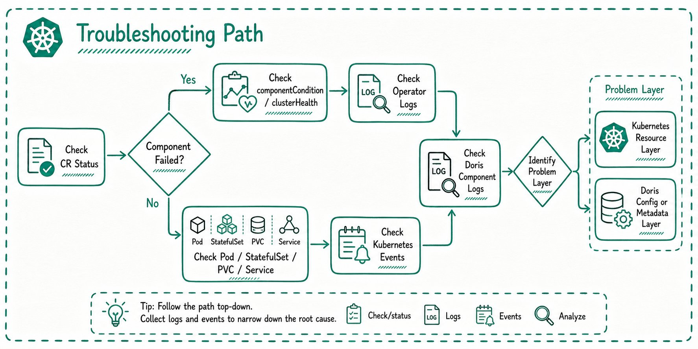

---
{
    "title": "Doris Operator のステータスとトラブルシューティング",
    "sidebar_label": "ステータスとトラブルシューティング",
    "language": "ja",
    "description": "Kubernetes 上の Doris クラスターについて、Doris Operator のステータスフィールド、クラスターの健全性、実践的なトラブルシューティング手順を説明します。",
    "keywords": ["Doris Operator のトラブルシューティング", "status", "clusterHealth", "DorisCluster", "DorisDisaggregatedCluster", "Kubernetes"]
}
---

Doris Operator は、Doris カスタムリソースの `status` フィールドにコンポーネントの状態を書き込みます。Kubernetes 上の Doris で問題を調査する際は、まず CR のステータスを確認し、続いて Operator のログ、Kubernetes リソース、Doris コンポーネントのログを確認します。

## リソースのステータスを確認する {#view-resource-status}

コンピュートとストレージが一体のクラスターでは、一般に `dcr` と略される `DorisCluster` を使用します。

```shell
kubectl get dcr -n ${namespace}
kubectl describe dcr ${cluster_name} -n ${namespace}
```

コンピュートとストレージが分離されたクラスターでは、一般に `ddc` と略される `DorisDisaggregatedCluster` を使用します。

```shell
kubectl get ddc -n ${namespace}
kubectl describe ddc ${cluster_name} -n ${namespace}
```

CR でコンポーネントが Ready になっていない場合は、基盤となるリソースを確認します。

```shell
kubectl get pod,sts,svc,pvc -n ${namespace}
kubectl get event -n ${namespace} --sort-by=.lastTimestamp
```

## DorisCluster のステータス {#doriscluster-status}

`DorisCluster.status` はコンポーネントごとに集約されます。

| フィールド | 説明 |
| --- | --- |
| `feStatus` | FE のステータス |
| `beStatus` | BE のステータス |
| `cnStatus` | CN のステータス |
| `brokerStatus` | Broker のステータス |

各コンポーネントのステータスには、通常、次の情報が含まれます。

| フィールド | 説明 |
| --- | --- |
| `accessService` | コンポーネントへの外部アクセスに使用する Service |
| `runningInstances` | 実行中のインスタンス |
| `creatingInstances` | 作成中のインスタンス |
| `failedInstances` | 障害が発生したインスタンス |
| `componentCondition.phase` | コンポーネントの現在のフェーズ |
| `componentCondition.reason` | そのフェーズになった理由 |
| `componentCondition.message` | 人が読める形式のステータスメッセージ |

一般的なフェーズは次のとおりです。

| フェーズ | 意味 |
| --- | --- |
| `available` | コンポーネントが利用可能 |
| `reconciling` | Operator がリソースを調整中 |
| `waitScheduling` | スケジューリングまたはほかのリソースを待機中 |
| `haveMemberFailed` | 少なくとも 1 つのインスタンスで障害が発生 |
| `initializing` | コンポーネントを初期化中 |
| `upgrading` | コンポーネントをアップグレード中 |
| `scaling` | コンポーネントをスケーリング中 |
| `restarting` | コンポーネントを再起動中 |

## DorisDisaggregatedCluster のステータス {#dorisdisaggregatedcluster-status}

`DorisDisaggregatedCluster.status` には、コンポーネントのステータスとクラスター全体の健全性が含まれます。

| フィールド | 説明 |
| --- | --- |
| `metaServiceStatus` | MetaService のステータス |
| `feStatus` | FE のステータス |
| `computeGroupStatuses` | ComputeGroup のステータス一覧 |
| `clusterHealth` | クラスター全体の健全性 |
| `observedGeneration` | Operator が観測した世代 |

`clusterHealth` はクラスター全体の可用性を示します。

| フィールド | 説明 |
| --- | --- |
| `health` | `green`、`yellow`、`red` などで示される全体の健全性 |
| `feAvailable` | FE が利用可能かどうか |
| `cgCount` | ComputeGroup の数 |
| `cgAvailableCount` | 利用可能な ComputeGroup の数 |
| `cgFullAvailableCount` | すべての Pod が利用可能な ComputeGroup の数 |

| 健全性 | 意味 |
| --- | --- |
| `green` | 主要コンポーネントが利用可能で、ComputeGroup の可用性が想定どおり |
| `yellow` | クラスターは一部利用可能だが、完全には Ready になっていない |
| `red` | 主要コンポーネントが利用できない、または利用可能な ComputeGroup が少なすぎる |

ComputeGroup のフェーズには、`Ready`、`Reconciling`、`Scaling`、`Decommissioning`、`ScaleDownFailed`、`Suspended` があります。

## 推奨するトラブルシューティング手順 {#recommended-troubleshooting-path}

次の順序で確認します。



## よくある調査の入り口 {#common-entry-points}

### Pod が Pending のままになる {#pod-stays-pending}

主な原因は次のとおりです。

- ノードの CPU またはメモリが不足している。
- ノードセレクター、アフィニティ、または許容設定が一致していない。
- PVC のバインドに失敗している。

```shell
kubectl describe pod ${pod_name} -n ${namespace}
kubectl get event -n ${namespace} --sort-by=.lastTimestamp
kubectl get pvc -n ${namespace}
```

### PVC をバインドできない {#pvc-cannot-be-bound}

主な原因は次のとおりです。

- StorageClass が存在しない。
- ストレージ容量が不足している。
- アクセスモードが一致していない。

```shell
kubectl get storageclass
kubectl describe pvc ${pvc_name} -n ${namespace}
```

### コンポーネントが再起動を繰り返す {#component-keeps-restarting}

主な原因は次のとおりです。

- Doris の起動設定が正しくない。
- ポートが競合している、または FQDN の設定が正しくない。
- ストレージの権限またはマウントパスに問題がある。
- JVM またはシステムのパラメーターが要件を満たしていない。

```shell
kubectl logs ${pod_name} -n ${namespace}
kubectl describe pod ${pod_name} -n ${namespace}
```

Pod が `CrashLoopBackOff` 状態で、ログだけでは原因を特定できない場合は、クラスター運用のドキュメントに記載された Debug 手順を使用します。

### Service にアクセスできない {#service-is-not-accessible}

主な原因は次のとおりです。

- 内部 Service を外部アクセスのエントリーポイントとして使用している。
- Service のタイプがアクセス環境に合っていない。
- Pod が Ready になっていないため、Endpoints が空になっている。
- クラウドの LoadBalancer の作成に失敗している。

```shell
kubectl get svc -n ${namespace}
kubectl get endpoints -n ${namespace}
kubectl describe svc ${service_name} -n ${namespace}
```

### 設定変更が反映されない {#configuration-changes-do-not-take-effect}

主な原因は次のとおりです。

- ConfigMap は変更されたが、コンポーネントが再起動していない。
- ConfigMap のキーがコンポーネントの要件に合っていない。
- CR が ConfigMap を正しく参照していない。
- マウントパスと設定されたファイルパスが一致していない。

```shell
kubectl get configmap -n ${namespace}
kubectl describe dcr ${cluster_name} -n ${namespace}
kubectl describe ddc ${cluster_name} -n ${namespace}
```

コンピュートとストレージが一体のクラスターで、主要な ConfigMap の変更時にローリング再起動がトリガーされることを期待する場合は、`enableRestartWhenConfigChange` が設定されているか確認します。

### authSecret の問題 {#authsecret-problems}

Doris Operator は、ノードの登録、スケールイン、廃止などの操作に Doris の管理用認証情報を必要とする場合があります。`authSecret` の設定が正しくないと、これらの操作を完了できないことがあります。

主な原因は次のとおりです。

- 参照先の Secret が存在しない、または別の名前空間にある。
- Secret のタイプまたはキーが正しくない。
- ユーザー名またはパスワードが Doris の管理アカウントと一致していない。
- 管理アカウントに必要な権限がない。

```shell
kubectl get secret ${auth_secret_name} -n ${namespace}
kubectl describe dcr ${cluster_name} -n ${namespace}
kubectl describe ddc ${cluster_name} -n ${namespace}
kubectl logs deployment/${operator_deployment_name} -n ${operator_namespace}
```

クラスターでデフォルト以外の管理アカウントを使用している場合、または root のパスワードをすでに設定している場合は、`authSecret` が実際の Doris の認証情報と一致していることを確認します。

#### 分離型クラスターで認証情報が原因で BE の登録に失敗する {#be-registration-failures-caused-by-credentials-in-a-decoupled-cluster}

次の手順は、Doris 4.1.5 など、`authSecret` を使用して FE にログインし、SQL でノードを登録する BE イメージに適用されます。

| 症状 | 確認事項 |
|---------|---------------|
| Pod のイベントに `FailedMount` が表示され、Secret が存在しないと報告される | Secret の名前と名前空間を確認します。Secret はクラスターと同じ名前空間に配置する必要があります |
| BE の登録ログに `Access denied` / `1045` が繰り返し表示され、ノードが参加しない | Secret の `username` と `password` がデータベースのアカウントと一致しているか確認します。スクリプトは最初にパスワードなしで root によるログインを試みるため、エラーが 1 回表示されても、その後の設定済み認証情報による試行が失敗したとは限りません |
| 管理アカウントでは FE にログインできるが、ノード管理の SQL が拒否される | そのアカウントに必要なノード管理権限があるか確認します |
| Secret を修正した後も、BE が古い認証情報を使って登録に失敗する | 起動スクリプトはすでに認証情報を変数に読み込んでおり、登録の再試行時には Secret を読み直しません |

まず、対象の BE Pod のイベントと登録ログを確認します。

```shell
kubectl describe pod ${be_pod_name} -n ${namespace}
kubectl logs ${be_pod_name} -c compute -n ${namespace}
```

復旧手順は次のとおりです。

1. Secret と `spec.authSecret` の参照を、[認証の設定](../separating-storage-compute/config-cluster.md) の説明に従って修正します。タイプが `kubernetes.io/basic-auth` で、`username` と `password` を含む Secret を使用します。root にすでにパスワードが設定されている場合は、既存の有効なアカウントを使用するか、先に管理者に管理アカウントの作成と権限の付与を依頼します。Secret を更新しても、データベースのパスワードは変更されません。
2. FE に接続できる環境から同じアカウントで接続し、パスワードと、`SHOW BACKENDS` など必要な管理操作を確認します。次のコマンドではパスワードの入力が求められます。`${fe_query_port}` は FE のクエリポートで、デフォルトは 9030 です。

   ```shell
   mysql -h ${fe_host} -P ${fe_query_port} -u ${management_user} -p
   ```

3. BE が古い認証情報のために引き続き登録に失敗する場合は、対象の Pod を一つずつ再作成し、起動スクリプトに Secret を読み直させます。`${be_pod_name}` には、登録に失敗したことを確認済みの Pod を指定する必要があります。正常な ComputeGroup 全体を再起動しないでください。

   ```shell
   kubectl delete pod ${be_pod_name} -n ${namespace}
   ```

4. StatefulSet によって Pod が再作成され、Ready になるまで待ちます。次に失敗した Pod に進む前に、FE で次の SQL を実行し、対応するノードが参加して `Alive` フィールドが `true` になっていることを確認します。

   ```sql
   SHOW BACKENDS;
   ```

### ComputeGroup のスケールインが完了しない {#computegroup-scale-in-does-not-finish}

コンピュートとストレージが分離されたクラスターでは、ComputeGroup のスケールインが `Decommissioning` または `ScaleDownFailed` のままになることがあります。

主な原因は次のとおりです。

- Doris のメタデータレベルでの廃止処理が完了していない。
- FE が利用できない。
- 管理用認証情報が正しくない。
- 対象ノードにデータ移行またはクリーンアップのタスクが残っている。

```shell
kubectl describe ddc ${cluster_name} -n ${namespace}
kubectl logs deployment/${operator_deployment_name} -n ${operator_namespace}
```

Doris 側でノードと ComputeGroup のステータスを確認する必要がある場合もあります。

## Operator のログ {#operator-logs}

CR のステータスだけでは障害の原因を説明できない場合は、Doris Operator のログを確認します。

```shell
kubectl get pod -n ${operator_namespace}
kubectl logs ${operator_pod_name} -n ${operator_namespace}
```
