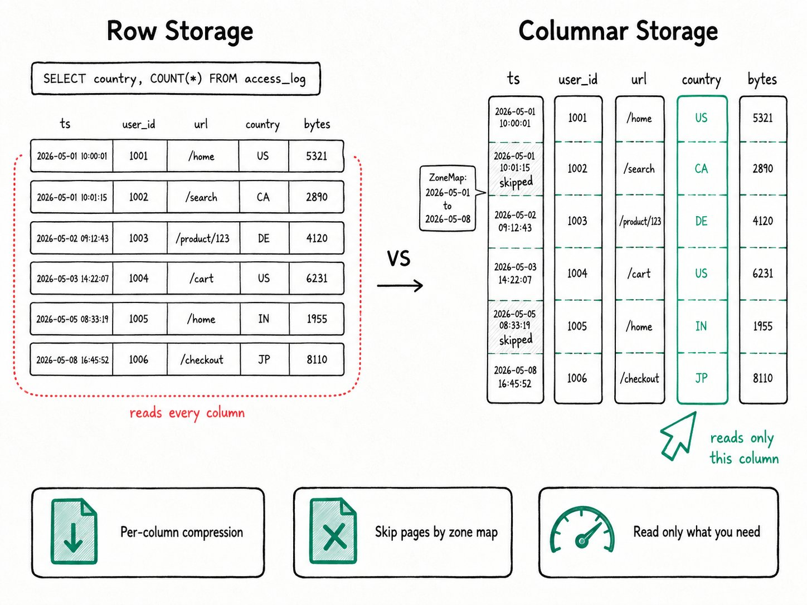

> **要約** すべての Apache Doris OLAP テーブルは、データを列指向の Segment ファイルに書き込みます。各カラムには個別のエンコーディング（PLAIN、dictionary、RLE、bit-shuffle、frame-of-reference）が適用され、各ページは独立して圧縮されます（デフォルトは LZ4、オプションで ZSTD）。ページごとの zone map と bloom filter により、クエリはページをデコードせずに[スキップ](./data-pruning)できます。また、4.1 で追加された V3 フッターにより、幅の広いテーブルで Segment を開く際のレイテンシが 16x 改善されます。


## Apache Doris で列指向ストレージを使う理由 {#why}

Apache Doris は、すべての OLAP テーブルを列指向の Segment ファイルに保存します。列指向の配置なら、クエリが参照するカラムだけに I/O を絞り、各カラムに最適なコーデックを選び、スキップ用インデックスを自然な形で配置できるためです。行指向ストアで分析を行うと、次の問題が生じます。

- 50 カラムのテーブルに対して `GROUP BY country` を実行すると、残りの 49 カラムのデータも読み取ります。I/O コストはクエリが参照するカラム数ではなく、行の幅に比例します。
- 圧縮が効きにくくなります。隣接する行には無関係な型の値が混在するため、dictionary、run-length、delta の各コーデックが生かせる規則性がありません。
- データをスキップしにくくなります。「この 64 KB のブロックには `ts >= '2026-05-01'` を満たす行がない」と判断するには、カラム単位の統計が必要ですが、行指向の配置にはその統計を保持する自然な場所がありません。

列指向の配置なら、これらの問題を解消できます。同じカラムの値がディスク上でまとまるため、型に合った変換をコーデックで選べます。さらに、ページインデックスを使えば、リーダーは[データを伸張する前に](./vectorized-execution)述語を評価できます。

## Apache Doris の列指向ストレージとは {#what}

Apache Doris の列指向ストレージは、すべての OLAP テーブル（Duplicate、Unique、Aggregate）が共有するディスク上の Segment ファイル形式です。各データロードで、Segment ファイルが作成されます。Segment 内では、ライターがカラムごとに値を約 64 KB のページへ順次書き込み、各ページをエンコード・圧縮して、スキップ用インデックスも書き込みます。ファイル末尾のフッターが、それらすべての位置を示します。

**主な用語**

- **`Segment`**：ディスク上の不変データの単位で、マジックバイト `D0R1` で識別されます。デフォルト値は、ページが 64 KB、dictionary ページが 256 KB、Segment の上限が 256 MB です。`be/src/storage/segment/segment.h` で定義されています。
- **`Page`**：単一カラムの値を切り出したものです。圧縮と zone map 統計の両方の単位になります。
- **`Encoding`**：圧縮前に適用するカラムごとの変換です。一般的な数値には PLAIN、カーディナリティの低い文字列には DICT、真偽値には RLE、整数カラムには BIT_SHUFFLE、日付には FOR（frame-of-reference）、V3 の文字列には BINARY_PLAIN_V2 を使用します。
- **`Page indexes`**：ordinal index、short key index、zone map（ページごとの最小値・最大値と NULL の有無）、bloom filter です。いずれもデータとともに Segment に書き込まれます。
- **`Footer`**：ファイル末尾にある protobuf レコードで、各カラム、エンコーディング、ページポインター、インデックスの位置を記述します。V3（4.1+）ではカラムのメタデータを外部化するため、幅の広い Segment を開く際にそのすべてを読み込む必要がありません。

## Apache Doris の列指向ストレージの仕組み {#how}

Apache Doris は Segment 内の各カラムを独立して処理します。エンコードし、約 64 KB ごとにページへ分割して圧縮し、インデックスとフッターを書き込みます。ディスク上での各カラムの処理は次のとおりです。

1. **エンコード。** ライターはカラムの型と値の分布に応じてエンコーディングを選びます。カーディナリティの低い `INT` カラムには bit-shuffle を使用し、異なる値が少ない文字列カラムには、別の dictionary ページに構築した辞書を使用します。
2. **ページ分割と圧縮。** エンコードされた値を約 64 KB のページに順次書き込みます。各ページはデフォルトで LZ4F を使って圧縮されます。テーブルの `compression` 設定に応じて ZSTD、Snappy、Zlib も使用できます。圧縮による削減率が 10% 未満なら、圧縮はスキップされます。
3. **インデックス作成。** ページを書き込む際、Segment は ordinal index（行番号による二分探索用）、ページごとの zone map（最小値、最大値、NULL の有無）、および `bloom_filter_columns` に指定されたカラムの bloom filter も書き込みます。short key index はテーブルのソートキーのプレフィックスを要約します。
4. **フッター書き込み。** ライターは、各カラム、ページポインター、インデックスを記述する `SegmentFooterPB` を末尾に追加します。V3 ではこれを、軽量なフッターと、クエリが実際に参照するカラムについてのみ読み込む `column_meta_entries` 領域に分けます。
5. **読み取り。** スキャンはフッターを開き、ordinal index、short key index、zone map、bloom filter で読み取り対象を絞ります。その後、残ったページだけを伸張・デコードし、列指向のバッチを[ベクトル化エンジン](./vectorized-execution)へ直接渡します。

Segment より上位の階層は `Tablet → Rowset → Segment → Column → Page` です。Compaction は rowset をマージしますが、それより細かい単位で書き換えることはありません。すべてのクエリは、その下位にあるカラムとページの配置からデータを読み取ります。

## クイックスタート {#quick-start}

```sql
CREATE TABLE access_log (
  ts DATETIME,
  user_id BIGINT,
  url VARCHAR(512),
  country CHAR(2)
)
DUPLICATE KEY(ts, user_id)
DISTRIBUTED BY HASH(user_id) BUCKETS 4
PROPERTIES (
  "compression" = "zstd",
  "bloom_filter_columns" = "url",
  "storage_format" = "V3"
);

SELECT country, COUNT(*) AS hits
FROM access_log
WHERE ts >= '2026-05-01'
GROUP BY country
ORDER BY hits DESC;
```

**想定される結果**

```
+---------+--------+
| country | hits   |
+---------+--------+
| US      | 184320 |
| DE      |  62018 |
| ...     |        |
+---------+--------+
```

このクエリが読み取るのは `ts` と `country` のカラムだけです。リーダーは、zone map が `max(ts) < 2026-05-01` を示すページを、伸張処理の前にスキップします。ZSTD は通常、テーブルのサイズを 5x から 10x 縮小します。また V3 フッターにより、カラム数が増えても Segment を開くコストを一定に保てます。

## Apache Doris の列指向ストレージを使うべき場面 {#when}

Apache Doris の列指向ストレージはデフォルトかつ唯一の OLAP 形式なので、すべての分析用テーブルで使用されます。トレードオフが問題になるのは、高 QPS のポイント検索やコーデックの調整など、限られた場面です。

**適しているケース**

- Apache Doris で扱うすべての分析用テーブル。列指向ストレージはオプションではなく、デフォルトかつ唯一の OLAP 形式です。
- 幅の広いテーブルとダッシュボードのクエリ。テーブルが広く、クエリで選択するカラムが少ないほど、行指向ストアと比べた削減効果が大きくなります。
- 頻繁にデータロードするテーブル。同じスキーマの下に行が増えるほど、カラムごとの圧縮とページごとの zone map の効果が高まります。
- 数千カラムを持つ幅の広いテーブル。`"storage_format" = "V3"`（4.1+）を設定すると、Segment を開く際のレイテンシとメモリ使用量を抑えられます。

**適していないケース**

- 数千 QPS で実行する、主キーによる `SELECT *` のポイント検索。各カラムが個別に読み取られるため、幅の広い行を検索すると I/O コストがカラム数に応じて増えます。[高並列ポイントクエリ](./high-concurrency-point-query)の仕組みを使用してください。これは Unique-Key Merge-on-Write テーブルに `"store_row_column" = "true"` を設定し、行形式のカラムを追加するものです。
- プロファイルを確認せずに `compression` や `storage_page_size` を調整する場合。デフォルト値（LZ4F、64 KB）はほとんどのワークロードに適しています。CPU コストよりストレージコストが重要な場合にのみ ZSTD に切り替え、小さなカラムの伸張で無駄な処理が生じている場合にのみページサイズを小さくしてください。
- 「生のカラムを見たい」という理由でエンコーディングを無効にする場合。raw モードはありません。コーデックはファイル形式の一部であり、取り外せる層ではありません。
- 行指向のスキーマで行う小規模なポイント検索の改善策として、列指向ストレージを考える場合。すべてのクエリが `WHERE id = ?` で単一行を返すなら、別のシステムか行ストア拡張が必要です。圧縮コーデックを変えても解決しません。

## 性能と数値 {#performance}

- **幅の広いテーブルにおける V3 フッター**：7,000 カラム、10,000 Segment のテーブルで、Segment を開く時間が 65s から 4s（16x 高速化）に、オープン時のメモリ使用量が 60 GB から 1 GB 未満（60x 削減）になりました。出典：[ストレージ形式 V3](../table-design/storage-format)。
- **ZSTD と以前のデフォルトとの比較**：25 GB、110 million 行のテキストログデータセットで、圧縮率は約 10x、以前のデフォルトより 53% 向上し、読み取りと伸張を合わせた処理は 30% 高速化しました。出典：[Apache Doris 1.1.0 リリースノート](https://doris.apache.org/blog/release-note-1.1.0/)。

## 関連資料 {#further-reading}

- [ストレージ形式 V3](../table-design/storage-format)：幅の広いテーブル向けのフッター最適化と、カラムごとのメタデータの外部化について説明します。
- [データプルーニング](./data-pruning)：Segment 内の ZoneMap、BloomFilter、ページごとのインデックスによって、スキャン時に読み取りをスキップする仕組みを説明します。
- [ベクトル化実行](./vectorized-execution)：カラムリーダーからデコード済みバッチを受け取るエンジンについて説明します。
- [VARIANT データ型](./variant-data-type)：JSON パスが、ここで説明したカラムごとのエンコード、ページ分割、インデックス付けを備えたサブカラムへ昇格する仕組みを説明します。
- [Apache Doris 1.1.0 リリースノート](https://doris.apache.org/blog/release-note-1.1.0/)：当初の ZSTD 圧縮ベンチマークと導入時の説明です。
