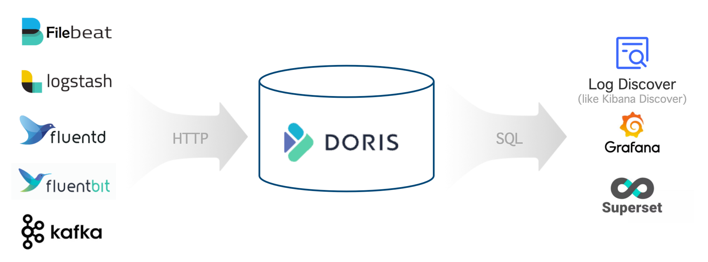
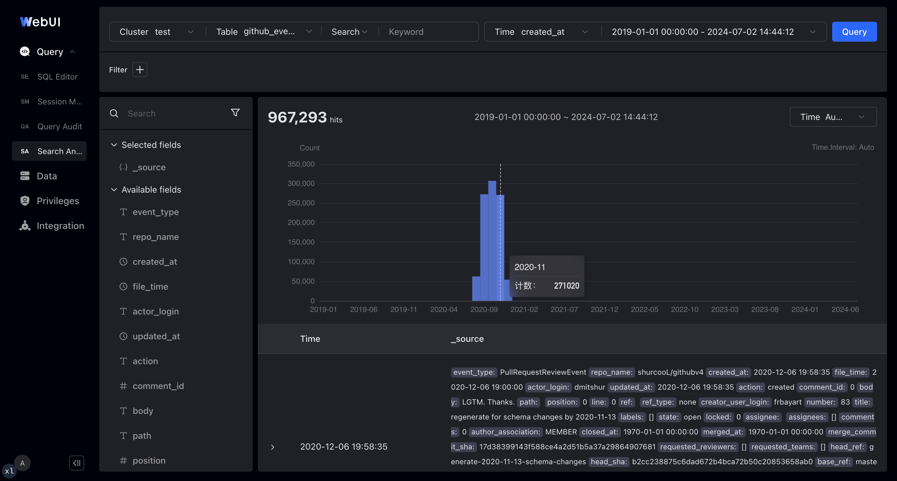

---
{
    "title": "ログの保存と分析",
    "language": "ja",
    "description": "Apache Doris で Elasticsearch を置き換え、ログプラットフォームを構築する方法を説明します。アーキテクチャ、リソース見積もり、テーブル作成、データ取り込み、クエリまでを網羅します。",
    "sidebar_label": "ログ",
    "keywords": [
        "Doris ログ分析",
        "ログ保存",
        "全文検索",
        "転置インデックス",
        "Elasticsearch の代替",
        "Stream Load ログ",
        "Logstash Doris",
        "Filebeat Doris",
        "Kafka Routine Load",
        "ホット・コールド階層化",
        "VARIANT 半構造化",
        "log_policy",
        "time_series compaction"
    ]
}
---

<!-- Knowledge type: Solution overview + Procedure -->
<!-- Applicable scenario: Log platform selection / Log storage and search analysis / Elasticsearch alternative -->

ログはシステムの動作を詳細に記録したもので、イベントの主体、時刻、場所、内容などの重要な情報を含みます。運用上の可観測性、ネットワークセキュリティの監視、ビジネス分析のため、企業は通常、分散したログを一元的に収集・保存・分析し、大量のログから価値を引き出す必要があります。

この用途に向けて、Apache Doris は汎用的な OLAP 機能に加え、転置インデックスと高速な全文検索を備え、書き込み性能とストレージ使用量を徹底的に最適化しています。Apache Doris を使用すれば、オープンで高性能、低コストの統合ログ保存・分析プラットフォームを構築できます。

この記事では、ソリューションに関する次の内容を説明します。

- **全体アーキテクチャ**：Apache Doris を使用したログプラットフォームの主要コンポーネントと基盤アーキテクチャ。
- **機能と利点**：Elasticsearch と比較した場合の特徴的な機能。
- **運用ガイド**：リソース見積もりからログのクエリまでの手順。

---

## 1. 全体アーキテクチャ {#1-overall-architecture}

<!-- Knowledge type: Architecture selection decision -->

Apache Doris を使用したログ保存・分析プラットフォームのアーキテクチャを次に示します。



全体のアーキテクチャは次の 3 つの部分で構成されます。

| レイヤー | コンポーネント | 説明 |
| :--- | :--- | :--- |
| ログの収集と前処理 | Logstash、Filebeat、Fluentbit、Kafka など | HTTP API を介してログデータを Apache Doris に書き込む |
| ログの保存と分析 | Apache Doris | 高性能で低コストの統合ストレージを提供し、SQL インターフェースを介した多様な検索・分析を可能にする |
| ログの分析とアラート | Grafana、Superset、Doris WebUI など | 標準の MySQL プロトコルで Doris にクエリを実行し、使いやすい可視化インターフェースを提供する |

---

## 2. 機能と利点 {#2-features-and-advantages}

<!-- Knowledge type: Capability definition -->

Apache Doris を使用したログプラットフォームには、次の主要な機能があります。

| 機能 | 説明 |
| :--- | :--- |
| 高スループット、低レイテンシーの取り込み | 毎日数百 TB のデータを GB/s の速度で安定して継続的に取り込み、レイテンシーを 1 秒未満に抑える |
| 大量データの低コスト保存 | PB 規模の保存に対応し、Elasticsearch と比べてストレージコストを 60%～80% 削減する。コールドデータを S3/HDFS に階層化すると、さらに 50% 削減する |
| 高性能な全文検索と分析 | 転置インデックスと全文検索に対応し、キーワードを含むログの検索や傾向分析などのクエリに秒単位で応答する |
| オープンで使いやすいエコシステム | 上流では Logstash、Filebeat、Fluentbit、Kafka などと連携し、下流では標準の MySQL プロトコルを介して Grafana、Superset、Doris WebUI と連携する |

### 2.1 高性能と低コスト {#21-high-performance-and-low-cost}

<!-- Knowledge type: Capability definition -->

ベンチマークと本番環境での検証によると、Apache Doris を使用したログプラットフォームの費用対効果は Elasticsearch の 5～10 倍です。この利点は主に、高性能なストレージ・クエリエンジンと、ログ用途に特化した最適化によるものです。

- **書き込みスループットの向上**：Elasticsearch の書き込みにおけるボトルネックは、データ解析と転置インデックス構築に要する CPU 処理です。Apache Doris は SIMD などの CPU ベクトル化命令を使って JSON 解析とインデックス構築を高速化し、ログ用途で不要な正引きインデックスなどのデータ構造を取り除いて転置インデックスの構造を簡素化しています。同じリソースを使用した場合、Doris の書き込み性能は Elasticsearch の 3～5 倍です。
- **ストレージコストの削減**：Elasticsearch では、正引きインデックス、転置インデックス、doc values の列ストアにデータが重複して保存され、一般的な圧縮率も比較的低くなります。Doris は正引きインデックスを取り除いてインデックスデータを 30% 削減し、列指向ストレージと Zstandard 圧縮アルゴリズムにより、Elasticsearch の 1.5 を大幅に上回る 5～10 の圧縮率を実現します。ホット・コールド階層化により履歴ログをオブジェクトストレージへ自動的に移動でき、コールドデータのストレージコストを 70% 以上削減します。ストレージコスト全体は Elasticsearch の約 20% です。
- **クエリ性能の向上**：Doris は全文検索の処理を簡素化し、ログ用途では不要な関連度スコアリングなどのアルゴリズムを省きます。「指定したキーワードを含む最新の 100 件のログ」のような典型的なクエリには、計画段階と実行段階で TopN 動的枝刈りなどの専用の最適化を適用します。

### 2.2 強力な分析機能 {#22-powerful-analytical-capabilities}

<!-- Knowledge type: Capability definition -->

Apache Doris は標準 SQL をサポートし、MySQL プロトコルと構文に互換性があるため、Doris を使用したログシステムには次の利点があります。

- **使いやすさ**：エンジニアやデータアナリストには SQL が広くなじみがあり、新しい技術スタックを学ばなくてもすぐに使い始められます。
- **豊富なエコシステム**：MySQL コマンドライン、各種 GUI / BI ツール、ビッグデータエコシステムとシームレスに連携し、複雑で多様なデータ処理・分析のニーズに対応します。
- **高度な分析機能**：SQL はデータ分析の事実上の標準であり、検索、集約、複数テーブルの JOIN、サブクエリ、UDF、論理ビュー、マテリアライズドビューなどをサポートします。

### 2.3 柔軟なスキーマ {#23-flexible-schema}

<!-- Knowledge type: Capability definition -->

次は、JSON 形式の典型的な半構造化ログの例です。最上位のフィールド（`timestamp`、`source`、`node`、`component`、`level`、`clientRequestId`、`message`、`properties`）は比較的固定されています。一方、拡張属性 `properties` 内のネストしたフィールド（`properties.size` や `properties.format` など）は変動しやすく、ログごとに異なる場合があります。

```json
{
  "timestamp": "2014-03-08T00:50:03.8432810Z",
  "source": "ADOPTIONCUSTOMERS81",
  "node": "Engine000000000405",
  "level": "Information",
  "component": "DOWNLOADER",
  "clientRequestId": "671db15d-abad-94f6-dd93-b3a2e6000672",
  "message": "Downloading file path: benchmark/2014/ADOPTIONCUSTOMERS81_94_0.parquet.gz",
  "properties": {
    "size": 1495636750,
    "format": "parquet",
    "rowCount": 855138,
    "downloadDuration": "00:01:58.3520561"
  }
}
```

Apache Doris は次の 2 つの仕組みにより、柔軟なスキーマをサポートします。

- **Light Schema Change**：最上位のフィールドがときどき変わる場合、`ADD/DROP COLUMN` や `ADD/DROP INDEX` などのスキーマ変更を数秒で完了できます。設計段階では、その時点でインデックスが必要なフィールドだけを検討すれば済みます。
- **VARIANT 半構造化型**：`properties` のような拡張フィールドには任意の JSON データを書き込めます。フィールド名と型は自動検出され、出現頻度の高いフィールドは列指向ストレージに分離されます。`VARIANT` に転置インデックスを作成し、内部フィールドへのクエリや検索を高速化することもできます。

Elasticsearch の dynamic mapping と比較すると、Apache Doris の柔軟なスキーマには次の利点があります。

- 同じフィールドに複数の型を使用できます。`VARIANT` が競合を自動的に処理して型を昇格させるため、ログデータの変化に適応しやすくなります。
- `VARIANT` は出現頻度の低いフィールドを自動的に単一の列へまとめ、フィールド、メタデータ、列が増えすぎることによる性能問題を回避します。
- 列やインデックスを動的に追加・削除できるため、最初からすべてのフィールドにインデックスを作成する必要がなく、不要なコストを抑えられます。

---

## 3. 運用ガイド {#3-operations-guide}

<!-- Knowledge type: Procedure -->
<!-- Applicable scenario: Log platform deployment / Production rollout -->

次の表に、Apache Doris 上にログプラットフォームを構築するための、開始から完了までの 6 ステップを示します。

| ステップ | 目的 |
| :--- | :--- |
| [ステップ 1：リソースを見積もる](#31-estimate-resources) | FE/BE ノード数、ディスク容量、オブジェクトストレージの必要量を見積もる |
| [ステップ 2：クラスターをデプロイする](#32-deploy-the-cluster) | 物理マシンまたは仮想マシンに Apache Doris をデプロイする |
| [ステップ 3：FE と BE の設定を調整する](#33-tune-fe-and-be-configurations) | ログ用途に合わせて主要なパラメータを調整する |
| [ステップ 4：テーブルを作成する](#34-create-the-table) | パーティショニングとバケット分割、圧縮、コンパクション、インデックス、階層化ポリシーを設計する |
| [ステップ 5：ログを収集する](#35-collect-logs) | Logstash、Filebeat、Kafka、またはカスタムプログラムと連携する |
| [ステップ 6：ログをクエリ・分析する](#36-query-and-analyze-logs) | SQL と可視化ツールを使用してログを検索・分析する |

### 3.1 リソースを見積もる {#31-estimate-resources}

<!-- Knowledge type: Hardware requirements -->
<!-- Applicable scenario: Pre-deployment planning / Capacity planning -->

クラスターをデプロイする前に、サーバーのハードウェアリソースを見積もる必要があります。主な手順は次のとおりです。

1. **書き込み用リソースを見積もる**。次の式を使用します。

    - `Average write throughput = Daily incremental data / 86400 s`
    - `Peak write throughput = Average write throughput * Peak-to-average write ratio`
    - `CPU cores required for peak writes = Peak write throughput / Per-core write throughput`

2. **ストレージリソースを見積もる**。次の式を使用します。

    - `Required storage = Daily incremental data / Compression ratio * Replica count * Data retention period`

3. **クエリ用リソースを見積もる**：クエリのリソース消費量は件数や複雑さによって異なります。初期見積もりでは CPU リソースの 50% をクエリ用に確保し、実際のテスト結果に基づいて調整します。

4. **リソースを集計する**：ステップ 1 と 3 から必要な CPU コア数を見積もり、マシンあたりの CPU コア数で割って BE サーバー数を求めます。さらにステップ 2 の結果から BE サーバーあたりの必要ストレージを見積もり、4～12 台のデータディスクに分散してディスクあたりの容量を求めます。

#### 例：毎日 100 TB の新規ログに必要なリソースの見積もり {#example-resource-estimation-for-100-tb-of-new-logs-per-day}

圧縮前の新規データ量が毎日 100 TB、圧縮率が 5、レプリカ数が 1、ホットデータの保持期間が 3 日、コールドデータの保持期間が 30 日、書き込みのピーク対平均比が 200%、コアあたりの書き込みスループットが 10 MB/s、CPU の 50% をクエリ用に確保する場合を例にします。見積もりは次のとおりです。

- **FE**：3 台のサーバー。それぞれ CPU 16 コア、メモリ 64 GB、100 GB SSD 1 台
- **BE**：15 台のサーバー。それぞれ CPU 32 コア、メモリ 256 GB、600 GB SSD 10 台
- **S3 オブジェクトストレージ**：コールドデータ用に 600 TB

主要な指標の値と計算方法を次に示します。

| 主要指標（単位） | 値 | 説明 |
| :--- | :--- | :--- |
| 日次増分データ量（TB） | 100 | 実際の要件に応じて設定 |
| 圧縮率 | 5 | 通常はインデックスを含めて 3～10。実際の要件に応じて設定 |
| レプリカ数 | 1 | 実際の要件に応じて設定。デフォルトは 1。指定可能な値は 1、2、3 |
| ホットデータの保持期間（日） | 3 | 実際の要件に応じて設定 |
| コールドデータの保持期間（日） | 30 | 実際の要件に応じて設定 |
| 合計保持期間（日） | 33 | 式：`Hot data retention + Cold data retention` |
| ホットデータの推定ストレージ量（TB） | 60 | 式：`Daily incremental data / Compression ratio * Replica count * Hot data retention` |
| コールドデータの推定ストレージ量（TB） | 600 | 式：`Daily incremental data / Compression ratio * Replica count * Cold data retention` |
| 書き込みのピーク対平均比 | 200% | 実際の要件に応じて設定。デフォルトは 200% |
| マシンあたりの CPU コア数 | 32 | 実際の要件に応じて設定。デフォルトは 32 コア |
| 平均書き込みスループット（MB/s） | 1214 | 式：`Daily incremental data / 86400 s` |
| ピーク書き込みスループット（MB/s） | 2427 | 式：`Average write throughput * Peak-to-average write ratio` |
| ピーク時の書き込みに必要な CPU コア数 | 242.7 | 式：`Peak write throughput / Per-core write throughput` |
| クエリ用に確保する CPU | 50% | 実際の要件に応じて設定。デフォルトは 50% |
| BE サーバー数の推定値 | 15.2 | 式：`CPU cores required for peak writes / CPU cores per machine / (1 - CPU reserved for queries)` |
| BE サーバー数の推定値（丸め後） | 15 | 式：`MAX(Replica count, rounded estimated number of BE servers)` |
| BE サーバーあたりの推定ストレージ量（TB） | 5.7 | 式：`Estimated hot-data storage / Estimated number of BE servers / (1 - 30%)`。30% はストレージの予備容量です。I/O 性能を高めるため、BE あたり 4～12 台のデータディスクをマウントすることを推奨します |

### 3.2 クラスターをデプロイする {#32-deploy-the-cluster}

<!-- Knowledge type: Procedure -->

リソースの見積もりが終わったら、Apache Doris クラスターをデプロイします。物理マシンまたは仮想マシンへのデプロイを推奨します。手動でデプロイする手順については、[手動デプロイ](../install/deploy-manually/integrated-storage-compute-deploy-manually)を参照してください。

### 3.3 FE と BE の設定を調整する {#33-tune-fe-and-be-configurations}

<!-- Knowledge type: Configuration parameters -->
<!-- Applicable scenario: Performance tuning / Cluster initialization -->

クラスターをデプロイしたら、ログの保存と分析に適するよう、FE と BE のパラメータをそれぞれ調整します。

#### 3.3.1 FE の設定を調整する {#331-tune-fe-configurations}

`fe/conf/fe.conf` で、次の表に従って FE の設定を調整します。

| 調整するパラメータ | 説明 |
| :--- | :--- |
| `max_running_txn_num_per_db = 10000` | 高い同時実行数でデータを取り込むと実行中のトランザクションが増えるため、この値を引き上げる |
| `streaming_label_keep_max_second = 3600`<br />`label_keep_max_second = 7200` | 頻繁な取り込みではトランザクションラベルのメモリ消費量が増えるため、保持時間を短くする |
| `enable_round_robin_create_tablet = true` | タブレット作成時にラウンドロビンを使用し、できるだけ均等に分散させる |
| `tablet_rebalancer_type = partition` | バランシング時に、各パーティション内のタブレットをできるだけ均等にする方式を使用する |
| `autobucket_min_buckets = 10` | ログ量の増加時にバケットが不足しないよう、自動バケット分割の最小数を 1 から 10 に引き上げる |
| `max_backend_heartbeat_failure_tolerance_count = 10` | ログ用途では BE サーバーに高い負荷がかかり、短時間ハートビートを送れないことがあるため、許容回数を 1 から 10 に引き上げる |

パラメータの詳細については、[FE の設定](../admin-manual/config/fe-config)を参照してください。

#### 3.3.2 BE の設定を調整する {#332-tune-be-configurations}

`be/conf/be.conf` で、次の表に従って BE の設定を調整します。

| モジュール | 調整するパラメータ | 説明 |
| :--- | :--- | :--- |
| ストレージ | `storage_root_path = /path/to/dir1;/path/to/dir2;...;/path/to/dir12` | ディスクディレクトリ上のホットデータの保存パスを設定する |
| ストレージ | `enable_file_cache = true` | ファイルキャッシュを有効にする |
| ストレージ | `file_cache_path = [{"path": "/mnt/datadisk0/file_cache", "total_size":53687091200, "query_limit": "10737418240"},{"path": "/mnt/datadisk1/file_cache", "total_size":53687091200,"query_limit": "10737418240"}]` | コールドデータのキャッシュパスと設定を指定する：<br />`path`：キャッシュパス<br />`total_size`：キャッシュパスの総容量。単位はバイトで、53687091200 バイト = 50 GB<br />`query_limit`：単一クエリがキャッシュパスから読み取れるデータの最大量。単位はバイトで、10737418240 バイト = 10 GB |
| 書き込み | `write_buffer_size = 1073741824` | 書き込みバッファファイルのサイズを大きくし、小さなファイルとランダム I/O を減らして性能を向上させる |
| コンパクション | `max_cumu_compaction_threads = 8` | 32 コアの BE では、累積コンパクションのスレッドプールを 8 スレッドに制限する。CPU コア数 / 4 はチューニングの出発点にすぎず、CPU の割り当て上限や予約量ではない。この設定によって、取り込み、クエリ、ベースコンパクションに CPU が割り当てられることはない。コンパクションの滞留状況とワークロードの測定結果に基づいて調整する |
| コンパクション | `inverted_index_compaction_enable = true` | インデックスのコンパクションを有効にし、コンパクション中の CPU 消費量を減らす |
| コンパクション | `enable_segcompaction = false`<br />`enable_ordered_data_compaction = false` | ログ用途で不要なコンパクション機能を 2 つ無効にする |
| コンパクション | `enable_compaction_priority_scheduling = false` | 優先度の低いコンパクションはディスクあたり 2 タスクに制限され、コンパクションが遅くなる |
| コンパクション | `total_permits_for_compaction_score = 200000` | メモリの制御に使用する。時系列ポリシー自体でもメモリを制御できる |
| キャッシュ | `disable_storage_page_cache = true`<br />`inverted_index_searcher_cache_limit = 30%` | ログデータ量が多くデータキャッシュの効果は限られるため、データキャッシュを無効にしてインデックスキャッシュを使用する |
| キャッシュ | `inverted_index_cache_stale_sweep_time_sec = 3600`<br />`index_cache_entry_stay_time_after_lookup_s = 3600` | インデックスキャッシュを最長 1 時間メモリに保持する |
| キャッシュ | `enable_inverted_index_cache_on_cooldown = true`<br />`enable_write_index_searcher_cache = false` | インデックスをコールドストレージにアップロードするときの自動キャッシュを有効にする |
| キャッシュ | `tablet_schema_cache_recycle_interval = 3600`<br />`segment_cache_capacity = 20000` | その他のキャッシュによるメモリ使用量を減らす |
| キャッシュ | `inverted_index_ram_dir_enable = true` | 書き込み中にインデックスの一時ファイルが発生させる I/O オーバーヘッドを減らす |
| スレッド | `pipeline_executor_size = 24`<br />`doris_scanner_thread_pool_thread_num = 48` | 32 コア CPU 向けの計算スレッドと I/O スレッドの設定。コア数に応じて比例的に増減させる |
| スレッド | `scan_thread_nice_value = 5` | クエリの I/O スレッドの優先度を下げ、書き込み性能と即時性を確保する |
| その他 | `string_type_length_soft_limit_bytes = 10485760` | `String` データの長さの上限を 10 MB に引き上げる |
| その他 | `trash_file_expire_time_sec = 300`<br />`path_gc_check_interval_second = 900`<br />`path_scan_interval_second = 900` | 不要ファイルの回収を速める |

パラメータの詳細については、[BE の設定](../admin-manual/config/be-config)を参照してください。

### 3.4 テーブルを作成する {#34-create-the-table}

<!-- Knowledge type: Procedure -->
<!-- Applicable scenario: Schema design / Performance tuning -->

ログデータの書き込みとクエリにはそれぞれ固有の特性があるため、性能を高めるには、テーブルの作成時に以下の項目を用途に合わせて設定します。

#### 3.4.1 パーティショニングとバケット分割のパラメータを設定する {#341-configure-partitioning-and-bucketing-parameters}

**パーティショニング**：

- 時刻フィールドに[範囲パーティショニング](../table-design/data-partitioning/manual-partitioning.md#range-partitioning)（`PARTITION BY RANGE(ts)`）を使用し、[動的パーティショニング](../table-design/data-partitioning/dynamic-partitioning)（`"dynamic_partition.enable" = "true"`）を有効にして日次パーティションを自動管理します。
- `Datetime` 型の時刻フィールドをキー（`DUPLICATE KEY(ts)`）にします。これにより、最新の N 件のログをクエリする速度が数倍向上します。

**バケット分割**：

- バケット数はクラスター内のディスク総数のおよそ 3 倍とし、バケットあたりの圧縮後のデータ量を約 5 GB にします。
- ランダム方式（`DISTRIBUTED BY RANDOM BUCKETS 60`）と書き込み時の単一タブレットへの取り込みを組み合わせ、バッチ書き込みの効率を高めます。

パーティショニングとバケット分割の詳細については、[データのパーティショニング](../table-design/data-partitioning/basic-concepts)を参照してください。

#### 3.4.2 圧縮パラメータを設定する {#342-configure-compression-parameters}

- データの圧縮率を高めるため、Zstd 圧縮アルゴリズム（`"compression" = "zstd"`）を使用します。

#### 3.4.3 コンパクションのパラメータを設定する {#343-configure-compaction-parameters}

- 時系列ポリシー（`"compaction_policy" = "time_series"`）を使用して書き込み増幅を抑えます。これは、高スループットのログ書き込みに必要なリソースを抑えるうえで重要です。

#### 3.4.4 インデックスを作成・設定する {#344-build-and-configure-indexes}

- 頻繁にクエリするフィールドにインデックス（`USING INVERTED`）を作成します。
- 全文検索が必要なフィールドでは、トークナイザー（`parser`）のパラメータを `unicode` に設定します。これは多くの用途に適しています。フレーズクエリに対応するには `support_phrase` を `true` に設定し、不要な場合は `false` にしてストレージ使用量を減らします。

#### 3.4.5 ストレージポリシーを設定する {#345-configure-storage-policies}

- **ホットデータの保存**：クラウドディスクを使用する場合はレプリカを 1 つに設定できます。物理ディスクを使用する場合は、レプリカを少なくとも 2 つ（`"replication_num" = "2"`）に設定します。
- **ホット・コールド階層化**：`log_s3` ストレージの場所（`CREATE RESOURCE "log_s3"`）を設定し、`log_policy_3day` 階層化ポリシー（`CREATE STORAGE POLICY log_policy_3day`）を指定します。これにより、3 日を超えたデータは `log_s3` で指定した保存先へ自動的に移されます。

#### 3.4.6 テーブル作成の完全な例 {#346-complete-table-creation-example}

```sql
CREATE DATABASE log_db;
USE log_db;

CREATE RESOURCE "log_s3"
PROPERTIES
(
    "type" = "s3",
    "s3.endpoint" = "your_endpoint_url",
    "s3.region" = "your_region",
    "s3.bucket" = "your_bucket",
    "s3.root.path" = "your_path",
    "s3.access_key" = "your_ak",
    "s3.secret_key" = "your_sk"
);

CREATE STORAGE POLICY log_policy_3day
PROPERTIES(
    "storage_resource" = "log_s3",
    "cooldown_ttl" = "259200"
);

CREATE TABLE log_table
(
  `ts` DATETIME,
  `host` TEXT,
  `path` TEXT,
  `message` TEXT,
  INDEX idx_host (`host`) USING INVERTED,
  INDEX idx_path (`path`) USING INVERTED,
  INDEX idx_message (`message`) USING INVERTED PROPERTIES("parser" = "unicode", "support_phrase" = "true")
)
ENGINE = OLAP
DUPLICATE KEY(`ts`)
PARTITION BY RANGE(`ts`) ()
DISTRIBUTED BY RANDOM BUCKETS 60
PROPERTIES (
  "compression" = "zstd",
  "compaction_policy" = "time_series",
  "dynamic_partition.enable" = "true",
  "dynamic_partition.create_history_partition" = "true",
  "dynamic_partition.time_unit" = "DAY",
  "dynamic_partition.start" = "-30",
  "dynamic_partition.end" = "1",
  "dynamic_partition.prefix" = "p",
  "dynamic_partition.buckets" = "60",
  "dynamic_partition.replication_num" = "2", -- Not needed in compute-storage separation
  "replication_num" = "2",                    -- Not needed in compute-storage separation
  "storage_policy" = "log_policy_3day"        -- Not needed in compute-storage separation
);
```

### 3.5 ログを収集する {#35-collect-logs}

<!-- Knowledge type: Procedure -->
<!-- Applicable scenario: Log onboarding / Data ingestion -->

テーブルを作成したら、ログの収集を開始できます。Apache Doris は、Logstash、Filebeat、Kafka などの一般的なログ収集ツールと連携できる、オープンで汎用的な Stream HTTP API を提供しています。次の表に、収集方法ごとの適用場面を示します。

| 収集方法 | 適用場面 |
| :--- | :--- |
| Logstash | 豊富なフィルターやプラグインが必要な、既存の Logstash パイプライン |
| Filebeat | リソース使用量を抑えたい環境での軽量なファイル収集 |
| Kafka Routine Load | ログがすでに Kafka にあり、Doris 側から能動的に取得する場合 |
| カスタムプログラム（Stream Load） | 自社開発の収集プログラムや特殊なデータソースとの連携 |

#### 3.5.1 Logstash と連携する {#351-integrate-with-logstash}

次の手順を実行します。

1. Logstash Doris Output プラグインをダウンロードしてインストールします。次のいずれかの方法を選んでください。

    - 直接ダウンロード：[こちらからダウンロード](https://apache-doris-releases.oss-accelerate.aliyuncs.com/extension/logstash-output-doris-1.2.0.gem)します。
    - ソースからビルドし、次のコマンドでインストールします。

        ```shell
        ./bin/logstash-plugin install logstash-output-doris-1.2.0.gem
        ```

2. Logstash を設定します。次の 2 つのファイルが必要です。

    - `logstash.yml`：書き込み性能を高めるため、Logstash がログをバッチ処理する際のバッチサイズと待機時間を設定します。

        ```yaml
        pipeline.batch.size: 1000000
        pipeline.batch.delay: 10000
        ```

    - `logstash_demo.conf`：収集するログの入力パスと、Apache Doris への出力設定を指定します。

        ```text
        input {
            file {
            path => "/path/to/your/log"
          }
        }

        output {
          doris {
            http_hosts => [ "<http://fehost1:http_port>", "<http://fehost2:http_port>", "<http://fehost3:http_port>" ]
            user => "your_username"
            password => "your_password"
            db => "your_db"
            table => "your_table"

            # doris stream load http headers
            headers => {
            "format" => "json"
            "read_json_by_line" => "true"
            "load_to_single_tablet" => "true"
            }

            # field mapping: doris fileld name => logstash field name
            # %{} to get a logstash field, [] for nested field such as [host][name] for host.name
            mapping => {
            "ts" => "%{@timestamp}"
            "host" => "%{[host][name]}"
            "path" => "%{[log][file][path]}"
            "message" => "%{message}"
            }
            log_request => true
            log_speed_interval => 10
          }
        }
        ```

3. Logstash を実行してログを収集し、Apache Doris に出力します。

    ```shell
    ./bin/logstash -f logstash_demo.conf
    ```

設定の詳細については、[Logstash Doris Output Plugin](../connection-integration/data-integration/logstash)を参照してください。

#### 3.5.2 Filebeat と連携する {#352-integrate-with-filebeat}

次の手順を実行します。

1. Apache Doris への出力に対応した Filebeat バイナリを入手します。[こちらからダウンロード](https://apache-doris-releases.oss-accelerate.aliyuncs.com/extension/filebeat-doris-2.1.1)するか、Apache Doris のソースからビルドできます。

2. Filebeat を設定します。主な設定ファイルは `filebeat_demo.yml` です。収集するログの入力パスと、Apache Doris への出力設定を指定します。

    ```yaml
    # input
    filebeat.inputs:
    - type: log
      enabled: true
      paths:
        - /path/to/your/log
      # multiline can join lines that span multiple lines (such as Java stack traces) into a single log
      multiline:
        type: pattern
        # Behavior: lines starting with yyyy-mm-dd HH:MM:SS are treated as a new log; others are appended to the previous log
        pattern: '^[0-9]{4}-[0-9]{2}-[0-9]{2} [0-9]{2}:[0-9]{2}:[0-9]{2}'
        negate: true
        match: after
        skip_newline: true

    processors:
    # Use the js script plugin to replace \t in the log with spaces, to avoid JSON parsing errors
    - script:
        lang: javascript
        source: >
            function process(event) {
                var msg = event.Get("message");
                msg = msg.replace(/\t/g, "  ");
                event.Put("message", msg);
            }
    # Use the dissect plugin for simple log parsing
    - dissect:
        # 2024-06-08 18:26:25,481 INFO (report-thread|199) [ReportHandler.cpuReport():617] begin to handle
        tokenizer: "%{day} %{time} %{log_level} (%{thread}) [%{position}] %{content}"
        target_prefix: ""
        ignore_failure: true
        overwrite_keys: true

    # queue and batch
    queue.mem:
      events: 1000000
      flush.min_events: 100000
      flush.timeout: 10s

    # output
    output.doris:
      fenodes: [ "http://fehost1:http_port", "http://fehost2:http_port", "http://fehost3:http_port" ]
      user: "your_username"
      password: "your_password"
      database: "your_db"
      table: "your_table"
      # output string format
      ## %{[agent][hostname]} %{[log][file][path]} are metadata that come with filebeat
      ## Another commonly used filebeat metadata is the collection timestamp %{[@timestamp]}
      ## %{[day]} %{[time]} are the fields parsed by the dissect step above
      codec_format_string: '{"ts": "%{[day]} %{[time]}", "host": "%{[agent][hostname]}", "path": "%{[log][file][path]}", "message": "%{[message]}"}'
      headers:
        format: "json"
        read_json_by_line: "true"
        load_to_single_tablet: "true"
    ```

3. Filebeat を実行してログを収集し、Apache Doris に出力します。

    ```shell
    chmod +x filebeat-doris-2.1.1
    ./filebeat-doris-2.1.1 -c filebeat_demo.yml
    ```

設定の詳細については、[Beats Doris Output Plugin](../connection-integration/data-integration/beats)を参照してください。

#### 3.5.3 Kafka と連携する {#353-integrate-with-kafka}

JSON 形式のログを Kafka メッセージキューに書き込み、Kafka Routine Load を作成すると、Apache Doris が Kafka からデータを能動的に取得します。

次の例を参照してください。`property.*` は Librdkafka クライアントの設定です。実際の Kafka クラスターに合わせて調整してください。

```sql
-- Prepare the kafka cluster and topic log__topic_
-- Create a routine load that imports data from kafka log__topic_ into the log_table table
CREATE ROUTINE LOAD load_log_kafka ON log_db.log_table
COLUMNS(ts, host, path, message)
PROPERTIES (
"max_batch_interval" = "60",
"max_batch_rows" = "20000000",
"max_batch_size" = "1073741824",
"load_to_single_tablet" = "true",
"format" = "json"
)
FROM KAFKA (
"kafka_broker_list" = "host:port",
"kafka_topic" = "log__topic_",
"property.group.id" = "your_group_id",
"property.security.protocol"="SASL_PLAINTEXT",
"property.sasl.mechanism"="GSSAPI",
"property.sasl.kerberos.service.name"="kafka",
"property.sasl.kerberos.keytab"="/path/to/xxx.keytab",
"property.sasl.kerberos.principal"="<xxx@yyy.com>"
);
-- Check the status of the routine load
SHOW ROUTINE LOAD;
```

Kafka の設定の詳細については、[Routine Load](../data-operate/import/import-way/routine-load-manual.md)を参照してください。

#### 3.5.4 カスタムプログラムでログを収集する {#354-use-a-custom-program-to-collect-logs}

一般的なログ収集ツールとの連携に加え、HTTP API の Stream Load を使用するカスタムプログラムからもログを取り込めます。

```shell
curl
--location-trusted
-u username:password
-H "format:json"
-H "read_json_by_line:true"
-H "load_to_single_tablet:true"
-H "timeout:600"
-T logfile.json
http://fe_host:fe_http_port/api/log_db/log_table/_stream_load
```

カスタムプログラムを使用する際は、次の点に注意してください。

- HTTP 認証には Basic Auth を使用します。値は `echo -n 'username:password' | base64` コマンドで計算できます。
- HTTP ヘッダー `format:json` を設定し、データ形式を JSON に指定します。
- HTTP ヘッダー `read_json_by_line:true` を設定し、各行に JSON を 1 件ずつ指定します。
- HTTP ヘッダー `load_to_single_tablet:true` を設定し、取り込みごとに単一のバケットへ書き込んで小さなファイルを減らします。
- クライアントから送信するバッチは 100 MB～1 GB を推奨します。Apache Doris 2.1 以降では、サーバー側の Group Commit 機能により、クライアント側のバッチサイズを小さくできます。

### 3.6 ログをクエリ・分析する {#36-query-and-analyze-logs}

<!-- Knowledge type: Procedure -->
<!-- Applicable scenario: Log search / Full-text search -->

#### 3.6.1 ログのクエリ {#361-log-queries}

Apache Doris は標準 SQL をサポートします。MySQL クライアント、JDBC、その他のツールからクラスターに接続して SQL クエリを実行できます。

```shell
mysql -h fe_host -P fe_mysql_port -u your_username -Dyour_db_name
```

参考として、一般的な SQL クエリを 5 つ示します。

- 最新の 10 件を表示する：

    ```sql
    SELECT * FROM your_table_name ORDER BY ts DESC LIMIT 10;
    ```

- `host` が `8.8.8.8` の最新の 10 件をクエリする：

    ```sql
    SELECT * FROM your_table_name WHERE host = '8.8.8.8' ORDER BY ts DESC LIMIT 10;
    ```

- `message` フィールドに `error` または `404` を含む最新の 10 件を検索する：`MATCH_ANY` は Apache Doris の全文検索用 SQL 構文で、引数に指定したキーワードのいずれかに一致します。

    ```sql
    SELECT * FROM your_table_name WHERE message MATCH_ANY 'error 404'
    ORDER BY ts DESC LIMIT 10;
    ```

- `message` フィールドに `image` と `faq` の両方を含む最新の 10 件を検索する：`MATCH_ALL` は Apache Doris の全文検索用 SQL 構文で、引数に指定したすべてのキーワードに一致します。

    ```sql
    SELECT * FROM your_table_name WHERE message MATCH_ALL 'image faq'
    ORDER BY ts DESC LIMIT 10;
    ```

- `message` フィールドに `image` と `faq` の両方を含む最新の 10 件を検索する：`MATCH_PHRASE` は Apache Doris の全文検索用 SQL 構文で、引数に指定したすべてのキーワードに同じ順序で一致します。たとえば、`a image faq b` は一致しますが、`a faq image b` は一致しません。

    ```sql
    SELECT * FROM your_table_name WHERE message MATCH_PHRASE 'image faq'
    ORDER BY ts DESC LIMIT 10;
    ```

#### 3.6.2 ログの可視化分析 {#362-visual-log-analysis}

Apache Doris を基盤とした可視化ログ分析プラットフォームを提供するサードパーティーもあります。Kibana Discover に似たログ検索・分析インターフェースを備え、直感的で使いやすい探索型のログ分析が可能です。



- 全文検索モードと SQL モードの両方に対応
- 時刻選択ツールやヒストグラム上で、ログクエリの時間範囲を選択可能
- ログの詳細を表示し、JSON またはテーブルとして展開可能
- ログデータの文脈に沿って、クリック操作でフィルターを追加・削除可能
- 検索結果内の各フィールドで頻出する値を表示し、異常の発見や詳細分析を支援

さらにサポートが必要な場合は、dev@doris.apache.org にお問い合わせください。

---

## 4. よくある質問 {#4-faq}

<!-- Knowledge type: FAQ -->

**Q1：ログ用途における Apache Doris と Elasticsearch の主な違いは何ですか？**

A：Doris の書き込みスループットは Elasticsearch の 3～5 倍で、ストレージコストは Elasticsearch の約 20% です。Doris は標準 SQL と MySQL プロトコルにも対応し、より強力な分析機能を提供します。ホット・コールド階層化によりコールドデータを S3/HDFS へ移動し、ストレージコストをさらに削減できます。

**Q2：ログのフィールドが頻繁に変わる場合は、どう対応すればよいですか？**

A：最上位のフィールドには Light Schema Change を使用し、`ADD/DROP COLUMN` と `ADD/DROP INDEX` を数秒で実行できます。動的に変わるネストしたフィールドには `VARIANT` 型を使用します。フィールド名と型を自動検出でき、`VARIANT` に転置インデックスも作成できます。

**Q3：バケット数はどのように決めればよいですか？**

A：クラスター内のディスク総数のおよそ 3 倍をバケット数とし、バケットあたりの圧縮後のデータ量を約 5 GB にします。`DISTRIBUTED BY RANDOM` と単一タブレットへの書き込みを組み合わせると、バッチ書き込みの効率が向上します。

**Q4：ホット・コールド階層化ポリシーの `cooldown_ttl` の単位は何ですか？**

A：単位は秒です。たとえば `259200` は 3 日を意味し、その期間が過ぎたデータはストレージポリシーで指定したオブジェクトストレージへ自動的に移されます。

**Q5：書き込み側のバッチサイズはどのように決めればよいですか？**

A：リクエストあたり 100 MB～1 GB のバッチサイズを推奨します。Apache Doris 2.1 以降では、サーバー側の Group Commit 機能を有効にすると、クライアント側でより小さなバッチサイズを使用できます。

---

## 5. トラブルシューティング {#5-troubleshooting}

<!-- Knowledge type: Troubleshooting -->
<!-- Applicable scenario: Common error handling / Performance issue diagnosis -->

| 症状 | 考えられる原因 | 推奨される対処方法 |
| :--- | :--- | :--- |
| 高い同時実行数での取り込みがトランザクション数の上限を超える | `max_running_txn_num_per_db` のデフォルト値が小さすぎる | `max_running_txn_num_per_db = 10000` に引き上げる |
| BE のハートビートが頻繁にタイムアウトする | ログ書き込みの負荷が高く、BE が短時間応答できなくなる | `max_backend_heartbeat_failure_tolerance_count = 10` に引き上げる |
| 書き込みによって小さなファイルやランダム I/O が大量に発生する | 書き込みバッファが小さすぎるか、単一タブレットへの取り込みを使用していない | `write_buffer_size = 1073741824` に引き上げ、`load_to_single_tablet:true` を設定する |
| コンパクションが遅く、書き込みに影響する | コンパクションのスレッドが不足しているか、優先度の低いタスクのスケジューリングに制限がある | `max_cumu_compaction_threads` を CPU コア数 / 4 に設定し、`enable_compaction_priority_scheduling` を無効にする |
| インデックスのメモリ使用量が多すぎる | データキャッシュとインデックスキャッシュがメモリを奪い合っている | `disable_storage_page_cache` を無効にし、`inverted_index_searcher_cache_limit = 30%` に制限する |
| 全文検索のフレーズクエリが機能しない | インデックスで `support_phrase` が有効になっていない | インデックスの作成時に `"support_phrase" = "true"` を設定する |
| 自動バケット分割で作成されるバケットが少なすぎてホットスポットが発生する | `autobucket_min_buckets` が小さすぎる | `autobucket_min_buckets = 10` に引き上げる |
