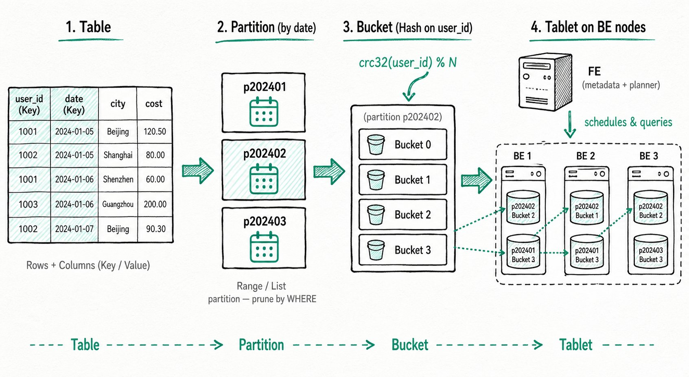

---
{
    "title": "パーティションとバケットの仕組み",
    "sidebar_label": "仕組み",
    "language": "ja",
    "description": "Doris のパーティションとバケットの背後にあるデータ分散モデルを説明します。パーティション、バケット、Tablet、ノードに加え、高度なパーティションおよびバケットモード、設計上の推奨事項、運用ガイダンスを扱います。"
}
---


{/* Knowledge type: Concept introduction / Procedure */}
{/* Applicable scenarios: Table design / Data organization and management */}

このページでは、Doris がパーティション、バケット、Tablet にデータを分散する方法を説明します。高度なパーティションおよびバケットモード、設計上の推奨事項、運用コマンドについても説明します。推奨される開始構成と判断ガイドについては、まず [パーティションとバケット](./overview) を読み、基盤となるモデルを理解したい場合に本ページを参照してください。

## 1. 概要 {#1-overview}

Doris は、**パーティション**と**バケット**という二層構造でテーブルのデータをクラスタ全体に分散します。

- **パーティション**：列の値（時間や地域など）に基づいてテーブルを小さなサブセットに水平分割し、クエリのプルーニングとデータライフサイクル管理を容易にします。
- **バケット**：各パーティション内のデータを複数のデータシャード（Tablet）にさらに均等に分散し、クラスタの並列性を十分に活用します。



データの流れは次のようにまとめられます。

```
Table ──► Partition ──► Bucket ──► Tablet (data shard, stored on BE nodes)
```

適切なパーティションおよびバケット設計により、**クエリの高速化**（パーティションプルーニングと並列スキャン）、**管理の容易さ**（時間単位でのアーカイブやクリーンアップ）、**より均等な書き込み**（ホットスポットのリスク低減）を同時に実現できます。

## 2. コア概念 {#2-core-concepts}

### 2.1 テーブル構造：行と列 {#21-table-structure-rows-and-columns}

Doris では、データをテーブルという形で論理的に記述します。テーブルは行（Row）と列（Column）で構成されます。

| 概念 | 説明                       |
| ------- | --------------------------------- |
| Row     | ユーザーデータの1行                |
| Column  | データの1行に含まれる異なるフィールドを記述します |

列はさらに次の二種類に分けられます。

| 列の種類 | 業務上の対応 | 説明                                                                                                |
| ----------- | ---------------- | ---------------------------------------------------------------------------------------------------------- |
| Key 列   | ディメンション列 | CREATE TABLE 文で `unique key`、`aggregate key`、`duplicate key` キーワードの後に指定する列 |
| Value 列 | メトリック列    | Key 列以外の列。集計方法はテーブル作成時に指定します            |

Aggregate モデルでは、Key 列が同じ行が1行に集約され、Value 列の集計方法はテーブル作成時にユーザーが指定します。Aggregate モデルの詳細については、[Doris データモデル](../../table-design/data-model/intro.mdx)を参照してください。

### 2.2 パーティション {#22-partition}

パーティションは、テーブル内の特定の列の値に基づいてデータを、より小さく互いに素なサブセットに分割します。各データ行は必ず1つの特定のパーティションに属し、パーティションは最小の論理管理単位です。

Doris は次の二種類の**パーティションタイプ**をサポートします。

- **Range パーティション**：数値または時間の範囲で分割します。時系列データでよく使用されます。
- **List パーティション**：列挙値の集合で分割します。地域やカテゴリなどの離散的なディメンションで分割する場合によく使用されます。

テーブル作成時にパーティションを指定しない場合、Doris はユーザーから透過的なデフォルトパーティションを生成し、テーブル内のすべてのデータを含めます。

適切なパーティション設計には次の利点があります。

- **クエリの高速化**：パーティションプルーニングにより、クエリに一致しないパーティションをスキップするため、Doris がスキャンするデータ量と I/O が減ります。大規模なデータセットほど効果が大きくなります。
- **管理の容易さ**：時間や地域で分割すると、アーカイブ、クリーンアップ、バックアップが簡単になります。たとえば時間でパーティション分割すれば、履歴データと新着データを分けて管理できます。

### 2.3 バケット {#23-bucket}

バケットは、パーティション内のデータを特定のルールに従って、より小さく互いに素なデータ単位にさらに分割します。各データ行は必ず1つの特定のバケットに属します。

パーティションは列の値の範囲またはリストでデータを分割します。バケットの目的は、パーティション内のバケット間でデータを**均等に**分散し、偏りを減らして並列スキャンを可能にすることです。結果はバケット方式とキーのデータ分布に左右されます。

Doris は次の二種類の**バケット方式**をサポートします。

- **Hash バケット**：バケット列の値の `crc32` ハッシュを計算し、バケット数で剰余を取ってデータを均等に分散します。
- **Random バケット**：データをバケットにランダムに割り当てます。Random バケットを使用する場合、`load_to_single_tablet` パラメータを組み合わせて小規模データの高速書き込みを最適化できます。

適切なバケット設計には次の利点があります。

- **より均等なデータ分布**：適切なバケットキーにより、データの偏りやノードまたはディスクの負荷の不均衡によるリスクを低減できます。
- **ホットスポットの減少**：処理を複数のバケットに分散することで、過負荷を減らし、安定性を向上できます。
- **同時実行性の向上**：Doris は同じパーティション内の異なるバケットを並列に読み取るため、スループットが向上します。

### 2.4 Tablet とノードのアーキテクチャ {#24-tablet-and-node-architecture}

バケットは物理的には**Tablet（データシャード）**に対応します。Tablet は Doris におけるデータ管理の最小単位であり、データ移動やレプリケーションなどの操作の基本的な物理単位でもあります。

Doris クラスタは次の二種類のノードで構成されます。

- **FE ノード（Frontend）**：クラスタメタデータ（テーブルや Tablet の情報など）を管理し、SQL の解析と実行計画を担当します。
- **BE ノード（Backend）**：Tablet データを保存し、計算タスクを実行します。BE からの結果は FE によって集約され、ユーザーに返されます。

データの書き込みとクエリでは、パーティションとバケットが次のように連携します。

- **データ書き込み**：データ行はまずパーティション戦略に従って対応するパーティションに割り当てられ、次にバケット戦略に従ってパーティション内の特定の Tablet にマッピングされます。
- **クエリ実行**：FE オプティマイザはクエリ条件に基づいて無関係なパーティションとバケットをプルーニングし、スキャン範囲を最小限にします。JOIN または集計クエリが含まれる場合、ノード間の Shuffle が発生することがあります。適切なパーティションおよびバケット設計（必要に応じて [Colocate](#52-colocate) と組み合わせる）により、Shuffle のコストを大幅に削減できます。

## 3. 最初の CREATE TABLE の例 {#3-the-first-create-table-example}

Doris でのテーブル作成は同期コマンドです。SQL 文の実行完了時に結果が返され、成功が返ればテーブルが作成されたことを示します。CREATE TABLE の完全な構文については [CREATE TABLE](../../sql-manual/sql-statements/table-and-view/table/CREATE-TABLE) を参照するか、`HELP CREATE TABLE` を使用して詳細なヘルプを確認してください。

次は、Range パーティションと Hash バケットを使用した最小限の CREATE TABLE の例です。

```sql
-- Range Partition
CREATE TABLE example_range_tbl
(
    `user_id` LARGEINT NOT NULL COMMENT "User ID",
    `date` DATE NOT NULL COMMENT "Data ingestion date",
    `timestamp` DATETIME NOT NULL COMMENT "Data ingestion timestamp",
    `city` VARCHAR(20) COMMENT "User's city",
    `age` SMALLINT COMMENT "User age",
    `sex` TINYINT COMMENT "User gender",
    `last_visit_date` DATETIME REPLACE DEFAULT "1970-01-01 00:00:00" COMMENT "User's last visit time",
    `cost` BIGINT SUM DEFAULT "0" COMMENT "Total user spending",
    `max_dwell_time` INT MAX DEFAULT "0" COMMENT "Maximum user dwell time",
    `min_dwell_time` INT MIN DEFAULT "99999" COMMENT "Minimum user dwell time"
)
PARTITION BY RANGE(`date`)
(
    PARTITION `p201701` VALUES LESS THAN ("2017-02-01"),
    PARTITION `p201702` VALUES LESS THAN ("2017-03-01"),
    PARTITION `p201703` VALUES LESS THAN ("2017-04-01"),
    PARTITION `p2018` VALUES [("2018-01-01"), ("2019-01-01"))
)
DISTRIBUTED BY HASH(`user_id`) BUCKETS 16
PROPERTIES
(
    "replication_num" = "1"
);
```

**この例で書き込みとクエリのプロセスを理解する**：

- 書き込み時、各データ行はまず `date` によって対応する Range パーティションに入ります（たとえば `2017-02-15` は `p201702` に入ります）。その後、`user_id` のハッシュ値によって、そのパーティションの16個の Tablet のいずれかにマッピングされます。
- `WHERE date = '2017-02-15'` というクエリでは、オプティマイザは `p201702` パーティションのみをスキャンします。さらに `user_id = 123` を指定すると、1つの Tablet だけが対象になります。

## 4. 高度な機能：パーティションモード {#4-advanced-partition-modes}

テーブル作成時に手動でパーティションを宣言する方法に加え、Doris は時間スケジュールに基づく自動パーティション作成（Dynamic Partition）と、入力データに基づくオンデマンドのパーティション作成（Auto Partition）もサポートします。三つのモードは次のとおりです。

| パーティションモード | パーティションが作成されるタイミング             | 適用シナリオ                                       |
| -------------- | --------------------------------------- | ---------------------------------------------------------- |
| 手動パーティション | テーブル作成時に明示的に宣言するか、`ALTER` で追加 | パーティション集合が安定しており、きめ細かな制御が必要な場合       |
| 動的パーティション | 時間スケジュールのルールに基づいてシステムが自動的に作成・再利用 | 時系列データで、過去 N 日、週、月のローリングパーティションを自動的に維持したい場合 |
| 自動パーティション  | データ書き込み時にオンデマンドで作成 | パーティション値が予測できない場合（マルチテナントや疎な時間など）で、事前作成を避けたい場合 |

各モードのすぐに使える CREATE TABLE の例や、自動パーティションと動的パーティションを組み合わせる方法については、[自動パーティション](./auto-partitioning)、[動的パーティション](./dynamic-partitioning)、[手動パーティション](./manual-partitioning) を参照してください。

## 5. 高度な機能：バケット {#5-advanced-bucketing}

### 5.1 自動バケット {#51-auto-bucketing}

使用するバケット数が不明な場合は、`BUCKETS AUTO` を設定し、推定データ量（`estimate_partition_size`）から Doris にバケット数を決めさせます。この方法は非常に大きなテーブルには適していません。詳細については、[データバケット](./data-bucketing) を参照してください。

### 5.2 Colocate {#52-colocate}

JOIN または集計クエリを頻繁に実行する複数の大規模テーブルでは、**Colocate** 戦略を有効にして、同じバケット列の値を持つデータを同じ物理ノードに配置できます。これによりノード間の Shuffle を回避し、クエリ性能を大幅に向上できます。詳細な使用方法については、Colocate Join のドキュメントを参照してください。

## 6. 設計上の推奨事項 {#6-design-recommendations}

適切なパーティションおよびバケット設計では、クエリ性能、データ管理、システム安定性のバランスを取る必要があります。一般的な指針を次に示します。

### 6.1 設計目標 {#61-design-goals}

1. **均等なデータ分布**：高カーディナリティの列をバケット列として選択し、一部のノードに過負荷をかけるデータの偏りを避けます。
2. **クエリ性能の最適化**：パーティションプルーニングによってスキャンするデータ量を大幅に減らせます。適切なバケット数により計算の並列性が向上し、必要に応じて Colocate を使用して Shuffle のコストを削減します。
3. **柔軟なデータ管理**：時間でパーティション分割するとコールド／ホット階層化（HDD/SSD）が容易になり、履歴パーティションを削除してストレージ容量を回収できます。

### 6.2 経験値と制限 {#62-empirical-values-and-limits}

- **メタデータ規模**：各 Tablet のメタデータは FE と BE の両方に保存されるため、規模を適切に制御する必要があります。
  - 10 million Tablet ごとに、FE には少なくとも約 100 GB のメモリが必要です。
  - 1台の BE が保持する Tablet 数は 20,000 未満にする必要があります。
- **書き込みスループット**：
  - パーティションあたりのバケット数は < 128 を推奨します。多すぎると書き込み性能に大きく影響します。
  - 各書き込みは少数のパーティションに集中させ、分散した書き込みによって小さなファイルが過剰に生成されるのを避けます。
- **パーティション列／バケット列の選択**：
  - パーティション列には時間または低カーディナリティの列挙値を優先します。
  - バケット列には高カーディナリティの列（`user_id` など）を選び、均等な分布を確保します。
  - 単一 Tablet のデータ量は 1-10 GB の範囲を推奨します。

## 7. パーティションの表示と変更 {#7-viewing-and-modifying-partitions}

### 7.1 SHOW CREATE TABLE で CREATE TABLE 文を表示する {#71-view-the-create-table-statement-via-show-create-table}

`SHOW CREATE TABLE` を使用すると、パーティション情報を含むテーブルの完全な CREATE TABLE 文を表示できます。

```sql
> show create table  example_range_tbl
+-------------------+---------------------------------------------------------------------------------------------------------+
| Table             | Create Table                                                                                            |
+-------------------+---------------------------------------------------------------------------------------------------------+
| example_range_tbl | CREATE TABLE `example_range_tbl` (                                                                      |
|                   |   `user_id` largeint(40) NOT NULL COMMENT 'User ID',                                                     |
|                   |   `date` date NOT NULL COMMENT 'Data ingestion date',                                                      |
|                   |   `timestamp` datetime NOT NULL COMMENT 'Data ingestion timestamp',                                             |
|                   |   `city` varchar(20) NULL COMMENT 'User city',                                                       |
|                   |   `age` smallint(6) NULL COMMENT 'User age',                                                            |
|                   |   `sex` tinyint(4) NULL COMMENT 'User gender',                                                             |
|                   |   `last_visit_date` datetime REPLACE NULL DEFAULT "1970-01-01 00:00:00" COMMENT 'User last visit time', |
|                   |   `cost` bigint(20) SUM NULL DEFAULT "0" COMMENT 'Total user spending',                                          |
|                   |   `max_dwell_time` int(11) MAX NULL DEFAULT "0" COMMENT 'Maximum user dwell time',                             |
|                   |   `min_dwell_time` int(11) MIN NULL DEFAULT "99999" COMMENT 'Minimum user dwell time'                          |
|                   | )                                                                                                       |
|                   | PARTITION BY RANGE(`date`)                                                                              |
|                   | (PARTITION p201701 VALUES [('0000-01-01'), ('2017-02-01')),                                             |
|                   | PARTITION p201702 VALUES [('2017-02-01'), ('2017-03-01')),                                              |
|                   | PARTITION p201703 VALUES [('2017-03-01'), ('2017-04-01')))                                              |
|                   | DISTRIBUTED BY HASH(`user_id`) BUCKETS 16                                                               |
|                   | PROPERTIES (                                                                                            |
|                   | "replication_allocation" = "tag.location.default: 1",                                                   |
|                   | "storage_format" = "V2",                                                                                |
|                   | "light_schema_change" = "true",                                                                         |
|                   | "disable_auto_compaction" = "false"                                                                     |
|                   | );                                                                                                      |
+-------------------+---------------------------------------------------------------------------------------------------------+
```

### 7.2 SHOW PARTITIONS でパーティション一覧を表示する {#72-view-the-partition-list-via-show-partitions}

`SHOW PARTITIONS FROM <table_name>` を使用すると、テーブルのパーティション一覧と詳細情報を表示できます。

```sql
> show partitions from example_range_tbl
+-------------+---------------+----------------+---------------------+--------+--------------+--------------------------------------------------------------------------------+-----------------+---------+----------------+---------------
+---------------------+---------------------+--------------------------+----------+------------+-------------------------+-----------+
| PartitionId | PartitionName | VisibleVersion | VisibleVersionTime  | State  | PartitionKey | Range                                                                          | DistributionKey | Buckets | ReplicationNum | StorageMedium
| CooldownTime        | RemoteStoragePolicy | LastConsistencyCheckTime | DataSize | IsInMemory | ReplicaAllocation       | IsMutable |
+-------------+---------------+----------------+---------------------+--------+--------------+--------------------------------------------------------------------------------+-----------------+---------+----------------+---------------
+---------------------+---------------------+--------------------------+----------+------------+-------------------------+-----------+
| 28731       | p201701       | 1              | 2024-01-25 10:50:51 | NORMAL | date         | [types: [DATEV2]; keys: [0000-01-01]; ..types: [DATEV2]; keys: [2017-02-01]; ) | user_id         | 16      | 1              | HDD
| 9999-12-31 23:59:59 |                     |                    | 0.000    | false      | tag.location.default: 1 | true      |
| 28732       | p201702       | 1              | 2024-01-25 10:50:51 | NORMAL | date         | [types: [DATEV2]; keys: [2017-02-01]; ..types: [DATEV2]; keys: [2017-03-01]; ) | user_id         | 16      | 1              | HDD
| 9999-12-31 23:59:59 |                     |                    | 0.000    | false      | tag.location.default: 1 | true      |
| 28733       | p201703       | 1              | 2024-01-25 10:50:51 | NORMAL | date         | [types: [DATEV2]; keys: [2017-03-01]; ..types: [DATEV2]; keys: [2017-04-01]; ) | user_id         | 16      | 1              | HDD
| 9999-12-31 23:59:59 |                     |                    | 0.000    | false      | tag.location.default: 1 | true      |
+-------------+---------------+----------------+---------------------+--------+--------------+--------------------------------------------------------------------------------+-----------------+---------+----------------+---------------
+---------------------+---------------------+--------------------------+----------+------------+-------------------------+-----------+
```

### 7.3 パーティションを変更する {#73-modify-partitions}

`ALTER TABLE ADD PARTITION` を使用すると、テーブルに新しいパーティションを追加できます。

```sql
ALTER TABLE example_range_tbl ADD  PARTITION p201704 VALUES LESS THAN("2020-05-01") DISTRIBUTED BY HASH(`user_id`) BUCKETS 5;
```

その他のパーティション変更操作については、SQL マニュアルの [ALTER-TABLE-PARTITION](../../sql-manual/sql-statements/table-and-view/table/ALTER-TABLE-PARTITION) を参照してください。

### 7.4 パーティション検索 {#74-partition-lookup}

`partitions` テーブル関数と `information_schema.partitions` システムテーブルには、クラスタのパーティション情報が記録されています。パーティションを自動的に管理する場合、これらを使用してパーティション情報を抽出できます。

#### 指定した値が属するパーティションを検索する {#find-the-partition-that-a-given-value-belongs-to}

Auto Partition テーブルで、ある値に対応するパーティションを検索します。

```sql
mysql> select * from partitions("catalog"="internal", "database"="optest", "table"="DAILY_TRADE_VALUE") where PartitionName = auto_partition_name('range', 'year', '2008-02-03');
+-------------+-----------------+----------------+---------------------+--------+--------------+--------------------------------------------------------------------------------+-----------------+---------+----------------+---------------+---------------------+---------------------+--------------------------+-----------+------------+-------------------------+-----------+--------------------+--------------+
| PartitionId | PartitionName   | VisibleVersion | VisibleVersionTime  | State  | PartitionKey | Range                                                                          | DistributionKey | Buckets | ReplicationNum | StorageMedium | CooldownTime        | RemoteStoragePolicy | LastConsistencyCheckTime | DataSize  | IsInMemory | ReplicaAllocation       | IsMutable | SyncWithBaseTables | UnsyncTables |
+-------------+-----------------+----------------+---------------------+--------+--------------+--------------------------------------------------------------------------------+-----------------+---------+----------------+---------------+---------------------+---------------------+--------------------------+-----------+------------+-------------------------+-----------+--------------------+--------------+
|      127095 | p20080101000000 |              2 | 2024-11-14 17:29:02 | NORMAL | TRADE_DATE   | [types: [DATEV2]; keys: [2008-01-01]; ..types: [DATEV2]; keys: [2009-01-01]; ) | TRADE_DATE      |      10 |              1 | HDD           | 9999-12-31 23:59:59 |                     | \N                       | 985.000 B |          0 | tag.location.default: 1 |         1 |                  1 | \N           |
+-------------+-----------------+----------------+---------------------+--------+--------------+--------------------------------------------------------------------------------+-----------------+---------+----------------+---------------+---------------------+---------------------+--------------------------+-----------+------------+-------------------------+-----------+--------------------+--------------+
1 row in set (0.30 sec)
```

List パーティションテーブルで対応するパーティションを検索します。

```sql
mysql> select * from information_schema.partitions where TABLE_SCHEMA='optest' and TABLE_NAME='list_table1' and PARTITION_NAME=auto_partition_name('list', null);
+---------------+--------------+-------------+----------------+-------------------+----------------------------+-------------------------------+------------------+---------------------+----------------------+-------------------------+-----------------------+------------+----------------+-------------+-----------------+--------------+-----------+-------------+---------------------+---------------------+----------+-------------------+-----------+-----------------+
| TABLE_CATALOG | TABLE_SCHEMA | TABLE_NAME  | PARTITION_NAME | SUBPARTITION_NAME | PARTITION_ORDINAL_POSITION | SUBPARTITION_ORDINAL_POSITION | PARTITION_METHOD | SUBPARTITION_METHOD | PARTITION_EXPRESSION | SUBPARTITION_EXPRESSION | PARTITION_DESCRIPTION | TABLE_ROWS | AVG_ROW_LENGTH | DATA_LENGTH | MAX_DATA_LENGTH | INDEX_LENGTH | DATA_FREE | CREATE_TIME | UPDATE_TIME         | CHECK_TIME          | CHECKSUM | PARTITION_COMMENT | NODEGROUP | TABLESPACE_NAME |
+---------------+--------------+-------------+----------------+-------------------+----------------------------+-------------------------------+------------------+---------------------+----------------------+-------------------------+-----------------------+------------+----------------+-------------+-----------------+--------------+-----------+-------------+---------------------+---------------------+----------+-------------------+-----------+-----------------+
| internal      | optest       | list_table1 | pX             | NULL              |                          0 |                             0 | LIST             | NULL                | str                  | NULL                    | (NULL)                |          1 |           1266 |        1266 |               0 |            0 |         0 |           0 | 2024-11-14 19:58:45 | 0000-00-00 00:00:00 |        0 |                   |           |                 |
+---------------+--------------+-------------+----------------+-------------------+----------------------------+-------------------------------+------------------+---------------------+----------------------+-------------------------+-----------------------+------------+----------------+-------------+-----------------+--------------+-----------+-------------+---------------------+---------------------+----------+-------------------+-----------+-----------------+
1 row in set (0.24 sec)
```

#### 指定した始点を持つパーティションを検索する {#find-partitions-with-a-given-starting-point}

```sql
mysql> select * from information_schema.partitions where TABLE_NAME='DAILY_TRADE_VALUE' and PARTITION_DESCRIPTION like "[('2012-01-01'),%";
+---------------+--------------+-------------------+-----------------+-------------------+----------------------------+-------------------------------+------------------+---------------------+----------------------+-------------------------+----------------------------------+------------+----------------+-------------+-----------------+--------------+-----------+-------------+---------------------+---------------------+----------+-------------------+-----------+-----------------+
| TABLE_CATALOG | TABLE_SCHEMA | TABLE_NAME        | PARTITION_NAME  | SUBPARTITION_NAME | PARTITION_ORDINAL_POSITION | SUBPARTITION_ORDINAL_POSITION | PARTITION_METHOD | SUBPARTITION_METHOD | PARTITION_EXPRESSION | SUBPARTITION_EXPRESSION | PARTITION_DESCRIPTION            | TABLE_ROWS | AVG_ROW_LENGTH | DATA_LENGTH | MAX_DATA_LENGTH | INDEX_LENGTH | DATA_FREE | CREATE_TIME | UPDATE_TIME         | CHECK_TIME          | CHECKSUM | PARTITION_COMMENT | NODEGROUP | TABLESPACE_NAME |
+---------------+--------------+-------------------+-----------------+-------------------+----------------------------+-------------------------------+------------------+---------------------+----------------------+-------------------------+----------------------------------+------------+----------------+-------------+-----------------+--------------+-----------+-------------+---------------------+---------------------+----------+-------------------+-----------+-----------------+
| internal      | optest       | DAILY_TRADE_VALUE | p20120101000000 | NULL              |                          0 |                             0 | RANGE            | NULL                | TRADE_DATE           | NULL                    | [('2012-01-01'), ('2013-01-01')) |          1 |            985 |         985 |               0 |            0 |         0 |           0 | 2024-11-14 17:29:02 | 0000-00-00 00:00:00 |        0 |                   |           |                 |
+---------------+--------------+-------------------+-----------------+-------------------+----------------------------+-------------------------------+------------------+---------------------+----------------------+-------------------------+----------------------------------+------------+----------------+-------------+-----------------+--------------+-----------+-------------+---------------------+---------------------+----------+-------------------+-----------+-----------------+
1 row in set (0.65 sec)
```

## 8. 参考資料 {#8-further-reading}

- [手動パーティション](./manual-partitioning)
- [動的パーティション](./dynamic-partitioning)
- [自動パーティション](./auto-partitioning)
- [データバケット](./data-bucketing)
- [よくある問題](./common-issues)
- [CREATE TABLE 構文](../../sql-manual/sql-statements/table-and-view/table/CREATE-TABLE)
- [ALTER TABLE PARTITION](../../sql-manual/sql-statements/table-and-view/table/ALTER-TABLE-PARTITION)
