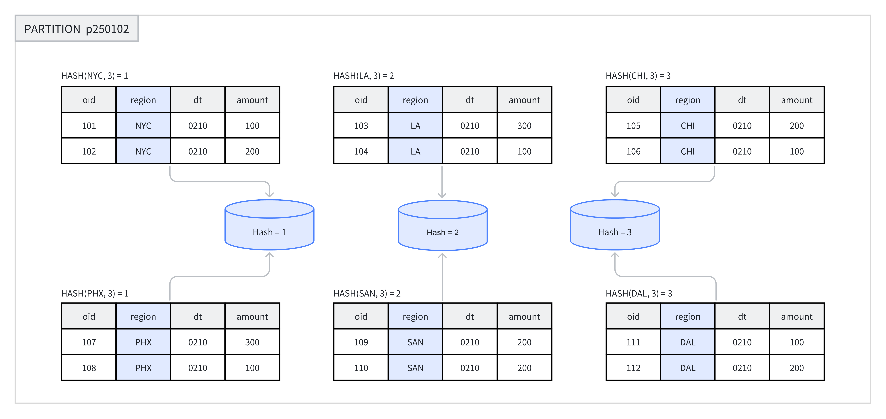
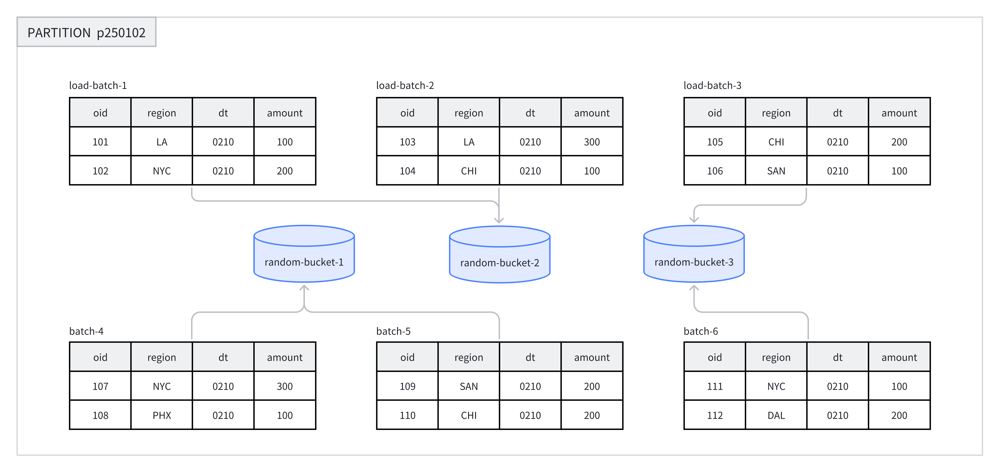

---
{
    "title": "データのバケット分割",
    "language": "ja",
    "description": "Doris のデータのバケット分割ガイド。Hash と Random のバケット分割方式、バケットキー、バケット数の選び方を説明し、クエリ性能の向上とデータの偏りの回避に役立てます。",
    "keywords": [
        "Doris のデータのバケット分割",
        "Hash バケット分割",
        "Random バケット分割",
        "バケットキーの選定",
        "バケット数",
        "tablet",
        "データの偏り"
    ]
}
---

<!-- Knowledge type: Architecture decision / Configuration parameter -->
<!-- Applicable scenarios: Table design / Performance tuning / Data skew handling -->

パーティションは、業務上の要件に応じて複数のデータバケットに分割できます。各バケットは、物理的なデータシャード（Tablet）として保存されます。適切なバケット分割戦略を採用すると、クエリ時にスキャンするデータ量を効果的に減らし、クエリ性能と同時処理能力を向上できます。

このドキュメントは、テーブル作成時の判断の流れに沿って構成されています。まずバケット分割方式を選び、次にバケットキーを選定し、最後にバケット数とその後のメンテナンス方法を決めます。

## クイックガイド {#quick-decision}

テーブルを作成する際は、次の順序でバケット分割を設計できます。

| 手順 | 決定事項 | 主な検討事項 |
|------|------|----------|
| 1 | バケット分割方式を選ぶ | 頻繁にフィルタに使用する列の有無、データ分布の均一性、テーブルモデル |
| 2 | バケットキーを選定する（Hash バケット分割のみ） | クエリのフィルタ条件、列のカーディナリティ、クエリの同時実行数とスループットの特性 |
| 3 | バケット数を決める | Tablet あたりのデータサイズ、BE の数、ディスクの数 |
| 4 | バケットのメンテナンス方針を立てる | データ量の増加傾向、動的パーティションの使用有無 |

## 1. バケット分割方式を選ぶ {#1-choose-the-bucketing-method}

Doris は、**Hash バケット分割**と**Random バケット分割**の2種類をサポートしています。主な違いは次のとおりです。

| 比較項目 | Hash バケット分割 | Random バケット分割 |
|--------|----------|------------|
| データの分散方法 | バケットキーの Hash 値に基づいて分割 | ランダムかつ均等に分散 |
| バケットキーの要否 | 必要 | 不要 |
| バケットプルーニングのサポート | サポート | 非サポート |
| 対応するテーブルモデル | DUPLICATE / UNIQUE / AGGREGATE | DUPLICATE のみ |
| データの偏りのリスク | バケットキーの選び方による | 低い |
| 適した用途 | 特定の列で頻繁にフィルタするポイントクエリ | 任意のディメンションでの分析、偏りやすいデータ |

### 1. Hash バケット分割 {#1-hash-bucketing}

テーブルの作成時または新しいパーティションの追加時に、バケットキーとして列を一つ以上選び、バケット数を明示的に指定する必要があります。同じパーティション内では、バケットキーとバケット数を基に Hash 計算が行われ、Hash 値が同じ行は同じバケットに割り当てられます。

たとえば、次の図では `p250102` パーティションが `region` 列に基づいて3つのバケットに分割され、Hash 値が同じ行は同じバケットに格納されます。



**推奨される用途：**

- 特定のフィールドで頻繁にフィルタする場合、そのフィールドをバケットキーにすると、バケットプルーニングを利用してクエリ効率を向上できます。
- テーブル内のデータが比較的均等に分布しており、偏りが生じにくい場合。

**例：** Hash バケット分割を使用するテーブルを作成します。構文の詳細は [CREATE TABLE](../../sql-manual/sql-statements/table-and-view/table/CREATE-TABLE.md) を参照してください。

以下の例では、テーブル名に `demo` データベースを指定しています。クラスターに存在しない場合は、先に作成してください。

```sql
CREATE DATABASE IF NOT EXISTS demo;
```

```sql
CREATE TABLE demo.hash_bucket_tbl(
    oid         BIGINT,
    dt          DATE,
    region      VARCHAR(10),
    amount      INT
)
DUPLICATE KEY(oid)
PARTITION BY RANGE(dt) (
    PARTITION p250101 VALUES LESS THAN("2025-01-01"),
    PARTITION p250102 VALUES LESS THAN("2025-01-02")
)
DISTRIBUTED BY HASH(region) BUCKETS 8;
```

この例では、`DISTRIBUTED BY HASH(region)` で Hash バケット分割の使用と `region` 列のバケットキーへの指定を行い、`BUCKETS 8` で8つのバケットを作成するよう指定しています。

### 2. Random バケット分割 {#2-random-bucketing}

Random バケット分割では、フィールドの Hash 値を使用せず、各パーティション内のバケットにデータをランダムに分散します。これにより、データを均等に分散し、不適切なバケットキーの選択に起因するデータの偏りを回避できます。

データロード時には、一つのデータロードジョブ内の各バッチがランダムに選ばれた Tablet に書き込まれ、データが均等に分散されます。たとえば、次の図では、8つのデータバッチが `p250102` パーティション内の3つのバケットにランダムに割り当てられます。



Random バケット分割を使用する場合、シングル Tablet ロードモード（`load_to_single_tablet` を `true` に設定）を有効にすると、単一バッチのデータを一つのデータシャードにのみ書き込めます。これにより、次の効果が得られます。

- 大規模なデータロードの同時実行数とスループットが向上します。
- データロードと Compaction による書き込み増幅が減少します。
- クラスターの安定性が向上します。

**推奨される用途：**

- 任意のディメンションで分析し、フィルタや結合に使用する列が固定されていない場合。
- 頻繁にクエリする列や列の組み合わせのデータ分布が大きく偏っており、データの偏りを避ける必要がある場合。

**適さない用途：**

- ポイントクエリ：Random バケット分割ではバケットキーに基づくプルーニングができないため、条件に一致するパーティション内の全データをスキャンします。
- UNIQUE および AGGREGATE テーブル：Random バケット分割をサポートするのは DUPLICATE テーブルのみです。

**例：** Random バケット分割を使用するテーブルを作成します。構文の詳細は [CREATE TABLE](../../sql-manual/sql-statements/table-and-view/table/CREATE-TABLE.md) を参照してください。

```sql
CREATE TABLE demo.random_bucket_tbl(
    oid         BIGINT,
    dt          DATE,
    region      VARCHAR(10),
    amount      INT
)
DUPLICATE KEY(oid)
PARTITION BY RANGE(dt) (
    PARTITION p250101 VALUES LESS THAN("2025-01-01"),
    PARTITION p250102 VALUES LESS THAN("2025-01-02")
)
DISTRIBUTED BY RANDOM BUCKETS 8;
```

この例では、`DISTRIBUTED BY RANDOM` で Random バケット分割の使用を指定します。バケットキーの選定は不要です。`BUCKETS 8` で8つのバケットを作成するよう指定しています。

## 2. バケットキーを選定する {#2-select-the-bucket-key}

:::tip ヒント

バケットキーの選定が必要なのは Hash バケット分割だけです。Random バケット分割では必要ありません。

:::

バケットキーには、列を一つ以上指定できます。テーブルモデルごとのバケットキーの制約は次のとおりです。

| テーブルモデル | バケットキーに指定できる列 |
|--------|----------|
| DUPLICATE | 任意の Key 列または Value 列 |
| AGGREGATE / UNIQUE | Key 列であること（データが正しく集約されるようにするため） |

### 選定の原則 {#selection-principles}

業務上のクエリの特性に応じて、次の原則を参考にバケットキーを選定できます。

| 原則 | 説明 | 利点 |
|------|------|------|
| クエリのフィルタ条件を活用する | クエリでフィルタとして頻繁に使用する列をバケットキーに選ぶ | バケットプルーニングが可能になり、スキャンするデータ量が減る |
| カーディナリティの高い列を活用する | 異なる値が多い列をバケットキーに選ぶ | データが均等に分散し、偏りを避けられる |
| 同時実行数の多いポイントクエリ | 単一列または少数の列をバケットキーに選ぶ | 単一のクエリでスキャンするバケットが一つだけになり、クエリ間の IO 干渉が減る |
| スループットを重視するクエリ | 複数の列をバケットキーに選ぶ | データがより均等に分散し、クエリ条件が等価条件に完全には一致しない場合に全体のスループットが向上する |

## 3. バケット数を決める {#3-determine-the-number-of-buckets}

Doris では、各 Bucket は物理ファイル（Tablet）として保存されます。テーブル内の Tablet の総数は次のように求められます。

```text
Total Tablets = partition_num × bucket_num
```

:::caution 注意

Partition のバケット数は、一度指定すると変更できません。バケット数を決める際は、将来のマシン増設を見込んで計画してください。

:::

Doris はバージョン 2.0 以降、マシンのリソースとクラスター情報に基づいて、パーティションのバケット数を自動設定できます。見積もりに求める精度に応じて、手動設定と自動設定を選べます。

### 1. バケット数を手動で設定する {#1-manually-set-the-number-of-buckets}

`DISTRIBUTED` 句でバケット数を指定します。

```sql
-- Set hash bucket num to 8
DISTRIBUTED BY HASH(region) BUCKETS 8

-- Set random bucket num to 8
DISTRIBUTED BY RANDOM BUCKETS 8
```

#### 決定の原則 {#decision-principles}

バケット数を決める際は、次の2つの原則に従います。両者が相反する場合は、**サイズに関する原則を優先**してください。

1. **サイズに関する原則**：各 Tablet の圧縮後のデータサイズ（インデックスを除く）は **1 GB から 20 GB** の範囲に収めることを推奨します。Unique Key テーブルでは **10 GB** 以下を推奨します。
    - Tablet が小さすぎる場合：集約の効果が低下し、メタデータ管理の負荷が増えます。
    - Tablet が大きすぎる場合：レプリカの移行と復旧が難しくなり、失敗した Schema Change の再試行コストが増えます。
    - `SHOW TABLETS FROM your_table` で実際の Tablet サイズを確認できます。

2. **数量に関する原則**：増設を考慮しない場合、テーブル内の Tablet 数は、クラスター内のディスク総数よりやや多くすることを推奨します。

:::caution MOW Tablet ごとの行数も考慮する

MOW Unique Key テーブルでは、圧縮後のデータサイズに加えて、各 Tablet の物理行数も考慮してください。Base Compaction は、マージ対象の物理入力行に対する rowid 変換マップを構築します。主なマッピングの保存には、行あたり約8バイトを使用します。列数の少ないテーブルや圧縮率の高いテーブルでは、Tablet のサイズが上記の推奨範囲内でも、行数が多いために Compaction 中にメモリ不足になる場合があります。見積もりと対処方法については、[大きな MOW Tablet における Compaction のメモリ使用量](../../admin-manual/trouble-shooting/compaction.md#mow-compaction-memory) を参照してください。

:::

さらに、次の点にも注意してください。

- データを均等に分散するため、バケット数は BE の数の整数倍にしてください。
- 単一パーティションのバケット数は、通常 **128** を超えないようにしてください。それ以上必要な場合は、先にテーブルをパーティション分割してください。

#### 推奨設定例 {#recommended-configuration-examples}

BE マシンが10台あり、それぞれにディスクが一つあるクラスターを想定します。バケット数を設定する際は、次の表を参考にしてください。

| パーティションの圧縮後のデータサイズ | 推奨バケット数 |
|-----------------|-----------------|
| < 1 GB | 1バケット |
| 1 - 10 GB | 10バケット |
| 10 - 200 GB | 10 - 20バケット |
| > 200 GB | 先にテーブルをパーティション分割する |

:::tip ヒント

`SHOW DATA` コマンドでテーブルのデータサイズを確認できます。テーブルの実際のデータサイズを求めるには、結果をレプリカ数で割る必要があります。

:::

### 2. バケット数を自動で設定する {#2-automatically-set-the-number-of-buckets}

バケット数の自動推定機能は、直近の一定期間におけるパーティションのサイズから将来のパーティションサイズを予測し、それに応じてバケット数を決めます。

```sql
-- Set hash bucket auto
DISTRIBUTED BY HASH(region) BUCKETS AUTO
properties("estimate_partition_size" = "20G")

-- Set random bucket auto
DISTRIBUTED BY RANDOM BUCKETS AUTO
properties("estimate_partition_size" = "20G")
```

`estimate_partition_size` プロパティは、パーティションサイズの初期推定値を調整するために使用します。

- このパラメーターは省略可能です。指定しない場合、デフォルト値は `10GB` です。
- このパラメーターが影響するのは初期推定値だけです。その後、過去のパーティションデータからシステムが推定する将来のパーティションサイズには影響しません。

算出されたバケット数は、FE 設定の `autobucket_min_buckets` と `autobucket_max_buckets` の範囲内に収められます。

| FE 設定 | デフォルト値 | 説明 |
|---|---|---|
| `autobucket_min_buckets` | 3 | 自動バケット分割で算出されるバケット数の下限。**4.0 系列では 4.0.8、4.1 系列では 4.1.4 から、デフォルト値が `1` から `3` に変更されました** |
| `autobucket_max_buckets` | 128 | 自動バケット分割で算出されるバケット数の上限 |

:::caution 動作の変更（4.0.8 / 4.1.4）

`autobucket_min_buckets` のデフォルト値は、4.0.8（4.0 系列）と 4.1.4（4.1 系列）で `1` から `3` に変更されました。以前は小さなパーティションのバケット数が一つと算出され、並列処理能力とデータ分散が不十分になることがありました。変更後、自動バケット分割で算出されるバケット数は3未満になりません。

この変更が影響するのは、アップグレード**後に作成された**パーティションだけです。既存のパーティションのバケット数は変わりません。以前の動作を維持するには、`autobucket_min_buckets` を明示的に `1` に設定してください。

:::

## 4. データのバケット分割を管理する {#4-maintain-data-bucketing}

:::tip ヒント

現在、Doris でバケット数を変更できるのは、新たに追加するパーティションについてのみです。次の操作はサポートされていません。

1. バケット分割方式の変更。
2. バケットキーの変更。
3. 作成済みのバケットのバケット数の変更。

:::

テーブル作成時には、`DISTRIBUTED` 句を使用して、各パーティションのバケット数を一律に指定します。データ量の増減に対応するには、パーティションを動的に追加する際に、新しいパーティションのバケット数を個別に指定できます。

次の例は、`ALTER TABLE` コマンドを使用して、新たに追加するパーティションのバケット数を変更する方法を示しています。

```sql
-- Modify hash bucket table
ALTER TABLE demo.hash_bucket_tbl
ADD PARTITION p250103 VALUES LESS THAN("2025-01-03")
DISTRIBUTED BY HASH(region) BUCKETS 16;

-- Modify random bucket table
ALTER TABLE demo.random_bucket_tbl
ADD PARTITION p250103 VALUES LESS THAN("2025-01-03")
DISTRIBUTED BY RANDOM BUCKETS 16;

-- Modify dynamic partition table
ALTER TABLE demo.dynamic_partition_tbl
SET ("dynamic_partition.buckets"="16");
```

バケット数の変更後は、`SHOW PARTITION` コマンドで結果を確認できます。
