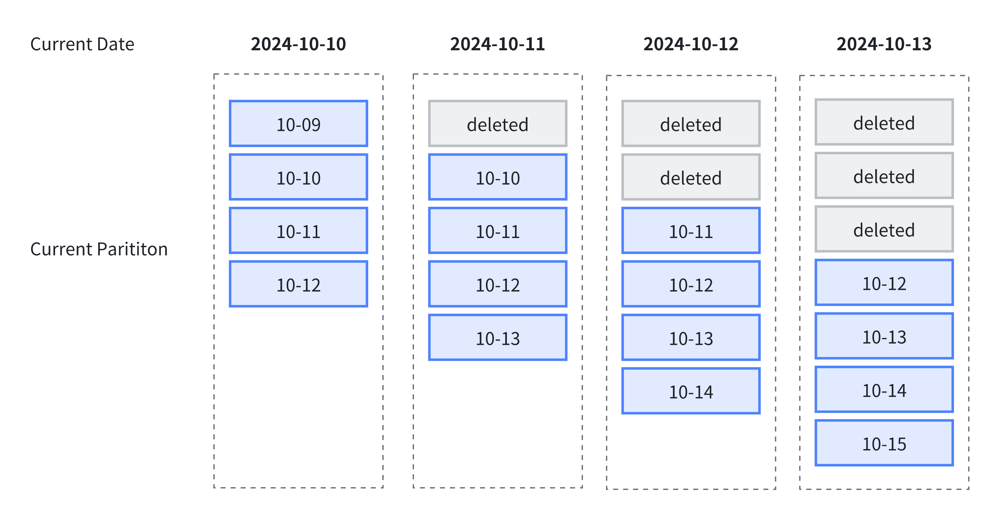

---
{
    "title": "動的パーティショニング",
    "sidebar_label": "動的パーティショニング",
    "language": "ja",
    "description": "動的パーティショニングは、スケジュールに従ってパーティションを作成・削除し、テーブルのパーティションのライフサイクル管理（TTL）を実現します。期限切れデータの自動削除が必要なログや時系列データなどに適しています。"
}
---

:::info パーティション管理方式の選択
動的パーティショニングは、スケジュールに従ってパーティションを作成・削除します。データの到着に応じてパーティションを作成する場合は、[自動パーティショニング](./auto-partitioning)を使用します。時間範囲を保持するか、履歴パーティションを指定した数だけ保持するかに応じて、保持方式を選択してください。
:::

<!-- Knowledge type: Feature introduction + Operating procedure + Configuration parameters -->
<!-- Applicable scenarios: Log management / Time-series data / Data lifecycle management -->

動的パーティショニングは、設定したルールに従ってパーティションを順次追加・削除し、テーブルのパーティションのライフサイクル管理（TTL）を実現して、データの保存に伴う負担を軽減します。ログ管理や時系列データ管理などでは、期限切れデータを順次削除するためによく使用されます。

## 適用シナリオ {#applicable-scenarios}

| シナリオ | 説明 |
| --- | --- |
| ログデータの管理 | 日単位または時間単位で直近 N 日分のログを保持し、期限切れのパーティションを自動的に削除する |
| 時系列データの管理 | 監視や IoT などで、時間軸に沿ってパーティションを自動的に管理する |
| データのライフサイクル管理 | TTL でデータの保持範囲を制御し、保存コストを削減する |
| 将来のパーティションの事前作成 | 今後 N 日分のパーティションを事前に作成し、パーティション不足による書き込み失敗を防ぐ |

次の図は、動的パーティショニングを使用したライフサイクル管理の例です。この例では、次のルールを指定します。

- スケジュールの単位 `dynamic_partition.time_unit` は `DAY` とし、日単位でパーティションを構成します。
- 開始オフセット `dynamic_partition.start` を `-1` に設定し、前日のパーティションを保持します。
- 終了オフセット `dynamic_partition.end` を `2` に設定し、翌日と翌々日のパーティションを保持します。

このルールに従い、時間が進んでも、前日、当日、翌日、翌々日の四つのパーティションが常に保持されます。



## 制限事項 {#limitations}

動的パーティショニングには、次の制限があります。

- `DATE` / `DATETIME` 列に対する Range パーティショニングのみをサポートします。
- パーティションキーは単一のキーのみをサポートします。

## 動的パーティションテーブルの作成 {#creating-a-dynamic-partitioned-table}

<!-- Knowledge type: Operating procedure -->

テーブルの作成時に `dynamic_partition` プロパティを指定すると、動的パーティションテーブルを作成できます。

```sql
CREATE TABLE test_dynamic_partition(
    order_id    BIGINT,
    create_dt   DATE,
    username    VARCHAR(20)
)
DUPLICATE KEY(order_id)
PARTITION BY RANGE(create_dt) ()
DISTRIBUTED BY HASH(order_id) BUCKETS 10
PROPERTIES(
    "dynamic_partition.enable" = "true",
    "dynamic_partition.time_unit" = "DAY",
    "dynamic_partition.start" = "-1",
    "dynamic_partition.end" = "2",
    "dynamic_partition.prefix" = "p",
    "dynamic_partition.create_history_partition" = "true"
);
```

`dynamic_partition` パラメータの詳細は、[動的パーティションのプロパティ](#dynamic-partition-properties)を参照してください。

## 動的パーティションの管理 {#managing-dynamic-partitions}

### 動的パーティションのプロパティの変更 {#modifying-dynamic-partition-properties}

:::info ヒント
`ALTER TABLE` 文で動的パーティションを変更しても、すぐには反映されません。Doris は `dynamic_partition_check_interval_seconds` で指定された間隔で動的パーティションを確認し、必要なパーティションの作成と削除を行います。
:::

次の例では、`ALTER TABLE` 文を使用して、動的パーティショニングを使用していないテーブルを動的パーティションテーブルに変更します。

```sql
CREATE TABLE test_partition(
    order_id    BIGINT,
    create_dt   DATE,
    username    VARCHAR(20)
)
DUPLICATE KEY(order_id)
PARTITION BY RANGE(create_dt) ()
DISTRIBUTED BY HASH(order_id) BUCKETS 10;

ALTER TABLE test_partition SET (
    "dynamic_partition.enable" = "true",
    "dynamic_partition.time_unit" = "DAY",
    "dynamic_partition.start" = "-1",
    "dynamic_partition.end" = "2",
    "dynamic_partition.prefix" = "p",
    "dynamic_partition.create_history_partition" = "true"
);
```

### 動的パーティションのスケジュール状態の確認 {#viewing-dynamic-partition-scheduling-status}

[SHOW-DYNAMIC-PARTITION](../../sql-manual/sql-statements/table-and-view/table/SHOW-DYNAMIC-PARTITION-TABLES)を使用すると、現在のデータベースにあるすべての動的パーティションテーブルのスケジュール状態を確認できます。

```sql
SHOW DYNAMIC PARTITION TABLES;
+-----------+--------+----------+-------------+------+--------+---------+-----------+----------------+---------------------+--------+------------------------+----------------------+-------------------------+
| TableName | Enable | TimeUnit | Start       | End  | Prefix | Buckets | StartOf   | LastUpdateTime | LastSchedulerTime   | State  | LastCreatePartitionMsg | LastDropPartitionMsg | ReservedHistoryPeriods  |
+-----------+--------+----------+-------------+------+--------+---------+-----------+----------------+---------------------+--------+------------------------+----------------------+-------------------------+
| d3        | true   | WEEK     | -3          | 3    | p      | 1       | MONDAY    | N/A            | 2020-05-25 14:29:24 | NORMAL | N/A                    | N/A                  | [2021-12-01,2021-12-31] |
| d5        | true   | DAY      | -7          | 3    | p      | 32      | N/A       | N/A            | 2020-05-25 14:29:24 | NORMAL | N/A                    | N/A                  | NULL                    |
| d4        | true   | WEEK     | -3          | 3    | p      | 1       | WEDNESDAY | N/A            | 2020-05-25 14:29:24 | NORMAL | N/A                    | N/A                  | NULL                    |
| d6        | true   | MONTH    | -2147483648 | 2    | p      | 8       | 3rd       | N/A            | 2020-05-25 14:29:24 | NORMAL | N/A                    | N/A                  | NULL                    |
| d2        | true   | DAY      | -3          | 3    | p      | 32      | N/A       | N/A            | 2020-05-25 14:29:24 | NORMAL | N/A                    | N/A                  | NULL                    |
| d7        | true   | MONTH    | -2147483648 | 5    | p      | 8       | 24th      | N/A            | 2020-05-25 14:29:24 | NORMAL | N/A                    | N/A                  | NULL                    |
+-----------+--------+----------+-------------+------+--------+---------+-----------+----------------+---------------------+--------+------------------------+----------------------+-------------------------+
7 rows in set (0.02 sec)
```

### 履歴パーティションの管理 {#managing-historical-partitions}

`start` と `end` プロパティで動的パーティションの数を指定した場合、すべてのパーティションを一度に作成することで待ち時間が長くなるのを避けるため、デフォルトでは履歴パーティションは作成されません。現在時刻以降のパーティションのみが作成されます。すべてのパーティションを一度に作成するには、`create_history_partition` パラメータを有効にします。

たとえば、現在の日付が 2024-10-11 で、`start = -2`、`end = 2` を指定した場合は次のようになります。

- `create_history_partition = true` の場合、範囲 `[10-09, 10-13]` に対して 5 個のパーティションが直ちに作成されます。
- `create_history_partition = false` の場合、範囲 `[10-11, 10-13]` に対して 3 個のパーティションのみが作成されます。

## 動的パーティションのパラメータ {#dynamic-partition-parameters}

### 動的パーティションのプロパティ {#dynamic-partition-properties}

<!-- Knowledge type: Configuration parameters -->

動的パーティションのルールを定めるパラメータには、`dynamic_partition` プレフィックスが付きます。使用できるパラメータは次のとおりです。

| パラメータ | 必須 | 説明 |
| --- | --- | --- |
| `dynamic_partition.enable` | いいえ | 動的パーティショニング機能を有効にするかどうかを指定します。`TRUE` または `FALSE` を設定できます。ほかの必須の動的パーティションパラメータが指定されている場合、デフォルトは `TRUE` です。 |
| `dynamic_partition.time_unit` | はい | 動的パーティショニングのスケジュール単位です。`HOUR`、`DAY`、`WEEK`、`MONTH`、`YEAR` を設定でき、それぞれ時間、日、週、月、年単位でパーティションを作成または削除します。 |
| `dynamic_partition.start` | いいえ | 動的パーティショニングの開始オフセットで、負の数で指定します。デフォルト値は `-2147483648` で、履歴パーティションを削除しないことを意味します。`time_unit` プロパティに応じて、現在の日（週または月）を基準としたこのオフセットより前の範囲にあるパーティションが削除されます。このオフセットから現在時刻までの履歴パーティションが存在しない場合に作成するかどうかは、`dynamic_partition.create_history_partition` で制御します。 |
| `dynamic_partition.end` | はい | 動的パーティショニングの終了オフセットで、正の数で指定します。`time_unit` プロパティに応じて、現在の日（週または月）を基準とした対応範囲のパーティションを事前に作成します。 |
| `dynamic_partition.prefix` | はい | 動的に作成されるパーティション名のプレフィックスです。 |
| `dynamic_partition.buckets` | いいえ | 動的に作成されるパーティションのバケット数です。このパラメータを設定すると、`DISTRIBUTED` で指定したバケット数が上書きされます。 |
| `dynamic_partition.replication_num` | いいえ | 動的に作成されるパーティションのレプリカ数です。指定しない場合、テーブル作成時に指定したレプリカ数がデフォルトになります。 |
| `dynamic_partition.create_history_partition` | いいえ | デフォルトは `false` です。`true` に設定すると、Doris は以下に示すルールに従ってすべてのパーティションを自動的に作成します。同時に、FE パラメータ `max_dynamic_partition_num` がパーティションの総数を制限し、一度に作成される数が多すぎることを防ぎます。作成するパーティションの数が `max_dynamic_partition_num` を超える場合、操作は拒否されます。`start` プロパティを指定しない場合、このパラメータは効果がありません。 |
| `dynamic_partition.history_partition_num` | いいえ | `create_history_partition` が `true` の場合、作成する履歴パーティションの数を指定します。デフォルト値は `-1` で、未設定を意味します。このパラメータは `dynamic_partition.start` と同じ効果があるため、どちらか一方のみを設定することを推奨します。 |
| `dynamic_partition.start_day_of_week` | いいえ | `time_unit` が `WEEK` の場合、週の開始曜日を指定します。有効な範囲は 1 から 7 で、1 は月曜日、7 は日曜日を表します。デフォルトは 1 で、週は月曜日から始まります。 |
| `dynamic_partition.start_day_of_month` | いいえ | `time_unit` が `MONTH` の場合、月の開始日を指定します。有効な範囲は 1 から 28 で、1 は月の 1 日、28 は月の 28 日を表します。デフォルトは 1 で、月は 1 日から始まります。うるう年や月ごとの日数の違いによる曖昧さを避けるため、29 日、30 日、31 日を開始日にすることはできません。 |
| `dynamic_partition.reserved_history_periods` | いいえ | 保持する履歴パーティションの時間範囲です。`dynamic_partition.time_unit` が `DAY` / `WEEK` / `MONTH` / `YEAR` の場合は、`[yyyy-MM-dd,yyyy-MM-dd],[...,...]` 形式で値を設定します。`dynamic_partition.time_unit` が `HOUR` の場合は、`[yyyy-MM-dd HH:mm:ss,yyyy-MM-dd HH:mm:ss],[...,...]` 形式で値を設定します。未設定の場合、デフォルトは `"NULL"` です。 |
| `dynamic_partition.time_zone` | いいえ | 動的パーティショニングのタイムゾーンです。デフォルトは現在のサーバーのシステムタイムゾーンで、例として `Asia/Shanghai` があります。タイムゾーンの設定について詳しくは、[タイムゾーン管理](../../admin-manual/cluster-management/time-zone)を参照してください。 |

### FE 設定パラメータ {#fe-configuration-parameters}

FE の動的パーティションパラメータは、FE の設定ファイルまたは `ADMIN SET FRONTEND CONFIG` コマンドで変更できます。

| パラメータ | デフォルト | 説明 |
| --- | --- | --- |
| `dynamic_partition_enable` | false | Doris の動的パーティショニング機能を有効にするかどうかを指定します。このパラメータは動的パーティションテーブルのパーティション操作にのみ影響し、通常のテーブルには影響しません。 |
| `dynamic_partition_check_interval_seconds` | 600 | 動的パーティションスレッドの実行間隔です。単位は秒です。 |
| `max_dynamic_partition_num` | 500 | 動的パーティションテーブルの作成時に作成できるパーティションの最大数を制限し、一度に作成される数が多すぎることを防ぎます。 |

## 動的パーティショニングのベストプラクティス {#dynamic-partitioning-best-practices}

### 例 1：ログデータのローリング保持 {#example-1-rolling-retention-of-log-data}

日単位でパーティションを作成し、過去 7 日分と当日分のみを保持して、今後 3 日分のパーティションを事前に作成します。

```sql
CREATE TABLE tbl1 (
    order_id    BIGINT,
    create_dt   DATE,
    username    VARCHAR(20)
)
PARTITION BY RANGE(create_dt) ()
DISTRIBUTED BY HASH(create_dt)
PROPERTIES (
    "dynamic_partition.enable" = "true",
    "dynamic_partition.time_unit" = "DAY",
    "dynamic_partition.start" = "-7",
    "dynamic_partition.end" = "3",
    "dynamic_partition.prefix" = "p",
    "dynamic_partition.buckets" = "32"
);
```

### 例 2：月単位のパーティショニングと全履歴の保持 {#example-2-partitioning-by-month-and-retaining-all-history}

月単位でパーティションを作成し、履歴パーティションは削除せず、今後 2 か月分のパーティションを事前に作成します。また、毎月 3 日を開始日に設定します。

```sql
CREATE TABLE tbl1 (
    order_id    BIGINT,
    create_dt   DATE,
    username    VARCHAR(20)
)
PARTITION BY RANGE(create_dt) ()
DISTRIBUTED BY HASH(create_dt)
PROPERTIES (
    "dynamic_partition.enable" = "true",
    "dynamic_partition.time_unit" = "MONTH",
    "dynamic_partition.end" = "2",
    "dynamic_partition.prefix" = "p",
    "dynamic_partition.buckets" = "8",
    "dynamic_partition.start_day_of_month" = "3"
);
```

### 例 3：指定した履歴期間の保持 {#example-3-retaining-specified-historical-time-ranges}

日単位でパーティションを作成し、過去 10 日分と今後 10 日分のパーティションに加えて、期間 `[2020-06-01, 2020-06-20]` と `[2020-10-31, 2020-11-15]` の履歴データを保持します。

```sql
CREATE TABLE tbl1 (
    order_id    BIGINT,
    create_dt   DATE,
    username    VARCHAR(20)
)
PARTITION BY RANGE(create_dt) ()
DISTRIBUTED BY HASH(create_dt)
PROPERTIES (
    "dynamic_partition.enable" = "true",
    "dynamic_partition.time_unit" = "DAY",
    "dynamic_partition.start" = "-10",
    "dynamic_partition.end" = "10",
    "dynamic_partition.prefix" = "p",
    "dynamic_partition.buckets" = "8",
    "dynamic_partition.reserved_history_periods" = "[2020-06-01,2020-06-20],[2020-10-31,2020-11-15]"
);
```
