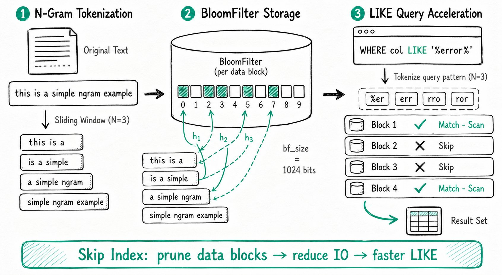

---
{
    "title": "NGram BloomFilter インデックス",
    "language": "ja",
    "description": "NGram BloomFilter インデックスは N-Gram トークン化と BloomFilter に基づいています。文字列カラムに対する LIKE あいまい検索で、一致しないデータブロックをスキップして IO を削減し、クエリ性能を大幅に向上させます。"
}
---

<!-- Knowledge type: Feature description + Operation steps -->
<!-- Applicable scenario: Acceleration of LIKE fuzzy queries on string columns -->

NGram BloomFilter インデックスは、文字列カラムに対する `LIKE '%pattern%'` あいまい検索を高速化するために設計された **Skip Index** です。BloomFilter インデックスを基盤に N-Gram トークン化を導入し、テキストを隣接する文字からなる複数の語群に分割してから BloomFilter に書き込むことで、あいまい一致を高速にフィルタリングできます。

**主な利点：** 適した条件では、インデックスを使わない全件スキャンと比べて、クエリを数倍から十倍高速化できます（[使用例](#usage-example)の 8 倍高速化した事例を参照）。

## インデックスの仕組み {#index-principle}



N-Gram トークン化では、文やテキストを隣接する文字からなる複数の語群に分割します。たとえば、文字列 `'This is a simple ngram example'` を `N = 3` でトークン化すると、次の 4 つの語群が得られます。

-   `'This is a'`
-   `'is a simple'`
-   `'a simple ngram'`
-   `'simple ngram example'`

NGram BloomFilter インデックスと通常の BloomFilter インデックスの主な違いは次のとおりです。

| 比較項目 | BloomFilter インデックス | NGram BloomFilter インデックス |
| -------- | ------------------------ | ------------------------------ |
| 書き込む内容 | カラムの元の値 | 元のテキストを N-Gram トークン化して得られる各語群 |
| 高速化するクエリの種類 | 等価クエリ（`=`、`IN`） | `LIKE '%pattern%'` あいまい検索 |
| 対応するカラムの型 | 複数のデータ型 | 文字列カラムのみ |

**クエリ高速化の流れ：**

1. `LIKE '%pattern%'` 内の `pattern` を N-Gram トークン化します。
2. 得られた各語群が BloomFilter に存在するかを順に確認します。
3. 語群が BloomFilter に存在しなければ、対応するデータブロックは LIKE 条件を満たさないため、スキップできます。
4. 一致しないデータブロックをスキップすることで IO を削減し、クエリを高速化します。

## 使用場面 {#use-cases}

NGram BloomFilter インデックスは、次の場面に適しています。

-   文字列カラムに対する `LIKE '%pattern%'` あいまい検索の高速化。
-   `LIKE` パターン内で連続する文字の数が、インデックスに定義された `gram_size` **以上**である場合。

:::tip 使用上の制約

-   対応するのは文字列カラムのみで、高速化できるのは `LIKE` クエリのみです。
-   NGram BloomFilter インデックスと通常の BloomFilter インデックスは**併用できません**。同じカラムにはどちらか一方だけを選択できます。
-   インデックスの効果を分析する方法は、BloomFilter インデックスと同じです。

:::

## インデックスの管理 {#manage-indexes}

### インデックスの作成 {#create-an-index}

#### テーブル作成時に作成する {#create-at-table-creation}

テーブル作成文の `COLUMN` 定義の後に、インデックス定義を追加します。

```sql
INDEX `idx_column_name` (`column_name`) USING NGRAM_BF
PROPERTIES("gram_size"="3", "bf_size"="1024")
COMMENT 'username ngram_bf index'
```

#### 構文の説明 {#syntax-description}

| パラメータ | 必須 | 説明 |
| ---------- | ---- | ---- |
| `idx_column_name` (`column_name`) | 必須 | `column_name` はインデックスを作成するカラム名で、前に定義されている必要があります。`idx_column_name` はインデックス名で、テーブル内で一意である必要があります。 |
| `USING NGRAM_BF` | 必須 | インデックスの種類を NGram BloomFilter インデックスに指定します。 |
| `PROPERTIES` | 任意 | NGram BloomFilter インデックスの追加プロパティを指定します。詳細は次の表を参照してください。 |
| `COMMENT` | 任意 | インデックスのコメントを指定します。 |

:::info 命名に関する推奨事項
インデックス名には `idx_` を接頭辞として付けることを推奨します。例：`idx_review_body`。
:::

#### PROPERTIES のパラメータ {#properties-parameters}

| プロパティ | 説明 |
| ---------- | ---- |
| `gram_size` | N-Gram の N に相当し、連続する N 文字ごとに一つの語群を形成するよう指定します。たとえば、`'This is a simple ngram example'` は `N = 3` のとき 4 つの語群に分割されます。LIKE クエリ文字列の最小長に設定することを推奨しますが、2 未満にはしないでください。 |
| `bf_size` | BloomFilter のサイズをビット単位で指定します。各データブロックのインデックスサイズを決定します。値を大きくするとストレージ使用量は増えますが、ハッシュ衝突の確率は下がります。 |

**推奨設定：** 通常は `"gram_size"="3"` と `"bf_size"="1024"` から始め、Query Profile に基づいて調整することを推奨します。

### インデックスの表示 {#view-indexes}

```sql
-- Method 1: In the INDEX section of the table schema, USING NGRAM_BF marks an NGram BloomFilter index
SHOW CREATE TABLE table_name;

-- Method 2: An IndexType of NGRAM_BF marks an NGram BloomFilter index
SHOW INDEX FROM table_name;
```

### インデックスの削除 {#drop-an-index}

```sql
ALTER TABLE table_ngrambf DROP INDEX idx_ngrambf;
```

### インデックスの変更 {#modify-an-index}

NGram BloomFilter インデックスは、次の二つの方法で既存のテーブルに追加できます。

```sql
-- Method 1: Use CREATE INDEX
CREATE INDEX idx_column_name2(column_name2) ON table_ngrambf
USING NGRAM_BF
PROPERTIES("gram_size"="3", "bf_size"="1024")
COMMENT 'username ngram_bf index';

-- Method 2: Use ALTER TABLE ADD INDEX
ALTER TABLE table_ngrambf
ADD INDEX idx_column_name2(column_name2) USING NGRAM_BF
PROPERTIES("gram_size"="3", "bf_size"="1024")
COMMENT 'username ngram_bf index';
```

## インデックスの使用 {#use-the-index}

### 関数プッシュダウンの有効化 {#enable-function-pushdown}

NGram BloomFilter インデックスを使用する前に、関数プッシュダウンを有効にします（`enable_function_pushdown` のデフォルト値は `false` です）。

```sql
SET enable_function_pushdown = true;
```

### インデックスによる高速化 {#trigger-index-acceleration}

NGram BloomFilter インデックスは、たとえば次の `LIKE` クエリを自動的に高速化します。

```sql
SELECT count() FROM table1 WHERE message LIKE '%error%';
```

### インデックスの効果の分析 {#index-effectiveness-analysis}

BloomFilter インデックス（NGram BloomFilter を含む）の高速化効果は、Query Profile の次の指標で分析できます。

| 指標 | 意味 |
| ---- | ---- |
| `RowsBloomFilterFiltered` | BloomFilter インデックスによって除外された行数です。他の Rows 指標と比較して、フィルタリングの効果を分析できます。 |
| `BlockConditionsFilteredBloomFilterTime` | BloomFilter インデックスに要した時間です。 |

## 使用例 {#usage-example}

Amazon の商品レビューのデータセット `amazon_reviews` を例に、NGram BloomFilter インデックスの使い方と高速化の効果を示します。

### ステップ 1：テーブルを作成する {#step-1-create-the-table}

```sql
CREATE TABLE `amazon_reviews` (
    `review_date` int(11) NULL,
    `marketplace` varchar(20) NULL,
    `customer_id` bigint(20) NULL,
    `review_id` varchar(40) NULL,
    `product_id` varchar(10) NULL,
    `product_parent` bigint(20) NULL,
    `product_title` varchar(500) NULL,
    `product_category` varchar(50) NULL,
    `star_rating` smallint(6) NULL,
    `helpful_votes` int(11) NULL,
    `total_votes` int(11) NULL,
    `vine` boolean NULL,
    `verified_purchase` boolean NULL,
    `review_headline` varchar(500) NULL,
    `review_body` string NULL
) ENGINE=OLAP
DUPLICATE KEY(`review_date`)
COMMENT 'OLAP'
DISTRIBUTED BY HASH(`review_date`) BUCKETS 16
PROPERTIES (
    "replication_allocation" = "tag.location.default: 1",
    "compression" = "ZSTD"
);
```

### ステップ 2：データをロードする {#step-2-load-data}

**1. データセットをダウンロードする**

`wget` などのツールを使用し、次の URL からデータセットをダウンロードします。

```
https://datasets-documentation.s3.eu-west-3.amazonaws.com/amazon_reviews/amazon_reviews_2010.snappy.parquet
https://datasets-documentation.s3.eu-west-3.amazonaws.com/amazon_reviews/amazon_reviews_2011.snappy.parquet
https://datasets-documentation.s3.eu-west-3.amazonaws.com/amazon_reviews/amazon_reviews_2012.snappy.parquet
https://datasets-documentation.s3.eu-west-3.amazonaws.com/amazon_reviews/amazon_reviews_2013.snappy.parquet
https://datasets-documentation.s3.eu-west-3.amazonaws.com/amazon_reviews/amazon_reviews_2014.snappy.parquet
https://datasets-documentation.s3.eu-west-3.amazonaws.com/amazon_reviews/amazon_reviews_2015.snappy.parquet
```

**2. Stream Load でデータをロードする**

```bash
curl --location-trusted -u root: -T amazon_reviews_2010.snappy.parquet -H "format:parquet" http://127.0.0.1:8030/api/${DB}/amazon_reviews/_stream_load
curl --location-trusted -u root: -T amazon_reviews_2011.snappy.parquet -H "format:parquet" http://127.0.0.1:8030/api/${DB}/amazon_reviews/_stream_load
curl --location-trusted -u root: -T amazon_reviews_2012.snappy.parquet -H "format:parquet" http://127.0.0.1:8030/api/${DB}/amazon_reviews/_stream_load
curl --location-trusted -u root: -T amazon_reviews_2013.snappy.parquet -H "format:parquet" http://127.0.0.1:8030/api/${DB}/amazon_reviews/_stream_load
curl --location-trusted -u root: -T amazon_reviews_2014.snappy.parquet -H "format:parquet" http://127.0.0.1:8030/api/${DB}/amazon_reviews/_stream_load
curl --location-trusted -u root: -T amazon_reviews_2015.snappy.parquet -H "format:parquet" http://127.0.0.1:8030/api/${DB}/amazon_reviews/_stream_load
```

:::info ファイルサイズの上限
上記のファイルは 10 GB を超える場合があります。Stream Load のファイルアップロードサイズの上限を超えないよう、`streaming_load_max_mb` を `be.conf` で調整してください。次のコマンドを使うと設定を動的に変更できます（すべての BE で実行してください）。

```bash
curl -X POST http://{be_ip}:{be_http_port}/api/update_config?streaming_load_max_mb=32768
```

:::

**3. データロードを確認する**

SQL で `count()` を実行し、データロードが成功したことを確認します。

```sql
mysql> SELECT COUNT() FROM amazon_reviews;
+-----------+
| count(*)  |
+-----------+
| 135589433 |
+-----------+
```

### ステップ 3：性能を比較する {#step-3-performance-comparison}

**シナリオ 1：インデックスなしのクエリ（所要時間 7.60s）**

```sql
SELECT
    product_id,
    any_value(product_title),
    AVG(star_rating) AS rating,
    COUNT() AS count
FROM
    amazon_reviews
WHERE
    review_body LIKE '%is super awesome%'
GROUP BY
    product_id
ORDER BY
    count DESC,
    rating DESC,
    product_id
LIMIT 5;
```

クエリ結果：

```
+------------+------------------------------------------+--------------------+-------+
| product_id | any_value(product_title)                 | rating             | count |
+------------+------------------------------------------+--------------------+-------+
| B00992CF6W | Minecraft                                | 4.8235294117647056 |    17 |
| B009UX2YAC | Subway Surfers                           | 4.7777777777777777 |     9 |
| B00DJFIMW6 | Minion Rush: Despicable Me Official Game |              4.875 |     8 |
| B0086700CM | Temple Run                               |                  5 |     6 |
| B00KWVZ750 | Angry Birds Epic RPG                     |                  5 |     6 |
+------------+------------------------------------------+--------------------+-------+
5 rows in set (7.60 sec)
```

**シナリオ 2：NGram BloomFilter インデックスの追加後（所要時間 0.93s）**

インデックスを追加します。

```sql
ALTER TABLE amazon_reviews
ADD INDEX review_body_ngram_idx(review_body) USING NGRAM_BF
PROPERTIES("gram_size"="10", "bf_size"="10240");
```

同じクエリを再度実行します。

```
+------------+------------------------------------------+--------------------+-------+
| product_id | any_value(product_title)                 | rating             | count |
+------------+------------------------------------------+--------------------+-------+
| B00992CF6W | Minecraft                                | 4.8235294117647056 |    17 |
| B009UX2YAC | Subway Surfers                           | 4.7777777777777777 |     9 |
| B00DJFIMW6 | Minion Rush: Despicable Me Official Game |              4.875 |     8 |
| B0086700CM | Temple Run                               |                  5 |     6 |
| B00KWVZ750 | Angry Birds Epic RPG                     |                  5 |     6 |
+------------+------------------------------------------+--------------------+-------+
5 rows in set (0.93 sec)
```

**性能比較：**

| シナリオ | 時間 | 性能向上 |
| -------- | ---- | -------- |
| インデックスなし | 7.60 s | 基準 |
| NGram BloomFilter インデックスを追加 | 0.93 s | **約 8 倍** |

## エスケープを含む LIKE パターンに対するインデックスの制限 {#index-limitations-for-escaped-like-patterns}

4.1.5 以降、カスタム `ESCAPE` を指定した LIKE クエリや、パターンにバックスラッシュを含む LIKE クエリでは、誤ったフィルタリングを避けるため、データの枝刈りに NGRAM Bloom Filter を使用しません。これらのクエリは通常のスキャンで引き続き実行できます。エスケープを含まない LIKE パターンでは、従来の条件を満たせば引き続きインデックスを使用できます。
