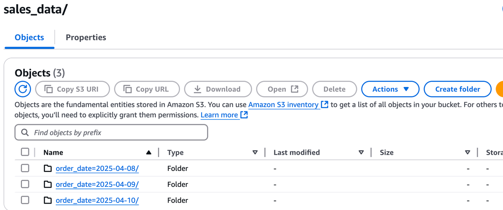
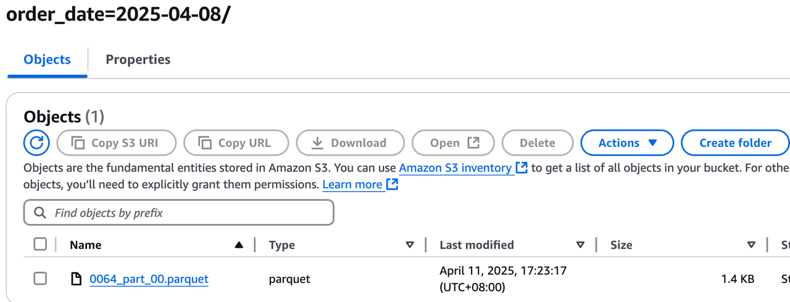

---
{
    "title": "Redshift",
    "language": "ko",
    "description": "Redshift UNLOAD로 데이터를 S3에 내보낸 뒤 S3 Load로 Doris에 적재하는 마이그레이션 방법입니다. 테이블 생성, 데이터 타입 매핑, 오류 처리, 배치 적재를 다룹니다.",
    "keywords": [
        "Redshift에서 Doris로 마이그레이션",
        "Redshift UNLOAD",
        "S3 Load",
        "Redshift 데이터 타입 매핑",
        "Doris 데이터 적재",
        "Parquet 적재",
        "ETL_QUALITY_UNSATISFIED"
    ]
}
---

<!-- Knowledge type: Procedure -->
<!-- Applicable scenario: Data migration / Redshift to Doris -->

Redshift에서 Apache Doris로 데이터를 마이그레이션할 때는 일반적으로 Amazon S3 같은 객체 스토리지를 중간 저장소로 사용합니다. 전체 마이그레이션 과정은 다음과 같습니다.

1. 원본 테이블 스키마를 바탕으로 Doris에 대상 테이블을 생성합니다.
2. Redshift [UNLOAD](https://docs.aws.amazon.com/redshift/latest/dg/r_UNLOAD.html) 문으로 데이터를 객체 스토리지에 내보냅니다.
3. Doris의 S3 Load 기능으로 객체 스토리지에서 데이터를 읽어 Doris에 적재합니다. 자세한 내용은 [S3 Load](./amazon-s3.md)를 참조하세요.

## 주의 사항 {#notes}

마이그레이이션을 수행하기 전에 다음 사항을 확인하세요.

- **모델링 및 파티션 전략**: Redshift 원본 테이블 스키마에 맞는 Doris [데이터 모델](../../../table-design/data-model/intro.mdx)을 선택하고 [파티션](../../../table-design/data-partitioning/dynamic-partitioning.md) 및 [버킷](../../../table-design/data-partitioning/data-bucketing.md) 전략을 정의합니다. 테이블 설계에 관한 추가 권장 사항은 [데이터 적재 모범 사례](../load-best-practices/load-best-practices.md)를 참조하세요.
- **타입 변환**: Redshift의 `TIME` 타입을 내보낼 때는 먼저 `CAST`로 `VARCHAR`로 변환해야 합니다.
- **복합 타입 제한**: 복합 타입(Struct/Array/Map)이 포함된 Parquet/ORC 파일은 현재 [TVF Load](./amazon-s3.md#method-2-load-with-tvf-synchronous)로 적재해야 합니다.

## 데이터 타입 매핑 {#data-type-mapping}

<!-- Knowledge type: Configuration -->

마이그레이션 전에 다음 표에 따라 Redshift 데이터 타입을 Doris 데이터 타입에 매핑하세요.

|     Redshift     |     Doris      |              비고              |
| ---------------- | -------------- | ------------------------------- |
| SMALLINT         | SMALLINT       |                                 |
| INTEGER          | INT            |                                 |
| BIGINT           | BIGINT         |                                 |
| DECIMAL          | DECIMAL        |                                 |
| REAL             | FLOAT          |                                 |
| DOUBLE PRECISION | DOUBLE         |                                 |
| BOOLEAN          | BOOLEAN        |                                 |
| CHAR             | CHAR           |                                 |
| VARCHAR          | VARCHAR/STRING | VARCHAR의 최대 길이는 65533     |
| DATE             | DATE           |                                 |
| TIMESTAMP        | DATETIME       |                                 |
| TIME/TIMETZ      | STRING         |                                 |
| SUPER            | VARIANT        |                                 |
| OTHER            | UNSUPPORTED    |                                 |

## 마이그레이션 단계 {#migration-steps}

### 1. Doris 테이블 생성 {#1-create-the-doris-table}

<!-- Knowledge type: Procedure -->

마이그레이션 전에 Doris에 해당 대상 테이블을 생성합니다.

**목표**: Redshift 원본 테이블 스키마를 바탕으로 Doris 데이터 모델과 파티션 및 버킷 전략을 계획합니다.

**Redshift 원본 테이블 예시**:

```SQL
CREATE TABLE sales_data (
    order_id      INTEGER,
    customer_name VARCHAR(128),
    order_date    DATE,
    amount        DECIMAL(10,2),
    country       VARCHAR(48)
)
DISTSTYLE AUTO;

INSERT INTO sales_data VALUES
(1, 'Alice', '2025-04-08', 99.99, 'USA'),
(2, 'Bob', '2025-04-08', 149.50, 'Canada'),
(3, 'Charlie', '2025-04-09', 75.00, 'UK'),
(4, 'Diana', '2025-04-10', 200.00, 'Australia');
```

**Doris 대상 테이블 예시**: 위 스키마를 바탕으로 `order_date`를 파티션 컬럼으로 사용하고 일 단위로 파티션을 나누는 Unique Key 파티션 테이블을 생성합니다.

```sql
CREATE TABLE `sales_data` (
  order_id      INT,
  order_date    DATE NOT NULL,
  customer_name VARCHAR(128),
  amount        DECIMAL(10,2),
  country       VARCHAR(48)
) ENGINE=OLAP
UNIQUE KEY(`order_id`,`order_date`)
PARTITION BY RANGE(`order_date`) (
PARTITION p20250408 VALUES [('2025-04-08'), ('2025-04-09')),
PARTITION p20250409 VALUES [('2025-04-09'), ('2025-04-10')),
PARTITION p20250410 VALUES [('2025-04-10'), ('2025-04-11'))
)
DISTRIBUTED BY HASH(`order_id`) BUCKETS 16
PROPERTIES (
 "dynamic_partition.enable" = "true",
 "dynamic_partition.time_unit" = "DAY",
 "dynamic_partition.end" = "5",
 "dynamic_partition.prefix" = "p",
 "dynamic_partition.buckets" = "16",
 "replication_num" = "1"
);
```

### 2. Redshift에서 S3로 데이터 내보내기 {#2-export-data-from-redshift-to-s3}

<!-- Knowledge type: Procedure -->

#### 2.1 UNLOAD로 Parquet 형식으로 내보내기 {#21-use-unload-to-export-as-parquet}

**목표**: 나중에 파티션별로 적재할 수 있도록 Doris 파티션 컬럼을 기준으로 Redshift 데이터를 나누어 Parquet 파일로 내보냅니다.

**명령**:

```sql
unload ('select * from sales_data')
to 's3://mybucket/redshift/sales_data/'
iam_role 'arn:aws:iam::0123456789012:role/MyRedshiftRole'
PARQUET
PARTITION BY (order_date) INCLUDE
```

**참고**: 파티션별 배치 적재가 가능하도록 Doris에서 사용하는 파티션 컬럼과 동일한 컬럼을 기준으로 내보내는 것이 좋습니다.

#### 2.2 S3에 내보낸 파일 확인 {#22-verify-the-exported-files-on-s3}

내보내기가 완료되면 S3에 파티션별 하위 디렉터리가 생성되며, 각 디렉터리에는 해당 파티션의 데이터가 들어 있습니다.





### 3. Doris에 데이터 적재 {#3-load-data-into-doris}

<!-- Knowledge type: Procedure -->

데이터 적재에는 **S3 Load**를 사용합니다. 작업을 제출하면 Doris가 데이터 소스에서 데이터를 직접 가져오는 비동기 데이터 적재 방식입니다. 데이터 소스로는 [AWS S3](./amazon-s3.md), [GCS](./google-cloud-storage.md), [AZURE](./azure-storage.md)를 비롯한 S3 호환 객체 스토리지를 사용할 수 있습니다.

적용 시나리오 비교:

| 시나리오                                          | 권장 방법                              |
| ------------------------------------------------- | ----------------------------------------------- |
| 데이터 양이 많고 비동기 처리가 가능한 경우       | S3 Load                                         |
| 동기식 데이터 적재가 필요한 경우                 | [TVF Load](./amazon-s3.md#method-2-load-with-tvf-synchronous)        |
| 파일에 복합 타입(Struct/Array/Map)이 포함된 경우 | [TVF Load](./amazon-s3.md#method-2-load-with-tvf-synchronous)를 사용해야 함 |

#### 3.1 단일 파티션 적재 {#31-load-a-single-partition}

```sql
LOAD LABEL sales_data_2025_04_08
(
    DATA INFILE("s3://mybucket/redshift/sales_data/order_date=2025-04-08/*")
    INTO TABLE sales_data
    FORMAT AS "parquet"
    (order_id, order_date, customer_name, amount, country)
)
WITH S3
(
    "provider" = "S3",
    "s3.endpoint" = "https://s3.ap-southeast-1.amazonaws.com",
    "s3.access_key" = "<ak>",
    "s3.secret_key"="<sk>",
    "s3.region" = "ap-southeast-1"
);
```

#### 3.2 SHOW LOAD로 작업 상태 확인 {#32-check-job-status-with-show-load}

S3 Load 작업은 비동기적으로 제출되므로, 작업 레이블을 지정해 `SHOW LOAD`로 적재 진행 상황을 확인할 수 있습니다.

```yaml
mysql> show load where label = "sales_data_2025_04_08"\G
*************************** 1. row ***************************
         JobId: 17956078
         Label: sales_data_2025_04_08
         State: FINISHED
      Progress: 100.00% (1/1)
          Type: BROKER
       EtlInfo: unselected.rows=0; dpp.abnorm.ALL=0; dpp.norm.ALL=2
      TaskInfo: cluster:s3.ap-southeast-1.amazonaws.com; timeout(s):3600; max_filter_ratio:0.0; priority:NORMAL
      ErrorMsg: NULL
    CreateTime: 2025-04-10 17:50:53
  EtlStartTime: 2025-04-10 17:50:54
 EtlFinishTime: 2025-04-10 17:50:54
 LoadStartTime: 2025-04-10 17:50:54
LoadFinishTime: 2025-04-10 17:50:54
           URL: NULL
    JobDetails: {"Unfinished backends":{"5eec1be8612d4872-91040ff1e7208a4f":[]},"ScannedRows":2,"TaskNumber":1,"LoadBytes":91,"All backends":{"5eec1be8612d4872-91040ff1e7208a4f":[10022]},"FileNumber":1,"FileSize":1620}
 TransactionId: 766228
  ErrorTablets: {}
          User: root
       Comment:
1 row in set (0.00 sec)
```

#### 3.3 적재 중 발생한 오류 처리 {#33-handle-errors-during-the-load}

<!-- Knowledge type: Troubleshooting -->
<!-- Applicable scenario: Troubleshooting / Data quality errors -->

**1단계**: 실패한 적재 작업을 조회합니다. 배치 적재에 여러 작업이 포함된 경우 다음 문으로 실패한 작업의 레이블과 원인을 확인할 수 있습니다.

```SQL
mysql> show load where state='CANCELLED' and label like "label_test%"\G
*************************** 1. row ***************************
         JobId: 18312384
         Label: label_test123
         State: CANCELLED
      Progress: 100.00% (3/3)
          Type: BROKER
       EtlInfo: unselected.rows=0; dpp.abnorm.ALL=4; dpp.norm.ALL=0
      TaskInfo: cluster:s3.ap-southeast-1.amazonaws.com; timeout(s):14400; max_filter_ratio:0.0; priority:NORMAL
      ErrorMsg: type:ETL_QUALITY_UNSATISFIED; msg:quality not good enough to cancel
    CreateTime: 2025-04-15 17:32:59
  EtlStartTime: 2025-04-15 17:33:02
 EtlFinishTime: 2025-04-15 17:33:02
 LoadStartTime: 2025-04-15 17:33:02
LoadFinishTime: 2025-04-15 17:33:02
           URL: http://10.16.10.6:28747/api/_load_error_log?file=__shard_2/error_log_insert_stmt_7602ccd7c3a4854-95307efca7bfe342_7602ccd7c3a4854_95307efca7bfe342
    JobDetails: {"Unfinished backends":{"7602ccd7c3a4854-95307efca7bfe341":[]},"ScannedRows":4,"TaskNumber":1,"LoadBytes":188,"All backends":{"7602ccd7c3a4854-95307efca7bfe341":[10022]},"FileNumber":3,"FileSize":4839}
 TransactionId: 769213
  ErrorTablets: {}
          User: root
       Comment:
```

**2단계**: 오류 유형을 파악합니다. 위 예시는 **데이터 품질 오류**(`ETL_QUALITY_UNSATISFIED`)입니다. 출력 결과의 `URL`을 열어 자세한 오류를 확인하세요. 예를 들어 다음 오류는 데이터 길이가 스키마에 정의된 `country` 컬럼의 실제 길이를 초과했음을 나타냅니다.

```python
[root@VM-10-6-centos ~]$ curl "http://10.16.10.6:28747/api/_load_error_log?file=__shard_2/error_log_insert_stmt_7602ccd7c3a4854-95307efca7bfe342_7602ccd7c3a4854_95307efca7bfe342"
Reason: column_name[country], the length of input is too long than schema. first 32 bytes of input str: [USA] schema length: 1; actual length: 3; . src line [];
Reason: column_name[country], the length of input is too long than schema. first 32 bytes of input str: [Canada] schema length: 1; actual length: 6; . src line [];
Reason: column_name[country], the length of input is too long than schema. first 32 bytes of input str: [UK] schema length: 1; actual length: 2; . src line [];
Reason: column_name[country], the length of input is too long than schema. first 32 bytes of input str: [Australia] schema length: 1; actual length: 9; . src line [];
```

**3단계**: 오류 허용 비율을 설정합니다(선택 사항). 일부 오류 행을 건너뛰어도 된다면 S3 Load의 `PROPERTIES`에서 오류 허용 비율을 설정하세요. 자세한 내용은 [데이터 적재 구성 매개변수](../../import/import-way/broker-load-manual.md#import-configuration-parameters)를 참조하세요.

#### 3.4 여러 파티션을 배치로 적재 {#34-load-multiple-partitions-in-batches}

대량의 과거 데이터를 마이그레이션할 때는 다음 지침에 따라 배치로 적재하세요.

- 각 배치는 Doris 파티션 하나 또는 소수의 파티션에 해당하도록 구성합니다.
- 시스템 부하와 적재 실패 후 재시도 비용을 줄이기 위해 단일 배치의 크기가 **100 GB**를 초과하지 않도록 합니다.
- [s3_load_demo.sh](https://github.com/apache/doris/blob/master/samples/load/shell/s3_load_demo.sh) 스크립트를 참고할 수 있습니다. 이 스크립트는 S3의 파티션 디렉터리를 순회하면서 배치 적재를 위한 S3 Load 작업을 Doris에 자동으로 제출합니다.

## 자주 묻는 질문 {#faq}

<!-- Knowledge type: FAQ -->

**Q1: Redshift의 TIME 타입을 Doris에 직접 적재할 수 없는 이유는 무엇인가요?**

Doris는 `TIME` 타입을 지원하지 않습니다. Redshift에서 `TIME/TIMEZ` 타입을 내보낼 때는 먼저 `CAST`로 `VARCHAR`로 변환하고, Doris에서는 `STRING`으로 저장해야 합니다.

**Q2: Struct/Array/Map 같은 복합 타입이 포함된 Parquet/ORC 파일에 S3 Load를 사용할 수 있나요?**

아니요. 현재 복합 타입이 포함된 파일은 [TVF Load](./amazon-s3.md#method-2-load-with-tvf-synchronous)로 적재해야 합니다.

**Q3: S3 Load는 동기식인가요, 비동기식인가요? 결과는 어떻게 조회하나요?**

S3 Load는 **비동기식** 데이터 적재 방식입니다. 작업을 제출한 후 `SHOW LOAD WHERE label = "<your_label>"`을 실행해 진행 상황과 결과를 확인하세요.

**Q4: `ETL_QUALITY_UNSATISFIED` 오류는 어떻게 처리하나요?**

이 오류는 데이터 품질이 요구 사항을 충족하지 못했음을 나타냅니다. 다음 순서로 처리하세요.

1. `SHOW LOAD` 출력 결과의 `URL`을 열어 자세한 오류 로그를 확인합니다.
2. 오류 로그에 따라 Doris 테이블 스키마 또는 원본 데이터를 조정합니다. 예를 들어 필드 길이 초과나 타입 불일치를 수정합니다.
3. 일부 오류 행을 허용할 수 있다면 S3 Load의 `PROPERTIES`에서 `max_filter_ratio` 오류 허용 비율을 조정합니다.

**Q5: 대량의 데이터를 마이그레이션할 때 한 번에 적재하다 실패하는 일을 어떻게 방지하나요?**

Doris 파티션별로 데이터를 배치로 적재하고, 각 배치의 크기를 100 GB 미만으로 유지하는 것이 좋습니다. [s3_load_demo.sh](https://github.com/apache/doris/blob/master/samples/load/shell/s3_load_demo.sh) 스크립트로 배치 제출을 자동화할 수 있습니다.
