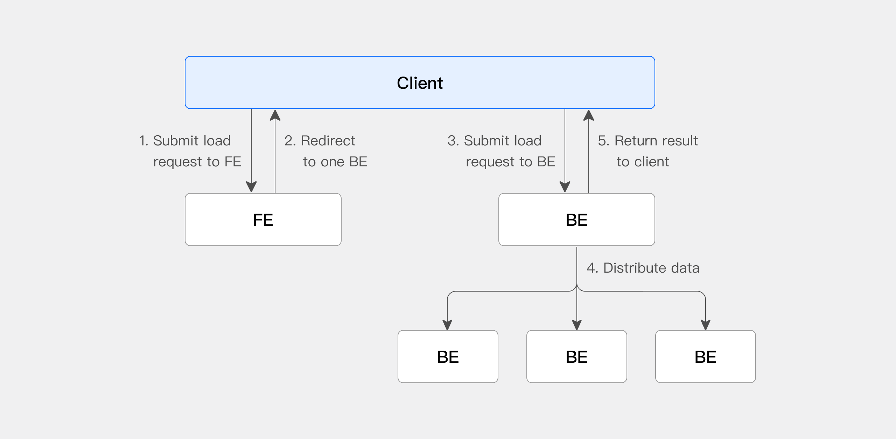

---
{
    "title": "Stream Load",
    "language": "ko",
    "description": "Stream Load는 HTTP를 통해 로컬 파일이나 데이터 스트림을 Doris에 동기적으로 적재하며, CSV/JSON/Parquet/ORC 형식을 지원하고 원자성을 보장합니다.",
    "keywords": [
        "Stream Load",
        "Doris 데이터 적재",
        "HTTP 데이터 적재",
        "CSV 데이터 적재",
        "JSON 데이터 적재",
        "동기식 데이터 적재",
        "Doris Streamloader",
        "curl 데이터 적재",
        "원자적 데이터 적재"
    ]
}
---

<!-- Knowledge type: Operation guide + Configuration parameter reference -->
<!-- Applicable scenario: Data import / Local file import / Streaming data write -->

Stream Load는 HTTP를 통해 로컬 파일이나 데이터 스트림을 Doris에 적재합니다. Stream Load는 동기식 데이터 적재 방식으로, 실행 후 적재 결과를 반환하므로 응답을 통해 적재 성공 여부를 확인할 수 있습니다. 일반적으로 10 GB보다 작은 파일을 Stream Load로 적재할 수 있습니다. 더 큰 파일은 먼저 분할한 다음 각 부분을 Stream Load로 적재하세요. Stream Load는 한 배치의 적재 작업에 원자성을 보장합니다. 모든 행이 성공적으로 적재되거나 아무 행도 적재되지 않습니다.

:::tip

`curl`을 직접 사용하는 단일 동시 실행 적재보다 전용 적재 도구인 Doris Streamloader를 사용하는 것이 좋습니다. Doris Streamloader는 Doris에 데이터를 적재하는 전용 클라이언트 도구로, **다중 동시 실행 적재**를 지원하여 대량 데이터 적재에 필요한 시간을 줄입니다. 사용법과 실제 활용 방법은 [Doris Streamloader 문서](../../../connection-integration/data-integration/doris-streamloader)를 참조하세요.

:::

## 사용 사례 {#use-cases}

Stream Load는 다음과 같은 경우에 적합합니다.

- 로컬 또는 원격 CSV, JSON, Parquet, ORC 파일을 Doris에 적재하는 경우.
- 프로그램(Java, Go, Python 등)에서 HTTP 스트림을 통해 데이터를 지속적으로 쓰는 경우.
- 단일 적재 작업의 원자성, 즉 모든 행의 적재 성공 또는 전체 실패가 필요한 경우.
- 단일 파일의 크기가 일반적으로 10 GB보다 작은 경우. 더 큰 파일은 적재 전에 분할하거나 Doris Streamloader를 사용하세요.

CSV 파일을 적재할 때는 null 값과 빈 문자열을 명확히 구분해야 합니다.

- Null 값(null): `\N`으로 나타냅니다. 예를 들어 `a,\N,b`는 가운데 열이 null임을 뜻합니다.
- 빈 문자열: 두 구분자 사이에 문자가 없으면 해당 값은 빈 문자열입니다. 예를 들어 `a,,b`에서는 두 쉼표 사이에 문자가 없으므로 가운데 열이 빈 문자열입니다.

## 기본 원리 {#basic-principles}

<!-- Knowledge type: Architecture principles -->

Stream Load를 사용할 때 HTTP를 통해 FE 노드에 적재 작업을 요청합니다. FE는 부하 분산을 위해 요청을 라운드 로빈 방식으로 BE 노드에 리디렉션합니다. 특정 BE 노드에 HTTP 요청을 직접 보낼 수도 있습니다. Stream Load에서 Doris는 한 노드를 Coordinator로 지정합니다. Coordinator 노드는 데이터를 받아 다른 노드에 분산합니다.

다음 다이어그램은 Stream Load의 주요 흐름을 보여줍니다.



실행 흐름은 다음과 같습니다.

1. Client가 FE에 Stream Load 적재 작업을 요청합니다.
2. FE는 라운드 로빈 순서로 적재 작업을 스케줄링할 BE를 Coordinator 노드로 선택하고 Client에 HTTP 리디렉션을 반환합니다.
3. Client가 Coordinator BE 노드에 연결하여 적재 요청을 제출합니다.
4. Coordinator BE가 해당 BE 노드에 데이터를 분산합니다. 적재가 완료되면 Client에 적재 결과를 반환합니다.
5. Client가 BE 노드를 Coordinator로 직접 지정하여 적재 작업을 분산하게 할 수도 있습니다.

## 빠른 시작 {#quick-start}

<!-- Knowledge type: Operational steps -->

Stream Load는 HTTP를 통해 제출하고 전송합니다. 다음 예에서는 curl 도구로 Stream Load 적재 작업을 제출하는 방법을 보여줍니다.

### 사전 요구 사항 {#prerequisites}

Stream Load에는 대상 테이블에 대한 INSERT 권한이 필요합니다. 사용자에게 INSERT 권한이 없다면 [GRANT](../../../sql-manual/sql-statements/account-management/GRANT-TO) 명령으로 부여하세요.

### 적재 작업 생성 {#create-an-import-job}

#### CSV 데이터 적재 {#import-csv-data}

1. 적재 데이터 생성

    다음 내용으로 CSV 파일 `streamload_example.csv`를 만듭니다.

    ```sql
    1,Emily,25
    2,Benjamin,35
    3,Olivia,28
    4,Alexander,60
    5,Ava,17
    6,William,69
    7,Sophia,32
    8,James,64
    9,Emma,37
    10,Liam,64
    ```

2. 대상 Doris 테이블 생성

    다음 문으로 Doris에 데이터를 적재할 테이블을 만듭니다.

    ```sql
    CREATE TABLE testdb.test_streamload(
        user_id            BIGINT       NOT NULL COMMENT "user id",
        name               VARCHAR(20)           COMMENT "name",
        age                INT                   COMMENT "age"
    )
    DUPLICATE KEY(user_id)
    DISTRIBUTED BY HASH(user_id) BUCKETS 10;
    ```

3. 적재 작업 시작

    `curl` 명령으로 Stream Load 적재 작업을 제출할 수 있습니다.

    ```shell
    curl --location-trusted -u <doris_user>:<doris_password> \
        -H "Expect:100-continue" \
        -H "column_separator:," \
        -H "columns:user_id,name,age" \
        -T streamload_example.csv \
        -XPUT http://<fe_ip>:<fe_http_port>/api/testdb/test_streamload/_stream_load
    ```

    Stream Load는 동기식 데이터 적재 방식이며, 적재 결과가 사용자에게 직접 반환됩니다.

    ```sql
    {
        "TxnId": 3,
        "Label": "123",
        "Comment": "",
        "TwoPhaseCommit": "false",
        "Status": "Success",
        "Message": "OK",
        "NumberTotalRows": 10,
        "NumberLoadedRows": 10,
        "NumberFilteredRows": 0,
        "NumberUnselectedRows": 0,
        "LoadBytes": 118,
        "LoadTimeMs": 173,
        "BeginTxnTimeMs": 1,
        "StreamLoadPutTimeMs": 70,
        "ReadDataTimeMs": 2,
        "WriteDataTimeMs": 48,
        "CommitAndPublishTimeMs": 52
    }
    ```

4. 적재된 데이터 확인

    ```sql
    mysql> select count(*) from testdb.test_streamload;
    +----------+
    | count(*) |
    +----------+
    |       10 |
    +----------+
    ```

#### JSON 데이터 적재 {#import-json-data}

1. 적재 데이터 생성

    다음 내용으로 JSON 파일 `streamload_example.json`을 만듭니다.

    ```sql
    [
    {"userid":1,"username":"Emily","userage":25},
    {"userid":2,"username":"Benjamin","userage":35},
    {"userid":3,"username":"Olivia","userage":28},
    {"userid":4,"username":"Alexander","userage":60},
    {"userid":5,"username":"Ava","userage":17},
    {"userid":6,"username":"William","userage":69},
    {"userid":7,"username":"Sophia","userage":32},
    {"userid":8,"username":"James","userage":64},
    {"userid":9,"username":"Emma","userage":37},
    {"userid":10,"username":"Liam","userage":64}
    ]
    ```

2. 대상 Doris 테이블 생성

    다음 문으로 Doris에 데이터를 적재할 테이블을 만듭니다.

    ```sql
    CREATE TABLE testdb.test_streamload(
        user_id            BIGINT       NOT NULL COMMENT "user id",
        name               VARCHAR(20)           COMMENT "name",
        age                INT                   COMMENT "age"
    )
    DUPLICATE KEY(user_id)
    DISTRIBUTED BY HASH(user_id) BUCKETS 10;
    ```

3. 적재 작업 시작

    `curl` 명령으로 Stream Load 적재 작업을 제출할 수 있습니다.

    ```shell
    curl --location-trusted -u <doris_user>:<doris_password> \
        -H "label:124" \
        -H "Expect:100-continue" \
        -H "format:json" -H "strip_outer_array:true" \
        -H "jsonpaths:[\"$.userid\", \"$.username\", \"$.userage\"]" \
        -H "columns:user_id,name,age" \
        -T streamload_example.json \
        -XPUT http://<fe_ip>:<fe_http_port>/api/testdb/test_streamload/_stream_load
    ```

    :::info 참고

    JSON 파일의 내용이 JSON 배열이 아니라 각 줄에 JSON 객체 하나씩 있는 형식이라면 헤더 `-H "strip_outer_array:false"`와 `-H "read_json_by_line:true"`를 추가하세요.
    JSON 파일의 루트 노드에 있는 JSON 객체를 적재하려면 `jsonpaths`를 `$.`로 설정하세요. 예: `-H "jsonpaths:[\"$.\"]"`.

    :::

    Stream Load는 동기식 데이터 적재 방식이며, 적재 결과가 사용자에게 직접 반환됩니다.

    ```sql
    {
        "TxnId": 7,
        "Label": "125",
        "Comment": "",
        "TwoPhaseCommit": "false",
        "Status": "Success",
        "Message": "OK",
        "NumberTotalRows": 10,
        "NumberLoadedRows": 10,
        "NumberFilteredRows": 0,
        "NumberUnselectedRows": 0,
        "LoadBytes": 471,
        "LoadTimeMs": 52,
        "BeginTxnTimeMs": 0,
        "StreamLoadPutTimeMs": 11,
        "ReadDataTimeMs": 0,
        "WriteDataTimeMs": 23,
        "CommitAndPublishTimeMs": 16
    }
    ```

### 적재 작업 조회 {#view-import-jobs}

기본적으로 Stream Load는 Client에 결과를 동기적으로 반환하므로 시스템에 Stream Load 작업 기록이 남지 않습니다. 기록을 활성화하려면 `be.conf`에 `enable_stream_load_record=true`를 추가하세요. 자세한 내용은 [BE 구성](../../../admin-manual/config/be-config)을 참조하세요.

설정한 후에는 `show stream load` 명령으로 완료된 Stream Load 작업을 조회할 수 있습니다.

```sql
mysql> show stream load from testdb;
+-------+--------+-----------------+---------------+---------+---------+------+-----------+------------+--------------+----------------+-----------+-------------------------+-------------------------+------+---------+
| Label | Db     | Table           | ClientIp      | Status  | Message | Url  | TotalRows | LoadedRows | FilteredRows | UnselectedRows | LoadBytes | StartTime               | FinishTime              | User | Comment |
+-------+--------+-----------------+---------------+---------+---------+------+-----------+------------+--------------+----------------+-----------+-------------------------+-------------------------+------+---------+
| 12356 | testdb | test_streamload | 192.168.88.31 | Success | OK      | N/A  | 10        | 10         | 0            | 0              | 118       | 2023-11-29 08:53:00.594 | 2023-11-29 08:53:00.650 | root |         |
+-------+--------+-----------------+---------------+---------+---------+------+-----------+------------+--------------+----------------+-----------+-------------------------+-------------------------+------+---------+
1 row in set (0.00 sec)
```

### 적재 작업 취소 {#cancel-an-import-job}

사용자는 Stream Load를 수동으로 취소할 수 없습니다. 시간이 초과되거나 적재 오류가 발생하면 시스템이 Stream Load를 자동으로 취소합니다.

### Compute Group 바인딩 {#bind-a-compute-group}

Stream Load를 실행할 Compute Group을 지정할 수 있습니다.

**스토리지와 컴퓨팅 분리 모드**

스토리지와 컴퓨팅이 분리된 모드에서는 다음과 같이 Compute Group을 지정할 수 있습니다.

1. HTTP Header 매개변수로 지정합니다.

    ```text
    -H "cloud_cluster:cluster1"
    ```

    Doris 4.0.0부터는 `compute_group` 매개변수도 사용할 수 있습니다.

    ```text
    -H "compute_group:cluster1"
    ```

    `compute_group`과 `cloud_cluster`를 모두 설정하면 `compute_group`이 우선합니다.

2. Stream Load에 바인딩된 사용자 속성에서 Compute Group을 지정합니다. 사용자 속성과 HTTP Header에서 모두 Compute Group을 지정하면 Header에서 지정한 값이 우선합니다.

    ```text
    set property for user1 'default_compute_group'='cluster1';
    ```

3. 사용자 속성과 HTTP Header 어디에도 Compute Group을 지정하지 않으면 Stream Load에 바인딩된 사용자가 접근할 수 있는 Compute Group 중 하나를 선택합니다. 접근 가능한 Compute Group이 없으면 적재가 실패합니다.

:::info 버전 참고 (4.0.8 / 4.1.4)

Doris 4.0 계열의 4.0.8 이상과 Doris 4.1 계열의 4.1.4 이상에서는 컴퓨팅과 스토리지가 분리된 모드에서 Stream Load의 Compute Group 라우팅과 실행 계획이 일치하지 않던 문제가 수정되었습니다.

- `compute_group` 헤더가 `cloud_cluster`보다 우선합니다. 이전에는 FE가 `cloud_cluster`만 인식했습니다.
- 실행 계획을 만들 때 **실제로 요청을 수신한 BE가 속한 Compute Group**을 사용하므로, 계획이 실제 실행 위치와 다른 Compute Group에 배치되지 않습니다.
- 이 경로에서는 적재 계정이 대상 Compute Group에 접근할 수 있는지, Compute Group이 존재하는지, 상태가 유효한지도 검사합니다. 따라서 적재 계정에 실제로 요청을 처리하는 Compute Group에 대한 접근 권한이 없다면 업그레이드 후 적재가 권한 오류로 실패하며, 해당 계정에 적절한 권한을 부여해야 합니다.

:::

:::info 버전 참고 (4.1.4)

4.1.4부터 BE의 Stream Load 엔드포인트(`PUT /api/{db}/{table}/_stream_load`, `PUT /api/_http_stream`, `PUT /api/{db}/_stream_load_2pc`)는 전역 `LOAD` 권한을 사전 검사하지 않습니다. 실제 쓰기 대상 데이터베이스와 테이블을 기준으로 FE에서 일관되게 권한을 확인합니다.

이에 따라 전역 `LOAD` 권한 없이 데이터베이스 또는 테이블 수준의 `LOAD_PRIV`만 가진 계정도 Stream Load와 2PC commit / abort를 실행할 수 있습니다.

:::

**스토리지와 컴퓨팅 통합 모드**

스토리지와 컴퓨팅이 통합된 모드에서는 Stream Load에 바인딩된 사용자 속성으로만 Compute Group을 지정할 수 있습니다. 사용자 속성에 Compute Group을 지정하지 않으면 이름이 `default`인 Compute Group이 선택됩니다.

```text
set property for user1 'resource_tags.location'='group_1';
```

## 참고 자료 {#reference}

<!-- Knowledge type: Configuration parameter reference -->

### 적재 명령 {#import-command}

Stream Load 적재 구문은 다음과 같습니다.

```shell
curl --location-trusted -u <doris_user>:<doris_password> \
  -H "Expect:100-continue" [-H ""...] \
  -T <file_path> \
  -XPUT http://fe_host:http_port/api/{db}/{table}/_stream_load
```

Stream Load는 HTTP 청크 방식과 비청크 방식의 적재를 모두 지원합니다. 비청크 방식에서는 업로드할 콘텐츠의 길이를 나타내는 `Content-Length`를 지정해야 데이터 무결성을 보장할 수 있습니다.

### 적재 구성 매개변수 {#import-configuration-parameters}

#### FE 구성 {#fe-configuration}

**1. stream_load_default_timeout_second**

| 항목 | 설명 |
| --- | --- |
| 기본값 | 259200 (s) |
| 동적 구성 | 예 |
| FE Master 전용 구성 | 예 |

설명: Stream Load의 기본 제한 시간입니다. 적재 작업의 제한 시간이며 단위는 초입니다. 적재 작업이 설정된 `timeout` 안에 완료되지 않으면 시스템이 작업을 취소하고 상태가 CANCELLED가 됩니다. 지정된 시간 안에 소스 파일의 적재를 완료할 수 없다면 Stream Load 요청에 별도의 제한 시간을 설정하거나 FE 매개변수 `stream_load_default_timeout_second`를 조정하여 전역 기본 제한 시간을 설정할 수 있습니다.

#### BE 구성 {#be-configuration}

**1. streaming_load_max_mb**

| 항목 | 설명 |
| --- | --- |
| 기본값 | 102400 (MB) |
| 동적 구성 | 예 |

설명: Stream Load 요청 본문의 최대 크기입니다. 소스 코드의 기본값은 102400 MB(100 GB)이며, 실제 제한은 배포 환경의 BE 구성에 따라 달라집니다. `read_json_by_line=true`를 사용하지 않는 JSON 적재에는 `streaming_load_json_max_mb` 제한도 적용됩니다.

요청이 실제 제한을 초과하면 데이터를 더 작은 배치로 나누거나 관리자에게 구성 조정을 요청하세요.

관리형 클라우드 서비스에서는 서비스에서 제공하는 구성 방식을 사용하거나 관리자에게 문의하세요. BE 호스트에 직접 접근할 필요는 없습니다.

**버전 이력:**

- 3.x 계열에서는 Doris 3.0.2부터 `streaming_load_max_mb`의 기본값이 10240 MB(10 GB)에서 102400 MB(100 GB)로 증가했습니다. Doris 3.0.0과 3.0.1의 기본값은 10 GB입니다.
- 2.1 계열에서는 동일한 변경 사항이 2.1.7부터 적용되었습니다.
- Doris 4.x와 dev에서는 100 GB 기본값이 유지됩니다. 실제 적용 값은 배포 환경의 구성에 따라 달라집니다.

#### Header 매개변수 {#header-parameters}

HTTP Header를 통해 적재 매개변수를 전달할 수 있습니다. 각 매개변수는 다음과 같습니다.

| 태그 | 매개변수 설명 |
| --- | --- |
| label | 이번 적재의 레이블을 지정합니다. 동일한 레이블을 사용하는 데이터는 두 번 이상 적재할 수 없습니다. 레이블을 지정하지 않으면 Doris가 자동으로 생성합니다. 레이블을 지정하면 동일한 데이터의 중복 적재를 방지할 수 있습니다. Doris는 기본적으로 적재 작업 레이블을 3일 동안 보관하며, `label_keep_max_second`로 보관 기간을 조정할 수 있습니다. 예를 들어 이번 적재의 레이블을 `123`으로 지정하려면 `-H "label:123"` 명령을 사용합니다. 레이블을 사용하면 동일한 데이터가 중복 적재되는 것을 방지할 수 있습니다. 동일한 데이터 배치에는 같은 레이블을 사용하여 해당 배치의 중복 요청이 한 번만 수락되도록 하는 것이 좋습니다. 이렇게 하면 At-Most-Once 의미 체계를 보장할 수 있습니다. 레이블에 해당하는 적재 작업의 상태가 CANCELLED라면 그 레이블을 다시 사용할 수 있습니다. |
| column_separator | 적재 파일의 열 구분자를 지정합니다. 기본값은 `\t`입니다. 보이지 않는 문자에는 `\x`를 접두사로 사용하고 구분자를 16진수로 나타냅니다. 여러 문자를 조합하여 열 구분자로 사용할 수도 있습니다. 예를 들어 Hive 파일의 구분자 `\x01`을 지정하려면 `-H "column_separator:\x01"` 명령을 사용합니다. |
| line_delimiter | 적재 파일의 줄 구분자를 지정합니다. 기본값은 `\n`입니다. 여러 문자를 조합하여 줄 구분자로 사용할 수도 있습니다. 예를 들어 줄 구분자를 `\n`으로 지정하려면 `-H "line_delimiter:\n"` 명령을 사용합니다. |
| columns | 적재 파일의 열과 테이블 열 간의 매핑을 지정합니다. 소스 파일의 열이 테이블 열과 정확히 일치하면 이 필드를 지정하지 않아도 됩니다. 소스 파일이 테이블 스키마와 일치하지 않으면 데이터 변환을 위해 이 필드가 필요합니다. 열에는 적재 파일의 필드에 직접 대응하며 필드 이름을 그대로 사용하는 형태와, `column_name = expression` 구문으로 파생 열을 나타내는 형태가 있습니다. 자세한 예는 [적재 중 데이터 변환](../../../data-operate/import/load-data-convert)을 참조하세요. |
| where | 데이터의 일부를 추출할 때 사용합니다. 필요하지 않은 데이터를 제외하려면 이 옵션을 사용하세요. 예를 들어 k1 열이 20180601인 데이터만 적재하려면 `-H "where: k1 = 20180601"`을 지정합니다. |
| max_filter_ratio | 필터링을 허용할 수 있는 데이터의 최대 비율입니다. 형식이 잘못된 데이터 등이 이에 해당합니다. 기본적으로 오류를 허용하지 않으며, 값의 범위는 0부터 1까지입니다. 적재 오류 비율이 이 값을 초과하면 적재가 실패합니다. `where` 조건으로 필터링된 행은 형식이 잘못된 데이터로 계산하지 않습니다. 예를 들어 올바른 데이터를 최대한 적재하도록 오류를 100% 허용하려면 `-H "max_filter_ratio:1"`을 지정합니다. |
| partitions | 이번 적재에 사용할 파티션을 지정합니다. 데이터가 속할 파티션을 알 수 있다면 이 옵션을 지정하는 것이 좋습니다. 지정한 파티션에 속하지 않는 데이터는 필터링됩니다. 예를 들어 p1과 p2 파티션에 적재하려면 `-H "partitions: p1, p2"`를 지정합니다. |
| timeout | 적재 제한 시간을 초 단위로 지정합니다. 기본값은 600초이며, 유효 범위는 1초부터 259200초까지입니다. 예를 들어 제한 시간을 1200초로 설정하려면 `-H "timeout:1200"`을 지정합니다. |
| strict_mode | 이번 적재에 엄격 모드를 사용할지 지정합니다. 기본적으로 비활성화되어 있습니다. 예를 들어 엄격 모드를 활성화하려면 `-H "strict_mode:true"`를 지정합니다. |
| timezone | 이번 적재에 사용할 시간대를 지정합니다. 기본값은 클러스터의 현재 시간대입니다. 이 매개변수는 적재에 사용되는 모든 시간대 관련 함수의 결과에 영향을 줍니다. 예를 들어 적재 시간대를 Africa/Abidjan으로 설정하려면 `-H "timezone:Africa/Abidjan"`을 지정합니다. |
| exec_mem_limit | 적재 메모리 제한입니다. 기본값은 2 GB이며, 단위는 바이트입니다. |
| format | 이번 적재의 데이터 형식을 지정합니다. 기본값은 CSV입니다. 현재 지원하는 형식은 CSV, JSON, arrow, csv_with_names(CSV 파일의 첫 행을 제외할 수 있음), csv_with_names_and_types(CSV 파일의 첫 두 행을 제외할 수 있음), Parquet, ORC입니다. 예를 들어 적재 데이터 형식을 JSON으로 지정하려면 `-H "format:json"`을 사용합니다. |
| jsonpaths | JSON 데이터를 적재하는 방법에는 두 가지가 있습니다. `jsonpaths`를 지정하지 않을 때 사용하는 단순 모드에서는 JSON 데이터가 객체 유형이어야 합니다. JSON 데이터가 비교적 복잡하고 `jsonpaths` 매개변수로 해당 값을 매칭해야 할 때는 매칭 모드를 사용합니다. 단순 모드에서는 JSON의 키가 테이블의 열 이름과 일대일로 대응해야 합니다. 예를 들어 JSON 데이터 `{"k1":1, "k2":2, "k3":"hello"}`의 k1, k2, k3는 테이블 열에 각각 대응해야 합니다. |
| strip_outer_array | `strip_outer_array`를 true로 설정하면 JSON 데이터가 배열 객체로 시작하며 배열을 펼칩니다. 기본값은 false입니다. JSON 데이터의 최상위 계층이 `[]`로 표시되는 배열이면 `strip_outer_array`를 true로 설정하세요. 예를 들어 `[{"k1" : 1, "v1" : 2},{"k1" : 3, "v1" : 4}]` 데이터를 이 설정으로 Doris에 적재하면 두 행이 생성됩니다. |
| json_root | `json_root`는 JSON 문서의 루트 노드를 지정하는 유효한 `jsonpath` 문자열입니다. 기본값은 ""입니다. |
| merge_type | 데이터의 병합 유형입니다. 다음 세 가지를 지원합니다.<br/>- APPEND(기본값): 이 배치의 모든 데이터를 기존 데이터에 추가합니다.<br/>- DELETE: 이 배치와 키가 일치하는 모든 행을 삭제합니다.<br/>- MERGE: `delete` 조건과 함께 사용해야 합니다. `delete` 조건에 일치하는 데이터는 DELETE 의미 체계로 처리하고 나머지는 APPEND 의미 체계로 처리합니다.<br/>예를 들어 MERGE 모드를 지정하려면 `-H "merge_type: MERGE" -H "delete: flag=1"`을 사용합니다. |
| delete | MERGE에서만 의미가 있으며 데이터의 삭제 조건을 지정합니다. |
| function_column.sequence_col | UNIQUE KEYS 모델에만 적용됩니다. 키 열이 동일한 경우 값 열이 `source_sequence` 열의 순서에 따라 REPLACE되도록 합니다. `source_sequence`는 데이터 소스의 열이나 테이블 스키마의 열일 수 있습니다. |
| fuzzy_parse | 불리언 값입니다. true로 설정하면 첫 행을 스키마로 사용하여 JSON을 파싱합니다. 이 옵션을 활성화하면 JSON 적재 효율이 높아질 수 있지만 모든 JSON 객체의 키 순서가 첫 행과 같아야 합니다. 기본값은 false이며 JSON 형식에만 사용합니다. |
| num_as_string | 불리언 값입니다. true로 설정하면 JSON 데이터를 파싱할 때 숫자형을 문자열로 변환하여 정밀도 손실 없이 적재합니다. |
| read_json_by_line | 불리언 값입니다. true로 설정하면 줄마다 JSON 객체 하나를 읽을 수 있습니다. 기본값은 false입니다. |
| send_batch_parallelism | 정수입니다. 배치 데이터 전송의 병렬도를 설정합니다. 병렬도 값이 BE 구성 `max_send_batch_parallelism_per_job`을 초과하면 Coordinator 역할의 BE가 `max_send_batch_parallelism_per_job` 값을 사용합니다. |
| hidden_columns | 적재 데이터에 포함된 숨겨진 열을 지정합니다. Header에 `Columns`가 포함되지 않았을 때 적용됩니다. 여러 숨겨진 열은 쉼표로 구분합니다. 시스템은 사용자가 지정한 데이터로 적재합니다. 다음 예에서 적재 데이터의 마지막 열은 `__DORIS_SEQUENCE_COL__`입니다. `hidden_columns: __DORIS_DELETE_SIGN__,__DORIS_SEQUENCE_COL__` |
| load_to_single_tablet | 불리언 값입니다. true로 설정하면 단일 작업의 데이터를 해당 파티션의 태블릿 하나에만 적재할 수 있습니다. 기본값은 false입니다. 이 매개변수는 무작위 버케팅을 사용하는 OLAP 테이블에 데이터를 적재할 때만 설정할 수 있습니다. |
| compress_type | 파일의 압축 형식을 지정합니다. 현재 CSV 파일 압축만 지원합니다. 지원하는 압축 형식은 gz, lzo, bz2, lz4, lzop, deflate입니다. |
| trim_double_quotes | 불리언 값입니다. 기본값은 false입니다. true로 설정하면 CSV 파일의 각 필드를 감싼 가장 바깥쪽 큰따옴표를 제거합니다. |
| skip_lines | 정수입니다. 기본값은 0입니다. CSV 파일의 처음 몇 줄을 건너뜁니다. `format`이 `csv_with_names` 또는 `csv_with_names_and_types`로 설정된 경우에는 이 매개변수가 적용되지 않습니다. |
| comment | 문자열입니다. 기본값은 빈 문자열입니다. 작업에 추가 정보를 덧붙입니다. |
| enclose | 감싸는 문자를 지정합니다. CSV 데이터 필드에 줄 구분자나 열 구분자가 포함된 경우 의도치 않은 잘림을 방지하기 위해 단일 바이트 문자를 감싸는 문자로 지정할 수 있습니다. 예를 들어 열 구분자가 `,`이고 감싸는 문자가 `'`일 때 데이터 `"a,'b,c'"`의 `b,c`는 하나의 필드로 파싱됩니다. 참고: `enclose`를 `"`로 설정했다면 `trim_double_quotes`를 true로 설정해야 합니다. |
| escape | 이스케이프 문자를 지정합니다. 필드 안에서 감싸는 문자와 같은 문자를 이스케이프하는 데 사용합니다. 예를 들어 데이터가 `"a,'b,'c'"`이고 감싸는 문자가 `'`일 때 `b,'c`를 하나의 필드로 파싱하려면 `\` 같은 단일 바이트 이스케이프 문자를 지정하고 데이터를 `"a,'b,\'c'"`로 수정합니다. |
| memtable_on_sink_node | 데이터 적재 시 MemTable forward를 활성화할지 지정합니다. 기본값은 false입니다. |
| unique_key_update_mode | Unique 테이블의 업데이트 모드입니다. 현재 Merge-On-Write Unique 테이블에만 적용됩니다. `UPSERT`, `UPDATE_FIXED_COLUMNS`, `UPDATE_FLEXIBLE_COLUMNS`의 세 가지 유형을 지원합니다. `UPSERT`: upsert 의미 체계로 데이터를 적재합니다. `UPDATE_FIXED_COLUMNS`: [부분 열 업데이트](../../../data-operate/update/partial-column-update.md#column-update-on-the-unique-key-model)를 사용하여 데이터를 적재합니다. `UPDATE_FLEXIBLE_COLUMNS`: [유연한 부분 열 업데이트](../../../data-operate/update/partial-column-update.md#flexible-column-update)를 사용하여 데이터를 적재합니다. |
| partial_update_new_key_behavior | Unique 테이블에서 부분 열 업데이트 또는 유연한 열 업데이트를 수행할 때 새로 삽입되는 행을 처리하는 방법입니다. `APPEND`와 `ERROR`의 두 가지 유형이 있습니다.<br/>- `APPEND`: 새 행 삽입을 허용합니다.<br/>- `ERROR`: 새 행을 삽입하려 하면 적재가 실패하고 오류를 보고합니다. |

### 적재 반환값 {#import-return-value}

Stream Load는 동기식 데이터 적재 방식이며, 다음과 같이 적재 요청의 응답을 통해 사용자에게 결과를 반환합니다.

```sql
{
    "TxnId": 1003,
    "Label": "b6f3bc78-0d2c-45d9-9e4c-faa0a0149bee",
    "Status": "Success",
    "ExistingJobStatus": "FINISHED", // optional
    "Message": "OK",
    "NumberTotalRows": 1000000,
    "NumberLoadedRows": 1000000,
    "NumberFilteredRows": 1,
    "NumberUnselectedRows": 0,
    "LoadBytes": 40888898,
    "LoadTimeMs": 2144,
    "BeginTxnTimeMs": 1,
    "StreamLoadPutTimeMs": 2,
    "ReadDataTimeMs": 325,
    "WriteDataTimeMs": 1933,
    "CommitAndPublishTimeMs": 106,
    "ErrorURL": "http://192.168.1.1:8042/api/_load_error_log?file=__shard_0/error_log_insert_stmt_db18266d4d9b4ee5-abb00ddd64bdf005_db18266d4d9b4ee5_abb00ddd64bdf005"
}
```

반환 결과의 매개변수는 다음 표와 같습니다.

| 매개변수 이름 | 설명 |
| --- | --- |
| TxnId | 적재 트랜잭션의 ID입니다. |
| Label | `-H "label:<label_id>"`로 지정한 적재 작업의 레이블입니다. |
| Status | 적재의 최종 상태입니다.<br/>- Success: 적재가 성공했습니다.<br/>- Publish Timeout: 적재는 완료되었지만 데이터가 표시되기까지 지연이 있을 수 있습니다. 재시도할 필요는 없습니다.<br/>- Label Already Exists: 레이블이 중복되었습니다. 새 레이블이 필요합니다.<br/>- Fail: 적재가 실패했습니다. |
| ExistingJobStatus | 해당 레이블에 연결된 기존 적재 작업의 상태입니다. `Status`가 `Label Already Exists`일 때만 표시됩니다. 이 값을 통해 기존 레이블의 적재 작업 상태를 확인할 수 있습니다. `RUNNING`은 작업이 아직 실행 중임을, `FINISHED`는 작업이 성공했음을 뜻합니다. |
| Message | 적재 오류 메시지입니다. |
| NumberTotalRows | 적재 과정에서 처리한 총 행 수입니다. |
| NumberLoadedRows | 성공적으로 적재된 행 수입니다. |
| NumberFilteredRows | 데이터 품질 검사를 통과하지 못한 행 수입니다. |
| NumberUnselectedRows | `where` 조건으로 필터링된 행 수입니다. |
| LoadBytes | 적재된 바이트 수입니다. |
| LoadTimeMs | 적재 완료 시간이며 단위는 밀리초입니다. |
| BeginTxnTimeMs | 트랜잭션 시작을 FE에 요청하는 데 걸린 시간이며 단위는 밀리초입니다. |
| StreamLoadPutTimeMs | 적재 데이터 실행 계획을 FE에 요청하는 데 걸린 시간이며 단위는 밀리초입니다. |
| ReadDataTimeMs | 데이터를 읽는 데 걸린 시간이며 단위는 밀리초입니다. |
| WriteDataTimeMs | 데이터 쓰기에 걸린 시간이며 단위는 밀리초입니다. |
| CommitAndPublishTimeMs | 트랜잭션의 커밋과 게시를 FE에 요청하는 데 걸린 시간이며 단위는 밀리초입니다. |
| ErrorURL | 데이터 품질 문제가 있으면 이 URL에 접속하여 오류가 발생한 행을 확인할 수 있습니다. |

데이터 품질 문제로 적재에 실패한 데이터를 `ErrorURL`에서 확인할 수 있습니다. `curl "<ErrorURL>"` 명령으로 오류 데이터 정보를 바로 확인하세요.

## 적재 예제 {#import-examples}

<!-- Knowledge type: Operation examples -->
<!-- Applicable scenario: Multi-scenario import practices -->

### 적재 제한 시간과 최대 적재 크기 설정 {#set-the-import-timeout-and-maximum-import-size}

적재 작업의 제한 시간은 초 단위입니다. 설정된 `timeout` 안에 적재 작업이 완료되지 않으면 시스템이 작업을 취소하고 상태가 CANCELLED가 됩니다. `timeout` 매개변수를 지정하거나 `fe.conf`에 `stream_load_default_timeout_second` 매개변수를 추가하여 Stream Load 적재 제한 시간을 조정할 수 있습니다.

적재하기 전에 파일 크기를 바탕으로 제한 시간을 계산하세요. 예를 들어 100 GB 파일을 예상 속도 50 MB/s로 적재한다면 다음과 같습니다.

```sql
Import time ~= 100GB / 50MB/s ~= 2048s
```

다음 명령은 `timeout`을 3000초로 설정하여 Stream Load 적재 작업을 생성합니다.

```shell
curl --location-trusted -u <doris_user>:<doris_password> \
    -H "Expect:100-continue" \
    -H "timeout:3000" \
    -H "column_separator:," \
    -H "columns:user_id,name,age" \
    -T streamload_example.csv \
    -XPUT http://<fe_ip>:<fe_http_port>/api/testdb/test_streamload/_stream_load
```

### 허용할 최대 오류 비율 설정 {#set-the-maximum-tolerated-error-ratio}

Doris 적재 작업은 형식이 잘못된 데이터의 일부를 허용할 수 있습니다. 허용 비율은 `max_filter_ratio`로 설정합니다. 기본값은 0이므로 잘못된 데이터가 한 행이라도 있으면 적재 작업 전체가 실패합니다. 문제가 있는 데이터 행 일부를 무시하려면 이 매개변수를 0과 1 사이의 값으로 설정하세요. 그러면 Doris가 데이터 형식이 잘못된 행을 자동으로 건너뜁니다. 허용 비율의 계산 방법은 [데이터 변환](../../../data-operate/import/load-data-convert) 문서를 참조하세요.

다음 명령은 `max_filter_ratio`를 0.4로 설정하여 Stream Load 적재 작업을 생성합니다.

```shell
curl --location-trusted -u <doris_user>:<doris_password> \
    -H "Expect:100-continue" \
    -H "max_filter_ratio:0.4" \
    -H "column_separator:," \
    -H "columns:user_id,name,age" \
    -T streamload_example.csv \
    -XPUT http://<fe_ip>:<fe_http_port>/api/testdb/test_streamload/_stream_load
```

### 적재 필터 조건 설정 {#set-import-filter-conditions}

적재 중 `WHERE` 매개변수를 사용하여 데이터를 조건에 따라 필터링할 수 있습니다. 필터링된 데이터는 필터 비율 계산에 포함되지 않으므로 `max_filter_ratio` 설정에 영향을 주지 않습니다. 적재가 끝나면 `num_rows_unselected`에서 필터링된 행 수를 확인할 수 있습니다.

다음 명령은 `WHERE` 필터 조건을 사용하여 Stream Load 적재 작업을 생성합니다.

```sql
curl --location-trusted -u <doris_user>:<doris_password> \
    -H "Expect:100-continue" \
    -H "where:age>=35" \
    -H "column_separator:," \
    -H "columns:user_id,name,age" \
    -T streamload_example.csv \
    -XPUT http://<fe_ip>:<fe_http_port>/api/testdb/test_streamload/_stream_load
```

### 지정한 파티션에 데이터 적재 {#import-data-into-specified-partitions}

로컬 파일의 데이터를 테이블의 p1과 p2 파티션에 적재하면서 20%의 오류 비율을 허용합니다.

```shell
curl --location-trusted -u <doris_user>:<doris_password> \
    -H "label:123" \
    -H "Expect:100-continue" \
    -H "max_filter_ratio:0.2" \
    -H "column_separator:," \
    -H "columns:user_id,name,age" \
    -H "partitions: p1, p2" \
    -T streamload_example.csv \
    -XPUT http://<fe_ip>:<fe_http_port>/api/testdb/test_streamload/_stream_load
```

### 적재 시간대 지정 {#specify-the-import-time-zone}

`DATETIME`과 `TIMESTAMP_NS`처럼 시간대 정보가 없는 유형에는 시간대 정보가 포함되지 않으며, 저장된 값은 Doris 시스템 시간대가 바뀌어도 변하지 않습니다. 따라서 시간대가 있는 입력은 적재 중 지정한 대상 시간대로 변환한 뒤 시간대 없이 저장합니다. Doris에서 대상 시간대는 세션 변수 `time_zone`으로 나타냅니다.

적재에서는 `timezone` 매개변수로 대상 시간대를 지정합니다. 시간대를 변환하거나 시간대에 민감한 함수를 평가할 때 이 값이 세션 변수 `time_zone`을 대신합니다. 따라서 특별한 사정이 없다면 적재 트랜잭션의 `timezone` 설정을 현재 Doris 클러스터의 `time_zone`과 일치시켜야 합니다. 이렇게 하면 시간대가 포함된 모든 시간 데이터가 해당 시간대로 변환됩니다.

예를 들어 Doris 시스템 시간대가 `+08:00`이고 적재 데이터의 시간 열에 `2012-01-01 01:00:00+00:00`과 `2015-12-12 12:12:12-08:00`이라는 두 행이 있다면, 적재 트랜잭션에서 `-H "timezone: +08:00"`을 지정했을 때 두 행 모두 해당 시간대로 변환되어 `2012-01-01 09:00:00`과 `2015-12-13 04:12:12`가 됩니다.

시간대에 관한 자세한 내용은 [시간대](../../../admin-manual/cluster-management/time-zone) 문서를 참조하세요.

### 스트리밍 방식으로 적재 {#import-using-streaming}

Stream Load는 HTTP 프로토콜을 기반으로 하므로 Java, Go, Python 등의 프로그램에서 데이터를 스트림으로 쓸 수 있습니다. Stream Load라는 이름도 여기에서 유래했습니다.

다음 `bash` 파이프라인 명령은 로컬 파일 대신 프로그램이 적재 데이터를 생성하는 사용법을 보여줍니다.

```shell
seq 1 10 | awk '{OFS="\t"}{print $1, $1 * 10}' | curl --location-trusted -u root -T - http://host:port/api/testDb/testTbl/_stream_load
```

### CSV의 첫 줄을 건너뛰고 적재 {#skip-the-first-line-of-a-csv-during-import}

파일 데이터:

```Plain
 id,name,age
 1,doris,20
 2,flink,10
```

`format=csv_with_names`를 지정하여 적재 중 첫 줄을 건너뜁니다.

```Plain
curl --location-trusted -u root -T test.csv  -H "label:1" -H "format:csv_with_names" -H "column_separator:," http://host:port/api/testDb/testTbl/_stream_load
```

### merge_type으로 Delete 작업 수행 {#use-merge_type-to-perform-a-delete-operation}

Stream Load의 적재 유형에는 APPEND, DELETE, MERGE가 있으며 `merge_type` 매개변수로 지정할 수 있습니다. 적재 데이터와 키가 일치하는 모든 행을 삭제하려면 다음 명령을 사용합니다.

```shell
curl --location-trusted -u <doris_user>:<doris_password> \
    -H "Expect:100-continue" \
    -H "merge_type: DELETE" \
    -H "column_separator:," \
    -H "columns:user_id,name,age" \
    -T streamload_example.csv \
    -XPUT http://<fe_ip>:<fe_http_port>/api/testdb/test_streamload/_stream_load
```

적재 전 테이블의 데이터가 다음과 같다고 가정합니다.

```sql
+--------+----------+----------+------+
| siteid | citycode | username | pv   |
+--------+----------+----------+------+
|      3 |        2 | tom      |    2 |
|      4 |        3 | bush     |    3 |
|      5 |        3 | helen    |    3 |
+--------+----------+----------+------+
```

적재 데이터는 다음과 같습니다.

```sql
3,2,tom,0
```

적재 후에는 일치하는 행이 테이블에서 삭제되어 결과가 다음과 같이 바뀝니다.

```sql
+--------+----------+----------+------+
| siteid | citycode | username | pv   |
+--------+----------+----------+------+
|      4 |        3 | bush     |    3 |
|      5 |        3 | helen    |    3 |
+--------+----------+----------+------+
```

### merge_type으로 Merge 작업 수행 {#use-merge_type-to-perform-a-merge-operation}

`merge_type`을 MERGE로 설정하면 적재 데이터를 테이블에 병합합니다. MERGE 의미 체계는 `DELETE` 조건과 함께 사용해야 합니다. `DELETE` 조건에 일치하는 행은 DELETE 의미 체계로 처리하고 나머지는 APPEND 의미 체계로 테이블에 추가합니다. 예를 들어 다음 작업은 `siteid`가 1인 행을 삭제하고 나머지 데이터를 테이블에 추가합니다.

```shell
curl --location-trusted -u <doris_user>:<doris_password> \
    -H "Expect:100-continue" \
    -H "merge_type: MERGE" \
    -H "delete: siteid=1" \
    -H "column_separator:," \
    -H "columns:user_id,name,age" \
    -T streamload_example.csv \
    -XPUT http://<fe_ip>:<fe_http_port>/api/testdb/test_streamload/_stream_load
```

적재 전 데이터가 다음과 같다고 가정합니다.

```sql
+--------+----------+----------+------+
| siteid | citycode | username | pv   |
+--------+----------+----------+------+
|      4 |        3 | bush     |    3 |
|      5 |        3 | helen    |    3 |
|      1 |        1 | jim      |    2 |
+--------+----------+----------+------+
```

적재 데이터는 다음과 같습니다.

```sql
2,1,grace,2
3,2,tom,2
1,1,jim,2
```

적재 후 `siteid = 1`인 행은 삭제되고 `siteid`가 2와 3인 행은 테이블에 추가됩니다.

```sql
+--------+----------+----------+------+
| siteid | citycode | username | pv   |
+--------+----------+----------+------+
|      4 |        3 | bush     |    3 |
|      2 |        1 | grace    |    2 |
|      3 |        2 | tom      |    2 |
|      5 |        3 | helen    |    3 |
+--------+----------+----------+------+
```

### 적재 중 Merge에 사용할 Sequence 열 지정 {#specify-the-sequence-column-for-merge-during-import}

Unique Key 테이블에 Sequence 열을 설정하면 키 열이 같은 행에서 Sequence 열의 값을 기준으로 REPLACE 집계 함수의 교체 순서가 결정되며, 더 큰 값이 더 작은 값을 교체할 수 있습니다. 이러한 테이블에서 `DORIS_DELETE_SIGN`을 기준으로 삭제를 표시하려면 키가 같고 Sequence 열의 값이 현재 값 이상이어야 합니다. `function_column.sequence_col` 매개변수를 `merge_type: DELETE`와 함께 지정하면 삭제 작업을 수행할 수 있습니다.

```sql
curl --location-trusted -u <doris_user>:<doris_password> \
    -H "Expect:100-continue" \
    -H "merge_type: DELETE" \
    -H "function_column.sequence_col: age" \
    -H "column_separator:," \
    -H "columns: name, gender, age" \
    -T streamload_example.csv \
    -XPUT http://<fe_ip>:<fe_http_port>/api/testdb/test_streamload/_stream_load
```

테이블 구조가 다음과 같다고 가정합니다.

```sql
mysql> SET show_hidden_columns=true;
Query OK, 0 rows affected (0.00 sec)

mysql> DESC table1;
+------------------------+--------------+------+-------+---------+---------+
| Field                  | Type         | Null | Key   | Default | Extra   |
+------------------------+--------------+------+-------+---------+---------+
| name                   | VARCHAR(100) | No   | true  | NULL    |         |
| gender                 | VARCHAR(10)  | Yes  | false | NULL    | REPLACE |
| age                    | INT          | Yes  | false | NULL    | REPLACE |
| __DORIS_DELETE_SIGN__  | TINYINT      | No   | false | 0       | REPLACE |
| __DORIS_SEQUENCE_COL__ | INT          | Yes  | false | NULL    | REPLACE |
+------------------------+--------------+------+-------+---------+---------+
4 rows in set (0.00 sec)
```

원래 테이블의 데이터가 다음과 같다고 가정합니다.

```sql
+-------+--------+------+
| name  | gender | age  |
+-------+--------+------+
| li    | male   |   10 |
| wang  | male   |   14 |
| zhang | male   |   12 |
+-------+--------+------+
```

**1. Sequence 매개변수가 적용되는 경우: 적재한 Sequence 열의 값이 테이블의 기존 값 이상**

적재 데이터는 다음과 같습니다.

```sql
li,male,10
```

`function_column.sequence_col: age`를 지정했고 `age`가 테이블의 기존 열 값 이상이므로 원래 행이 삭제되고 테이블 데이터는 다음과 같이 바뀝니다.

```sql
+-------+--------+------+
| name  | gender | age  |
+-------+--------+------+
| wang  | male   |   14 |
| zhang | male   |   12 |
+-------+--------+------+
```

**2. Sequence 매개변수가 적용되지 않는 경우: 적재한 Sequence 열의 값이 테이블의 기존 값 이하**

적재 데이터는 다음과 같습니다.

```sql
li,male,9
```

`function_column.sequence_col: age`를 지정했지만 `age`가 테이블의 기존 열 값보다 작으므로 DELETE 작업이 적용되지 않습니다. 테이블 데이터는 그대로 유지되며 기본 키가 `li`인 행도 계속 표시됩니다.

```sql
+-------+--------+------+
| name  | gender | age  |
+-------+--------+------+
| li    | male   |   10 |
| wang  | male   |   14 |
| zhang | male   |   12 |
+-------+--------+------+
```

행이 삭제되지 않는 이유는 내부 처리에서 먼저 키가 같은 행을 확인하고 Sequence 열 값이 더 큰 행을 외부에 표시한 다음, 그 행의 `DORIS_DELETE_SIGN` 값이 1인지 확인하기 때문입니다. 값이 1이면 해당 행을 외부에 표시하지 않고, 0이면 계속 읽을 수 있습니다.

### 감싸는 문자가 포함된 데이터 적재 {#import-data-containing-enclosing-characters}

CSV 데이터에 구분자나 열 구분자가 포함되어 있으면 데이터가 잘리지 않도록 단일 바이트 문자를 감싸는 문자로 지정할 수 있습니다.

다음 데이터의 열에는 구분자 `,`가 포함되어 있습니다.

```sql
Zhang San,30,'Shanghai City, Huangpu District, Dagu Road'
```

감싸는 문자 `'`를 지정하면 "Shanghai City, Huangpu District, Dagu Road"를 하나의 필드로 처리할 수 있습니다.

```sql
curl --location-trusted -u <doris_user>:<doris_password> \
    -H "Expect:100-continue" \
    -H "column_separator:," \
    -H "enclose:'" \
    -H "columns:username,age,address" \
    -T streamload_example.csv \
    -XPUT http://<fe_ip>:<fe_http_port>/api/testdb/test_streamload/_stream_load
```

감싸는 문자 자체가 필드에도 나타난다면, 예를 들어 "Shanghai City, Huangpu District, 'Dagu Road"를 하나의 필드로 처리하려면 먼저 열의 해당 문자를 이스케이프합니다.

```sql
Zhang San,30,'Shanghai City, Huangpu District, \'Dagu Road'
```

`escape` 매개변수로 다음 예의 `\`처럼 단일 바이트 이스케이프 문자를 지정할 수 있습니다.

```sql
curl --location-trusted -u <doris_user>:<doris_password> \
    -H "Expect:100-continue" \
    -H "column_separator:," \
    -H "enclose:'" \
    -H "escape:\\" \
    -H "columns:username,age,address" \
    -T streamload_example.csv \
    -XPUT http://<fe_ip>:<fe_http_port>/api/testdb/test_streamload/_stream_load
```

### DEFAULT CURRENT_TIMESTAMP 필드가 있는 테이블에 데이터 적재 {#import-data-into-a-table-with-default-current_timestamp-fields}

다음 예에서는 `DEFAULT CURRENT_TIMESTAMP`가 설정된 필드가 있는 테이블에 데이터를 적재합니다.

테이블 스키마:

```sql
CREATE TABLE testDb.testTbl (
    `id` BIGINT(30) NOT NULL,
    `order_code` VARCHAR(30) DEFAULT NULL COMMENT '',
    `create_time` DATETIMEv2(3) DEFAULT CURRENT_TIMESTAMP
)
DUPLICATE KEY(id)
DISTRIBUTED BY HASH(id) BUCKETS 10;
```

JSON 데이터 형식:

```Plain
{"id":1,"order_Code":"avc"}
```

적재 명령:

```shell
curl --location-trusted -u root -T test.json -H "label:1" -H "format:json" -H 'columns: id, order_code, create_time=CURRENT_TIMESTAMP()' http://host:port/api/testDb/testTbl/_stream_load
```

### 단순 모드로 JSON 데이터 적재 {#import-json-data-in-simple-mode}

JSON 필드가 테이블 열 이름과 일대일로 대응하면 `"strip_outer_array:true"`와 `"format:json"`을 지정하여 JSON 데이터를 테이블에 적재할 수 있습니다.

예를 들어 테이블 정의는 다음과 같습니다.

```sql
CREATE TABLE testdb.test_streamload(
    user_id            BIGINT       NOT NULL COMMENT "user id",
    name               VARCHAR(20)           COMMENT "name",
    age                INT                   COMMENT "age"
)
DUPLICATE KEY(user_id)
DISTRIBUTED BY HASH(user_id) BUCKETS 10;
```

적재 데이터의 필드 이름은 테이블의 필드 이름과 일대일로 대응합니다.

```sql
[
{"user_id":1,"name":"Emily","age":25},
{"user_id":2,"name":"Benjamin","age":35},
{"user_id":3,"name":"Olivia","age":28},
{"user_id":4,"name":"Alexander","age":60},
{"user_id":5,"name":"Ava","age":17},
{"user_id":6,"name":"William","age":69},
{"user_id":7,"name":"Sophia","age":32},
{"user_id":8,"name":"James","age":64},
{"user_id":9,"name":"Emma","age":37},
{"user_id":10,"name":"Liam","age":64}
]
```

다음 명령으로 JSON 데이터를 테이블에 적재할 수 있습니다.

```sql
curl --location-trusted -u <doris_user>:<doris_password> \
    -H "Expect:100-continue" \
    -H "format:json" \
    -H "strip_outer_array:true" \
    -T streamload_example.json \
    -XPUT http://<fe_ip>:<fe_http_port>/api/testdb/test_streamload/_stream_load
```

### 매칭 모드로 복잡한 JSON 데이터 적재 {#import-complex-json-data-in-matching-mode}

JSON 데이터가 복잡하여 테이블 열 이름과 일대일로 대응하지 않거나 추가 열이 있다면 `jsonpaths` 매개변수로 열 이름을 매핑하여 적재할 수 있습니다. 예를 들어 데이터가 다음과 같다고 가정합니다.

```sql
[
{"userid":1,"hudi":"lala","username":"Emily","userage":25,"userhp":101},
{"userid":2,"hudi":"kpkp","username":"Benjamin","userage":35,"userhp":102},
{"userid":3,"hudi":"ji","username":"Olivia","userage":28,"userhp":103},
{"userid":4,"hudi":"popo","username":"Alexander","userage":60,"userhp":103},
{"userid":5,"hudi":"uio","username":"Ava","userage":17,"userhp":104},
{"userid":6,"hudi":"lkj","username":"William","userage":69,"userhp":105},
{"userid":7,"hudi":"komf","username":"Sophia","userage":32,"userhp":106},
{"userid":8,"hudi":"mki","username":"James","userage":64,"userhp":107},
{"userid":9,"hudi":"hjk","username":"Emma","userage":37,"userhp":108},
{"userid":10,"hudi":"hua","username":"Liam","userage":64,"userhp":109}
]
```

`jsonpaths` 매개변수를 지정하여 필요한 열을 매칭할 수 있습니다.

```sql
curl --location-trusted -u <doris_user>:<doris_password> \
    -H "Expect:100-continue" \
    -H "format:json" \
    -H "strip_outer_array:true" \
    -H "jsonpaths:[\"$.userid\", \"$.username\", \"$.userage\"]" \
    -H "columns:user_id,name,age" \
    -T streamload_example.json \
    -XPUT http://<fe_ip>:<fe_http_port>/api/testdb/test_streamload/_stream_load
```

### 적재할 JSON 루트 노드 지정 {#specify-the-json-root-node-for-import}

JSON 데이터에 중첩된 JSON 필드가 있다면 적재할 JSON의 루트 노드를 지정해야 합니다. 기본값은 ""입니다.

다음 데이터에서는 `comment` 열 안의 데이터를 테이블에 적재하려고 합니다.

```sql
[
    {"user":1,"comment":{"userid":101,"username":"Emily","userage":25}},
    {"user":2,"comment":{"userid":102,"username":"Benjamin","userage":35}},
    {"user":3,"comment":{"userid":103,"username":"Olivia","userage":28}},
    {"user":4,"comment":{"userid":104,"username":"Alexander","userage":60}},
    {"user":5,"comment":{"userid":105,"username":"Ava","userage":17}},
    {"user":6,"comment":{"userid":106,"username":"William","userage":69}},
    {"user":7,"comment":{"userid":107,"username":"Sophia","userage":32}},
    {"user":8,"comment":{"userid":108,"username":"James","userage":64}},
    {"user":9,"comment":{"userid":109,"username":"Emma","userage":37}},
    {"user":10,"comment":{"userid":110,"username":"Liam","userage":64}}
    ]
```

먼저 `json_root` 매개변수로 루트 노드를 `comment`로 설정한 다음 `jsonpaths` 매개변수로 열 이름 매핑을 완료합니다.

```sql
curl --location-trusted -u <doris_user>:<doris_password> \
    -H "Expect:100-continue" \
    -H "format:json" \
    -H "strip_outer_array:true" \
    -H "json_root: $.comment" \
    -H "jsonpaths:[\"$.userid\", \"$.username\", \"$.userage\"]" \
    -H "columns:user_id,name,age" \
    -T streamload_example.json \
    -XPUT http://<fe_ip>:<fe_http_port>/api/testdb/test_streamload/_stream_load
```

### Array 데이터 유형 적재 {#import-array-data-type}

다음 데이터에는 배열 유형이 포함되어 있습니다.

```sql
1|Emily|[1,2,3,4]
2|Benjamin|[22,45,90,12]
3|Olivia|[23,16,19,16]
4|Alexander|[123,234,456]
5|Ava|[12,15,789]
6|William|[57,68,97]
7|Sophia|[46,47,49]
8|James|[110,127,128]
9|Emma|[19,18,123,446]
10|Liam|[89,87,96,12]
```

다음 스키마의 테이블에 데이터를 적재합니다.

```sql
CREATE TABLE testdb.test_streamload(
    typ_id     BIGINT          NOT NULL COMMENT "ID",
    name       VARCHAR(20)     NULL     COMMENT "name",
    arr        ARRAY<int(10)>  NULL     COMMENT "array"
)
DUPLICATE KEY(typ_id)
DISTRIBUTED BY HASH(typ_id) BUCKETS 10;
```

Stream Load 작업을 사용하면 텍스트 파일의 ARRAY 유형을 테이블에 직접 적재할 수 있습니다.

```sql
curl --location-trusted -u <doris_user>:<doris_password> \
    -H "Expect:100-continue" \
    -H "column_separator:|" \
    -H "columns:typ_id,name,arr" \
    -T streamload_example.csv \
    -XPUT http://<fe_ip>:<fe_http_port>/api/testdb/test_streamload/_stream_load
```

### Map 데이터 유형 적재 {#import-map-data-type}

다음 예처럼 적재 데이터에 Map 유형이 포함된 경우를 살펴봅니다.

```sql
[
{"user_id":1,"namemap":{"Emily":101,"age":25}},
{"user_id":2,"namemap":{"Benjamin":102,"age":35}},
{"user_id":3,"namemap":{"Olivia":103,"age":28}},
{"user_id":4,"namemap":{"Alexander":104,"age":60}},
{"user_id":5,"namemap":{"Ava":105,"age":17}},
{"user_id":6,"namemap":{"William":106,"age":69}},
{"user_id":7,"namemap":{"Sophia":107,"age":32}},
{"user_id":8,"namemap":{"James":108,"age":64}},
{"user_id":9,"namemap":{"Emma":109,"age":37}},
{"user_id":10,"namemap":{"Liam":110,"age":64}}
]
```

다음 스키마의 테이블에 데이터를 적재합니다.

```sql
CREATE TABLE testdb.test_streamload(
    user_id            BIGINT       NOT NULL COMMENT "ID",
    namemap            Map<STRING, INT>  NULL     COMMENT "namemap"
)
DUPLICATE KEY(user_id)
DISTRIBUTED BY HASH(user_id) BUCKETS 10;
```

Stream Load 작업을 사용하면 텍스트 파일의 Map 유형을 테이블에 직접 적재할 수 있습니다.

```sql
curl --location-trusted -u <doris_user>:<doris_password> \
    -H "Expect:100-continue" \
    -H "format: json" \
    -H "strip_outer_array:true" \
    -T streamload_example.json \
    -XPUT http://<fe_ip>:<fe_http_port>/api/testdb/test_streamload/_stream_load
```

### Bitmap 데이터 유형 적재 {#import-bitmap-data-type}

적재 중 Bitmap 유형 데이터가 있으면 `to_bitmap`으로 데이터를 Bitmap으로 변환하거나 `bitmap_empty` 함수로 Bitmap을 채울 수 있습니다.

예를 들어 적재 데이터가 다음과 같다고 가정합니다.

```sql
1|koga|17723
2|nijg|146285
3|lojn|347890
4|lofn|489871
5|jfin|545679
6|kon|676724
7|nhga|767689
8|nfubg|879878
9|huang|969798
10|buag|97997
```

Bitmap 유형이 포함된 다음 테이블에 데이터를 적재합니다.

```sql
CREATE TABLE testdb.test_streamload(
    typ_id     BIGINT                NULL   COMMENT "ID",
    hou        VARCHAR(10)           NULL   COMMENT "one",
    arr        BITMAP  BITMAP_UNION  NOT NULL   COMMENT "two"
)
AGGREGATE KEY(typ_id,hou)
DISTRIBUTED BY HASH(typ_id,hou) BUCKETS 10;
```

`to_bitmap`으로 데이터를 Bitmap 유형으로 변환할 수 있습니다.

```sql
curl --location-trusted -u <doris_user>:<doris_password> \
    -H "Expect:100-continue" \
    -H "columns:typ_id,hou,arr,arr=to_bitmap(arr)" \
    -T streamload_example.csv \
    -XPUT http://<fe_ip>:<fe_http_port>/api/testdb/test_streamload/_stream_load
```

### HLL 데이터 유형 적재 {#import-hll-data-type}

`hll_hash` 함수로 데이터를 HLL 유형으로 변환할 수 있습니다. 데이터가 다음과 같다고 가정합니다.

```sql
1001|koga
1002|nijg
1003|lojn
1004|lofn
1005|jfin
1006|kon
1007|nhga
1008|nfubg
1009|huang
1010|buag
```

다음 테이블에 적재합니다.

```sql
CREATE TABLE testdb.test_streamload(
    typ_id           BIGINT          NULL   COMMENT "ID",
    typ_name         VARCHAR(10)     NULL   COMMENT "NAME",
    pv               hll hll_union   NOT NULL   COMMENT "hll"
)
AGGREGATE KEY(typ_id,typ_name)
DISTRIBUTED BY HASH(typ_id) BUCKETS 10;
```

`hll_hash` 함수를 사용하여 적재합니다.

```sql
curl --location-trusted -u <doris_user>:<doris_password> \
    -H "column_separator:|" \
    -H "columns:typ_id,typ_name,pv=hll_hash(typ_id)" \
    -T streamload_example.csv \
    -XPUT http://<fe_ip>:<fe_http_port>/api/testdb/test_streamload/_stream_load
```

### 열 매핑, 파생 열 및 필터링 {#column-mapping-derived-columns-and-filtering}

Doris는 적재 문에서 다양한 열 변환과 필터링 작업을 지원하며 대부분의 내장 함수를 사용할 수 있습니다. 사용법은 [데이터 변환](../../../data-operate/import/load-data-convert) 문서를 참조하세요.

### 적재에 엄격 모드 활성화 {#enable-strict-mode-for-import}

`strict_mode` 속성은 적재 작업을 엄격 모드로 실행할지 설정합니다. 이 속성은 열 매핑, 변환 및 필터링 결과에 영향을 줍니다. 엄격 모드에 관한 자세한 내용은 [엄격 모드](../handling-messy-data#strict-mode-strict_mode) 문서를 참조하세요.

### 적재 중 부분 열 업데이트 또는 유연한 부분 열 업데이트 수행 {#perform-partial-column-update-or-flexible-partial-column-update-during-import}

적재 중 부분 열 업데이트를 표현하는 방법은 [열 업데이트](../../../data-operate/update/partial-column-update.md) 문서를 참조하세요.

## FAQ {#faq}

<!-- Knowledge type: Troubleshooting -->
<!-- Applicable scenario: Troubleshooting / FAQ -->

### Stream Load를 수동으로 취소할 수 있나요? {#does-stream-load-support-manual-cancellation}

아니요. 시간이 초과되거나 적재 오류가 발생하면 시스템이 Stream Load를 자동으로 취소합니다. 사용자는 실행 중인 Stream Load 작업을 수동으로 취소할 수 없습니다.

### 단일 Stream Load 파일에 크기 제한이 있나요? {#is-there-a-size-limit-for-a-single-stream-load-file}

단일 적재 파일은 10 GB 이하로 유지하는 것이 좋습니다. 더 큰 파일은 적재 전에 분할하세요. BE 구성 매개변수 `streaming_load_max_mb`를 조정하여 단일 적재 제한을 높이거나, 성능 향상을 위해 [Doris Streamloader](../../../connection-integration/data-integration/doris-streamloader)를 사용하여 다중 동시 실행 적재를 할 수도 있습니다.

### 이전 Stream Load 작업은 어떻게 조회하나요? {#how-do-i-query-historical-stream-load-jobs}

기본적으로 시스템은 Stream Load 작업 기록을 저장하지 않습니다. `be.conf`에 `enable_stream_load_record=true`를 설정하고 재시작한 다음 `show stream load from <db>`로 기록을 조회하세요.

### "Label Already Exists" 오류는 어떻게 처리하나요? {#how-do-i-handle-the-label-already-exists-error}

이 오류는 동일한 레이블이 이미 사용되었음을 뜻합니다. 응답의 `ExistingJobStatus` 필드에서 기존 작업의 상태를 확인할 수 있습니다.

- `RUNNING`: 작업이 아직 실행 중입니다. 완료될 때까지 기다리세요.
- `FINISHED`: 작업이 성공적으로 완료되었습니다. 재시도할 필요가 없습니다.
- 상태가 CANCELLED라면 동일한 레이블로 새 적재를 시작할 수 있습니다.

At-Most-Once 의미 체계를 보장하고 중복 적재를 방지하려면 동일한 데이터 배치에 항상 같은 레이블을 사용하는 것이 좋습니다.

### 데이터 형식 오류로 적재가 실패하면 어떻게 하나요? {#what-if-an-import-fails-because-of-data-format-errors}

다음과 같이 문제를 찾아 처리할 수 있습니다.

1. 응답의 `ErrorURL` 필드에서 오류가 발생한 행을 확인합니다: `curl "<ErrorURL>"`.
2. 형식이 잘못된 데이터 일부를 허용하려면 `max_filter_ratio`를 적절히 높입니다. 값의 범위는 0부터 1까지입니다.
3. CSV에서 null 값(`\N`)과 빈 문자열(두 구분자 사이에 문자가 없음)을 올바르게 사용했는지 확인합니다.
4. 열 구분자, 줄 구분자, 감싸는 문자(`enclose`), 이스케이프 문자(`escape`)의 설정이 실제 파일 내용과 일치하는지 확인합니다.

### 적재 시간 초과(CANCELLED)는 어떻게 처리하나요? {#how-do-i-handle-import-timeouts-cancelled}

데이터 크기에 따라 적절한 제한 시간을 추정하세요.

```text
Import time ~= File size / Estimated import speed (for example, 50MB/s)
```

제한 시간은 다음 두 가지 방법으로 조정할 수 있습니다.

- 단일 적재: Header 매개변수 `-H "timeout:3000"`을 사용합니다.
- 전역 설정: FE 매개변수 `stream_load_default_timeout_second`를 조정합니다.

### CSV에서 null 값과 빈 문자열은 어떻게 구분하나요? {#how-do-i-distinguish-null-values-from-empty-strings-in-csv}

| 유형 | 표현 방법 | 예 | 가운데 열의 의미 |
| --- | --- | --- | --- |
| Null 값 | `\N` 사용 | `a,\N,b` | 가운데 열이 null임 |
| 빈 문자열 | 두 구분자 사이에 문자가 없음 | `a,,b` | 가운데 열이 빈 문자열임 |
