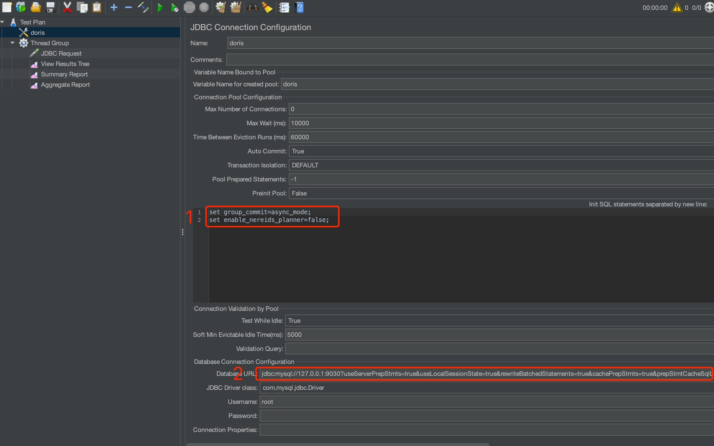
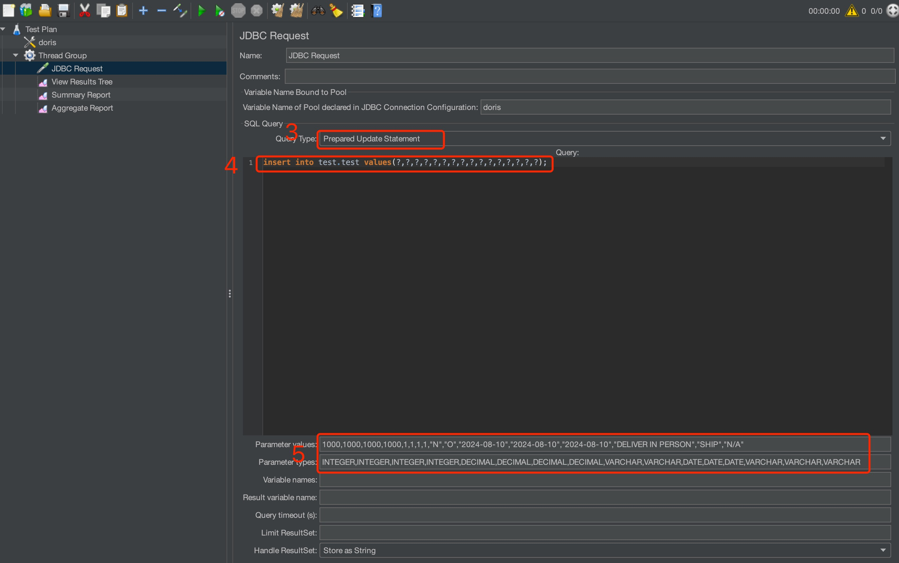

---
{
    "title": "고동시성 데이터 적재 최적화 (Group Commit)",
    "language": "ko",
    "description": "Doris Group Commit은 빈번한 소량 쓰기 트랜잭션을 병합하여 FE의 파싱 부담과 버전 수 증가를 줄이고, INSERT와 Stream Load의 고동시성 성능을 높입니다.",
    "keywords": [
        "Group Commit",
        "고동시성 데이터 적재",
        "빈번한 소량 쓰기",
        "INSERT INTO 최적화",
        "Stream Load 최적화",
        "Doris 데이터 적재 성능",
        "PreparedStatement",
        "WAL"
    ]
}
---

<!-- Knowledge type: Feature capability + Operational steps + Configuration parameters -->
<!-- Applicable scenarios: High-concurrency small-batch writes / Real-time load / Performance tuning -->

빈번하게 소량의 데이터를 쓰는 환경에서는 기존 데이터 적재 방식에 다음과 같은 문제가 있습니다.

- 데이터 적재마다 독립적인 트랜잭션이 생성되고, 매번 FE에서 SQL 파싱과 실행 계획 생성을 거쳐야 하므로 전체 성능이 저하됩니다.
- 데이터 적재마다 새 버전이 생성되어 버전 수가 빠르게 늘어나고 백그라운드 Compaction의 부담이 커집니다.

이러한 문제를 해결하기 위해 Doris는 Group Commit 메커니즘을 도입했습니다. Group Commit은 새로운 데이터 적재 방식이 아니라 기존 방식의 최적화 기능이며, 주로 다음을 대상으로 합니다.

- `INSERT INTO tbl VALUES(...)` 문
- Stream Load

Group Commit은 백그라운드에서 여러 소량 데이터 적재를 하나의 큰 트랜잭션으로 병합해 커밋함으로써 고동시성 소량 쓰기 성능을 크게 높입니다. PreparedStatement와 함께 사용하면 성능을 더욱 높일 수 있습니다.

## 적용 시나리오와 모드 선택 {#applicable-scenarios-and-selection}

| 시나리오 | 권장 모드 | 설명 |
| --- | --- | --- |
| 데이터 적재 완료 직후 데이터가 표시되어야 하는 고동시성 쓰기 | `sync_mode` | 여러 데이터 적재를 하나의 트랜잭션으로 병합하고 커밋한 뒤 호출이 반환됩니다. |
| 지연 시간에 민감한 빈번한 쓰기 | `async_mode` | 데이터를 먼저 WAL에 기록하고 호출이 즉시 반환됩니다. 커밋은 백그라운드에서 비동기적으로 진행됩니다. |
| Group Commit이 필요하지 않은 경우 | `off_mode` | Group Commit을 비활성화하고 일반 데이터 적재 경로를 사용합니다. |

## Group Commit 모드 {#group-commit-modes}

Group Commit 쓰기에는 다음 세 가지 모드가 있습니다.

- **비활성화 모드 (`off_mode`)**

    Group Commit을 비활성화합니다.

- **동기 모드 (`sync_mode`)**

    Doris는 부하와 테이블의 `group_commit_interval` 속성에 따라 여러 데이터 적재를 하나의 트랜잭션으로 병합해 커밋하며, 각 데이터 적재 호출은 트랜잭션이 커밋된 뒤 반환됩니다. 데이터 적재가 완료되자마자 데이터를 볼 수 있어야 하는 고동시성 쓰기에 적합합니다.

- **비동기 모드 (`async_mode`)**

    Doris는 먼저 데이터를 WAL(`Write Ahead Log`)에 기록하고 데이터 적재 호출을 즉시 반환합니다. 이후 부하와 테이블의 `group_commit_interval` 속성에 따라 데이터를 비동기적으로 커밋하며, 커밋 후 데이터가 표시됩니다. WAL이 디스크 공간을 과도하게 차지하지 않도록 단일 데이터 적재의 데이터 양이 많으면 Doris가 자동으로 `sync_mode`로 전환합니다. 지연 시간에 민감하고 빈번한 쓰기에 적합합니다.

    WAL 파일 수는 FE HTTP 인터페이스에서 확인할 수 있습니다. 자세한 내용은 [여기](../../../admin-manual/open-api/fe-http/get-wal-size-action)를 참조하세요. BE 메트릭에서 `wal` 키워드를 검색할 수도 있습니다.

## 빠른 시작 {#quick-start}

다음 예제는 모두 아래 테이블 스키마를 사용합니다.

```sql
CREATE TABLE `dt` (
    `id` int(11) NOT NULL,
    `name` varchar(50) NULL,
    `score` int(11) NULL
) ENGINE=OLAP
DUPLICATE KEY(`id`)
DISTRIBUTED BY HASH(`id`) BUCKETS 1
PROPERTIES (
    "replication_num" = "1"
);
```

### 테이블 속성 설정 {#table-property-configuration}

:::info
`group_commit_mode` 테이블 속성은 **4.1.0** 버전부터 지원됩니다.
:::

테이블 수준에서 기본 Group Commit 모드를 설정할 수 있습니다. Stream Load에서 `group_commit` HTTP Header를 설정하지 않으면 테이블 속성에 지정된 모드가 사용됩니다.

**1. 테이블 생성 시 설정:**

```sql
CREATE TABLE `dt` (
    `id` int(11) NOT NULL,
    `name` varchar(50) NULL,
    `score` int(11) NULL
) ENGINE=OLAP
DUPLICATE KEY(`id`)
DISTRIBUTED BY HASH(`id`) BUCKETS 1
PROPERTIES (
    "replication_num" = "1",
    "group_commit_mode" = "async_mode"
);
```

**2. 테이블 속성 변경:**

```sql
# Change to sync mode
ALTER TABLE dt SET ("group_commit_mode" = "sync_mode");

# Disable Group Commit
ALTER TABLE dt SET ("group_commit_mode" = "off_mode");
```

**3. 테이블 속성 확인:**

`SHOW CREATE TABLE`은 값이 `off_mode`인 경우를 제외하고 `group_commit_mode` 속성을 표시합니다.

```sql
mysql> SHOW CREATE TABLE dt;
+-------+----------------------------------------------------------------------------------------------------------------------------------------------------------------------------------------------------------------------+
| Table | Create Table                                                                                                                                                                                                       |
+-------+----------------------------------------------------------------------------------------------------------------------------------------------------------------------------------------------------------------------+
| dt    | CREATE TABLE `dt` (
  `id` int(11) NOT NULL,
  `name` varchar(50) NULL,
  `score` int(11) NULL
) ENGINE=OLAP
DUPLICATE KEY(`id`)
DISTRIBUTED BY HASH(`id`) BUCKETS 1
PROPERTIES (
    "group_commit_mode" = "async_mode"
) |
+-------+----------------------------------------------------------------------------------------------------------------------------------------------------------------------------------------------------------------------+
1 row in set (0.00 sec)
```

**4. 우선순위:**

| 데이터 적재 방식 | 우선순위(높음 → 낮음) |
| --- | --- |
| Stream Load | `group_commit` HTTP Header > 테이블 속성 `group_commit_mode` |
| INSERT INTO VALUES | 세션 변수 `group_commit` > 테이블 속성 `group_commit_mode` |

## 사용 방법 {#usage}

### INSERT INTO VALUES {#insert-into-values}

세션 변수 `group_commit`을 설정하여 Group Commit을 활성화합니다. 세션 변수는 테이블 속성보다 우선합니다.

**비동기 모드:**

```sql
# Set the session variable to enable group commit (default is off_mode), using async mode
mysql> set group_commit = async_mode;

# The returned label starts with group_commit, which tells you that group commit is in use
mysql> insert into dt values(1, 'Bob', 90), (2, 'Alice', 99);
Query OK, 2 rows affected (0.05 sec)
{'label':'group_commit_a145ce07f1c972fc-bd2c54597052a9ad', 'status':'PREPARE', 'txnId':'181508'}

# This label and txn_id match the previous one, indicating that the inserts are batched into the same load task
mysql> insert into dt(id, name) values(3, 'John');
Query OK, 1 row affected (0.01 sec)
{'label':'group_commit_a145ce07f1c972fc-bd2c54597052a9ad', 'status':'PREPARE', 'txnId':'181508'}

# The data is not immediately queryable
mysql> select * from dt;
Empty set (0.01 sec)

# After 10 seconds, the data is queryable. The data visibility delay is controlled by the table property group_commit_interval.
mysql> select * from dt;
+------+-------+-------+
| id   | name  | score |
+------+-------+-------+
|    1 | Bob   |    90 |
|    2 | Alice |    99 |
|    3 | John  |  NULL |
+------+-------+-------+
3 rows in set (0.02 sec)
```

**동기 모드:**

```sql
# Set the session variable to enable group commit (default is off_mode), using sync mode
mysql> set group_commit = sync_mode;

# The returned label starts with group_commit, which tells you that group commit is in use. The load takes at least the value of the table property group_commit_interval.
mysql> insert into dt values(4, 'Bob', 90), (5, 'Alice', 99);
Query OK, 2 rows affected (10.06 sec)
{'label':'group_commit_d84ab96c09b60587_ec455a33cb0e9e87', 'status':'PREPARE', 'txnId':'3007', 'query_id':'fc6b94085d704a94-a69bfc9a202e66e2'}

# The data is queryable immediately
mysql> select * from dt;
+------+-------+-------+
| id   | name  | score |
+------+-------+-------+
|    1 | Bob   |    90 |
|    2 | Alice |    99 |
|    3 | John  |  NULL |
|    4 | Bob   |    90 |
|    5 | Alice |    99 |
+------+-------+-------+
5 rows in set (0.03 sec)
```

**비활성화 모드:**

```sql
mysql> set group_commit = off_mode;
```

### JDBC 사용 (PreparedStatement) {#using-jdbc-preparedstatement}

JDBC `insert into values`로 데이터를 쓸 때 SQL 파싱과 계획 생성의 부담을 줄이기 위해 Doris는 FE 측에서 MySQL 프로토콜의 `PreparedStatement` 기능을 지원합니다. `PreparedStatement`를 사용하면 SQL과 해당 데이터 적재 계획이 세션 수준 메모리 캐시에 저장됩니다. 이후 데이터 적재에서는 캐시된 객체를 바로 사용하므로 FE의 CPU 사용량이 줄어듭니다.

**1. JDBC URL을 설정하고 서버 측 PreparedStatement 활성화:**

```text
url = jdbc:mysql://127.0.0.1:9030/db?useServerPrepStmts=true&useLocalSessionState=true&rewriteBatchedStatements=true&cachePrepStmts=true&prepStmtCacheSqlLimit=99999&prepStmtCacheSize=500
```

**2. 다음 두 가지 방법 중 하나로 `group_commit` 세션 변수 설정:**

- JDBC URL에 `sessionVariables=group_commit=async_mode`를 추가하여 설정:

    ```text
    url = jdbc:mysql://127.0.0.1:9030/db?useServerPrepStmts=true&useLocalSessionState=true&rewriteBatchedStatements=true&cachePrepStmts=true&prepStmtCacheSqlLimit=99999&prepStmtCacheSize=500&sessionVariables=group_commit=async_mode,enable_nereids_planner=false
    ```

- SQL 문을 실행하여 설정:

    ```java
    try (Statement statement = conn.createStatement()) {
        statement.execute("SET group_commit = async_mode;");
    }
    ```

**3. `PreparedStatement`를 사용한 배치 쓰기:**

```java
private static final String JDBC_DRIVER = "com.mysql.jdbc.Driver";
private static final String URL_PATTERN = "jdbc:mysql://%s:%d/%s?useServerPrepStmts=true&useLocalSessionState=true&rewriteBatchedStatements=true&cachePrepStmts=true&prepStmtCacheSqlLimit=99999&prepStmtCacheSize=50&sessionVariables=group_commit=async_mode";
private static final String HOST = "127.0.0.1";
private static final int PORT = 9030;
private static final String DB = "db";
private static final String TBL = "dt";
private static final String USER = "root";
private static final String PASSWD = "";
private static final int INSERT_BATCH_SIZE = 10;

private static void groupCommitInsertBatch() throws Exception {
    Class.forName(JDBC_DRIVER);
    // add rewriteBatchedStatements=true and cachePrepStmts=true in JDBC url
    // set session variables by sessionVariables=group_commit=async_mode in JDBC url
    try (Connection conn = DriverManager.getConnection(
            String.format(URL_PATTERN, HOST, PORT, DB), USER, PASSWD)) {

        String query = "insert into " + TBL + " values(?, ?, ?)";
        try (PreparedStatement stmt = conn.prepareStatement(query)) {
            for (int j = 0; j < 5; j++) {
                // 10 rows per insert
                for (int i = 0; i < INSERT_BATCH_SIZE; i++) {
                    stmt.setInt(1, i);
                    stmt.setString(2, "name" + i);
                    stmt.setInt(3, i + 10);
                    stmt.addBatch();
                }
                int[] result = stmt.executeBatch();
            }
        }
    } catch (Exception e) {
        e.printStackTrace();
    }
}
```

:::tip
빈번한 `INSERT INTO` 문은 감사 로그를 대량으로 남겨 최종 성능에 영향을 줄 수 있으므로, PreparedStatement의 감사 로그는 기본적으로 비활성화되어 있습니다. 세션 변수를 설정하여 PreparedStatement의 감사 로그 출력 여부를 제어할 수 있습니다.

```sql
# Set the session variable to enable audit logging for prepared statements. The default value is false, which disables audit logging for prepared statements.
set enable_prepared_stmt_audit_log=true;
```
:::

JDBC 사용에 관한 자세한 내용은 [INSERT를 사용한 데이터 동기화](../import-way/insert-into-manual.md)를 참조하세요.

### Golang 클라이언트에서 배치 처리 {#batching-with-the-golang-client}

Golang은 PreparedStatement 지원에 제한이 있으므로 클라이언트에서 수동으로 배치 처리하면 Group Commit 성능을 높일 수 있습니다. 다음은 예제 프로그램입니다.

```Golang
package main

import (
	"database/sql"
	"fmt"
	"math/rand"
	"strings"
	"sync"
	"sync/atomic"
	"time"

	_ "github.com/go-sql-driver/mysql"
)

const (
	host     = "127.0.0.1"
	port     = 9030
	db       = "test"
	user     = "root"
	password = ""
	table    = "async_lineitem"
)

var (
	threadCount = 20
	batchSize   = 100
)

var totalInsertedRows int64
var rowsInsertedLastSecond int64

func main() {
	dbDSN := fmt.Sprintf("%s:%s@tcp(%s:%d)/%s?parseTime=true", user, password, host, port, db)
	db, err := sql.Open("mysql", dbDSN)
	if err != nil {
		fmt.Printf("Error opening database: %s\n", err)
		return
	}
	defer db.Close()

	var wg sync.WaitGroup
	for i := 0; i < threadCount; i++ {
		wg.Add(1)
		go func() {
			defer wg.Done()
			groupCommitInsertBatch(db)
		}()
	}

	go logInsertStatistics()

	wg.Wait()
}

func groupCommitInsertBatch(db *sql.DB) {
	for {
		valueStrings := make([]string, 0, batchSize)
		valueArgs := make([]interface{}, 0, batchSize*16)
		for i := 0; i < batchSize; i++ {
		    valueStrings = append(valueStrings, "(?, ?, ?, ?, ?, ?, ?, ?, ?, ?, ?, ?, ?, ?, ?, ?)")
			valueArgs = append(valueArgs, rand.Intn(1000))
			valueArgs = append(valueArgs, rand.Intn(1000))
			valueArgs = append(valueArgs, rand.Intn(1000))
			valueArgs = append(valueArgs, rand.Intn(1000))
			valueArgs = append(valueArgs, sql.NullFloat64{Float64: 1.0, Valid: true})
			valueArgs = append(valueArgs, sql.NullFloat64{Float64: 1.0, Valid: true})
			valueArgs = append(valueArgs, sql.NullFloat64{Float64: 1.0, Valid: true})
			valueArgs = append(valueArgs, sql.NullFloat64{Float64: 1.0, Valid: true})
			valueArgs = append(valueArgs, "N")
			valueArgs = append(valueArgs, "O")
			valueArgs = append(valueArgs, time.Now())
			valueArgs = append(valueArgs, time.Now())
			valueArgs = append(valueArgs, time.Now())
			valueArgs = append(valueArgs, "DELIVER IN PERSON")
			valueArgs = append(valueArgs, "SHIP")
			valueArgs = append(valueArgs, "N/A")
		}
		stmt := fmt.Sprintf("INSERT INTO %s VALUES %s",
			table, strings.Join(valueStrings, ","))
		_, err := db.Exec(stmt, valueArgs...)
		if err != nil {
			fmt.Printf("Error executing batch: %s\n", err)
			return
		}
		atomic.AddInt64(&rowsInsertedLastSecond, int64(batchSize))
		atomic.AddInt64(&totalInsertedRows, int64(batchSize))
	}
}

func logInsertStatistics() {
	for {
		time.Sleep(1 * time.Second)
		fmt.Printf("Total inserted rows: %d\n", totalInsertedRows)
		fmt.Printf("Rows inserted in the last second: %d\n", rowsInsertedLastSecond)
		rowsInsertedLastSecond = 0
	}
}

```

### Stream Load {#stream-load}

Stream Load로 데이터를 적재할 때 HTTP Header에 `group_commit` 매개변수를 설정하여 Group Commit을 활성화할 수 있습니다.

:::note
`group_commit` Header를 설정하지 않았고 테이블 속성에 `group_commit_mode`가 설정되어 있다면 테이블 속성의 모드가 자동으로 사용됩니다.
:::

`data.csv`의 내용이 다음과 같다고 가정합니다.

```text
6,Amy,60
7,Ross,98
```

**비동기 모드:**

```shell
# Add the "group_commit:async_mode" header during load

curl --location-trusted -u {user}:{passwd} -T data.csv -H "group_commit:async_mode"  -H "column_separator:,"  http://{fe_host}:{http_port}/api/db/dt/_stream_load
{
    "TxnId": 7009,
    "Label": "group_commit_c84d2099208436ab_96e33fda01eddba8",
    "Comment": "",
    "GroupCommit": true,
    "Status": "Success",
    "Message": "OK",
    "NumberTotalRows": 2,
    "NumberLoadedRows": 2,
    "NumberFilteredRows": 0,
    "NumberUnselectedRows": 0,
    "LoadBytes": 19,
    "LoadTimeMs": 35,
    "StreamLoadPutTimeMs": 5,
    "ReadDataTimeMs": 0,
    "WriteDataTimeMs": 26
}

# The returned GroupCommit is true, which means the load entered the group commit path
# The returned Label starts with group_commit and is the label associated with the load that actually consumes the data
```

**동기 모드:**

```shell
# Add the "group_commit:sync_mode" header during load

curl --location-trusted -u {user}:{passwd} -T data.csv -H "group_commit:sync_mode"  -H "column_separator:,"  http://{fe_host}:{http_port}/api/db/dt/_stream_load
{
    "TxnId": 3009,
    "Label": "group_commit_d941bf17f6efcc80_ccf4afdde9881293",
    "Comment": "",
    "GroupCommit": true,
    "Status": "Success",
    "Message": "OK",
    "NumberTotalRows": 2,
    "NumberLoadedRows": 2,
    "NumberFilteredRows": 0,
    "NumberUnselectedRows": 0,
    "LoadBytes": 19,
    "LoadTimeMs": 10044,
    "StreamLoadPutTimeMs": 4,
    "ReadDataTimeMs": 0,
    "WriteDataTimeMs": 10038
}

# The returned GroupCommit is true, which means the load entered the group commit path
# The returned Label starts with group_commit and is the label associated with the load that actually consumes the data
```

Stream Load 구문과 모범 사례에 관한 자세한 내용은 [Stream Load](../import-way/stream-load-manual)를 참조하세요.

## 자동 커밋 조건 {#auto-commit-conditions}

<!-- Knowledge type: Configuration parameters -->

커밋 간격(기본값 10초)이 지나거나 누적 데이터가 기본 크기 임계값인 128 MB에 도달하면 커밋이 실행됩니다. 워크로드에 맞게 테이블별 두 임계값을 조정하세요.

### 커밋 간격 조정 {#adjusting-the-commit-interval}

기본 커밋 간격은 10초입니다. 테이블 설정을 변경하여 조정할 수 있습니다.

```sql
# Change the commit interval to 2 seconds
ALTER TABLE dt SET ("group_commit_interval_ms" = "2000");
```

**조정 권장 사항:**

| 예시 값 | 장점 | 단점 |
| --- | --- | --- |
| 짧은 간격(예: 2초) | 데이터가 표시되기까지의 지연이 줄어 실시간 표시가 중요한 환경에 적합 | 커밋 빈도와 버전 수가 더 빠르게 증가하고 백그라운드 Compaction의 부담이 커짐 |
| 긴 간격(예: 30초) | 커밋 배치가 커지고 버전 수가 느리게 증가하며 시스템 오버헤드가 줄어듦 | 데이터가 표시되기까지의 지연이 늘어남 |

업무에서 허용할 수 있는 데이터 표시 지연을 기준으로 값을 설정하세요. 시스템 부하가 높다면 간격을 적절히 늘릴 수 있습니다.

### 커밋 데이터 크기 조정 {#adjusting-the-commit-data-size}

**버전 이력:**

- `group_commit_data_bytes` 테이블 속성은 Doris 2.1.0에서 도입되었으며 기본값은 134217728바이트(128 MB)입니다.
- 이 기본값은 3.x, 4.x 및 dev에서도 동일합니다.
- BE 매개변수 `group_commit_queue_mem_limit`의 기본값은 64 MB이며 큐 메모리의 역압을 제어합니다. 커밋 실행 임계값과는 별개의 설정입니다.

Group Commit의 기본 커밋 데이터 크기 임계값은 128 MB입니다. 테이블 설정을 변경하여 조정할 수 있습니다.

```sql
# Set the commit data-size trigger threshold to 256 MB
ALTER TABLE dt SET ("group_commit_data_bytes" = "268435456");
```

**조정 권장 사항:**

| 예시 값 | 장점 | 단점 |
| --- | --- | --- |
| 작은 임계값(예: 32 MB) | 메모리 사용량이 적어 리소스가 제한된 환경에 적합 | 커밋 배치가 작아 처리량이 제한될 수 있음 |
| 큰 임계값(예: 256 MB) | 배치 커밋 효율과 시스템 처리량이 높아짐 | 메모리 사용량이 늘어남 |

메모리 리소스와 데이터 안정성 요구 사항을 고려하여 값을 선택하세요. 메모리가 충분하고 처리량을 높이고 싶다면 값을 256 MB 이상으로 늘릴 수 있습니다.

## 관련 시스템 설정 {#related-system-configuration}

### BE 설정 {#be-configuration}

**`group_commit_wal_path`**

- 설명: Group Commit이 WAL 파일을 저장하는 디렉터리입니다.
- 기본값: `storage_root_path`에 설정된 각 디렉터리 아래에 `wal`이라는 디렉터리가 생성됩니다. 설정 예시는 다음과 같습니다.

    ```text
    group_commit_wal_path=/data1/storage/wal;/data2/storage/wal;/data3/storage/wal
    ```

### 컴퓨팅과 스토리지가 분리된 모드에서 Stream Load 전달 {#stream-load-forwarding-in-compute-storage-decoupled-mode}

컴퓨팅과 스토리지가 분리된 모드에서 로드 밸런서가 Stream Load 요청을 무작위로 분산하면, 같은 테이블에 대한 요청이 서로 다른 BE 노드에 도달해 Group Commit이 효과적으로 배치할 수 없습니다. BE 전달을 활성화하면 요청을 받은 BE가 해당 테이블의 대상 BE로 요청을 전달하므로 같은 테이블의 모든 요청이 하나의 BE에 모입니다.

| 설정 | 위치 | 기본값 | 설명 |
| --- | --- | --- | --- |
| `enable_group_commit_streamload_be_forward` | FE | `false` | Stream Load BE 전달 활성화 여부. 컴퓨팅과 스토리지가 분리된 모드에서 요청이 Group Commit을 사용하는 경우에만 적용됩니다. |
| `enable_group_commit_streamload_be_forward` | BE | `false` | BE 엔드포인트 `/api/{db}/{table}/_stream_load_forward`로의 요청 허용 여부. **Doris 4.0 계열의 4.0.8 및 Doris 4.1 계열의 4.1.4에서 추가되었습니다.** |

이 설정은 FE와 BE **양쪽 모두**에서 `true`로 지정해야 합니다.

:::caution 동작 변경 (4.0.8 / 4.1.4)

Doris 4.0 계열의 4.0.8 및 Doris 4.1 계열의 4.1.4부터 BE의 `_stream_load_forward` 엔드포인트에는 다음 두 가지 제한이 적용됩니다.

- BE 설정 `enable_group_commit_streamload_be_forward`로 엔드포인트 사용 여부를 제어합니다. 값이 `false`(기본값)이면 요청에 `Stream load forward is disabled` 메시지와 함께 `403 Forbidden`이 반환됩니다.
- 설정을 활성화한 후에도 엔드포인트 요청은 인증을 통과해야 하며 전역 `LOAD` 권한이 있어야 합니다.

업그레이드 전에 FE에서만 이 기능을 활성화했다면 업그레이드 후에는 전달이 실패합니다. 모든 `be.conf`에 `enable_group_commit_streamload_be_forward=true`를 추가하고 데이터 적재 계정에 `LOAD` 권한이 있는지 확인하세요.

:::

### Follower FE로 전달 {#forwarding-to-a-follower-fe}

> 4.1.4 버전부터 지원됩니다.

앞서 설명한 BE 전달 외에도 FE는 Group Commit을 사용하는 Stream Load 요청을 라운드 로빈 방식으로 Follower FE에 전달할 수 있습니다. 이를 통해 배치 처리 부하를 여러 FE에 분산합니다.

| 설정 | 위치 | 기본값 | 설명 |
| --- | --- | --- | --- |
| `enable_forward_group_commit_stream_load_to_follower` | FE | `false` | Group Commit Stream Load 요청을 라운드 로빈 방식으로 Follower FE에 전달할지 여부 |

참고: 대상 테이블의 `light_schema_change`가 `false`이면 이 전달을 지원하지 않으며 요청이 오류로 실패합니다.

### WAL 파일 수 제한 {#wal-count-limit}

> 4.1.4 버전부터 지원됩니다.

`async_mode`의 Group Commit은 먼저 데이터를 WAL에 기록한 다음 비동기적으로 재생합니다. WAL 재생이 계속 실패하면 WAL 파일이 쌓여 디스크 공간을 모두 사용할 수 있습니다. 4.1.4 버전부터 BE 설정 `group_commit_max_wal_num_per_table`로 테이블별 WAL 파일 수를 제한할 수 있습니다.

| 설정 | 위치 | 기본값 | 설명 |
| --- | --- | --- | --- |
| `group_commit_max_wal_num_per_table` | BE | `10` | 단일 테이블에 허용되는 Group Commit WAL 파일의 최대 개수. `0`은 제한 없음을 의미하며 동적 변경을 지원합니다. |

제한을 초과하면 해당 테이블의 `async_mode` Group Commit 데이터 적재가 다음과 같은 `EXCEEDED_LIMIT` 오류와 함께 거부됩니다.

```text
Too many group commit async WALs for table <table_name>
```

이 오류는 스키마 변경이나 디스크 장애 등으로 WAL 재생에 문제가 발생했음을 뜻합니다. 제한을 단순히 높이기보다 원인을 조사하고 WAL 재생을 복구하세요.

## 제한 사항 {#limitations}

### Group Commit이 적용되지 않는 상황 {#group-commit-fallback-scenarios}

| 데이터 적재 방식 | Group Commit을 사용하지 않는 경로로 전환되는 조건 |
| --- | --- |
| `INSERT INTO VALUES` | 트랜잭션 쓰기 사용(`Begin; INSERT INTO VALUES; COMMIT`)<br/>레이블 지정(`INSERT INTO dt WITH LABEL {label} VALUES`)<br/>VALUES에 표현식 포함(`INSERT INTO dt VALUES (1 + 100)`)<br/>열 업데이트 쓰기<br/>경량 스키마 변경을 지원하지 않는 테이블 |
| `Stream Load` | 2단계 커밋 사용<br/>레이블 지정(`-H "label:my_label"`)<br/>열 업데이트 쓰기<br/>경량 스키마 변경을 지원하지 않는 테이블 |

### Unique 모델 {#unique-model}

- Group Commit은 커밋 순서를 보장하지 않습니다. 데이터 일관성을 보장하려면 Sequence 열을 사용하세요.

### WAL 제한 사항 {#wal-limitations}

4.1.5부터 WAL 재생은 끝부분에 완전히 기록되지 않은 길이 필드나 페이로드를 파일의 끝으로 처리합니다. 완전한 데이터 블록은 끝부분의 체크섬 필드가 완전히 기록되지 않았더라도 재생할 수 있습니다. 기록이 끝나지 않은 마지막 레코드는 완전한 레코드로 복구되지 않습니다. WAL 파일이 없거나 손상된 경우에는 여전히 데이터 무결성을 보장할 수 없습니다.

- `async_mode`는 데이터를 WAL에 기록하고 성공하면 WAL을 삭제하며, 실패하면 WAL에서 복구합니다.
- WAL 파일은 단일 복제본으로 저장됩니다. 해당 디스크가 손상되거나 파일이 실수로 삭제되면 데이터가 손실될 수 있습니다.
- BE 노드를 오프라인으로 전환할 때는 데이터 손실을 막기 위해 `DECOMMISSION` 명령을 사용하세요.
- 다음 경우에는 `async_mode`가 자동으로 `sync_mode`로 전환됩니다.
    - 단일 데이터 적재의 데이터 양이 단일 WAL 디렉터리 공간의 80%를 초과하는 경우
    - 데이터 크기를 알 수 없는 청크 방식의 Stream Load
    - 사용 가능한 디스크 공간이 부족한 경우
- 대규모 Schema Change 중에는 Group Commit 쓰기가 거부되므로 클라이언트가 재시도해야 합니다.

## 성능 {#performance}

고동시성 소량 데이터 적재 환경에서 `Stream Load`와 `JDBC`를 사용해 `group commit`(`async_mode` 사용)의 쓰기 성능을 테스트했습니다.

### Stream Load 로그 시나리오 테스트 {#stream-load-log-scenario-test}

**머신 구성:**

- FE 1대: Alibaba Cloud, 8코어 CPU, 16 GB 메모리, 100 GB ESSD PL1 클라우드 디스크 1개
- BE 3대: Alibaba Cloud, 16코어 CPU, 64 GB 메모리, 1 TB ESSD PL1 클라우드 디스크 1개
- 테스트 클라이언트 1대: Alibaba Cloud, 16코어 CPU, 64 GB 메모리, 100 GB ESSD PL1 클라우드 디스크 1개
- 테스트 버전: Doris-3.0.1

**데이터셋:**

- `httplogs` 데이터셋, 총 31 GB 및 247 million행

**테스트 도구:**

- [doris-streamloader](../../../connection-integration/data-integration/doris-streamloader.md)

**테스트 방법:**

- 동시 요청당 데이터 크기와 동시 요청 수를 달리하면서 `non-group_commit` 모드와 `group_commit`의 `async_mode`를 비교하고 `247249096`행을 적재했습니다.

**테스트 결과:**

| 데이터 적재 방식 | 동시 요청당 데이터 크기 | 동시 요청 수 | 시간(초) | 적재 속도(행/초) | 적재 처리량(MB/초) |
| --- | --- | --- | --- | --- | --- |
| `group_commit` | 10 KB | 10 | 2204 | 112,181 | 14.8 |
| `group_commit` | 10 KB | 30 | 2176 | 113,625 | 15.0 |
| `group_commit` | 100 KB | 10 | 283 | 873,671 | 115.1 |
| `group_commit` | 100 KB | 30 | 244 | 1,013,315 | 133.5 |
| `group_commit` | 500 KB | 10 | 125 | 1,977,992 | 260.6 |
| `group_commit` | 500 KB | 30 | 122 | 2,026,631 | 267.1 |
| `group_commit` | 1 MB | 10 | 119 | 2,077,723 | 273.8 |
| `group_commit` | 1 MB | 30 | 119 | 2,077,723 | 273.8 |
| `group_commit` | 10 MB | 10 | 118 | 2,095,331 | 276.1 |
| `non-group_commit` | 1 MB | 10 | 1883 | 131,305 | 17.3 |
| `non-group_commit` | 10 MB | 10 | 294 | 840,983 | 105.4 |
| `non-group_commit` | 10 MB | 30 | 118 | 2,095,331 | 276.1 |

위 `group_commit` 테스트에서 BE CPU 사용률은 10%에서 40% 사이를 유지했습니다.

결과에서 알 수 있듯이 `group_commit` 모드는 소량 데이터를 동시에 적재할 때 성능을 효과적으로 높이는 동시에 버전 수를 줄이고 백그라운드 데이터 병합의 부담을 낮춥니다.

### JDBC {#jdbc}

**머신 구성:**

- FE 1대: Alibaba Cloud, 8코어 CPU, 16 GB 메모리, 100 GB ESSD PL1 클라우드 디스크 1개
- BE 1대: Alibaba Cloud, 16코어 CPU, 64 GB 메모리, 500 GB ESSD PL1 클라우드 디스크 1개
- 테스트 클라이언트 1대: Alibaba Cloud, 16코어 CPU, 64 GB 메모리, 100 GB ESSD PL1 클라우드 디스크 1개
- 테스트 버전: Doris-3.0.1
- 성능 향상을 위해 PreparedStatement의 감사 로그 비활성화

**데이터셋:**

- TPC-H sf10 `lineitem` 테이블 데이터셋, 파일 30개, 총 약 22 GB 및 180 million행

**테스트 도구:**

- [DataX](https://github.com/alibaba/DataX)

**테스트 방법:**

- 동시 요청 수와 `INSERT`당 행 수를 달리하면서 `txtfilereader`에서 `mysqlwriter`로 데이터를 썼습니다.

**테스트 결과:**

| 삽입당 행 수 | 동시 요청 수 | 적재 속도(행/초) | 적재 처리량(MB/초) |
| --- | --- | --- | --- |
| 100 | 10 | 160,758 | 17.21 |
| 100 | 20 | 210,476 | 22.19 |
| 100 | 30 | 214,323 | 22.92 |

위 테스트에서 FE CPU 사용률은 약 60~70%, BE CPU 사용률은 약 10~20%를 유지했습니다.

### INSERT INTO 동기 모드, 소량 배치 {#insert-into-sync-mode-small-batches}

**머신 구성:**

- FE 1대: Alibaba Cloud, 16코어 CPU, 64 GB 메모리, 500 GB ESSD PL1 클라우드 디스크 1개
- BE 5대: Alibaba Cloud, 16코어 CPU, 64 GB 메모리, 1 TB ESSD PL1 클라우드 디스크 1개
- 테스트 클라이언트 1대: Alibaba Cloud, 16코어 CPU, 64 GB 메모리, 100 GB ESSD PL1 클라우드 디스크 1개
- 테스트 버전: Doris-3.0.1

**데이터셋:**

- TPC-H sf10 `lineitem` 테이블 데이터셋.
- CREATE TABLE 문은 다음과 같습니다.

    ```sql
    CREATE TABLE IF NOT EXISTS lineitem (
      L_ORDERKEY    INTEGER NOT NULL,
      L_PARTKEY     INTEGER NOT NULL,
      L_SUPPKEY     INTEGER NOT NULL,
      L_LINENUMBER  INTEGER NOT NULL,
      L_QUANTITY    DECIMAL(15,2) NOT NULL,
      L_EXTENDEDPRICE  DECIMAL(15,2) NOT NULL,
      L_DISCOUNT    DECIMAL(15,2) NOT NULL,
      L_TAX         DECIMAL(15,2) NOT NULL,
      L_RETURNFLAG  CHAR(1) NOT NULL,
      L_LINESTATUS  CHAR(1) NOT NULL,
      L_SHIPDATE    DATE NOT NULL,
      L_COMMITDATE  DATE NOT NULL,
      L_RECEIPTDATE DATE NOT NULL,
      L_SHIPINSTRUCT CHAR(25) NOT NULL,
      L_SHIPMODE     CHAR(10) NOT NULL,
      L_COMMENT      VARCHAR(44) NOT NULL
    )
    DUPLICATE KEY(L_ORDERKEY, L_PARTKEY, L_SUPPKEY, L_LINENUMBER)
    DISTRIBUTED BY HASH(L_ORDERKEY) BUCKETS 32
    PROPERTIES (
      "replication_num" = "3"
    );
    ```

**테스트 도구:**

- [Jmeter](https://jmeter.apache.org/)

설정할 Jmeter 매개변수는 아래 이미지와 같습니다.




1. 테스트 전 초기화 문으로 `set group_commit=async_mode`와 `set enable_nereids_planner=false`를 설정합니다.
2. JDBC PreparedStatement를 활성화합니다. 전체 URL은 다음과 같습니다.

    ```text
    jdbc:mysql://127.0.0.1:9030?useServerPrepStmts=true&useLocalSessionState=true&rewriteBatchedStatements=true&cachePrepStmts=true&prepStmtCacheSqlLimit=99999&prepStmtCacheSize=50&sessionVariables=group_commit=async_mode,enable_nereids_planner=false`.
    ```

3. 데이터 적재 유형을 prepared update statement로 설정합니다.
4. 데이터 적재 문을 설정합니다.
5. 매번 적재할 값을 설정합니다. 각 값이 해당 적재 값의 유형과 일치하는지 확인하세요.

**테스트 방법:**

- `Jmeter`를 통해 `Doris`에 데이터를 씁니다. 각 동시 요청은 `INSERT INTO`당 1행을 씁니다.

**테스트 결과(단위: 행/초):**

다음 테스트는 동시 요청 수 30, 100, 500을 대상으로 합니다.

**동시 요청 30개, 동기 모드, BE 5대와 복제본 3개:**

| Group Commit 간격 | 10ms | 20ms | 50ms | 100ms |
| --- | --- | --- | --- | --- |
| `enable_nereids_planner=true` | 891.8 | 701.1 | 400.0 | 237.5 |
| `enable_nereids_planner=false` | 885.8 | 688.1 | 398.7 | 232.9 |

**동시 요청 100개, 동기 모드, BE 5대와 복제본 3개:**

| Group Commit 간격 | 10ms | 20ms | 50ms | 100ms |
| --- | --- | --- | --- | --- |
| `enable_nereids_planner=true` | 2427.8 | 2068.9 | 1259.4 | 764.9 |
| `enable_nereids_planner=false` | 2320.4 | 1899.3 | 1206.2 | 749.7 |

**동시 요청 500개, 동기 모드, BE 5대와 복제본 3개:**

| Group Commit 간격 | 10ms | 20ms | 50ms | 100ms |
| --- | --- | --- | --- | --- |
| `enable_nereids_planner=true` | 5567.5 | 5713.2 | 4681.0 | 3131.2 |
| `enable_nereids_planner=false` | 4471.6 | 5042.5 | 4932.2 | 3641.1 |

### INSERT INTO 동기 모드, 대량 배치 {#insert-into-sync-mode-large-batches}

**머신 구성:**

- FE 1대: Alibaba Cloud, 16코어 CPU, 64 GB 메모리, 500 GB ESSD PL1 클라우드 디스크 1개
- BE 5대: Alibaba Cloud, 16코어 CPU, 64 GB 메모리, 1 TB ESSD PL1 클라우드 디스크 1개. 참고: 테스트에는 각각 BE 1대, 3대, 5대를 사용했습니다.
- 테스트 클라이언트 1대: Alibaba Cloud, 16코어 CPU, 64 GB 메모리, 100 GB ESSD PL1 클라우드 디스크 1개
- 테스트 버전: Doris-3.0.1

**데이터셋:**

- TPC-H sf10 `lineitem` 테이블 데이터셋.
- CREATE TABLE 문은 다음과 같습니다.

    ```sql
    CREATE TABLE IF NOT EXISTS lineitem (
      L_ORDERKEY    INTEGER NOT NULL,
      L_PARTKEY     INTEGER NOT NULL,
      L_SUPPKEY     INTEGER NOT NULL,
      L_LINENUMBER  INTEGER NOT NULL,
      L_QUANTITY    DECIMAL(15,2) NOT NULL,
      L_EXTENDEDPRICE  DECIMAL(15,2) NOT NULL,
      L_DISCOUNT    DECIMAL(15,2) NOT NULL,
      L_TAX         DECIMAL(15,2) NOT NULL,
      L_RETURNFLAG  CHAR(1) NOT NULL,
      L_LINESTATUS  CHAR(1) NOT NULL,
      L_SHIPDATE    DATE NOT NULL,
      L_COMMITDATE  DATE NOT NULL,
      L_RECEIPTDATE DATE NOT NULL,
      L_SHIPINSTRUCT CHAR(25) NOT NULL,
      L_SHIPMODE     CHAR(10) NOT NULL,
      L_COMMENT      VARCHAR(44) NOT NULL
    )
    DUPLICATE KEY(L_ORDERKEY, L_PARTKEY, L_SUPPKEY, L_LINENUMBER)
    DISTRIBUTED BY HASH(L_ORDERKEY) BUCKETS 32
    PROPERTIES (
      "replication_num" = "3"
    );
    ```

**테스트 도구:**

- [Jmeter](https://jmeter.apache.org/)

**테스트 방법:**

- `Jmeter`를 통해 `Doris`에 데이터를 씁니다. 각 동시 요청은 `INSERT INTO`당 1000행을 씁니다.

**테스트 결과(단위: 행/초):**

다음 테스트는 동시 요청 수 30, 100, 500을 대상으로 합니다.

**동시 요청 30개, 동기 모드, BE 5대와 복제본 3개:**

| Group Commit 간격 | 10ms | 20ms | 50ms | 100ms |
| --- | --- | --- | --- | --- |
| `enable_nereids_planner=true` | 9.1K | 11.1K | 11.4K | 11.1K |
| `enable_nereids_planner=false` | 157.8K | 159.9K | 154.1K | 120.4K |

**동시 요청 100개, 동기 모드, BE 5대와 복제본 3개:**

| Group Commit 간격 | 10ms | 20ms | 50ms | 100ms |
| --- | --- | --- | --- | --- |
| `enable_nereids_planner=true` | 10.0K | 9.2K | 8.9K | 8.9K |
| `enable_nereids_planner=false` | 130.4K | 131.0K | 130.4K | 124.1K |

**동시 요청 500개, 동기 모드, BE 5대와 복제본 3개:**

| Group Commit 간격 | 10ms | 20ms | 50ms | 100ms |
| --- | --- | --- | --- | --- |
| `enable_nereids_planner=true` | 2.5K | 2.5K | 2.3K | 2.1K |
| `enable_nereids_planner=false` | 94.2K | 95.1K | 94.4K | 94.8K |

## 자주 묻는 질문 {#faq}

<!-- Knowledge type: FAQ / Troubleshooting -->

**Q1: 데이터 적재에 Group Commit이 사용되는지 어떻게 확인하나요?**

- INSERT INTO VALUES: 반환 결과의 `label`이 `group_commit_`으로 시작하며, 여러 데이터 적재가 동일한 `label`과 `txnId`를 공유할 수 있습니다.
- Stream Load: 반환된 JSON에서 `GroupCommit` 필드가 `true`이고 `Label`이 `group_commit_`으로 시작합니다.

**Q2: `async_mode`를 활성화하면 언제 데이터를 쿼리할 수 있나요?**

- 데이터가 표시되기까지의 지연은 테이블 속성 `group_commit_interval_ms`(기본값 10초)와 `group_commit_data_bytes`(기본 커밋 실행 임계값 128 MB)에 의해 함께 결정됩니다. 두 임계값 중 하나에 먼저 도달하면 커밋이 실행됩니다.

**Q3: `async_mode`가 자동으로 `sync_mode`로 전환되는 때는 언제인가요?**

- 단일 데이터 적재가 단일 WAL 디렉터리 공간의 80%를 초과하는 경우.
- 데이터 크기를 알 수 없는 청크 방식의 Stream Load.
- 사용 가능한 디스크 공간이 부족한 경우.

**Q4: `INSERT INTO VALUES`에 Group Commit이 적용되지 않는 이유는 무엇인가요?**

- 명시적 트랜잭션 안에서 실행 중인지, 레이블을 지정했는지, VALUES에 표현식이 포함되었는지, 열 업데이트 쓰기인지, 테이블이 경량 스키마 변경을 지원하는지 확인하세요. 자세한 내용은 [Group Commit이 적용되지 않는 상황](#group-commit-fallback-scenarios)을 참조하세요.

**Q5: `async_mode`를 사용할 때 데이터 손실 위험이 있나요?**

- WAL 파일은 단일 복제본으로 저장됩니다. 해당 디스크가 손상되거나 파일이 실수로 삭제되면 데이터가 손실될 수 있습니다. BE 노드를 오프라인으로 전환할 때는 데이터 손실을 막기 위해 항상 `DECOMMISSION` 명령을 사용하세요.

**Q6: Unique 모델에서 Group Commit을 사용할 때 무엇을 주의해야 하나요?**

- Group Commit은 커밋 순서를 보장하지 않습니다. 데이터 일관성을 보장하려면 Sequence 열을 사용하세요.
