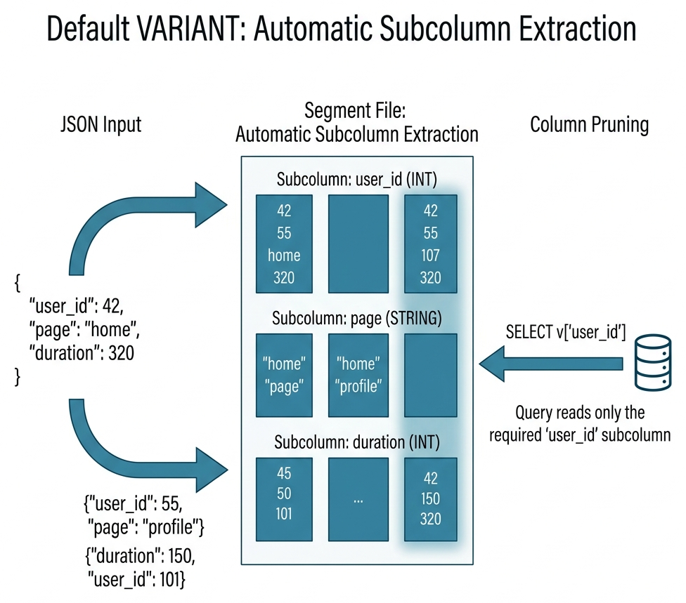
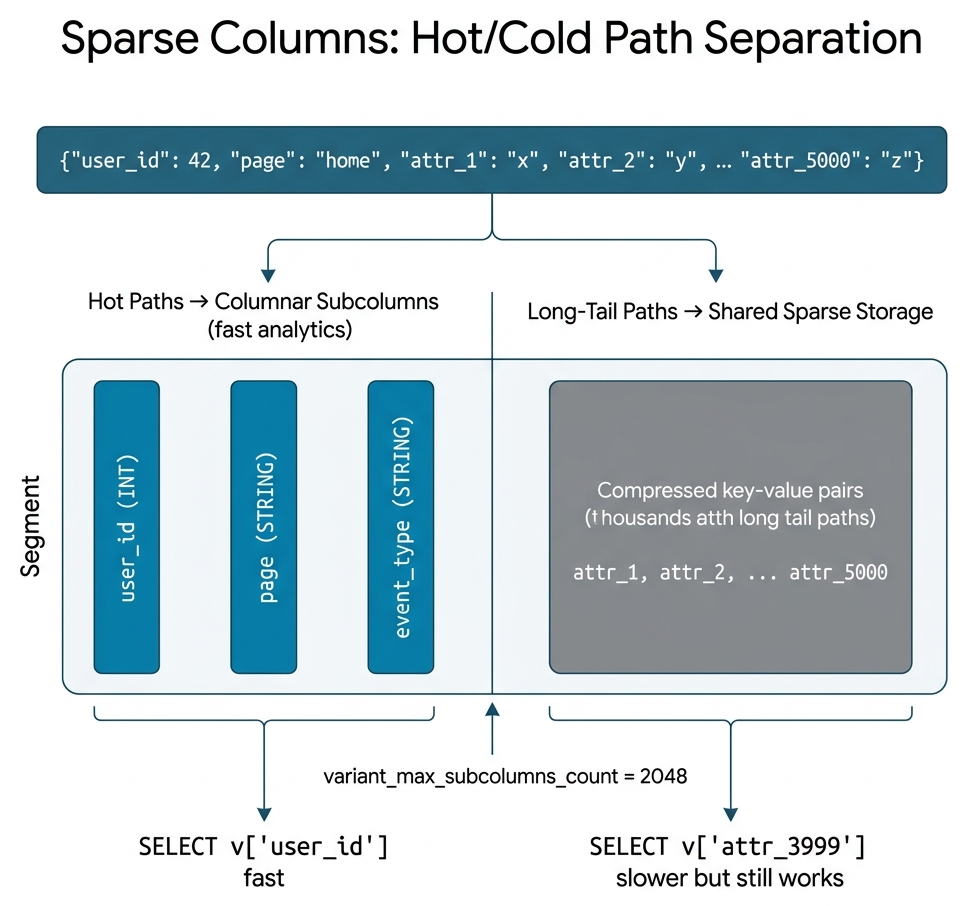
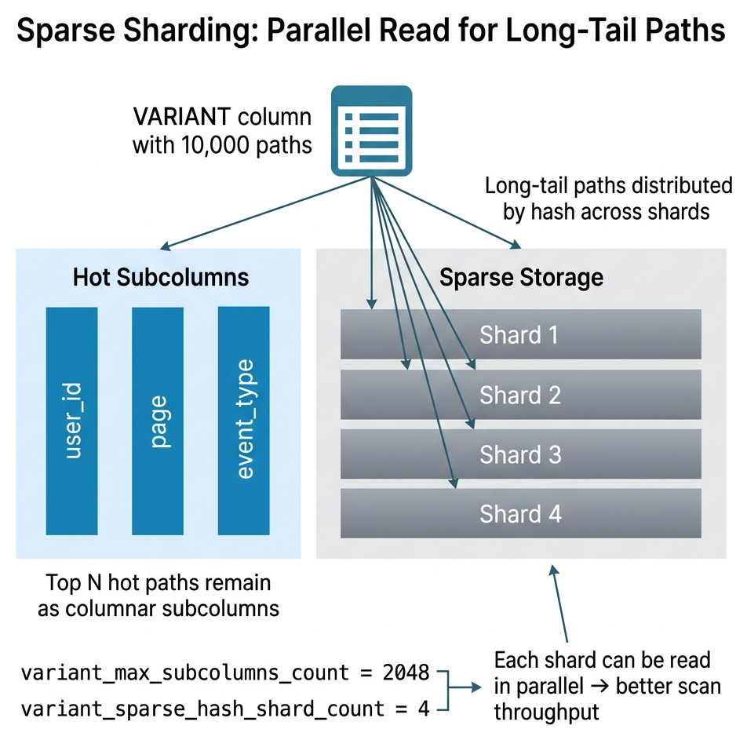
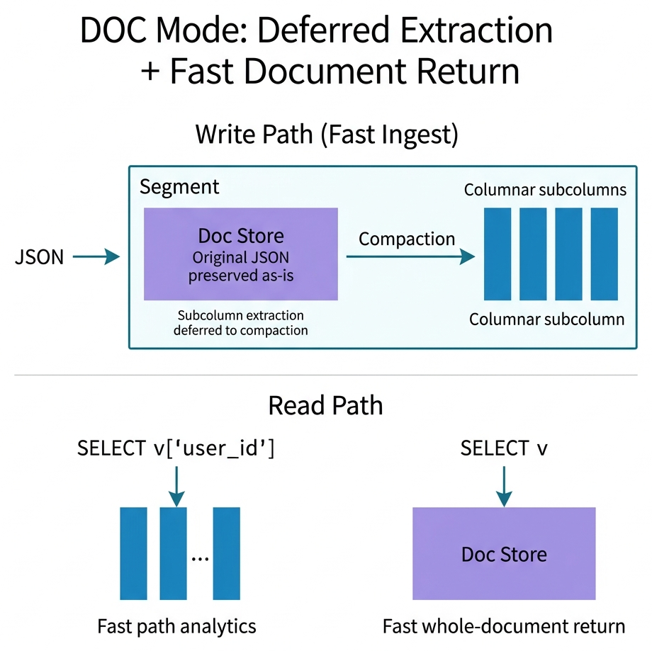
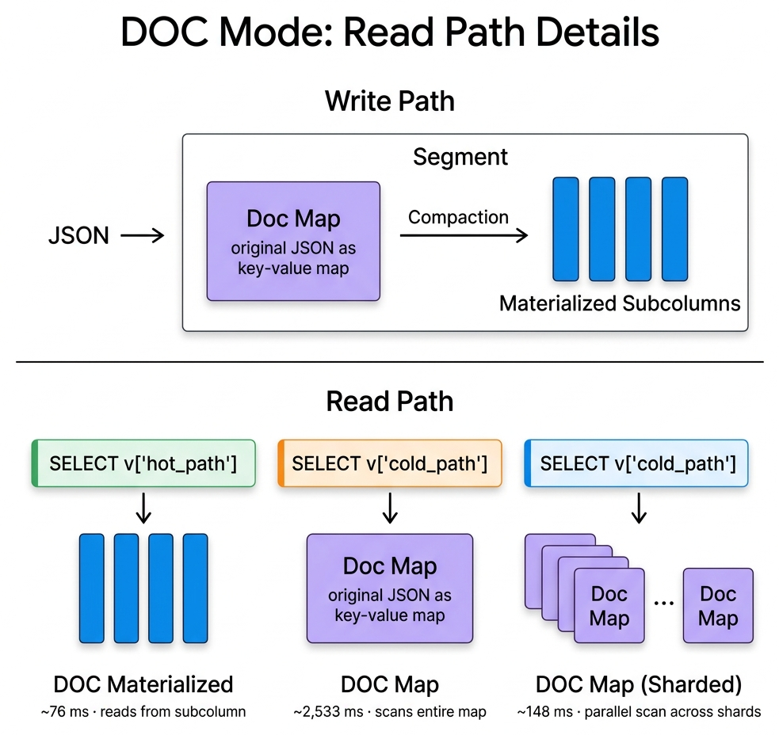
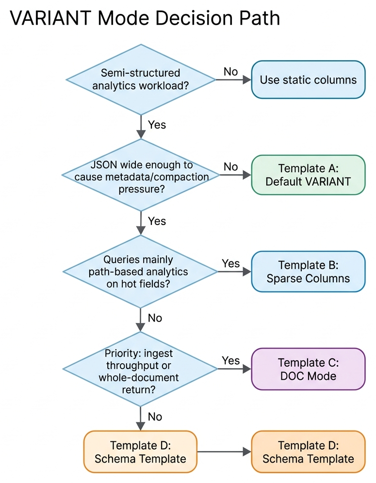
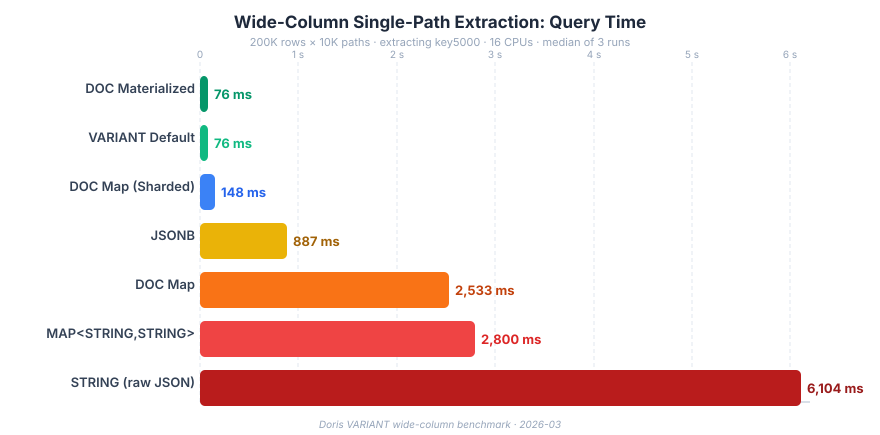

---
{
    "title": "VARIANT 워크로드 가이드",
    "language": "ko",
    "description": "VARIANT를 언제 사용하고, 기본 모드, Sparse, DOC mode, Schema Template 중 어떻게 선택하며, 구성은 어디서 시작할지 안내하는 의사결정 가이드입니다."
}
---

## 개요 {#overview}

`VARIANT`는 반구조화된 JSON을 저장하고 자주 사용되는 경로에 Subcolumnization을 적용합니다.

새 `VARIANT` 워크로드의 모델링 방법을 결정할 때 이 가이드를 사용하세요. 다음과 같은 질문에 답하는 데 도움이 됩니다.

- 이 워크로드는 `VARIANT`를 사용해야 할까요, 아니면 정적 열을 사용해야 할까요?
- JSON이 매우 넓다면 기본 동작, sparse columns, DOC mode 중 무엇으로 시작해야 할까요?
- 어떤 설정을 기본값으로 유지하고, 어떤 설정을 먼저 변경해야 할까요?

이미 `VARIANT`를 사용하기로 결정했고 구문이나 타입 규칙만 필요하다면 [VARIANT](./VARIANT.md)를 참조하세요. 실행 가능한 최소 가져오기 예제가 필요하다면 [Variant 데이터 가져오기](../../../../data-operate/import/complex-types/variant.md)를 참조하세요. 하위 열과 sparse 인코딩이 데이터를 저장하는 방식 및 각 시나리오의 속성 설정 방법을 이해하려면 [VARIANT 저장소 및 튜닝](./variant-storage-tuning.md)을 참조하세요.

:::tip VARIANT를 선택하는 이유
`VARIANT`는 JSON의 유연성을 유지하면서도 Doris가 자주 사용되는 경로에 Subcolumnization을 적용할 수 있게 합니다. 따라서 전체 문서 스키마를 미리 고정하지 않고도 일반적인 필터, 집계, 경로 수준 인덱스를 효과적으로 사용할 수 있습니다. 매우 넓은 JSON에서는 저장소 계층 최적화로 훨씬 많은 경로 수에서도 Subcolumnization을 실용적으로 유지할 수 있습니다.
:::

## VARIANT가 적합한 경우 {#when-variant-fits}

다음 조건 대부분이 참이면 `VARIANT`가 일반적으로 적합합니다.

- 입력이 JSON 또는 시간이 지나면서 필드가 변경되는 다른 반구조화 페이로드입니다.
- 쿼리가 모든 행의 모든 필드가 아니라 일반적으로 일부 핫 경로에 접근합니다.
- 열 기반 분석 성능을 포기하지 않고 스키마 유연성을 원합니다.
- 일부 경로에는 인덱싱이 필요하고, 많은 다른 경로는 동적으로 유지할 수 있습니다.

다음 조건이 우세하면 정적 열을 선호하세요.

- 스키마가 안정적이고 미리 알고 있습니다.
- 핵심 필드가 조인 키, 정렬 키 또는 엄격하게 제어되는 타입 열로 자주 사용됩니다. VARIANT 값도 조인과 정렬에 사용할 수 있지만, 타입이 지정된 열이 더 빠르고 타입 의미를 유지합니다.
- 주된 요구 사항이 경로별 분석이 아니라 원시 JSON을 보관하는 것입니다.

## 먼저 답할 네 가지 질문 {#four-questions-first}

설정을 변경하기 전에 다음 네 가지 질문에 답하세요.

### 1. 명확한 핫 경로가 있나요? {#1-are-there-clear-hot-paths}

쿼리가 동일한 JSON 경로에 반복해서 접근하면 Doris는 해당 경로에 계속 Subcolumnization을 적용할 수 있습니다. 이것이 `VARIANT`가 가장 큰 도움을 주는 지점입니다.

### 2. 일부 경로에 고정 타입 또는 안정적인 인덱스가 필요한가요? {#2-do-a-few-paths-need-fixed-types-or-stable-indexes}

그렇다면 해당 경로에만 Schema Template을 사용하세요. Schema Template은 소수의 비즈니스 핵심 필드를 위한 것이며 전체 문서를 설명하기 위한 것이 아닙니다.

### 3. 실제로 넓은 JSON이 되고 있나요? {#3-is-this-really-becoming-wide-json}

경로 수가 계속 증가하여 메타데이터 부담, compaction 부담 또는 눈에 띄는 쿼리 오버헤드가 발생하기 시작하면 wide JSON 문제가 있는 것입니다.

### 4. 넓은 JSON에서 더 중요한 것은 핫 경로 분석인가요, 전체 문서 반환인가요? {#4-for-wide-json-what-matters-more-hot-path-analytics-or-whole-document-return}

- 핵심 가치가 핫 필드의 경로 기반 필터링, 집계, 인덱싱에 있다면 sparse columns 쪽을 고려하세요.
- 핵심 가치가 수집 효율 또는 전체 문서 반환에 있다면 DOC mode 쪽을 고려하세요.

## 주요 개념 {#key-concepts}

아래 저장소 모드를 읽기 전에 다음 용어를 확인하세요. 각 개념은 2-3줄로 설명되어 있으며, 구현 세부 정보는 [VARIANT](./VARIANT.md)를 참조하세요.

**Subcolumnization.** 데이터를 `VARIANT` 열에 기록할 때 Doris는 JSON 경로를 자동으로 검색하고 핫 경로를 독립적인 열 기반 하위 열로 추출하여 효율적인 분석을 지원합니다.



**Schema Template.** 선택한 경로를 안정적인 타입으로 고정하는 `VARIANT` 열의 선언입니다. 타입, 인덱스, 동작을 예측 가능하게 유지해야 하는 핵심 비즈니스 필드에 사용하세요. 가능한 모든 경로를 열거하려고 하지 마세요.

**Wide JSON.** 고유 경로 수가 계속 증가하여 메타데이터 크기, 쓰기 비용, compaction 비용 또는 쿼리 비용이 증가하기 시작하면 wide JSON 문제가 있는 것입니다.

**Sparse columns.** 넓은 JSON에 명확한 핫/콜드 분리가 있을 때 sparse columns는 핫 경로를 Subcolumnization으로 유지하고 콜드(롱테일) 경로를 공유 sparse 저장소로 보냅니다. Sparse 저장소는 여러 물리 열에 걸쳐 샤딩하여 읽기 병렬성을 높일 수 있습니다.



위 그림과 같이 `user_id`, `page`와 같은 핫 경로는 완전한 분석 성능을 제공하는 독립적인 열 기반 하위 열로 유지되고, 수천 개의 롱테일 경로는 공유 sparse 저장소로 모입니다. 임계값은 `variant_max_subcolumns_count`로 제어됩니다.

**Sparse sharding.** 롱테일 경로 수가 매우 많으면 단일 sparse 열이 읽기 병목이 될 수 있습니다. Sparse sharding은 해시를 사용해 롱테일 경로를 여러 물리 열(`variant_doc_hash_shard_count`)에 분산하므로 병렬로 스캔할 수 있습니다.



**DOC mode.** 원본 JSON을 map 형식의 저장 필드(**doc map**)로 추가 저장합니다. 전체 문서 쿼리는 이를 직접 읽으며, 그 대가로 저장 공간이 더 필요합니다. 기본 모드와 마찬가지로 Subcolumnization은 `variant_max_subcolumns_count` 및 `variant_doc_materialization_min_rows`로 제어됩니다. 데이터 파일이 행 임계값에 도달하면 최대 `variant_max_subcolumns_count`개의 경로가 추출됩니다. 행 임계값을 높이면 작은 배치는 doc map만 기록하므로 수집 속도가 빨라지고, Subcolumnization은 이후 compaction으로 지연됩니다.



위 그림과 같이 쓰는 동안 JSON은 빠른 수집을 위해 Doc Store에 있는 그대로 보존됩니다. 행 임계값이 설정되면 이후 compaction 중에 하위 열이 추출됩니다. 읽을 때 경로 기반 쿼리(예: `SELECT v['user_id']`)는 물리화된 하위 열에서 완전한 열 기반 속도로 읽고, 전체 문서 쿼리(`SELECT v`)는 하위 열에서 재구성하지 않고 Doc Store에서 직접 읽습니다.

DOC mode에는 쿼리한 경로가 물리화되었는지에 따라 세 가지 읽기 경로가 있습니다.



- **DOC Materialized**: 쿼리한 경로가 이미 하위 열로 추출되었습니다(compaction 후 또는 `variant_doc_materialization_min_rows`가 충족된 경우). 기본 VARIANT와 동일하게 완전한 열 기반 속도로 읽습니다.
- **DOC Map**: 쿼리한 경로가 아직 물리화되지 않았습니다. 쿼리는 값을 찾기 위해 전체 doc map을 스캔하는 방식으로 대체되므로 넓은 JSON에서 훨씬 느립니다.
- **DOC Map (Sharded)**: 동일한 대체 경로이지만 `variant_doc_hash_shard_count`를 사용해 doc map을 여러 물리 열에 분산하므로 병렬 스캔이 가능하고 복구 속도가 훨씬 빨라집니다.

**Storage Format V3.** 열 메타데이터를 segment footer에서 분리합니다. 수천 개의 하위 열이 존재할 때 메타데이터 병목을 제거하므로 모든 `VARIANT` 테이블, 특히 넓은 JSON에 권장됩니다.

## 권장 의사결정 경로 {#recommended-decision-path}



## 저장소 모드 {#storage-modes}

아래 표에서 시작점을 선택한 다음 해당 섹션을 읽으세요.

| | 일반적인 시나리오 | 권장 모드 | 주요 구성 |
|---|---|---|---|
| **A** | 이벤트 로그, 감사 로그 | 기본 VARIANT + V3 | 기본값 유지 |
| **B** | 광고 / 텔레메트리 / 사용자 프로필(넓고 핫 경로가 적음) | Sparse + V3 | `variant_max_subcolumns_count`, `variant_doc_hash_shard_count` |
| **C** | 모델 출력 / trace / 아카이브(수집 우선 또는 전체 문서 반환) | DOC mode + V3 | `variant_enable_doc_mode`, `variant_doc_materialization_min_rows`, `variant_doc_hash_shard_count` |
| **D** | 주문 / 결제 / 디바이스(핵심 경로에 안정적인 타입 필요) | Schema Template + A 또는 B | 핵심 경로만 정의 |

### 기본 모드 {#default-mode}

대부분의 새로운 `VARIANT` 워크로드에서 가장 안전한 시작점입니다.

일반적인 예: 쿼리가 익숙한 소수의 경로에 반복해서 접근하는 이벤트 로그 또는 감사 페이로드입니다.

```sql
CREATE TABLE IF NOT EXISTS event_log (
    ts DATETIME NOT NULL,
    event_id BIGINT NOT NULL,
    event_type VARCHAR(64),
    payload VARIANT
)
DUPLICATE KEY(`ts`, `event_id`)
DISTRIBUTED BY HASH(`event_id`) BUCKETS 16
PROPERTIES (
    "replication_num" = "1",
    "storage_format" = "V3"
);
```

워크로드가 sparse columns 또는 DOC mode를 정당화할 만큼 넓은지 아직 확신할 수 없고, 대부분의 가치가 여러 일반적인 경로에 대한 필터링, 집계, 그룹화에서 발생할 때 사용하세요.

주의할 점:
- 경로 증가로 인한 부담이 이미 발생한 경우가 아니라면 초기에 `variant_max_subcolumns_count`를 높이지 마세요.
- JSON이 넓지 않다면 sparse columns 또는 DOC mode를 활성화해도 이점 없이 복잡성만 증가합니다.

### Sparse 모드 {#sparse-mode}

페이로드가 넓지만 대부분의 쿼리가 여전히 소수의 핫 경로에 집중할 때 sparse columns를 선택하세요.

일반적인 예: 수천 개의 선택적 속성이 있지만 정기적으로 쿼리되는 속성은 수십 개뿐인 광고, 텔레메트리 또는 프로필 JSON입니다.

```sql
CREATE TABLE IF NOT EXISTS telemetry_wide (
    ts DATETIME NOT NULL,
    device_id BIGINT NOT NULL,
    attributes VARIANT<
        'device_type' : STRING,
        'region' : STRING,
        properties(
            'variant_max_subcolumns_count' = '2048',
            'variant_doc_hash_shard_count' = '64'
        )
    >
)
DUPLICATE KEY(`ts`, `device_id`)
DISTRIBUTED BY HASH(`device_id`) BUCKETS 32
PROPERTIES (
    "replication_num" = "1",
    "storage_format" = "V3"
);
```

전체 키 수가 매우 많지만 주된 워크로드가 여전히 경로 기반 필터링, 집계, 인덱싱일 때 사용하세요.

주의할 점:
- 핫 경로 분석이 병목이라면 먼저 DOC mode로 전환하지 마세요.
- `variant_max_subcolumns_count`의 기본값은 `2048`이며, 대부분의 워크로드에서 자동 Subcolumnization을 시작하기에 적절합니다. 사실상 모든 경로가 Subcolumnization을 거치게 될 정도로 크게 설정하지 마세요. 워크로드에 정말 매우 큰 추출 하위 열 규모가 필요하다면 [DOC Mode](#doc-mode-template)를 우선 고려하세요.

### DOC 모드 {#doc-mode-template}

전체 JSON 문서 반환 또는 수집 오버헤드 최소화가 경로 기반 분석 최적화보다 중요할 때 DOC mode를 선택하세요.

일반적인 예: 완전한 페이로드로 자주 반환되는 모델 응답, trace 스냅샷 또는 보관된 JSON 문서입니다.

DOC mode는 다음과 같은 경우에 도움이 됩니다.

- Subcolumnization 규모가 매우 커져 10,000개 경로에 가까워지면 하드웨어 요구 사항이 빠르게 증가합니다. 이 규모에서는 DOC mode가 더 안정적인 선택입니다.
- 기본 즉시 Subcolumnization과 비교하면 compaction 메모리를 약 삼분의 이 수준으로 줄일 수 있습니다.
- Sparse wide-column 수집 워크로드에서는 처리량이 약 5–10배 향상될 수 있습니다.
- 전체 `VARIANT` 값(`SELECT variant_col`)을 읽는 쿼리에서는 수천 개의 하위 열에서 문서를 재구성할 필요가 없으므로 DOC mode가 훨씬 빠른 성능을 제공합니다.

**시작하기:**

```sql
CREATE TABLE IF NOT EXISTS trace_archive (
    ts DATETIME NOT NULL,
    trace_id VARCHAR(64) NOT NULL,
    span VARIANT<
        'service_name' : STRING,
        properties(
            'variant_enable_doc_mode' = 'true',
            'variant_doc_materialization_min_rows' = '10000',
            'variant_doc_hash_shard_count' = '64'
        )
    >
)
DUPLICATE KEY(`ts`, `trace_id`)
DISTRIBUTED BY HASH(`trace_id`) BUCKETS 32
PROPERTIES (
    "replication_num" = "1",
    "storage_format" = "V3"
);
```

수집 처리량이 최우선이거나, 워크로드가 전체 JSON 문서를 자주 다시 필요로 하거나, 매우 넓은 열을 `SELECT variant_col`로 자주 읽을 때 사용하세요.

주의할 점:
- DOC mode가 모든 wide-JSON 워크로드에 대한 기본 해답은 아닙니다. 핫 경로 분석이 우세하면 sparse columns가 일반적으로 더 적합합니다.
- DOC mode는 `variant_max_subcolumns_count` 및 `variant_doc_hash_shard_count`와 함께 설정할 수 있습니다. 자세한 내용은 [VARIANT 저장소 및 튜닝](./variant-storage-tuning.md)을 참조하세요.
- DOC mode의 기본 샤드 수(`variant_doc_hash_shard_count`)는 `1`입니다. 아직 물리화되지 않은 매우 넓은 JSON의 경로를 쿼리하는 경우가 많다면 위 예제의 `64`처럼 샤드 수를 명시적으로 설정하세요.
- `DROP`, `RENAME`, 주석 변경을 제외하면 Schema Template이 있는 열은 ALTER할 수 없으므로 이후 `variant_doc_materialization_min_rows`를 변경할 수 없습니다. 테이블을 만들 때 값을 선택하세요.

### Schema Template {#schema-template}

소수의 경로에 안정적인 타입, 안정적인 동작 또는 경로별 인덱스가 필요할 때 Schema Template을 선택하세요.

일반적인 예: 몇 개의 핵심 비즈니스 경로를 타입이 지정되고 검색 가능하게 유지해야 하는 주문, 결제 또는 디바이스 페이로드입니다.

```sql
CREATE TABLE IF NOT EXISTS order_events (
    ts DATETIME NOT NULL,
    order_id BIGINT NOT NULL,
    detail VARIANT<
        'status' : STRING,
        'amount' : DECIMAL(18, 2),
        'currency' : STRING
    >,
    INDEX idx_status(detail) USING INVERTED PROPERTIES("field_pattern" = "status")
)
DUPLICATE KEY(`ts`, `order_id`)
DISTRIBUTED BY HASH(`order_id`) BUCKETS 16
PROPERTIES (
    "replication_num" = "1",
    "storage_format" = "V3"
);
```

소수의 필드만 비즈니스 핵심이고 해당 경로에 더 엄격한 타입 또는 경로 수준 인덱스 전략이 필요할 때 사용하세요. 필요에 따라 Schema Template을 sparse columns 또는 기본 `VARIANT`와 결합하세요.

주의할 점:
- 전체 JSON 스키마를 정적 템플릿으로 만들지 마세요. 그러면 `VARIANT`의 목적이 사라집니다.
- Schema Template은 핵심 경로만 포함해야 하며 나머지는 동적으로 유지됩니다.
- 열이 생성된 후에는 Schema Template을 변경할 수 없습니다. 프로덕션 데이터를 로드하기 전에 핵심 경로를 결정하세요.

## 성능 {#performance}

아래 차트는 10K 경로의 wide-column 데이터 세트에서 단일 경로 추출 시간을 비교합니다(200K행, 키 하나 추출, CPU 16개, 3회 실행의 중앙값).



| 모드 | 쿼리 시간 | 최대 메모리 |
|---|---:|---:|
| DOC Materialized | 76 ms | 1 MiB |
| VARIANT Default | 76 ms | 1 MiB |
| DOC Map (Sharded) | 148 ms | 1 MiB |
| JSONB | 887 ms | 32 GiB |
| DOC Map | 2,533 ms | 1 MiB |
| MAP\<STRING,STRING\> | 2,800 ms | 1 MiB |
| STRING (원시 JSON) | 6,104 ms | 48 GiB |

핵심 내용:

- **물리화된 하위 열이 가장 빠릅니다.** Default와 DOC Materialized 모두 약 76 ms로, 원시 STRING보다 80배, JSONB보다 12배 빠릅니다.
- **샤딩된 DOC Map이 도움이 됩니다.** doc map을 샤딩하면 물리화되지 않은 경로의 쿼리 시간이 2.5 s에서 148 ms로 줄어듭니다.
- **JSONB와 STRING은 메모리를 많이 사용합니다.** VARIANT 모드의 1 MiB와 비교해 최대 메모리가 32–48 GiB입니다.

## 모범 사례 {#best-practices}

### 가져오기 단계 {#import-phase}

- **새 `VARIANT` 테이블은 Storage Format V3로 시작하세요.** V3는 열 메타데이터를 segment footer에서 분리합니다. 이를 사용하지 않으면 wide JSON 워크로드에서 파일 열기가 느려지고 메모리 오버헤드가 커집니다.
- **Schema Template을 통해 핵심 경로를 일찍 고정하세요.** Schema Template이 없으면 시스템이 타입을 자동으로 추론합니다. 동일한 경로의 타입이 배치마다 변경되면(예: 정수 다음에 문자열) JSONB로 승격되고 해당 경로의 인덱스가 손실됩니다.
- **기본 설정에서 시작한 후 증상에 따라 튜닝하세요.** 대부분의 워크로드에는 기본값으로 충분합니다. AI 학습, 커넥티드 차량 또는 사용자 태그 시스템처럼 비정상적으로 큰 Subcolumnization 규모와 많은 경로 수준 인덱스가 필요한 경우에만 시나리오에 맞게 튜닝하세요. 첫날부터 과도하게 구성하면(매우 큰 `variant_max_subcolumns_count` 설정, 필요하지 않은데 DOC mode 활성화) 이점에 대한 근거 없이 복잡성만 증가합니다.

### 쿼리 단계 {#query-phase}

- **매우 넓은 `VARIANT` 열의 주요 쿼리 패턴으로 `SELECT *`를 사용하지 마세요.** DOC mode가 없으면 `SELECT *` 또는 `SELECT variant_col`은 모든 하위 열에서 큰 JSON을 재구성해야 하므로 `SELECT v['path']`와 같이 경로를 지정하는 것보다 훨씬 느립니다.
- **필터에서 하위 경로를 저장된 타입으로 CAST하세요.** `v['id'] = 123`과 같은 비교는 경로를 암시적으로 CAST하고 행별로 평가하므로 zone map, BloomFilter, 인덱스를 사용할 수 없습니다. 경로가 저장된 타입( `SET describe_extend_variant_column = true` 실행 후 `DESC`로 확인)으로 `CAST(v['id'] AS BIGINT) = 123`과 같이 작성하세요. 문자열 경로를 문자열 리터럴과 비교할 때는 CAST가 필요하지 않습니다.
- **어떤 비교 의미 체계를 사용하는지 알아야 합니다.** 경로를 리터럴과 비교하면 리터럴에서 선택한 타입으로 경로가 CAST됩니다. 두 VARIANT 값을 비교하거나 VARIANT 값으로 그룹화, 조인, 정렬하면 대신 VARIANT 의미 체계를 사용합니다. 숫자는 문자열보다 먼저 정렬되고 `1`은 절대 `"1"`과 같지 않습니다. [비교, 그룹화, 정렬](./VARIANT.md#comparison-grouping-and-ordering)을 참조하세요.

### 운영 단계 {#operations-phase}

- **compaction 부담을 관찰하세요.** 하위 열이 증가하면 병합 비용이 커집니다. Compaction Score가 계속 상승하면 `variant_max_subcolumns_count`가 너무 높거나 수집 속도가 너무 빠른지 확인하세요.
- **스키마 드리프트를 관찰하세요.** JSON 구조가 자주 변경되면 핫 경로가 sparse 저장소로 밀려 갑작스러운 쿼리 성능 저하가 발생할 수 있습니다. Schema Template으로 핵심 경로를 고정하세요.
- **타입 충돌을 관찰하세요.** 동일한 경로에서 타입 충돌이 자주 발생하면 JSONB 승격과 인덱스 손실을 피하기 위해 해당 경로를 Schema Template으로 고정해야 합니다.

## 빠른 확인 {#quick-verify}

테이블을 만든 후 다음 최소 시퀀스로 모든 것이 정상인지 확인하세요.

```sql
-- 샘플 데이터를 삽입합니다. INSERT는 일반 문자열을 VARIANT 문자열로 저장하므로 JSON 텍스트를 파싱해야 합니다.
INSERT INTO event_log VALUES
    ('2025-01-01 10:00:00', 1001, 'click', PARSE_TO_VARIANT('{\"page\": \"home\", \"user_id\": 42, \"duration_ms\": 320}')),
    ('2025-01-01 10:00:01', 1002, 'purchase', PARSE_TO_VARIANT('{\"item\": \"widget\", \"price\": 9.99, \"user_id\": 42}')),
    ('2025-01-01 10:00:02', 1003, 'click', PARSE_TO_VARIANT('{\"page\": \"search\", \"user_id\": 99, \"query\": \"doris variant\"}'));

-- 데이터 확인
SELECT payload['user_id'], payload['page'] FROM event_log;

-- Subcolumnization 결과 확인
SET describe_extend_variant_column = true;
DESC event_log;

-- 한 경로의 타입을 행별로 확인
SELECT variant_type(payload['user_id']) FROM event_log;
```

## 관련 문서 {#related-reading}

- [VARIANT](./VARIANT.md)
- [Variant 데이터 가져오기](../../../../data-operate/import/complex-types/variant.md)
- [Storage Format V3](../../../../table-design/storage-format.md)
- [SEARCH Function](../../../../table-design/index/inverted-index/search-function.md)
