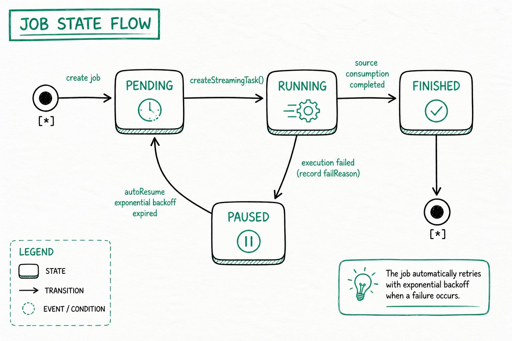

---
{
    "title": "지속적 적재 개요",
    "language": "ko",
    "sidebar_label": "개요",
    "description": "MySQL, PostgreSQL, OceanBase 및 S3를 위한 Doris Streaming Job의 지속적 적재, 동기화 방법 선택, 작업 상태 및 일반적인 운영 방법을 알아봅니다.",
    "keywords": [
        "Doris 지속적 적재",
        "Streaming Job",
        "MySQL 실시간 동기화",
        "PostgreSQL 실시간 동기화",
        "OceanBase 실시간 동기화",
        "S3 지속적 적재",
        "SQL 매핑 동기화",
        "자동 테이블 생성 동기화",
        "exactly-once",
        "at-least-once",
        "autoResume"
    ]
}
---

:::caution 실험적 기능

Doris 지속적 적재는 실험적 기능이며 Doris 4.1.5부터 지원됩니다.

:::

<!-- Knowledge type: Feature overview + architecture selection decision -->
<!-- Applicable scenarios: Real-time data ingestion selection / continuous load operations -->

Doris는 **Streaming Job**을 통해 여러 데이터 소스의 데이터를 Doris 테이블로 지속적으로 적재할 수 있습니다. Job을 제출하면 Doris가 적재 작업을 계속 실행하면서 소스에서 데이터를 실시간으로 읽어 Doris 테이블에 기록합니다.

이 문서는 다음 질문에 답하는 데 도움이 됩니다.

- 지속적 적재는 어떤 데이터 소스와 동기화 모드를 지원합니까?
- SQL 매핑 동기화와 자동 테이블 생성 동기화 중 무엇을 선택해야 합니까?
- 작업 상태는 어떻게 전환되며 자동 복구는 어떻게 작동합니까?
- 일상적인 운영에서 적재 작업을 어떻게 조회하고, 일시 중지하고, 재개하고, 삭제합니까?
- 일반적인 FE 및 Job 구성 매개변수에는 무엇이 있습니까?

## 지원되는 데이터 소스 및 동기화 모드 {#supported-data-sources-and-sync-modes}

지속적 적재는 다음 데이터 소스와 동기화 모드를 지원합니다. S3 알림 적재와 일회성 적재는 Doris 4.1.6부터 지원됩니다.

| 데이터 소스 | 지원 버전 | SQL 매핑 동기화                                                  | 자동 테이블 생성 동기화                                                | 구성 가이드                                                                                                                       |
| :---------- | :-------- | :---------------------------------------------------------------- | :---------------------------------------------------------------------- | :---------------------------------------------------------------------------------------------------------------------------------------- |
| MySQL       | 5.6, 5.7, 8.0.x    | [SQL 매핑을 사용하는 MySQL CDC](./continuous-load-mysql-table.md)    | [자동 테이블 생성을 사용하는 MySQL CDC](./continuous-load-mysql-database.md) | [Amazon RDS MySQL](./prerequisites/amazon-rds-mysql.md) · [Amazon Aurora MySQL](./prerequisites/amazon-aurora-mysql.md)                   |
| PostgreSQL  | 14, 15, 16, 17     | [SQL 매핑을 사용하는 PostgreSQL CDC](./continuous-load-postgresql-table.md) | [자동 테이블 생성을 사용하는 PostgreSQL CDC](./continuous-load-postgresql-database.md) | [Amazon RDS PostgreSQL](./prerequisites/amazon-rds-postgresql.md) · [Amazon Aurora PostgreSQL](./prerequisites/amazon-aurora-postgresql.md) |
| OceanBase   | MySQL 호환 모드 | -                                                           | [자동 테이블 생성을 사용하는 OceanBase CDC](./continuous-load-oceanbase-database.md) | -                                                                                                                                         |
| S3          | -                  | [S3 지속적 적재](./continuous-load-s3.md)                     | -                                                                       | -                                                                                                                                         |

업스트림 열 유형을 Doris 유형으로 매핑하는 방법은 [MySQL](./data-type-mapping-mysql.md), [PostgreSQL](./data-type-mapping-postgresql.md) 및 [OceanBase](./data-type-mapping-oceanbase.md)의 데이터 유형 매핑을 참조하십시오.

## 동기화 방법 선택 방법 {#how-to-choose-a-sync-method}

<!-- Knowledge type: Architecture selection decision -->

SQL 매핑 동기화와 자동 테이블 생성 동기화는 **기본 메커니즘이 완전히 다른** 두 가지 지속적 적재 방법이며, “테이블 수”의 차이가 아닙니다. **자동 테이블 생성 동기화는 `include_tables`를 통해 단일 테이블만 동기화하는 것도 지원하므로**, 필요한 기능을 기준으로 선택해야 합니다.

### 기능 비교 {#capability-comparison}

| 기능         | SQL 매핑 동기화                                                | 자동 테이블 생성 동기화                           |
| :----------------- | :-------------------------------------------------------------- | :------------------------------------------------- |
| 기본 메커니즘 | Job + TVF (`INSERT INTO tbl SELECT * FROM tvf()`)             | Job + 네이티브 전체 데이터베이스 DDL (`FROM src TO DATABASE db`) |
| 대상 수준       | 기존 Doris 테이블                                         | Doris 데이터베이스 컨테이너                         |
| 동기화 범위       | 단일 테이블                                                  | 한 테이블부터 여러 테이블, 전체 데이터베이스까지(`include_tables`로 제어) |
| 테이블 자동 생성 | 테이블을 미리 생성해야 함                                | 첫 동기화 시 기본 키 테이블이 자동으로 생성됨 |
| SQL 유연성    | 열 매핑, 필터링 및 변환(SELECT 절) 지원 | 있는 그대로 복사하며 ETL은 지원하지 않음              |
| 의미 보장 | exactly-once                                                    | at-least-once                                      |
| 필요한 권한 | Load                                                           | Load + Create(테이블 자동 생성 시) |
| 일반적인 시나리오  | 열 제거, 필드 이름 변경, 유형 변환 또는 조건부 필터링이 필요한 실시간 동기화 | 전체 데이터베이스 또는 테이블 그룹의 미러 복제. 다운스트림 테이블 스키마가 업스트림을 자동으로 따르도록 해야 하는 경우 |

### 선택 권장 사항 {#selection-recommendations}

- **데이터에 SQL 처리를 적용해야 하거나 exactly-once 의미 보장이 엄격하게 필요함** -> **SQL 매핑 동기화**를 선택합니다.
- **Doris가 테이블을 자동으로 생성하고 하나의 구성으로 테이블 그룹을 동기화하기를 원함** -> **자동 테이블 생성 동기화**를 선택합니다.
- **데이터 소스가 OceanBase임** -> 현재 MySQL 호환 모드의 자동 테이블 생성 동기화만 지원됩니다.
- **데이터 소스가 S3 객체 스토리지임** -> S3 TVF를 사용하는 SQL 매핑 동기화만 지원됩니다.

## Job 상태 전환 {#job-state-transitions}

<!-- Knowledge type: Runtime mechanism -->

Streaming Job은 실행 중 다음 상태 사이를 전환합니다. **SQL 매핑 동기화와 자동 테이블 생성 동기화는 동일한 상태 머신을 따릅니다.**



### 상태 설명 {#state-descriptions}

| 상태        | 의미                                                                                                                  |
| :----------- | :----------------------------------------------------------------------------------------------------------------------- |
| **PENDING**  | Job이 생성되었지만 아직 하위 작업이 예약되지 않았습니다. 다음 예약 주기에 `StreamingTask`를 생성하기 위해 대기합니다. |
| **RUNNING**  | 하위 작업이 생성되어 실행 중이며, 소스에서 증분 데이터를 읽어 Doris에 기록합니다.         |
| **FINISHED** | 소스의 모든 데이터 소비가 완료되어 Job이 종료되었습니다. S3 TVF Job은 모든 파일이 적재된 후 이 상태가 됩니다. |
| **PAUSED**   | 하위 작업이 실패하여 Job이 자동으로 일시 중지되고 `failReason`이 기록됩니다. `select * from jobs(...)`의 `ErrorMsg` 필드에서 원인을 확인할 수 있습니다. |

### 자동 복구(autoResume) {#automatic-recovery-autoresume}

Job이 `PAUSED` 상태가 되면 스케줄러는 **지수 백오프 전략**을 사용하여 주기적으로 복구를 시도합니다. 복구되면 Job은 `PENDING`으로 돌아가 하위 작업을 계속 생성합니다. **수동 개입 없이 네트워크 변동이나 짧은 시간 동안의 업스트림 사용 불가 같은 일시적 오류가 자동으로 처리됩니다.**

각 시나리오에 적절한 명령을 사용하십시오.

- **즉시 재개하거나 문제 해결 후 수동으로 시작**: [`RESUME JOB`](#resume-a-load-job)을 사용합니다.
- **완전히 중지하여 더 이상 예약하지 않음**: [`PAUSE JOB`](#pause-a-load-job)을 사용합니다(수동으로 일시 중지한 Job은 autoResume으로 다시 시작되지 않음). 또는 [`DROP JOB`](#delete-a-load-job)을 사용합니다.

### CDC 작업 주체 및 실패 처리 {#cdc-task-identity-and-failure-handling}

4.1.5부터 Streaming CDC는 쓰기, 테이블 메타데이터 쿼리 및 스키마 변경에 고정된 관리자 ID 대신 Job 생성자의 Doris ID를 사용합니다. 생성자에게는 대상 테이블에 대한 `LOAD` 권한이 필요하고, 자동 테이블 생성에는 `CREATE` 권한, 스키마 동기화에는 해당 `ALTER` 권한과 테이블 조회 권한이 필요합니다. 실행 중 권한을 취소하면 이후 작업에도 영향을 줍니다. Job에 기록된 생성자의 권한 부여를 확인하십시오.

`cdc_stream()`을 기반으로 하는 Streaming INSERT 작업이 실패해도 일반 작업 재시도 흐름으로 들어가지 않습니다. `jobs()`와 `tasks()`에서 오류를 확인하고 소스 또는 권한 문제를 해결한 다음 Job 상태에 따라 재개하십시오. 실패한 작업이 자동으로 재생된다고 가정하지 마십시오.

## 일반 작업 {#common-operations}

<!-- Knowledge type: Operational steps -->

### 적재 상태 조회 {#view-load-status}

모든 Streaming 유형의 Insert Job을 조회합니다.

```sql
select * from jobs("type"="insert") where ExecuteType = "STREAMING";
```

결과 열:

| 열            | 설명                                                              |
| ----------------- | ------------------------------------------------------------------------ |
| ID                | Job ID                                                                   |
| NAME              | Job 이름                                                                 |
| Definer           | Job 정의자                                                              |
| ExecuteType       | Job 예약 유형: *ONE_TIME/RECURRING/STREAMING/MANUAL*               |
| RecurringStrategy | 반복 전략입니다. 일반 Insert에서 사용되며 ExecuteType=Streaming이면 비어 있습니다. |
| Status            | Job 상태                                                               |
| ExecuteSql        | Job의 Insert SQL 문                                      |
| CreateTime        | Job 생성 시간                                                        |
| SucceedTaskCount  | 성공한 작업 수                                               |
| FailedTaskCount   | 실패한 작업 수                                                   |
| CanceledTaskCount | 취소된 작업 수                                                 |
| Comment           | Job 주석                                                              |
| Properties        | Job 속성                                                           |
| CurrentOffset     | Job이 처리를 완료한 오프셋입니다. ExecuteType=Streaming일 때만 설정됩니다. |
| EndOffset         | 데이터 소스에서 가져온 최대 EndOffset입니다. ExecuteType=Streaming일 때만 설정됩니다. |
| LoadStatistic     | Job 통계                                                           |
| ErrorMsg          | Job 오류 메시지                                                 |
| JobRuntimeMsg     | Job 런타임 힌트                                                 |
| LagBytes          | 소스 로그(MySQL / OceanBase binlog 또는 PostgreSQL WAL)의 백로그 바이트 수입니다. `-1`은 현재 값을 사용할 수 없음을 의미하며, 예를 들어 S3 데이터 소스이거나 전체 스냅샷 단계인 경우가 이에 해당합니다. |
| LastSourceEventTimestamp | 커밋된 오프셋에 기록된 최신 소스 이벤트의 타임스탬프(Unix 초)입니다. 사용할 수 없으면 비어 있습니다. |
| LastTaskSuccessTime | 가장 최근 Task가 성공적으로 완료된 시간                  |

### Task 상태 조회 {#view-task-status}

Job ID로 Job 아래의 모든 하위 작업을 조회합니다.

```sql
select * from tasks("type"="insert") where jobId='<job_id>';
```

결과 열:

| 열        | 설명                                                          |
| ------------- | -------------------------------------------------------------------- |
| TaskId        | Task ID                                                              |
| JobID         | JobID                                                                |
| JobName       | Job 이름                                                             |
| Label         | Task가 적재에 사용하는 레이블                               |
| Status        | Task 상태                                                          |
| ErrorMsg      | Task 실패 메시지                                                 |
| CreateTime    | Task 생성 시간                                                   |
| StartTime     | Task 시작 시간                                                      |
| FinishTime    | Task 완료 시간                                                     |
| LoadStatistic | Task 통계                                                      |
| User          | Task 실행자                                                        |
| RunningOffset | 현재 Task가 동기화 중인 오프셋 정보입니다. Job.ExecuteType=Streaming일 때만 설정됩니다. |

### 적재 Job 일시 중지 {#pause-a-load-job}

지정한 Job을 수동으로 일시 중지합니다(일시 중지한 Job은 autoResume으로 다시 시작되지 않음).

```sql
PAUSE JOB WHERE jobname = <job_name>;
```

### 적재 Job 재개 {#resume-a-load-job}

`PAUSED` 상태인 Job을 재개합니다.

```sql
RESUME JOB WHERE jobName = <job_name>;
```

### 적재 Job 삭제 {#delete-a-load-job}

지정한 Job을 영구적으로 삭제합니다. 삭제 후에는 Job이 더 이상 예약되지 않습니다.

```sql
DROP JOB WHERE jobName = <job_name>;
```

## 공통 매개변수 {#common-parameters}

<!-- Knowledge type: Configuration parameters -->

### FE 구성 매개변수 {#fe-configuration-parameters}

| 매개변수                            | 기본값 | 설명                                       |
| ------------------------------------ | ------- | ------------------------------------------------- |
| max_streaming_job_num                | 1024    | Streaming Job의 최대 개수                  |
| job_streaming_task_exec_thread_num   | 10      | StreamingTask 실행에 사용되는 스레드 수   |
| max_streaming_task_show_count        | 100    | 메모리에 유지되는 StreamingTask 실행 기록의 최대 개수 |

### Job 공통 적재 구성 매개변수 {#job-common-load-configuration-parameters}

| 매개변수    | 기본값 | 설명                                            |
| ------------ | ------- | ------------------------------------------------------ |
| max_interval | 10      | 업스트림에 새 데이터가 없을 때의 유휴 예약 간격(초)입니다. 정수(초)만 허용되며 `10`과 같이 지정합니다. `10s` 같은 단위 접미사는 지원되지 않습니다. 1 이상이어야 합니다. |

## 제한 사항 {#limitations}

<!-- Knowledge type: Limitations / unsupported boundaries -->

동기화 범위, 테이블 자동 생성 및 의미 보장(exactly-once / at-least-once)은 [기능 비교](#capability-comparison)에 설명되어 있습니다. 이 섹션에는 **지원되지 않는** 제약과 동작만 나열합니다.

### 기본 키 테이블 {#primary-key-tables}

**기본 키가 있는** 업스트림 테이블만 동기화할 수 있습니다(두 동기화 방법 모두). 해당 Doris 테이블은 **Unique Key** 테이블입니다. 자동 테이블 생성 동기화에서는 이러한 테이블로 자동 생성되고, SQL 매핑 동기화에서는 사용자가 생성해야 합니다. 기본 키가 없는 테이블은 지원되지 않습니다.

### 스키마 변경(DDL) {#schema-change-ddl}

DDL 동기화는 **자동 테이블 생성 동기화에만** 적용됩니다. SQL 매핑(TVF)은 어떠한 DDL도 동기화하지 않으며, `cdc_stream()` 테이블 함수는 항상 `schema_change_enabled`를 `false`로 강제합니다.

- **PostgreSQL**: `ADD COLUMN`과 `DROP COLUMN`만 동기화됩니다. **열 유형 변경, `RENAME COLUMN`, 제약 조건 / 인덱스 / 파티션 변경은 동기화되지 않습니다.** Doris에서 수동으로 적용하십시오.
- **MySQL**: `ADD COLUMN`과 `DROP COLUMN`만 동기화됩니다. **열 유형 변경, `RENAME COLUMN`, 제약 조건 / 인덱스 / 파티션 변경은 동기화되지 않습니다.** Doris에서 수동으로 적용하십시오.
- **OceanBase**: `ADD COLUMN`과 `DROP COLUMN`만 동기화됩니다. **열 유형 변경, `RENAME COLUMN`, 기본 키 / 제약 조건 / 인덱스 / 파티션 변경은 동기화되지 않습니다.** Doris에서 수동으로 적용하십시오.

자동 테이블 생성 동기화에서는 기본적으로 스키마 변경 동기화가 활성화됩니다. Doris 4.1에서는 이를 비활성화하는 SQL 속성을 제공하지 않습니다.

:::caution 스키마 변경 동작

- 추가된 열에는 업스트림 열의 `DEFAULT` 값이 포함되지 않습니다(MySQL, PostgreSQL 및 OceanBase). 새 열에는 Doris에서 기본값이 없으며 기존 행도 백필되지 않습니다.
- PostgreSQL 스키마 변경 감지는 Relation 이벤트에 의해 수행됩니다. `ADD COLUMN`과 `DROP COLUMN`만 인식되며, 열을 추가하면서 삭제하는 변경(`RENAME`일 수 있음)은 건너뛰고 열 유형 변경도 건너뜁니다. 이 기능은 자동 테이블 생성 동기화(at-least-once) 경로에만 적용되며 TVF / exactly-once 경로에서는 지원되지 않습니다.

:::

## FAQ {#faq}

<!-- Knowledge type: FAQ / troubleshooting -->

### MySQL 연결 오류: Public Key Retrieval is not allowed {#mysql-connection-error-public-key-retrieval-is-not-allowed}

**원인:** 구성된 MySQL 사용자는 SHA256 암호 인증을 사용하며, 이 경우 TLS와 같은 프로토콜을 통해 암호를 전송해야 합니다.

**해결 방법 1:** JDBC URL에 `allowPublicKeyRetrieval=true` 매개변수를 추가합니다.

```
jdbc:mysql://127.0.0.1:3306?allowPublicKeyRetrieval=true
```

**해결 방법 2:** MySQL 사용자의 인증 방식을 `mysql_native_password`로 변경합니다.

```sql
ALTER USER 'username'@'%' IDENTIFIED WITH mysql_native_password BY 'password';
FLUSH PRIVILEGES;
```
