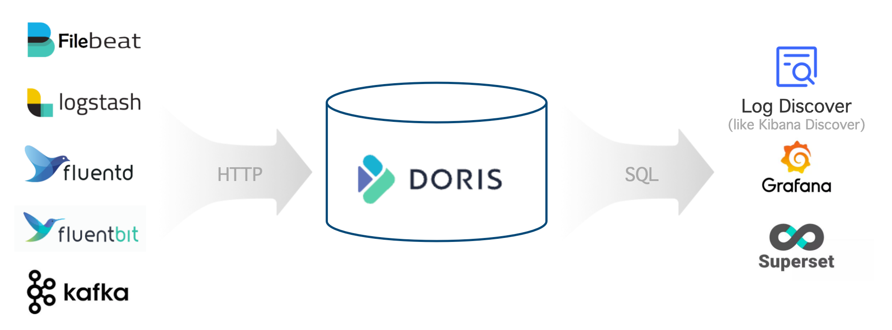
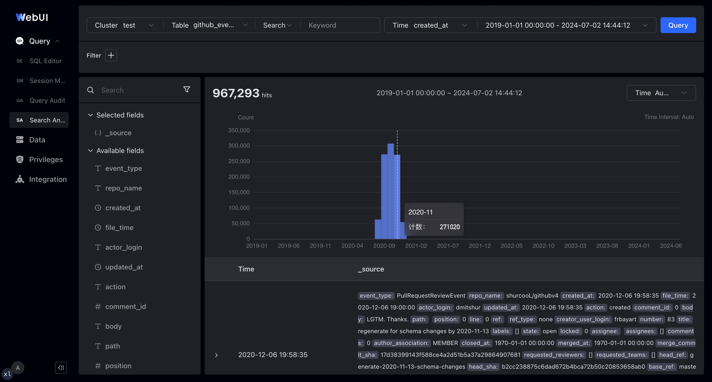

---
{
    "title": "로그 저장 및 분석",
    "language": "ko",
    "description": "Apache Doris로 Elasticsearch를 대체해 로그 플랫폼을 구축하는 방법을 설명합니다. 아키텍처, 리소스 산정, 테이블 생성, 수집, 쿼리까지 전 과정을 다룹니다.",
    "sidebar_label": "로그",
    "keywords": [
        "Doris 로그 분석",
        "로그 저장",
        "전문 검색",
        "역인덱스",
        "Elasticsearch 대안",
        "Stream Load 로그",
        "Logstash Doris",
        "Filebeat Doris",
        "Kafka Routine Load",
        "핫·콜드 계층화",
        "VARIANT 반정형 데이터",
        "log_policy",
        "time_series compaction"
    ]
}
---

<!-- Knowledge type: Solution overview + Procedure -->
<!-- Applicable scenario: Log platform selection / Log storage and search analysis / Elasticsearch alternative -->

로그는 시스템 운영을 상세히 기록한 데이터로, 이벤트의 주체, 시간, 위치, 내용과 같은 핵심 정보를 담고 있습니다. 운영 관측성, 네트워크 보안 모니터링, 비즈니스 분석을 위해 기업은 흩어져 있는 로그를 한곳에 수집·저장·분석하고, 방대한 로그에서 가치를 찾아야 합니다.

이러한 용도에 맞춰 Apache Doris는 일반적인 OLAP 기능에 역인덱스와 고속 전문 검색 기능을 더하고, 쓰기 성능과 저장 공간 사용량을 극한까지 최적화했습니다. Apache Doris를 사용하면 개방적이고 성능이 높으며 비용이 낮은 통합 로그 저장·분석 플랫폼을 구축할 수 있습니다.

이 문서에서는 다음 내용을 다룹니다.

- **전체 아키텍처**: Apache Doris 기반 로그 플랫폼의 핵심 구성 요소와 기반 아키텍처
- **특징과 장점**: Elasticsearch와 비교한 차별화된 기능
- **운영 가이드**: 리소스 산정부터 로그 쿼리까지의 전체 절차

---

## 1. 전체 아키텍처 {#1-overall-architecture}

<!-- Knowledge type: Architecture selection decision -->

Apache Doris 기반 로그 저장·분석 플랫폼의 아키텍처는 다음과 같습니다.



전체 아키텍처는 세 부분으로 구성됩니다.

| 계층 | 구성 요소 | 설명 |
| :--- | :--- | :--- |
| 로그 수집 및 전처리 | Logstash, Filebeat, Fluentbit, Kafka 등 | HTTP API를 통해 로그 데이터를 Apache Doris에 기록 |
| 로그 저장 및 분석 | Apache Doris | 고성능·저비용 통합 저장소를 제공하고 SQL 인터페이스를 통해 다양한 검색 및 분석 기능 제공 |
| 로그 분석 및 알림 | Grafana, Superset, Doris WebUI 등 | 표준 MySQL 프로토콜로 Doris를 쿼리하고 사용하기 쉬운 시각화 인터페이스 제공 |

---

## 2. 특징과 장점 {#2-features-and-advantages}

<!-- Knowledge type: Capability definition -->

Apache Doris 기반 로그 플랫폼은 다음과 같은 핵심 기능을 제공합니다.

| 기능 | 설명 |
| :--- | :--- |
| 높은 처리량과 짧은 지연 시간의 수집 | 하루 수백 TB의 로그를 GB/s 속도로 안정적이고 지속적으로 수집하며 지연 시간은 1초 미만 |
| 방대한 데이터의 저비용 저장 | PB 규모 저장을 지원하며 Elasticsearch 대비 저장 비용을 60%–80% 절감하고, 콜드 데이터를 S3/HDFS로 계층화하면 추가로 50% 절감 |
| 고성능 전문 검색 및 분석 | 역인덱스와 전문 검색을 지원하며 키워드가 포함된 상세 로그 조회, 추세 분석 등의 쿼리에 수초 내 응답 |
| 개방적이고 사용하기 쉬운 생태계 | 상위 시스템에서는 Logstash, Filebeat, Fluentbit, Kafka 등과 연동하고, 하위 시스템에서는 표준 MySQL 프로토콜을 통해 Grafana, Superset, Doris WebUI와 연동 |

### 2.1 높은 성능과 낮은 비용 {#21-high-performance-and-low-cost}

<!-- Knowledge type: Capability definition -->

벤치마크와 운영 환경에서 검증한 결과, Apache Doris 기반 로그 플랫폼의 비용 대비 성능은 Elasticsearch보다 5~10배 높습니다. 이러한 장점은 주로 고성능 저장·쿼리 엔진과 로그 용도에 특화된 최적화에서 비롯됩니다.

- **더 높은 쓰기 처리량**: Elasticsearch의 쓰기 병목은 데이터 파싱과 역인덱스 구축에 쓰이는 CPU입니다. Apache Doris는 SIMD와 같은 CPU 벡터화 명령으로 JSON 파싱과 인덱스 구축을 가속하고, 로그에 필요하지 않은 정방향 인덱스 등의 자료 구조를 제거해 역인덱스 구조를 간소화합니다. 동일한 리소스에서 Doris의 쓰기 성능은 Elasticsearch의 3~5배입니다.
- **더 낮은 저장 비용**: Elasticsearch는 정방향 인덱스, 역인덱스, doc values 열 저장소 등 데이터의 여러 사본을 저장하며 일반적인 압축률도 비교적 낮습니다. Doris는 정방향 인덱스를 제거해 인덱스 데이터량을 30% 줄이고, 열 지향 저장 방식과 Zstandard 압축 알고리즘으로 5~10의 압축비를 달성합니다. 이는 Elasticsearch의 1.5보다 훨씬 높습니다. 핫·콜드 계층화 기능은 과거 로그를 객체 스토리지로 자동 이동해 콜드 데이터 저장 비용을 70% 이상 줄일 수 있습니다. 전체 저장 비용은 Elasticsearch의 약 20%에 불과합니다.
- **더 높은 쿼리 성능**: Doris는 전문 검색 과정을 간소화하고 로그 용도에 필요하지 않은 관련성 점수 계산 등의 알고리즘을 건너뜁니다. 또한 "특정 키워드를 포함하는 최신 로그 100건" 같은 일반적인 쿼리를 위해 계획 및 실행 단계에서 TopN 동적 가지치기 등의 최적화를 적용합니다.

### 2.2 강력한 분석 기능 {#22-powerful-analytical-capabilities}

<!-- Knowledge type: Capability definition -->

Apache Doris는 표준 SQL을 지원하고 MySQL 프로토콜 및 구문과 호환됩니다. 따라서 Doris 기반 로그 시스템에는 다음과 같은 장점이 있습니다.

- **쉬운 사용법**: 엔지니어와 데이터 분석가는 SQL에 익숙하므로 새로운 기술 스택을 배우지 않고도 빠르게 시작할 수 있습니다.
- **풍부한 생태계**: MySQL 명령줄, 다양한 GUI / BI 도구, 빅데이터 생태계와 원활하게 통합해 복잡하고 다양한 데이터 처리·분석 요구를 충족합니다.
- **강력한 분석 기능**: SQL은 데이터 분석의 사실상 표준으로, 검색, 집계, 다중 테이블 JOIN, 서브쿼리, UDF, 논리 뷰, 구체화된 뷰 등을 지원합니다.

### 2.3 유연한 스키마 {#23-flexible-schema}

<!-- Knowledge type: Capability definition -->

다음은 JSON 형식의 일반적인 반정형 로그 예시입니다. 최상위 필드(`timestamp`, `source`, `node`, `component`, `level`, `clientRequestId`, `message`, `properties`)는 비교적 고정되어 있지만, 확장 속성인 `properties` 안의 중첩 필드(`properties.size`, `properties.format` 등)는 동적으로 달라지며 로그마다 필드가 다를 수 있습니다.

```json
{
  "timestamp": "2014-03-08T00:50:03.8432810Z",
  "source": "ADOPTIONCUSTOMERS81",
  "node": "Engine000000000405",
  "level": "Information",
  "component": "DOWNLOADER",
  "clientRequestId": "671db15d-abad-94f6-dd93-b3a2e6000672",
  "message": "Downloading file path: benchmark/2014/ADOPTIONCUSTOMERS81_94_0.parquet.gz",
  "properties": {
    "size": 1495636750,
    "format": "parquet",
    "rowCount": 855138,
    "downloadDuration": "00:01:58.3520561"
  }
}
```

Apache Doris는 다음 두 가지 방식으로 유연한 스키마를 지원합니다.

- **Light Schema Change**: 최상위 필드가 가끔 변경되는 경우 `ADD/DROP COLUMN`, `ADD/DROP INDEX`와 같은 스키마 변경을 수초 내에 완료할 수 있습니다. 계획 단계에서는 현재 어떤 필드에 인덱스가 필요한지만 고려하면 됩니다.
- **VARIANT 반정형 타입**: `properties` 같은 확장 필드에는 임의의 JSON 데이터를 기록할 수 있습니다. 필드 이름과 타입을 자동으로 감지하고 자주 나타나는 필드를 별도의 열 저장소로 분리합니다. `VARIANT`에 역인덱스를 생성해 내부 필드의 쿼리와 검색 속도를 높일 수도 있습니다.

Elasticsearch의 동적 매핑과 비교하면 Apache Doris의 유연한 스키마에는 다음과 같은 장점이 있습니다.

- 동일한 필드에 여러 타입을 허용합니다. `VARIANT`는 충돌을 자동으로 처리하고 타입을 승격해 로그 데이터의 점진적인 변경에 더 잘 대응합니다.
- `VARIANT`는 드물게 나타나는 필드를 단일 열로 자동 병합해 필드, 메타데이터 또는 열이 지나치게 많아 발생하는 성능 문제를 피합니다.
- 열과 인덱스를 동적으로 추가하고 제거할 수 있습니다. 처음부터 모든 필드에 인덱스를 생성할 필요가 없어 불필요한 비용을 줄입니다.

---

## 3. 운영 가이드 {#3-operations-guide}

<!-- Knowledge type: Procedure -->
<!-- Applicable scenario: Log platform deployment / Production rollout -->

다음 표는 Apache Doris 기반 로그 플랫폼을 구축하는 전체 여섯 단계 절차를 보여줍니다.

| 단계 | 목적 |
| :--- | :--- |
| [1단계: 리소스 산정](#31-estimate-resources) | FE/BE 노드 수, 디스크 용량, 객체 스토리지 크기 산정 |
| [2단계: 클러스터 배포](#32-deploy-the-cluster) | 물리 머신 또는 가상 머신에 Apache Doris 배포 |
| [3단계: FE 및 BE 설정 조정](#33-tune-fe-and-be-configurations) | 로그 용도에 맞춰 주요 매개변수 조정 |
| [4단계: 테이블 생성](#34-create-the-table) | 파티션과 버킷, 압축, compaction, 인덱스, 계층화 정책 설계 |
| [5단계: 로그 수집](#35-collect-logs) | Logstash, Filebeat, Kafka 또는 사용자 정의 프로그램과 연동 |
| [6단계: 로그 쿼리 및 분석](#36-query-and-analyze-logs) | SQL과 시각화 도구로 로그 검색 및 분석 |

### 3.1 리소스 산정 {#31-estimate-resources}

<!-- Knowledge type: Hardware requirements -->
<!-- Applicable scenario: Pre-deployment planning / Capacity planning -->

클러스터를 배포하기 전에 서버 하드웨어 리소스를 산정해야 합니다. 주요 단계는 다음과 같습니다.

1. 다음 공식으로 **쓰기 리소스를 산정**합니다.

    - `Average write throughput = Daily incremental data / 86400 s`
    - `Peak write throughput = Average write throughput * Peak-to-average write ratio`
    - `CPU cores required for peak writes = Peak write throughput / Per-core write throughput`

2. 다음 공식으로 **저장 리소스를 산정**합니다.

    - `Required storage = Daily incremental data / Compression ratio * Replica count * Data retention period`

3. **쿼리 리소스를 산정**합니다. 쿼리의 리소스 사용량은 쿼리 양과 복잡도에 따라 달라집니다. 초기 계획에는 CPU 리소스의 50%를 쿼리용으로 확보한 뒤 실제 테스트 결과에 따라 조정합니다.

4. **리소스를 종합**합니다. 첫 번째와 세 번째 단계에서 필요한 CPU 코어 수를 산정한 다음, 이를 머신당 CPU 코어 수로 나눠 BE 서버 수를 구합니다. 두 번째 단계의 결과를 결합해 BE 서버당 필요한 저장 용량을 산정하고, 이를 데이터 디스크 4~12개에 분산해 디스크당 용량을 계산합니다.

#### 예시: 하루에 신규 로그 100 TB가 발생할 때의 리소스 산정 {#example-resource-estimation-for-100-tb-of-new-logs-per-day}

압축 전 신규 데이터가 하루 100 TB이고, 압축비가 5, 복제본 수가 1, 핫 데이터 보관 기간이 3일, 콜드 데이터 보관 기간이 30일이라고 가정합니다. 쓰기 처리량의 피크 대 평균 비율은 200%, 코어당 쓰기 처리량은 10 MB/s이며 CPU의 50%를 쿼리용으로 확보합니다. 산정 결과는 다음과 같습니다.

- **FE**: 서버 3대, 각각 CPU 16코어, 메모리 64 GB, 100 GB SSD 1개
- **BE**: 서버 15대, 각각 CPU 32코어, 메모리 256 GB, 600 GB SSD 10개
- **S3 객체 스토리지**: 콜드 데이터 저장 공간 600 TB

주요 지표의 값과 계산 방식은 다음과 같습니다.

| 주요 지표(단위) | 값 | 설명 |
| :--- | :--- | :--- |
| 일일 신규 데이터(TB) | 100 | 실제 요구 사항에 따라 입력 |
| 압축비 | 5 | 일반적으로 3~10(인덱스 포함)이며 실제 요구 사항에 따라 입력 |
| 복제본 수 | 1 | 실제 요구 사항에 따라 입력. 기본값 1, 가능한 값: 1, 2, 3 |
| 핫 데이터 보관 기간(일) | 3 | 실제 요구 사항에 따라 입력 |
| 콜드 데이터 보관 기간(일) | 30 | 실제 요구 사항에 따라 입력 |
| 전체 보관 기간(일) | 33 | 공식: `Hot data retention + Cold data retention` |
| 예상 핫 데이터 저장 용량(TB) | 60 | 공식: `Daily incremental data / Compression ratio * Replica count * Hot data retention` |
| 예상 콜드 데이터 저장 용량(TB) | 600 | 공식: `Daily incremental data / Compression ratio * Replica count * Cold data retention` |
| 쓰기 처리량의 피크 대 평균 비율 | 200% | 실제 요구 사항에 따라 입력. 기본값 200% |
| 머신당 CPU 코어 수 | 32 | 실제 요구 사항에 따라 입력. 기본값 32코어 |
| 평균 쓰기 처리량(MB/s) | 1214 | 공식: `Daily incremental data / 86400 s` |
| 피크 쓰기 처리량(MB/s) | 2427 | 공식: `Average write throughput * Peak-to-average write ratio` |
| 피크 쓰기에 필요한 CPU 코어 수 | 242.7 | 공식: `Peak write throughput / Per-core write throughput` |
| 쿼리용으로 확보한 CPU | 50% | 실제 요구 사항에 따라 입력. 기본값 50% |
| 예상 BE 서버 수 | 15.2 | 공식: `CPU cores required for peak writes / CPU cores per machine / (1 - CPU reserved for queries)` |
| 예상 BE 서버 수(반올림) | 15 | 공식: `MAX(Replica count, rounded estimated number of BE servers)` |
| BE 서버당 예상 저장 용량(TB) | 5.7 | 공식: `Estimated hot-data storage / Estimated number of BE servers / (1 - 30%)`. 여기서 30%는 저장 공간 여유분입니다. I/O 용량을 높이려면 BE마다 데이터 디스크 4~12개를 마운트하는 것이 좋습니다. |

### 3.2 클러스터 배포 {#32-deploy-the-cluster}

<!-- Knowledge type: Procedure -->

리소스 산정을 마치면 Apache Doris 클러스터를 배포할 수 있습니다. 물리 머신 또는 가상 머신에 배포하는 것이 좋습니다. 수동 배포 절차는 [수동 배포](../install/deploy-manually/integrated-storage-compute-deploy-manually)를 참조하세요.

### 3.3 FE 및 BE 설정 조정 {#33-tune-fe-and-be-configurations}

<!-- Knowledge type: Configuration parameters -->
<!-- Applicable scenario: Performance tuning / Cluster initialization -->

클러스터를 배포한 다음, 로그 저장·분석 용도에 맞게 FE와 BE 매개변수를 각각 조정합니다.

#### 3.3.1 FE 설정 조정 {#331-tune-fe-configurations}

`fe/conf/fe.conf`에서 다음 표에 따라 FE 설정을 조정합니다.

| 조정할 매개변수 | 설명 |
| :--- | :--- |
| `max_running_txn_num_per_db = 10000` | 동시 수집량이 많으면 실행 중인 트랜잭션도 많아지므로 이 값을 높입니다. |
| `streaming_label_keep_max_second = 3600`<br />`label_keep_max_second = 7200` | 수집이 빈번하면 트랜잭션 레이블이 더 많은 메모리를 사용하므로 보관 시간을 줄입니다. |
| `enable_round_robin_create_tablet = true` | 태블릿을 생성할 때 라운드 로빈 방식을 사용해 가능한 한 고르게 분산합니다. |
| `tablet_rebalancer_type = partition` | 균형을 맞출 때 각 파티션 내 태블릿을 가능한 한 고르게 분산하는 전략을 사용합니다. |
| `autobucket_min_buckets = 10` | 로그 양이 증가할 때 버킷이 부족해지지 않도록 자동 버킷팅의 최소 버킷 수를 1에서 10으로 높입니다. |
| `max_backend_heartbeat_failure_tolerance_count = 10` | 로그 처리 중 BE 서버의 부하가 높아 잠시 하트비트를 놓칠 수 있으므로 허용 횟수를 1에서 10으로 높입니다. |

매개변수에 관한 자세한 내용은 [FE 설정](../admin-manual/config/fe-config)을 참조하세요.

#### 3.3.2 BE 설정 조정 {#332-tune-be-configurations}

`be/conf/be.conf`에서 다음 표에 따라 BE 설정을 조정합니다.

| 모듈 | 조정할 매개변수 | 설명 |
| :--- | :--- | :--- |
| 저장 | `storage_root_path = /path/to/dir1;/path/to/dir2;...;/path/to/dir12` | 디스크 디렉터리에 핫 데이터를 저장할 경로를 설정합니다. |
| 저장 | `enable_file_cache = true` | 파일 캐시를 활성화합니다. |
| 저장 | `file_cache_path = [{"path": "/mnt/datadisk0/file_cache", "total_size":53687091200, "query_limit": "10737418240"},{"path": "/mnt/datadisk1/file_cache", "total_size":53687091200,"query_limit": "10737418240"}]` | 콜드 데이터의 캐시 경로와 설정을 지정합니다.<br />`path`: 캐시 경로<br />`total_size`: 캐시 경로의 전체 크기(바이트). 53687091200바이트 = 50 GB<br />`query_limit`: 단일 쿼리가 캐시 경로에서 읽을 수 있는 최대 데이터량(바이트). 10737418240바이트 = 10 GB |
| 쓰기 | `write_buffer_size = 1073741824` | 쓰기 버퍼 파일 크기를 늘려 작은 파일과 무작위 I/O를 줄이고 성능을 높입니다. |
| Compaction | `max_cumu_compaction_threads = 8` | CPU 32코어인 BE에서는 누적 compaction 스레드 풀을 스레드 8개로 제한합니다. CPU 코어 수 / 4는 튜닝의 출발점일 뿐 CPU 할당량이나 예약량이 아닙니다. 이 설정은 수집, 쿼리 또는 base compaction에 CPU를 할당하지 않습니다. Compaction 적체량과 워크로드 측정값을 바탕으로 조정하세요. |
| Compaction | `inverted_index_compaction_enable = true` | 인덱스 compaction을 활성화해 compaction 중 CPU 사용량을 줄입니다. |
| Compaction | `enable_segcompaction = false`<br />`enable_ordered_data_compaction = false` | 로그 용도에 필요하지 않은 두 가지 compaction 기능을 비활성화합니다. |
| Compaction | `enable_compaction_priority_scheduling = false` | 우선순위가 낮은 compaction은 디스크당 작업 2개로 제한되어 compaction 속도가 느려집니다. |
| Compaction | `total_permits_for_compaction_score = 200000` | 메모리 제어에 사용합니다. 시계열 정책 자체에서도 메모리를 제어할 수 있습니다. |
| 캐시 | `disable_storage_page_cache = true`<br />`inverted_index_searcher_cache_limit = 30%` | 로그 데이터량이 많아 데이터 캐시의 이점이 제한적이므로 데이터 캐시를 끄고 인덱스 캐시를 사용합니다. |
| 캐시 | `inverted_index_cache_stale_sweep_time_sec = 3600`<br />`index_cache_entry_stay_time_after_lookup_s = 3600` | 인덱스 캐시를 최대 한 시간 동안 메모리에 유지합니다. |
| 캐시 | `enable_inverted_index_cache_on_cooldown = true`<br />`enable_write_index_searcher_cache = false` | 인덱스를 콜드 스토리지에 업로드할 때 자동 캐싱을 활성화합니다. |
| 캐시 | `tablet_schema_cache_recycle_interval = 3600`<br />`segment_cache_capacity = 20000` | 다른 캐시가 사용하는 메모리를 줄입니다. |
| 캐시 | `inverted_index_ram_dir_enable = true` | 쓰기 중 인덱스 임시 파일로 인해 발생하는 I/O 오버헤드를 줄입니다. |
| 스레드 | `pipeline_executor_size = 24`<br />`doris_scanner_thread_pool_thread_num = 48` | CPU 32코어에 맞춘 컴퓨팅 및 I/O 스레드 설정입니다. 코어 수에 비례해 늘리거나 줄입니다. |
| 스레드 | `scan_thread_nice_value = 5` | 쿼리 I/O 스레드의 우선순위를 낮춰 쓰기 성능과 적시성을 확보합니다. |
| 기타 | `string_type_length_soft_limit_bytes = 10485760` | `String` 데이터의 길이 제한을 10 MB로 높입니다. |
| 기타 | `trash_file_expire_time_sec = 300`<br />`path_gc_check_interval_second = 900`<br />`path_scan_interval_second = 900` | 휴지통 파일을 더 빨리 정리합니다. |

매개변수에 관한 자세한 내용은 [BE 설정](../admin-manual/config/be-config)을 참조하세요.

### 3.4 테이블 생성 {#34-create-the-table}

<!-- Knowledge type: Procedure -->
<!-- Applicable scenario: Schema design / Performance tuning -->

로그 데이터의 쓰기와 쿼리에는 각각 뚜렷한 특성이 있으므로, 테이블을 생성할 때 다음 절의 설정을 적용해 성능을 높입니다.

#### 3.4.1 파티션 및 버킷 매개변수 설정 {#341-configure-partitioning-and-bucketing-parameters}

**파티션**:

- 시간 필드에 [Range 파티션](../table-design/data-partitioning/manual-partitioning.md#range-partitioning)(`PARTITION BY RANGE(ts)`)을 사용하고 [동적 파티션](../table-design/data-partitioning/dynamic-partitioning)(`"dynamic_partition.enable" = "true"`)을 활성화해 일별 파티션을 자동으로 관리합니다.
- `Datetime` 타입의 시간 필드를 키(`DUPLICATE KEY(ts)`)로 사용합니다. 최신 로그 N건을 쿼리할 때 속도가 몇 배 빨라집니다.

**버킷**:

- 버킷 수는 클러스터의 전체 디스크 수의 약 3배로 설정하고, 버킷당 압축 데이터량은 약 5 GB로 맞춥니다.
- 무작위 분산 전략(`DISTRIBUTED BY RANDOM BUCKETS 60`)을 쓰기 시 단일 태블릿 수집과 함께 사용해 배치 쓰기 효율을 높입니다.

파티션과 버킷에 관한 자세한 내용은 [데이터 파티션](../table-design/data-partitioning/basic-concepts)을 참조하세요.

#### 3.4.2 압축 매개변수 설정 {#342-configure-compression-parameters}

- Zstd 압축 알고리즘(`"compression" = "zstd"`)을 사용해 데이터 압축비를 높입니다.

#### 3.4.3 Compaction 매개변수 설정 {#343-configure-compaction-parameters}

- 시계열 정책(`"compaction_policy" = "time_series"`)을 사용해 쓰기 증폭을 완화합니다. 이는 처리량이 높은 로그 쓰기의 리소스 사용량에 중요합니다.

#### 3.4.4 인덱스 생성 및 설정 {#344-build-and-configure-indexes}

- 자주 쿼리하는 필드에 인덱스를 생성합니다(`USING INVERTED`).
- 전문 검색이 필요한 필드에는 토크나이저(`parser`) 매개변수를 대부분의 요구에 적합한 `unicode`로 설정합니다. 구문 검색을 지원하려면 `support_phrase`를 `true`로 설정하고, 필요하지 않다면 저장 공간을 줄이기 위해 `false`로 설정합니다.

#### 3.4.5 저장 정책 설정 {#345-configure-storage-policies}

- **핫 데이터 저장**: 클라우드 디스크를 사용할 때는 복제본을 1개로 설정할 수 있습니다. 물리 디스크를 사용할 때는 복제본을 최소 2개로 설정합니다(`"replication_num" = "2"`).
- **핫·콜드 계층화**: `log_s3` 저장 위치(`CREATE RESOURCE "log_s3"`)를 설정하고 `log_policy_3day` 계층화 정책(`CREATE STORAGE POLICY log_policy_3day`)을 지정합니다. 그러면 3일이 지난 데이터가 `log_s3`로 지정된 저장 위치로 자동 이동합니다.

#### 3.4.6 전체 테이블 생성 예시 {#346-complete-table-creation-example}

```sql
CREATE DATABASE log_db;
USE log_db;

CREATE RESOURCE "log_s3"
PROPERTIES
(
    "type" = "s3",
    "s3.endpoint" = "your_endpoint_url",
    "s3.region" = "your_region",
    "s3.bucket" = "your_bucket",
    "s3.root.path" = "your_path",
    "s3.access_key" = "your_ak",
    "s3.secret_key" = "your_sk"
);

CREATE STORAGE POLICY log_policy_3day
PROPERTIES(
    "storage_resource" = "log_s3",
    "cooldown_ttl" = "259200"
);

CREATE TABLE log_table
(
  `ts` DATETIME,
  `host` TEXT,
  `path` TEXT,
  `message` TEXT,
  INDEX idx_host (`host`) USING INVERTED,
  INDEX idx_path (`path`) USING INVERTED,
  INDEX idx_message (`message`) USING INVERTED PROPERTIES("parser" = "unicode", "support_phrase" = "true")
)
ENGINE = OLAP
DUPLICATE KEY(`ts`)
PARTITION BY RANGE(`ts`) ()
DISTRIBUTED BY RANDOM BUCKETS 60
PROPERTIES (
  "compression" = "zstd",
  "compaction_policy" = "time_series",
  "dynamic_partition.enable" = "true",
  "dynamic_partition.create_history_partition" = "true",
  "dynamic_partition.time_unit" = "DAY",
  "dynamic_partition.start" = "-30",
  "dynamic_partition.end" = "1",
  "dynamic_partition.prefix" = "p",
  "dynamic_partition.buckets" = "60",
  "dynamic_partition.replication_num" = "2", -- Not needed in compute-storage separation
  "replication_num" = "2",                    -- Not needed in compute-storage separation
  "storage_policy" = "log_policy_3day"        -- Not needed in compute-storage separation
);
```

### 3.5 로그 수집 {#35-collect-logs}

<!-- Knowledge type: Procedure -->
<!-- Applicable scenario: Log onboarding / Data ingestion -->

테이블을 생성한 뒤 로그 수집을 시작할 수 있습니다. Apache Doris는 Logstash, Filebeat, Kafka 등 일반적인 로그 수집기와 연동할 수 있는 개방형 범용 Stream HTTP API를 제공합니다. 다음 표는 수집 방식별 적용 상황을 요약합니다.

| 수집 방식 | 적용 상황 |
| :--- | :--- |
| Logstash | 이미 Logstash 파이프라인을 사용하고 있으며 다양한 필터와 플러그인 생태계가 필요한 경우 |
| Filebeat | 리소스 사용량에 민감한 환경에서 파일을 가볍게 수집해야 하는 경우 |
| Kafka Routine Load | 로그가 이미 Kafka에 저장되어 있고 Doris가 데이터를 직접 가져와야 하는 경우 |
| 사용자 정의 프로그램(Stream Load) | 자체 수집 프로그램이나 특수 데이터 소스와 연동해야 하는 경우 |

#### 3.5.1 Logstash 연동 {#351-integrate-with-logstash}

다음 단계를 따릅니다.

1. Logstash Doris Output 플러그인을 다운로드하고 설치합니다. 다음 방법 중 하나를 선택하세요.

    - 직접 다운로드: [여기에서 다운로드](https://apache-doris-releases.oss-accelerate.aliyuncs.com/extension/logstash-output-doris-1.2.0.gem)합니다.
    - 소스에서 빌드한 다음 아래 명령으로 설치합니다.

        ```shell
        ./bin/logstash-plugin install logstash-output-doris-1.2.0.gem
        ```

2. Logstash를 설정합니다. 다음 두 파일이 필요합니다.

    - `logstash.yml`: 쓰기 성능을 높이기 위해 Logstash가 로그를 배치로 처리할 때 사용하는 배치 크기와 지연 시간을 설정합니다.

        ```yaml
        pipeline.batch.size: 1000000
        pipeline.batch.delay: 10000
        ```

    - `logstash_demo.conf`: 수집할 로그의 입력 경로와 Apache Doris 출력 설정을 지정합니다.

        ```text
        input {
            file {
            path => "/path/to/your/log"
          }
        }

        output {
          doris {
            http_hosts => [ "<http://fehost1:http_port>", "<http://fehost2:http_port>", "<http://fehost3:http_port>" ]
            user => "your_username"
            password => "your_password"
            db => "your_db"
            table => "your_table"

            # doris stream load http headers
            headers => {
            "format" => "json"
            "read_json_by_line" => "true"
            "load_to_single_tablet" => "true"
            }

            # field mapping: doris fileld name => logstash field name
            # %{} to get a logstash field, [] for nested field such as [host][name] for host.name
            mapping => {
            "ts" => "%{@timestamp}"
            "host" => "%{[host][name]}"
            "path" => "%{[log][file][path]}"
            "message" => "%{message}"
            }
            log_request => true
            log_speed_interval => 10
          }
        }
        ```

3. Logstash를 실행해 로그를 수집하고 Apache Doris로 출력합니다.

    ```shell
    ./bin/logstash -f logstash_demo.conf
    ```

설정에 관한 자세한 내용은 [Logstash Doris Output Plugin](../connection-integration/data-integration/logstash)을 참조하세요.

#### 3.5.2 Filebeat 연동 {#352-integrate-with-filebeat}

다음 단계를 따릅니다.

1. Apache Doris 출력을 지원하는 Filebeat 바이너리를 구합니다. [여기에서 다운로드](https://apache-doris-releases.oss-accelerate.aliyuncs.com/extension/filebeat-doris-2.1.1)하거나 Apache Doris 소스에서 빌드할 수 있습니다.

2. Filebeat를 설정합니다. 기본 설정 파일은 `filebeat_demo.yml`이며 수집할 로그의 입력 경로와 Apache Doris 출력 설정을 지정합니다.

    ```yaml
    # input
    filebeat.inputs:
    - type: log
      enabled: true
      paths:
        - /path/to/your/log
      # multiline can join lines that span multiple lines (such as Java stack traces) into a single log
      multiline:
        type: pattern
        # Behavior: lines starting with yyyy-mm-dd HH:MM:SS are treated as a new log; others are appended to the previous log
        pattern: '^[0-9]{4}-[0-9]{2}-[0-9]{2} [0-9]{2}:[0-9]{2}:[0-9]{2}'
        negate: true
        match: after
        skip_newline: true

    processors:
    # Use the js script plugin to replace \t in the log with spaces, to avoid JSON parsing errors
    - script:
        lang: javascript
        source: >
            function process(event) {
                var msg = event.Get("message");
                msg = msg.replace(/\t/g, "  ");
                event.Put("message", msg);
            }
    # Use the dissect plugin for simple log parsing
    - dissect:
        # 2024-06-08 18:26:25,481 INFO (report-thread|199) [ReportHandler.cpuReport():617] begin to handle
        tokenizer: "%{day} %{time} %{log_level} (%{thread}) [%{position}] %{content}"
        target_prefix: ""
        ignore_failure: true
        overwrite_keys: true

    # queue and batch
    queue.mem:
      events: 1000000
      flush.min_events: 100000
      flush.timeout: 10s

    # output
    output.doris:
      fenodes: [ "http://fehost1:http_port", "http://fehost2:http_port", "http://fehost3:http_port" ]
      user: "your_username"
      password: "your_password"
      database: "your_db"
      table: "your_table"
      # output string format
      ## %{[agent][hostname]} %{[log][file][path]} are metadata that come with filebeat
      ## Another commonly used filebeat metadata is the collection timestamp %{[@timestamp]}
      ## %{[day]} %{[time]} are the fields parsed by the dissect step above
      codec_format_string: '{"ts": "%{[day]} %{[time]}", "host": "%{[agent][hostname]}", "path": "%{[log][file][path]}", "message": "%{[message]}"}'
      headers:
        format: "json"
        read_json_by_line: "true"
        load_to_single_tablet: "true"
    ```

3. Filebeat를 실행해 로그를 수집하고 Apache Doris로 출력합니다.

    ```shell
    chmod +x filebeat-doris-2.1.1
    ./filebeat-doris-2.1.1 -c filebeat_demo.yml
    ```

설정에 관한 자세한 내용은 [Beats Doris Output Plugin](../connection-integration/data-integration/beats)을 참조하세요.

#### 3.5.3 Kafka 연동 {#353-integrate-with-kafka}

JSON 형식의 로그를 Kafka 메시지 큐에 기록한 다음 Kafka Routine Load를 생성하면 Apache Doris가 Kafka에서 데이터를 직접 가져옵니다.

다음 예시에서 `property.*`는 Librdkafka 클라이언트 설정입니다. 실제 Kafka 클러스터에 맞게 조정하세요.

```sql
-- Prepare the kafka cluster and topic log__topic_
-- Create a routine load that imports data from kafka log__topic_ into the log_table table
CREATE ROUTINE LOAD load_log_kafka ON log_db.log_table
COLUMNS(ts, host, path, message)
PROPERTIES (
"max_batch_interval" = "60",
"max_batch_rows" = "20000000",
"max_batch_size" = "1073741824",
"load_to_single_tablet" = "true",
"format" = "json"
)
FROM KAFKA (
"kafka_broker_list" = "host:port",
"kafka_topic" = "log__topic_",
"property.group.id" = "your_group_id",
"property.security.protocol"="SASL_PLAINTEXT",
"property.sasl.mechanism"="GSSAPI",
"property.sasl.kerberos.service.name"="kafka",
"property.sasl.kerberos.keytab"="/path/to/xxx.keytab",
"property.sasl.kerberos.principal"="<xxx@yyy.com>"
);
-- Check the status of the routine load
SHOW ROUTINE LOAD;
```

Kafka 설정에 관한 자세한 내용은 [Routine Load](../data-operate/import/import-way/routine-load-manual.md)를 참조하세요.

#### 3.5.4 사용자 정의 프로그램으로 로그 수집 {#354-use-a-custom-program-to-collect-logs}

일반적인 로그 수집기와 연동하는 방법 외에도, 사용자 정의 프로그램에서 HTTP API Stream Load를 사용해 로그를 가져올 수 있습니다.

```shell
curl
--location-trusted
-u username:password
-H "format:json"
-H "read_json_by_line:true"
-H "load_to_single_tablet:true"
-H "timeout:600"
-T logfile.json
http://fe_host:fe_http_port/api/log_db/log_table/_stream_load
```

사용자 정의 프로그램을 사용할 때는 다음 사항에 유의하세요.

- HTTP 인증에는 Basic Auth를 사용합니다. `echo -n 'username:password' | base64` 명령으로 값을 계산할 수 있습니다.
- HTTP 헤더 `format:json`을 설정해 데이터 형식을 JSON으로 지정합니다.
- HTTP 헤더 `read_json_by_line:true`를 설정해 각 줄에 JSON 객체 하나가 들어 있음을 지정합니다.
- HTTP 헤더 `load_to_single_tablet:true`를 설정해 수집 요청마다 단일 버킷에 기록하고 작은 파일의 생성을 줄입니다.
- 클라이언트가 100 MB~1 GB 크기의 배치를 보내는 것이 좋습니다. Apache Doris 2.1 이상에서는 서버 측 Group Commit 기능을 사용해 클라이언트 측 배치 크기를 줄일 수 있습니다.

### 3.6 로그 쿼리 및 분석 {#36-query-and-analyze-logs}

<!-- Knowledge type: Procedure -->
<!-- Applicable scenario: Log search / Full-text search -->

#### 3.6.1 로그 쿼리 {#361-log-queries}

Apache Doris는 표준 SQL을 지원합니다. MySQL 클라이언트, JDBC 또는 다른 도구로 클러스터에 연결해 SQL 쿼리를 실행할 수 있습니다.

```shell
mysql -h fe_host -P fe_mysql_port -u your_username -Dyour_db_name
```

다음은 자주 사용하는 SQL 쿼리 명령 5개의 예시입니다.

- 최신 레코드 10건 보기:

    ```sql
    SELECT * FROM your_table_name ORDER BY ts DESC LIMIT 10;
    ```

- `host`가 `8.8.8.8`인 최신 레코드 10건 쿼리:

    ```sql
    SELECT * FROM your_table_name WHERE host = '8.8.8.8' ORDER BY ts DESC LIMIT 10;
    ```

- `message` 필드에 `error` 또는 `404`가 포함된 최신 레코드 10건 검색. `MATCH_ANY`는 Apache Doris 전문 검색의 SQL 구문으로, 인수에 있는 키워드 중 하나라도 일치하면 반환합니다.

    ```sql
    SELECT * FROM your_table_name WHERE message MATCH_ANY 'error 404'
    ORDER BY ts DESC LIMIT 10;
    ```

- `message` 필드에 `image`와 `faq`가 모두 포함된 최신 레코드 10건 검색. `MATCH_ALL`은 Apache Doris 전문 검색의 SQL 구문으로, 인수에 있는 모든 키워드와 일치하면 반환합니다.

    ```sql
    SELECT * FROM your_table_name WHERE message MATCH_ALL 'image faq'
    ORDER BY ts DESC LIMIT 10;
    ```

- `message` 필드에 `image`와 `faq`가 모두 포함된 최신 레코드 10건 검색. `MATCH_PHRASE`는 Apache Doris 전문 검색의 SQL 구문으로, 인수에 있는 모든 키워드가 같은 순서로 나타나야 일치합니다. 예를 들어 `a image faq b`는 일치하지만 `a faq image b`는 일치하지 않습니다.

    ```sql
    SELECT * FROM your_table_name WHERE message MATCH_PHRASE 'image faq'
    ORDER BY ts DESC LIMIT 10;
    ```

#### 3.6.2 시각적 로그 분석 {#362-visual-log-analysis}

일부 타사 공급업체는 Apache Doris 기반 시각적 로그 분석 플랫폼을 제공합니다. 여기에는 Kibana Discover와 유사한 로그 검색·분석 인터페이스가 포함되어 있어 직관적이고 사용하기 쉬운 탐색형 로그 분석 경험을 제공합니다.



- 전문 검색 모드와 SQL 모드를 모두 지원
- 시간 선택 도구와 히스토그램에서 로그 쿼리의 시간 범위를 선택할 수 있음
- 로그 상세 정보를 다양하게 보여주며 JSON 또는 테이블로 펼쳐 볼 수 있음
- 로그 데이터의 문맥에서 필터를 클릭해 대화형으로 추가하거나 제거할 수 있음
- 검색 결과에 필드별 상위 값을 표시해 이상 징후를 찾고 더 자세히 분석할 수 있음

추가 도움이 필요하면 dev@doris.apache.org로 문의하세요.

---

## 4. 자주 묻는 질문 {#4-faq}

<!-- Knowledge type: FAQ -->

**Q1: 로그 용도에서 Apache Doris와 Elasticsearch의 핵심 차이는 무엇인가요?**

A: Doris의 쓰기 처리량은 Elasticsearch의 3~5배이고, 저장 비용은 Elasticsearch의 약 20%에 불과합니다. Doris는 표준 SQL과 MySQL 프로토콜도 지원해 더 강력한 분석 기능을 제공합니다. 핫·콜드 계층화를 통해 콜드 데이터를 S3/HDFS로 이동하면 저장 비용을 더 줄일 수 있습니다.

**Q2: 로그 필드가 자주 바뀌면 어떻게 처리해야 하나요?**

A: Light Schema Change를 사용하면 최상위 필드의 `ADD/DROP COLUMN`과 `ADD/DROP INDEX`를 수초 내에 수행할 수 있습니다. 동적 중첩 필드에는 필드 이름과 타입을 자동으로 감지하고 역인덱스를 지원하는 `VARIANT` 타입을 사용하세요.

**Q3: 버킷 수는 어떻게 정해야 하나요?**

A: 버킷 수는 클러스터의 전체 디스크 수의 약 3배로 설정하고, 버킷당 압축 데이터량은 약 5 GB로 맞춥니다. 배치 쓰기 효율을 높이려면 `DISTRIBUTED BY RANDOM`을 단일 태블릿 쓰기와 함께 사용하세요.

**Q4: 핫·콜드 계층화 정책에서 `cooldown_ttl`의 단위는 무엇인가요?**

A: 단위는 초입니다. 예를 들어 `259200`은 3일을 뜻하며, 이 기간이 지나면 데이터가 저장 정책에 지정된 객체 스토리지 위치로 자동 이동합니다.

**Q5: 쓰기 측의 배치 크기는 어떻게 정해야 하나요?**

A: 요청당 100 MB~1 GB의 배치 크기를 권장합니다. Apache Doris 2.1 이상에서는 서버 측 Group Commit 기능을 활성화하고 클라이언트에서 더 작은 배치를 사용할 수 있습니다.

---

## 5. 문제 해결 {#5-troubleshooting}

<!-- Knowledge type: Troubleshooting -->
<!-- Applicable scenario: Common error handling / Performance issue diagnosis -->

| 증상 | 가능한 원인 | 권장 조치 |
| :--- | :--- | :--- |
| 동시 수집량이 많을 때 트랜잭션 한도를 초과함 | `max_running_txn_num_per_db`의 기본값이 너무 작음 | `max_running_txn_num_per_db = 10000`으로 높임 |
| BE 하트비트가 자주 시간 초과됨 | 로그 쓰기 부하가 높아 BE가 잠시 응답하지 않음 | `max_backend_heartbeat_failure_tolerance_count = 10`으로 높임 |
| 쓰기 작업에서 작은 파일이나 무작위 I/O가 많이 발생함 | 쓰기 버퍼가 너무 작거나 단일 태블릿 수집을 사용하지 않음 | `write_buffer_size = 1073741824`로 높이고 `load_to_single_tablet:true`를 설정 |
| Compaction이 느리고 쓰기에 영향을 줌 | Compaction 스레드가 부족하거나 낮은 우선순위의 스케줄링 제한이 적용됨 | `max_cumu_compaction_threads`를 CPU 코어 수 / 4로 설정하고 `enable_compaction_priority_scheduling`을 비활성화 |
| 인덱스의 메모리 사용량이 너무 높음 | 데이터 캐시와 인덱스 캐시가 메모리를 두고 경쟁함 | `disable_storage_page_cache`를 비활성화하고 `inverted_index_searcher_cache_limit = 30%`로 제한 |
| 전문 검색의 구문 쿼리가 작동하지 않음 | 인덱스에서 `support_phrase`가 활성화되지 않음 | 인덱스를 생성할 때 `"support_phrase" = "true"`로 설정 |
| 자동 버킷팅으로 생성된 버킷이 너무 적어 핫스팟이 발생함 | `autobucket_min_buckets`가 너무 작음 | `autobucket_min_buckets = 10`으로 높임 |
