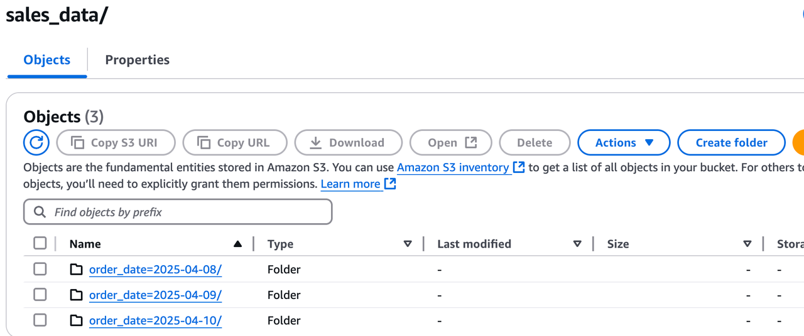
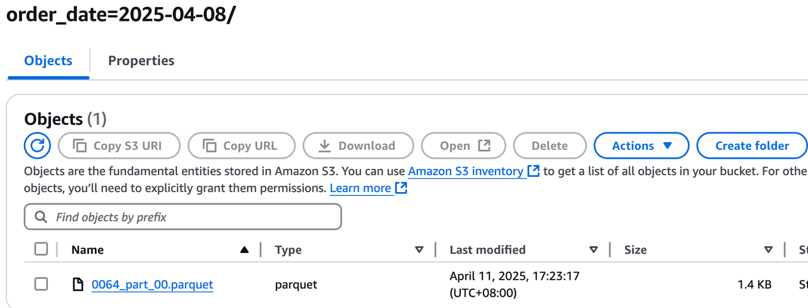

---
{
    "title": "Redshift",
    "language": "ru",
    "description": "Миграция данных из Redshift в Doris: экспорт в S3 с помощью Redshift UNLOAD и последующая загрузка в Doris с помощью S3 Load. Описаны создание таблицы, сопоставление типов данных, обработка ошибок и пакетная загрузка.",
    "keywords": [
        "Миграция из Redshift в Doris",
        "Redshift UNLOAD",
        "S3 Load",
        "Сопоставление типов данных Redshift",
        "Загрузка данных в Doris",
        "Загрузка Parquet",
        "ETL_QUALITY_UNSATISFIED"
    ]
}
---

<!-- Knowledge type: Procedure -->
<!-- Applicable scenario: Data migration / Redshift to Doris -->

При миграции данных из Redshift в Apache Doris в качестве промежуточного хранилища обычно используют объектное хранилище, например Amazon S3. Общая последовательность миграции:

1. Создайте целевую таблицу в Doris на основе схемы исходной таблицы.
2. Экспортируйте данные в объектное хранилище с помощью команды Redshift [UNLOAD](https://docs.aws.amazon.com/redshift/latest/dg/r_UNLOAD.html).
3. Загрузите данные из объектного хранилища в Doris с помощью S3 Load. Подробности см. в разделе [Загрузка из S3](./amazon-s3.md).

## Примечания {#notes}

Перед миграцией учитывайте следующее:

- **Модель данных и стратегия разбиения**: выберите подходящую [модель данных](../../../table-design/data-model/intro.mdx) Doris на основе схемы исходной таблицы Redshift и определите стратегию [разбиения на разделы](../../../table-design/data-partitioning/dynamic-partitioning.md) и [распределения по бакетам](../../../table-design/data-partitioning/data-bucketing.md). Дополнительные рекомендации по проектированию таблиц см. в разделе [Рекомендации по загрузке](../load-best-practices/load-best-practices.md).
- **Преобразование типов**: при экспорте типа `TIME` из Redshift сначала преобразуйте его в `VARCHAR` с помощью `CAST`.
- **Ограничения для сложных типов**: файлы Parquet/ORC, содержащие сложные типы (Struct/Array/Map), в настоящее время необходимо загружать с помощью [TVF Load](./amazon-s3.md#method-2-load-with-tvf-synchronous).

## Сопоставление типов данных {#data-type-mapping}

<!-- Knowledge type: Configuration -->

Перед миграцией сопоставьте типы данных Redshift с типами данных Doris по следующей таблице:

|     Redshift     |     Doris      |              Примечания              |
| ---------------- | -------------- | ------------------------------------ |
| SMALLINT         | SMALLINT       |                                      |
| INTEGER          | INT            |                                      |
| BIGINT           | BIGINT         |                                      |
| DECIMAL          | DECIMAL        |                                      |
| REAL             | FLOAT          |                                      |
| DOUBLE PRECISION | DOUBLE         |                                      |
| BOOLEAN          | BOOLEAN        |                                      |
| CHAR             | CHAR           |                                      |
| VARCHAR          | VARCHAR/STRING | Максимальная длина VARCHAR — 65533   |
| DATE             | DATE           |                                      |
| TIMESTAMP        | DATETIME       |                                      |
| TIME/TIMETZ      | STRING         |                                      |
| SUPER            | VARIANT        |                                      |
| OTHER            | UNSUPPORTED    |                                      |

## Этапы миграции {#migration-steps}

### 1. Создание таблицы в Doris {#1-create-the-doris-table}

<!-- Knowledge type: Procedure -->

Перед миграцией создайте соответствующую целевую таблицу в Doris.

**Цель**: спланировать модель данных Doris, разбиение на разделы и распределение по бакетам на основе схемы исходной таблицы Redshift.

**Пример исходной таблицы Redshift**:

```SQL
CREATE TABLE sales_data (
    order_id      INTEGER,
    customer_name VARCHAR(128),
    order_date    DATE,
    amount        DECIMAL(10,2),
    country       VARCHAR(48)
)
DISTSTYLE AUTO;

INSERT INTO sales_data VALUES
(1, 'Alice', '2025-04-08', 99.99, 'USA'),
(2, 'Bob', '2025-04-08', 149.50, 'Canada'),
(3, 'Charlie', '2025-04-09', 75.00, 'UK'),
(4, 'Diana', '2025-04-10', 200.00, 'Australia');
```

**Пример целевой таблицы Doris**: на основе приведённой выше схемы создайте таблицу с Unique Key и разбиением по дням, используя `order_date` в качестве столбца разбиения:

```sql
CREATE TABLE `sales_data` (
  order_id      INT,
  order_date    DATE NOT NULL,
  customer_name VARCHAR(128),
  amount        DECIMAL(10,2),
  country       VARCHAR(48)
) ENGINE=OLAP
UNIQUE KEY(`order_id`,`order_date`)
PARTITION BY RANGE(`order_date`) (
PARTITION p20250408 VALUES [('2025-04-08'), ('2025-04-09')),
PARTITION p20250409 VALUES [('2025-04-09'), ('2025-04-10')),
PARTITION p20250410 VALUES [('2025-04-10'), ('2025-04-11'))
)
DISTRIBUTED BY HASH(`order_id`) BUCKETS 16
PROPERTIES (
 "dynamic_partition.enable" = "true",
 "dynamic_partition.time_unit" = "DAY",
 "dynamic_partition.end" = "5",
 "dynamic_partition.prefix" = "p",
 "dynamic_partition.buckets" = "16",
 "replication_num" = "1"
);
```

### 2. Экспорт данных из Redshift в S3 {#2-export-data-from-redshift-to-s3}

<!-- Knowledge type: Procedure -->

#### 2.1 Экспорт в Parquet с помощью UNLOAD {#21-use-unload-to-export-as-parquet}

**Цель**: экспортировать данные Redshift в файлы Parquet с разбиением по столбцу разделов Doris, чтобы затем загружать их по разделам.

**Команда**:

```sql
unload ('select * from sales_data')
to 's3://mybucket/redshift/sales_data/'
iam_role 'arn:aws:iam::0123456789012:role/MyRedshiftRole'
PARQUET
PARTITION BY (order_date) INCLUDE
```

**Примечание**: при экспорте рекомендуется использовать тот же столбец разбиения, что и в Doris, чтобы загружать данные пакетами по разделам.

#### 2.2 Проверка экспортированных файлов в S3 {#22-verify-the-exported-files-on-s3}

После экспорта в S3 для каждого раздела создаётся отдельный подкаталог с данными этого раздела:





### 3. Загрузка данных в Doris {#3-load-data-into-doris}

<!-- Knowledge type: Procedure -->

Для загрузки используется **S3 Load** — асинхронный способ загрузки данных: после отправки задания Doris самостоятельно извлекает данные из источника. Поддерживается любое объектное хранилище, совместимое с S3, включая [AWS S3](./amazon-s3.md), [GCS](./google-cloud-storage.md) и [AZURE](./azure-storage.md).

Сравнение способов по условиям применения:

| Условия применения                                | Рекомендуемый способ                             |
| ------------------------------------------------- | ------------------------------------------------ |
| Большой объём данных, допустима асинхронная обработка | S3 Load                                      |
| Требуется синхронная загрузка данных              | [TVF Load](./amazon-s3.md#method-2-load-with-tvf-synchronous) |
| Файлы содержат сложные типы (Struct/Array/Map)    | Необходим [TVF Load](./amazon-s3.md#method-2-load-with-tvf-synchronous) |

#### 3.1 Загрузка одного раздела {#31-load-a-single-partition}

```sql
LOAD LABEL sales_data_2025_04_08
(
    DATA INFILE("s3://mybucket/redshift/sales_data/order_date=2025-04-08/*")
    INTO TABLE sales_data
    FORMAT AS "parquet"
    (order_id, order_date, customer_name, amount, country)
)
WITH S3
(
    "provider" = "S3",
    "s3.endpoint" = "https://s3.ap-southeast-1.amazonaws.com",
    "s3.access_key" = "<ak>",
    "s3.secret_key"="<sk>",
    "s3.region" = "ap-southeast-1"
);
```

#### 3.2 Проверка состояния задания с помощью SHOW LOAD {#32-check-job-status-with-show-load}

Поскольку задание S3 Load выполняется асинхронно, его ход можно проверить с помощью `SHOW LOAD`, указав метку задания:

```yaml
mysql> show load where label = "sales_data_2025_04_08"\G
*************************** 1. row ***************************
         JobId: 17956078
         Label: sales_data_2025_04_08
         State: FINISHED
      Progress: 100.00% (1/1)
          Type: BROKER
       EtlInfo: unselected.rows=0; dpp.abnorm.ALL=0; dpp.norm.ALL=2
      TaskInfo: cluster:s3.ap-southeast-1.amazonaws.com; timeout(s):3600; max_filter_ratio:0.0; priority:NORMAL
      ErrorMsg: NULL
    CreateTime: 2025-04-10 17:50:53
  EtlStartTime: 2025-04-10 17:50:54
 EtlFinishTime: 2025-04-10 17:50:54
 LoadStartTime: 2025-04-10 17:50:54
LoadFinishTime: 2025-04-10 17:50:54
           URL: NULL
    JobDetails: {"Unfinished backends":{"5eec1be8612d4872-91040ff1e7208a4f":[]},"ScannedRows":2,"TaskNumber":1,"LoadBytes":91,"All backends":{"5eec1be8612d4872-91040ff1e7208a4f":[10022]},"FileNumber":1,"FileSize":1620}
 TransactionId: 766228
  ErrorTablets: {}
          User: root
       Comment:
1 row in set (0.00 sec)
```

#### 3.3 Обработка ошибок при загрузке {#33-handle-errors-during-the-load}

<!-- Knowledge type: Troubleshooting -->
<!-- Applicable scenario: Troubleshooting / Data quality errors -->

**Шаг 1**: найдите задания, завершившиеся с ошибкой. Если пакетная загрузка включает несколько заданий, следующая команда поможет отобрать метки и причины ошибок для неудачных заданий:

```SQL
mysql> show load where state='CANCELLED' and label like "label_test%"\G
*************************** 1. row ***************************
         JobId: 18312384
         Label: label_test123
         State: CANCELLED
      Progress: 100.00% (3/3)
          Type: BROKER
       EtlInfo: unselected.rows=0; dpp.abnorm.ALL=4; dpp.norm.ALL=0
      TaskInfo: cluster:s3.ap-southeast-1.amazonaws.com; timeout(s):14400; max_filter_ratio:0.0; priority:NORMAL
      ErrorMsg: type:ETL_QUALITY_UNSATISFIED; msg:quality not good enough to cancel
    CreateTime: 2025-04-15 17:32:59
  EtlStartTime: 2025-04-15 17:33:02
 EtlFinishTime: 2025-04-15 17:33:02
 LoadStartTime: 2025-04-15 17:33:02
LoadFinishTime: 2025-04-15 17:33:02
           URL: http://10.16.10.6:28747/api/_load_error_log?file=__shard_2/error_log_insert_stmt_7602ccd7c3a4854-95307efca7bfe342_7602ccd7c3a4854_95307efca7bfe342
    JobDetails: {"Unfinished backends":{"7602ccd7c3a4854-95307efca7bfe341":[]},"ScannedRows":4,"TaskNumber":1,"LoadBytes":188,"All backends":{"7602ccd7c3a4854-95307efca7bfe341":[10022]},"FileNumber":3,"FileSize":4839}
 TransactionId: 769213
  ErrorTablets: {}
          User: root
       Comment:
```

**Шаг 2**: определите тип ошибки. В приведённом примере это **ошибка качества данных** (`ETL_QUALITY_UNSATISFIED`). Откройте `URL` из вывода команды, чтобы увидеть подробности. Например, следующая ошибка указывает, что длина данных превышает фактическую длину столбца `country`, заданную в схеме:

```python
[root@VM-10-6-centos ~]$ curl "http://10.16.10.6:28747/api/_load_error_log?file=__shard_2/error_log_insert_stmt_7602ccd7c3a4854-95307efca7bfe342_7602ccd7c3a4854_95307efca7bfe342"
Reason: column_name[country], the length of input is too long than schema. first 32 bytes of input str: [USA] schema length: 1; actual length: 3; . src line [];
Reason: column_name[country], the length of input is too long than schema. first 32 bytes of input str: [Canada] schema length: 1; actual length: 6; . src line [];
Reason: column_name[country], the length of input is too long than schema. first 32 bytes of input str: [UK] schema length: 1; actual length: 2; . src line [];
Reason: column_name[country], the length of input is too long than schema. first 32 bytes of input str: [Australia] schema length: 1; actual length: 9; . src line [];
```

**Шаг 3**: задайте допустимую долю ошибок (необязательно). Если допустимо пропустить часть строк с ошибками, задайте допустимую долю ошибок в `PROPERTIES` задания S3 Load. Подробности см. в разделе [Параметры настройки загрузки](../../import/import-way/broker-load-manual.md#import-configuration-parameters).

#### 3.4 Пакетная загрузка нескольких разделов {#34-load-multiple-partitions-in-batches}

При миграции больших объёмов исторических данных придерживайтесь следующих рекомендаций:

- Включайте в каждый пакет данные одного или нескольких разделов Doris.
- Размер одного пакета не должен превышать **100 GB**, чтобы снизить нагрузку на систему и затраты на повторную попытку при сбое загрузки.
- В качестве примера можно использовать скрипт [s3_load_demo.sh](https://github.com/apache/doris/blob/master/samples/load/shell/s3_load_demo.sh). Он перебирает каталоги разделов в S3 и автоматически отправляет в Doris задания S3 Load для пакетной загрузки.

## Часто задаваемые вопросы {#faq}

<!-- Knowledge type: FAQ -->

**Вопрос 1: Почему тип TIME из Redshift нельзя загрузить в Doris напрямую?**

Doris не поддерживает тип `TIME`. При экспорте типа `TIME/TIMEZ` из Redshift преобразуйте его в `VARCHAR` с помощью `CAST`, а в Doris храните как `STRING`.

**Вопрос 2: Можно ли использовать S3 Load для файлов Parquet/ORC, содержащих сложные типы, такие как Struct/Array/Map?**

Нет. В настоящее время файлы со сложными типами необходимо загружать с помощью [TVF Load](./amazon-s3.md#method-2-load-with-tvf-synchronous).

**Вопрос 3: S3 Load работает синхронно или асинхронно? Как проверить результат?**

S3 Load — **асинхронный** способ загрузки. После отправки задания выполните `SHOW LOAD WHERE label = "<your_label>"`, чтобы проверить ход выполнения и результат.

**Вопрос 4: Как обработать ошибку `ETL_QUALITY_UNSATISFIED`?**

Эта ошибка означает, что качество данных не соответствует требованиям. Чтобы устранить её:

1. Откройте `URL` из вывода `SHOW LOAD`, чтобы получить подробный журнал ошибок.
2. На основе журнала ошибок скорректируйте схему таблицы Doris или исходные данные, например при превышении длины поля или несовпадении типов.
3. Если часть ошибочных строк допустима, измените допустимую долю ошибок `max_filter_ratio` в `PROPERTIES` задания S3 Load.

**Вопрос 5: Как избежать сбоя при однократной загрузке большого объёма данных?**

Рекомендуется загружать данные пакетами по разделам Doris, ограничивать размер каждого пакета 100 GB и использовать скрипт [s3_load_demo.sh](https://github.com/apache/doris/blob/master/samples/load/shell/s3_load_demo.sh) для автоматической отправки пакетов.
