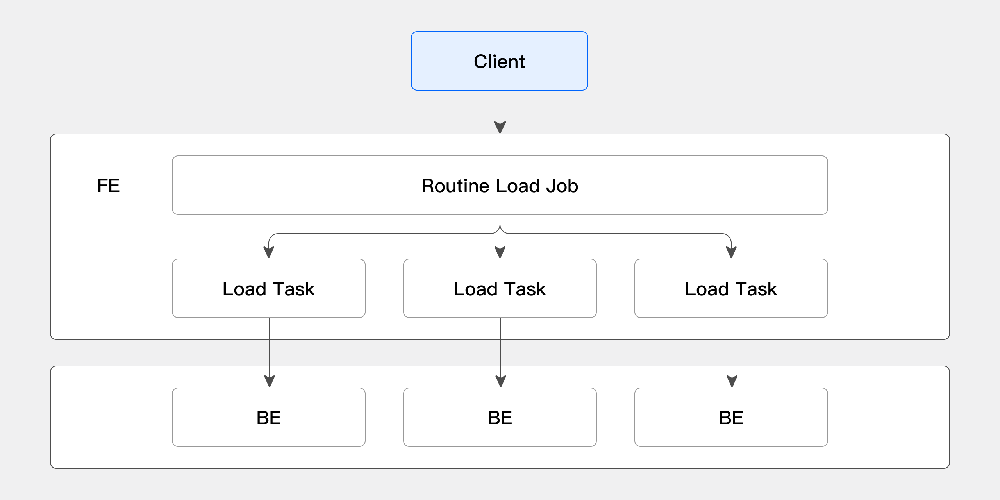

---
{
    "title": "Routine Load",
    "language": "ru",
    "description": "Apache Doris Routine Load непрерывно считывает данные из Kafka: форматы CSV/JSON, семантика Exactly-Once, аутентификация SSL/Kerberos, управление жизненным циклом заданий и устранение неполадок.",
    "keywords": [
        "Routine Load",
        "импорт из Kafka в реальном времени",
        "потоковый импорт в Doris",
        "непрерывный импорт",
        "Exactly-Once",
        "Kafka SSL",
        "Kafka Kerberos",
        "Kafka SASL",
        "SASL_PLAINTEXT",
        "SASL_SSL",
        "импорт JSON",
        "импорт CSV",
        "импорт в динамические таблицы",
        "один поток — несколько таблиц",
        "гибкое частичное обновление столбцов",
        "UPDATE_FLEXIBLE_COLUMNS",
        "PAUSED",
        "Routine Load PAUSED",
        "out of range",
        "kafka_broker_version_fallback",
        "property.broker.version.fallback",
        "desired_concurrent_number",
        "max_filter_ratio",
        "ErrorLogUrls",
        "ALTER ROUTINE LOAD",
        "PAUSE ROUTINE LOAD",
        "RESUME ROUTINE LOAD",
        "STOP ROUTINE LOAD"
    ]
}
---

<!-- Knowledge type: Procedures + Configuration parameters + Examples + FAQ -->
<!-- Applicable scenarios: Continuously consume data from Kafka into Doris / Real-time data ingestion / CDC streaming sync -->

Routine Load — это задание **потокового импорта** в Apache Doris, которое непрерывно считывает данные из топика Kafka и записывает их в таблицу Doris. После отправки задания Routine Load Doris поддерживает его непрерывную работу, в реальном времени создаёт задачи импорта для считывания сообщений из указанного топика кластера Kafka и обеспечивает семантику **Exactly-Once**, чтобы данные не терялись и не дублировались.

## Быстрая навигация {#quick-navigation}

Выберите раздел в зависимости от вашей задачи:

| Задача | Раздел |
| ------- | ------- |
| Сразу запустить минимальный пример | [Быстрый старт](#quick-start) |
| Разобраться в принципах работы, состояниях и автоматическом восстановлении | [Основные принципы](#basic-principles) |
| Найти все настраиваемые параметры (FE/BE/задание/Kafka) | [Справочник](#reference-manual) |
| Найти пример для нужного сценария: обработка ошибок, фильтрация, JSON, Kerberos и т. д. | [Примеры импорта](#import-examples) |
| Разобраться, почему задание перешло в `PAUSED` или возникла ошибка `out of range` либо SSL | [Часто задаваемые вопросы (FAQ)](#frequently-asked-questions-faq) |

## Сценарии использования {#use-cases}

<!-- Knowledge type: Scenario description -->

Routine Load подходит для следующих сценариев:

- Непрерывная синхронизация данных из топика Kafka с Doris в реальном времени.
- Обеспечение семантики **Exactly-Once** для предотвращения потери или дублирования данных.
- Сопоставление столбцов, фильтрация, вычисление производных столбцов и другие преобразования импортируемых данных.
- Динамическое распределение данных одного топика Kafka между несколькими таблицами Doris (один поток — несколько таблиц).

### Поддерживаемые источники данных и форматы {#supported-data-sources-and-formats}

Routine Load считывает данные только из **кластера Kafka** и поддерживает два формата сообщений:

| Формат | Описание |
| ---- | ---- |
| CSV  | Каждое сообщение содержит одну строку, в конце которой **нет** символа перевода строки. |
| JSON | Один объект JSON или массив JSON из нескольких объектов. |

При импорте CSV важно различать значения null и пустые строки:

- Значение null обозначается как `\n`. Например, `a,\n,b` означает, что в среднем столбце находится значение null.
- Пустая строка задаётся непосредственно. Например, `a,,b` означает, что в среднем столбце находится пустая строка (`''`).

### Ограничения {#limitations}

При считывании данных из Kafka через Routine Load действуют следующие ограничения:

| Ограничение | Описание |
| ------ | ---- |
| Формат сообщений | Поддерживаются только текстовые форматы CSV и JSON. Каждое сообщение CSV содержит одну строку, в конце которой **нет** символа перевода строки. |
| Версия Kafka | По умолчанию поддерживается Kafka 0.10.0.0 и новее. Для версий Kafka ниже 0.10.0.0 (0.9.0, 0.8.2, 0.8.1, 0.8.0) измените настройку BE `kafka_broker_version_fallback`, указав нужную старую версию, либо задайте `property.broker.version.fallback` при создании задания. При использовании старой версии некоторые новые возможности Routine Load могут быть недоступны, например задание смещений разделов Kafka по времени. |

## Основные принципы {#basic-principles}

Routine Load непрерывно считывает данные из топика Kafka и записывает их в Doris. После создания задания Routine Load в Doris появляется долгоживущее задание импорта, состоящее из нескольких задач:

- **Задание импорта (Load Job)**: долгоживущее задание Routine Load, которое непрерывно считывает данные из источника.
- **Задача импорта (Load Task)**: часть задания, выполняющая непосредственное считывание данных. Каждая задача представляет собой отдельную транзакцию.

Подробная схема работы Routine Load показана ниже:



Общий порядок работы:

1. Клиент отправляет в FE запрос на создание задания Routine Load. FE через Routine Load Manager создаёт долгоживущее задание импорта (Routine Load Job).
2. FE с помощью Job Scheduler разбивает Routine Load Job на несколько Routine Load Tasks. Затем Task Scheduler направляет их на узлы BE.
3. Когда Routine Load Task на BE завершает импорт, она фиксирует транзакцию в FE и обновляет метаданные задания.
4. После фиксации Routine Load Task создаются новые задачи либо повторно выполняются задачи, время ожидания которых истекло.
5. Task Scheduler непрерывно планирует вновь созданные Routine Load Tasks.

### Автоматическое восстановление {#auto-recovery-mechanism}

<!-- Knowledge type: State machine / Operations rules -->

Для обеспечения высокой доступности заданий Routine Load предусматривает автоматическое восстановление. Если задание неожиданно приостанавливается, поток Routine Load Scheduler пытается автоматически возобновить его. При неожиданной недоступности Kafka или других сбоях этот механизм позволяет заданию импорта продолжить работу после восстановления Kafka без вмешательства пользователя.

В таблице указано, в каких случаях восстановление происходит автоматически, а в каких требуется вмешательство пользователя:

| Причина приостановки | Автоматическое восстановление | Рекомендуемое действие |
| -------------- | ------------ | -------- |
| Временная недоступность брокера Kafka, нестабильность сети | Да | Scheduler автоматически повторяет попытки с интервалом `period_of_auto_resume_min`. |
| Пользователь вручную выполнил `PAUSE ROUTINE LOAD` | Нет | Вручную выполните `RESUME ROUTINE LOAD`. |
| Проблема с качеством данных: превышено значение `max_filter_ratio` или `max_error_number` | Нет | Проверьте `ErrorLogUrls`, исправьте данные или настройте параметры, затем выполните `RESUME`. |
| Неустранимые ошибки метаданных, например удаление базы данных или таблицы | Нет | Создайте таблицу заново или пересоздайте задание. |

## Быстрый старт {#quick-start}

<!-- Knowledge type: Procedures -->

В этом разделе приведён минимальный рабочий пример: создание задания Routine Load для Kafka, просмотр его состояния, приостановка, возобновление, изменение и остановка.

### Создание задания импорта {#create-an-import-job}

Долгоживущее задание импорта Routine Load создаётся командой [CREATE ROUTINE LOAD](../../../sql-manual/sql-statements/data-modification/load-and-export/CREATE-ROUTINE-LOAD). Routine Load может считывать данные CSV и JSON.

#### Импорт данных CSV {#import-csv-data}

1. Подготовьте пример данных в Kafka:

    ```bash
    kafka-console-consumer.sh --bootstrap-server localhost:9092 --topic test-routine-load-csv --from-beginning
    1,Emily,25
    2,Benjamin,35
    3,Olivia,28
    4,Alexander,60
    5,Ava,17
    6,William,69
    7,Sophia,32
    8,James,64
    9,Emma,37
    10,Liam,64
    ```

2. Создайте целевую таблицу:

    ```sql
    CREATE TABLE testdb.test_routineload_tbl(
        user_id            BIGINT       NOT NULL COMMENT "user id",
        name               VARCHAR(20)           COMMENT "name",
        age                INT                   COMMENT "age"
    )
    DUPLICATE KEY(user_id)
    DISTRIBUTED BY HASH(user_id) BUCKETS 10;
    ```

3. Создайте задание импорта Routine Load:

    ```sql
    CREATE ROUTINE LOAD testdb.example_routine_load_csv ON test_routineload_tbl
    COLUMNS TERMINATED BY ",",
    COLUMNS(user_id, name, age)
    FROM KAFKA(
        "kafka_broker_list" = "192.168.88.62:9092",
        "kafka_topic" = "test-routine-load-csv",
        "property.kafka_default_offsets" = "OFFSET_BEGINNING"
    );
    ```

#### Импорт данных JSON {#import-json-data}

1. Подготовьте пример данных в Kafka:

    ```bash
    kafka-console-consumer.sh --bootstrap-server localhost:9092 --topic test-routine-load-json --from-beginning
    {"user_id":1,"name":"Emily","age":25}
    {"user_id":2,"name":"Benjamin","age":35}
    {"user_id":3,"name":"Olivia","age":28}
    {"user_id":4,"name":"Alexander","age":60}
    {"user_id":5,"name":"Ava","age":17}
    {"user_id":6,"name":"William","age":69}
    {"user_id":7,"name":"Sophia","age":32}
    {"user_id":8,"name":"James","age":64}
    {"user_id":9,"name":"Emma","age":37}
    {"user_id":10,"name":"Liam","age":64}
    ```

2. Создайте целевую таблицу:

    ```sql
    CREATE TABLE testdb.test_routineload_tbl(
        user_id            BIGINT       NOT NULL COMMENT "user id",
        name               VARCHAR(20)           COMMENT "name",
        age                INT                   COMMENT "age"
    )
    DUPLICATE KEY(user_id)
    DISTRIBUTED BY HASH(user_id) BUCKETS 10;
    ```

3. Создайте задание импорта Routine Load:

    ```sql
    CREATE ROUTINE LOAD testdb.example_routine_load_json ON test_routineload_tbl
    COLUMNS(user_id,name,age)
    PROPERTIES(
        "format"="json",
        "jsonpaths"="[\"$.user_id\",\"$.name\",\"$.age\"]"
    )
    FROM KAFKA(
        "kafka_broker_list" = "192.168.88.62:9092",
        "kafka_topic" = "test-routine-load-json",
        "property.kafka_default_offsets" = "OFFSET_BEGINNING"
    );
    ```

:::info Примечание
Чтобы импортировать объект JSON из корня файла JSON, задайте для `jsonpaths` значение `$.`, например: `PROPERTIES("jsonpaths"="$. ")`.
:::

### Просмотр состояния импорта {#view-import-status}

Состояние Routine Load можно рассматривать на двух уровнях:

- **Задание импорта**: целевая таблица, число подзадач, задержка импорта, настройки импорта и результаты.
- **Задача импорта**: состояние подзадач, ход считывания и узел BE, которому назначена задача.

#### Просмотр задания импорта {#view-the-load-job}

Используйте команду [SHOW ROUTINE LOAD](../../../sql-manual/sql-statements/data-modification/load-and-export/SHOW-ROUTINE-LOAD) для просмотра задания импорта. Она показывает основные сведения о задании: целевую таблицу, задержку импорта, настройки и сведения об ошибках.

Следующая команда показывает состояние задания `testdb.example_routine_load_csv`:

```sql
mysql> SHOW ROUTINE LOAD FOR testdb.example_routine_load\G
*************************** 1. row ***************************
                  Id: 12025
                Name: example_routine_load
          CreateTime: 2024-01-15 08:12:42
           PauseTime: NULL
             EndTime: NULL
              DbName: default_cluster:testdb
           TableName: test_routineload_tbl
        IsMultiTable: false
               State: RUNNING
      DataSourceType: KAFKA
      CurrentTaskNum: 1
       JobProperties: {"max_batch_rows":"200000","timezone":"America/New_York","send_batch_parallelism":"1","load_to_single_tablet":"false","column_separator":"','","line_delimiter":"\n","current_concurrent_number":"1","delete":"*","partial_columns":"false","merge_type":"APPEND","exec_mem_limit":"2147483648","strict_mode":"false","jsonpaths":"","max_batch_interval":"10","max_batch_size":"104857600","fuzzy_parse":"false","partitions":"*","columnToColumnExpr":"user_id,name,age","whereExpr":"*","desired_concurrent_number":"5","precedingFilter":"*","format":"csv","max_error_number":"0","max_filter_ratio":"1.0","json_root":"","strip_outer_array":"false","num_as_string":"false"}
DataSourceProperties: {"topic":"test-topic","currentKafkaPartitions":"0","brokerList":"192.168.88.62:9092"}
    CustomProperties: {"kafka_default_offsets":"OFFSET_BEGINNING","group.id":"example_routine_load_73daf600-884e-46c0-a02b-4e49fdf3b4dc"}
           Statistic: {"receivedBytes":28,"runningTxns":[],"errorRows":0,"committedTaskNum":3,"loadedRows":3,"loadRowsRate":0,"abortedTaskNum":0,"errorRowsAfterResumed":0,"totalRows":3,"unselectedRows":0,"receivedBytesRate":0,"taskExecuteTimeMs":30069}
            Progress: {"0":"2"}
                 Lag: {"0":0}
ReasonOfStateChanged:
        ErrorLogUrls:
            OtherMsg:
                User: root
             Comment:
1 row in set (0.00 sec)
```

#### Просмотр подзадач импорта {#view-the-load-subtasks}

Используйте команду [SHOW ROUTINE LOAD TASK](../../../sql-manual/sql-statements/data-modification/load-and-export/SHOW-ROUTINE-LOAD-TASK) для просмотра подзадач импорта. Задание Routine Load можно указать с помощью `WHERE JobName = <job_name>` или `FOR [<db>.]<job_name>`; если `<db>` опущено, используется текущая база данных. Команда показывает сведения о подзадачах текущего задания, включая их состояние и идентификатор BE, которому они назначены.

Следующая команда показывает подзадачи `testdb.example_routine_load_csv`:

```sql
mysql> SHOW ROUTINE LOAD TASK WHERE jobname = 'example_routine_load_csv';
+-----------------------------------+-------+-----------+-------+---------------------+---------------------+---------+-------+----------------------+
| TaskId                            | TxnId | TxnStatus | JobId | CreateTime          | ExecuteStartTime    | Timeout | BeId  | DataSourceProperties |
+-----------------------------------+-------+-----------+-------+---------------------+---------------------+---------+-------+----------------------+
| 8cf47e6a68ed4da3-8f45b431db50e466 | 195   | PREPARE   | 12177 | 2024-01-15 12:20:41 | 2024-01-15 12:21:01 | 20      | 10429 | {"4":1231,"9":2603}  |
| f2d4525c54074aa2-b6478cf8daaeb393 | 196   | PREPARE   | 12177 | 2024-01-15 12:20:41 | 2024-01-15 12:21:01 | 20      | 12109 | {"1":1225,"6":1216}  |
| cb870f1553864250-975279875a25fab6 | -1    | NULL      | 12177 | 2024-01-15 12:20:52 | NULL                | 20      | -1    | {"2":7234,"7":4865}  |
| 68771fd8a1824637-90a9dac2a7a0075e | -1    | NULL      | 12177 | 2024-01-15 12:20:52 | NULL                | 20      | -1    | {"3":1769,"8":2982}  |
| 77112dfea5e54b0a-a10eab3d5b19e565 | 197   | PREPARE   | 12177 | 2024-01-15 12:21:02 | 2024-01-15 12:21:02 | 20      | 12098 | {"0":3000,"5":2622}  |
+-----------------------------------+-------+-----------+-------+---------------------+---------------------+---------+-------+----------------------+
```

Можно также использовать следующий синтаксис:

```sql
mysql> SHOW ROUTINE LOAD TASK FOR testdb.example_routine_load_csv;
```

### Приостановка задания импорта {#pause-an-import-job}

Задание импорта можно приостановить командой [PAUSE ROUTINE LOAD](../../../sql-manual/sql-statements/data-modification/load-and-export/PAUSE-ROUTINE-LOAD). После приостановки задание переходит в состояние `PAUSED`, но не завершается. Его можно вновь запустить командой `RESUME ROUTINE LOAD`.

```sql
PAUSE ROUTINE LOAD FOR testdb.example_routine_load_csv;
```

### Возобновление задания импорта {#resume-an-import-job}

Задание импорта в состоянии `PAUSED` можно возобновить командой [RESUME ROUTINE LOAD](../../../sql-manual/sql-statements/data-modification/load-and-export/RESUME-ROUTINE-LOAD).

```sql
RESUME ROUTINE LOAD FOR testdb.example_routine_load_csv;
```

### Изменение задания импорта {#modify-an-import-job}

Созданное задание импорта можно изменить командой [ALTER ROUTINE LOAD](../../../sql-manual/sql-statements/data-modification/load-and-export/ALTER-ROUTINE-LOAD). Перед изменением приостановите его командой `PAUSE ROUTINE LOAD`, а после изменения возобновите командой `RESUME ROUTINE LOAD`.

Например, так можно изменить требуемую степень параллелизма `desired_concurrent_number` и сведения о топике Kafka:

```sql
ALTER ROUTINE LOAD FOR testdb.example_routine_load_csv
PROPERTIES(
    "desired_concurrent_number" = "3"
)
FROM KAFKA(
    "kafka_broker_list" = "192.168.88.60:9092",
    "kafka_topic" = "test-topic"
);
```

### Отмена задания импорта {#cancel-an-import-job}

Команда [STOP ROUTINE LOAD](../../../sql-manual/sql-statements/data-modification/load-and-export/STOP-ROUTINE-LOAD) останавливает и удаляет задание импорта Routine Load. **Удалённое задание импорта невозможно восстановить** или просмотреть командой `SHOW ROUTINE LOAD`.

```sql
STOP ROUTINE LOAD FOR testdb.example_routine_load_csv;
```

### Привязка Compute Group {#bind-a-compute-group}

В **режиме разделения хранения и вычислений** Compute Group для Routine Load выбирается в следующем порядке приоритета:

1. Compute Group, указанная в команде `use db@cluster`.
2. Compute Group, указанная в свойстве пользователя `default_compute_group`.
3. Одна из Compute Group, к которым у текущего пользователя есть доступ.

В **режиме совместного хранения и вычислений** выбирается Compute Group, указанная в свойстве пользователя `resource_tags.location`. Если в свойствах пользователя Compute Group не указана, используется группа с именем `default`.

:::caution Примечание
Compute Group для задания Routine Load **можно указать только при создании**. После создания задания изменить привязанную Compute Group нельзя.
:::

## Справочник {#reference-manual}

<!-- Knowledge type: Configuration parameters + Syntax reference -->

### Синтаксис команды импорта {#import-command-syntax}

Синтаксис создания долгоживущего задания импорта Routine Load:

```sql
CREATE ROUTINE LOAD [<db_name>.]<job_name> [ON <tbl_name>]
[merge_type]
[load_properties]
[job_properties]
FROM KAFKA [data_source_properties]
[COMMENT "<comment>"]
```

Описание частей команды:

| Часть | Описание |
| ---------------------- | ------------------------------------------------------------ |
| db_name | База данных, в которой создаётся задание импорта. |
| job_name | Имя создаваемого задания импорта. В одной базе данных не может быть заданий с одинаковым именем. |
| tbl_name | Имя таблицы, в которую импортируются данные. Необязательный параметр. Если его не указать, используется подход с динамическими таблицами; тогда данные в Kafka должны содержать имя таблицы. |
| merge_type | Тип слияния данных. Значение по умолчанию — APPEND.<p>Доступны три варианта:</p><p>- APPEND: добавление данных.</p><p>- MERGE: импорт со слиянием.</p><p>- DELETE: все импортируемые данные подлежат удалению.</p> |
| load_properties | Описание импорта, включающее следующие части:<p>- конструкция column_separator</p><p>- конструкция columns_mapping</p><p>- конструкция preceding_filter</p><p>- конструкция where_predicates</p><p>- конструкция partitions</p><p>- конструкция delete_on</p><p>- конструкция order_by</p> |
| job_properties | Общие параметры импорта Routine Load. |
| data_source_properties | Свойства источника данных Kafka. |
| comment | Комментарий к заданию импорта. |

### Описание параметров импорта {#import-parameter-description}

#### Параметры конфигурации FE {#fe-configuration-parameters}

| Параметр | Значение по умолчанию | Динамический | Только для главного FE | Описание |
| -------- | ------ | -------- | ------------------ | -------- |
| max_routine_load_task_concurrent_num | 256 | Да | Да | Ограничивает максимальное число одновременно выполняемых подзадач в задании импорта Routine Load. Рекомендуется оставить значение по умолчанию. Слишком большое значение может привести к чрезмерному числу одновременных задач и расходу ресурсов кластера. |
| max_routine_load_task_num_per_be | 1024 | Да | Да | Максимальное число одновременно выполняемых задач Routine Load на одном BE. Значение `max_routine_load_task_num_per_be` должно быть меньше `routine_load_thread_pool_size`. |
| max_routine_load_job_num | 100 | Да | Да | Максимальное число заданий Routine Load, включая задания в состояниях NEED_SCHEDULED, RUNNING и PAUSE. |
| max_tolerable_backend_down_num | 0 | Да | Да | Если недоступен хотя бы один BE, Routine Load не может восстановиться автоматически. При определённых условиях Doris может повторно запланировать задачу в состоянии PAUSED и перевести её в RUNNING. Значение 0 означает, что повторное планирование допускается только при доступности всех узлов BE. |
| period_of_auto_resume_min | 5 (минут) | Да | Да | Интервал автоматического восстановления Routine Load. |

#### Параметры конфигурации BE {#be-configuration-parameters}

| Параметр | Значение по умолчанию | Динамический | Описание |
| -------- | ------ | -------- | ---- |
| max_consumer_num_per_group | 3 | Да | Максимальное число потребителей, которые одна подзадача может создать для считывания данных. |

#### Параметры настройки импорта {#import-configuration-parameters}

При создании задания Routine Load параметры разных частей импорта можно задать командой `CREATE ROUTINE LOAD`.

##### Конструкция tbl_name {#tbl_name-clause}

Задаёт имя таблицы, в которую импортируются данные. Необязательный параметр.

Если имя не указано, используется подход с **динамическими таблицами**: данные в Kafka должны содержать имя таблицы. Сейчас имя динамической таблицы можно извлечь только из Kafka Value, а данные должны иметь определённый формат. Для JSON: `table_name|{"col1": "val1", "col2": "val2"}`, где `tbl_name` — имя таблицы, а `|` отделяет имя таблицы от данных. Данные CSV имеют аналогичный вид, например: `table_name|val1,val2,val3`.

:::caution Примечание
Значение `table_name` должно в точности совпадать с именем таблицы в Doris, иначе импорт завершится ошибкой. Динамические таблицы не поддерживают `column_mapping`.
:::

##### Конструкция merge_type {#merge_type-clause}

Тип слияния данных задаётся с помощью `merge_type`. Доступны три варианта:

- **APPEND**: импорт с добавлением данных.
- **MERGE**: импорт со слиянием. Применяется только к модели Unique Key. Требует конструкции `[DELETE ON]` для обозначения столбца Delete Flag.
- **DELETE**: все импортируемые данные подлежат удалению.

##### Конструкция load_properties {#load_properties-clause}

Свойства импортируемых данных описываются в `load_properties`. Синтаксис:

```sql
[COLUMNS TERMINATED BY <column_separator>,]
[COLUMNS (<column1_name>[, <column2_name>, <column_mapping>, ...]),]
[WHERE <where_expr>,]
[PARTITION(<partition1_name>, [<partition2_name>, <partition3_name>, ...]),]
[DELETE ON <delete_expr>,]
[ORDER BY <order_by_column1>[, <order_by_column2>, <order_by_column3>, ...]]
```

Параметры каждой части:

| Часть | Параметр | Описание |
| --------------------- | ------------------ | ------------------------------------------------------------ |
| COLUMNS TERMINATED BY | `<column_separator>` | Разделитель столбцов. По умолчанию — `\t`. Например, запятая задаётся так: `COLUMN TERMINATED BY ","`. Обработка пустых значений:<p>- Значение null обозначается как `\n`. Запись `a,\n,b` означает, что в среднем столбце находится значение null.</p><p>- Пустая строка задаётся непосредственно. Запись `a,,b` означает, что в среднем столбце находится пустая строка (`''`).</p> |
| COLUMNS | `<column_name>` | Имя соответствующего столбца. Например, столбцы импорта `(k1, k2, k3)` задаются так: `COLUMNS(k1, k2, k3)`. Конструкцию COLUMNS можно опустить, если:<p>- столбцы CSV однозначно соответствуют столбцам таблицы;</p><p>- имена ключей JSON совпадают с именами столбцов таблицы.</p> |
| &nbsp; | `<column_mapping>` | Сопоставление столбцов позволяет фильтровать и преобразовывать их при импорте. Например, целевой столбец k4 можно вычислить из k3 по формуле k3+1: `COLUMNS(k1, k2, k3, k4 = k3 + 1)`. Подробности см. в разделе [Преобразование данных](../../import/load-data-convert). |
| WHERE | `<where_expr>` | Фильтрует импортируемые данные по условию. Например, импорт только строк с age > 30 задаётся так: `WHERE age > 30`. |
| PARTITION | `<partition_name>` | Указывает разделы целевой таблицы, в которые нужно импортировать данные. Если параметр не задан, данные автоматически импортируются в соответствующие разделы. Например, для разделов p1 и p2: `PARTITION(p1, p2)`. |
| DELETE ON | `<delete_expr>` | В режиме импорта MERGE выражение `delete_expr` отмечает данные, которые нужно удалить. Например, удаление при age > 30 задаётся так: `DELETE ON age > 30`. |
| ORDER BY | `<order_by_column>` | Действует только для модели Unique Key. Задаёт Sequence Column в импортируемых данных, чтобы обеспечить нужный порядок. Например, `create_time` можно указать в качестве Sequence Column так: `ORDER BY create_time`. Подробности см. в разделе [Обновление данных / Sequence Column](../../../data-operate/update/update-of-unique-model). |

##### Конструкция job_properties {#job_properties-clause}

При создании задания импорта Routine Load его свойства можно указать в конструкции `job_properties`. Синтаксис:

```sql
PROPERTIES ("<key1>" = "<value1>"[, "<key2>" = "<value2>" ...])
```

Параметры конструкции `job_properties`:

**История версий:**

- В Doris 2.1.1 верхний предел `max_batch_size` вырос с 1 GB до 10 GB.
- В Doris 2.1.5 и 3.0.0 значение по умолчанию выросло со 100 MB до 1 GB.
- Верхний предел 10 GB и значение по умолчанию 1 GB действуют во всех версиях 3.x, 4.x и dev.

| Параметр | Описание |
| ---- | ---- |
| desired_concurrent_number | <p>Значение по умолчанию: 256</p><p>Желаемая степень параллелизма для одной задачи импорта. Фактическая степень параллелизма подзадач может отличаться от заданной. Она вычисляется так:</p><p>`min(topic_partition_num, desired_concurrent_number, max_routine_load_task_concurrent_num)`, где:</p><p>- `topic_partition_num`: число разделов топика Kafka.</p><p>- `desired_concurrent_number`: значение этого параметра.</p><p>- `max_routine_load_task_concurrent_num`: максимальная степень параллелизма задач Routine Load, заданная в FE.</p> |
| max_batch_interval | Максимальное время выполнения каждой подзадачи в секундах. Должно быть больше 0. Значение по умолчанию — 60. Параметры `max_batch_interval`, `max_batch_rows` и `max_batch_size` вместе задают пороги выполнения подзадачи. Когда достигается любой из них, подзадача импорта завершается и создаётся новая. |
| max_batch_rows | Максимальное число строк, которые может прочитать каждая подзадача. Должно быть не меньше 200000. Значение по умолчанию — 20000000. Параметры `max_batch_interval`, `max_batch_rows` и `max_batch_size` вместе задают пороги выполнения подзадачи. Когда достигается любой из них, подзадача импорта завершается и создаётся новая. |
| max_batch_size | Максимальное число байт, которые может прочитать каждая подзадача. Единица измерения — байты; допустимый диапазон — от 100 MB до 10 GB (от 104857600 до 10737418240 байт включительно), значение по умолчанию — 1 GB. Параметры `max_batch_interval`, `max_batch_rows` и `max_batch_size` вместе задают пороги выполнения подзадачи. Когда достигается любой из них, подзадача импорта завершается и создаётся новая. |
| max_error_number | Максимальное число строк с ошибками в окне выборки. Должно быть не меньше 0. По умолчанию — 0, то есть строки с ошибками не допускаются. Размер окна выборки равен `max_batch_rows * 10`. Если число строк с ошибками в этом окне превышает `max_error_number`, задание Routine Load приостанавливается. Для проверки качества данных требуется вмешательство пользователя. Сведения об ошибках доступны в поле `ErrorLogUrls` результата команды [SHOW ROUTINE LOAD](../../../sql-manual/sql-statements/data-modification/load-and-export/SHOW-ROUTINE-LOAD). Строки, отфильтрованные условием where, не считаются строками с ошибками. |
| strict_mode | Включает строгий режим; по умолчанию он отключён. Строгий режим означает строгую фильтрацию при преобразовании типов столбцов во время импорта. Если при включённом режиме исходное значение, отличное от NULL, после преобразования типа становится NULL, строка отфильтровывается.<p>Правила фильтрации:</p><p>- Строгий режим не влияет на производные столбцы, созданные преобразующими функциями.</p><p>- Если требуется преобразование типа столбца, данные неправильного типа отфильтровываются. Их можно просмотреть по ссылке из `ErrorLogUrls` в результате [SHOW ROUTINE LOAD](../../../sql-manual/sql-statements/data-modification/load-and-export/SHOW-ROUTINE-LOAD).</p><p>- Если тип столбца ограничен диапазоном и исходные данные проходят преобразование типа, но выходят за допустимый диапазон, строгий режим на них не влияет. Например, значение 10 проходит преобразование в `decimal(1,0)`, но выходит за пределы диапазона, объявленного для столбца. Подробности см. в разделе [Строгий режим](../../../data-operate/import/handling-messy-data#strict-mode-strict_mode).</p> |
| timezone | Часовой пояс задания импорта. По умолчанию используется параметр часового пояса сеанса. Этот параметр влияет на результаты всех функций, связанных с часовыми поясами, которые применяются при импорте. |
| format | Формат импортируемых данных. По умолчанию — CSV. Также поддерживается JSON. |
| jsonpaths | При импорте JSON параметр `jsonpaths` указывает поля, которые нужно извлечь. Например: `"jsonpaths" = "[\"$.userid\",\"$.username\",\"$.age\",\"$.city\"]"` |
| json_root | При импорте JSON параметр `json_root` указывает корневой узел данных. Doris извлекает из него элементы и разбирает их. По умолчанию значение пустое. Например: `"json_root" = "$.RECORDS"` |
| strip_outer_array | При импорте JSON значение true для `strip_outer_array` означает, что данные представлены массивом и каждый его элемент считается отдельной строкой. По умолчанию — false. Данные JSON в Kafka часто представляют собой массив, заключённый во внешние скобки `[]`. В таком случае можно задать `"strip_outer_array" = "true"`. Например, следующие данные будут разобраны как две строки: `[{"user_id":1,"name":"Emily","age":25},{"user_id":2,"name":"Benjamin","age":35}]` |
| send_batch_parallelism | Задаёт степень параллелизма при отправке пакетов данных. Если она превышает настройку BE `max_send_batch_parallelism_per_job`, BE, выполняющий роль координатора, использует значение `max_send_batch_parallelism_per_job`. |
| load_to_single_tablet | Позволяет одной задаче импортировать данные только в один таблет соответствующего раздела. По умолчанию — false. Параметр можно задавать только при импорте в OLAP-таблицу со случайным распределением по бакетам. |
| partial_columns | Включает частичное обновление столбцов. По умолчанию — false. Параметр можно задавать только для таблицы модели Unique, использующей Merge on Write. Импорт из одного потока в несколько таблиц этот параметр не поддерживает. Подробности см. в разделе [Частичное обновление столбцов](../../../data-operate/update/partial-column-update.md). |
| unique_key_update_mode | Режим обновления таблицы Unique Key. Варианты:<ul><li>`UPSERT` (по умолчанию): обычная вставка или обновление всей строки.</li><li>`UPDATE_FIXED_COLUMNS`: частичное обновление, при котором во всех строках обновляются одни и те же столбцы. Эквивалентно `partial_columns=true`.</li><li>`UPDATE_FLEXIBLE_COLUMNS`: гибкое частичное обновление, при котором в разных строках могут обновляться разные столбцы. Требуется формат JSON и параметр таблицы `enable_unique_key_skip_bitmap_column=true`. Нельзя использовать совместно с `jsonpaths`, `fuzzy_parse`, конструкцией `COLUMNS` или конструкцией `WHERE`.</li></ul>Подробности см. в разделе [Частичное обновление столбцов](../../../data-operate/update/partial-column-update#flexible-column-update). |
| partial_update_new_key_behavior | Порядок обработки новых строк при частичном обновлении столбцов в таблице Unique Merge on Write. Два варианта: `APPEND` и `ERROR`.<br/>- `APPEND`: разрешить вставку новых строк.<br/>- `ERROR`: при вставке новой строки импорт завершается с ошибкой. |
| max_filter_ratio | Максимальная допустимая доля отфильтрованных строк в окне выборки. Значение должно быть от 0 до 1 включительно. По умолчанию — 1.0: допускается любое число строк с ошибками. Размер окна выборки равен `max_batch_rows * 10`. Если отношение числа строк с ошибками к общему числу строк в этом окне превышает `max_filter_ratio`, задание Routine Load приостанавливается. Для проверки качества данных требуется вмешательство пользователя. Строки, отфильтрованные условием where, не считаются строками с ошибками. |
| enclose | Задаёт символ обрамления. Если поля CSV содержат разделители строк или столбцов, однобайтовый символ обрамления предотвращает нежелательное разделение. Например, при разделителе столбцов `,` и символе обрамления `'` значение `a,'b,c'` разбирается так, что `b,c` становится одним полем. |
| escape | Задаёт символ экранирования для символов внутри поля, совпадающих с символом обрамления. Например, чтобы при данных `a,'b,'c'` и символе обрамления `'` значение `b,'c` разбиралось как одно поле, нужно задать однобайтовый символ экранирования, например `\`, и изменить данные на `a,'b,\'c'`. |

#### Конструкция data_source_properties {#data_source_properties-clause}

При создании задания импорта Routine Load свойства источника данных Kafka можно задать в конструкции `data_source_properties`. Синтаксис:

```sql
FROM KAFKA ("<key1>" = "<value1>"[, "<key2>" = "<value2>" ...])
```

Параметры конструкции `data_source_properties`:

| Параметр | Описание |
| ---- | ---- |
| kafka_broker_list | Данные для подключения к брокерам Kafka. Формат: `<kafka_broker_ip>:<kafka port>`. Несколько брокеров разделяются запятыми. Например: `"kafka_broker_list" = "<broker1_ip>:9092,<broker2_ip>:9092"` |
| kafka_topic | Топик Kafka, на который оформляется подписка. Одно задание импорта может считывать данные только из одного топика Kafka. |
| kafka_partitions | Разделы Kafka, на которые оформляется подписка. Если параметр не задан, по умолчанию считываются все разделы. |
| kafka_offsets | Начальное смещение считывания раздела Kafka. Если указано время, считывание начинается с ближайшего смещения, время которого не меньше указанного. Можно задать конкретное смещение не меньше 0 или одно из следующих значений:<p>- `OFFSET_BEGINNING`: подписка с позиции, где доступны данные.</p><p>- `OFFSET_END`: подписка с конца.</p><p>- Время, например: `"2021-05-22 11:00:00"`.</p><p>Если параметр не задан, подписка на все разделы топика по умолчанию начинается с `OFFSET_END`. Можно задать несколько начальных смещений через запятую, например: `"kafka_offsets" = "101,0,OFFSET_BEGINNING,OFFSET_END"` или `"kafka_offsets" = "2021-05-22 11:00:00,2021-05-22 11:00:00"`.</p><p>Примечание: формат времени нельзя сочетать с форматом OFFSET.</p> |
| property | Пользовательские параметры Kafka, аналогичные параметру `--property` в командной оболочке Kafka. Если значение параметра представляет собой файл, добавьте перед ним префикс `FILE:`. Создание файла описано в команде [CREATE FILE](../../../sql-manual/sql-statements/security/CREATE-FILE). Дополнительные поддерживаемые параметры клиента перечислены в официальном документе librdkafka [CONFIGURATION](https://github.com/confluentinc/librdkafka/blob/master/CONFIGURATION.md). Например: `"property.client.id" = "12345"`, `"property.group.id" = "group_id_0"`, `"property.ssl.ca.location" = "FILE:ca.pem"`. |

Параметры Kafka `property` в `data_source_properties` позволяют настроить защищённый доступ. Сейчас Doris поддерживает несколько протоколов безопасности Kafka, в том числе plaintext (по умолчанию), SSL, PLAIN и Kerberos.

### Состояние импорта {#import-status}

Состояние задания импорта можно просмотреть командой `SHOW ROUTINE LOAD`:

```sql
SHOW [ALL] ROUTINE LOAD [FOR jobName];
```

Пример результата:

```sql
mysql> SHOW ROUTINE LOAD FOR testdb.example_routine_load\G
*************************** 1. row ***************************
                  Id: 12025
                Name: example_routine_load
          CreateTime: 2024-01-15 08:12:42
           PauseTime: NULL
             EndTime: NULL
              DbName: default_cluster:testdb
           TableName: test_routineload_tbl
        IsMultiTable: false
               State: RUNNING
      DataSourceType: KAFKA
      CurrentTaskNum: 1
       JobProperties: {"max_batch_rows":"200000","timezone":"America/New_York","send_batch_parallelism":"1","load_to_single_tablet":"false","column_separator":"','","line_delimiter":"\n","current_concurrent_number":"1","delete":"*","partial_columns":"false","merge_type":"APPEND","exec_mem_limit":"2147483648","strict_mode":"false","jsonpaths":"","max_batch_interval":"10","max_batch_size":"104857600","fuzzy_parse":"false","partitions":"*","columnToColumnExpr":"user_id,name,age","whereExpr":"*","desired_concurrent_number":"5","precedingFilter":"*","format":"csv","max_error_number":"0","max_filter_ratio":"1.0","json_root":"","strip_outer_array":"false","num_as_string":"false"}
DataSourceProperties: {"topic":"test-topic","currentKafkaPartitions":"0","brokerList":"192.168.88.62:9092"}
    CustomProperties: {"kafka_default_offsets":"OFFSET_BEGINNING","group.id":"example_routine_load_73daf600-884e-46c0-a02b-4e49fdf3b4dc"}
           Statistic: {"receivedBytes":28,"runningTxns":[],"errorRows":0,"committedTaskNum":3,"loadedRows":3,"loadRowsRate":0,"abortedTaskNum":0,"errorRowsAfterResumed":0,"totalRows":3,"unselectedRows":0,"receivedBytesRate":0,"taskExecuteTimeMs":30069}
            Progress: {"0":"2"}
                 Lag: {"0":0}
ReasonOfStateChanged:
        ErrorLogUrls:
            OtherMsg:
                User: root
             Comment:
1 row in set (0.00 sec)
```

Описание столбцов результата:

| Столбец результата | Описание |
| -------------------- | ------------------------------------------------------------ |
| Id | Идентификатор задания, автоматически созданный Doris. |
| Name | Имя задания. |
| CreateTime | Время создания задания. |
| PauseTime | Время последней приостановки задания. |
| EndTime | Время завершения задания. |
| DbName | Имя соответствующей базы данных. |
| TableName | Имя соответствующей таблицы. Для заданий с несколькими динамическими таблицами конкретное имя таблицы не отображается; вместо него показано `multi-table`. |
| IsMultiTable | Признак задания с несколькими таблицами (один поток — несколько таблиц). |
| State | Состояние задания. Всего предусмотрено 5 состояний. См. раздел [Состояния задания](#job-state-machine) ниже. |
| DataSourceType | Тип источника данных: KAFKA. |
| CurrentTaskNum | Текущее число подзадач. |
| JobProperties | Подробные настройки задания. |
| DataSourceProperties | Подробные настройки источника данных. |
| CustomProperties | Пользовательские настройки. |
| Statistic | Статистика выполнения задания. |
| Progress | Ход выполнения задания. Для источников Kafka показывает текущее считанное смещение каждого раздела. Например, `{"0":"2"}` означает, что считывание раздела Kafka 0 дошло до смещения 2. |
| Lag | Задержка задания. Для источников Kafka показывает отставание считывания по каждому разделу. Например, `{"0":10}` означает, что отставание для раздела Kafka 0 равно 10. |
| ReasonOfStateChanged | Причина изменения состояния задания. |
| ErrorLogUrls | URL для просмотра отфильтрованных данных низкого качества. |
| OtherMsg | Дополнительные сведения об ошибках. |

### Состояния задания {#job-state-machine}

<!-- Knowledge type: State machine -->

Задание Routine Load может находиться в одном из 5 состояний. Переходы между ними показаны ниже:

| Состояние | Значение | Причина перехода | Возможное следующее состояние |
| ---- | ---- | -------- | -------------- |
| `NEED_SCHEDULE` | Задание ожидает планирования. | Начальное состояние после `CREATE ROUTINE LOAD` или `RESUME ROUTINE LOAD`. | `RUNNING` |
| `RUNNING` | Задание работает и непрерывно считывает данные из Kafka. | Успешное планирование. | `PAUSED` / `STOPPED` |
| `PAUSED` | Задание приостановлено, но не завершено. | Ручное выполнение `PAUSE ROUTINE LOAD` или автоматическая приостановка из-за ошибки. | `NEED_SCHEDULE` (ручное выполнение `RESUME` или автоматическое восстановление) / `CANCELLED` |
| `STOPPED` | Задание остановлено, **повторный запуск невозможен**. | `STOP ROUTINE LOAD`. | Конечное состояние. |
| `CANCELLED` | Задание отменено. | Удаление базы данных или таблицы либо другие ошибки. | Конечное состояние. |

## Примеры импорта {#import-examples}

<!-- Knowledge type: Procedures + Examples -->

В таблице перечислены примеры этого раздела по сценариям использования:

| Категория | Сценарий | Задача |
| ---- | ---- | -------- |
| Качество данных и фильтрация | [Настройка максимальной допустимой доли ошибок импорта](#set-maximum-import-fault-tolerance) | Допустить загрязнённые данные при нестабильном качестве данных. |
| Качество данных и фильтрация | [Настройка условий фильтрации при импорте](#set-import-filter-conditions) | Импортировать только данные, соответствующие условию. |
| Качество данных и фильтрация | [Импорт в строгом режиме](#strict-mode-import) | Строго фильтровать ошибки преобразования типов. |
| Управление считыванием | [Считывание с указанного смещения](#consume-data-from-a-specified-offset) | Точно задать смещение Kafka. |
| Управление считыванием | [Указание group.id и client.id группы потребителей](#specify-the-groupid-and-clientid-of-the-consumer-group) | Задать собственный идентификатор потребителя Kafka. |
| Управление записью данных | [Импорт в указанный раздел](#import-data-into-a-specified-partition) | Записывать данные только в указанные разделы целевой таблицы. |
| Управление записью данных | [Настройка часового пояса импорта](#set-the-import-timezone) | Обрабатывать поля времени с учётом часовых поясов. |
| Управление записью данных | [Настройка merge_type](#set-merge_type) | Удалять записи или выполнять слияние в таблице Unique Key. |
| Преобразование данных | [Сопоставление столбцов и вычисление производных столбцов при импорте](#column-mapping-and-derived-column-computation-in-import) | Вычислять поля во время импорта. |
| Преобразование данных | [Импорт данных с символами обрамления](#import-data-with-enclosing-characters) | Обрабатывать разделители внутри полей CSV. |
| Сложные форматы | [Импорт JSON](#json-format-import) | Импортировать данные Kafka в формате JSON. |
| Сложные форматы | [Импорт сложных типов](#import-complex-types) | Обрабатывать типы Array, Map, Bitmap и HLL. |
| Безопасность и несколько таблиц | [Аутентификация Kafka](#kafka-security-authentication) | Настроить SSL, Kerberos, PLAIN и другие способы аутентификации. |
| Безопасность и несколько таблиц | [Импорт из одного потока в несколько таблиц](#single-stream-multi-table-import) | Записывать данные одного топика в несколько таблиц Doris. |

### Настройка максимальной допустимой доли ошибок импорта {#set-maximum-import-fault-tolerance}

1. Пример импортируемых данных:

    ```sql
    1,Benjamin,18
    2,Emily,20
    3,Alexander,dirty_data
    ```

2. Схема таблицы:

    ```sql
    CREATE TABLE demo.routine_test01 (
        id       INT             NOT NULL   COMMENT "User ID",
        name     VARCHAR(30)     NOT NULL   COMMENT "Name",
        age      INT                        COMMENT "Age"
    )
    DUPLICATE KEY(`id`)
    DISTRIBUTED BY HASH(`id`) BUCKETS 1;
    ```

3. Команда импорта:

    ```sql
    CREATE ROUTINE LOAD demo.kafka_job01 ON routine_test01
            COLUMNS TERMINATED BY ","
            PROPERTIES
            (
                "max_filter_ratio"="0.5",
                "max_error_number" = "100",
                "strict_mode" = "true"
            )
            FROM KAFKA
            (
                "kafka_broker_list" = "10.16.10.6:9092",
                "kafka_topic" = "routineLoad01",
                "property.kafka_default_offsets" = "OFFSET_BEGINNING"
            );
    ```

4. Результат импорта:

    ```sql
    mysql> select * from routine_test01;
    +------+------------+------+
    | id   | name       | age  |
    +------+------------+------+
    |    1 | Benjamin   |   18 |
    |    2 | Emily      |   20 |
    +------+------------+------+
    2 rows in set (0.01 sec)
    ```

### Считывание с указанного смещения {#consume-data-from-a-specified-offset}

1. Пример импортируемых данных:

    ```sql
    1,Benjamin,18
    2,Emily,20
    3,Alexander,22
    4,Sophia,24
    5,William,26
    6,Charlotte,28
    ```

2. Схема таблицы:

    ```sql
    CREATE TABLE demo.routine_test02 (
        id       INT             NOT NULL   COMMENT "User ID",
        name     VARCHAR(30)     NOT NULL   COMMENT "Name",
        age      INT                        COMMENT "Age"
    )
    DUPLICATE KEY(`id`)
    DISTRIBUTED BY HASH(`id`) BUCKETS 1;
    ```

3. Команда импорта:

    ```sql
    CREATE ROUTINE LOAD demo.kafka_job02 ON routine_test02
            COLUMNS TERMINATED BY ","
            FROM KAFKA
            (
                "kafka_broker_list" = "10.16.10.6:9092",
                "kafka_topic" = "routineLoad02",
                "kafka_partitions" = "0",
                "kafka_offsets" = "3"
            );
    ```

4. Результат импорта:

    ```sql
    mysql> select * from routine_test02;
    +------+--------------+------+
    | id   | name         | age  |
    +------+--------------+------+
    |    4 | Sophia       |   24 |
    |    5 | William      |   26 |
    |    6 | Charlotte    |   28 |
    +------+--------------+------+
    3 rows in set (0.01 sec)
    ```

### Указание group.id и client.id группы потребителей {#specify-the-groupid-and-clientid-of-the-consumer-group}

1. Пример импортируемых данных:

    ```sql
    1,Benjamin,18
    2,Emily,20
    3,Alexander,22
    ```

2. Схема таблицы:

    ```sql
    CREATE TABLE demo.routine_test03 (
        id       INT             NOT NULL   COMMENT "User ID",
        name     VARCHAR(30)     NOT NULL   COMMENT "Name",
        age      INT                        COMMENT "Age"
    )
    DUPLICATE KEY(`id`)
    DISTRIBUTED BY HASH(`id`) BUCKETS 1;
    ```

3. Команда импорта:

    ```sql
    CREATE ROUTINE LOAD demo.kafka_job03 ON routine_test03
            COLUMNS TERMINATED BY ","
            FROM KAFKA
            (
                "kafka_broker_list" = "10.16.10.6:9092",
                "kafka_topic" = "routineLoad01",
                "property.group.id" = "kafka_job03",
                "property.client.id" = "kafka_client_03",
                "property.kafka_default_offsets" = "OFFSET_BEGINNING"
            );
    ```

4. Результат импорта:

    ```sql
    mysql> select * from routine_test03;
    +------+------------+------+
    | id   | name       | age  |
    +------+------------+------+
    |    1 | Benjamin   |   18 |
    |    2 | Emily      |   20 |
    |    3 | Alexander  |   22 |
    +------+------------+------+
    3 rows in set (0.01 sec)
    ```

### Настройка условий фильтрации при импорте {#set-import-filter-conditions}

1. Пример импортируемых данных:

    ```sql
    1,Benjamin,18
    2,Emily,20
    3,Alexander,22
    4,Sophia,24
    5,William,26
    6,Charlotte,28
    ```

2. Схема таблицы:

    ```sql
    CREATE TABLE demo.routine_test04 (
        id       INT             NOT NULL   COMMENT "User ID",
        name     VARCHAR(30)     NOT NULL   COMMENT "Name",
        age      INT                        COMMENT "Age"
    )
    DUPLICATE KEY(`id`)
    DISTRIBUTED BY HASH(`id`) BUCKETS 1;
    ```

3. Команда импорта:

    ```sql
    CREATE ROUTINE LOAD demo.kafka_job04 ON routine_test04
            COLUMNS TERMINATED BY ",",
            WHERE id >= 3
            FROM KAFKA
            (
                "kafka_broker_list" = "10.16.10.6:9092",
                "kafka_topic" = "routineLoad04",
                "property.kafka_default_offsets" = "OFFSET_BEGINNING"
            );
    ```

4. Результат импорта:

    ```sql
    mysql> select * from routine_test04;
    +------+--------------+------+
    | id   | name         | age  |
    +------+--------------+------+
    |    4 | Sophia       |   24 |
    |    5 | William      |   26 |
    |    6 | Charlotte    |   28 |
    +------+--------------+------+
    3 rows in set (0.01 sec)
    ```

### Импорт в указанный раздел {#import-data-into-a-specified-partition}

1. Пример импортируемых данных:

    ```sql
    1,Benjamin,18,2024-02-04 10:00:00
    2,Emily,20,2024-02-05 11:00:00
    3,Alexander,22,2024-02-06 12:00:00
    ```

2. Схема таблицы:

    ```sql
    CREATE TABLE demo.routine_test05 (
        id      INT            NOT NULL  COMMENT "ID",
        name    VARCHAR(30)    NOT NULL  COMMENT "Name",
        age     INT                      COMMENT "Age",
        date    DATETIME                 COMMENT "Date"
    )
    DUPLICATE KEY(`id`)
    PARTITION BY RANGE(`id`)
    (PARTITION partition_a VALUES [("0"), ("1")),
    PARTITION partition_b VALUES [("1"), ("2")),
    PARTITION partition_c VALUES [("2"), ("3")))
    DISTRIBUTED BY HASH(`id`) BUCKETS 1;
    ```

3. Команда импорта:

    ```sql
    CREATE ROUTINE LOAD demo.kafka_job05 ON routine_test05
            COLUMNS TERMINATED BY ",",
            PARTITION(partition_b)
            FROM KAFKA
            (
                "kafka_broker_list" = "10.16.10.6:9092",
                "kafka_topic" = "routineLoad05",
                "property.kafka_default_offsets" = "OFFSET_BEGINNING"
            );
    ```

4. Результат импорта:

    ```sql
    mysql> select * from routine_test05;
    +------+----------+------+---------------------+
    | id   | name     | age  | date                |
    +------+----------+------+---------------------+
    |    1 | Benjamin |   18 | 2024-02-04 10:00:00 |
    +------+----------+------+---------------------+
    1 rows in set (0.01 sec)
    ```

### Настройка часового пояса импорта {#set-the-import-timezone}

1. Пример импортируемых данных:

    ```sql
    1,Benjamin,18,2024-02-04 10:00:00
    2,Emily,20,2024-02-05 11:00:00
    3,Alexander,22,2024-02-06 12:00:00
    ```

2. Схема таблицы:

    ```sql
    CREATE TABLE demo.routine_test06 (
        id      INT            NOT NULL  COMMENT "id",
        name    VARCHAR(30)    NOT NULL  COMMENT "name",
        age     INT                      COMMENT "age",
        date    DATETIME                 COMMENT "date"
    )
    DUPLICATE KEY(id)
    DISTRIBUTED BY HASH(id) BUCKETS 1;
    ```

3. Команда импорта:

    ```sql
    CREATE ROUTINE LOAD demo.kafka_job06 ON routine_test06
            COLUMNS TERMINATED BY ","
            PROPERTIES
            (
                "timezone" = "Asia/Shanghai"
            )
            FROM KAFKA
            (
                "kafka_broker_list" = "10.16.10.6:9092",
                "kafka_topic" = "routineLoad06",
                "property.kafka_default_offsets" = "OFFSET_BEGINNING"
            );
    ```

4. Результат импорта:

    ```sql
    mysql> select * from routine_test06;
    +------+-------------+------+---------------------+
    | id   | name        | age  | date                |
    +------+-------------+------+---------------------+
    |    1 | Benjamin    |   18 | 2024-02-04 10:00:00 |
    |    2 | Emily       |   20 | 2024-02-05 11:00:00 |
    |    3 | Alexander   |   22 | 2024-02-06 12:00:00 |
    +------+-------------+------+---------------------+
    3 rows in set (0.00 sec)
    ```

### Настройка merge_type {#set-merge_type}

#### Использование merge_type для удаления {#specify-merge_type-to-perform-delete}

1. Пример импортируемых данных:

    ```sql
    3,Alexander,22
    5,William,26
    ```

    Данные таблицы до импорта:

    ```sql
    mysql> SELECT * FROM routine_test07;
    +------+----------------+------+
    | id   | name           | age  |
    +------+----------------+------+
    |    1 | Benjamin       |   18 |
    |    2 | Emily          |   20 |
    |    3 | Alexander      |   22 |
    |    4 | Sophia         |   24 |
    |    5 | William        |   26 |
    |    6 | Charlotte      |   28 |
    +------+----------------+------+
    ```

2. Схема таблицы:

    ```sql
    CREATE TABLE demo.routine_test07 (
        id      INT            NOT NULL  COMMENT "id",
        name    VARCHAR(30)    NOT NULL  COMMENT "name",
        age     INT                      COMMENT "age"
    )
    UNIQUE KEY(id)
    DISTRIBUTED BY HASH(id) BUCKETS 1;
    ```

3. Команда импорта:

    ```sql
    CREATE ROUTINE LOAD demo.kafka_job07 ON routine_test07
            WITH DELETE
            COLUMNS TERMINATED BY ","
            FROM KAFKA
            (
                "kafka_broker_list" = "10.16.10.6:9092",
                "kafka_topic" = "routineLoad07",
                "property.kafka_default_offsets" = "OFFSET_BEGINNING"
            );
    ```

4. Результат импорта:

    ```sql
    mysql> SELECT * FROM routine_test07;
    +------+----------------+------+
    | id   | name           | age  |
    +------+----------------+------+
    |    1 | Benjamin       |   18 |
    |    2 | Emily          |   20 |
    |    4 | Sophia         |   24 |
    |    6 | Charlotte      |   28 |
    +------+----------------+------+
    ```

#### Использование merge_type для слияния {#specify-merge_type-to-perform-merge}

1. Пример импортируемых данных:

    ```sql
    1,xiaoxiaoli,28
    2,xiaoxiaowang,30
    3,xiaoxiaoliu,32
    4,dadali,34
    5,dadawang,36
    6,dadaliu,38
    ```

    Данные таблицы до импорта:

    ```sql
    mysql> SELECT * FROM routine_test08;
    +------+----------------+------+
    | id   | name           | age  |
    +------+----------------+------+
    |    1 | Benjamin       |   18 |
    |    2 | Emily          |   20 |
    |    3 | Alexander      |   22 |
    |    4 | Sophia         |   24 |
    |    5 | William        |   26 |
    |    6 | Charlotte      |   28 |
    +------+----------------+------+
    6 rows in set (0.01 sec)
    ```

2. Схема таблицы:

    ```sql
    CREATE TABLE demo.routine_test08 (
        id      INT            NOT NULL  COMMENT "id",
        name    VARCHAR(30)    NOT NULL  COMMENT "name",
        age     INT                      COMMENT "age"
    )
    UNIQUE KEY(id)
    DISTRIBUTED BY HASH(id) BUCKETS 1;
    ```

3. Команда импорта:

    ```sql
    CREATE ROUTINE LOAD demo.kafka_job08 ON routine_test08
            WITH MERGE
            COLUMNS TERMINATED BY ",",
            DELETE ON id = 2
            FROM KAFKA
            (
                "kafka_broker_list" = "10.16.10.6:9092",
                "kafka_topic" = "routineLoad08",
                "property.kafka_default_offsets" = "OFFSET_BEGINNING"
            );
    ```

4. Результат импорта:

    ```sql
    mysql> SELECT * FROM routine_test08;
    +------+-------------+------+
    | id   | name        | age  |
    +------+-------------+------+
    |    1 | xiaoxiaoli  |   28 |
    |    3 | xiaoxiaoliu |   32 |
    |    4 | dadali      |   34 |
    |    5 | dadawang    |   36 |
    |    6 | dadaliu     |   38 |
    +------+-------------+------+
    5 rows in set (0.00 sec)
    ```

#### Указание Sequence Column для импорта со слиянием {#specify-the-sequence-column-for-merge-imports}

1. Пример импортируемых данных:

    ```sql
    1,xiaoxiaoli,28
    2,xiaoxiaowang,30
    3,xiaoxiaoliu,32
    4,dadali,34
    5,dadawang,36
    6,dadaliu,38
    ```

    Данные таблицы до импорта:

    ```sql
    mysql> SELECT * FROM routine_test09;
    +------+----------------+------+
    | id   | name           | age  |
    +------+----------------+------+
    |    1 | Benjamin       |   18 |
    |    2 | Emily          |   20 |
    |    3 | Alexander      |   22 |
    |    4 | Sophia         |   24 |
    |    5 | William        |   26 |
    |    6 | Charlotte      |   28 |
    +------+----------------+------+
    6 rows in set (0.01 sec)
    ```

2. Схема таблицы:

    ```sql
    CREATE TABLE demo.routine_test08 (
        id      INT            NOT NULL  COMMENT "id",
        name    VARCHAR(30)    NOT NULL  COMMENT "name",
        age     INT                      COMMENT "age"
    )
    UNIQUE KEY(id)
    DISTRIBUTED BY HASH(id) BUCKETS 1
    PROPERTIES (
        "function_column.sequence_col" = "age"
    );
    ```

3. Команда импорта:

    ```sql
    CREATE ROUTINE LOAD demo.kafka_job09 ON routine_test09
            WITH MERGE
            COLUMNS TERMINATED BY ",",
            COLUMNS(id, name, age),
            DELETE ON id = 2,
            ORDER BY age
            PROPERTIES
            (
                "desired_concurrent_number"="1",
                "strict_mode" = "false"
            )
            FROM KAFKA
            (
                "kafka_broker_list" = "10.16.10.6:9092",
                "kafka_topic" = "routineLoad09",
                "property.kafka_default_offsets" = "OFFSET_BEGINNING"
            );
    ```

4. Результат импорта:

    ```sql
    mysql> SELECT * FROM routine_test09;
    +------+-------------+------+
    | id   | name        | age  |
    +------+-------------+------+
    |    1 | xiaoxiaoli  |   28 |
    |    3 | xiaoxiaoliu |   32 |
    |    4 | dadali      |   34 |
    |    5 | dadawang    |   36 |
    |    6 | dadaliu     |   38 |
    +------+-------------+------+
    5 rows in set (0.00 sec)
    ```

### Сопоставление столбцов и вычисление производных столбцов при импорте {#column-mapping-and-derived-column-computation-in-import}

1. Пример импортируемых данных:

    ```sql
    1,Benjamin,18
    2,Emily,20
    3,Alexander,22
    ```

2. Схема таблицы:

    ```sql
    CREATE TABLE demo.routine_test10 (
        id      INT            NOT NULL  COMMENT "id",
        name    VARCHAR(30)    NOT NULL  COMMENT "name",
        age     INT                      COMMENT "age",
        num     INT                      COMMENT "number"
    )
    DUPLICATE KEY(`id`)
    DISTRIBUTED BY HASH(`id`) BUCKETS 1;
    ```

3. Команда импорта:

    ```sql
    CREATE ROUTINE LOAD demo.kafka_job10 ON routine_test10
            COLUMNS TERMINATED BY ",",
            COLUMNS(id, name, age, num=age*10)
            FROM KAFKA
            (
                "kafka_broker_list" = "10.16.10.6:9092",
                "kafka_topic" = "routineLoad10",
                "property.kafka_default_offsets" = "OFFSET_BEGINNING"
            );
    ```

4. Результат импорта:

    ```sql
    mysql> SELECT * FROM routine_test10;
    +------+----------------+------+------+
    | id   | name           | age  | num  |
    +------+----------------+------+------+
    |    1 | Benjamin       |   18 |  180 |
    |    2 | Emily          |   20 |  200 |
    |    3 | Alexander      |   22 |  220 |
    +------+----------------+------+------+
    3 rows in set (0.01 sec)
    ```

### Импорт данных с символами обрамления {#import-data-with-enclosing-characters}

1. Пример импортируемых данных:

    ```sql
    1,"Benjamin",18
    2,"Emily",20
    3,"Alexander",22
    ```

2. Схема таблицы:

    ```sql
    CREATE TABLE demo.routine_test11 (
        id      INT            NOT NULL  COMMENT "id",
        name    VARCHAR(30)    NOT NULL  COMMENT "name",
        age     INT                      COMMENT "age",
        num     INT                      COMMENT "number"
    )
    DUPLICATE KEY(`id`)
    DISTRIBUTED BY HASH(`id`) BUCKETS 1;
    ```

3. Команда импорта:

    ```sql
    CREATE ROUTINE LOAD demo.kafka_job11 ON routine_test11
            COLUMNS TERMINATED BY ","
            PROPERTIES
            (
                "desired_concurrent_number"="1",
                "enclose" = "\""
            )
            FROM KAFKA
            (
                "kafka_broker_list" = "10.16.10.6:9092",
                "kafka_topic" = "routineLoad12",
                "property.kafka_default_offsets" = "OFFSET_BEGINNING"
            );
    ```

4. Результат импорта:

    ```sql
    mysql> SELECT * FROM routine_test11;
    +------+----------------+------+------+
    | id   | name           | age  | num  |
    +------+----------------+------+------+
    |    1 | Benjamin       |   18 |  180 |
    |    2 | Emily          |   20 |  200 |
    |    3 | Alexander      |   22 |  220 |
    +------+----------------+------+------+
    3 rows in set (0.02 sec)
    ```

### Импорт JSON {#json-format-import}

#### Импорт JSON в простом режиме {#import-json-data-in-simple-mode}

1. Пример импортируемых данных:

    ```sql
    { "id" : 1, "name" : "Benjamin", "age":18 }
    { "id" : 2, "name" : "Emily", "age":20 }
    { "id" : 3, "name" : "Alexander", "age":22 }
    ```

2. Схема таблицы:

    ```sql
    CREATE TABLE demo.routine_test12 (
        id      INT            NOT NULL  COMMENT "id",
        name    VARCHAR(30)    NOT NULL  COMMENT "name",
        age     INT                      COMMENT "age"
    )
    DUPLICATE KEY(`id`)
    DISTRIBUTED BY HASH(`id`) BUCKETS 1;
    ```

3. Команда импорта:

    ```sql
    CREATE ROUTINE LOAD demo.kafka_job12 ON routine_test12
            PROPERTIES
            (
                "format" = "json"
            )
            FROM KAFKA
            (
                "kafka_broker_list" = "10.16.10.6:9092",
                "kafka_topic" = "routineLoad12",
                "property.kafka_default_offsets" = "OFFSET_BEGINNING"
            );
    ```

4. Результат импорта:

    ```sql
    mysql> select * from routine_test12;
    +------+----------------+------+
    | id   | name           | age  |
    +------+----------------+------+
    |    1 | Benjamin       |   18 |
    |    2 | Emily          |   20 |
    |    3 | Alexander      |   22 |
    +------+----------------+------+
    3 rows in set (0.02 sec)
    ```

#### Импорт сложных данных JSON в режиме сопоставления {#import-complex-json-data-in-match-mode}

1. Пример импортируемых данных:

    ```sql
    { "name" : "Benjamin", "id" : 1, "num":180 , "age":18 }
    { "name" : "Emily", "id" : 2, "num":200 , "age":20 }
    { "name" : "Alexander", "id" : 3, "num":220 , "age":22 }
    ```

2. Схема таблицы:

    ```sql
    CREATE TABLE demo.routine_test13 (
        id      INT            NOT NULL  COMMENT "id",
        name    VARCHAR(30)    NOT NULL  COMMENT "name",
        age     INT                      COMMENT "age",
        num     INT                      COMMENT "num"
    )
    DUPLICATE KEY(`id`)
    DISTRIBUTED BY HASH(`id`) BUCKETS 1;
    ```

3. Команда импорта:

    ```sql
    CREATE ROUTINE LOAD demo.kafka_job13 ON routine_test13
            COLUMNS(name, id, num, age)
            PROPERTIES
            (
                "format" = "json",
                "jsonpaths" = "[\"$.name\",\"$.id\",\"$.num\",\"$.age\"]"
            )
            FROM KAFKA
            (
                "kafka_broker_list" = "10.16.10.6:9092",
                "kafka_topic" = "routineLoad13",
                "property.kafka_default_offsets" = "OFFSET_BEGINNING"
            );
    ```

4. Результат импорта:

    ```sql
    mysql> select * from routine_test13;
    +------+----------------+------+------+
    | id   | name           | age  | num  |
    +------+----------------+------+------+
    |    1 | Benjamin       |   18 |  180 |
    |    2 | Emily          |   20 |  200 |
    |    3 | Alexander      |   22 |  220 |
    +------+----------------+------+------+
    3 rows in set (0.01 sec)
    ```

#### Импорт данных с указанным корневым узлом JSON {#import-data-with-a-specified-json-root-node}

1. Пример импортируемых данных:

    ```sql
    {"id": 1231, "source" :{ "id" : 1, "name" : "Benjamin", "age":18 }}
    {"id": 1232, "source" :{ "id" : 2, "name" : "Emily", "age":20 }}
    {"id": 1233, "source" :{ "id" : 3, "name" : "Alexander", "age":22 }}
    ```

2. Схема таблицы:

    ```sql
    CREATE TABLE demo.routine_test14 (
        id      INT            NOT NULL  COMMENT "id",
        name    VARCHAR(30)    NOT NULL  COMMENT "name",
        age     INT                      COMMENT "age"
    )
    DUPLICATE KEY(`id`)
    DISTRIBUTED BY HASH(`id`) BUCKETS 1;
    ```

3. Команда импорта:

    ```sql
    CREATE ROUTINE LOAD demo.kafka_job14 ON routine_test14
            PROPERTIES
            (
                "format" = "json",
                "json_root" = "$.source"
            )
            FROM KAFKA
            (
                "kafka_broker_list" = "10.16.10.6:9092",
                "kafka_topic" = "routineLoad14",
                "property.kafka_default_offsets" = "OFFSET_BEGINNING"
            );
    ```

4. Результат импорта:

    ```sql
    mysql> select * from routine_test14;
    +------+----------------+------+
    | id   | name           | age  |
    +------+----------------+------+
    |    1 | Benjamin       |   18 |
    |    2 | Emily          |   20 |
    |    3 | Alexander      |   22 |
    +------+----------------+------+
    3 rows in set (0.01 sec)
    ```

#### Сопоставление столбцов и вычисление производных столбцов при импорте (JSON) {#column-mapping-and-derived-column-computation-in-import-json}

1. Пример импортируемых данных:

    ```sql
    { "id" : 1, "name" : "Benjamin", "age":18 }
    { "id" : 2, "name" : "Emily", "age":20 }
    { "id" : 3, "name" : "Alexander", "age":22 }
    ```

2. Схема таблицы:

    ```sql
    CREATE TABLE demo.routine_test15 (
        id      INT            NOT NULL  COMMENT "id",
        name    VARCHAR(30)    NOT NULL  COMMENT "name",
        age     INT                      COMMENT "age",
        num     INT                      COMMENT "num"
    )
    DUPLICATE KEY(`id`)
    DISTRIBUTED BY HASH(`id`) BUCKETS 1;
    ```

3. Команда импорта:

    ```sql
    CREATE ROUTINE LOAD demo.kafka_job15 ON routine_test15
            COLUMNS(id, name, age, num=age*10)
            PROPERTIES
            (
                "format" = "json"
            )
            FROM KAFKA
            (
                "kafka_broker_list" = "10.16.10.6:9092",
                "kafka_topic" = "routineLoad15",
                "property.kafka_default_offsets" = "OFFSET_BEGINNING"
            );
    ```

4. Результат импорта:

    ```sql
    mysql> select * from routine_test15;
    +------+----------------+------+------+
    | id   | name           | age  | num  |
    +------+----------------+------+------+
    |    1 | Benjamin       |   18 |  180 |
    |    2 | Emily          |   20 |  200 |
    |    3 | Alexander      |   22 |  220 |
    +------+----------------+------+------+
    3 rows in set (0.01 sec)
    ```

#### Гибкое частичное обновление столбцов {#flexible-partial-column-update}

В этом примере показано гибкое частичное обновление, при котором разные строки могут обновлять разные столбцы. Это особенно полезно в **сценариях CDC**, поскольку записи об изменениях могут содержать разные поля.

1. Пример импортируемых данных (каждая запись JSON обновляет свои столбцы):

    ```json
    {"id": 1, "balance": 150.00, "last_active": "2024-01-15 10:30:00"}
    {"id": 2, "city": "Shanghai", "age": 28}
    {"id": 3, "name": "Alice", "balance": 500.00, "city": "Beijing"}
    {"id": 1, "age": 30}
    {"id": 4, "__DORIS_DELETE_SIGN__": 1}
    ```

2. Создайте таблицу (необходимо включить Merge-on-Write и столбец битовой карты пропуска):

    ```sql
    CREATE TABLE demo.routine_test_flexible (
        id           INT            NOT NULL  COMMENT "id",
        name         VARCHAR(30)              COMMENT "name",
        age          INT                      COMMENT "age",
        city         VARCHAR(50)              COMMENT "city",
        balance      DECIMAL(10,2)            COMMENT "balance",
        last_active  DATETIME                 COMMENT "last active time"
    )
    UNIQUE KEY(`id`)
    DISTRIBUTED BY HASH(`id`) BUCKETS 1
    PROPERTIES (
        "replication_num" = "1",
        "enable_unique_key_merge_on_write" = "true",
        "enable_unique_key_skip_bitmap_column" = "true"
    );
    ```

3. Вставьте исходные данные:

    ```sql
    INSERT INTO demo.routine_test_flexible VALUES
    (1, 'John', 25, 'Shenzhen', 100.00, '2024-01-01 08:00:00'),
    (2, 'Jane', 30, 'Guangzhou', 200.00, '2024-01-02 09:00:00'),
    (3, 'Bob', 35, 'Hangzhou', 300.00, '2024-01-03 10:00:00'),
    (4, 'Tom', 40, 'Nanjing', 400.00, '2024-01-04 11:00:00');
    ```

4. Команда импорта:

    ```sql
    CREATE ROUTINE LOAD demo.kafka_job_flexible ON routine_test_flexible
            PROPERTIES
            (
                "format" = "json",
                "unique_key_update_mode" = "UPDATE_FLEXIBLE_COLUMNS"
            )
            FROM KAFKA
            (
                "kafka_broker_list" = "10.16.10.6:9092",
                "kafka_topic" = "routineLoadFlexible",
                "property.kafka_default_offsets" = "OFFSET_BEGINNING"
            );
    ```

5. Результат импорта:

    ```sql
    mysql> SELECT * FROM demo.routine_test_flexible ORDER BY id;
    +------+-------+------+-----------+---------+---------------------+
    | id   | name  | age  | city      | balance | last_active         |
    +------+-------+------+-----------+---------+---------------------+
    |    1 | John  |   30 | Shenzhen  |  150.00 | 2024-01-15 10:30:00 |
    |    2 | Jane  |   28 | Shanghai  |  200.00 | 2024-01-02 09:00:00 |
    |    3 | Alice |   35 | Beijing   |  500.00 | 2024-01-03 10:00:00 |
    +------+-------+------+-----------+---------+---------------------+
    3 rows in set (0.01 sec)
    ```

    :::info Примечание
    Строка с `id=4` удалена из-за `__DORIS_DELETE_SIGN__`. Каждая строка обновляет только столбцы, присутствующие в соответствующей записи JSON.
    :::

### Импорт сложных типов {#import-complex-types}

#### Импорт типа данных Array {#import-array-data-type}

1. Пример импортируемых данных:

    ```sql
    { "id" : 1, "name" : "Benjamin", "age":18, "array":[1,2,3,4,5]}
    { "id" : 2, "name" : "Emily", "age":20, "array":[6,7,8,9,10]}
    { "id" : 3, "name" : "Alexander", "age":22, "array":[11,12,13,14,15]}
    ```

2. Схема таблицы:

    ```sql
    CREATE TABLE demo.routine_test16
    (
        id      INT             NOT NULL  COMMENT "id",
        name    VARCHAR(30)     NOT NULL  COMMENT "name",
        age     INT                       COMMENT "age",
        array   ARRAY<int(11)>  NULL      COMMENT "test array column"
    )
    DUPLICATE KEY(`id`)
    DISTRIBUTED BY HASH(`id`) BUCKETS 1;
    ```

3. Команда импорта:

    ```sql
    CREATE ROUTINE LOAD demo.kafka_job16 ON routine_test16
            PROPERTIES
            (
                "format" = "json"
            )
            FROM KAFKA
            (
                "kafka_broker_list" = "10.16.10.6:9092",
                "kafka_topic" = "routineLoad16",
                "property.kafka_default_offsets" = "OFFSET_BEGINNING"
            );
    ```

4. Результат импорта:

    ```sql
    mysql> select * from routine_test16;
    +------+----------------+------+----------------------+
    | id   | name           | age  | array                |
    +------+----------------+------+----------------------+
    |    1 | Benjamin       |   18 | [1, 2, 3, 4, 5]      |
    |    2 | Emily          |   20 | [6, 7, 8, 9, 10]     |
    |    3 | Alexander      |   22 | [11, 12, 13, 14, 15] |
    +------+----------------+------+----------------------+
    3 rows in set (0.00 sec)
    ```

#### Импорт типа данных Map {#import-map-data-type}

1. Пример импортируемых данных:

    ```sql
    { "id" : 1, "name" : "Benjamin", "age":18, "map":{"a": 100, "b": 200}}
    { "id" : 2, "name" : "Emily", "age":20, "map":{"c": 300, "d": 400}}
    { "id" : 3, "name" : "Alexander", "age":22, "map":{"e": 500, "f": 600}}
    ```

2. Схема таблицы:

    ```sql
    CREATE TABLE demo.routine_test17 (
        id      INT                 NOT NULL  COMMENT "id",
        name    VARCHAR(30)         NOT NULL  COMMENT "name",
        age     INT                           COMMENT "age",
        map     Map<STRING, INT>    NULL      COMMENT "test column"
    )
    DUPLICATE KEY(`id`)
    DISTRIBUTED BY HASH(`id`) BUCKETS 1;
    ```

3. Команда импорта:

    ```sql
    CREATE ROUTINE LOAD demo.kafka_job17 ON routine_test17
        PROPERTIES
            (
                "format" = "json"
            )
            FROM KAFKA
            (
                "kafka_broker_list" = "10.16.10.6:9092",
                "kafka_topic" = "routineLoad17",
                "property.kafka_default_offsets" = "OFFSET_BEGINNING"
            );
    ```

4. Результат импорта:

    ```sql
    mysql> select * from routine_test17;
    +------+----------------+------+--------------------+
    | id   | name           | age  | map                |
    +------+----------------+------+--------------------+
    |    1 | Benjamin       |   18 | {"a":100, "b":200} |
    |    2 | Emily          |   20 | {"c":300, "d":400} |
    |    3 | Alexander      |   22 | {"e":500, "f":600} |
    +------+----------------+------+--------------------+
    3 rows in set (0.01 sec)
    ```

#### Импорт типа данных Bitmap {#import-bitmap-data-type}

1. Пример импортируемых данных:

    ```sql
    { "id" : 1, "name" : "Benjamin", "age":18, "bitmap_id":243}
    { "id" : 2, "name" : "Emily", "age":20, "bitmap_id":28574}
    { "id" : 3, "name" : "Alexander", "age":22, "bitmap_id":8573}
    ```

2. Схема таблицы:

    ```sql
    CREATE TABLE demo.routine_test18 (
        id        INT            NOT NULL      COMMENT "id",
        name      VARCHAR(30)    NOT NULL      COMMENT "name",
        age       INT                          COMMENT "age",
        bitmap_id INT                          COMMENT "test",
        device_id BITMAP         BITMAP_UNION  COMMENT "test column"
    )
    AGGREGATE KEY (`id`,`name`,`age`,`bitmap_id`)
    DISTRIBUTED BY HASH(`id`) BUCKETS 1;
    ```

3. Команда импорта:

    ```sql
    CREATE ROUTINE LOAD demo.kafka_job18 ON routine_test18
            COLUMNS(id, name, age, bitmap_id, device_id=to_bitmap(bitmap_id))
            PROPERTIES
            (
                "format" = "json"
            )
            FROM KAFKA
            (
                "kafka_broker_list" = "10.16.10.6:9092",
                "kafka_topic" = "routineLoad18",
                "property.kafka_default_offsets" = "OFFSET_BEGINNING"
            );
    ```

4. Результат импорта:

    ```sql
    mysql> select id, BITMAP_UNION_COUNT(pv) over(order by id) uv from(
        ->    select id, BITMAP_UNION(device_id) as pv
        ->    from routine_test18
        -> group by id
        -> ) final;
    +------+------+
    | id   | uv   |
    +------+------+
    |    1 |    1 |
    |    2 |    2 |
    |    3 |    3 |
    +------+------+
    3 rows in set (0.00 sec)
    ```

#### Импорт типа данных HLL {#import-hll-data-type}

1. Пример импортируемых данных:

    ```sql
    2022-05-05,10001,Test01,Beijing,windows
    2022-05-05,10002,Test01,Beijing,linux
    2022-05-05,10003,Test01,Beijing,macos
    2022-05-05,10004,Test01,Hebei,windows
    2022-05-06,10001,Test01,Shanghai,windows
    2022-05-06,10002,Test01,Shanghai,linux
    2022-05-06,10003,Test01,Jiangsu,macos
    2022-05-06,10004,Test01,Shaanxi,windows
    ```

2. Схема таблицы:

    ```sql
    create table demo.routine_test19 (
        dt        DATE,
        id        INT,
        name      VARCHAR(10),
        province  VARCHAR(10),
        os        VARCHAR(10),
        pv        hll hll_union
    )
    Aggregate KEY (dt,id,name,province,os)
    distributed by hash(id) buckets 10;
    ```

3. Команда импорта:

    ```sql
    CREATE ROUTINE LOAD demo.kafka_job19 ON routine_test19
            COLUMNS TERMINATED BY ",",
            COLUMNS(dt, id, name, province, os, pv=hll_hash(id))
            FROM KAFKA
            (
                "kafka_broker_list" = "10.16.10.6:9092",
                "kafka_topic" = "routineLoad19",
                "property.kafka_default_offsets" = "OFFSET_BEGINNING"
            );
    ```

4. Результат импорта:

    ```sql
    mysql> select * from routine_test19;
    +------------+-------+----------+----------+---------+------+
    | dt         | id    | name     | province | os      | pv   |
    +------------+-------+----------+----------+---------+------+
    | 2022-05-05 | 10001 | Test01   | Beijing     | windows | NULL |
    | 2022-05-06 | 10001 | Test01   | Shanghai    | windows | NULL |
    | 2022-05-05 | 10002 | Test01   | Beijing     | linux   | NULL |
    | 2022-05-06 | 10002 | Test01   | Shanghai    | linux   | NULL |
    | 2022-05-05 | 10004 | Test01   | Heibei      | windows | NULL |
    | 2022-05-06 | 10004 | Test01   | Shanxi      | windows | NULL |
    | 2022-05-05 | 10003 | Test01   | Beijing     | macos   | NULL |
    | 2022-05-06 | 10003 | Test01   | Jiangsu     | macos   | NULL |
    +------------+-------+----------+----------+---------+------+
    8 rows in set (0.01 sec)

    mysql> SELECT HLL_UNION_AGG(pv) FROM routine_test19;
    +-------------------+
    | hll_union_agg(pv) |
    +-------------------+
    |                 4 |
    +-------------------+
    1 row in set (0.01 sec)
    ```

### Аутентификация Kafka {#kafka-security-authentication}

Doris поддерживает перечисленные ниже способы доступа с использованием протоколов безопасности Kafka. Для каждого приведены пример импорта и описание параметров.

#### Импорт данных Kafka с аутентификацией SSL {#import-kafka-data-with-ssl-authentication}

Пример команды импорта:

```sql
CREATE ROUTINE LOAD demo.kafka_job20 ON routine_test20
        PROPERTIES
        (
            "format" = "json"
        )
        FROM KAFKA
        (
            "kafka_broker_list" = "192.168.100.129:9092",
            "kafka_topic" = "routineLoad21",
            "property.security.protocol" = "ssl",
            "property.ssl.ca.location" = "FILE:ca.pem",
            "property.ssl.certificate.location" = "FILE:client.pem",
            "property.ssl.key.location" = "FILE:client.key",
            "property.ssl.key.password" = "ssl_passwd"
        );
```

Описание параметров:

| Параметр | Описание |
| --------------------------------- | ------------------------------------------------------------ |
| property.security.protocol | Используемый протокол безопасности. В примере используется SSL. |
| property.ssl.ca.location | Расположение сертификата CA (центра сертификации). |
| property.ssl.certificate.location | Требуется только при включённой аутентификации клиента на сервере Kafka. Расположение открытого ключа клиента. |
| property.ssl.key.location | Требуется только при включённой аутентификации клиента на сервере Kafka. Расположение закрытого ключа клиента. |
| property.ssl.key.password | Требуется только при включённой аутентификации клиента на сервере Kafka. Пароль закрытого ключа клиента. |

#### Импорт данных Kafka с аутентификацией Kerberos {#import-kafka-data-with-kerberos-authentication}

Пример команды импорта:

```sql
CREATE ROUTINE LOAD demo.kafka_job21 ON routine_test21
        PROPERTIES
        (
            "format" = "json"
        )
        FROM KAFKA
        (
            "kafka_broker_list" = "192.168.100.129:9092",
            "kafka_topic" = "routineLoad21",
            "property.security.protocol" = "SASL_PLAINTEXT",
            "property.sasl.kerberos.service.name" = "kafka",
            "property.sasl.kerberos.keytab"="/opt/third/kafka/kerberos/kafka_client.keytab",
            "property.sasl.kerberos.principal" = "clients/stream.dt.local@EXAMPLE.COM"
        );
```

Описание параметров:

| Параметр | Описание |
| ----------------------------------- | --------------------------------------------------- |
| property.security.protocol | Используемый протокол безопасности. В примере используется SASL_PLAINTEXT. |
| property.sasl.kerberos.service.name | Имя службы брокера. По умолчанию — Kafka. |
| property.sasl.kerberos.keytab | Расположение файла keytab. |
| property.sasl.kerberos.principal | Идентификатор principal в Kerberos. |

:::tip Совет
Рекомендуется задать `rdnbs=true` в `krb5.conf`. Иначе возможна ошибка: `Server kafka/15.5.4.68@EXAMPLE.COM not found in Kerberos database`
:::

#### Импорт из кластера Kafka с аутентификацией PLAIN {#import-a-kafka-cluster-with-plain-authentication}

Пример команды импорта:

```sql
CREATE ROUTINE LOAD demo.kafka_job22 ON routine_test22
        PROPERTIES
        (
            "format" = "json"
        )
        FROM KAFKA
        (
            "kafka_broker_list" = "192.168.100.129:9092",
            "kafka_topic" = "routineLoad22",
            "property.security.protocol"="SASL_PLAINTEXT",
            "property.sasl.mechanism"="PLAIN",
            "property.sasl.username"="admin",
            "property.sasl.password"="admin"
        );
```

Описание параметров:

| Параметр | Описание |
| -------------------------- | --------------------------------------------------- |
| property.security.protocol | Используемый протокол безопасности. В примере используется SASL_PLAINTEXT. |
| property.sasl.mechanism | Задаёт механизм аутентификации SASL — PLAIN. |
| property.sasl.username | Имя пользователя SASL. |
| property.sasl.password | Пароль SASL. |

#### Подключение к службе Kafka с шифрованием и аутентификацией (пример StreamNative) {#connect-to-a-kafka-service-with-encrypted-authentication-streamnative-example}

Пример подключения к службе обмена сообщениями StreamNative:

```sql
CREATE ROUTINE LOAD example_db.test1 ON example_tbl
COLUMNS(user_id, name, age)
FROM KAFKA (
    "kafka_broker_list" = "pc-xxxx.aws-mec1-test-xwiqv.aws.snio.cloud:9093",
    "kafka_topic" = "my_topic",
    "property.security.protocol" = "SASL_SSL",
    "property.sasl.mechanism" = "PLAIN",
    "property.sasl.username" = "user",
    "property.sasl.password" = "token:eyJhbxxx",
    "property.group.id" = "my_group_id_1",
    "property.client.id" = "my_client_id_1",
    "property.enable.ssl.certificate.verification" = "false"
);
```

:::caution Примечание
- Если на стороне BE не настроен путь к доверенному сертификату CA, задайте `"property.enable.ssl.certificate.verification" = "false"`, чтобы пропустить проверку сертификата сервера.
- В противном случае укажите путь к доверенному сертификату CA: `"property.ssl.ca.location" = "/path/to/ca-cert.pem"`.
:::

### Импорт из одного потока в несколько таблиц {#single-stream-multi-table-import}

Создайте для `example_db` динамическое задание импорта Kafka с именем `test1`, которое работает с несколькими таблицами. Укажите `group.id` и `client.id`; по умолчанию будут считываться все разделы, начиная с позиции, где доступны данные (`OFFSET_BEGINNING`).

Предположим, данные Kafka нужно импортировать в таблицы `tbl1` и `tbl2` базы `example_db`. Можно создать задание Routine Load с именем `test1`, которое импортирует данные топика Kafka `my_topic` в обе таблицы:

```sql
CREATE ROUTINE LOAD example_db.test1
FROM KAFKA
(
    "kafka_broker_list" = "broker1:9092,broker2:9092,broker3:9092",
    "kafka_topic" = "my_topic",
    "property.kafka_default_offsets" = "OFFSET_BEGINNING"
);
```

В этом случае данные Kafka должны содержать имя таблицы. Сейчас имя динамической таблицы можно извлечь только из Kafka Value, а данные должны иметь определённый формат. Для JSON: `table_name|{"col1": "val1", "col2": "val2"}`, где `tbl_name` — имя таблицы, а `|` отделяет имя таблицы от данных. Данные CSV имеют аналогичный вид, например: `table_name|val1,val2,val3`.

:::caution Примечание
Значение `table_name` должно в точности совпадать с именем таблицы в Doris, иначе импорт завершится ошибкой. Динамические таблицы не поддерживают `column_mapping`.
:::

### Импорт в строгом режиме {#strict-mode-import}

Создайте задание импорта Kafka с именем `test1` для таблицы `example_tbl` в базе `example_db` и включите строгий режим:

```sql
CREATE ROUTINE LOAD example_db.test1 ON example_tbl
COLUMNS(k1, k2, k3, v1, v2, v3 = k1 * 100),
PRECEDING FILTER k1 = 1,
WHERE k1 < 100 and k2 like "%doris%"
PROPERTIES
(
    "strict_mode" = "true"
)
FROM KAFKA
(
    "kafka_broker_list" = "broker1:9092,broker2:9092,broker3:9092",
    "kafka_topic" = "my_topic"
);
```

## Часто задаваемые вопросы (FAQ) {#frequently-asked-questions-faq}

<!-- Knowledge type: FAQ / Troubleshooting -->
<!-- Applicable scenarios: Troubleshooting / Error diagnosis -->

### Что делать, если задание Routine Load автоматически переходит в состояние PAUSED? {#what-should-i-do-if-a-routine-load-job-automatically-enters-the-paused-state}

Обычно причина связана с качеством данных или ошибками на стороне Kafka:

1. Выполните `SHOW ROUTINE LOAD FOR <job_name>` и проверьте поля `ReasonOfStateChanged` и `ErrorLogUrls`.
2. Если проблема в загрязнённых данных, при необходимости увеличьте `max_filter_ratio` и `max_error_number`.
3. Если произошла ошибка Kafka, убедитесь, что брокер и топик доступны, затем выполните `RESUME ROUTINE LOAD`.

### Как устранить ошибку `Offset out of range` или `out of range`? {#how-to-handle-the-offset-out-of-range-or-out-of-range-error}

Обычно это означает, что сохранённое смещение уже удалено из Kafka после истечения срока хранения данных:

1. Приостановите задание: `PAUSE ROUTINE LOAD FOR <job_name>`.
2. С помощью `ALTER ROUTINE LOAD` установите для `kafka_offsets` допустимую позицию, например `OFFSET_BEGINNING` или конкретное смещение.
3. Выполните `RESUME ROUTINE LOAD`, чтобы возобновить задание.

### Что означает ошибка `Server kafka/xxx@EXAMPLE.COM not found in Kerberos database`? {#server-kafkaxxxexamplecom-not-found-in-kerberos-database}

При использовании аутентификации Kerberos задайте `rdnbs=true` в `krb5.conf`.

### Как устранить ошибку `Server certificate verification failed` или другие ошибки SSL? {#server-certificate-verification-failed-or-other-ssl-errors}

Если на стороне BE не настроен доверенный сертификат CA, задайте `"property.enable.ssl.certificate.verification" = "false"` либо явно укажите `"property.ssl.ca.location" = "/path/to/ca-cert.pem"`.

### Почему не применяется заданная степень параллелизма (`desired_concurrent_number`)? {#the-desired-concurrency-desired_concurrent_number-does-not-take-effect}

Фактическая степень параллелизма равна минимальному из трёх значений:

```text
min(topic_partition_num, desired_concurrent_number, max_routine_load_task_concurrent_num)
```

Проверьте число разделов топика Kafka и настройку FE `max_routine_load_task_concurrent_num`.

### Как использовать старую версию Kafka (< 0.10.0.0)? {#how-to-use-an-older-kafka-version--01000}

Задайте `kafka_broker_version_fallback` в конфигурации BE или укажите совместимую версию через `property.broker.version.fallback` при создании задания.

### Как указать целевую таблицу при импорте из одного потока в несколько таблиц? {#how-to-specify-the-target-table-for-single-stream-multi-table-import}

Значение Kafka Value должно содержать имя таблицы в формате `table_name|<data>`. Имя должно в точности совпадать с именем таблицы в Doris. Динамические таблицы не поддерживают `column_mapping`.

### Как просмотреть загрязнённые данные, которые не удалось импортировать? {#how-to-view-the-dirty-data-that-failed-to-import}

Выполните `SHOW ROUTINE LOAD FOR <job_name>` и найдите поле `ErrorLogUrls` в результате. Откройте указанный URL в браузере или с помощью `wget`, чтобы получить образец отфильтрованных данных с ошибками и узнать их причину.

### Нужно ли приостанавливать задание Routine Load перед изменением? {#must-i-pause-a-routine-load-job-before-modifying-it}

Да. Команда `ALTER ROUTINE LOAD` требует, чтобы задание находилось в состоянии `PAUSED`. Порядок изменения: `PAUSE ROUTINE LOAD` -> `ALTER ROUTINE LOAD` -> `RESUME ROUTINE LOAD`.

## Дополнительная помощь {#more-help}

- Справочник SQL: [CREATE ROUTINE LOAD](../../../sql-manual/sql-statements/data-modification/load-and-export/CREATE-ROUTINE-LOAD)
- Для получения дополнительных сведений выполните `HELP ROUTINE LOAD` в командной строке клиента.
