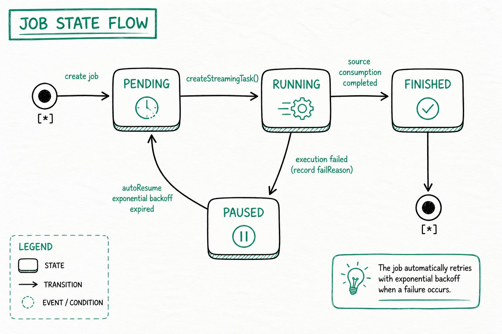

---
{
    "title": "Обзор непрерывной загрузки",
    "language": "ru",
    "sidebar_label": "Обзор",
    "description": "Изучите источники данных Streaming Job в Doris, включая MySQL, PostgreSQL, OceanBase и S3, а также режимы синхронизации, семантику согласованности, состояния заданий, общие параметры и эксплуатационные команды.",
    "keywords": [
        "Непрерывная загрузка Doris",
        "Streaming Job",
        "Синхронизация MySQL в реальном времени",
        "Синхронизация PostgreSQL в реальном времени",
        "Синхронизация OceanBase в реальном времени",
        "Непрерывная загрузка S3",
        "SQL Mapping Sync",
        "Auto Table Creation Sync",
        "exactly-once",
        "at-least-once",
        "autoResume"
    ]
}
---

:::caution Экспериментальная функция

Непрерывная загрузка Doris является экспериментальной функцией и поддерживается начиная с Doris 4.1.5.

:::

<!-- Knowledge type: Feature overview + architecture selection decision -->
<!-- Applicable scenarios: Real-time data ingestion selection / continuous load operations -->

Doris поддерживает непрерывную загрузку данных из нескольких источников в таблицы Doris через **Streaming Job**. После отправки Job Doris продолжает выполнять задание загрузки, в реальном времени считывая данные из источника и записывая их в таблицу Doris.

Этот документ поможет ответить на следующие вопросы:

- Какие источники данных и режимы синхронизации поддерживает непрерывная загрузка?
- Как выбрать между SQL Mapping Sync и Auto Table Creation Sync?
- Как изменяются состояния задания и как работает автоматическое восстановление?
- Как в повседневной работе просматривать, приостанавливать, возобновлять и удалять задания загрузки?
- Каковы общие параметры конфигурации FE и Job?

## Поддерживаемые источники данных и режимы синхронизации {#supported-data-sources-and-sync-modes}

Непрерывная загрузка поддерживает следующие источники данных и режимы синхронизации. Уведомления S3 и однократная загрузка поддерживаются начиная с Doris 4.1.6:

| Источник данных | Поддерживаемые версии | SQL Mapping Sync | Auto Table Creation Sync | Руководство по настройке |
| :---------- | :----------------- | :---------------------------------------------------------------- | :---------------------------------------------------------------------- | :---------------------------------------------------------------------------------------------------------------------------------------- |
| MySQL       | 5.6, 5.7, 8.0.x    | [MySQL CDC с SQL Mapping Sync](./continuous-load-mysql-table.md)    | [MySQL CDC с Auto Table Creation Sync](./continuous-load-mysql-database.md) | [Amazon RDS MySQL](./prerequisites/amazon-rds-mysql.md) · [Amazon Aurora MySQL](./prerequisites/amazon-aurora-mysql.md)                   |
| PostgreSQL  | 14, 15, 16, 17     | [PostgreSQL CDC с SQL Mapping Sync](./continuous-load-postgresql-table.md) | [PostgreSQL CDC с Auto Table Creation Sync](./continuous-load-postgresql-database.md) | [Amazon RDS PostgreSQL](./prerequisites/amazon-rds-postgresql.md) · [Amazon Aurora PostgreSQL](./prerequisites/amazon-aurora-postgresql.md) |
| OceanBase   | режим совместимости с MySQL | -                                                           | [OceanBase CDC с Auto Table Creation Sync](./continuous-load-oceanbase-database.md) | -                                                                                                                                         |
| S3          | -                  | [Непрерывная загрузка S3](./continuous-load-s3.md)                     | -                                                                       | -                                                                                                                                         |

Сведения о сопоставлении типов столбцов источника с типами Doris см. в разделах о сопоставлении типов данных для [MySQL](./data-type-mapping-mysql.md), [PostgreSQL](./data-type-mapping-postgresql.md) и [OceanBase](./data-type-mapping-oceanbase.md).

## Как выбрать метод синхронизации {#how-to-choose-a-sync-method}

<!-- Knowledge type: Architecture selection decision -->

SQL Mapping Sync и Auto Table Creation Sync — это два метода непрерывной загрузки с **полностью разными внутренними механизмами**, а не различие в «количестве таблиц». **Auto Table Creation Sync также поддерживает синхронизацию только одной таблицы через `include_tables`**, поэтому выбирать метод следует по требуемым возможностям.

### Сравнение возможностей {#capability-comparison}

| Возможность | SQL Mapping Sync | Auto Table Creation Sync |
| :----------------- | :-------------------------------------------------------------- | :------------------------------------------------- |
| Базовый механизм | Job + TVF (`INSERT INTO tbl SELECT * FROM tvf()`) | Job + нативный DDL для всей базы данных (`FROM src TO DATABASE db`) |
| Уровень назначения | Существующая таблица Doris | Контейнер базы данных Doris |
| Охват синхронизации | Одна таблица | От одной или нескольких таблиц до всей базы данных (управляется `include_tables`) |
| Автоматическое создание таблиц | Таблицы необходимо создать заранее | Таблицы с первичным ключом автоматически создаются при первой синхронизации |
| Гибкость SQL | Поддерживаются сопоставление столбцов, фильтрация и преобразование (предложение SELECT) | Поддерживаются переименование целевых таблиц и исключение столбцов без ключа; выражения SQL, фильтрация строк и преобразование данных не поддерживаются |
| Гарантия семантики | exactly-once | at-least-once |
| Требуемые привилегии | Load | Load + Create (при автоматическом создании таблиц) |
| Типичные сценарии | Синхронизация в реальном времени, требующая выражений SQL, преобразования типов или условной фильтрации | Зеркальная репликация всей базы данных или группы таблиц с возможностью простого переименования целевых таблиц или удаления столбцов |

### Рекомендации по выбору {#selection-recommendations}

- **Если необходимо обрабатывать данные с помощью SQL или есть строгие требования к семантике exactly-once** -> выберите **SQL Mapping Sync**
- **Если требуется, чтобы Doris автоматически создавал таблицы и синхронизировал группу таблиц одной конфигурацией** -> выберите **Auto Table Creation Sync**
- **Если источником данных является OceanBase** -> в настоящее время поддерживается только Auto Table Creation Sync в режиме совместимости с MySQL
- **Если источником данных является объектное хранилище S3** -> поддерживается только SQL Mapping Sync (с использованием S3 TVF)

## Переходы состояний задания {#job-state-transitions}

<!-- Knowledge type: Runtime mechanism -->

Во время выполнения Streaming Job переходит между следующими состояниями. **SQL Mapping Sync и Auto Table Creation Sync используют одну и ту же машину состояний**:



### Описание состояний {#state-descriptions}

| Состояние | Значение |
| :----------- | :----------------------------------------------------------------------------------------------------------------------- |
| **PENDING**  | Задание создано, но дочерние задачи ещё не запланированы; оно ожидает следующего цикла планировщика для создания `StreamingTask`. |
| **RUNNING**  | Дочерняя задача создана и выполняется: она считывает инкрементальные данные из источника и записывает их в Doris. |
| **FINISHED** | Источник полностью обработан, и задание завершено. Задание S3 TVF переходит в это состояние после загрузки всех файлов. |
| **PAUSED**   | Дочерняя задача завершилась ошибкой, задание автоматически приостановлено, а `failReason` записан. Причину можно проверить в поле `ErrorMsg` запроса `select * from jobs(...)`. |

### Автоматическое восстановление (autoResume) {#automatic-recovery-autoresume}

После перехода задания в `PAUSED` планировщик периодически пытается восстановить его, используя **стратегию экспоненциальной задержки**. После восстановления задание возвращается в `PENDING` и продолжает создавать дочерние задачи. **Ручное вмешательство не требуется: временные сбои (нестабильность сети, кратковременная недоступность источника и т. п.) устраняются автоматически.**

Используйте соответствующую команду в каждом сценарии:

- **Немедленно возобновить или вручную запустить после устранения неполадки**: используйте [`RESUME JOB`](#resume-a-load-job)
- **Полностью остановить и больше не планировать**: используйте [`PAUSE JOB`](#pause-a-load-job) (задание, приостановленное вручную, не будет разбужено autoResume) или [`DROP JOB`](#delete-a-load-job)

### Идентификатор задачи CDC и обработка сбоев {#cdc-task-identity-and-failure-handling}

Начиная с версии 4.1.5 Streaming CDC использует учётную запись Doris создателя задания для записи, запросов метаданных таблиц и изменений схемы вместо фиксированной учётной записи администратора. Создателю нужны привилегии `LOAD` для целевых таблиц, `CREATE` для автоматического создания таблиц, а также соответствующие привилегии `ALTER` и просмотра таблиц для синхронизации схемы. Отзыв привилегий во время выполнения также влияет на последующие задачи. Проверьте разрешения создателя, указанного в задании.

Неудачные задачи Streaming INSERT на основе `cdc_stream()` не переходят в обычный поток повторных попыток задач. Изучите ошибки в `jobs()` и `tasks()`, исправьте проблемы источника или привилегий и возобновите выполнение в соответствии с состоянием задания. Не следует предполагать, что неудачная задача будет автоматически воспроизведена.

## Общие операции {#common-operations}

<!-- Knowledge type: Operational steps -->

### Просмотр состояния загрузки {#view-load-status}

Выполните запрос для всех Insert Job типа Streaming:

```sql
select * from jobs("type"="insert") where ExecuteType = "STREAMING";
```

Столбцы результата:

| Столбец | Описание |
| ----------------- | ------------------------------------------------------------------------ |
| ID                | Идентификатор Job |
| NAME              | Имя Job |
| Definer           | Определитель Job |
| ExecuteType       | Тип планирования задания: *ONE_TIME/RECURRING/STREAMING/MANUAL* |
| RecurringStrategy | Стратегия повторения. Используется обычным Insert. Пусто, если ExecuteType=Streaming |
| Status            | Состояние Job |
| ExecuteSql        | Оператор Insert SQL задания |
| CreateTime        | Время создания Job |
| SucceedTaskCount  | Число успешно выполненных задач |
| FailedTaskCount   | Число неудачных задач |
| CanceledTaskCount | Число отменённых задач |
| Comment           | Комментарий Job |
| Properties        | Свойства Job |
| CurrentOffset     | Offset, до которого Job завершил обработку. Заполняется только при ExecuteType=Streaming |
| EndOffset         | Максимальный EndOffset, полученный Job из источника данных. Заполняется только при ExecuteType=Streaming |
| LoadStatistic     | Статистика Job |
| ErrorMsg          | Сообщение об ошибке Job |
| JobRuntimeMsg     | Сообщения о состоянии выполнения Job |
| LagBytes          | Число отстающих байтов в журнале источника (binlog MySQL / OceanBase или WAL PostgreSQL). `-1` означает, что значение сейчас недоступно, например для источника S3 или на этапе полного снимка. |
| LastSourceEventTimestamp | Метка времени (в секундах Unix) последнего события источника, записанного в зафиксированном offset. Пусто, если недоступно. |
| LastTaskSuccessTime | Время успешного завершения последней Task |

### Просмотр состояния Task {#view-task-status}

Выполните запрос всех дочерних задач Job по его идентификатору:

```sql
select * from tasks("type"="insert") where jobId='<job_id>';
```

Столбцы результата:

| Столбец | Описание |
| ------------- | ------------------------------------------------------------------- |
| TaskId        | Идентификатор Task |
| JobID         | Идентификатор Job |
| JobName       | Имя Job |
| Label         | Метка, используемая Task для загрузки |
| Status        | Состояние Task |
| ErrorMsg      | Сообщение об ошибке Task |
| CreateTime    | Время создания Task |
| StartTime     | Время начала Task |
| FinishTime    | Время завершения Task |
| LoadStatistic | Статистика Task |
| User          | Исполнитель Task |
| RunningOffset | Информация об offset, который сейчас синхронизирует Task. Заполняется только при Job.ExecuteType=Streaming |

### Приостановка задания загрузки {#pause-a-load-job}

Вручную приостановите указанное задание (задание, приостановленное вручную, не будет разбужено autoResume):

```sql
PAUSE JOB WHERE jobname = <job_name>;
```

### Возобновление задания загрузки {#resume-a-load-job}

Возобновите задание, находящееся в состоянии `PAUSED`:

```sql
RESUME JOB WHERE jobName = <job_name>;
```

### Удаление задания загрузки {#delete-a-load-job}

Безвозвратно удалите указанное задание. После удаления оно больше не планируется:

```sql
DROP JOB WHERE jobName = <job_name>;
```

## Общие параметры {#common-parameters}

<!-- Knowledge type: Configuration parameters -->

### Параметры конфигурации FE {#fe-configuration-parameters}

| Параметр | По умолчанию | Описание |
| ------------------------------------ | ------- | ------------------------------------------------- |
| max_streaming_job_num                | 1024    | Максимальное число Streaming Job |
| job_streaming_task_exec_thread_num   | 10      | Число потоков для выполнения StreamingTask |
| max_streaming_task_show_count        | 100    | Максимальное число записей о выполнении StreamingTask, хранимых в памяти |

### Общие параметры конфигурации загрузки Job {#job-common-load-configuration-parameters}

Настройте следующие параметры через `CREATE JOB ... PROPERTIES (...)`. Если не указано иное, их можно использовать в заданиях непрерывной загрузки MySQL, PostgreSQL и OceanBase.

| Параметр | Значение по умолчанию | Описание |
| --- | --- | --- |
| `max_interval` | `10` | Интервал простоя планировщика в секундах, когда новые данные из источника отсутствуют. Принимаются только целые числа, большие или равные 1; суффиксы единиц, такие как `10s`, не поддерживаются. |
| `compute_group` | Текущая сессия или вычислительная группа пользователя по умолчанию | Поддерживается только в режиме разделения вычислений и хранения. Указывает вычислительную группу, в которой выполняется задание. Явно заданное значение не может быть пустым, и пользователь должен иметь привилегию USAGE для этой вычислительной группы. Создание задания завершается ошибкой, если параметр не задан и ни текущая сессия, ни пользователь не имеют доступной вычислительной группы по умолчанию. |
| `session.<variable_name>` | Значение соответствующей переменной сессии по умолчанию | Поддерживается только в режиме TVF. Задаёт переменную сессии для INSERT-задачи Job, например `session.insert_max_filter_ratio`. Имя и значение переменной должны соответствовать допустимым переменным сессии Doris. |

При использовании в качестве свойства Job параметр `offset` не задаёт начальную позицию задания CDC. При создании задания задайте начальную позицию в параметрах источника `FROM MYSQL`, `FROM POSTGRES`, `FROM OCEANBASE` или `cdc_stream(...)`. После приостановки задания CDC его позицию можно сбросить через `ALTER JOB ... PROPERTIES ("offset" = '<json_offset>')`. MySQL и OceanBase используют `{"file":"binlog.000001","pos":"154"}`, а PostgreSQL — `{"lsn":"12345678"}`. `ALTER JOB` принимает только точные JSON-значения offset.

## Ограничения {#limitations}

<!-- Knowledge type: Limitations / unsupported boundaries -->

Охват синхронизации, автоматическое создание таблиц и гарантии семантики (exactly-once / at-least-once) описаны в разделе [Сравнение возможностей](#capability-comparison). В этом разделе перечислены только ограничения и варианты поведения, которые **не поддерживаются**.

### Таблицы с первичным ключом {#primary-key-tables}

Синхронизировать можно только исходные таблицы **с первичным ключом** (для обоих методов синхронизации). Соответствующая таблица Doris является таблицей **Unique Key** — в Auto Table Creation Sync она создаётся автоматически, а в SQL Mapping Sync вы создаёте её самостоятельно. Таблицы без первичного ключа не поддерживаются.

### Schema Change (DDL) {#schema-change-ddl}

Синхронизация DDL применяется **только к методу [Auto Table Creation Sync](#capability-comparison)**; метод [SQL Mapping Sync](#capability-comparison) не синхронизирует DDL — табличная функция `cdc_stream()` всегда принудительно устанавливает `schema_change_enabled` в `false`.

- **Для MySQL, PostgreSQL и OceanBase синхронизируются только `ADD COLUMN` и `DROP COLUMN`. Изменения типов столбцов, `RENAME COLUMN`, а также изменения первичных ключей, ограничений, индексов и секционирования НЕ синхронизируются** — применяйте их вручную в Doris. Информацию о поведении и ограничениях для конкретного источника см. в разделах о синхронизации Schema Change для [MySQL](./schema-change-mysql.md), [PostgreSQL](./schema-change-postgresql.md) и [OceanBase](./schema-change-oceanbase.md).

Auto Table Creation Sync включает Schema Change Sync по умолчанию. В настоящее время Doris не предоставляет SQL-свойство для его отключения.

## Часто задаваемые вопросы {#faq}

<!-- Knowledge type: FAQ / troubleshooting -->

### Ошибка подключения MySQL: Public Key Retrieval is not allowed {#mysql-connection-error-public-key-retrieval-is-not-allowed}

**Причина:** настроенный пользователь MySQL использует аутентификацию паролем SHA256, которая требует передачи пароля по протоколу TLS или аналогичному протоколу.

**Решение 1:** добавьте параметр `allowPublicKeyRetrieval=true` в JDBC URL:

```text
jdbc:mysql://127.0.0.1:3306?allowPublicKeyRetrieval=true
```

**Решение 2:** измените метод аутентификации пользователя MySQL на `mysql_native_password`:

```sql
ALTER USER 'username'@'%' IDENTIFIED WITH mysql_native_password BY 'password';
FLUSH PRIVILEGES;
```
