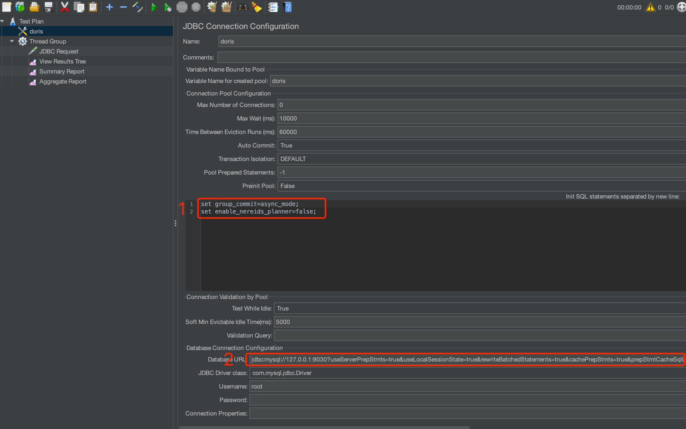
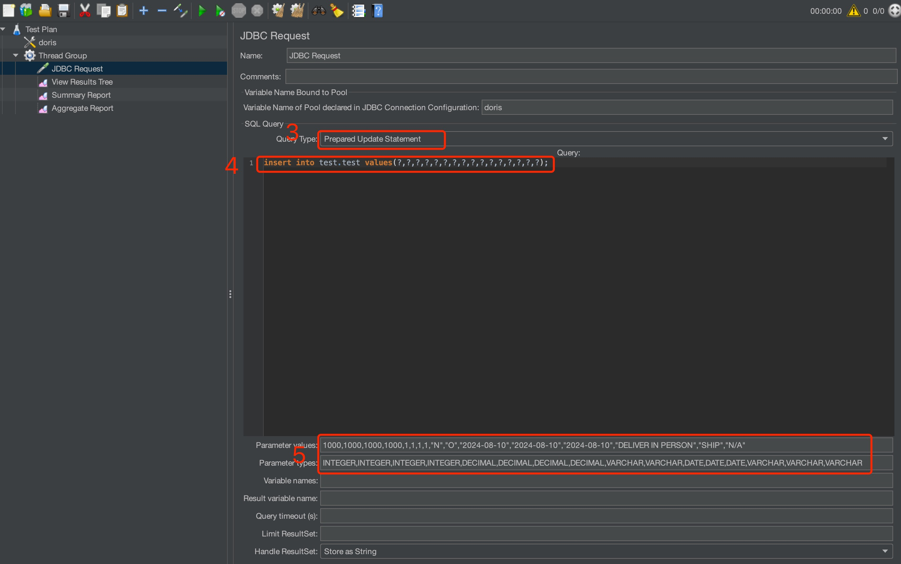

---
{
    "title": "Оптимизация загрузки при высокой конкурентности (Group Commit)",
    "language": "ru",
    "description": "Doris Group Commit объединяет частые транзакции записи небольших пакетов, снижая нагрузку на FE при разборе запросов и сокращая рост числа версий. Это повышает производительность INSERT и Stream Load при высокой конкурентности.",
    "keywords": [
        "Group Commit",
        "Загрузка при высокой конкурентности",
        "Частая запись небольших пакетов",
        "Оптимизация INSERT INTO",
        "Оптимизация Stream Load",
        "Производительность загрузки Doris",
        "PreparedStatement",
        "WAL"
    ]
}
---

<!-- Knowledge type: Feature capability + Operational steps + Configuration parameters -->
<!-- Applicable scenarios: High-concurrency small-batch writes / Real-time load / Performance tuning -->

При частой записи небольших пакетов традиционные способы загрузки создают следующие проблемы:

- Для каждой загрузки создаётся отдельная транзакция. Каждая из них требует разбора SQL и построения плана выполнения на FE, что снижает общую производительность.
- Каждая загрузка создаёт новую версию. Число версий быстро растёт, увеличивая нагрузку на фоновое уплотнение данных (Compaction).

Для решения этих проблем в Doris предусмотрен механизм Group Commit. Это не новый способ загрузки, а оптимизация существующих способов, прежде всего:

- оператора `INSERT INTO tbl VALUES(...)`;
- Stream Load.

Group Commit объединяет несколько загрузок небольших пакетов в одну крупную транзакцию, которая фиксируется в фоновом режиме. Это значительно повышает производительность конкурентной записи небольших пакетов. Совместное использование Group Commit и PreparedStatement даёт ещё больший прирост производительности.

## Сценарии применения и выбор режима {#applicable-scenarios-and-selection}

| Сценарий | Рекомендуемый режим | Описание |
| --- | --- | --- |
| Конкурентная запись с требованием немедленной видимости данных | `sync_mode` | Несколько загрузок объединяются в одну транзакцию; вызов возвращает результат после её фиксации. |
| Частая запись с жёсткими требованиями к задержке | `async_mode` | Данные сначала записываются в WAL, и вызов сразу возвращает результат; транзакция фиксируется асинхронно в фоновом режиме. |
| Group Commit не требуется | `off_mode` | Отключает Group Commit и использует обычный путь загрузки. |

## Режимы Group Commit {#group-commit-modes}

Для записи через Group Commit доступны три режима:

- **Выключенный режим (`off_mode`)**

    Отключает Group Commit.

- **Синхронный режим (`sync_mode`)**

    Doris объединяет несколько загрузок в одну транзакцию с учётом нагрузки и свойства таблицы `group_commit_interval`. Каждая загрузка возвращает результат после фиксации транзакции. Режим подходит для конкурентной записи, когда данные должны быть видны сразу после завершения загрузки.

- **Асинхронный режим (`async_mode`)**

    Doris сначала записывает данные в WAL (`Write Ahead Log`), после чего загрузка сразу возвращает результат. Затем Doris асинхронно фиксирует данные с учётом нагрузки и свойства таблицы `group_commit_interval`; после фиксации данные становятся видимыми. Чтобы WAL не занимал слишком много места на диске, при большом объёме данных в одной загрузке Doris автоматически переключается на `sync_mode`. Режим подходит для частой записи с жёсткими требованиями к задержке.

    Число файлов WAL можно проверить через HTTP-интерфейс FE; подробности см. [здесь](../../../admin-manual/open-api/fe-http/get-wal-size-action). Также можно найти метрики BE по ключевому слову `wal`.

## Быстрый старт {#quick-start}

Во всех примерах ниже используется следующая схема таблицы:

```sql
CREATE TABLE `dt` (
    `id` int(11) NOT NULL,
    `name` varchar(50) NULL,
    `score` int(11) NULL
) ENGINE=OLAP
DUPLICATE KEY(`id`)
DISTRIBUTED BY HASH(`id`) BUCKETS 1
PROPERTIES (
    "replication_num" = "1"
);
```

### Настройка свойств таблицы {#table-property-configuration}

:::info
Свойство таблицы `group_commit_mode` поддерживается начиная с версии **4.1.0**.
:::

На уровне таблицы можно задать режим Group Commit по умолчанию. Если в запросе Stream Load не указан HTTP-заголовок `group_commit`, используется режим из свойства таблицы.

**1. Задать при создании таблицы:**

```sql
CREATE TABLE `dt` (
    `id` int(11) NOT NULL,
    `name` varchar(50) NULL,
    `score` int(11) NULL
) ENGINE=OLAP
DUPLICATE KEY(`id`)
DISTRIBUTED BY HASH(`id`) BUCKETS 1
PROPERTIES (
    "replication_num" = "1",
    "group_commit_mode" = "async_mode"
);
```

**2. Изменить свойство таблицы:**

```sql
# Change to sync mode
ALTER TABLE dt SET ("group_commit_mode" = "sync_mode");

# Disable Group Commit
ALTER TABLE dt SET ("group_commit_mode" = "off_mode");
```

**3. Просмотреть свойство таблицы:**

`SHOW CREATE TABLE` показывает свойство `group_commit_mode`, если его значение отличается от `off_mode`:

```sql
mysql> SHOW CREATE TABLE dt;
+-------+----------------------------------------------------------------------------------------------------------------------------------------------------------------------------------------------------------------------+
| Table | Create Table                                                                                                                                                                                                       |
+-------+----------------------------------------------------------------------------------------------------------------------------------------------------------------------------------------------------------------------+
| dt    | CREATE TABLE `dt` (
  `id` int(11) NOT NULL,
  `name` varchar(50) NULL,
  `score` int(11) NULL
) ENGINE=OLAP
DUPLICATE KEY(`id`)
DISTRIBUTED BY HASH(`id`) BUCKETS 1
PROPERTIES (
    "group_commit_mode" = "async_mode"
) |
+-------+----------------------------------------------------------------------------------------------------------------------------------------------------------------------------------------------------------------------+
1 row in set (0.00 sec)
```

**4. Приоритет:**

| Способ загрузки | Приоритет (от высокого к низкому) |
| --- | --- |
| Stream Load | HTTP-заголовок `group_commit` > свойство таблицы `group_commit_mode` |
| INSERT INTO VALUES | переменная сеанса `group_commit` > свойство таблицы `group_commit_mode` |

## Использование {#usage}

### INSERT INTO VALUES {#insert-into-values}

Чтобы включить Group Commit, задайте переменную сеанса `group_commit`. Она имеет приоритет над свойством таблицы.

**Асинхронный режим:**

```sql
# Set the session variable to enable group commit (default is off_mode), using async mode
mysql> set group_commit = async_mode;

# The returned label starts with group_commit, which tells you that group commit is in use
mysql> insert into dt values(1, 'Bob', 90), (2, 'Alice', 99);
Query OK, 2 rows affected (0.05 sec)
{'label':'group_commit_a145ce07f1c972fc-bd2c54597052a9ad', 'status':'PREPARE', 'txnId':'181508'}

# This label and txn_id match the previous one, indicating that the inserts are batched into the same load task
mysql> insert into dt(id, name) values(3, 'John');
Query OK, 1 row affected (0.01 sec)
{'label':'group_commit_a145ce07f1c972fc-bd2c54597052a9ad', 'status':'PREPARE', 'txnId':'181508'}

# The data is not immediately queryable
mysql> select * from dt;
Empty set (0.01 sec)

# After 10 seconds, the data is queryable. The data visibility delay is controlled by the table property group_commit_interval.
mysql> select * from dt;
+------+-------+-------+
| id   | name  | score |
+------+-------+-------+
|    1 | Bob   |    90 |
|    2 | Alice |    99 |
|    3 | John  |  NULL |
+------+-------+-------+
3 rows in set (0.02 sec)
```

**Синхронный режим:**

```sql
# Set the session variable to enable group commit (default is off_mode), using sync mode
mysql> set group_commit = sync_mode;

# The returned label starts with group_commit, which tells you that group commit is in use. The load takes at least the value of the table property group_commit_interval.
mysql> insert into dt values(4, 'Bob', 90), (5, 'Alice', 99);
Query OK, 2 rows affected (10.06 sec)
{'label':'group_commit_d84ab96c09b60587_ec455a33cb0e9e87', 'status':'PREPARE', 'txnId':'3007', 'query_id':'fc6b94085d704a94-a69bfc9a202e66e2'}

# The data is queryable immediately
mysql> select * from dt;
+------+-------+-------+
| id   | name  | score |
+------+-------+-------+
|    1 | Bob   |    90 |
|    2 | Alice |    99 |
|    3 | John  |  NULL |
|    4 | Bob   |    90 |
|    5 | Alice |    99 |
+------+-------+-------+
5 rows in set (0.03 sec)
```

**Выключенный режим:**

```sql
mysql> set group_commit = off_mode;
```

### Использование JDBC (PreparedStatement) {#using-jdbc-preparedstatement}

При записи данных через JDBC с помощью `insert into values` Doris поддерживает функцию `PreparedStatement` протокола MySQL на стороне FE. Она уменьшает затраты на разбор SQL и построение плана. SQL и план загрузки сохраняются в кэше памяти на уровне сеанса; последующие загрузки используют сохранённый объект напрямую, что снижает загрузку CPU на FE.

**1. Задайте JDBC URL и включите PreparedStatement на стороне сервера:**

```text
url = jdbc:mysql://127.0.0.1:9030/db?useServerPrepStmts=true&useLocalSessionState=true&rewriteBatchedStatements=true&cachePrepStmts=true&prepStmtCacheSqlLimit=99999&prepStmtCacheSize=500
```

**2. Задайте переменную сеанса `group_commit` одним из двух способов:**

- Через JDBC URL, добавив `sessionVariables=group_commit=async_mode`:

    ```text
    url = jdbc:mysql://127.0.0.1:9030/db?useServerPrepStmts=true&useLocalSessionState=true&rewriteBatchedStatements=true&cachePrepStmts=true&prepStmtCacheSqlLimit=99999&prepStmtCacheSize=500&sessionVariables=group_commit=async_mode,enable_nereids_planner=false
    ```

- Выполнив оператор SQL:

    ```java
    try (Statement statement = conn.createStatement()) {
        statement.execute("SET group_commit = async_mode;");
    }
    ```

**3. Используйте `PreparedStatement` для пакетной записи:**

```java
private static final String JDBC_DRIVER = "com.mysql.jdbc.Driver";
private static final String URL_PATTERN = "jdbc:mysql://%s:%d/%s?useServerPrepStmts=true&useLocalSessionState=true&rewriteBatchedStatements=true&cachePrepStmts=true&prepStmtCacheSqlLimit=99999&prepStmtCacheSize=50&sessionVariables=group_commit=async_mode";
private static final String HOST = "127.0.0.1";
private static final int PORT = 9030;
private static final String DB = "db";
private static final String TBL = "dt";
private static final String USER = "root";
private static final String PASSWD = "";
private static final int INSERT_BATCH_SIZE = 10;

private static void groupCommitInsertBatch() throws Exception {
    Class.forName(JDBC_DRIVER);
    // add rewriteBatchedStatements=true and cachePrepStmts=true in JDBC url
    // set session variables by sessionVariables=group_commit=async_mode in JDBC url
    try (Connection conn = DriverManager.getConnection(
            String.format(URL_PATTERN, HOST, PORT, DB), USER, PASSWD)) {

        String query = "insert into " + TBL + " values(?, ?, ?)";
        try (PreparedStatement stmt = conn.prepareStatement(query)) {
            for (int j = 0; j < 5; j++) {
                // 10 rows per insert
                for (int i = 0; i < INSERT_BATCH_SIZE; i++) {
                    stmt.setInt(1, i);
                    stmt.setString(2, "name" + i);
                    stmt.setInt(3, i + 10);
                    stmt.addBatch();
                }
                int[] result = stmt.executeBatch();
            }
        }
    } catch (Exception e) {
        e.printStackTrace();
    }
}
```

:::tip
Частые операторы `INSERT INTO` создают большой объём записей в журнале аудита, что несколько снижает итоговую производительность. Поэтому аудит подготовленных операторов по умолчанию отключён. Управлять им можно с помощью переменной сеанса.

```sql
# Set the session variable to enable audit logging for prepared statements. The default value is false, which disables audit logging for prepared statements.
set enable_prepared_stmt_audit_log=true;
```
:::

Подробнее об использовании JDBC см. в разделе [Синхронизация данных с помощью INSERT](../import-way/insert-into-manual.md).

### Формирование пакетов в клиенте Golang {#batching-with-the-golang-client}

Поддержка подготовленных операторов в Golang ограничена, поэтому для повышения производительности Group Commit пакеты можно формировать вручную на стороне клиента. Пример программы:

```Golang
package main

import (
	"database/sql"
	"fmt"
	"math/rand"
	"strings"
	"sync"
	"sync/atomic"
	"time"

	_ "github.com/go-sql-driver/mysql"
)

const (
	host     = "127.0.0.1"
	port     = 9030
	db       = "test"
	user     = "root"
	password = ""
	table    = "async_lineitem"
)

var (
	threadCount = 20
	batchSize   = 100
)

var totalInsertedRows int64
var rowsInsertedLastSecond int64

func main() {
	dbDSN := fmt.Sprintf("%s:%s@tcp(%s:%d)/%s?parseTime=true", user, password, host, port, db)
	db, err := sql.Open("mysql", dbDSN)
	if err != nil {
		fmt.Printf("Error opening database: %s\n", err)
		return
	}
	defer db.Close()

	var wg sync.WaitGroup
	for i := 0; i < threadCount; i++ {
		wg.Add(1)
		go func() {
			defer wg.Done()
			groupCommitInsertBatch(db)
		}()
	}

	go logInsertStatistics()

	wg.Wait()
}

func groupCommitInsertBatch(db *sql.DB) {
	for {
		valueStrings := make([]string, 0, batchSize)
		valueArgs := make([]interface{}, 0, batchSize*16)
		for i := 0; i < batchSize; i++ {
		    valueStrings = append(valueStrings, "(?, ?, ?, ?, ?, ?, ?, ?, ?, ?, ?, ?, ?, ?, ?, ?)")
			valueArgs = append(valueArgs, rand.Intn(1000))
			valueArgs = append(valueArgs, rand.Intn(1000))
			valueArgs = append(valueArgs, rand.Intn(1000))
			valueArgs = append(valueArgs, rand.Intn(1000))
			valueArgs = append(valueArgs, sql.NullFloat64{Float64: 1.0, Valid: true})
			valueArgs = append(valueArgs, sql.NullFloat64{Float64: 1.0, Valid: true})
			valueArgs = append(valueArgs, sql.NullFloat64{Float64: 1.0, Valid: true})
			valueArgs = append(valueArgs, sql.NullFloat64{Float64: 1.0, Valid: true})
			valueArgs = append(valueArgs, "N")
			valueArgs = append(valueArgs, "O")
			valueArgs = append(valueArgs, time.Now())
			valueArgs = append(valueArgs, time.Now())
			valueArgs = append(valueArgs, time.Now())
			valueArgs = append(valueArgs, "DELIVER IN PERSON")
			valueArgs = append(valueArgs, "SHIP")
			valueArgs = append(valueArgs, "N/A")
		}
		stmt := fmt.Sprintf("INSERT INTO %s VALUES %s",
			table, strings.Join(valueStrings, ","))
		_, err := db.Exec(stmt, valueArgs...)
		if err != nil {
			fmt.Printf("Error executing batch: %s\n", err)
			return
		}
		atomic.AddInt64(&rowsInsertedLastSecond, int64(batchSize))
		atomic.AddInt64(&totalInsertedRows, int64(batchSize))
	}
}

func logInsertStatistics() {
	for {
		time.Sleep(1 * time.Second)
		fmt.Printf("Total inserted rows: %d\n", totalInsertedRows)
		fmt.Printf("Rows inserted in the last second: %d\n", rowsInsertedLastSecond)
		rowsInsertedLastSecond = 0
	}
}

```

### Stream Load {#stream-load}

При загрузке данных через Stream Load механизм Group Commit можно включить, указав параметр `group_commit` в HTTP-заголовке.

:::note
Если заголовок `group_commit` не указан, но в свойствах таблицы задано `group_commit_mode`, режим из свойства таблицы используется автоматически.
:::

Предположим, файл `data.csv` содержит:

```text
6,Amy,60
7,Ross,98
```

**Асинхронный режим:**

```shell
# Add the "group_commit:async_mode" header during load

curl --location-trusted -u {user}:{passwd} -T data.csv -H "group_commit:async_mode"  -H "column_separator:,"  http://{fe_host}:{http_port}/api/db/dt/_stream_load
{
    "TxnId": 7009,
    "Label": "group_commit_c84d2099208436ab_96e33fda01eddba8",
    "Comment": "",
    "GroupCommit": true,
    "Status": "Success",
    "Message": "OK",
    "NumberTotalRows": 2,
    "NumberLoadedRows": 2,
    "NumberFilteredRows": 0,
    "NumberUnselectedRows": 0,
    "LoadBytes": 19,
    "LoadTimeMs": 35,
    "StreamLoadPutTimeMs": 5,
    "ReadDataTimeMs": 0,
    "WriteDataTimeMs": 26
}

# The returned GroupCommit is true, which means the load entered the group commit path
# The returned Label starts with group_commit and is the label associated with the load that actually consumes the data
```

**Синхронный режим:**

```shell
# Add the "group_commit:sync_mode" header during load

curl --location-trusted -u {user}:{passwd} -T data.csv -H "group_commit:sync_mode"  -H "column_separator:,"  http://{fe_host}:{http_port}/api/db/dt/_stream_load
{
    "TxnId": 3009,
    "Label": "group_commit_d941bf17f6efcc80_ccf4afdde9881293",
    "Comment": "",
    "GroupCommit": true,
    "Status": "Success",
    "Message": "OK",
    "NumberTotalRows": 2,
    "NumberLoadedRows": 2,
    "NumberFilteredRows": 0,
    "NumberUnselectedRows": 0,
    "LoadBytes": 19,
    "LoadTimeMs": 10044,
    "StreamLoadPutTimeMs": 4,
    "ReadDataTimeMs": 0,
    "WriteDataTimeMs": 10038
}

# The returned GroupCommit is true, which means the load entered the group commit path
# The returned Label starts with group_commit and is the label associated with the load that actually consumes the data
```

Подробнее о синтаксисе Stream Load и рекомендациях по использованию см. в разделе [Stream Load](../import-way/stream-load-manual).

## Условия автоматической фиксации {#auto-commit-conditions}

<!-- Knowledge type: Configuration parameters -->

Фиксация запускается, когда истекает интервал фиксации (по умолчанию 10 секунд) или накопленный объём данных достигает порога (по умолчанию 128 MB). Настраивайте оба порога для каждой таблицы с учётом характера нагрузки.

### Настройка интервала фиксации {#adjusting-the-commit-interval}

Интервал фиксации по умолчанию составляет 10 секунд. Его можно изменить в настройках таблицы:

```sql
# Change the commit interval to 2 seconds
ALTER TABLE dt SET ("group_commit_interval_ms" = "2000");
```

**Рекомендации по настройке:**

| Пример значения | Преимущества | Недостатки |
| --- | --- | --- |
| Более короткий интервал (например, 2 секунды) | Меньшая задержка видимости данных; подходит, когда данные должны быть доступны почти в реальном времени | Более частые фиксации, быстрый рост числа версий и повышенная нагрузка на фоновое уплотнение данных (Compaction) |
| Более длинный интервал (например, 30 секунд) | Более крупные пакеты при фиксации, медленный рост числа версий и меньшие системные затраты | Большая задержка видимости данных |

Выбирайте значение с учётом допустимой для вашего приложения задержки видимости данных. При высокой нагрузке на систему интервал можно увеличить.

### Настройка объёма данных для фиксации {#adjusting-the-commit-data-size}

**История версий:**

- Свойство таблицы `group_commit_data_bytes` появилось в Doris 2.1.0 со значением по умолчанию 134217728 байт (128 MB).
- В версиях 3.x, 4.x и dev это значение по умолчанию не изменилось.
- Параметр BE `group_commit_queue_mem_limit` по умолчанию равен 64 MB и управляет ограничением нагрузки на память очереди. Это отдельная настройка, не связанная с порогом запуска фиксации.

Порог объёма данных, запускающий фиксацию Group Commit, по умолчанию составляет 128 MB. Его можно изменить в настройках таблицы:

```sql
# Set the commit data-size trigger threshold to 256 MB
ALTER TABLE dt SET ("group_commit_data_bytes" = "268435456");
```

**Рекомендации по настройке:**

| Пример значения | Преимущества | Недостатки |
| --- | --- | --- |
| Меньший порог (например, 32 MB) | Меньший расход памяти; подходит для сред с ограниченными ресурсами | Меньшие пакеты при фиксации; пропускная способность может снизиться |
| Больший порог (например, 256 MB) | Более эффективная пакетная фиксация и более высокая пропускная способность системы | Больший расход памяти |

Выбирайте значение с учётом доступной памяти и требований к надёжности данных. Если памяти достаточно и нужна более высокая пропускная способность, значение можно увеличить до 256 MB или выше.

## Связанные системные настройки {#related-system-configuration}

### Настройки BE {#be-configuration}

**`group_commit_wal_path`**

- Описание: каталог, в котором Group Commit хранит файлы WAL.
- Значение по умолчанию: в каждом каталоге, указанном в `storage_root_path`, создаётся каталог с именем `wal`. Пример настройки:

    ```text
    group_commit_wal_path=/data1/storage/wal;/data2/storage/wal;/data3/storage/wal
    ```

### Перенаправление Stream Load при разделении вычислений и хранения {#stream-load-forwarding-in-compute-storage-decoupled-mode}

При разделении вычислений и хранения балансировщик нагрузки может случайным образом распределять запросы Stream Load. Тогда запросы к одной таблице попадают на разные узлы BE, и Group Commit не может эффективно объединять их в пакеты. Если включить перенаправление через BE, узел BE, принявший запрос, передаст его целевому BE для этой таблицы. Так все запросы к одной таблице поступают на один BE.

| Параметр | Где задаётся | Значение по умолчанию | Описание |
| --- | --- | --- | --- |
| `enable_group_commit_streamload_be_forward` | FE | `false` | Включает перенаправление Stream Load через BE. Действует только при разделении вычислений и хранения и использовании Group Commit в запросе |
| `enable_group_commit_streamload_be_forward` | BE | `false` | Разрешает запросы к конечной точке BE `/api/{db}/{table}/_stream_load_forward`. **Добавлено в Doris 4.0.8 для серии 4.0 и в Doris 4.1.4 для серии 4.1** |

Для работы функции установите значение `true` **и на FE, и на BE**.

:::caution Изменение поведения (4.0.8 / 4.1.4)

Начиная с Doris 4.0.8 в серии 4.0 и Doris 4.1.4 в серии 4.1 для конечной точки BE `_stream_load_forward` действуют два ограничения:

- Доступ к ней управляется параметром BE `enable_group_commit_streamload_be_forward`. Если он равен `false` (значение по умолчанию), запросы возвращают `403 Forbidden` с сообщением `Stream load forward is disabled`.
- После включения параметра запросы к конечной точке должны также проходить аутентификацию, а учётная запись должна иметь глобальную привилегию `LOAD`.

Если до обновления функция была включена только на FE, после обновления перенаправление перестанет работать. Добавьте `enable_group_commit_streamload_be_forward=true` в `be.conf` каждого BE и убедитесь, что учётная запись для загрузки имеет привилегию `LOAD`.

:::

### Перенаправление на Follower FE {#forwarding-to-a-follower-fe}

> Поддерживается начиная с версии 4.1.4.

Помимо описанного выше перенаправления через BE, FE может по круговой схеме перенаправлять запросы Stream Load с Group Commit на Follower FE, распределяя нагрузку по формированию пакетов между несколькими FE.

| Параметр | Где задаётся | Значение по умолчанию | Описание |
| --- | --- | --- | --- |
| `enable_forward_group_commit_stream_load_to_follower` | FE | `false` | Включает перенаправление запросов Stream Load с Group Commit на Follower FE по круговой схеме |

Примечание: если для целевой таблицы свойство `light_schema_change` имеет значение `false`, такое перенаправление не поддерживается и запрос завершается ошибкой.

### Ограничение числа файлов WAL {#wal-count-limit}

> Поддерживается начиная с версии 4.1.4.

Group Commit в режиме `async_mode` сначала записывает данные в WAL, а затем асинхронно воспроизводит их. Если воспроизведение WAL постоянно завершается ошибкой, файлы WAL накапливаются и могут заполнить диск. Начиная с версии 4.1.4 параметр BE `group_commit_max_wal_num_per_table` ограничивает число файлов WAL для одной таблицы.

| Параметр | Где задаётся | Значение по умолчанию | Описание |
| --- | --- | --- | --- |
| `group_commit_max_wal_num_per_table` | BE | `10` | Максимальное число файлов WAL Group Commit для одной таблицы. `0` означает отсутствие ограничения. Поддерживается динамическое изменение |

При превышении лимита загрузки Group Commit в режиме `async_mode` для этой таблицы отклоняются с ошибкой `EXCEEDED_LIMIT`, например:

```text
Too many group commit async WALs for table <table_name>
```

Ошибка означает, что при воспроизведении WAL возникла проблема, например изменение схемы или отказ диска. Найдите и устраните причину сбоя воспроизведения WAL, вместо того чтобы просто повышать лимит.

## Ограничения {#limitations}

### Сценарии перехода на загрузку без Group Commit {#group-commit-fallback-scenarios}

| Способ загрузки | Условия перехода на загрузку без Group Commit |
| --- | --- |
| `INSERT INTO VALUES` | Запись в явной транзакции (`Begin; INSERT INTO VALUES; COMMIT`)<br/>Указание метки (`INSERT INTO dt WITH LABEL {label} VALUES`)<br/>Выражение в VALUES (`INSERT INTO dt VALUES (1 + 100)`)<br/>Запись с обновлением столбцов<br/>Таблица не поддерживает облегчённое изменение схемы |
| `Stream Load` | Двухфазная фиксация<br/>Указание метки (`-H "label:my_label"`)<br/>Запись с обновлением столбцов<br/>Таблица не поддерживает облегчённое изменение схемы |

### Модель Unique {#unique-model}

- Group Commit не гарантирует порядок фиксации транзакций. Для обеспечения согласованности данных используйте столбец Sequence.

### Ограничения WAL {#wal-limitations}

Начиная с версии 4.1.5 при воспроизведении WAL неполное поле длины или неполные данные в конце файла считаются концом файла. Полный блок данных может быть воспроизведён, даже если его завершающее поле контрольной суммы записано не полностью. Незавершённая запись в конце файла не восстанавливается как полная. Если файлы WAL отсутствуют или повреждены, целостность данных по-прежнему не гарантируется.

- В режиме `async_mode` данные записываются в WAL. После успешной загрузки соответствующий файл удаляется, а при сбое данные восстанавливаются из WAL.
- Файлы WAL хранятся в единственном экземпляре. При повреждении соответствующего диска или случайном удалении файла данные могут быть потеряны.
- При выводе узла BE из эксплуатации используйте команду `DECOMMISSION`, чтобы предотвратить потерю данных.
- `async_mode` автоматически переключается на `sync_mode` в следующих случаях:
    - Объём одной загрузки слишком велик: более 80% пространства одного каталога WAL.
    - Используется Stream Load с передачей данных частями, а размер данных неизвестен.
    - На диске недостаточно свободного места.
- Во время тяжёлого изменения схемы (Schema Change) записи через Group Commit отклоняются; клиенту необходимо повторить попытку.

## Производительность {#performance}

Производительность записи через `group commit` в режиме `async_mode` при высокой конкурентности и небольшом объёме данных проверялась с помощью `Stream Load` и `JDBC`.

### Тест загрузки журналов через Stream Load {#stream-load-log-scenario-test}

**Конфигурация машин:**

- 1 FE: Alibaba Cloud, CPU с 8 ядрами, 16 GB памяти, 1 облачный диск ESSD PL1 объёмом 100 GB
- 3 BE: Alibaba Cloud, CPU с 16 ядрами, 64 GB памяти, 1 облачный диск ESSD PL1 объёмом 1 TB на каждом узле
- 1 тестовый клиент: Alibaba Cloud, CPU с 16 ядрами, 64 GB памяти, 1 облачный диск ESSD PL1 объёмом 100 GB
- Тестовая версия: Doris-3.0.1

**Набор данных:**

- `httplogs`: всего 31 GB и 247 миллионов строк

**Инструмент тестирования:**

- [doris-streamloader](../../../connection-integration/data-integration/doris-streamloader.md)

**Методика тестирования:**

- Сравниваются режим `non-group_commit` и `group_commit` с `async_mode` при разных объёмах данных на один конкурентный поток и разных уровнях конкурентности; загружается `247249096` строк.

**Результаты тестирования:**

| Способ загрузки | Объём данных на поток | Уровень конкурентности | Время (секунды) | Скорость загрузки (строк/секунду) | Пропускная способность загрузки (MB/секунду) |
| --- | --- | --- | --- | --- | --- |
| `group_commit` | 10 KB | 10 | 2204 | 112,181 | 14.8 |
| `group_commit` | 10 KB | 30 | 2176 | 113,625 | 15.0 |
| `group_commit` | 100 KB | 10 | 283 | 873,671 | 115.1 |
| `group_commit` | 100 KB | 30 | 244 | 1,013,315 | 133.5 |
| `group_commit` | 500 KB | 10 | 125 | 1,977,992 | 260.6 |
| `group_commit` | 500 KB | 30 | 122 | 2,026,631 | 267.1 |
| `group_commit` | 1 MB | 10 | 119 | 2,077,723 | 273.8 |
| `group_commit` | 1 MB | 30 | 119 | 2,077,723 | 273.8 |
| `group_commit` | 10 MB | 10 | 118 | 2,095,331 | 276.1 |
| `non-group_commit` | 1 MB | 10 | 1883 | 131,305 | 17.3 |
| `non-group_commit` | 10 MB | 10 | 294 | 840,983 | 105.4 |
| `non-group_commit` | 10 MB | 30 | 118 | 2,095,331 | 276.1 |

В приведённых выше тестах `group_commit` загрузка CPU на BE составляла от 10% до 40%.

Результаты показывают, что режим `group_commit` повышает производительность при конкурентной загрузке небольших объёмов данных, одновременно сокращая число версий и нагрузку от фонового объединения данных.

### JDBC {#jdbc}

**Конфигурация машин:**

- 1 FE: Alibaba Cloud, CPU с 8 ядрами, 16 GB памяти, 1 облачный диск ESSD PL1 объёмом 100 GB
- 1 BE: Alibaba Cloud, CPU с 16 ядрами, 64 GB памяти, 1 облачный диск ESSD PL1 объёмом 500 GB
- 1 тестовый клиент: Alibaba Cloud, CPU с 16 ядрами, 64 GB памяти, 1 облачный диск ESSD PL1 объёмом 100 GB
- Тестовая версия: Doris-3.0.1
- Для повышения производительности аудит подготовленных операторов отключён

**Набор данных:**

- Данные таблицы `lineitem` из TPC-H sf10: 30 файлов, всего около 22 GB и 180 миллионов строк

**Инструмент тестирования:**

- [DataX](https://github.com/alibaba/DataX)

**Методика тестирования:**

- Данные записываются из `txtfilereader` в `mysqlwriter` при разных уровнях конкурентности и разном числе строк на один `INSERT`.

**Результаты тестирования:**

| Строк на один INSERT | Уровень конкурентности | Скорость загрузки (строк/секунду) | Пропускная способность загрузки (MB/секунду) |
| --- | --- | --- | --- |
| 100 | 10 | 160,758 | 17.21 |
| 100 | 20 | 210,476 | 22.19 |
| 100 | 30 | 214,323 | 22.92 |

В этих тестах загрузка CPU на FE составляла около 60-70%, а на BE — около 10-20%.

### INSERT INTO в синхронном режиме: небольшие пакеты {#insert-into-sync-mode-small-batches}

**Конфигурация машин:**

- 1 FE: Alibaba Cloud, CPU с 16 ядрами, 64 GB памяти, 1 облачный диск ESSD PL1 объёмом 500 GB
- 5 BE: Alibaba Cloud, CPU с 16 ядрами, 64 GB памяти, 1 облачный диск ESSD PL1 объёмом 1 TB на каждом узле
- 1 тестовый клиент: Alibaba Cloud, CPU с 16 ядрами, 64 GB памяти, 1 облачный диск ESSD PL1 объёмом 100 GB
- Тестовая версия: Doris-3.0.1

**Набор данных:**

- Данные таблицы `lineitem` из TPC-H sf10.
- Оператор CREATE TABLE:

    ```sql
    CREATE TABLE IF NOT EXISTS lineitem (
      L_ORDERKEY    INTEGER NOT NULL,
      L_PARTKEY     INTEGER NOT NULL,
      L_SUPPKEY     INTEGER NOT NULL,
      L_LINENUMBER  INTEGER NOT NULL,
      L_QUANTITY    DECIMAL(15,2) NOT NULL,
      L_EXTENDEDPRICE  DECIMAL(15,2) NOT NULL,
      L_DISCOUNT    DECIMAL(15,2) NOT NULL,
      L_TAX         DECIMAL(15,2) NOT NULL,
      L_RETURNFLAG  CHAR(1) NOT NULL,
      L_LINESTATUS  CHAR(1) NOT NULL,
      L_SHIPDATE    DATE NOT NULL,
      L_COMMITDATE  DATE NOT NULL,
      L_RECEIPTDATE DATE NOT NULL,
      L_SHIPINSTRUCT CHAR(25) NOT NULL,
      L_SHIPMODE     CHAR(10) NOT NULL,
      L_COMMENT      VARCHAR(44) NOT NULL
    )
    DUPLICATE KEY(L_ORDERKEY, L_PARTKEY, L_SUPPKEY, L_LINENUMBER)
    DISTRIBUTED BY HASH(L_ORDERKEY) BUCKETS 32
    PROPERTIES (
      "replication_num" = "3"
    );
    ```

**Инструмент тестирования:**

- [Jmeter](https://jmeter.apache.org/)

Необходимые параметры Jmeter показаны ниже:




1. Задайте перед тестом начальные операторы: `set group_commit=async_mode` и `set enable_nereids_planner=false`.
2. Включите JDBC PreparedStatement. Полный URL:

    ```text
    jdbc:mysql://127.0.0.1:9030?useServerPrepStmts=true&useLocalSessionState=true&rewriteBatchedStatements=true&cachePrepStmts=true&prepStmtCacheSqlLimit=99999&prepStmtCacheSize=50&sessionVariables=group_commit=async_mode,enable_nereids_planner=false`.
    ```

3. Выберите тип загрузки «prepared update statement».
4. Задайте оператор загрузки.
5. Задайте значения для каждой загрузки. Убедитесь, что тип каждого значения соответствует ожидаемому типу.

**Методика тестирования:**

- Данные записываются в `Doris` через `Jmeter`. Каждый конкурентный поток записывает 1 строку за один `INSERT INTO`.

**Результаты тестирования (строк/секунду):**

Ниже приведены результаты для уровней конкурентности 30, 100 и 500.

**30 конкурентных потоков, синхронный режим, 5 BE с 3 репликами:**

| Интервал фиксации Group Commit | 10ms | 20ms | 50ms | 100ms |
| --- | --- | --- | --- | --- |
| `enable_nereids_planner=true` | 891.8 | 701.1 | 400.0 | 237.5 |
| `enable_nereids_planner=false` | 885.8 | 688.1 | 398.7 | 232.9 |

**100 конкурентных потоков, синхронный режим, 5 BE с 3 репликами:**

| Интервал фиксации Group Commit | 10ms | 20ms | 50ms | 100ms |
| --- | --- | --- | --- | --- |
| `enable_nereids_planner=true` | 2427.8 | 2068.9 | 1259.4 | 764.9 |
| `enable_nereids_planner=false` | 2320.4 | 1899.3 | 1206.2 | 749.7 |

**500 конкурентных потоков, синхронный режим, 5 BE с 3 репликами:**

| Интервал фиксации Group Commit | 10ms | 20ms | 50ms | 100ms |
| --- | --- | --- | --- | --- |
| `enable_nereids_planner=true` | 5567.5 | 5713.2 | 4681.0 | 3131.2 |
| `enable_nereids_planner=false` | 4471.6 | 5042.5 | 4932.2 | 3641.1 |

### INSERT INTO в синхронном режиме: крупные пакеты {#insert-into-sync-mode-large-batches}

**Конфигурация машин:**

- 1 FE: Alibaba Cloud, CPU с 16 ядрами, 64 GB памяти, 1 облачный диск ESSD PL1 объёмом 500 GB
- 5 BE: Alibaba Cloud, CPU с 16 ядрами, 64 GB памяти, 1 облачный диск ESSD PL1 объёмом 1 TB на каждом узле. Примечание: в разных тестах использовались 1, 3 и 5 BE соответственно.
- 1 тестовый клиент: Alibaba Cloud, CPU с 16 ядрами, 64 GB памяти, 1 облачный диск ESSD PL1 объёмом 100 GB
- Тестовая версия: Doris-3.0.1

**Набор данных:**

- Данные таблицы `lineitem` из TPC-H sf10.
- Оператор CREATE TABLE:

    ```sql
    CREATE TABLE IF NOT EXISTS lineitem (
      L_ORDERKEY    INTEGER NOT NULL,
      L_PARTKEY     INTEGER NOT NULL,
      L_SUPPKEY     INTEGER NOT NULL,
      L_LINENUMBER  INTEGER NOT NULL,
      L_QUANTITY    DECIMAL(15,2) NOT NULL,
      L_EXTENDEDPRICE  DECIMAL(15,2) NOT NULL,
      L_DISCOUNT    DECIMAL(15,2) NOT NULL,
      L_TAX         DECIMAL(15,2) NOT NULL,
      L_RETURNFLAG  CHAR(1) NOT NULL,
      L_LINESTATUS  CHAR(1) NOT NULL,
      L_SHIPDATE    DATE NOT NULL,
      L_COMMITDATE  DATE NOT NULL,
      L_RECEIPTDATE DATE NOT NULL,
      L_SHIPINSTRUCT CHAR(25) NOT NULL,
      L_SHIPMODE     CHAR(10) NOT NULL,
      L_COMMENT      VARCHAR(44) NOT NULL
    )
    DUPLICATE KEY(L_ORDERKEY, L_PARTKEY, L_SUPPKEY, L_LINENUMBER)
    DISTRIBUTED BY HASH(L_ORDERKEY) BUCKETS 32
    PROPERTIES (
      "replication_num" = "3"
    );
    ```

**Инструмент тестирования:**

- [Jmeter](https://jmeter.apache.org/)

**Методика тестирования:**

- Данные записываются в `Doris` через `Jmeter`. Каждый конкурентный поток записывает 1000 строк за один `INSERT INTO`.

**Результаты тестирования (строк/секунду):**

Ниже приведены результаты для уровней конкурентности 30, 100 и 500.

**30 конкурентных потоков, синхронный режим, 5 BE с 3 репликами:**

| Интервал фиксации Group Commit | 10ms | 20ms | 50ms | 100ms |
| --- | --- | --- | --- | --- |
| `enable_nereids_planner=true` | 9.1K | 11.1K | 11.4K | 11.1K |
| `enable_nereids_planner=false` | 157.8K | 159.9K | 154.1K | 120.4K |

**100 конкурентных потоков, синхронный режим, 5 BE с 3 репликами:**

| Интервал фиксации Group Commit | 10ms | 20ms | 50ms | 100ms |
| --- | --- | --- | --- | --- |
| `enable_nereids_planner=true` | 10.0K | 9.2K | 8.9K | 8.9K |
| `enable_nereids_planner=false` | 130.4K | 131.0K | 130.4K | 124.1K |

**500 конкурентных потоков, синхронный режим, 5 BE с 3 репликами:**

| Интервал фиксации Group Commit | 10ms | 20ms | 50ms | 100ms |
| --- | --- | --- | --- | --- |
| `enable_nereids_planner=true` | 2.5K | 2.5K | 2.3K | 2.1K |
| `enable_nereids_planner=false` | 94.2K | 95.1K | 94.4K | 94.8K |

## Часто задаваемые вопросы {#faq}

<!-- Knowledge type: FAQ / Troubleshooting -->

**В1: Как проверить, используется ли Group Commit при загрузке?**

- INSERT INTO VALUES: поле `label` в возвращённом результате начинается с `group_commit_`; несколько загрузок могут иметь одинаковые `label` и `txnId`.
- Stream Load: в возвращённом JSON поле `GroupCommit` равно `true`, а значение `Label` начинается с `group_commit_`.

**В2: Через какое время после включения `async_mode` данные становятся доступными для запросов?**

- Задержка видимости данных определяется совместно свойствами таблицы `group_commit_interval_ms` (по умолчанию 10 секунд) и `group_commit_data_bytes` (порог запуска фиксации по умолчанию 128 MB). Фиксация запускается, как только достигается любой из порогов.

**В3: Когда `async_mode` автоматически переключается на `sync_mode`?**

- Объём одной загрузки превышает 80% пространства одного каталога WAL.
- Используется Stream Load с передачей данных частями, а размер данных неизвестен.
- На диске недостаточно свободного места.

**В4: Почему `INSERT INTO VALUES` не использует Group Commit?**

- Проверьте, выполняется ли запись в явной транзакции, указана ли метка, содержатся ли в VALUES выражения, обновляются ли отдельные столбцы и поддерживает ли таблица облегчённое изменение схемы. Подробнее см. в разделе [Сценарии перехода на загрузку без Group Commit](#group-commit-fallback-scenarios).

**В5: Есть ли риск потери данных при использовании `async_mode`?**

- Файлы WAL хранятся в единственном экземпляре. При повреждении соответствующего диска или случайном удалении файла данные могут быть потеряны. При выводе узла BE из эксплуатации всегда используйте команду `DECOMMISSION`, чтобы предотвратить потерю данных.

**В6: Что учитывать при использовании Group Commit с моделью Unique?**

- Group Commit не гарантирует порядок фиксации транзакций. Для обеспечения согласованности данных используйте столбец Sequence.
