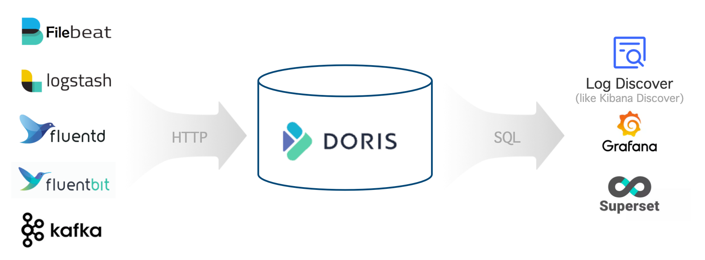
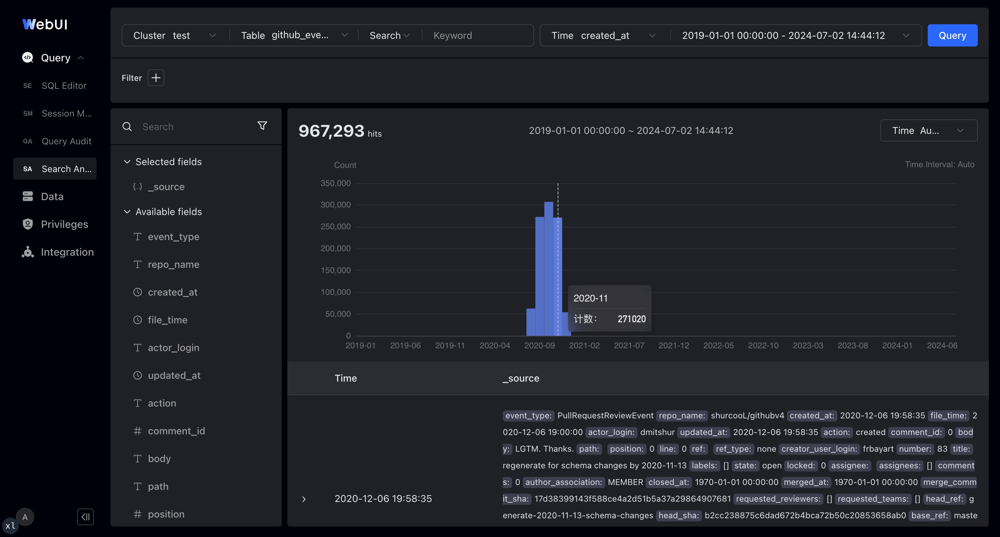

---
{
    "title": "Хранение и анализ логов",
    "language": "ru",
    "description": "Как заменить Elasticsearch на Apache Doris при создании платформы для логов? В статье рассмотрен весь процесс: от архитектуры и оценки ресурсов до создания таблиц, загрузки данных и выполнения запросов.",
    "sidebar_label": "Логи",
    "keywords": [
        "Анализ логов в Doris",
        "хранение логов",
        "полнотекстовый поиск",
        "инвертированный индекс",
        "альтернатива Elasticsearch",
        "загрузка логов через Stream Load",
        "Logstash Doris",
        "Filebeat Doris",
        "Kafka Routine Load",
        "разделение горячих и холодных данных",
        "полуструктурированные данные VARIANT",
        "log_policy",
        "time_series compaction"
    ]
}
---

<!-- Knowledge type: Solution overview + Procedure -->
<!-- Applicable scenario: Log platform selection / Log storage and search analysis / Elasticsearch alternative -->

Логи — это подробные записи о работе системы, содержащие ключевую информацию о событии: его источнике, времени, месте и содержании. Для мониторинга работы систем, контроля сетевой безопасности и анализа бизнеса предприятиям обычно требуется централизованно собирать, хранить и анализировать разрозненные логи, чтобы извлекать пользу из огромных объёмов данных.

Для таких задач Apache Doris дополняет свои общие возможности OLAP инвертированными индексами и быстрым полнотекстовым поиском, а также оптимизирует производительность записи и занимаемый объём хранилища. На основе Apache Doris можно построить открытую, производительную и экономичную единую платформу для хранения и анализа логов.

В статье рассмотрены следующие аспекты решения:

- **Общая архитектура**: основные компоненты и архитектура платформы для логов на базе Apache Doris.
- **Возможности и преимущества**: отличия от Elasticsearch.
- **Практическое руководство**: все этапы от оценки ресурсов до выполнения запросов к логам.

---

## 1. Общая архитектура {#1-overall-architecture}

<!-- Knowledge type: Architecture selection decision -->

Архитектура платформы для хранения и анализа логов на базе Apache Doris показана ниже:



Она состоит из трёх частей:

| Уровень | Компоненты | Описание |
| :--- | :--- | :--- |
| Сбор и предварительная обработка логов | Logstash, Filebeat, Fluentbit, Kafka и др. | Запись логов в Apache Doris через HTTP API |
| Хранение и анализ логов | Apache Doris | Единое производительное и экономичное хранилище с широкими возможностями поиска и анализа через интерфейс SQL |
| Анализ логов и оповещения | Grafana, Superset, Doris WebUI и др. | Выполнение запросов к Doris по стандартному протоколу MySQL и предоставление удобных визуальных интерфейсов |

---

## 2. Возможности и преимущества {#2-features-and-advantages}

<!-- Knowledge type: Capability definition -->

Платформа для логов на базе Apache Doris предоставляет следующие основные возможности:

| Возможность | Описание |
| :--- | :--- |
| Загрузка с высокой пропускной способностью и низкой задержкой | Стабильная непрерывная загрузка сотен TB в день со скоростью порядка GB/s и задержкой менее 1 секунды |
| Экономичное хранение огромных объёмов данных | Хранение в масштабе PB с экономией 60%–80% затрат по сравнению с Elasticsearch; перенос холодных данных в S3/HDFS дополнительно сокращает затраты на 50% |
| Производительный полнотекстовый поиск и анализ | Инвертированные индексы и полнотекстовый поиск; запросы на поиск записей по ключевым словам и анализ тенденций выполняются за секунды |
| Открытая и удобная экосистема | Интеграция с Logstash, Filebeat, Fluentbit, Kafka и др. на входе, а также с Grafana, Superset и Doris WebUI через стандартный протокол MySQL на выходе |

### 2.1 Высокая производительность и низкая стоимость {#21-high-performance-and-low-cost}

<!-- Knowledge type: Capability definition -->

Согласно результатам тестирования и эксплуатации в рабочих средах, соотношение производительности и стоимости платформы для логов на базе Apache Doris в 5–10 раз лучше, чем у Elasticsearch. Это достигается прежде всего за счёт производительного движка хранения и запросов, а также оптимизаций для работы с логами:

- **Более высокая пропускная способность записи**: в Elasticsearch запись ограничивает нагрузка на CPU при разборе данных и построении инвертированного индекса. Apache Doris ускоряет разбор JSON и построение индексов с помощью инструкций векторизации CPU, таких как SIMD, и упрощает структуру инвертированного индекса, удаляя прямые индексы и другие структуры данных, не нужные для логов. При одинаковых ресурсах производительность записи Doris в 3–5 раз выше, чем у Elasticsearch.
- **Более низкая стоимость хранения**: Elasticsearch хранит несколько копий данных — прямой индекс, инвертированный индекс и столбцовое хранилище doc values — и обеспечивает сравнительно низкую степень общего сжатия. Doris удаляет прямой индекс, сокращая объём данных индекса на 30%; использует столбцовое хранение и алгоритм сжатия Zstandard, достигая степени сжатия от 5 до 10 против 1.5 у Elasticsearch. Функция разделения горячих и холодных данных может автоматически переносить исторические логи в объектное хранилище, снижая стоимость хранения холодных данных более чем на 70%. Общая стоимость хранения составляет лишь около 20% от стоимости Elasticsearch.
- **Более высокая производительность запросов**: Doris упрощает процесс полнотекстового поиска и пропускает алгоритмы, не нужные для логов, например оценку релевантности. Для типичных запросов, таких как «найти последние 100 логов с заданным ключевым словом», Doris применяет специальные оптимизации на этапах планирования и выполнения, в том числе динамическое отсечение TopN.

### 2.2 Широкие возможности анализа {#22-powerful-analytical-capabilities}

<!-- Knowledge type: Capability definition -->

Apache Doris поддерживает стандартный SQL и совместим с протоколом и синтаксисом MySQL, поэтому система логов на базе Doris имеет следующие преимущества:

- **Простота использования**: инженеры и аналитики данных хорошо знакомы с SQL и могут быстро начать работу без изучения нового стека технологий.
- **Богатая экосистема**: система легко интегрируется с командной строкой MySQL, различными инструментами GUI / BI и экосистемой больших данных, удовлетворяя разнообразные потребности в обработке и анализе данных.
- **Мощные средства анализа**: SQL фактически стал стандартом анализа данных и поддерживает поиск, агрегацию, JOIN нескольких таблиц, подзапросы, UDF, логические и материализованные представления и другие возможности.

### 2.3 Гибкая схема {#23-flexible-schema}

<!-- Knowledge type: Capability definition -->

Ниже приведён типичный пример полуструктурированного лога в формате JSON. Поля верхнего уровня относительно постоянны (`timestamp`, `source`, `node`, `component`, `level`, `clientRequestId`, `message`, `properties`), а вложенные поля расширяемого атрибута `properties` (например, `properties.size` и `properties.format`) более динамичны и могут различаться от лога к логу.

```json
{
  "timestamp": "2014-03-08T00:50:03.8432810Z",
  "source": "ADOPTIONCUSTOMERS81",
  "node": "Engine000000000405",
  "level": "Information",
  "component": "DOWNLOADER",
  "clientRequestId": "671db15d-abad-94f6-dd93-b3a2e6000672",
  "message": "Downloading file path: benchmark/2014/ADOPTIONCUSTOMERS81_94_0.parquet.gz",
  "properties": {
    "size": 1495636750,
    "format": "parquet",
    "rowCount": 855138,
    "downloadDuration": "00:01:58.3520561"
  }
}
```

Apache Doris обеспечивает гибкость схемы с помощью двух механизмов:

- **Light Schema Change**: если поля верхнего уровня меняются время от времени, изменения схемы, такие как `ADD/DROP COLUMN` и `ADD/DROP INDEX`, можно выполнить за секунды. На этапе проектирования достаточно определить, каким полям индексы нужны сейчас.
- **Полуструктурированный тип VARIANT**: в расширяемые поля, такие как `properties`, можно записывать произвольные данные JSON. Имена и типы полей определяются автоматически, а часто встречающиеся поля выделяются в столбцовое хранилище. На `VARIANT` также можно создавать инвертированные индексы для ускорения запросов и поиска по внутренним полям.

По сравнению с динамическим сопоставлением полей в Elasticsearch гибкая схема Apache Doris имеет следующие преимущества:

- Одно поле может иметь несколько типов. `VARIANT` автоматически разрешает конфликты и расширяет типы, лучше приспосабливаясь к изменениям данных логов.
- `VARIANT` автоматически объединяет редко встречающиеся поля в один столбец, предотвращая проблемы с производительностью из-за чрезмерного количества полей, метаданных или столбцов.
- Поддерживается динамическое добавление и удаление столбцов и индексов, поэтому создавать индексы для всех полей заранее не требуется. Это сокращает лишние затраты.

---

## 3. Практическое руководство {#3-operations-guide}

<!-- Knowledge type: Procedure -->
<!-- Applicable scenario: Log platform deployment / Production rollout -->

В следующей таблице приведены шесть этапов создания платформы для логов на базе Apache Doris:

| Этап | Цель |
| :--- | :--- |
| [Шаг 1: Оценить ресурсы](#31-estimate-resources) | Оценить число узлов FE/BE, ёмкость дисков и объём объектного хранилища |
| [Шаг 2: Развернуть кластер](#32-deploy-the-cluster) | Развернуть Apache Doris на физических или виртуальных машинах |
| [Шаг 3: Настроить конфигурации FE и BE](#33-tune-fe-and-be-configurations) | Скорректировать ключевые параметры для работы с логами |
| [Шаг 4: Создать таблицу](#34-create-the-table) | Спроектировать секционирование и распределение по корзинам, сжатие, уплотнение, индексы и политики разделения данных |
| [Шаг 5: Собрать логи](#35-collect-logs) | Интегрировать Logstash, Filebeat, Kafka или собственную программу |
| [Шаг 6: Выполнять запросы и анализировать логи](#36-query-and-analyze-logs) | Искать и анализировать логи с помощью SQL и средств визуализации |

### 3.1 Оценить ресурсы {#31-estimate-resources}

<!-- Knowledge type: Hardware requirements -->
<!-- Applicable scenario: Pre-deployment planning / Capacity planning -->

Перед развёртыванием кластера необходимо оценить аппаратные ресурсы серверов. Основные действия:

1. **Оцените ресурсы для записи** по следующим формулам:

    - `Average write throughput = Daily incremental data / 86400 s`
    - `Peak write throughput = Average write throughput * Peak-to-average write ratio`
    - `CPU cores required for peak writes = Peak write throughput / Per-core write throughput`

2. **Оцените ресурсы для хранения** по формуле:

    - `Required storage = Daily incremental data / Compression ratio * Replica count * Data retention period`

3. **Оцените ресурсы для запросов**: их потребление зависит от числа и сложности запросов. Для первоначальной оценки зарезервируйте 50% ресурсов CPU под запросы, а затем скорректируйте долю по результатам реальных испытаний.

4. **Сведите оценки ресурсов**: определите необходимое число ядер CPU по шагам 1 и 3, затем разделите его на число ядер CPU одной машины, чтобы получить количество серверов BE. С учётом шага 2 оцените необходимый объём хранилища на каждом сервере BE и распределите его между 4–12 дисками для данных, чтобы определить ёмкость каждого диска.

#### Пример: оценка ресурсов для 100 TB новых логов в день {#example-resource-estimation-for-100-tb-of-new-logs-per-day}

Предположим, что ежедневно поступает 100 TB новых данных до сжатия, степень сжатия равна 5, используется 1 реплика, горячие данные хранятся 3 дня, холодные — 30 дней, отношение пиковой скорости записи к средней составляет 200%, одно ядро обеспечивает запись со скоростью 10 MB/s, а под запросы зарезервировано 50% CPU. Получаем следующие оценки:

- **FE**: 3 сервера, каждый с 16 ядрами CPU, 64 GB памяти и одним SSD на 100 GB
- **BE**: 15 серверов, каждый с 32 ядрами CPU, 256 GB памяти и десятью SSD по 600 GB
- **Объектное хранилище S3**: 600 TB для холодных данных

Значения ключевых показателей и расчёты приведены ниже:

| Ключевой показатель (единица измерения) | Значение | Описание |
| :--- | :--- | :--- |
| Ежедневный прирост данных (TB) | 100 | Укажите согласно фактическим потребностям |
| Степень сжатия | 5 | Обычно от 3 до 10 с учётом индексов; укажите согласно фактическим потребностям |
| Число реплик | 1 | Укажите согласно фактическим потребностям; по умолчанию 1; возможные значения: 1, 2, 3 |
| Срок хранения горячих данных (дни) | 3 | Укажите согласно фактическим потребностям |
| Срок хранения холодных данных (дни) | 30 | Укажите согласно фактическим потребностям |
| Общий срок хранения (дни) | 33 | Формула: `Hot data retention + Cold data retention` |
| Оценочный объём горячих данных (TB) | 60 | Формула: `Daily incremental data / Compression ratio * Replica count * Hot data retention` |
| Оценочный объём холодных данных (TB) | 600 | Формула: `Daily incremental data / Compression ratio * Replica count * Cold data retention` |
| Отношение пиковой скорости записи к средней | 200% | Укажите согласно фактическим потребностям; по умолчанию 200% |
| Число ядер CPU на машину | 32 | Укажите согласно фактическим потребностям; по умолчанию 32 ядра |
| Средняя скорость записи (MB/s) | 1214 | Формула: `Daily incremental data / 86400 s` |
| Пиковая скорость записи (MB/s) | 2427 | Формула: `Average write throughput * Peak-to-average write ratio` |
| Число ядер CPU для записи на пиковой скорости | 242.7 | Формула: `Peak write throughput / Per-core write throughput` |
| Доля CPU, зарезервированная под запросы | 50% | Укажите согласно фактическим потребностям; по умолчанию 50% |
| Оценочное число серверов BE | 15.2 | Формула: `CPU cores required for peak writes / CPU cores per machine / (1 - CPU reserved for queries)` |
| Оценочное число серверов BE после округления | 15 | Формула: `MAX(Replica count, rounded estimated number of BE servers)` |
| Оценочный объём хранилища на сервер BE (TB) | 5.7 | Формула: `Estimated hot-data storage / Estimated number of BE servers / (1 - 30%)`, где 30% — резерв ёмкости. Для повышения пропускной способности I/O рекомендуется подключать к каждому BE от 4 до 12 дисков для данных |

### 3.2 Развернуть кластер {#32-deploy-the-cluster}

<!-- Knowledge type: Procedure -->

После оценки ресурсов можно развернуть кластер Apache Doris. Рекомендуется использовать физические или виртуальные машины. Порядок действий при ручном развёртывании приведён в разделе [Ручное развёртывание](../install/deploy-manually/integrated-storage-compute-deploy-manually).

### 3.3 Настроить конфигурации FE и BE {#33-tune-fe-and-be-configurations}

<!-- Knowledge type: Configuration parameters -->
<!-- Applicable scenario: Performance tuning / Cluster initialization -->

После развёртывания кластера отдельно настройте параметры FE и BE с учётом особенностей хранения и анализа логов.

#### 3.3.1 Настроить конфигурацию FE {#331-tune-fe-configurations}

Измените параметры FE в `fe/conf/fe.conf` согласно следующей таблице:

| Параметр | Описание |
| :--- | :--- |
| `max_running_txn_num_per_db = 10000` | При высококонкурентной загрузке выполняется много транзакций, поэтому значение параметра увеличивают |
| `streaming_label_keep_max_second = 3600`<br />`label_keep_max_second = 7200` | Метки частых транзакций загрузки потребляют больше памяти, поэтому срок их хранения сокращают |
| `enable_round_robin_create_tablet = true` | При создании таблетов применяется циклическое распределение, чтобы распределять их как можно равномернее |
| `tablet_rebalancer_type = partition` | При балансировке применяется стратегия максимально равномерного распределения таблетов внутри каждой секции |
| `autobucket_min_buckets = 10` | Минимальное число корзин при автоматическом распределении увеличивают с 1 до 10, чтобы при росте объёма логов корзин хватало |
| `max_backend_heartbeat_failure_tolerance_count = 10` | При высокой нагрузке на серверы BE возможны кратковременные пропуски сигналов состояния; допустимое число пропусков увеличивают с 1 до 10 |

Дополнительные сведения о параметрах см. в разделе [Конфигурация FE](../admin-manual/config/fe-config).

#### 3.3.2 Настроить конфигурацию BE {#332-tune-be-configurations}

Измените параметры BE в `be/conf/be.conf` согласно следующей таблице:

| Модуль | Параметр | Описание |
| :--- | :--- | :--- |
| Хранение | `storage_root_path = /path/to/dir1;/path/to/dir2;...;/path/to/dir12` | Укажите пути к дисковым каталогам для горячих данных |
| Хранение | `enable_file_cache = true` | Включите файловый кеш |
| Хранение | `file_cache_path = [{"path": "/mnt/datadisk0/file_cache", "total_size":53687091200, "query_limit": "10737418240"},{"path": "/mnt/datadisk1/file_cache", "total_size":53687091200,"query_limit": "10737418240"}]` | Укажите пути и параметры кеша для холодных данных:<br />`path`: путь к кешу<br />`total_size`: общий размер кеша по этому пути в байтах; 53687091200 байт = 50 GB<br />`query_limit`: максимальный объём данных, который один запрос может прочитать из кеша по этому пути, в байтах; 10737418240 байт = 10 GB |
| Запись | `write_buffer_size = 1073741824` | Увеличьте размер файла буфера записи, чтобы сократить число небольших файлов и объём случайного I/O, повысив производительность |
| Уплотнение | `max_cumu_compaction_threads = 8` | Для BE с 32 ядрами этот параметр ограничивает пул потоков накопительного уплотнения 8 потоками. Число ядер CPU / 4 — только начальная точка настройки, а не квота или резерв CPU. Этот параметр не выделяет CPU для загрузки, запросов или базового уплотнения; корректируйте его по измерениям накопившихся задач уплотнения и рабочей нагрузки. |
| Уплотнение | `inverted_index_compaction_enable = true` | Включите уплотнение индексов, чтобы уменьшить потребление CPU при уплотнении |
| Уплотнение | `enable_segcompaction = false`<br />`enable_ordered_data_compaction = false` | Отключите две функции уплотнения, не нужные для логов |
| Уплотнение | `enable_compaction_priority_scheduling = false` | Число задач уплотнения с низким приоритетом ограничено 2 на диск, что замедляет уплотнение |
| Уплотнение | `total_permits_for_compaction_score = 200000` | Используется для контроля памяти; политика для временных рядов сама позволяет контролировать память |
| Кеш | `disable_storage_page_cache = true`<br />`inverted_index_searcher_cache_limit = 30%` | При большом объёме логов кеш данных приносит мало пользы; отключите его и используйте кеш индексов |
| Кеш | `inverted_index_cache_stale_sweep_time_sec = 3600`<br />`index_cache_entry_stay_time_after_lookup_s = 3600` | Сохраняйте кеш индексов в памяти до одного часа |
| Кеш | `enable_inverted_index_cache_on_cooldown = true`<br />`enable_write_index_searcher_cache = false` | Включите автоматическое кеширование индексов при их загрузке в хранилище холодных данных |
| Кеш | `tablet_schema_cache_recycle_interval = 3600`<br />`segment_cache_capacity = 20000` | Уменьшите объём памяти, занимаемый другими кешами |
| Кеш | `inverted_index_ram_dir_enable = true` | Сократите затраты на I/O из-за временных файлов индекса при записи |
| Потоки | `pipeline_executor_size = 24`<br />`doris_scanner_thread_pool_thread_num = 48` | Параметры вычислительных потоков и потоков I/O для CPU с 32 ядрами; изменяйте их пропорционально числу ядер |
| Потоки | `scan_thread_nice_value = 5` | Понизьте приоритет потоков I/O запросов, чтобы обеспечить производительность и своевременность записи |
| Прочее | `string_type_length_soft_limit_bytes = 10485760` | Увеличьте ограничение длины данных типа `String` до 10 MB |
| Прочее | `trash_file_expire_time_sec = 300`<br />`path_gc_check_interval_second = 900`<br />`path_scan_interval_second = 900` | Ускорьте удаление ненужных файлов |

Дополнительные сведения о параметрах см. в разделе [Конфигурация BE](../admin-manual/config/be-config).

### 3.4 Создать таблицу {#34-create-the-table}

<!-- Knowledge type: Procedure -->
<!-- Applicable scenario: Schema design / Performance tuning -->

Запись логов и запросы к ним имеют свои особенности. При создании таблицы используйте настройки из следующих разделов, чтобы повысить производительность.

#### 3.4.1 Настроить секционирование и распределение по корзинам {#341-configure-partitioning-and-bucketing-parameters}

**Секционирование**:

- Используйте [секционирование по диапазонам](../table-design/data-partitioning/manual-partitioning.md#range-partitioning) для поля времени (`PARTITION BY RANGE(ts)`) и включите [динамическое секционирование](../table-design/data-partitioning/dynamic-partitioning) (`"dynamic_partition.enable" = "true"`), чтобы автоматически управлять ежедневными секциями.
- Используйте поле времени типа `Datetime` в качестве ключа (`DUPLICATE KEY(ts)`); это ускоряет в несколько раз запросы на получение последних N логов.

**Распределение по корзинам**:

- Задайте число корзин примерно в 3 раза больше общего числа дисков в кластере, ориентируясь на 5 GB сжатых данных на корзину.
- Используйте случайное распределение (`DISTRIBUTED BY RANDOM BUCKETS 60`) вместе с загрузкой в один таблет при записи, чтобы повысить эффективность пакетной записи.

Дополнительные сведения о секционировании и распределении по корзинам см. в разделе [Разделение данных](../table-design/data-partitioning/basic-concepts).

#### 3.4.2 Настроить сжатие {#342-configure-compression-parameters}

- Используйте алгоритм сжатия Zstd (`"compression" = "zstd"`), чтобы повысить степень сжатия данных.

#### 3.4.3 Настроить уплотнение {#343-configure-compaction-parameters}

- Используйте политику для временных рядов (`"compaction_policy" = "time_series"`), чтобы уменьшить усиление записи, которое существенно влияет на потребление ресурсов при высокопроизводительной записи логов.

#### 3.4.4 Создать и настроить индексы {#344-build-and-configure-indexes}

- Создайте индексы для полей, по которым часто выполняются запросы (`USING INVERTED`).
- Для полей, требующих полнотекстового поиска, задайте параметру токенизатора (`parser`) значение `unicode`, подходящее для большинства задач. Для поддержки поиска фраз установите `support_phrase` в `true`; если поиск фраз не нужен, установите `false`, чтобы сократить объём хранилища.

#### 3.4.5 Настроить политики хранения {#345-configure-storage-policies}

- **Хранение горячих данных**: при использовании облачных дисков можно настроить 1 реплику; при использовании физических дисков настройте не менее 2 реплик (`"replication_num" = "2"`).
- **Разделение горячих и холодных данных**: настройте место хранения `log_s3` (`CREATE RESOURCE "log_s3"`) и политику разделения `log_policy_3day` (`CREATE STORAGE POLICY log_policy_3day`), чтобы данные старше 3 дней автоматически переносились в место хранения, указанное в `log_s3`.

#### 3.4.6 Полный пример создания таблицы {#346-complete-table-creation-example}

```sql
CREATE DATABASE log_db;
USE log_db;

CREATE RESOURCE "log_s3"
PROPERTIES
(
    "type" = "s3",
    "s3.endpoint" = "your_endpoint_url",
    "s3.region" = "your_region",
    "s3.bucket" = "your_bucket",
    "s3.root.path" = "your_path",
    "s3.access_key" = "your_ak",
    "s3.secret_key" = "your_sk"
);

CREATE STORAGE POLICY log_policy_3day
PROPERTIES(
    "storage_resource" = "log_s3",
    "cooldown_ttl" = "259200"
);

CREATE TABLE log_table
(
  `ts` DATETIME,
  `host` TEXT,
  `path` TEXT,
  `message` TEXT,
  INDEX idx_host (`host`) USING INVERTED,
  INDEX idx_path (`path`) USING INVERTED,
  INDEX idx_message (`message`) USING INVERTED PROPERTIES("parser" = "unicode", "support_phrase" = "true")
)
ENGINE = OLAP
DUPLICATE KEY(`ts`)
PARTITION BY RANGE(`ts`) ()
DISTRIBUTED BY RANDOM BUCKETS 60
PROPERTIES (
  "compression" = "zstd",
  "compaction_policy" = "time_series",
  "dynamic_partition.enable" = "true",
  "dynamic_partition.create_history_partition" = "true",
  "dynamic_partition.time_unit" = "DAY",
  "dynamic_partition.start" = "-30",
  "dynamic_partition.end" = "1",
  "dynamic_partition.prefix" = "p",
  "dynamic_partition.buckets" = "60",
  "dynamic_partition.replication_num" = "2", -- Not needed in compute-storage separation
  "replication_num" = "2",                    -- Not needed in compute-storage separation
  "storage_policy" = "log_policy_3day"        -- Not needed in compute-storage separation
);
```

### 3.5 Собрать логи {#35-collect-logs}

<!-- Knowledge type: Procedure -->
<!-- Applicable scenario: Log onboarding / Data ingestion -->

После создания таблицы можно приступать к сбору логов. Apache Doris предоставляет открытый универсальный HTTP API Stream, который интегрируется с распространёнными средствами сбора логов (Logstash, Filebeat, Kafka и др.). В таблице указано, в каких случаях подходит каждый способ сбора:

| Способ сбора | Когда применять |
| :--- | :--- |
| Logstash | Уже существующие конвейеры Logstash, которым нужна развитая экосистема фильтров и плагинов |
| Filebeat | Легковесный сбор файлов при ограниченных ресурсах |
| Kafka Routine Load | Логи уже поступают в Kafka, а Doris должен самостоятельно получать их |
| Собственная программа (Stream Load) | Собственные программы сбора и интеграция с особыми источниками данных |

#### 3.5.1 Интеграция с Logstash {#351-integrate-with-logstash}

Выполните следующие шаги:

1. Скачайте и установите плагин Logstash Doris Output одним из способов:

    - Скачайте готовый пакет: [ссылка для скачивания](https://apache-doris-releases.oss-accelerate.aliyuncs.com/extension/logstash-output-doris-1.2.0.gem).
    - Соберите плагин из исходного кода и установите следующей командой:

        ```shell
        ./bin/logstash-plugin install logstash-output-doris-1.2.0.gem
        ```

2. Настройте Logstash. Для этого нужны два файла:

    - `logstash.yml`: настройте размер пакета и задержку пакетной обработки логов в Logstash, чтобы повысить производительность записи.

        ```yaml
        pipeline.batch.size: 1000000
        pipeline.batch.delay: 10000
        ```

    - `logstash_demo.conf`: укажите путь к собираемым логам и параметры вывода в Apache Doris.

        ```text
        input {
            file {
            path => "/path/to/your/log"
          }
        }

        output {
          doris {
            http_hosts => [ "<http://fehost1:http_port>", "<http://fehost2:http_port>", "<http://fehost3:http_port>" ]
            user => "your_username"
            password => "your_password"
            db => "your_db"
            table => "your_table"

            # doris stream load http headers
            headers => {
            "format" => "json"
            "read_json_by_line" => "true"
            "load_to_single_tablet" => "true"
            }

            # field mapping: doris field name => logstash field name
            # %{} to get a logstash field, [] for nested field such as [host][name] for host.name
            mapping => {
            "ts" => "%{@timestamp}"
            "host" => "%{[host][name]}"
            "path" => "%{[log][file][path]}"
            "message" => "%{message}"
            }
            log_request => true
            log_speed_interval => 10
          }
        }
        ```

3. Запустите Logstash для сбора логов и их вывода в Apache Doris:

    ```shell
    ./bin/logstash -f logstash_demo.conf
    ```

Дополнительные сведения о настройке см. в разделе [Logstash Doris Output Plugin](../connection-integration/data-integration/logstash).

#### 3.5.2 Интеграция с Filebeat {#352-integrate-with-filebeat}

Выполните следующие шаги:

1. Получите исполняемый файл Filebeat с поддержкой вывода в Apache Doris. Его можно [скачать](https://apache-doris-releases.oss-accelerate.aliyuncs.com/extension/filebeat-doris-2.1.1) или собрать из исходного кода Apache Doris.

2. Настройте Filebeat. В основном файле `filebeat_demo.yml` указываются путь к собираемым логам и параметры вывода в Apache Doris:

    ```yaml
    # input
    filebeat.inputs:
    - type: log
      enabled: true
      paths:
        - /path/to/your/log
      # multiline can join lines that span multiple lines (such as Java stack traces) into a single log
      multiline:
        type: pattern
        # Behavior: lines starting with yyyy-mm-dd HH:MM:SS are treated as a new log; others are appended to the previous log
        pattern: '^[0-9]{4}-[0-9]{2}-[0-9]{2} [0-9]{2}:[0-9]{2}:[0-9]{2}'
        negate: true
        match: after
        skip_newline: true

    processors:
    # Use the js script plugin to replace \t in the log with spaces, to avoid JSON parsing errors
    - script:
        lang: javascript
        source: >
            function process(event) {
                var msg = event.Get("message");
                msg = msg.replace(/\t/g, "  ");
                event.Put("message", msg);
            }
    # Use the dissect plugin for simple log parsing
    - dissect:
        # 2024-06-08 18:26:25,481 INFO (report-thread|199) [ReportHandler.cpuReport():617] begin to handle
        tokenizer: "%{day} %{time} %{log_level} (%{thread}) [%{position}] %{content}"
        target_prefix: ""
        ignore_failure: true
        overwrite_keys: true

    # queue and batch
    queue.mem:
      events: 1000000
      flush.min_events: 100000
      flush.timeout: 10s

    # output
    output.doris:
      fenodes: [ "http://fehost1:http_port", "http://fehost2:http_port", "http://fehost3:http_port" ]
      user: "your_username"
      password: "your_password"
      database: "your_db"
      table: "your_table"
      # output string format
      ## %{[agent][hostname]} %{[log][file][path]} are metadata that come with filebeat
      ## Another commonly used filebeat metadata is the collection timestamp %{[@timestamp]}
      ## %{[day]} %{[time]} are the fields parsed by the dissect step above
      codec_format_string: '{"ts": "%{[day]} %{[time]}", "host": "%{[agent][hostname]}", "path": "%{[log][file][path]}", "message": "%{[message]}"}'
      headers:
        format: "json"
        read_json_by_line: "true"
        load_to_single_tablet: "true"
    ```

3. Запустите Filebeat для сбора логов и их вывода в Apache Doris:

    ```shell
    chmod +x filebeat-doris-2.1.1
    ./filebeat-doris-2.1.1 -c filebeat_demo.yml
    ```

Дополнительные сведения о настройке см. в разделе [Beats Doris Output Plugin](../connection-integration/data-integration/beats).

#### 3.5.3 Интеграция с Kafka {#353-integrate-with-kafka}

Записывайте логи в формате JSON в очередь сообщений Kafka, затем создайте Kafka Routine Load, чтобы Apache Doris самостоятельно получал данные из Kafka.

В приведённом ниже примере `property.*` — параметры клиента Librdkafka; настройте их согласно конфигурации своего кластера Kafka:

```sql
-- Prepare the kafka cluster and topic log__topic_
-- Create a routine load that imports data from kafka log__topic_ into the log_table table
CREATE ROUTINE LOAD load_log_kafka ON log_db.log_table
COLUMNS(ts, host, path, message)
PROPERTIES (
"max_batch_interval" = "60",
"max_batch_rows" = "20000000",
"max_batch_size" = "1073741824",
"load_to_single_tablet" = "true",
"format" = "json"
)
FROM KAFKA (
"kafka_broker_list" = "host:port",
"kafka_topic" = "log__topic_",
"property.group.id" = "your_group_id",
"property.security.protocol"="SASL_PLAINTEXT",
"property.sasl.mechanism"="GSSAPI",
"property.sasl.kerberos.service.name"="kafka",
"property.sasl.kerberos.keytab"="/path/to/xxx.keytab",
"property.sasl.kerberos.principal"="<xxx@yyy.com>"
);
-- Check the status of the routine load
SHOW ROUTINE LOAD;
```

Дополнительные сведения о настройке Kafka см. в разделе [Routine Load](../data-operate/import/import-way/routine-load-manual.md).

#### 3.5.4 Сбор логов собственной программой {#354-use-a-custom-program-to-collect-logs}

Помимо интеграции с распространёнными средствами сбора, логи можно загружать собственной программой через HTTP API Stream Load:

```shell
curl
--location-trusted
-u username:password
-H "format:json"
-H "read_json_by_line:true"
-H "load_to_single_tablet:true"
-H "timeout:600"
-T logfile.json
http://fe_host:fe_http_port/api/log_db/log_table/_stream_load
```

При использовании собственной программы учитывайте следующее:

- Для аутентификации HTTP используйте Basic Auth. Значение можно вычислить командой `echo -n 'username:password' | base64`.
- Установите HTTP-заголовок `format:json`, чтобы указать формат данных JSON.
- Установите HTTP-заголовок `read_json_by_line:true`, чтобы каждая строка содержала один объект JSON.
- Установите HTTP-заголовок `load_to_single_tablet:true`, чтобы каждая загрузка записывалась в одну корзину и создавала меньше небольших файлов.
- Рекомендуемый размер пакета, отправляемого клиентом, составляет от 100 MB до 1 GB. В Apache Doris 2.1 и более поздних версиях функция Group Commit на стороне сервера позволяет уменьшить размер пакета на стороне клиента.

### 3.6 Выполнять запросы и анализировать логи {#36-query-and-analyze-logs}

<!-- Knowledge type: Procedure -->
<!-- Applicable scenario: Log search / Full-text search -->

#### 3.6.1 Запросы к логам {#361-log-queries}

Apache Doris поддерживает стандартный SQL. Для выполнения SQL-запросов к кластеру можно подключиться через клиент MySQL, JDBC или другие инструменты:

```shell
mysql -h fe_host -P fe_mysql_port -u your_username -Dyour_db_name
```

Ниже приведены 5 распространённых SQL-запросов:

- Просмотр последних 10 записей:

    ```sql
    SELECT * FROM your_table_name ORDER BY ts DESC LIMIT 10;
    ```

- Запрос последних 10 записей, в которых `host` равен `8.8.8.8`:

    ```sql
    SELECT * FROM your_table_name WHERE host = '8.8.8.8' ORDER BY ts DESC LIMIT 10;
    ```

- Поиск последних 10 записей, в которых поле `message` содержит `error` или `404`. Оператор `MATCH_ANY` в SQL-синтаксисе полнотекстового поиска Apache Doris находит любое из ключевых слов аргумента:

    ```sql
    SELECT * FROM your_table_name WHERE message MATCH_ANY 'error 404'
    ORDER BY ts DESC LIMIT 10;
    ```

- Поиск последних 10 записей, в которых поле `message` содержит и `image`, и `faq`. Оператор `MATCH_ALL` в SQL-синтаксисе полнотекстового поиска Apache Doris требует совпадения всех ключевых слов аргумента:

    ```sql
    SELECT * FROM your_table_name WHERE message MATCH_ALL 'image faq'
    ORDER BY ts DESC LIMIT 10;
    ```

- Поиск последних 10 записей, в которых поле `message` содержит и `image`, и `faq`. Оператор `MATCH_PHRASE` в SQL-синтаксисе полнотекстового поиска Apache Doris требует совпадения всех ключевых слов аргумента в том же порядке. Например, `a image faq b` подходит, а `a faq image b` — нет:

    ```sql
    SELECT * FROM your_table_name WHERE message MATCH_PHRASE 'image faq'
    ORDER BY ts DESC LIMIT 10;
    ```

#### 3.6.2 Визуальный анализ логов {#362-visual-log-analysis}

Некоторые сторонние поставщики предлагают платформы визуального анализа логов на базе Apache Doris. В их число входит интерфейс поиска и анализа логов, похожий на Kibana Discover и предоставляющий удобные средства интерактивного исследования:



- Поддерживаются режимы полнотекстового поиска и SQL
- Диапазон времени для запросов к логам можно выбирать с помощью элемента выбора времени и гистограммы
- Подробные записи логов можно раскрывать в виде JSON или таблиц
- Фильтры можно добавлять и удалять интерактивными щелчками в контексте данных логов
- Для полей в результатах поиска показываются наиболее частые значения, что помогает обнаруживать аномалии и продолжать подробный анализ

Если вам нужна дополнительная помощь, напишите на dev@doris.apache.org.

---

## 4. Часто задаваемые вопросы {#4-faq}

<!-- Knowledge type: FAQ -->

**Вопрос 1: В чём основные различия между Apache Doris и Elasticsearch при работе с логами?**

Ответ: пропускная способность записи Doris в 3–5 раз выше, чем у Elasticsearch, а стоимость хранения составляет лишь около 20% от стоимости Elasticsearch. Doris также поддерживает стандартный SQL и протокол MySQL, предоставляя более широкие возможности анализа. Разделение горячих и холодных данных позволяет переносить холодные данные в S3/HDFS и ещё сильнее сокращать затраты на хранение.

**Вопрос 2: Поля логов часто меняются. Как с этим работать?**

Ответ: используйте Light Schema Change, чтобы за секунды выполнять `ADD/DROP COLUMN` и `ADD/DROP INDEX` для полей верхнего уровня. Для динамических вложенных полей используйте тип `VARIANT`, который автоматически определяет имена и типы полей и поддерживает инвертированные индексы на `VARIANT`.

**Вопрос 3: Как выбрать число корзин?**

Ответ: задайте число корзин примерно в 3 раза больше общего числа дисков в кластере, ориентируясь на 5 GB сжатых данных на корзину. Используйте `DISTRIBUTED BY RANDOM` вместе с записью в один таблет, чтобы повысить эффективность пакетной записи.

**Вопрос 4: В каких единицах задаётся `cooldown_ttl` в политике разделения горячих и холодных данных?**

Ответ: в секундах. Например, `259200` означает 3 дня, после которых данные автоматически переносятся в объектное хранилище, указанное в политике хранения.

**Вопрос 5: Как выбрать размер пакета на стороне записи?**

Ответ: рекомендуется отправлять от 100 MB до 1 GB за запрос. В Apache Doris 2.1 и более поздних версиях можно включить серверную функцию Group Commit и использовать на клиенте пакеты меньшего размера.

---

## 5. Устранение неполадок {#5-troubleshooting}

<!-- Knowledge type: Troubleshooting -->
<!-- Applicable scenario: Common error handling / Performance issue diagnosis -->

| Симптом | Возможная причина | Рекомендуемое действие |
| :--- | :--- | :--- |
| При высококонкурентной загрузке превышен лимит транзакций | Значение `max_running_txn_num_per_db` по умолчанию слишком мало | Увеличьте значение до `max_running_txn_num_per_db = 10000` |
| Часто истекает время ожидания сигнала состояния BE | Из-за высокой нагрузки при записи логов BE ненадолго перестаёт отвечать | Увеличьте значение до `max_backend_heartbeat_failure_tolerance_count = 10` |
| При записи создаётся много небольших файлов / возникает случайный I/O | Буфер записи слишком мал или не используется загрузка в один таблет | Увеличьте значение до `write_buffer_size = 1073741824` и установите `load_to_single_tablet:true` |
| Уплотнение идёт медленно и мешает записи | Недостаточно потоков уплотнения или действует ограничение планирования задач с низким приоритетом | Задайте для `max_cumu_compaction_threads` значение, равное числу ядер CPU / 4, и отключите `enable_compaction_priority_scheduling` |
| Индексы занимают слишком много памяти | Кеш данных и кеш индексов конкурируют за память | Отключите `disable_storage_page_cache` и ограничьте `inverted_index_searcher_cache_limit = 30%` |
| Не работают запросы фраз в полнотекстовом поиске | Для индекса не включён параметр `support_phrase` | При создании индекса установите `"support_phrase" = "true"` |
| Автоматическое распределение создаёт слишком мало корзин, что приводит к перегруженным участкам | Значение `autobucket_min_buckets` слишком мало | Увеличьте значение до `autobucket_min_buckets = 10` |
