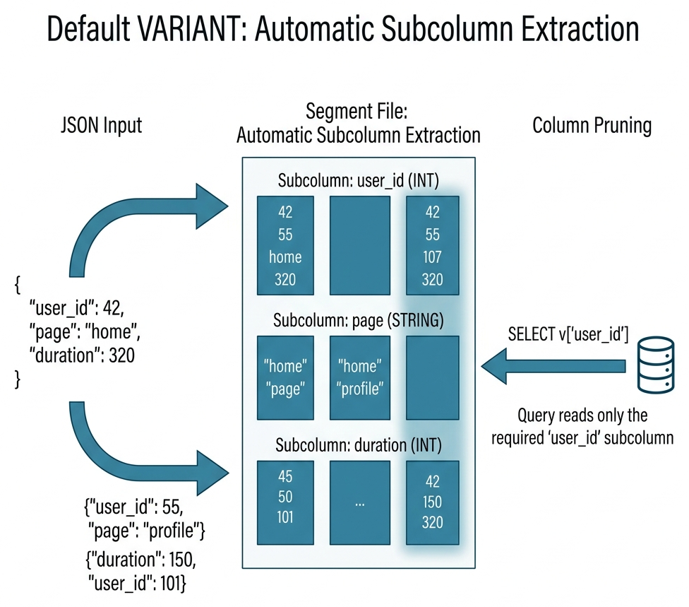
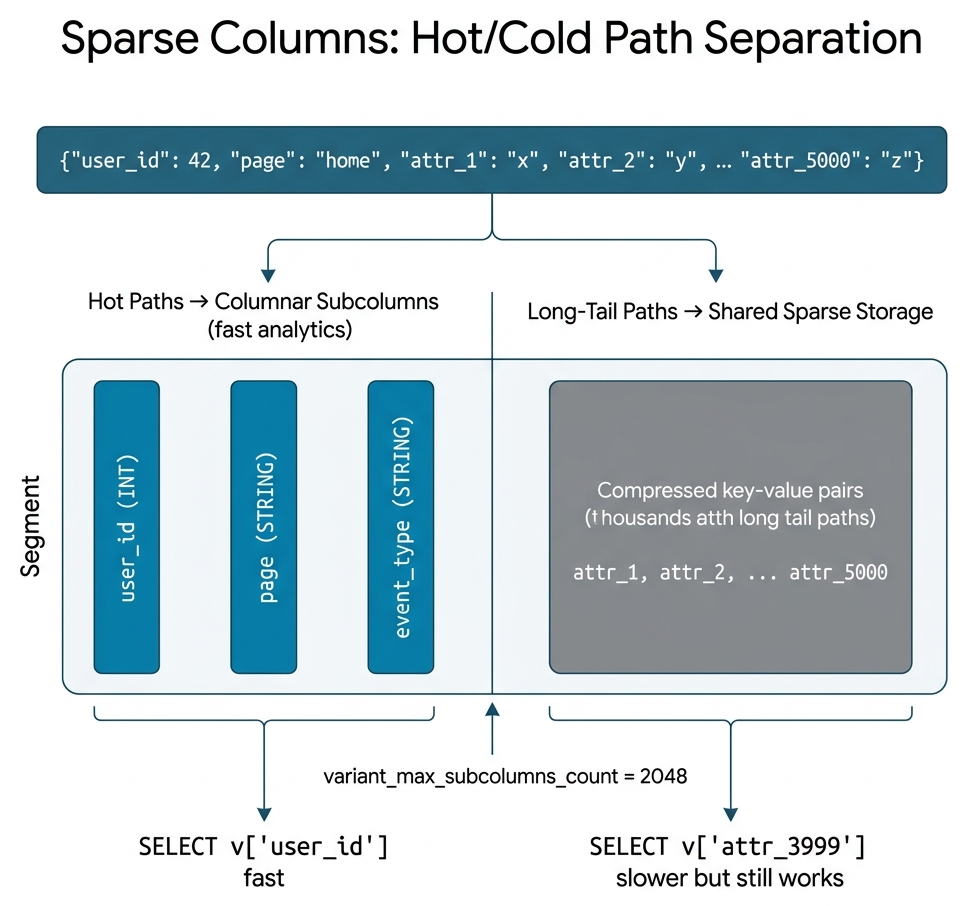
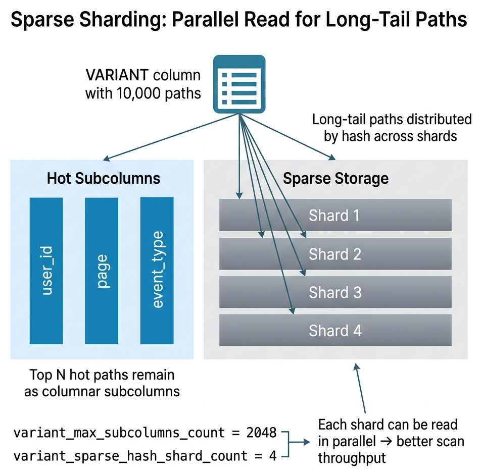
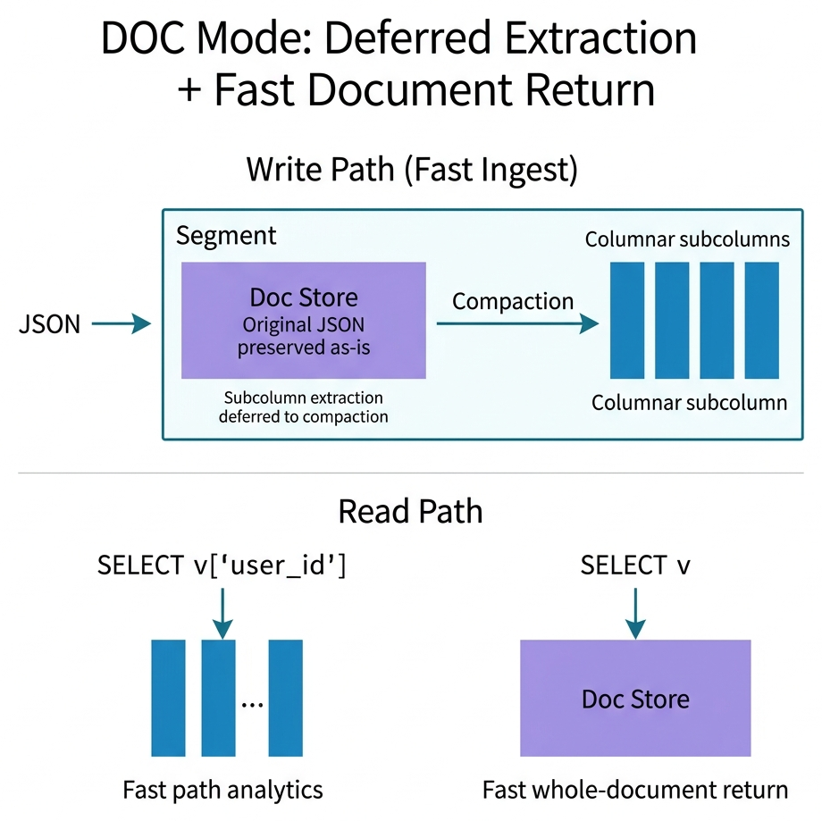
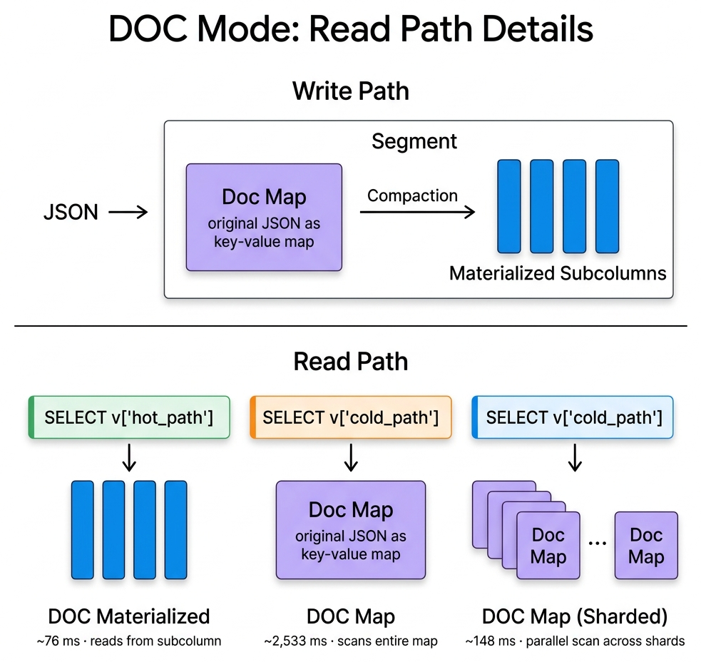
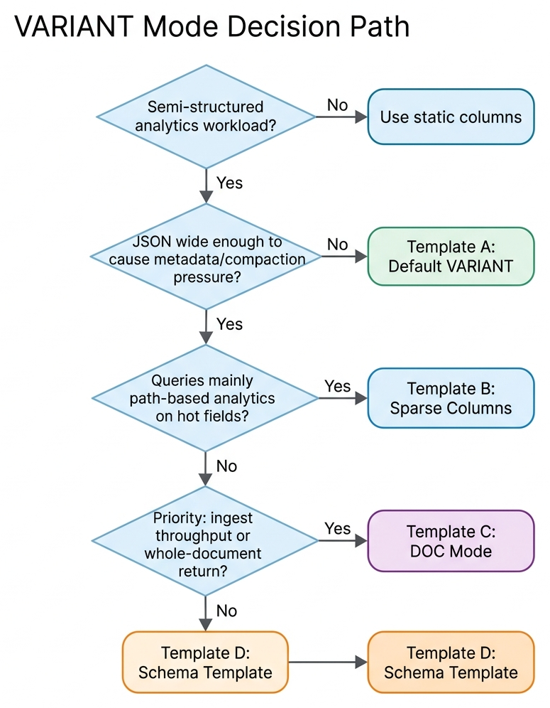
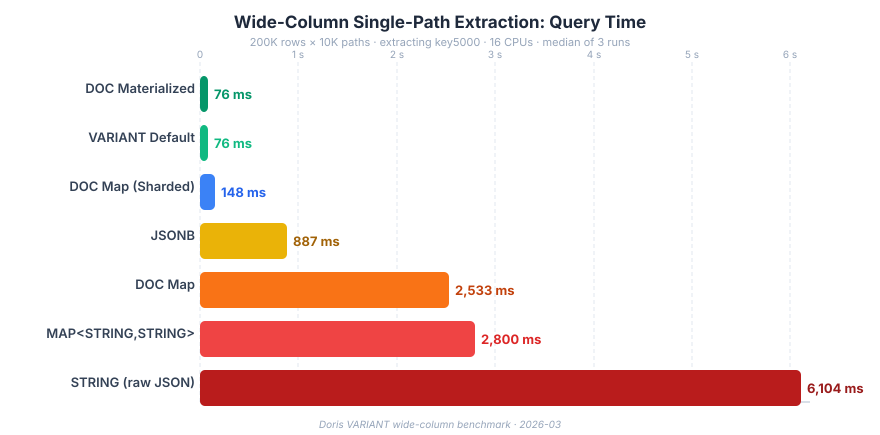

---
{
    "title": "Руководство по рабочим нагрузкам VARIANT",
    "language": "ru",
    "description": "Руководство по выбору: когда использовать VARIANT, как выбирать между режимами по умолчанию, Sparse, DOC mode и Schema Template, а также с чего начать настройку."
}
---

## Обзор {#overview}

`VARIANT` хранит полуструктурированный JSON и применяет Subcolumnization к часто используемым путям.

Используйте это руководство, когда выбираете способ моделирования новой рабочей нагрузки `VARIANT`. Оно помогает ответить на такие вопросы:

- Должна ли эта рабочая нагрузка использовать `VARIANT` или статические столбцы?
- Если JSON очень широкий, следует ли начать с поведения по умолчанию, sparse columns или DOC mode?
- Какие настройки оставить по умолчанию, а какие изменить в первую очередь?

Если вы уже знаете, что хотите использовать `VARIANT`, и вам нужны только синтаксис или правила типов, перейдите к разделу [VARIANT](./VARIANT.md). Если нужен минимальный работоспособный пример импорта, перейдите к разделу [Импорт данных Variant](../../../../data-operate/import/complex-types/variant.md). Чтобы понять, как подстолбцы и sparse encoding хранят данные и как задавать свойства для каждого сценария, см. раздел [Хранение и настройка VARIANT](./variant-storage-tuning.md).

:::tip Почему выбирают VARIANT
`VARIANT` сохраняет гибкость JSON, но Doris по-прежнему может применять Subcolumnization к часто используемым путям. Благодаря этому распространённые фильтры, агрегации и индексы уровня пути работают эффективно без предварительной фиксации схемы всего документа. Для очень широкого JSON оптимизации на уровне хранения позволяют применять Subcolumnization при гораздо большем количестве путей.
:::

## Когда подходит VARIANT {#when-variant-fits}

`VARIANT` обычно хорошо подходит, если выполняется большинство следующих условий:

- Входные данные представлены JSON или другой полуструктурированной полезной нагрузкой, поля которой со временем меняются.
- Запросы обычно обращаются к подмножеству горячих путей, а не ко всем полям каждой строки.
- Вы хотите сохранить гибкость схемы и одновременно получить производительность аналитики по столбцам.
- Для некоторых путей нужна индексация, тогда как многие другие пути могут оставаться динамическими.

Предпочтительны статические столбцы, если преобладают следующие условия:

- Схема стабильна и заранее известна.
- Основные поля регулярно используются как Join Key, ключи сортировки или строго контролируемые типизированные столбцы. Значения VARIANT можно соединять и сортировать, но типизированные столбцы работают быстрее и сохраняют семантику типов.
- Основное требование — архивировать исходный JSON, а не анализировать данные по путям.

## Сначала ответьте на четыре вопроса {#four-questions-first}

Прежде чем изменять какие-либо настройки, ответьте на следующие четыре вопроса.

### 1. Есть ли чётко определённые горячие пути? {#1-are-there-clear-hot-paths}

Если запросы постоянно обращаются к одним и тем же путям JSON, Doris может продолжать применять к ним Subcolumnization. Именно здесь `VARIANT` приносит наибольшую пользу.

### 2. Нужны ли нескольким путям фиксированные типы или стабильные индексы? {#2-do-a-few-paths-need-fixed-types-or-stable-indexes}

Если да, используйте Schema Template только для этих путей. Он предназначен для небольшого набора критически важных бизнес-полей, а не для описания всего документа.

### 3. Действительно ли JSON становится широким? {#3-is-this-really-becoming-wide-json}

Проблема широкого JSON возникает, когда количество путей продолжает расти и начинает создавать нагрузку на метаданные, компакцию или заметные накладные расходы на запросы.

### 4. Что важнее для широкого JSON: аналитика горячих путей или возврат всего документа? {#4-for-wide-json-what-matters-more-hot-path-analytics-or-whole-document-return}

- Если основная ценность по-прежнему заключается в фильтрации, агрегации и индексации горячих полей по путям, выбирайте sparse columns.
- Если основная ценность — эффективность загрузки или возврат всего документа, выбирайте DOC mode.

## Ключевые понятия {#key-concepts}

Прежде чем читать о режимах хранения ниже, убедитесь, что следующие термины понятны. Каждый из них объясняется в 2–3 строках; подробности реализации см. в разделе [VARIANT](./VARIANT.md).

**Subcolumnization.** При записи данных в столбец `VARIANT` Doris автоматически обнаруживает пути JSON и извлекает горячие пути в независимые подстолбцы для эффективной аналитики.



**Schema Template.** Объявление для столбца `VARIANT`, которое закрепляет выбранные пути за стабильными типами. Используйте его для ключевых бизнес-полей, которые должны оставаться типизированными, индексируемыми и предсказуемыми. Не пытайтесь перечислить все возможные пути.

**Wide JSON.** Проблема широкого JSON возникает, когда количество различных путей продолжает расти и начинает увеличивать размер метаданных, стоимость записи, стоимость компакции или стоимость запросов.

**Sparse columns.** Если в широком JSON есть чёткое разделение на горячие и холодные пути, sparse columns оставляют горячие пути в Subcolumnization, а холодные пути (длинный хвост) перемещают в общее sparse storage. Sparse storage поддерживает шардирование по нескольким физическим столбцам для повышения параллелизма чтения.



Как показано выше, горячие пути (например, `user_id`, `page`) остаются независимыми подстолбцами с полной скоростью аналитики, а тысячи путей длинного хвоста объединяются в общее sparse storage. Порог задаётся параметром `variant_max_subcolumns_count`.

**Sparse sharding.** Когда количество путей длинного хвоста очень велико, один sparse column может стать узким местом чтения. Sparse sharding распределяет пути длинного хвоста по хешу между несколькими физическими столбцами (`variant_doc_hash_shard_count`), чтобы их можно было сканировать параллельно.



**DOC mode.** Дополнительно хранит исходный JSON как поле в формате map (то есть **doc map**), которое запросы всего документа читают напрямую, ценой дополнительного места. Как и в режиме по умолчанию, Subcolumnization управляется параметрами `variant_max_subcolumns_count` и `variant_doc_materialization_min_rows`: когда файл данных достигает порога строк, извлекается не более `variant_max_subcolumns_count` путей. При большем пороге строк небольшие пакеты записывают только doc map, что ускоряет загрузку, а Subcolumnization откладывается до последующей компакции.



Как показано выше, во время записи JSON сохраняется без изменений в Doc Store для быстрой загрузки. Если задан порог строк, подстолбцы извлекаются позже во время компакции. Во время чтения запросы по путям (например, `SELECT v['user_id']`) читают материализованные подстолбцы с полной скоростью столбцов, а запросы всего документа (`SELECT v`) читают данные напрямую из Doc Store без восстановления из подстолбцов.

DOC mode имеет три отдельных пути чтения в зависимости от того, был ли материализован запрошенный путь:



- **DOC Materialized**: запрошенный путь уже извлечён в подстолбец (после компакции или после достижения значения `variant_doc_materialization_min_rows`). Чтение выполняется с полной скоростью столбцов, как и в VARIANT по умолчанию.
- **DOC Map**: запрошенный путь ещё не материализован. Запрос возвращается к сканированию всей doc map для поиска значения — в широком JSON это значительно медленнее.
- **DOC Map (Sharded)**: тот же резервный путь, но при использовании `variant_doc_hash_shard_count` doc map распределяется между несколькими физическими столбцами, что позволяет выполнять параллельное сканирование и значительно ускоряет восстановление.

**Storage Format V3.** Отделяет метаданные столбца от footer сегмента. Рекомендуется для любой таблицы `VARIANT`, особенно для широкого JSON, поскольку устраняет узкое место в метаданных при наличии тысяч подстолбцов.

## Рекомендуемый путь выбора {#recommended-decision-path}



## Режимы хранения {#storage-modes}

Используйте таблицу ниже, чтобы выбрать отправную точку, затем прочитайте соответствующий раздел.

| | Типичный сценарий | Рекомендуемый режим | Ключевая конфигурация |
|---|---|---|---|
| **A** | Журналы событий, журналы аудита | Default VARIANT + V3 | Сохранить значения по умолчанию |
| **B** | Реклама / телеметрия / профили пользователей (широкие данные, мало горячих путей) | Sparse + V3 | `variant_max_subcolumns_count`, `variant_doc_hash_shard_count` |
| **C** | Вывод моделей / трассировки / архивы (приоритет загрузки или возврат всего документа) | DOC mode + V3 | `variant_enable_doc_mode`, `variant_doc_materialization_min_rows`, `variant_doc_hash_shard_count` |
| **D** | Заказы / платежи / устройства (ключевым путям нужны стабильные типы) | Schema Template + A или B | Определить только ключевые пути |

### Режим по умолчанию {#default-mode}

Это наиболее безопасная отправная точка для большинства новых рабочих нагрузок `VARIANT`.

Типичный пример: журналы событий или аудита, где запросы постоянно обращаются к нескольким знакомым путям.

```sql
CREATE TABLE IF NOT EXISTS event_log (
    ts DATETIME NOT NULL,
    event_id BIGINT NOT NULL,
    event_type VARCHAR(64),
    payload VARIANT
)
DUPLICATE KEY(`ts`, `event_id`)
DISTRIBUTED BY HASH(`event_id`) BUCKETS 16
PROPERTIES (
    "replication_num" = "1",
    "storage_format" = "V3"
);
```

Используйте его, если пока не уверены, достаточно ли широка рабочая нагрузка, чтобы оправдать sparse columns или DOC mode, и большая часть ценности по-прежнему связана с фильтрацией, агрегацией и группировкой по нескольким распространённым путям.

Обратите внимание:
- Не увеличивайте `variant_max_subcolumns_count` заранее, если рост количества путей ещё не создаёт нагрузку.
- Если JSON не является широким, включение sparse columns или DOC mode добавит сложность без пользы.

### Режим Sparse {#sparse-mode}

Выбирайте sparse columns, когда полезная нагрузка широкая, но большинство запросов по-прежнему сосредоточено на небольшом наборе горячих путей.

Типичный пример: JSON рекламы, телеметрии или профилей с тысячами необязательных атрибутов, из которых регулярно запрашиваются только десятки.

```sql
CREATE TABLE IF NOT EXISTS telemetry_wide (
    ts DATETIME NOT NULL,
    device_id BIGINT NOT NULL,
    attributes VARIANT<
        'device_type' : STRING,
        'region' : STRING,
        properties(
            'variant_max_subcolumns_count' = '2048',
            'variant_doc_hash_shard_count' = '64'
        )
    >
)
DUPLICATE KEY(`ts`, `device_id`)
DISTRIBUTED BY HASH(`device_id`) BUCKETS 32
PROPERTIES (
    "replication_num" = "1",
    "storage_format" = "V3"
);
```

Используйте его, когда общее количество ключей очень велико, но основная рабочая нагрузка по-прежнему связана с фильтрацией, агрегацией и индексацией по путям.

Обратите внимание:
- Если узким местом остаётся аналитика горячих путей, сначала не переходите к DOC mode.
- Значение `variant_max_subcolumns_count` по умолчанию равно `2048`, что уже является правильной отправной точкой для автоматического Subcolumnization в большинстве рабочих нагрузок. Не устанавливайте его настолько большим, чтобы фактически все пути проходили через Subcolumnization. Если рабочей нагрузке действительно нужен очень большой масштаб извлечённых подстолбцов, предпочтителен [DOC Mode](#doc-mode-template).

### DOC Mode {#doc-mode-template}

Выбирайте DOC mode, когда возврат всего JSON-документа или минимизация накладных расходов на загрузку важнее оптимизации аналитики по путям.

Типичный пример: ответы моделей, снимки трассировок или архивные JSON-документы, которые часто возвращаются целиком.

DOC mode помогает в следующих случаях:

- Когда масштаб Subcolumnization становится чрезвычайно большим (приближается к 10,000 путям), требования к оборудованию быстро растут. На таком масштабе DOC mode является более стабильным выбором.
- Память для компакции может уменьшиться примерно на две трети по сравнению с нетерпеливым Subcolumnization по умолчанию.
- В рабочих нагрузках загрузки разреженных широких столбцов пропускная способность может увеличиться примерно в 5–10×.
- Когда запросы читают всё значение `VARIANT` (`SELECT variant_col`), DOC mode не восстанавливает документ из тысяч подстолбцов, обеспечивая ускорение на порядки.

**Начало работы:**

```sql
CREATE TABLE IF NOT EXISTS trace_archive (
    ts DATETIME NOT NULL,
    trace_id VARCHAR(64) NOT NULL,
    span VARIANT<
        'service_name' : STRING,
        properties(
            'variant_enable_doc_mode' = 'true',
            'variant_doc_materialization_min_rows' = '10000',
            'variant_doc_hash_shard_count' = '64'
        )
    >
)
DUPLICATE KEY(`ts`, `trace_id`)
DISTRIBUTED BY HASH(`trace_id`) BUCKETS 32
PROPERTIES (
    "replication_num" = "1",
    "storage_format" = "V3"
);
```

Используйте его, когда пропускная способность загрузки является первым приоритетом, рабочая нагрузка часто требует возврата полного JSON-документа или очень широкие столбцы часто читаются с помощью `SELECT variant_col`.

Обратите внимание:
- DOC mode не является ответом по умолчанию для каждой рабочей нагрузки с широким JSON. Если преобладает аналитика горячих путей, обычно лучше подходят sparse columns.
- DOC mode можно задавать вместе с `variant_max_subcolumns_count` и `variant_doc_hash_shard_count`; см. раздел [Хранение и настройка VARIANT](./variant-storage-tuning.md).
- Количество шардов DOC mode по умолчанию (`variant_doc_hash_shard_count`) равно `1`. Если запросы часто читают ещё не материализованные пути очень широкого JSON, задайте количество шардов явно, например `64`, как в приведённом выше примере.
- За исключением `DROP`, `RENAME` и изменений комментариев столбец со Schema Template нельзя изменить, поэтому его `variant_doc_materialization_min_rows` нельзя будет изменить позже. Выберите это значение при создании таблицы.

### Schema Template {#schema-template}

Выбирайте Schema Template, когда небольшому числу путей нужны стабильные типы, стабильное поведение или индексы для конкретных путей.

Типичный пример: полезные нагрузки заказов, платежей или устройств, где несколько критически важных бизнес-путей должны сохранять тип и возможность поиска.

```sql
CREATE TABLE IF NOT EXISTS order_events (
    ts DATETIME NOT NULL,
    order_id BIGINT NOT NULL,
    detail VARIANT<
        'status' : STRING,
        'amount' : DECIMAL(18, 2),
        'currency' : STRING
    >,
    INDEX idx_status(detail) USING INVERTED PROPERTIES("field_pattern" = "status")
)
DUPLICATE KEY(`ts`, `order_id`)
DISTRIBUTED BY HASH(`order_id`) BUCKETS 16
PROPERTIES (
    "replication_num" = "1",
    "storage_format" = "V3"
);
```

Используйте его, когда критически важны только несколько полей и этим путям нужны более строгая типизация или стратегия индексации на уровне пути. При необходимости сочетайте Schema Template со sparse columns или `VARIANT` по умолчанию.

Обратите внимание:
- Не превращайте всю схему JSON в статический шаблон. Это лишит `VARIANT` его смысла.
- Schema Template должен охватывать только ключевые пути; остальные остаются динамическими.
- Schema Template нельзя изменить после создания столбца. Определите ключевые пути до загрузки производственных данных.

## Производительность {#performance}

На диаграмме ниже сравнивается время извлечения одного пути на наборе данных широких столбцов с 10K путями (200K строк, извлечение одного ключа, 16 CPU, медиана 3 запусков).



| Режим | Время запроса | Пиковая память |
|---|---:|---:|
| DOC Materialized | 76 ms | 1 MiB |
| VARIANT Default | 76 ms | 1 MiB |
| DOC Map (Sharded) | 148 ms | 1 MiB |
| JSONB | 887 ms | 32 GiB |
| DOC Map | 2,533 ms | 1 MiB |
| MAP\<STRING,STRING\> | 2,800 ms | 1 MiB |
| STRING (исходный JSON) | 6,104 ms | 48 GiB |

Основные выводы:

- **Материализованные подстолбцы выигрывают.** И Default, и DOC Materialized дают примерно 76 ms — это в 80× быстрее исходного STRING и в 12× быстрее JSONB.
- **DOC Map с шардированием помогает.** Шардирование doc map сокращает время запроса для нематериализованных путей с 2.5 s до 148 ms.
- **JSONB и STRING требуют много памяти.** Их пиковое потребление составляет 32–48 GiB против 1 MiB для режимов VARIANT.

## Лучшие практики {#best-practices}

### Этап импорта {#import-phase}

- **Для новых таблиц `VARIANT` начинайте с Storage Format V3.** V3 отделяет метаданные столбца от footer сегмента. Без него рабочие нагрузки с широким JSON страдают от медленного открытия файлов и высокого потребления памяти.
- **Рано закрепляйте ключевые пути с помощью Schema Template.** Без Schema Template система выводит типы автоматически. Если один и тот же путь меняет тип между пакетами (например, сначала целое число, затем строка), он преобразуется в JSONB, а индексы на этом пути теряются.
- **Начинайте с настроек по умолчанию, затем настраивайте по симптомам.** Для большинства рабочих нагрузок значений по умолчанию достаточно. Настраивайте параметры по сценарию только тогда, когда такие рабочие нагрузки, как обучение ИИ, подключённые транспортные средства или системы пользовательских тегов, требуют необычно большого масштаба Subcolumnization и множества индексов уровня пути. Чрезмерная настройка в первый день (очень большое `variant_max_subcolumns_count`, включение DOC mode без необходимости) добавляет сложность без доказательств пользы.

### Этап запросов {#query-phase}

- **Не используйте `SELECT *` как основной шаблон запросов для очень широких столбцов `VARIANT`.** Без DOC mode `SELECT *` или `SELECT variant_col` должны восстанавливать большой JSON из всех подстолбцов, что значительно медленнее указания путей, например `SELECT v['path']`.
- **Приводите подпути в фильтрах к их сохранённому типу с помощью CAST.** Сравнение вроде `v['id'] = 123` неявно приводит путь и вычисляется построчно, поэтому zone maps, BloomFilter и индексы не используются. Пишите `CAST(v['id'] AS BIGINT) = 123`, используя тип, в котором хранится путь (проверьте его с помощью `DESC` после `SET describe_extend_variant_column = true`). Для сравнения строкового пути со строковым литералом CAST не требуется.
- **Понимайте, какое сравнение выполняется.** При сравнении пути с литералом путь приводится к типу, выбранному на основе литерала. При сравнении двух значений VARIANT или группировке, соединении либо сортировке по значению VARIANT вместо этого используется семантика VARIANT: числа сортируются перед строками, а `1` никогда не равно `"1"`. См. раздел [Сравнение, группировка и сортировка](./VARIANT.md#comparison-grouping-and-ordering).

### Этап эксплуатации {#operations-phase}

- **Следите за нагрузкой на компакцию.** Рост числа подстолбцов увеличивает стоимость слияния. Если Compaction Score продолжает расти, проверьте, не слишком ли велико значение `variant_max_subcolumns_count` и не слишком ли высока скорость загрузки.
- **Следите за дрейфом схемы.** Если структура JSON часто меняется, горячие пути могут быть вытеснены в sparse storage, что приведёт к внезапному замедлению запросов. Закрепляйте критически важные пути с помощью Schema Template.
- **Следите за конфликтами типов.** Частые конфликты типов для одного и того же пути показывают, что путь следует закрепить через Schema Template, чтобы избежать преобразования в JSONB и потери индекса.

## Быстрая проверка {#quick-verify}

После создания таблицы выполните эту минимальную последовательность, чтобы проверить работоспособность:

```sql
-- Insert sample data. INSERT stores a plain string as a VARIANT string, so parse the JSON text.
INSERT INTO event_log VALUES
    ('2025-01-01 10:00:00', 1001, 'click', PARSE_TO_VARIANT('{"page": "home", "user_id": 42, "duration_ms": 320}')),
    ('2025-01-01 10:00:01', 1002, 'purchase', PARSE_TO_VARIANT('{"item": "widget", "price": 9.99, "user_id": 42}')),
    ('2025-01-01 10:00:02', 1003, 'click', PARSE_TO_VARIANT('{"page": "search", "user_id": 99, "query": "doris variant"}'));

-- Verify data
SELECT payload['user_id'], payload['page'] FROM event_log;

-- Check Subcolumnization results
SET describe_extend_variant_column = true;
DESC event_log;

-- Check the type of one path, row by row
SELECT variant_type(payload['user_id']) FROM event_log;
```

## Дополнительные материалы {#related-reading}

- [VARIANT](./VARIANT.md)
- [Импорт данных Variant](../../../../data-operate/import/complex-types/variant.md)
- [Storage Format V3](../../../../table-design/storage-format.md)
- [SEARCH Function](../../../../table-design/index/inverted-index/search-function.md)
