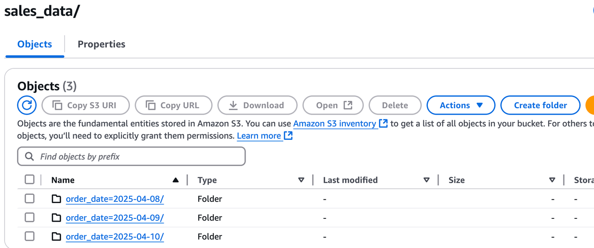
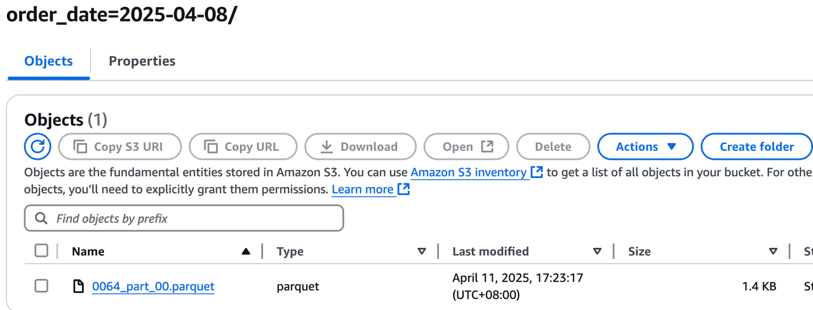

---
{
    "title": "Redshift",
    "language": "ru",
    "description": "Миграция данных из Redshift в Doris путем экспорта в S3 с помощью Redshift UNLOAD и последующей загрузки в Doris с помощью S3 Load. Описаны создание таблицы, сопоставление типов данных, обработка ошибок и пакетная загрузка.",
    "keywords": [
        "Миграция Redshift в Doris",
        "Redshift UNLOAD",
        "S3 Load",
        "Сопоставление типов данных Redshift",
        "Загрузка данных в Doris",
        "Загрузка Parquet",
        "ETL_QUALITY_UNSATISFIED"
    ]
}
---

<!-- Knowledge type: Procedure -->
<!-- Applicable scenario: Data migration / Redshift to Doris -->

При миграции данных из Redshift в Apache Doris обычно используется объектное хранилище (например, Amazon S3) в качестве промежуточного носителя. Общий процесс миграции выглядит следующим образом:

1. Создайте целевую таблицу в Doris на основе схемы исходной таблицы.
2. Экспортируйте данные в объектное хранилище с помощью оператора Redshift [UNLOAD](https://docs.aws.amazon.com/redshift/latest/dg/r_UNLOAD.html).
3. Используйте функцию S3 Load в Doris для чтения данных из объектного хранилища и их загрузки в Doris. Подробнее см. в разделе [S3 Load](./amazon-s3.md).

## Примечания {#notes}

Перед выполнением миграции обратите внимание на следующие моменты:

- **Стратегия моделирования и секционирования**: выберите подходящую [модель данных](../../../table-design/data-model/intro.mdx) Doris на основе схемы исходной таблицы Redshift и определите стратегии [секционирования](../../../table-design/data-partitioning/dynamic-partitioning.md) и [бакетирования](../../../table-design/data-partitioning/data-bucketing.md). Дополнительные рекомендации по проектированию таблиц см. в разделе [Лучшие практики загрузки данных](../load-best-practices/load-best-practices.md).
- **Преобразование типов**: при экспорте типа `TIME` из Redshift сначала преобразуйте его с помощью `CAST` в `VARCHAR`.
- **Ограничения сложных типов**: файлы Parquet/ORC, содержащие сложные типы (Struct/Array/Map), в настоящее время необходимо загружать с помощью [загрузки через TVF](./amazon-s3.md#method-2-load-with-tvf-synchronous).

## Сопоставление типов данных {#data-type-mapping}

<!-- Knowledge type: Configuration -->

Перед миграцией сопоставьте типы данных Redshift и Doris по таблице ниже:

|     Redshift     |     Doris      |              Примечания              |
| ---------------- | -------------- | ------------------------------------ |
| SMALLINT         | SMALLINT       |                                      |
| INTEGER          | INT            |                                      |
| BIGINT           | BIGINT         |                                      |
| DECIMAL          | DECIMAL        |                                      |
| REAL             | FLOAT          |                                      |
| DOUBLE PRECISION | DOUBLE         |                                      |
| BOOLEAN          | BOOLEAN        |                                      |
| CHAR             | CHAR           |                                      |
| VARCHAR          | VARCHAR/STRING | Максимальная длина VARCHAR — 65533   |
| DATE             | DATE           |                                      |
| TIMESTAMP        | DATETIME       |                                      |
| TIME/TIMETZ      | STRING         |                                      |
| SUPER            | VARIANT        |                                      |
| OTHER            | UNSUPPORTED    |                                      |

## Этапы миграции {#migration-steps}

### 1. Создание таблицы Doris {#1-create-the-doris-table}

<!-- Knowledge type: Procedure -->

Перед миграцией сначала создайте соответствующую целевую таблицу в Doris.

**Цель**: спланировать модель данных Doris, стратегии секционирования и бакетирования на основе схемы исходной таблицы Redshift.

**Пример исходной таблицы Redshift**:

```SQL
CREATE TABLE sales_data (
    order_id      INTEGER,
    customer_name VARCHAR(128),
    order_date    DATE,
    amount        DECIMAL(10,2),
    country       VARCHAR(48)
)
DISTSTYLE AUTO;

INSERT INTO sales_data VALUES
(1, 'Alice', '2025-04-08', 99.99, 'USA'),
(2, 'Bob', '2025-04-08', 149.50, 'Canada'),
(3, 'Charlie', '2025-04-09', 75.00, 'UK'),
(4, 'Diana', '2025-04-10', 200.00, 'Australia');
```

**Пример целевой таблицы Doris**: на основе приведенной выше схемы создайте секционированную таблицу с Unique Key, используя `order_date` в качестве столбца секционирования и создавая секции по дням:

```sql
CREATE TABLE `sales_data` (
  order_id      INT,
  order_date    DATE NOT NULL,
  customer_name VARCHAR(128),
  amount        DECIMAL(10,2),
  country       VARCHAR(48)
) ENGINE=OLAP
UNIQUE KEY(`order_id`,`order_date`)
PARTITION BY RANGE(`order_date`) (
PARTITION p20250408 VALUES [('2025-04-08'), ('2025-04-09')),
PARTITION p20250409 VALUES [('2025-04-09'), ('2025-04-10')),
PARTITION p20250410 VALUES [('2025-04-10'), ('2025-04-11'))
)
DISTRIBUTED BY HASH(`order_id`) BUCKETS 16
PROPERTIES (
 "dynamic_partition.enable" = "true",
 "dynamic_partition.time_unit" = "DAY",
 "dynamic_partition.end" = "5",
 "dynamic_partition.prefix" = "p",
 "dynamic_partition.buckets" = "16",
 "replication_num" = "1"
);
```

### 2. Экспорт данных из Redshift в S3 {#2-export-data-from-redshift-to-s3}

<!-- Knowledge type: Procedure -->

#### 2.1 Использование UNLOAD для экспорта в Parquet {#21-use-unload-to-export-as-parquet}

**Цель**: экспортировать данные Redshift в виде файлов Parquet, разделенных по столбцу секционирования Doris, чтобы впоследствии загружать данные по партициям.

**Команда**:

```sql
unload ('select * from sales_data')
to 's3://mybucket/redshift/sales_data/'
iam_role 'arn:aws:iam::0123456789012:role/MyRedshiftRole'
PARQUET
PARTITION BY (order_date) INCLUDE
```

**Примечание**: рекомендуется экспортировать данные с тем же столбцом секционирования, который используется в Doris, чтобы загружать данные пакетами по партициям.

#### 2.2 Проверка экспортированных файлов в S3 {#22-verify-the-exported-files-on-s3}

После экспорта S3 создает подкаталог для каждой партиции, и каждый каталог содержит данные одной партиции:





### 3. Загрузка данных в Doris {#3-load-data-into-doris}

<!-- Knowledge type: Procedure -->

Загрузка выполняется с помощью **S3 Load** — асинхронного способа загрузки данных, при котором после отправки задания Doris самостоятельно получает данные из источника. Источник данных может быть любым объектным хранилищем, совместимым с S3, включая [AWS S3](./amazon-s3.md), [GCS](./google-cloud-storage.md) и [AZURE](./azure-storage.md).

Сравнение подходящих сценариев:

| Сценарий                                          | Рекомендуемый способ                              |
| ------------------------------------------------- | ------------------------------------------------- |
| Большой объем данных, возможна асинхронная обработка | S3 Load                                         |
| Требуется синхронная загрузка данных              | [Загрузка через TVF](./amazon-s3.md#method-2-load-with-tvf-synchronous)        |
| Файлы содержат сложные типы (Struct/Array/Map)    | Требуется [загрузка через TVF](./amazon-s3.md#method-2-load-with-tvf-synchronous) |

#### 3.1 Загрузка одной партиции {#31-load-a-single-partition}

```sql
LOAD LABEL sales_data_2025_04_08
(
    DATA INFILE("s3://mybucket/redshift/sales_data/order_date=2025-04-08/*")
    INTO TABLE sales_data
    FORMAT AS "parquet"
    (order_id, order_date, customer_name, amount, country)
)
WITH S3
(
    "provider" = "S3",
    "s3.endpoint" = "https://s3.ap-southeast-1.amazonaws.com",
    "s3.access_key" = "<ak>",
    "s3.secret_key"="<sk>",
    "s3.region" = "ap-southeast-1"
);
```

#### 3.2 Проверка состояния задания с помощью SHOW LOAD {#32-check-job-status-with-show-load}

Поскольку S3 Load отправляется асинхронно, для проверки хода загрузки можно использовать `SHOW LOAD` с меткой задания:

```yaml
mysql> show load where label = "sales_data_2025_04_08"\G
*************************** 1. row ***************************
         JobId: 17956078
         Label: sales_data_2025_04_08
         State: FINISHED
      Progress: 100.00% (1/1)
          Type: BROKER
       EtlInfo: unselected.rows=0; dpp.abnorm.ALL=0; dpp.norm.ALL=2
      TaskInfo: cluster:s3.ap-southeast-1.amazonaws.com; timeout(s):3600; max_filter_ratio:0.0; priority:NORMAL
      ErrorMsg: NULL
    CreateTime: 2025-04-10 17:50:53
  EtlStartTime: 2025-04-10 17:50:54
 EtlFinishTime: 2025-04-10 17:50:54
 LoadStartTime: 2025-04-10 17:50:54
LoadFinishTime: 2025-04-10 17:50:54
           URL: NULL
    JobDetails: {"Unfinished backends":{"5eec1be8612d4872-91040ff1e7208a4f":[]},"ScannedRows":2,"TaskNumber":1,"LoadBytes":91,"All backends":{"5eec1be8612d4872-91040ff1e7208a4f":[10022]},"FileNumber":1,"FileSize":1620}
 TransactionId: 766228
  ErrorTablets: {}
          User: root
       Comment:
1 row in set (0.00 sec)
```

#### 3.3 Обработка ошибок при загрузке {#33-handle-errors-during-the-load}

<!-- Knowledge type: Troubleshooting -->
<!-- Applicable scenario: Troubleshooting / Data quality errors -->

**Шаг 1**: запросите задания загрузки, завершившиеся с ошибкой. Если пакетная загрузка содержит несколько заданий, следующая инструкция позволяет отфильтровать метки и причины неудачных заданий:

```SQL
mysql> show load where state='CANCELLED' and label like "label_test%"\G
*************************** 1. row ***************************
         JobId: 18312384
         Label: label_test123
         State: CANCELLED
      Progress: 100.00% (3/3)
          Type: BROKER
       EtlInfo: unselected.rows=0; dpp.abnorm.ALL=4; dpp.norm.ALL=0
      TaskInfo: cluster:s3.ap-southeast-1.amazonaws.com; timeout(s):14400; max_filter_ratio:0.0; priority:NORMAL
      ErrorMsg: type:ETL_QUALITY_UNSATISFIED; msg:quality not good enough to cancel
    CreateTime: 2025-04-15 17:32:59
  EtlStartTime: 2025-04-15 17:33:02
 EtlFinishTime: 2025-04-15 17:33:02
 LoadStartTime: 2025-04-15 17:33:02
LoadFinishTime: 2025-04-15 17:33:02
           URL: http://10.16.10.6:28747/api/_load_error_log?file=__shard_2/error_log_insert_stmt_7602ccd7c3a4854-95307efca7bfe342_7602ccd7c3a4854_95307efca7bfe342
    JobDetails: {"Unfinished backends":{"7602ccd7c3a4854-95307efca7bfe341":[]},"ScannedRows":4,"TaskNumber":1,"LoadBytes":188,"All backends":{"7602ccd7c3a4854-95307efca7bfe341":[10022]},"FileNumber":3,"FileSize":4839}
 TransactionId: 769213
  ErrorTablets: {}
          User: root
       Comment:
```

**Шаг 2**: определите тип ошибки. В приведенном выше примере это **ошибка качества данных** (`ETL_QUALITY_UNSATISFIED`). Откройте URL, возвращенный в выводе, чтобы просмотреть подробную информацию об ошибке. Например, приведенная ниже ошибка означает, что длина данных превышает фактическую длину столбца `country`, заданную в схеме:

```python
[root@VM-10-6-centos ~]$ curl "http://10.16.10.6:28747/api/_load_error_log?file=__shard_2/error_log_insert_stmt_7602ccd7c3a4854-95307efca7bfe342_7602ccd7c3a4854_95307efca7bfe342"
Reason: column_name[country], the length of input is too long than schema. first 32 bytes of input str: [USA] schema length: 1; actual length: 3; . src line [];
Reason: column_name[country], the length of input is too long than schema. first 32 bytes of input str: [Canada] schema length: 1; actual length: 6; . src line [];
Reason: column_name[country], the length of input is too long than schema. first 32 bytes of input str: [UK] schema length: 1; actual length: 2; . src line [];
Reason: column_name[country], the length of input is too long than schema. first 32 bytes of input str: [Australia] schema length: 1; actual length: 9; . src line [];
```

**Шаг 3**: задайте коэффициент допустимых ошибок (необязательно). Если можно пропустить часть ошибочных строк, задайте коэффициент допустимых ошибок в `PROPERTIES` S3 Load. Подробнее см. в разделе [Параметры конфигурации загрузки](../../import/import-way/broker-load-manual.md#import-configuration-parameters).

#### 3.4 Пакетная загрузка нескольких партиций {#34-load-multiple-partitions-in-batches}

При миграции больших исторических наборов данных придерживайтесь следующих рекомендаций по пакетной загрузке:

- Каждый пакет должен соответствовать одной партиции Doris или небольшому числу партиций.
- Размер одного пакета не должен превышать **100 GB**, чтобы снизить нагрузку на систему и стоимость повторной попытки после неудачной загрузки.
- В качестве справочного материала можно использовать скрипт [s3_load_demo.sh](https://github.com/apache/doris/blob/master/samples/load/shell/s3_load_demo.sh). Он перебирает каталоги партиций в S3 и автоматически отправляет задания S3 Load в Doris для пакетной загрузки.

## Часто задаваемые вопросы {#faq}

<!-- Knowledge type: FAQ -->

**Q1: Почему тип Redshift TIME нельзя напрямую загрузить в Doris?**

Doris не поддерживает тип `TIME`. При экспорте из Redshift типа `TIME/TIMEZ` необходимо использовать `CAST`, преобразовать его в `VARCHAR`, а затем экспортировать и хранить в Doris как `STRING`.

**Q2: Можно ли использовать S3 Load для файлов Parquet/ORC, содержащих сложные типы, такие как Struct/Array/Map?**

Нет. В настоящее время для файлов, содержащих сложные типы, необходимо использовать [загрузку через TVF](./amazon-s3.md#method-2-load-with-tvf-synchronous).

**Q3: S3 Load выполняется синхронно или асинхронно? Как запросить результат?**

S3 Load — это **асинхронный** способ загрузки. После отправки задания выполните `SHOW LOAD WHERE label = "<your_label>"`, чтобы проверить ход выполнения и результат.

**Q4: Как обрабатывать ошибку `ETL_QUALITY_UNSATISFIED`?**

Эта ошибка означает, что качество данных не соответствует требованиям. Для ее обработки:

1. Откройте URL, возвращенный в выводе `SHOW LOAD`, чтобы получить подробный журнал ошибок.
2. На основании журнала ошибок (например, переполнения длины поля или несовпадения типов) скорректируйте схему таблицы Doris или исходные данные.
3. Если допустимо наличие ошибочных строк, измените коэффициент допустимых ошибок `max_filter_ratio` в `PROPERTIES` S3 Load.

**Q5: Как избежать сбоя однократной загрузки при миграции больших объемов данных?**

Рекомендуется загружать данные пакетами по партициям Doris, ограничивать размер каждого пакета 100 GB и использовать скрипт [s3_load_demo.sh](https://github.com/apache/doris/blob/master/samples/load/shell/s3_load_demo.sh) для автоматизации отправки пакетов.
