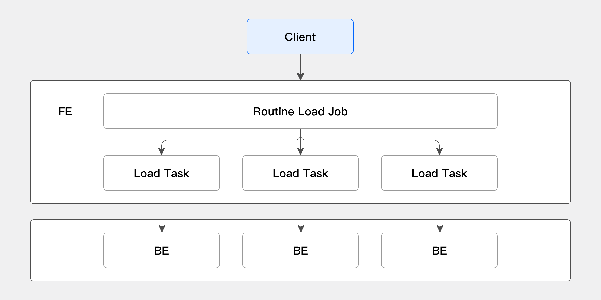

---
{
    "title": "Routine Load",
    "language": "ru",
    "description": "Apache Doris Routine Load непрерывно загружает данные из Kafka: форматы CSV/JSON, семантика Exactly-Once, аутентификация SSL/Kerberos, управление жизненным циклом заданий и устранение неполадок.",
    "keywords": [
        "Routine Load",
        "импорт из Kafka в реальном времени",
        "потоковый импорт в Doris",
        "непрерывный импорт",
        "Exactly-Once",
        "Kafka SSL",
        "Kafka Kerberos",
        "Kafka SASL",
        "SASL_PLAINTEXT",
        "SASL_SSL",
        "импорт JSON",
        "импорт CSV",
        "импорт в динамические таблицы",
        "один поток — несколько таблиц",
        "гибкое частичное обновление столбцов",
        "UPDATE_FLEXIBLE_COLUMNS",
        "PAUSED",
        "Routine Load PAUSED",
        "out of range",
        "kafka_broker_version_fallback",
        "property.broker.version.fallback",
        "desired_concurrent_number",
        "max_filter_ratio",
        "ErrorLogUrls",
        "ALTER ROUTINE LOAD",
        "PAUSE ROUTINE LOAD",
        "RESUME ROUTINE LOAD",
        "STOP ROUTINE LOAD"
    ]
}
---

<!-- Knowledge type: Procedures + Configuration parameters + Examples + FAQ -->
<!-- Applicable scenarios: Continuously consume data from Kafka into Doris / Real-time data ingestion / CDC streaming sync -->

Routine Load — это задание **потокового импорта** в Apache Doris, которое непрерывно считывает данные из топика Kafka и записывает их в таблицу Doris. После создания задания Routine Load система Doris поддерживает его непрерывную работу, в реальном времени создаёт задачи импорта для чтения сообщений из указанного топика кластера Kafka и обеспечивает семантику **Exactly-Once**, исключающую потерю и дублирование данных.

## Быстрая навигация {#quick-navigation}

Перейдите к разделу, который соответствует вашей задаче:

| Что нужно сделать | Раздел |
| ------- | ------- |
| Сразу запустить минимальный пример | [Быстрый старт](#quick-start) |
| Разобраться в принципах работы, состояниях и автоматическом восстановлении | [Основные принципы](#basic-principles) |
| Найти все настраиваемые параметры (FE/BE/задания/Kafka) | [Справочник](#reference-manual) |
| Найти пример для своего сценария (допустимые ошибки, фильтрация, JSON, Kerberos и др.) | [Примеры импорта](#import-examples) |
| Разобраться, почему задание перешло в `PAUSED` или возникла ошибка `out of range` либо SSL | [Часто задаваемые вопросы (FAQ)](#frequently-asked-questions-faq) |

## Сценарии использования {#use-cases}

<!-- Knowledge type: Scenario description -->

Routine Load подходит для следующих задач:

- Непрерывная синхронизация данных из топика Kafka с Doris в реальном времени.
- Загрузка с семантикой **Exactly-Once**, исключающей потерю и дублирование данных.
- Преобразование загружаемых данных: сопоставление столбцов, фильтрация, вычисление производных столбцов и другие операции.
- Динамическое распределение данных из одного топика Kafka по нескольким таблицам Doris (один поток — несколько таблиц).

### Поддерживаемые источники и форматы данных {#supported-data-sources-and-formats}

Routine Load считывает данные только из **кластера Kafka** и поддерживает два формата сообщений:

| Формат | Описание |
| ---- | ---- |
| CSV  | Каждое сообщение содержит одну строку, в конце которой **нет** символа перевода строки. |
| JSON | Один объект JSON или массив JSON из нескольких объектов. |

При импорте CSV важно различать значение NULL и пустую строку:

- Значение NULL обозначается как `\n`. Например, `a,\n,b` означает, что значение среднего столбца — NULL.
- Пустая строка задаётся отсутствием данных между разделителями. Например, в `a,,b` значение среднего столбца — пустая строка (`''`).

### Ограничения {#limitations}

При загрузке данных из Kafka через Routine Load действуют следующие ограничения:

| Ограничение | Описание |
| ------ | ---- |
| Формат сообщений | Поддерживаются только текстовые форматы CSV и JSON. Каждое сообщение CSV содержит одну строку, в конце которой **нет** символа перевода строки. |
| Версия Kafka | По умолчанию поддерживается Kafka 0.10.0.0 и выше. Для Kafka ниже 0.10.0.0 (0.9.0, 0.8.2, 0.8.1, 0.8.0) измените параметр BE `kafka_broker_version_fallback`, указав нужную старую версию, либо задайте `property.broker.version.fallback` при создании задания. При использовании старой версии некоторые новые возможности Routine Load могут быть недоступны, например установка смещений разделов Kafka по времени. |

## Основные принципы {#basic-principles}

Routine Load непрерывно считывает данные из топика Kafka и записывает их в Doris. После создания задания Routine Load в Doris появляется долговременное задание импорта, состоящее из нескольких задач:

- **Задание загрузки (Load Job)** — долговременное задание Routine Load, которое непрерывно считывает данные из источника.
- **Задача загрузки (Load Task)** — часть задания загрузки, выполняющая непосредственное считывание данных. Каждая задача представляет собой отдельную транзакцию.

Подробная схема работы Routine Load показана на рисунке:



Общий процесс выглядит так:

1. Клиент отправляет в FE запрос на создание задания Routine Load. FE создаёт долговременное задание импорта (Routine Load Job) с помощью Routine Load Manager.
2. FE с помощью Job Scheduler разбивает Routine Load Job на несколько Routine Load Tasks. Затем Task Scheduler направляет их на узлы BE.
3. Когда Routine Load Task завершает импорт на BE, она фиксирует транзакцию в FE и обновляет метаданные задания.
4. После фиксации Routine Load Task создаются новые задачи, а задачи с истекшим временем ожидания запускаются повторно.
5. Task Scheduler непрерывно планирует выполнение новых Routine Load Tasks.

### Механизм автоматического восстановления {#auto-recovery-mechanism}

<!-- Knowledge type: State machine / Operations rules -->

Для обеспечения высокой доступности заданий Routine Load предусматривает автоматическое восстановление. Если задание неожиданно приостановилось, поток Routine Load Scheduler пытается восстановить его автоматически. Это позволяет заданию импорта продолжить нормальную работу без вмешательства пользователя после восстановления Kafka при неожиданном сбое Kafka или другой ситуации, мешающей работе.

В таблице указано, когда восстановление происходит автоматически, а когда требуется вмешательство пользователя:

| Причина приостановки | Автоматическое восстановление | Рекомендуемое действие |
| -------------- | ------------ | -------- |
| Временная недоступность брокера Kafka или нестабильное сетевое соединение | Да | Scheduler автоматически повторяет попытку с интервалом `period_of_auto_resume_min`. |
| Пользователь выполнил `PAUSE ROUTINE LOAD` | Нет | Вручную выполните `RESUME ROUTINE LOAD`. |
| Проблема с качеством данных (превышено значение `max_filter_ratio` или `max_error_number`) | Нет | Проверьте `ErrorLogUrls`, исправьте данные или параметры, затем выполните `RESUME`. |
| Неустранимая ошибка метаданных, например удаление базы данных или таблицы | Нет | Создайте таблицу заново или пересоздайте задание. |

## Быстрый старт {#quick-start}

<!-- Knowledge type: Procedures -->

В этом разделе приведён минимальный рабочий пример: создание задания Routine Load для Kafka и основные операции просмотра, приостановки, возобновления, изменения и остановки задания.

### Создание задания импорта {#create-an-import-job}

Для создания долговременного задания импорта Routine Load используйте команду [CREATE ROUTINE LOAD](../../../sql-manual/sql-statements/data-modification/load-and-export/CREATE-ROUTINE-LOAD). Routine Load может считывать данные CSV и JSON.

#### Импорт данных CSV {#import-csv-data}

1. Подготовьте образец данных Kafka:

    ```bash
    kafka-console-consumer.sh --bootstrap-server localhost:9092 --topic test-routine-load-csv --from-beginning
    1,Emily,25
    2,Benjamin,35
    3,Olivia,28
    4,Alexander,60
    5,Ava,17
    6,William,69
    7,Sophia,32
    8,James,64
    9,Emma,37
    10,Liam,64
    ```

2. Создайте целевую таблицу:

    ```sql
    CREATE TABLE testdb.test_routineload_tbl(
        user_id            BIGINT       NOT NULL COMMENT "user id",
        name               VARCHAR(20)           COMMENT "name",
        age                INT                   COMMENT "age"
    )
    DUPLICATE KEY(user_id)
    DISTRIBUTED BY HASH(user_id) BUCKETS 10;
    ```

3. Создайте задание импорта Routine Load:

    ```sql
    CREATE ROUTINE LOAD testdb.example_routine_load_csv ON test_routineload_tbl
    COLUMNS TERMINATED BY ",",
    COLUMNS(user_id, name, age)
    FROM KAFKA(
        "kafka_broker_list" = "192.168.88.62:9092",
        "kafka_topic" = "test-routine-load-csv",
        "property.kafka_default_offsets" = "OFFSET_BEGINNING"
    );
    ```

#### Импорт данных JSON {#import-json-data}

1. Подготовьте образец данных Kafka:

    ```bash
    kafka-console-consumer.sh --bootstrap-server localhost:9092 --topic test-routine-load-json --from-beginning
    {"user_id":1,"name":"Emily","age":25}
    {"user_id":2,"name":"Benjamin","age":35}
    {"user_id":3,"name":"Olivia","age":28}
    {"user_id":4,"name":"Alexander","age":60}
    {"user_id":5,"name":"Ava","age":17}
    {"user_id":6,"name":"William","age":69}
    {"user_id":7,"name":"Sophia","age":32}
    {"user_id":8,"name":"James","age":64}
    {"user_id":9,"name":"Emma","age":37}
    {"user_id":10,"name":"Liam","age":64}
    ```

2. Создайте целевую таблицу:

    ```sql
    CREATE TABLE testdb.test_routineload_tbl(
        user_id            BIGINT       NOT NULL COMMENT "user id",
        name               VARCHAR(20)           COMMENT "name",
        age                INT                   COMMENT "age"
    )
    DUPLICATE KEY(user_id)
    DISTRIBUTED BY HASH(user_id) BUCKETS 10;
    ```

3. Создайте задание импорта Routine Load:

    ```sql
    CREATE ROUTINE LOAD testdb.example_routine_load_json ON test_routineload_tbl
    COLUMNS(user_id,name,age)
    PROPERTIES(
        "format"="json",
        "jsonpaths"="[\"$.user_id\",\"$.name\",\"$.age\"]"
    )
    FROM KAFKA(
        "kafka_broker_list" = "192.168.88.62:9092",
        "kafka_topic" = "test-routine-load-json",
        "property.kafka_default_offsets" = "OFFSET_BEGINNING"
    );
    ```

:::info Примечание
Чтобы импортировать объект JSON из корня файла JSON, задайте для `jsonpaths` значение `$.`, например: `PROPERTIES("jsonpaths"="$. ")`.
:::

### Просмотр состояния импорта {#view-import-status}

Состояние Routine Load можно рассматривать на двух уровнях:

- **Задание загрузки**: сведения о целевой таблице, количестве подзадач, задержке импорта, настройках и результатах импорта.
- **Задача загрузки**: состояние подзадач импорта, ход считывания данных и узел BE, на который направлена задача.

#### Просмотр задания загрузки {#view-the-load-job}

Используйте команду [SHOW ROUTINE LOAD](../../../sql-manual/sql-statements/data-modification/load-and-export/SHOW-ROUTINE-LOAD) для просмотра задания загрузки. Она показывает основные сведения о текущем задании: целевую таблицу, задержку импорта, настройки и информацию об ошибках.

Следующая команда показывает состояние задания `testdb.example_routine_load_csv`:

```sql
mysql> SHOW ROUTINE LOAD FOR testdb.example_routine_load\G
*************************** 1. row ***************************
                  Id: 12025
                Name: example_routine_load
          CreateTime: 2024-01-15 08:12:42
           PauseTime: NULL
             EndTime: NULL
              DbName: default_cluster:testdb
           TableName: test_routineload_tbl
        IsMultiTable: false
               State: RUNNING
      DataSourceType: KAFKA
      CurrentTaskNum: 1
       JobProperties: {"max_batch_rows":"200000","timezone":"America/New_York","send_batch_parallelism":"1","load_to_single_tablet":"false","column_separator":"','","line_delimiter":"\n","current_concurrent_number":"1","delete":"*","partial_columns":"false","merge_type":"APPEND","exec_mem_limit":"2147483648","strict_mode":"false","jsonpaths":"","max_batch_interval":"10","max_batch_size":"104857600","fuzzy_parse":"false","partitions":"*","columnToColumnExpr":"user_id,name,age","whereExpr":"*","desired_concurrent_number":"5","precedingFilter":"*","format":"csv","max_error_number":"0","max_filter_ratio":"1.0","json_root":"","strip_outer_array":"false","num_as_string":"false"}
DataSourceProperties: {"topic":"test-topic","currentKafkaPartitions":"0","brokerList":"192.168.88.62:9092"}
    CustomProperties: {"kafka_default_offsets":"OFFSET_BEGINNING","group.id":"example_routine_load_73daf600-884e-46c0-a02b-4e49fdf3b4dc"}
           Statistic: {"receivedBytes":28,"runningTxns":[],"errorRows":0,"committedTaskNum":3,"loadedRows":3,"loadRowsRate":0,"abortedTaskNum":0,"errorRowsAfterResumed":0,"totalRows":3,"unselectedRows":0,"receivedBytesRate":0,"taskExecuteTimeMs":30069}
            Progress: {"0":"2"}
                 Lag: {"0":0}
ReasonOfStateChanged:
        ErrorLogUrls:
            OtherMsg:
                User: root
             Comment:
1 row in set (0.00 sec)
```

#### Просмотр подзадач загрузки {#view-the-load-subtasks}

Используйте команду [SHOW ROUTINE LOAD TASK](../../../sql-manual/sql-statements/data-modification/load-and-export/SHOW-ROUTINE-LOAD-TASK) для просмотра подзадач импорта. Она показывает сведения о подзадачах текущего задания, в том числе их состояние и идентификаторы BE, на которые они направлены.

Следующая команда показывает подзадачи задания `testdb.example_routine_load_csv`:

```sql
mysql> SHOW ROUTINE LOAD TASK WHERE jobname = 'example_routine_load_csv';
+-----------------------------------+-------+-----------+-------+---------------------+---------------------+---------+-------+----------------------+
| TaskId                            | TxnId | TxnStatus | JobId | CreateTime          | ExecuteStartTime    | Timeout | BeId  | DataSourceProperties |
+-----------------------------------+-------+-----------+-------+---------------------+---------------------+---------+-------+----------------------+
| 8cf47e6a68ed4da3-8f45b431db50e466 | 195   | PREPARE   | 12177 | 2024-01-15 12:20:41 | 2024-01-15 12:21:01 | 20      | 10429 | {"4":1231,"9":2603}  |
| f2d4525c54074aa2-b6478cf8daaeb393 | 196   | PREPARE   | 12177 | 2024-01-15 12:20:41 | 2024-01-15 12:21:01 | 20      | 12109 | {"1":1225,"6":1216}  |
| cb870f1553864250-975279875a25fab6 | -1    | NULL      | 12177 | 2024-01-15 12:20:52 | NULL                | 20      | -1    | {"2":7234,"7":4865}  |
| 68771fd8a1824637-90a9dac2a7a0075e | -1    | NULL      | 12177 | 2024-01-15 12:20:52 | NULL                | 20      | -1    | {"3":1769,"8":2982}  |
| 77112dfea5e54b0a-a10eab3d5b19e565 | 197   | PREPARE   | 12177 | 2024-01-15 12:21:02 | 2024-01-15 12:21:02 | 20      | 12098 | {"0":3000,"5":2622}  |
+-----------------------------------+-------+-----------+-------+---------------------+---------------------+---------+-------+----------------------+
```

### Приостановка задания импорта {#pause-an-import-job}

Приостановить задание можно командой [PAUSE ROUTINE LOAD](../../../sql-manual/sql-statements/data-modification/load-and-export/PAUSE-ROUTINE-LOAD). После приостановки задание переходит в состояние `PAUSED`, но не завершается. Его можно вновь запустить командой `RESUME ROUTINE LOAD`.

```sql
PAUSE ROUTINE LOAD FOR testdb.example_routine_load_csv;
```

### Возобновление задания импорта {#resume-an-import-job}

Возобновить задание в состоянии `PAUSED` можно командой [RESUME ROUTINE LOAD](../../../sql-manual/sql-statements/data-modification/load-and-export/RESUME-ROUTINE-LOAD).

```sql
RESUME ROUTINE LOAD FOR testdb.example_routine_load_csv;
```

### Изменение задания импорта {#modify-an-import-job}

Изменить созданное задание можно командой [ALTER ROUTINE LOAD](../../../sql-manual/sql-statements/data-modification/load-and-export/ALTER-ROUTINE-LOAD). Перед изменением приостановите его командой `PAUSE ROUTINE LOAD`, а после изменения возобновите командой `RESUME ROUTINE LOAD`.

Например, так можно изменить желаемую степень параллелизма `desired_concurrent_number` и сведения о топике Kafka:

```sql
ALTER ROUTINE LOAD FOR testdb.example_routine_load_csv
PROPERTIES(
    "desired_concurrent_number" = "3"
)
FROM KAFKA(
    "kafka_broker_list" = "192.168.88.60:9092",
    "kafka_topic" = "test-topic"
);
```

### Отмена задания импорта {#cancel-an-import-job}

Остановить и удалить задание импорта Routine Load можно командой [STOP ROUTINE LOAD](../../../sql-manual/sql-statements/data-modification/load-and-export/STOP-ROUTINE-LOAD). **Удалённое задание импорта нельзя восстановить** или просмотреть командой `SHOW ROUTINE LOAD`.

```sql
STOP ROUTINE LOAD FOR testdb.example_routine_load_csv;
```

### Привязка Compute Group {#bind-a-compute-group}

В **режиме раздельного хранения и вычислений** Routine Load выбирает Compute Group в следующем порядке приоритета:

1. Начиная с версии 4.1.5, приоритет имеет Compute Group, явно привязанная свойством задания `"compute_group" = "<compute_group_name>"`.
2. Если свойство не задано, выбирается Compute Group, указанная командой `use db@cluster`.
3. Затем выбирается Compute Group, указанная в свойстве пользователя `default_compute_group`.
4. Наконец, выбирается одна из Compute Group, к которым у текущего пользователя есть доступ.

`compute_group` — необязательное строковое свойство; по умолчанию привязка отсутствует. Оно поддерживается только в режиме раздельного хранения и вычислений. Группа должна существовать, а создатель задания должен иметь для неё право `USAGE`. Значение `DEFAULT` зарезервировано независимо от регистра и не может использоваться для привязки. Явная привязка имеет приоритет над выбором в сеансе. Перед запуском каждой задачи повторно проверяются существование группы и права владельца задания. Если группа отсутствует, задание может приостановиться до её восстановления. Если права отозваны, восстановите их, а затем возобновите задание вручную.

Добавьте это свойство в `PROPERTIES` в приведённых ниже примерах `CREATE ROUTINE LOAD`:

```sql
PROPERTIES (
    "compute_group" = "cg_ingest",
    "desired_concurrent_number" = "3"
)
```

В **режиме совместного хранения и вычислений** выбирается Compute Group, указанная в свойстве пользователя `resource_tags.location`. Если в свойствах пользователя Compute Group не задана, используется группа с именем `default`.

:::caution Примечание
Compute Group для задания Routine Load **можно указать только при его создании**. После создания задания изменить привязанную Compute Group нельзя.
:::

## Справочник {#reference-manual}

<!-- Knowledge type: Configuration parameters + Syntax reference -->

### Синтаксис команды импорта {#import-command-syntax}

Синтаксис создания долговременного задания импорта Routine Load:

```sql
CREATE ROUTINE LOAD [<db_name>.]<job_name> [ON <tbl_name>]
[merge_type]
[load_properties]
[job_properties]
FROM KAFKA [data_source_properties]
[COMMENT "<comment>"]
```

Описание частей команды:

| Часть команды | Описание |
| ---------------------- | ------------------------------------------------------------ |
| db_name | База данных, в которой создаётся задание импорта. |
| job_name | Имя создаваемого задания импорта. В одной базе данных не может быть заданий с одинаковыми именами. |
| tbl_name | Имя таблицы, в которую импортируются данные. Необязательный параметр. Если он не указан, используется динамическое определение таблицы: данные Kafka должны содержать имя таблицы. |
| merge_type | Тип объединения данных. По умолчанию — APPEND.<p>Возможны три варианта:</p><p>- APPEND: добавление данных.</p><p>- MERGE: объединение данных.</p><p>- DELETE: все импортируемые данные подлежат удалению.</p> |
| load_properties | Описание импортируемых данных, включающее следующие части:<p>- условие column_separator</p><p>- условие columns_mapping</p><p>- условие preceding_filter</p><p>- условие where_predicates</p><p>- условие partitions</p><p>- условие delete_on</p><p>- условие order_by</p> |
| job_properties | Общие параметры импорта Routine Load. |
| data_source_properties | Свойства источника данных Kafka. |
| comment | Комментарий к заданию импорта. |

### Описание параметров импорта {#import-parameter-description}

#### Параметры конфигурации FE {#fe-configuration-parameters}

| Параметр | По умолчанию | Динамический | Только для FE Master | Описание |
| -------- | ------ | -------- | ------------------ | -------- |
| max_routine_load_task_concurrent_num | 256 | Да | Да | Ограничивает максимальное количество параллельных подзадач задания Routine Load. Рекомендуется оставить значение по умолчанию. Слишком большое значение может привести к появлению множества параллельных задач и расходованию ресурсов кластера. |
| max_routine_load_task_num_per_be | 1024 | Да | Да | Максимальное число одновременно выполняемых задач Routine Load на одном BE. Значение `max_routine_load_task_num_per_be` должно быть меньше `routine_load_thread_pool_size`. |
| max_routine_load_job_num | 100 | Да | Да | Ограничивает максимальное число заданий Routine Load, включая задания в состояниях NEED_SCHEDULED, RUNNING и PAUSE. |
| max_tolerable_backend_down_num | 0 | Да | Да | Если хотя бы один BE недоступен, Routine Load не может восстановиться автоматически. При определённых условиях Doris может повторно запланировать задачу в состоянии PAUSED и перевести её в RUNNING. Значение 0 разрешает повторное планирование только при доступности всех узлов BE. |
| period_of_auto_resume_min | 5 (минут) | Да | Да | Интервал автоматического восстановления Routine Load. |

#### Параметры конфигурации BE {#be-configuration-parameters}

| Параметр | По умолчанию | Динамический | Описание |
| -------- | ------ | -------- | ---- |
| max_consumer_num_per_group | 3 | Да | Максимальное число потребителей, которое одна подзадача может создать для считывания данных. |

#### Параметры настройки импорта {#import-configuration-parameters}

При создании задания Routine Load параметры импорта для разных частей команды можно указать с помощью `CREATE ROUTINE LOAD`.

##### Условие tbl_name {#tbl_name-clause}

Задаёт имя таблицы, в которую импортируются данные. Необязательное условие.

Если имя не указано, используется **динамическое определение таблицы**: данные Kafka должны содержать имя таблицы. Сейчас динамическое имя таблицы можно извлечь только из Kafka Value; данные должны иметь определённый формат. Для JSON: `table_name|{"col1": "val1", "col2": "val2"}`, где `tbl_name` — имя таблицы, а `|` — разделитель между именем таблицы и её данными. Данные CSV имеют аналогичный формат, например: `table_name|val1,val2,val3`.

:::caution Примечание
Значение `table_name` должно точно совпадать с именем таблицы в Doris, иначе импорт завершится ошибкой. Динамические таблицы не поддерживают `column_mapping`.
:::

##### Условие merge_type {#merge_type-clause}

Тип объединения данных можно задать с помощью `merge_type`. Возможны три варианта:

- **APPEND**: добавление данных.
- **MERGE**: объединение данных. Применяется только к модели Unique Key. Необходимо использовать вместе с `[DELETE ON]`, чтобы обозначить столбец Delete Flag.
- **DELETE**: все импортируемые данные подлежат удалению.

##### Условие load_properties {#load_properties-clause}

Свойства импортируемых данных можно описать с помощью `load_properties`. Синтаксис:

```sql
[COLUMNS TERMINATED BY <column_separator>,]
[COLUMNS (<column1_name>[, <column2_name>, <column_mapping>, ...]),]
[WHERE <where_expr>,]
[PARTITION(<partition1_name>, [<partition2_name>, <partition3_name>, ...]),]
[DELETE ON <delete_expr>,]
[ORDER BY <order_by_column1>[, <order_by_column2>, <order_by_column3>, ...]]
```

Параметры каждой части:

| Часть | Параметр | Описание |
| --------------------- | ------------------ | ------------------------------------------------------------ |
| COLUMNS TERMINATED BY | `<column_separator>` | Задаёт разделитель столбцов. По умолчанию — `\t`. Например, для запятой: `COLUMN TERMINATED BY ","`. Обработка пустых значений:<p>- Значение NULL обозначается как `\n`. `a,\n,b` означает, что значение среднего столбца — NULL.</p><p>- Пустая строка задаётся отсутствием данных между разделителями. `a,,b` означает, что значение среднего столбца — пустая строка (`''`).</p> |
| COLUMNS | `<column_name>` | Задаёт соответствующее имя столбца. Например, столбцы импорта `(k1, k2, k3)` задаются как `COLUMNS(k1, k2, k3)`. Условие COLUMNS можно опустить, если:<p>- Столбцы CSV соответствуют столбцам таблицы в том же порядке.</p><p>- Ключи JSON совпадают с именами столбцов таблицы.</p> |
| &nbsp; | `<column_mapping>` | При импорте можно фильтровать и преобразовывать столбцы с помощью их сопоставления. Например, целевой столбец k4 вычисляется из k3 по формуле k3+1: `COLUMNS(k1, k2, k3, k4 = k3 + 1)`. Подробнее см. [Преобразование данных](../../import/load-data-convert). |
| WHERE | `<where_expr>` | Фильтрует импортируемые данные по условию. Например, чтобы импортировать только данные с age > 30: `WHERE age > 30`. |
| PARTITION | `<partition_name>` | Задаёт разделы целевой таблицы для импорта. Если условие не задано, данные автоматически попадают в соответствующие разделы. Например, импорт в разделы p1 и p2: `PARTITION(p1, p2)`. |
| DELETE ON | `<delete_expr>` | В режиме MERGE выражение `delete_expr` отмечает данные для удаления. Например, для удаления данных с age > 30 при MERGE: `DELETE ON age > 30`. |
| ORDER BY | `<order_by_column>` | Действует только для модели Unique Key. Задаёт Sequence Column в импортируемых данных для соблюдения порядка. Например, чтобы использовать `create_time` как Sequence Column: `ORDER BY create_time`. Подробнее см. [Обновление данных / Sequence Column](../../../data-operate/update/update-of-unique-model). |

##### Условие job_properties {#job_properties-clause}

При создании задания импорта Routine Load его свойства можно задать с помощью условия `job_properties`. Синтаксис:

```sql
PROPERTIES ("<key1>" = "<value1>"[, "<key2>" = "<value2>" ...])
```

Возможные параметры `job_properties` приведены ниже.

**История изменений версий:**

- В Doris 2.1.1 верхний предел `max_batch_size` увеличен с 1 GB до 10 GB.
- В Doris 2.1.5 и 3.0.0 значение по умолчанию увеличено со 100 MB до 1 GB.
- Верхний предел 10 GB и значение по умолчанию 1 GB действуют во всех версиях 3.x, 4.x и dev.

| Параметр | Описание |
| ---- | ---- |
| desired_concurrent_number | <p>Значение по умолчанию: 256</p><p>Желаемая степень параллелизма для отдельной задачи загрузки. При импорте фактическая степень параллелизма подзадач может отличаться от желаемой. Она вычисляется как:</p><p>`min(topic_partition_num, desired_concurrent_number, max_routine_load_task_concurrent_num)`, где:</p><p>- `topic_partition_num`: количество разделов топика Kafka.</p><p>- `desired_concurrent_number`: значение данного параметра.</p><p>- `max_routine_load_task_concurrent_num`: заданная в FE максимальная степень параллелизма задач Routine Load.</p> |
| max_batch_interval | Максимальное время работы каждой подзадачи в секундах. Должно быть больше 0. По умолчанию — 60. Параметры `max_batch_interval`, `max_batch_rows` и `max_batch_size` вместе задают пороги выполнения подзадачи. При достижении любого из них подзадача импорта завершается и создаётся новая. |
| max_batch_rows | Максимальное число строк, которое может прочитать каждая подзадача. Должно быть не менее 200000. По умолчанию — 20000000. Параметры `max_batch_interval`, `max_batch_rows` и `max_batch_size` вместе задают пороги выполнения подзадачи. При достижении любого из них подзадача импорта завершается и создаётся новая. |
| max_batch_size | Максимальное число байтов, которое может прочитать каждая подзадача. Единица измерения — байт; допустимый диапазон — от 100 MB до 10 GB (от 104857600 до 10737418240 байт включительно), значение по умолчанию — 1 GB. Параметры `max_batch_interval`, `max_batch_rows` и `max_batch_size` вместе задают пороги выполнения подзадачи. При достижении любого из них подзадача импорта завершается и создаётся новая. |
| max_error_number | Максимальное число строк с ошибками в окне выборки. Должно быть не менее 0. По умолчанию — 0 (строки с ошибками не допускаются). Размер окна выборки равен `max_batch_rows * 10`. Если число строк с ошибками в окне превышает `max_error_number`, задание Routine Load приостанавливается. Чтобы проверить качество данных, требуется вмешательство пользователя. Сведения о проблемах можно получить из поля `ErrorLogUrls` команды [SHOW ROUTINE LOAD](../../../sql-manual/sql-statements/data-modification/load-and-export/SHOW-ROUTINE-LOAD). Строки, исключённые условием where, не считаются ошибочными. |
| strict_mode | Включает или выключает строгий режим. По умолчанию он выключен. Строгий режим предусматривает строгую фильтрацию результатов преобразования типов столбцов при импорте. Если после преобразования типа исходное значение, отличное от NULL, становится NULL, строка отфильтровывается.<p>Правила фильтрации:</p><p>- Строгий режим не влияет на производные столбцы, вычисляемые функциями.</p><p>- При преобразовании типа столбца данные с неподходящим типом отфильтровываются. Их можно просмотреть через `ErrorLogUrls` в результате [SHOW ROUTINE LOAD](../../../sql-manual/sql-statements/data-modification/load-and-export/SHOW-ROUTINE-LOAD).</p><p>- Если тип импортируемого столбца имеет ограничения диапазона и исходные данные успешно преобразуются к этому типу, но не укладываются в диапазон, строгий режим на них не влияет. Например, значение 10 преобразуется к типу `decimal(1,0)`, но не входит в объявленный диапазон столбца. Подробнее см. [Строгий режим](../../../data-operate/import/handling-messy-data#strict-mode-strict_mode).</p> |
| timezone | Задаёт часовой пояс задания импорта. По умолчанию используется параметр часового пояса сеанса. Этот параметр влияет на результаты всех функций импорта, связанных с часовыми поясами. |
| format | Задаёт формат импортируемых данных. По умолчанию — CSV. Также поддерживается JSON. |
| compute_group | Поддерживается с версии 4.1.5. Необязательная строка; по умолчанию не задана. Поддерживается только в режиме раздельного хранения и вычислений и явно привязывает Compute Group для выполнения. Требуется право `USAGE` на группу; зарезервированное значение `DEFAULT` не допускается. |
| jsonpaths | Для данных в формате JSON параметр `jsonpaths` задаёт поля, извлекаемые из JSON. Например: `"jsonpaths" = "[\"$.userid\",\"$.username\",\"$.age\",\"$.city\"]"` |
| json_root | Для данных в формате JSON параметр `json_root` задаёт корневой узел JSON. Doris извлекает и обрабатывает элементы указанного узла. По умолчанию значение пустое. Например: `"json_root" = "$.RECORDS"` |
| strip_outer_array | Для данных в формате JSON значение true параметра `strip_outer_array` означает, что данные представлены массивом и каждый его элемент рассматривается как отдельная строка. По умолчанию — false. Данные JSON в Kafka часто представлены массивом, то есть заключены снаружи в скобки `[]`. В этом случае можно задать `"strip_outer_array" = "true"`. Например, следующие данные будут разобраны в две строки: `[{"user_id":1,"name":"Emily","age":25},{"user_id":2,"name":"Benjamin","age":35}]` |
| send_batch_parallelism | Задаёт степень параллелизма отправки пакетных данных. Если значение превышает параметр BE `max_send_batch_parallelism_per_job`, BE, выступающий координатором, использует значение `max_send_batch_parallelism_per_job`. |
| load_to_single_tablet | Позволяет задаче загружать данные только в один tablet соответствующего раздела. По умолчанию — false. Параметр можно задать только при импорте в таблицу OLAP со случайным распределением по корзинам. |
| partial_columns | Включает частичное обновление столбцов. По умолчанию — false. Параметр можно задать только для таблицы модели Unique с Merge on Write. При импорте из одного потока в несколько таблиц параметр не поддерживается. Подробнее см. [Частичное обновление столбцов](../../../data-operate/update/partial-column-update.md). |
| unique_key_update_mode | Задаёт режим обновления таблицы Unique Key. Варианты:<ul><li>`UPSERT` (по умолчанию): обычная вставка или обновление целой строки.</li><li>`UPDATE_FIXED_COLUMNS`: частичное обновление столбцов, при котором во всех строках обновляются одни и те же столбцы. Эквивалентно `partial_columns=true`.</li><li>`UPDATE_FLEXIBLE_COLUMNS`: гибкое частичное обновление, при котором в разных строках могут обновляться разные столбцы. Требуется формат JSON и свойство таблицы `enable_unique_key_skip_bitmap_column=true`. Нельзя использовать вместе с `jsonpaths`, `fuzzy_parse`, условием `COLUMNS` или условием `WHERE`.</li></ul>Подробнее см. [Частичное обновление столбцов](../../../data-operate/update/partial-column-update#flexible-column-update). |
| partial_update_new_key_behavior | Определяет обработку новых строк при частичном обновлении столбцов таблицы Unique с Merge on Write. Возможны два значения: `APPEND` и `ERROR`.<br/>- `APPEND`: разрешить вставку новых строк.<br/>- `ERROR`: при вставке новой строки импорт завершается ошибкой. |
| max_filter_ratio | Максимальная допустимая доля отфильтрованных строк в окне выборки. Значение должно быть от 0 до 1 включительно. По умолчанию — 1.0, то есть допускаются любые строки с ошибками. Размер окна выборки равен `max_batch_rows * 10`. Если отношение числа строк с ошибками к общему числу строк в окне превышает `max_filter_ratio`, задание Routine Load приостанавливается. Чтобы проверить качество данных, требуется вмешательство пользователя. Строки, исключённые условием where, не считаются ошибочными. |
| enclose | Задаёт символ обрамления. Если поля CSV содержат разделители строк или столбцов, для предотвращения нежелательного разбиения можно указать однобайтовый символ обрамления. Например, если разделитель столбцов — `,`, а символ обрамления — `'`, то в данных `a,'b,c'` значение `b,c` разбирается как одно поле. |
| escape | Задаёт символ экранирования. Он нужен для экранирования символов внутри поля, совпадающих с символом обрамления. Например, для данных `a,'b,'c'` с символом обрамления `'`, чтобы разобрать `b,'c` как одно поле, задайте однобайтовый символ экранирования (например, `\`) и измените данные на `a,'b,\'c'`. |

#### Условие data_source_properties {#data_source_properties-clause}

При создании задания импорта Routine Load свойства источника Kafka можно задать с помощью `data_source_properties`. Синтаксис:

```sql
FROM KAFKA ("<key1>" = "<value1>"[, "<key2>" = "<value2>" ...])
```

Возможные параметры `data_source_properties`:

| Параметр | Описание |
| ---- | ---- |
| kafka_broker_list | Задаёт сведения для подключения к брокерам Kafka. Формат: `<kafka_broker_ip>:<kafka port>`. Несколько брокеров разделяются запятыми. Например: `"kafka_broker_list" = "<broker1_ip>:9092,<broker2_ip>:9092"` |
| kafka_topic | Задаёт топик Kafka для подписки. Одно задание импорта может считывать данные только из одного топика Kafka. |
| kafka_partitions | Задаёт разделы Kafka для подписки. Если параметр не указан, по умолчанию считываются все разделы. |
| kafka_offsets | Начальное смещение считывания для раздела Kafka. Если указано время, считывание начинается с ближайшего смещения, время которого не меньше заданного. Можно указать конкретное смещение не меньше 0 либо один из следующих вариантов:<p>- `OFFSET_BEGINNING`: подписаться с позиции, где доступны данные.</p><p>- `OFFSET_END`: подписаться с конца.</p><p>- Время, например: `"2021-05-22 11:00:00"`.</p><p>Если параметр не указан, по умолчанию подписка на все разделы топика начинается с `OFFSET_END`. Можно задать несколько начальных смещений через запятую, например: `"kafka_offsets" = "101,0,OFFSET_BEGINNING,OFFSET_END"` или `"kafka_offsets" = "2021-05-22 11:00:00,2021-05-22 11:00:00"`.</p><p>Примечание: время нельзя смешивать с форматом OFFSET.</p> |
| property | Задаёт пользовательские параметры Kafka, аналогичные параметру `--property` оболочки kafka. Если значение параметра — файл, добавьте перед значением префикс `FILE:`. О создании файла см. команду [CREATE FILE](../../../sql-manual/sql-statements/security/CREATE-FILE). Другие поддерживаемые пользовательские параметры описаны в разделе клиентских настроек официального документа librdkafka [CONFIGURATION](https://github.com/confluentinc/librdkafka/blob/master/CONFIGURATION.md). Например: `"property.client.id" = "12345"`, `"property.group.id" = "group_id_0"`, `"property.ssl.ca.location" = "FILE:ca.pem"`. |

Параметры Kafka property в `data_source_properties` позволяют настроить безопасный доступ. Сейчас Doris поддерживает несколько протоколов безопасности Kafka, включая plaintext (по умолчанию), SSL, PLAIN и Kerberos.

### Состояние импорта {#import-status}

Просмотреть состояние задания импорта можно командой `SHOW ROUTINE LOAD`:

```sql
SHOW [ALL] ROUTINE LOAD [FOR jobName];
```

Пример результата:

```sql
mysql> SHOW ROUTINE LOAD FOR testdb.example_routine_load\G
*************************** 1. row ***************************
                  Id: 12025
                Name: example_routine_load
          CreateTime: 2024-01-15 08:12:42
           PauseTime: NULL
             EndTime: NULL
              DbName: default_cluster:testdb
           TableName: test_routineload_tbl
        IsMultiTable: false
               State: RUNNING
      DataSourceType: KAFKA
      CurrentTaskNum: 1
       JobProperties: {"max_batch_rows":"200000","timezone":"America/New_York","send_batch_parallelism":"1","load_to_single_tablet":"false","column_separator":"','","line_delimiter":"\n","current_concurrent_number":"1","delete":"*","partial_columns":"false","merge_type":"APPEND","exec_mem_limit":"2147483648","strict_mode":"false","jsonpaths":"","max_batch_interval":"10","max_batch_size":"104857600","fuzzy_parse":"false","partitions":"*","columnToColumnExpr":"user_id,name,age","whereExpr":"*","desired_concurrent_number":"5","precedingFilter":"*","format":"csv","max_error_number":"0","max_filter_ratio":"1.0","json_root":"","strip_outer_array":"false","num_as_string":"false"}
DataSourceProperties: {"topic":"test-topic","currentKafkaPartitions":"0","brokerList":"192.168.88.62:9092"}
    CustomProperties: {"kafka_default_offsets":"OFFSET_BEGINNING","group.id":"example_routine_load_73daf600-884e-46c0-a02b-4e49fdf3b4dc"}
           Statistic: {"receivedBytes":28,"runningTxns":[],"errorRows":0,"committedTaskNum":3,"loadedRows":3,"loadRowsRate":0,"abortedTaskNum":0,"errorRowsAfterResumed":0,"totalRows":3,"unselectedRows":0,"receivedBytesRate":0,"taskExecuteTimeMs":30069}
            Progress: {"0":"2"}
                 Lag: {"0":0}
ReasonOfStateChanged:
        ErrorLogUrls:
            OtherMsg:
                User: root
             Comment:
1 row in set (0.00 sec)
```

Описание столбцов результата:

| Столбец результата | Описание |
| -------------------- | ------------------------------------------------------------ |
| Id | Идентификатор задания, автоматически созданный Doris. |
| Name | Имя задания. |
| CreateTime | Время создания задания. |
| PauseTime | Время последней приостановки задания. |
| EndTime | Время завершения задания. |
| DbName | Имя соответствующей базы данных. |
| TableName | Имя соответствующей таблицы. Для заданий с несколькими таблицами (динамическими таблицами) конкретное имя не выводится; вместо него показывается `multi-table`. |
| IsMultiTable | Признак задания с несколькими таблицами (один поток — несколько таблиц). |
| State | Состояние выполнения задания. Всего состояний 5. См. ниже [Состояния задания](#job-state-machine). |
| DataSourceType | Тип источника данных: KAFKA. |
| CurrentTaskNum | Текущее число подзадач. |
| JobProperties | Подробные настройки задания. |
| DataSourceProperties | Подробные настройки источника данных. |
| CustomProperties | Пользовательские настройки. |
| Statistic | Статистика выполнения задания. |
| Progress | Ход выполнения задания. Для источников Kafka показывает текущее считанное смещение каждого раздела. Например, `{"0":"2"}` означает, что для раздела Kafka 0 считывание дошло до смещения 2. |
| Lag | Задержка задания. Для источников Kafka показывает отставание считывания по каждому разделу. Например, `{"0":10}` означает, что отставание в разделе Kafka 0 равно 10. |
| ReasonOfStateChanged | Причина изменения состояния задания. |
| ErrorLogUrls | URL для просмотра отфильтрованных данных низкого качества. |
| OtherMsg | Прочие сведения об ошибках. |

### Состояния задания {#job-state-machine}

<!-- Knowledge type: State machine -->

У задания Routine Load есть 5 состояний. Переходы между ними описаны в таблице:

| Состояние | Значение | Причина перехода | Возможное следующее состояние |
| ---- | ---- | -------- | -------------- |
| `NEED_SCHEDULE` | Задание ожидает планирования. | Начальное состояние после `CREATE ROUTINE LOAD` или `RESUME ROUTINE LOAD`. | `RUNNING` |
| `RUNNING` | Задание выполняется и непрерывно считывает данные Kafka. | Успешное планирование. | `PAUSED` / `STOPPED` |
| `PAUSED` | Задание приостановлено, но не завершено. | Команда `PAUSE ROUTINE LOAD` или автоматическая приостановка из-за исключения. | `NEED_SCHEDULE` (после ручного `RESUME` или автоматического восстановления) / `CANCELLED` |
| `STOPPED` | Задание остановлено и **не может быть запущено снова**. | `STOP ROUTINE LOAD`. | Конечное состояние. |
| `CANCELLED` | Задание отменено. | Удаление базы данных или таблицы либо другие исключения. | Конечное состояние. |

## Примеры импорта {#import-examples}

<!-- Knowledge type: Procedures + Examples -->

В таблице собраны все типовые примеры этого раздела по сценариям использования:

| Категория | Сценарий | Когда применять |
| ---- | ---- | -------- |
| Качество данных и фильтрация | [Настройка максимальной допустимой доли ошибок импорта](#set-maximum-import-fault-tolerance) | Нужно допускать ошибки из-за нестабильного качества данных. |
| Качество данных и фильтрация | [Настройка условий фильтрации при импорте](#set-import-filter-conditions) | Нужно импортировать только данные, соответствующие условиям. |
| Качество данных и фильтрация | [Импорт в строгом режиме](#strict-mode-import) | Нужно строго отфильтровывать ошибки преобразования типов. |
| Управление считыванием | [Считывание данных с заданного смещения](#consume-data-from-a-specified-offset) | Нужно точно управлять смещением Kafka. |
| Управление считыванием | [Указание group.id и client.id группы потребителей](#specify-the-groupid-and-clientid-of-the-consumer-group) | Нужны собственные идентификаторы потребителя Kafka. |
| Управление записью | [Импорт данных в указанный раздел](#import-data-into-a-specified-partition) | Нужно записывать данные только в указанные разделы целевой таблицы. |
| Управление записью | [Настройка часового пояса импорта](#set-the-import-timezone) | Нужно обрабатывать поля времени из разных часовых поясов. |
| Управление записью | [Настройка merge_type](#set-merge_type) | Нужно удалять или объединять данные в таблице Unique Key. |
| Преобразование данных | [Сопоставление и вычисление производных столбцов при импорте](#column-mapping-and-derived-column-computation-in-import) | Нужно вычислять поля при импорте. |
| Преобразование данных | [Импорт данных с символами обрамления](#import-data-with-enclosing-characters) | Поля CSV содержат разделители. |
| Сложные форматы | [Импорт данных JSON](#json-format-import) | Данные Kafka имеют формат JSON. |
| Сложные форматы | [Импорт сложных типов](#import-complex-types) | Нужно обрабатывать типы Array, Map, Bitmap и HLL. |
| Безопасность и несколько таблиц | [Аутентификация при работе с Kafka](#kafka-security-authentication) | Требуется SSL, Kerberos, PLAIN или другой способ аутентификации. |
| Безопасность и несколько таблиц | [Импорт из одного потока в несколько таблиц](#single-stream-multi-table-import) | Нужно записывать данные одного топика в несколько таблиц Doris. |

### Настройка максимальной допустимой доли ошибок импорта {#set-maximum-import-fault-tolerance}

1. Образец импортируемых данных:

    ```sql
    1,Benjamin,18
    2,Emily,20
    3,Alexander,dirty_data
    ```

2. Схема таблицы:

    ```sql
    CREATE TABLE demo.routine_test01 (
        id       INT             NOT NULL   COMMENT "User ID",
        name     VARCHAR(30)     NOT NULL   COMMENT "Name",
        age      INT                        COMMENT "Age"
    )
    DUPLICATE KEY(`id`)
    DISTRIBUTED BY HASH(`id`) BUCKETS 1;
    ```

3. Команда импорта:

    ```sql
    CREATE ROUTINE LOAD demo.kafka_job01 ON routine_test01
            COLUMNS TERMINATED BY ","
            PROPERTIES
            (
                "max_filter_ratio"="0.5",
                "max_error_number" = "100",
                "strict_mode" = "true"
            )
            FROM KAFKA
            (
                "kafka_broker_list" = "10.16.10.6:9092",
                "kafka_topic" = "routineLoad01",
                "property.kafka_default_offsets" = "OFFSET_BEGINNING"
            );
    ```

4. Результат импорта:

    ```sql
    mysql> select * from routine_test01;
    +------+------------+------+
    | id   | name       | age  |
    +------+------------+------+
    |    1 | Benjamin   |   18 |
    |    2 | Emily      |   20 |
    +------+------------+------+
    2 rows in set (0.01 sec)
    ```

### Считывание данных с заданного смещения {#consume-data-from-a-specified-offset}

1. Образец импортируемых данных:

    ```sql
    1,Benjamin,18
    2,Emily,20
    3,Alexander,22
    4,Sophia,24
    5,William,26
    6,Charlotte,28
    ```

2. Схема таблицы:

    ```sql
    CREATE TABLE demo.routine_test02 (
        id       INT             NOT NULL   COMMENT "User ID",
        name     VARCHAR(30)     NOT NULL   COMMENT "Name",
        age      INT                        COMMENT "Age"
    )
    DUPLICATE KEY(`id`)
    DISTRIBUTED BY HASH(`id`) BUCKETS 1;
    ```

3. Команда импорта:

    ```sql
    CREATE ROUTINE LOAD demo.kafka_job02 ON routine_test02
            COLUMNS TERMINATED BY ","
            FROM KAFKA
            (
                "kafka_broker_list" = "10.16.10.6:9092",
                "kafka_topic" = "routineLoad02",
                "kafka_partitions" = "0",
                "kafka_offsets" = "3"
            );
    ```

4. Результат импорта:

    ```sql
    mysql> select * from routine_test02;
    +------+--------------+------+
    | id   | name         | age  |
    +------+--------------+------+
    |    4 | Sophia       |   24 |
    |    5 | William      |   26 |
    |    6 | Charlotte    |   28 |
    +------+--------------+------+
    3 rows in set (0.01 sec)
    ```

### Указание group.id и client.id группы потребителей {#specify-the-groupid-and-clientid-of-the-consumer-group}

1. Образец импортируемых данных:

    ```sql
    1,Benjamin,18
    2,Emily,20
    3,Alexander,22
    ```

2. Схема таблицы:

    ```sql
    CREATE TABLE demo.routine_test03 (
        id       INT             NOT NULL   COMMENT "User ID",
        name     VARCHAR(30)     NOT NULL   COMMENT "Name",
        age      INT                        COMMENT "Age"
    )
    DUPLICATE KEY(`id`)
    DISTRIBUTED BY HASH(`id`) BUCKETS 1;
    ```

3. Команда импорта:

    ```sql
    CREATE ROUTINE LOAD demo.kafka_job03 ON routine_test03
            COLUMNS TERMINATED BY ","
            FROM KAFKA
            (
                "kafka_broker_list" = "10.16.10.6:9092",
                "kafka_topic" = "routineLoad01",
                "property.group.id" = "kafka_job03",
                "property.client.id" = "kafka_client_03",
                "property.kafka_default_offsets" = "OFFSET_BEGINNING"
            );
    ```

4. Результат импорта:

    ```sql
    mysql> select * from routine_test03;
    +------+------------+------+
    | id   | name       | age  |
    +------+------------+------+
    |    1 | Benjamin   |   18 |
    |    2 | Emily      |   20 |
    |    3 | Alexander  |   22 |
    +------+------------+------+
    3 rows in set (0.01 sec)
    ```

### Настройка условий фильтрации при импорте {#set-import-filter-conditions}

1. Образец импортируемых данных:

    ```sql
    1,Benjamin,18
    2,Emily,20
    3,Alexander,22
    4,Sophia,24
    5,William,26
    6,Charlotte,28
    ```

2. Схема таблицы:

    ```sql
    CREATE TABLE demo.routine_test04 (
        id       INT             NOT NULL   COMMENT "User ID",
        name     VARCHAR(30)     NOT NULL   COMMENT "Name",
        age      INT                        COMMENT "Age"
    )
    DUPLICATE KEY(`id`)
    DISTRIBUTED BY HASH(`id`) BUCKETS 1;
    ```

3. Команда импорта:

    ```sql
    CREATE ROUTINE LOAD demo.kafka_job04 ON routine_test04
            COLUMNS TERMINATED BY ",",
            WHERE id >= 3
            FROM KAFKA
            (
                "kafka_broker_list" = "10.16.10.6:9092",
                "kafka_topic" = "routineLoad04",
                "property.kafka_default_offsets" = "OFFSET_BEGINNING"
            );
    ```

4. Результат импорта:

    ```sql
    mysql> select * from routine_test04;
    +------+--------------+------+
    | id   | name         | age  |
    +------+--------------+------+
    |    4 | Sophia       |   24 |
    |    5 | William      |   26 |
    |    6 | Charlotte    |   28 |
    +------+--------------+------+
    3 rows in set (0.01 sec)
    ```

### Импорт данных в указанный раздел {#import-data-into-a-specified-partition}

1. Образец импортируемых данных:

    ```sql
    1,Benjamin,18,2024-02-04 10:00:00
    2,Emily,20,2024-02-05 11:00:00
    3,Alexander,22,2024-02-06 12:00:00
    ```

2. Схема таблицы:

    ```sql
    CREATE TABLE demo.routine_test05 (
        id      INT            NOT NULL  COMMENT "ID",
        name    VARCHAR(30)    NOT NULL  COMMENT "Name",
        age     INT                      COMMENT "Age",
        date    DATETIME                 COMMENT "Date"
    )
    DUPLICATE KEY(`id`)
    PARTITION BY RANGE(`id`)
    (PARTITION partition_a VALUES [("0"), ("1")),
    PARTITION partition_b VALUES [("1"), ("2")),
    PARTITION partition_c VALUES [("2"), ("3")))
    DISTRIBUTED BY HASH(`id`) BUCKETS 1;
    ```

3. Команда импорта:

    ```sql
    CREATE ROUTINE LOAD demo.kafka_job05 ON routine_test05
            COLUMNS TERMINATED BY ",",
            PARTITION(partition_b)
            FROM KAFKA
            (
                "kafka_broker_list" = "10.16.10.6:9092",
                "kafka_topic" = "routineLoad05",
                "property.kafka_default_offsets" = "OFFSET_BEGINNING"
            );
    ```

4. Результат импорта:

    ```sql
    mysql> select * from routine_test05;
    +------+----------+------+---------------------+
    | id   | name     | age  | date                |
    +------+----------+------+---------------------+
    |    1 | Benjamin |   18 | 2024-02-04 10:00:00 |
    +------+----------+------+---------------------+
    1 rows in set (0.01 sec)
    ```

### Настройка часового пояса импорта {#set-the-import-timezone}

1. Образец импортируемых данных:

    ```sql
    1,Benjamin,18,2024-02-04 10:00:00
    2,Emily,20,2024-02-05 11:00:00
    3,Alexander,22,2024-02-06 12:00:00
    ```

2. Схема таблицы:

    ```sql
    CREATE TABLE demo.routine_test06 (
        id      INT            NOT NULL  COMMENT "id",
        name    VARCHAR(30)    NOT NULL  COMMENT "name",
        age     INT                      COMMENT "age",
        date    DATETIME                 COMMENT "date"
    )
    DUPLICATE KEY(id)
    DISTRIBUTED BY HASH(id) BUCKETS 1;
    ```

3. Команда импорта:

    ```sql
    CREATE ROUTINE LOAD demo.kafka_job06 ON routine_test06
            COLUMNS TERMINATED BY ","
            PROPERTIES
            (
                "timezone" = "Asia/Shanghai"
            )
            FROM KAFKA
            (
                "kafka_broker_list" = "10.16.10.6:9092",
                "kafka_topic" = "routineLoad06",
                "property.kafka_default_offsets" = "OFFSET_BEGINNING"
            );
    ```

4. Результат импорта:

    ```sql
    mysql> select * from routine_test06;
    +------+-------------+------+---------------------+
    | id   | name        | age  | date                |
    +------+-------------+------+---------------------+
    |    1 | Benjamin    |   18 | 2024-02-04 10:00:00 |
    |    2 | Emily       |   20 | 2024-02-05 11:00:00 |
    |    3 | Alexander   |   22 | 2024-02-06 12:00:00 |
    +------+-------------+------+---------------------+
    3 rows in set (0.00 sec)
    ```

### Настройка merge_type {#set-merge_type}

#### Удаление данных с помощью merge_type {#specify-merge_type-to-perform-delete}

1. Образец импортируемых данных:

    ```sql
    3,Alexander,22
    5,William,26
    ```

    Данные в таблице до импорта:

    ```sql
    mysql> SELECT * FROM routine_test07;
    +------+----------------+------+
    | id   | name           | age  |
    +------+----------------+------+
    |    1 | Benjamin       |   18 |
    |    2 | Emily          |   20 |
    |    3 | Alexander      |   22 |
    |    4 | Sophia         |   24 |
    |    5 | William        |   26 |
    |    6 | Charlotte      |   28 |
    +------+----------------+------+
    ```

2. Схема таблицы:

    ```sql
    CREATE TABLE demo.routine_test07 (
        id      INT            NOT NULL  COMMENT "id",
        name    VARCHAR(30)    NOT NULL  COMMENT "name",
        age     INT                      COMMENT "age"
    )
    UNIQUE KEY(id)
    DISTRIBUTED BY HASH(id) BUCKETS 1;
    ```

3. Команда импорта:

    ```sql
    CREATE ROUTINE LOAD demo.kafka_job07 ON routine_test07
            WITH DELETE
            COLUMNS TERMINATED BY ","
            FROM KAFKA
            (
                "kafka_broker_list" = "10.16.10.6:9092",
                "kafka_topic" = "routineLoad07",
                "property.kafka_default_offsets" = "OFFSET_BEGINNING"
            );
    ```

4. Результат импорта:

    ```sql
    mysql> SELECT * FROM routine_test07;
    +------+----------------+------+
    | id   | name           | age  |
    +------+----------------+------+
    |    1 | Benjamin       |   18 |
    |    2 | Emily          |   20 |
    |    4 | Sophia         |   24 |
    |    6 | Charlotte      |   28 |
    +------+----------------+------+
    ```

#### Объединение данных с помощью merge_type {#specify-merge_type-to-perform-merge}

1. Образец импортируемых данных:

    ```sql
    1,xiaoxiaoli,28
    2,xiaoxiaowang,30
    3,xiaoxiaoliu,32
    4,dadali,34
    5,dadawang,36
    6,dadaliu,38
    ```

    Данные в таблице до импорта:

    ```sql
    mysql> SELECT * FROM routine_test08;
    +------+----------------+------+
    | id   | name           | age  |
    +------+----------------+------+
    |    1 | Benjamin       |   18 |
    |    2 | Emily          |   20 |
    |    3 | Alexander      |   22 |
    |    4 | Sophia         |   24 |
    |    5 | William        |   26 |
    |    6 | Charlotte      |   28 |
    +------+----------------+------+
    6 rows in set (0.01 sec)
    ```

2. Схема таблицы:

    ```sql
    CREATE TABLE demo.routine_test08 (
        id      INT            NOT NULL  COMMENT "id",
        name    VARCHAR(30)    NOT NULL  COMMENT "name",
        age     INT                      COMMENT "age"
    )
    UNIQUE KEY(id)
    DISTRIBUTED BY HASH(id) BUCKETS 1;
    ```

3. Команда импорта:

    ```sql
    CREATE ROUTINE LOAD demo.kafka_job08 ON routine_test08
            WITH MERGE
            COLUMNS TERMINATED BY ",",
            DELETE ON id = 2
            FROM KAFKA
            (
                "kafka_broker_list" = "10.16.10.6:9092",
                "kafka_topic" = "routineLoad08",
                "property.kafka_default_offsets" = "OFFSET_BEGINNING"
            );
    ```

4. Результат импорта:

    ```sql
    mysql> SELECT * FROM routine_test08;
    +------+-------------+------+
    | id   | name        | age  |
    +------+-------------+------+
    |    1 | xiaoxiaoli  |   28 |
    |    3 | xiaoxiaoliu |   32 |
    |    4 | dadali      |   34 |
    |    5 | dadawang    |   36 |
    |    6 | dadaliu     |   38 |
    +------+-------------+------+
    5 rows in set (0.00 sec)
    ```

#### Указание Sequence Column для импорта с объединением {#specify-the-sequence-column-for-merge-imports}

1. Образец импортируемых данных:

    ```sql
    1,xiaoxiaoli,28
    2,xiaoxiaowang,30
    3,xiaoxiaoliu,32
    4,dadali,34
    5,dadawang,36
    6,dadaliu,38
    ```

    Данные в таблице до импорта:

    ```sql
    mysql> SELECT * FROM routine_test09;
    +------+----------------+------+
    | id   | name           | age  |
    +------+----------------+------+
    |    1 | Benjamin       |   18 |
    |    2 | Emily          |   20 |
    |    3 | Alexander      |   22 |
    |    4 | Sophia         |   24 |
    |    5 | William        |   26 |
    |    6 | Charlotte      |   28 |
    +------+----------------+------+
    6 rows in set (0.01 sec)
    ```

2. Схема таблицы:

    ```sql
    CREATE TABLE demo.routine_test08 (
        id      INT            NOT NULL  COMMENT "id",
        name    VARCHAR(30)    NOT NULL  COMMENT "name",
        age     INT                      COMMENT "age"
    )
    UNIQUE KEY(id)
    DISTRIBUTED BY HASH(id) BUCKETS 1
    PROPERTIES (
        "function_column.sequence_col" = "age"
    );
    ```

3. Команда импорта:

    ```sql
    CREATE ROUTINE LOAD demo.kafka_job09 ON routine_test09
            WITH MERGE
            COLUMNS TERMINATED BY ",",
            COLUMNS(id, name, age),
            DELETE ON id = 2,
            ORDER BY age
            PROPERTIES
            (
                "desired_concurrent_number"="1",
                "strict_mode" = "false"
            )
            FROM KAFKA
            (
                "kafka_broker_list" = "10.16.10.6:9092",
                "kafka_topic" = "routineLoad09",
                "property.kafka_default_offsets" = "OFFSET_BEGINNING"
            );
    ```

4. Результат импорта:

    ```sql
    mysql> SELECT * FROM routine_test09;
    +------+-------------+------+
    | id   | name        | age  |
    +------+-------------+------+
    |    1 | xiaoxiaoli  |   28 |
    |    3 | xiaoxiaoliu |   32 |
    |    4 | dadali      |   34 |
    |    5 | dadawang    |   36 |
    |    6 | dadaliu     |   38 |
    +------+-------------+------+
    5 rows in set (0.00 sec)
    ```

### Сопоставление и вычисление производных столбцов при импорте {#column-mapping-and-derived-column-computation-in-import}

1. Образец импортируемых данных:

    ```sql
    1,Benjamin,18
    2,Emily,20
    3,Alexander,22
    ```

2. Схема таблицы:

    ```sql
    CREATE TABLE demo.routine_test10 (
        id      INT            NOT NULL  COMMENT "id",
        name    VARCHAR(30)    NOT NULL  COMMENT "name",
        age     INT                      COMMENT "age",
        num     INT                      COMMENT "number"
    )
    DUPLICATE KEY(`id`)
    DISTRIBUTED BY HASH(`id`) BUCKETS 1;
    ```

3. Команда импорта:

    ```sql
    CREATE ROUTINE LOAD demo.kafka_job10 ON routine_test10
            COLUMNS TERMINATED BY ",",
            COLUMNS(id, name, age, num=age*10)
            FROM KAFKA
            (
                "kafka_broker_list" = "10.16.10.6:9092",
                "kafka_topic" = "routineLoad10",
                "property.kafka_default_offsets" = "OFFSET_BEGINNING"
            );
    ```

4. Результат импорта:

    ```sql
    mysql> SELECT * FROM routine_test10;
    +------+----------------+------+------+
    | id   | name           | age  | num  |
    +------+----------------+------+------+
    |    1 | Benjamin       |   18 |  180 |
    |    2 | Emily          |   20 |  200 |
    |    3 | Alexander      |   22 |  220 |
    +------+----------------+------+------+
    3 rows in set (0.01 sec)
    ```

### Импорт данных с символами обрамления {#import-data-with-enclosing-characters}

1. Образец импортируемых данных:

    ```sql
    1,"Benjamin",18
    2,"Emily",20
    3,"Alexander",22
    ```

2. Схема таблицы:

    ```sql
    CREATE TABLE demo.routine_test11 (
        id      INT            NOT NULL  COMMENT "id",
        name    VARCHAR(30)    NOT NULL  COMMENT "name",
        age     INT                      COMMENT "age",
        num     INT                      COMMENT "number"
    )
    DUPLICATE KEY(`id`)
    DISTRIBUTED BY HASH(`id`) BUCKETS 1;
    ```

3. Команда импорта:

    ```sql
    CREATE ROUTINE LOAD demo.kafka_job11 ON routine_test11
            COLUMNS TERMINATED BY ","
            PROPERTIES
            (
                "desired_concurrent_number"="1",
                "enclose" = "\""
            )
            FROM KAFKA
            (
                "kafka_broker_list" = "10.16.10.6:9092",
                "kafka_topic" = "routineLoad12",
                "property.kafka_default_offsets" = "OFFSET_BEGINNING"
            );
    ```

4. Результат импорта:

    ```sql
    mysql> SELECT * FROM routine_test11;
    +------+----------------+------+------+
    | id   | name           | age  | num  |
    +------+----------------+------+------+
    |    1 | Benjamin       |   18 |  180 |
    |    2 | Emily          |   20 |  200 |
    |    3 | Alexander      |   22 |  220 |
    +------+----------------+------+------+
    3 rows in set (0.02 sec)
    ```

### Импорт данных JSON {#json-format-import}

#### Импорт данных JSON в простом режиме {#import-json-data-in-simple-mode}

1. Образец импортируемых данных:

    ```sql
    { "id" : 1, "name" : "Benjamin", "age":18 }
    { "id" : 2, "name" : "Emily", "age":20 }
    { "id" : 3, "name" : "Alexander", "age":22 }
    ```

2. Схема таблицы:

    ```sql
    CREATE TABLE demo.routine_test12 (
        id      INT            NOT NULL  COMMENT "id",
        name    VARCHAR(30)    NOT NULL  COMMENT "name",
        age     INT                      COMMENT "age"
    )
    DUPLICATE KEY(`id`)
    DISTRIBUTED BY HASH(`id`) BUCKETS 1;
    ```

3. Команда импорта:

    ```sql
    CREATE ROUTINE LOAD demo.kafka_job12 ON routine_test12
            PROPERTIES
            (
                "format" = "json"
            )
            FROM KAFKA
            (
                "kafka_broker_list" = "10.16.10.6:9092",
                "kafka_topic" = "routineLoad12",
                "property.kafka_default_offsets" = "OFFSET_BEGINNING"
            );
    ```

4. Результат импорта:

    ```sql
    mysql> select * from routine_test12;
    +------+----------------+------+
    | id   | name           | age  |
    +------+----------------+------+
    |    1 | Benjamin       |   18 |
    |    2 | Emily          |   20 |
    |    3 | Alexander      |   22 |
    +------+----------------+------+
    3 rows in set (0.02 sec)
    ```

#### Импорт сложных данных JSON в режиме сопоставления {#import-complex-json-data-in-match-mode}

1. Образец импортируемых данных:

    ```sql
    { "name" : "Benjamin", "id" : 1, "num":180 , "age":18 }
    { "name" : "Emily", "id" : 2, "num":200 , "age":20 }
    { "name" : "Alexander", "id" : 3, "num":220 , "age":22 }
    ```

2. Схема таблицы:

    ```sql
    CREATE TABLE demo.routine_test13 (
        id      INT            NOT NULL  COMMENT "id",
        name    VARCHAR(30)    NOT NULL  COMMENT "name",
        age     INT                      COMMENT "age",
        num     INT                      COMMENT "num"
    )
    DUPLICATE KEY(`id`)
    DISTRIBUTED BY HASH(`id`) BUCKETS 1;
    ```

3. Команда импорта:

    ```sql
    CREATE ROUTINE LOAD demo.kafka_job13 ON routine_test13
            COLUMNS(name, id, num, age)
            PROPERTIES
            (
                "format" = "json",
                "jsonpaths" = "[\"$.name\",\"$.id\",\"$.num\",\"$.age\"]"
            )
            FROM KAFKA
            (
                "kafka_broker_list" = "10.16.10.6:9092",
                "kafka_topic" = "routineLoad13",
                "property.kafka_default_offsets" = "OFFSET_BEGINNING"
            );
    ```

4. Результат импорта:

    ```sql
    mysql> select * from routine_test13;
    +------+----------------+------+------+
    | id   | name           | age  | num  |
    +------+----------------+------+------+
    |    1 | Benjamin       |   18 |  180 |
    |    2 | Emily          |   20 |  200 |
    |    3 | Alexander      |   22 |  220 |
    +------+----------------+------+------+
    3 rows in set (0.01 sec)
    ```

#### Импорт данных с указанным корневым узлом JSON {#import-data-with-a-specified-json-root-node}

1. Образец импортируемых данных:

    ```sql
    {"id": 1231, "source" :{ "id" : 1, "name" : "Benjamin", "age":18 }}
    {"id": 1232, "source" :{ "id" : 2, "name" : "Emily", "age":20 }}
    {"id": 1233, "source" :{ "id" : 3, "name" : "Alexander", "age":22 }}
    ```

2. Схема таблицы:

    ```sql
    CREATE TABLE demo.routine_test14 (
        id      INT            NOT NULL  COMMENT "id",
        name    VARCHAR(30)    NOT NULL  COMMENT "name",
        age     INT                      COMMENT "age"
    )
    DUPLICATE KEY(`id`)
    DISTRIBUTED BY HASH(`id`) BUCKETS 1;
    ```

3. Команда импорта:

    ```sql
    CREATE ROUTINE LOAD demo.kafka_job14 ON routine_test14
            PROPERTIES
            (
                "format" = "json",
                "json_root" = "$.source"
            )
            FROM KAFKA
            (
                "kafka_broker_list" = "10.16.10.6:9092",
                "kafka_topic" = "routineLoad14",
                "property.kafka_default_offsets" = "OFFSET_BEGINNING"
            );
    ```

4. Результат импорта:

    ```sql
    mysql> select * from routine_test14;
    +------+----------------+------+
    | id   | name           | age  |
    +------+----------------+------+
    |    1 | Benjamin       |   18 |
    |    2 | Emily          |   20 |
    |    3 | Alexander      |   22 |
    +------+----------------+------+
    3 rows in set (0.01 sec)
    ```

#### Сопоставление и вычисление производных столбцов при импорте (JSON) {#column-mapping-and-derived-column-computation-in-import-json}

1. Образец импортируемых данных:

    ```sql
    { "id" : 1, "name" : "Benjamin", "age":18 }
    { "id" : 2, "name" : "Emily", "age":20 }
    { "id" : 3, "name" : "Alexander", "age":22 }
    ```

2. Схема таблицы:

    ```sql
    CREATE TABLE demo.routine_test15 (
        id      INT            NOT NULL  COMMENT "id",
        name    VARCHAR(30)    NOT NULL  COMMENT "name",
        age     INT                      COMMENT "age",
        num     INT                      COMMENT "num"
    )
    DUPLICATE KEY(`id`)
    DISTRIBUTED BY HASH(`id`) BUCKETS 1;
    ```

3. Команда импорта:

    ```sql
    CREATE ROUTINE LOAD demo.kafka_job15 ON routine_test15
            COLUMNS(id, name, age, num=age*10)
            PROPERTIES
            (
                "format" = "json"
            )
            FROM KAFKA
            (
                "kafka_broker_list" = "10.16.10.6:9092",
                "kafka_topic" = "routineLoad15",
                "property.kafka_default_offsets" = "OFFSET_BEGINNING"
            );
    ```

4. Результат импорта:

    ```sql
    mysql> select * from routine_test15;
    +------+----------------+------+------+
    | id   | name           | age  | num  |
    +------+----------------+------+------+
    |    1 | Benjamin       |   18 |  180 |
    |    2 | Emily          |   20 |  200 |
    |    3 | Alexander      |   22 |  220 |
    +------+----------------+------+------+
    3 rows in set (0.01 sec)
    ```

#### Гибкое частичное обновление столбцов {#flexible-partial-column-update}

Этот пример показывает гибкое частичное обновление столбцов: каждая строка может обновлять разные столбцы. Это особенно полезно в **сценариях CDC**, поскольку записи об изменениях могут содержать разные поля.

1. Образец импортируемых данных (каждая запись JSON обновляет разные столбцы):

    ```json
    {"id": 1, "balance": 150.00, "last_active": "2024-01-15 10:30:00"}
    {"id": 2, "city": "Shanghai", "age": 28}
    {"id": 3, "name": "Alice", "balance": 500.00, "city": "Beijing"}
    {"id": 1, "age": 30}
    {"id": 4, "__DORIS_DELETE_SIGN__": 1}
    ```

2. Создайте таблицу (необходимо включить Merge-on-Write и столбец skip bitmap):

    ```sql
    CREATE TABLE demo.routine_test_flexible (
        id           INT            NOT NULL  COMMENT "id",
        name         VARCHAR(30)              COMMENT "name",
        age          INT                      COMMENT "age",
        city         VARCHAR(50)              COMMENT "city",
        balance      DECIMAL(10,2)            COMMENT "balance",
        last_active  DATETIME                 COMMENT "last active time"
    )
    UNIQUE KEY(`id`)
    DISTRIBUTED BY HASH(`id`) BUCKETS 1
    PROPERTIES (
        "replication_num" = "1",
        "enable_unique_key_merge_on_write" = "true",
        "enable_unique_key_skip_bitmap_column" = "true"
    );
    ```

3. Вставьте исходные данные:

    ```sql
    INSERT INTO demo.routine_test_flexible VALUES
    (1, 'John', 25, 'Shenzhen', 100.00, '2024-01-01 08:00:00'),
    (2, 'Jane', 30, 'Guangzhou', 200.00, '2024-01-02 09:00:00'),
    (3, 'Bob', 35, 'Hangzhou', 300.00, '2024-01-03 10:00:00'),
    (4, 'Tom', 40, 'Nanjing', 400.00, '2024-01-04 11:00:00');
    ```

4. Команда импорта:

    ```sql
    CREATE ROUTINE LOAD demo.kafka_job_flexible ON routine_test_flexible
            PROPERTIES
            (
                "format" = "json",
                "unique_key_update_mode" = "UPDATE_FLEXIBLE_COLUMNS"
            )
            FROM KAFKA
            (
                "kafka_broker_list" = "10.16.10.6:9092",
                "kafka_topic" = "routineLoadFlexible",
                "property.kafka_default_offsets" = "OFFSET_BEGINNING"
            );
    ```

5. Результат импорта:

    ```sql
    mysql> SELECT * FROM demo.routine_test_flexible ORDER BY id;
    +------+-------+------+-----------+---------+---------------------+
    | id   | name  | age  | city      | balance | last_active         |
    +------+-------+------+-----------+---------+---------------------+
    |    1 | John  |   30 | Shenzhen  |  150.00 | 2024-01-15 10:30:00 |
    |    2 | Jane  |   28 | Shanghai  |  200.00 | 2024-01-02 09:00:00 |
    |    3 | Alice |   35 | Beijing   |  500.00 | 2024-01-03 10:00:00 |
    +------+-------+------+-----------+---------+---------------------+
    3 rows in set (0.01 sec)
    ```

    :::info Примечание
    Строка с `id=4` удалена из-за `__DORIS_DELETE_SIGN__`. В каждой строке обновляются только столбцы, присутствующие в соответствующей записи JSON.
    :::

### Импорт сложных типов {#import-complex-types}

#### Импорт данных типа Array {#import-array-data-type}

1. Образец импортируемых данных:

    ```sql
    { "id" : 1, "name" : "Benjamin", "age":18, "array":[1,2,3,4,5]}
    { "id" : 2, "name" : "Emily", "age":20, "array":[6,7,8,9,10]}
    { "id" : 3, "name" : "Alexander", "age":22, "array":[11,12,13,14,15]}
    ```

2. Схема таблицы:

    ```sql
    CREATE TABLE demo.routine_test16
    (
        id      INT             NOT NULL  COMMENT "id",
        name    VARCHAR(30)     NOT NULL  COMMENT "name",
        age     INT                       COMMENT "age",
        array   ARRAY<int(11)>  NULL      COMMENT "test array column"
    )
    DUPLICATE KEY(`id`)
    DISTRIBUTED BY HASH(`id`) BUCKETS 1;
    ```

3. Команда импорта:

    ```sql
    CREATE ROUTINE LOAD demo.kafka_job16 ON routine_test16
            PROPERTIES
            (
                "format" = "json"
            )
            FROM KAFKA
            (
                "kafka_broker_list" = "10.16.10.6:9092",
                "kafka_topic" = "routineLoad16",
                "property.kafka_default_offsets" = "OFFSET_BEGINNING"
            );
    ```

4. Результат импорта:

    ```sql
    mysql> select * from routine_test16;
    +------+----------------+------+----------------------+
    | id   | name           | age  | array                |
    +------+----------------+------+----------------------+
    |    1 | Benjamin       |   18 | [1, 2, 3, 4, 5]      |
    |    2 | Emily          |   20 | [6, 7, 8, 9, 10]     |
    |    3 | Alexander      |   22 | [11, 12, 13, 14, 15] |
    +------+----------------+------+----------------------+
    3 rows in set (0.00 sec)
    ```

#### Импорт данных типа Map {#import-map-data-type}

1. Образец импортируемых данных:

    ```sql
    { "id" : 1, "name" : "Benjamin", "age":18, "map":{"a": 100, "b": 200}}
    { "id" : 2, "name" : "Emily", "age":20, "map":{"c": 300, "d": 400}}
    { "id" : 3, "name" : "Alexander", "age":22, "map":{"e": 500, "f": 600}}
    ```

2. Схема таблицы:

    ```sql
    CREATE TABLE demo.routine_test17 (
        id      INT                 NOT NULL  COMMENT "id",
        name    VARCHAR(30)         NOT NULL  COMMENT "name",
        age     INT                           COMMENT "age",
        map     Map<STRING, INT>    NULL      COMMENT "test column"
    )
    DUPLICATE KEY(`id`)
    DISTRIBUTED BY HASH(`id`) BUCKETS 1;
    ```

3. Команда импорта:

    ```sql
    CREATE ROUTINE LOAD demo.kafka_job17 ON routine_test17
        PROPERTIES
            (
                "format" = "json"
            )
            FROM KAFKA
            (
                "kafka_broker_list" = "10.16.10.6:9092",
                "kafka_topic" = "routineLoad17",
                "property.kafka_default_offsets" = "OFFSET_BEGINNING"
            );
    ```

4. Результат импорта:

    ```sql
    mysql> select * from routine_test17;
    +------+----------------+------+--------------------+
    | id   | name           | age  | map                |
    +------+----------------+------+--------------------+
    |    1 | Benjamin       |   18 | {"a":100, "b":200} |
    |    2 | Emily          |   20 | {"c":300, "d":400} |
    |    3 | Alexander      |   22 | {"e":500, "f":600} |
    +------+----------------+------+--------------------+
    3 rows in set (0.01 sec)
    ```

#### Импорт данных типа Bitmap {#import-bitmap-data-type}

1. Образец импортируемых данных:

    ```sql
    { "id" : 1, "name" : "Benjamin", "age":18, "bitmap_id":243}
    { "id" : 2, "name" : "Emily", "age":20, "bitmap_id":28574}
    { "id" : 3, "name" : "Alexander", "age":22, "bitmap_id":8573}
    ```

2. Схема таблицы:

    ```sql
    CREATE TABLE demo.routine_test18 (
        id        INT            NOT NULL      COMMENT "id",
        name      VARCHAR(30)    NOT NULL      COMMENT "name",
        age       INT                          COMMENT "age",
        bitmap_id INT                          COMMENT "test",
        device_id BITMAP         BITMAP_UNION  COMMENT "test column"
    )
    AGGREGATE KEY (`id`,`name`,`age`,`bitmap_id`)
    DISTRIBUTED BY HASH(`id`) BUCKETS 1;
    ```

3. Команда импорта:

    ```sql
    CREATE ROUTINE LOAD demo.kafka_job18 ON routine_test18
            COLUMNS(id, name, age, bitmap_id, device_id=to_bitmap(bitmap_id))
            PROPERTIES
            (
                "format" = "json"
            )
            FROM KAFKA
            (
                "kafka_broker_list" = "10.16.10.6:9092",
                "kafka_topic" = "routineLoad18",
                "property.kafka_default_offsets" = "OFFSET_BEGINNING"
            );
    ```

4. Результат импорта:

    ```sql
    mysql> select id, BITMAP_UNION_COUNT(pv) over(order by id) uv from(
        ->    select id, BITMAP_UNION(device_id) as pv
        ->    from routine_test18
        -> group by id
        -> ) final;
    +------+------+
    | id   | uv   |
    +------+------+
    |    1 |    1 |
    |    2 |    2 |
    |    3 |    3 |
    +------+------+
    3 rows in set (0.00 sec)
    ```

#### Импорт данных типа HLL {#import-hll-data-type}

1. Образец импортируемых данных:

    ```sql
    2022-05-05,10001,Test01,Beijing,windows
    2022-05-05,10002,Test01,Beijing,linux
    2022-05-05,10003,Test01,Beijing,macos
    2022-05-05,10004,Test01,Hebei,windows
    2022-05-06,10001,Test01,Shanghai,windows
    2022-05-06,10002,Test01,Shanghai,linux
    2022-05-06,10003,Test01,Jiangsu,macos
    2022-05-06,10004,Test01,Shaanxi,windows
    ```

2. Схема таблицы:

    ```sql
    create table demo.routine_test19 (
        dt        DATE,
        id        INT,
        name      VARCHAR(10),
        province  VARCHAR(10),
        os        VARCHAR(10),
        pv        hll hll_union
    )
    Aggregate KEY (dt,id,name,province,os)
    distributed by hash(id) buckets 10;
    ```

3. Команда импорта:

    ```sql
    CREATE ROUTINE LOAD demo.kafka_job19 ON routine_test19
            COLUMNS TERMINATED BY ",",
            COLUMNS(dt, id, name, province, os, pv=hll_hash(id))
            FROM KAFKA
            (
                "kafka_broker_list" = "10.16.10.6:9092",
                "kafka_topic" = "routineLoad19",
                "property.kafka_default_offsets" = "OFFSET_BEGINNING"
            );
    ```

4. Результат импорта:

    ```sql
    mysql> select * from routine_test19;
    +------------+-------+----------+----------+---------+------+
    | dt         | id    | name     | province | os      | pv   |
    +------------+-------+----------+----------+---------+------+
    | 2022-05-05 | 10001 | Test01   | Beijing     | windows | NULL |
    | 2022-05-06 | 10001 | Test01   | Shanghai    | windows | NULL |
    | 2022-05-05 | 10002 | Test01   | Beijing     | linux   | NULL |
    | 2022-05-06 | 10002 | Test01   | Shanghai    | linux   | NULL |
    | 2022-05-05 | 10004 | Test01   | Heibei      | windows | NULL |
    | 2022-05-06 | 10004 | Test01   | Shanxi      | windows | NULL |
    | 2022-05-05 | 10003 | Test01   | Beijing     | macos   | NULL |
    | 2022-05-06 | 10003 | Test01   | Jiangsu     | macos   | NULL |
    +------------+-------+----------+----------+---------+------+
    8 rows in set (0.01 sec)

    mysql> SELECT HLL_UNION_AGG(pv) FROM routine_test19;
    +-------------------+
    | hll_union_agg(pv) |
    +-------------------+
    |                 4 |
    +-------------------+
    1 row in set (0.01 sec)
    ```

### Аутентификация при работе с Kafka {#kafka-security-authentication}

Doris поддерживает перечисленные ниже способы безопасного подключения к Kafka. Для каждого приведены пример импорта и описание параметров.

#### Импорт данных Kafka с аутентификацией SSL {#import-kafka-data-with-ssl-authentication}

Пример команды импорта:

```sql
CREATE ROUTINE LOAD demo.kafka_job20 ON routine_test20
        PROPERTIES
        (
            "format" = "json"
        )
        FROM KAFKA
        (
            "kafka_broker_list" = "192.168.100.129:9092",
            "kafka_topic" = "routineLoad21",
            "property.security.protocol" = "ssl",
            "property.ssl.ca.location" = "FILE:ca.pem",
            "property.ssl.certificate.location" = "FILE:client.pem",
            "property.ssl.key.location" = "FILE:client.key",
            "property.ssl.key.password" = "ssl_passwd"
        );
```

Описание параметров:

| Параметр | Описание |
| --------------------------------- | ------------------------------------------------------------ |
| property.security.protocol | Используемый протокол безопасности. В примере выше — SSL. |
| property.ssl.ca.location | Расположение сертификата CA (центра сертификации). |
| property.ssl.certificate.location | Расположение открытого ключа клиента. Требуется только при включённой аутентификации клиентов на сервере Kafka. |
| property.ssl.key.location | Расположение закрытого ключа клиента. Требуется только при включённой аутентификации клиентов на сервере Kafka. |
| property.ssl.key.password | Пароль закрытого ключа клиента. Требуется только при включённой аутентификации клиентов на сервере Kafka. |

#### Импорт данных Kafka с аутентификацией Kerberos {#import-kafka-data-with-kerberos-authentication}

Пример команды импорта:

```sql
CREATE ROUTINE LOAD demo.kafka_job21 ON routine_test21
        PROPERTIES
        (
            "format" = "json"
        )
        FROM KAFKA
        (
            "kafka_broker_list" = "192.168.100.129:9092",
            "kafka_topic" = "routineLoad21",
            "property.security.protocol" = "SASL_PLAINTEXT",
            "property.sasl.kerberos.service.name" = "kafka",
            "property.sasl.kerberos.keytab"="/opt/third/kafka/kerberos/kafka_client.keytab",
            "property.sasl.kerberos.principal" = "clients/stream.dt.local@EXAMPLE.COM"
        );
```

Описание параметров:

| Параметр | Описание |
| ----------------------------------- | --------------------------------------------------- |
| property.security.protocol | Используемый протокол безопасности. В примере выше — SASL_PLAINTEXT. |
| property.sasl.kerberos.service.name | Задаёт имя службы брокера. По умолчанию — Kafka. |
| property.sasl.kerberos.keytab | Расположение файла keytab. |
| property.sasl.kerberos.principal | Задаёт principal Kerberos. |

:::tip Совет
Рекомендуется задать `rdnbs=true` в `krb5.conf`. Иначе может возникнуть ошибка: `Server kafka/15.5.4.68@EXAMPLE.COM not found in Kerberos database`
:::

#### Импорт из кластера Kafka с аутентификацией PLAIN {#import-a-kafka-cluster-with-plain-authentication}

Пример команды импорта:

```sql
CREATE ROUTINE LOAD demo.kafka_job22 ON routine_test22
        PROPERTIES
        (
            "format" = "json"
        )
        FROM KAFKA
        (
            "kafka_broker_list" = "192.168.100.129:9092",
            "kafka_topic" = "routineLoad22",
            "property.security.protocol"="SASL_PLAINTEXT",
            "property.sasl.mechanism"="PLAIN",
            "property.sasl.username"="admin",
            "property.sasl.password"="admin"
        );
```

Описание параметров:

| Параметр | Описание |
| -------------------------- | --------------------------------------------------- |
| property.security.protocol | Используемый протокол безопасности. В примере выше — SASL_PLAINTEXT. |
| property.sasl.mechanism | Задаёт механизм аутентификации SASL — PLAIN. |
| property.sasl.username | Имя пользователя SASL. |
| property.sasl.password | Пароль SASL. |

#### Подключение к службе Kafka с шифрованием и аутентификацией (пример StreamNative) {#connect-to-a-kafka-service-with-encrypted-authentication-streamnative-example}

В качестве примера рассмотрим подключение к службе обмена сообщениями StreamNative:

```sql
CREATE ROUTINE LOAD example_db.test1 ON example_tbl
COLUMNS(user_id, name, age)
FROM KAFKA (
    "kafka_broker_list" = "pc-xxxx.aws-mec1-test-xwiqv.aws.snio.cloud:9093",
    "kafka_topic" = "my_topic",
    "property.security.protocol" = "SASL_SSL",
    "property.sasl.mechanism" = "PLAIN",
    "property.sasl.username" = "user",
    "property.sasl.password" = "token:eyJhbxxx",
    "property.group.id" = "my_group_id_1",
    "property.client.id" = "my_client_id_1",
    "property.enable.ssl.certificate.verification" = "false"
);
```

:::caution Примечание
- Если на стороне BE не настроен путь к доверенному сертификату CA, установите `"property.enable.ssl.certificate.verification" = "false"`, чтобы пропустить проверку сертификата сервера.
- В противном случае укажите путь к доверенному сертификату CA: `"property.ssl.ca.location" = "/path/to/ca-cert.pem"`.
:::

### Импорт из одного потока в несколько таблиц {#single-stream-multi-table-import}

Создайте для `example_db` динамическое задание импорта Kafka с именем `test1`, которое загружает данные в несколько таблиц. Оно должно указывать `group.id` и `client.id`, по умолчанию считывать все разделы и начинать подписку с позиции, где доступны данные (`OFFSET_BEGINNING`).

Допустим, данные из Kafka нужно импортировать в таблицы `tbl1` и `tbl2` базы `example_db`. Можно создать задание Routine Load с именем `test1`, которое импортирует данные топика Kafka `my_topic` в обе таблицы:

```sql
CREATE ROUTINE LOAD example_db.test1
FROM KAFKA
(
    "kafka_broker_list" = "broker1:9092,broker2:9092,broker3:9092",
    "kafka_topic" = "my_topic",
    "property.kafka_default_offsets" = "OFFSET_BEGINNING"
);
```

В этом случае данные Kafka должны содержать имя таблицы. Сейчас динамическое имя таблицы можно извлечь только из Kafka Value; данные должны иметь определённый формат. Для JSON: `table_name|{"col1": "val1", "col2": "val2"}`, где `tbl_name` — имя таблицы, а `|` — разделитель между именем таблицы и её данными. Данные CSV имеют аналогичный формат, например: `table_name|val1,val2,val3`.

:::caution Примечание
Значение `table_name` должно точно совпадать с именем таблицы в Doris, иначе импорт завершится ошибкой. Динамические таблицы не поддерживают `column_mapping`.
:::

### Импорт в строгом режиме {#strict-mode-import}

Создайте для таблицы `example_tbl` базы `example_db` задание Routine Load из Kafka с именем `test1` и включённым строгим режимом:

```sql
CREATE ROUTINE LOAD example_db.test1 ON example_tbl
COLUMNS(k1, k2, k3, v1, v2, v3 = k1 * 100),
PRECEDING FILTER k1 = 1,
WHERE k1 < 100 and k2 like "%doris%"
PROPERTIES
(
    "strict_mode" = "true"
)
FROM KAFKA
(
    "kafka_broker_list" = "broker1:9092,broker2:9092,broker3:9092",
    "kafka_topic" = "my_topic"
);
```

## Часто задаваемые вопросы (FAQ) {#frequently-asked-questions-faq}

<!-- Knowledge type: FAQ / Troubleshooting -->
<!-- Applicable scenarios: Troubleshooting / Error diagnosis -->

### Что делать, если задание Routine Load автоматически переходит в состояние PAUSED? {#what-should-i-do-if-a-routine-load-job-automatically-enters-the-paused-state}

Обычно причина — проблемы с качеством данных или ошибки на стороне Kafka:

1. Выполните `SHOW ROUTINE LOAD FOR <job_name>`, чтобы просмотреть `ReasonOfStateChanged` и `ErrorLogUrls`.
2. Если проблема связана с некорректными данными, при необходимости увеличьте `max_filter_ratio` и `max_error_number`.
3. Если произошла ошибка Kafka, убедитесь, что брокер и топик доступны, затем выполните `RESUME ROUTINE LOAD` для восстановления.

### Что делать при ошибке `Offset out of range` или `out of range`? {#how-to-handle-the-offset-out-of-range-or-out-of-range-error}

Обычно она означает, что сохранённое смещение уже удалено из Kafka в соответствии с политикой хранения:

1. Приостановите задание: `PAUSE ROUTINE LOAD FOR <job_name>`.
2. С помощью `ALTER ROUTINE LOAD` установите для `kafka_offsets` допустимую позицию (например, `OFFSET_BEGINNING` или конкретное смещение).
3. Выполните `RESUME ROUTINE LOAD`, чтобы восстановить задание.

### Что делать при ошибке `Server kafka/xxx@EXAMPLE.COM not found in Kerberos database`? {#server-kafkaxxxexamplecom-not-found-in-kerberos-database}

При использовании аутентификации Kerberos установите `rdnbs=true` в `krb5.conf`.

### Что делать при ошибке `Server certificate verification failed` или других ошибках SSL? {#server-certificate-verification-failed-or-other-ssl-errors}

Если на стороне BE не настроен доверенный сертификат CA, установите `"property.enable.ssl.certificate.verification" = "false"` либо явно задайте `"property.ssl.ca.location" = "/path/to/ca-cert.pem"`.

### Почему желаемая степень параллелизма (`desired_concurrent_number`) не применяется? {#the-desired-concurrency-desired_concurrent_number-does-not-take-effect}

Фактическая степень параллелизма равна наименьшему из трёх значений:

```text
min(topic_partition_num, desired_concurrent_number, max_routine_load_task_concurrent_num)
```

Проверьте число разделов топика Kafka и параметр FE `max_routine_load_task_concurrent_num`.

### Как использовать старую версию Kafka (< 0.10.0.0)? {#how-to-use-an-older-kafka-version--01000}

Задайте `kafka_broker_version_fallback` в конфигурации BE или укажите совместимую версию через `property.broker.version.fallback` при создании задания.

### Как указать целевую таблицу при импорте из одного потока в несколько таблиц? {#how-to-specify-the-target-table-for-single-stream-multi-table-import}

Kafka Value должен содержать имя таблицы в формате `table_name|<data>`. Имя должно точно совпадать с именем таблицы в Doris. Динамические таблицы не поддерживают `column_mapping`.

### Как просмотреть некорректные данные, которые не удалось импортировать? {#how-to-view-the-dirty-data-that-failed-to-import}

Выполните `SHOW ROUTINE LOAD FOR <job_name>` и найдите поле `ErrorLogUrls` в результате. Откройте указанный URL в браузере или с помощью `wget`, чтобы получить образец отфильтрованных ошибочных данных и причину ошибки.

### Нужно ли приостанавливать задание Routine Load перед его изменением? {#must-i-pause-a-routine-load-job-before-modifying-it}

Да. Команда `ALTER ROUTINE LOAD` требует, чтобы задание находилось в состоянии `PAUSED`. Порядок действий: `PAUSE ROUTINE LOAD` -> `ALTER ROUTINE LOAD` -> `RESUME ROUTINE LOAD`.

## Дополнительная справка {#more-help}

- Справочник по SQL: [CREATE ROUTINE LOAD](../../../sql-manual/sql-statements/data-modification/load-and-export/CREATE-ROUTINE-LOAD)
- Чтобы получить дополнительную справку в командной строке клиента, выполните `HELP ROUTINE LOAD`.
