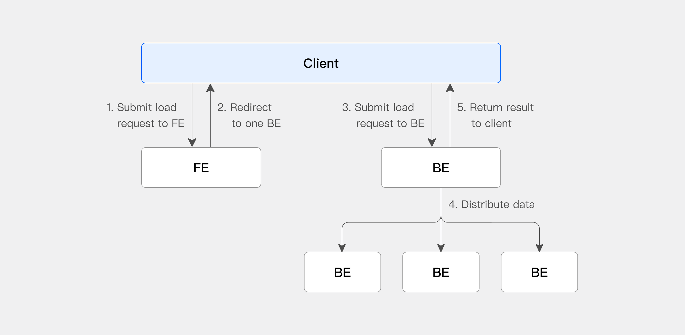

---
{
    "title": "Stream Load",
    "language": "ru",
    "description": "Stream Load синхронно загружает локальные файлы или потоки данных в Doris по HTTP, поддерживает форматы CSV/JSON/Parquet/ORC и гарантирует атомарность загрузки.",
    "keywords": [
        "Stream Load",
        "загрузка данных в Doris",
        "загрузка по HTTP",
        "загрузка CSV",
        "загрузка JSON",
        "синхронная загрузка",
        "Doris Streamloader",
        "загрузка с помощью curl",
        "атомарная загрузка"
    ]
}
---

<!-- Knowledge type: Operation guide + Configuration parameter reference -->
<!-- Applicable scenario: Data import / Local file import / Streaming data write -->

Stream Load позволяет загружать в Doris локальные файлы или потоки данных по HTTP. Это синхронный способ загрузки: после выполнения он возвращает результат, по которому можно определить, прошла ли загрузка успешно. Обычно Stream Load используют для файлов размером менее 10 GB. Более крупные файлы сначала разбивают на части, а затем загружают каждую часть с помощью Stream Load. Stream Load гарантирует атомарность пакета задач загрузки: либо все строки загружаются успешно, либо не загружается ни одна.

:::tip

Для загрузки с несколькими параллельными потоками рекомендуется использовать специализированный инструмент Doris Streamloader вместо прямого вызова `curl` с одним потоком. Этот клиент для загрузки данных в Doris поддерживает **параллельную загрузку** и сокращает время загрузки больших объёмов данных. Инструкции и практические рекомендации приведены в [документации Doris Streamloader](../../../connection-integration/data-integration/doris-streamloader).

:::

## Сценарии использования {#use-cases}

Stream Load подходит для следующих типичных сценариев:

- Загрузка в Doris локальных или удалённых файлов форматов CSV, JSON, Parquet и ORC.
- Непрерывная запись данных программами на Java, Go, Python и других языках через потоки HTTP.
- Задачи, для которых требуется атомарность одной загрузки: либо все строки загружаются, либо загрузка целиком завершается неудачей.
- Загрузка отдельных файлов, обычно размером менее 10 GB. Более крупные файлы следует разбить перед загрузкой или загрузить с помощью Doris Streamloader.

При загрузке CSV важно различать значения null и пустые строки:

- Значение null: обозначается как `\N`. Например, в `a,\N,b` средний столбец содержит null.
- Пустая строка: если между двумя разделителями нет символов, значение считается пустой строкой. Например, в `a,,b` между двумя запятыми нет символов, поэтому средний столбец содержит пустую строку.

## Принцип работы {#basic-principles}

<!-- Knowledge type: Architecture principles -->

При использовании Stream Load задание на загрузку отправляется узлу FE по HTTP. Для балансировки нагрузки FE циклически перенаправляет запрос одному из узлов BE. HTTP-запрос также можно отправить непосредственно определённому узлу BE. В Stream Load Doris назначает один узел координатором (Coordinator). Он принимает данные и распределяет их между другими узлами.

На следующей схеме показан основной процесс Stream Load:



Порядок выполнения:

1. Клиент отправляет узлу FE запрос на запуск задания Stream Load.
2. FE выбирает узел BE по циклическому алгоритму, назначает его координатором для планирования загрузки и возвращает клиенту перенаправление HTTP.
3. Клиент подключается к узлу BE, назначенному координатором, и отправляет запрос на загрузку.
4. Координатор BE распределяет данные между соответствующими узлами BE. После завершения загрузки он возвращает клиенту результат.
5. Клиент также может напрямую назначить узел BE координатором, который распределит задание на загрузку.

## Быстрый старт {#quick-start}

<!-- Knowledge type: Operational steps -->

Задания Stream Load отправляются, а данные передаются по HTTP. Следующие примеры показывают, как запустить загрузку с помощью инструмента curl.

### Предварительные требования {#prerequisites}

Для Stream Load требуется привилегия INSERT на целевую таблицу. Если у пользователя её нет, предоставьте привилегию командой [GRANT](../../../sql-manual/sql-statements/account-management/GRANT-TO).

### Создание задания на загрузку {#create-an-import-job}

#### Загрузка данных CSV {#import-csv-data}

1. Подготовьте данные для загрузки

    Создайте файл CSV `streamload_example.csv` со следующим содержимым:

    ```sql
    1,Emily,25
    2,Benjamin,35
    3,Olivia,28
    4,Alexander,60
    5,Ava,17
    6,William,69
    7,Sophia,32
    8,James,64
    9,Emma,37
    10,Liam,64
    ```

2. Создайте целевую таблицу Doris

    Создайте в Doris таблицу для загрузки следующей инструкцией:

    ```sql
    CREATE TABLE testdb.test_streamload(
        user_id            BIGINT       NOT NULL COMMENT "user id",
        name               VARCHAR(20)           COMMENT "name",
        age                INT                   COMMENT "age"
    )
    DUPLICATE KEY(user_id)
    DISTRIBUTED BY HASH(user_id) BUCKETS 10;
    ```

3. Запустите задание на загрузку

    Задание Stream Load можно отправить командой `curl`.

    ```shell
    curl --location-trusted -u <doris_user>:<doris_password> \
        -H "Expect:100-continue" \
        -H "column_separator:," \
        -H "columns:user_id,name,age" \
        -T streamload_example.csv \
        -XPUT http://<fe_ip>:<fe_http_port>/api/testdb/test_streamload/_stream_load
    ```

    Stream Load выполняется синхронно и возвращает результат загрузки непосредственно пользователю.

    ```sql
    {
        "TxnId": 3,
        "Label": "123",
        "Comment": "",
        "TwoPhaseCommit": "false",
        "Status": "Success",
        "Message": "OK",
        "NumberTotalRows": 10,
        "NumberLoadedRows": 10,
        "NumberFilteredRows": 0,
        "NumberUnselectedRows": 0,
        "LoadBytes": 118,
        "LoadTimeMs": 173,
        "BeginTxnTimeMs": 1,
        "StreamLoadPutTimeMs": 70,
        "ReadDataTimeMs": 2,
        "WriteDataTimeMs": 48,
        "CommitAndPublishTimeMs": 52
    }
    ```

4. Просмотрите загруженные данные

    ```sql
    mysql> select count(*) from testdb.test_streamload;
    +----------+
    | count(*) |
    +----------+
    |       10 |
    +----------+
    ```

#### Загрузка данных JSON {#import-json-data}

1. Подготовьте данные для загрузки

    Создайте файл JSON `streamload_example.json` со следующим содержимым:

    ```sql
    [
    {"userid":1,"username":"Emily","userage":25},
    {"userid":2,"username":"Benjamin","userage":35},
    {"userid":3,"username":"Olivia","userage":28},
    {"userid":4,"username":"Alexander","userage":60},
    {"userid":5,"username":"Ava","userage":17},
    {"userid":6,"username":"William","userage":69},
    {"userid":7,"username":"Sophia","userage":32},
    {"userid":8,"username":"James","userage":64},
    {"userid":9,"username":"Emma","userage":37},
    {"userid":10,"username":"Liam","userage":64}
    ]
    ```

2. Создайте целевую таблицу Doris

    Создайте в Doris таблицу для загрузки следующей инструкцией:

    ```sql
    CREATE TABLE testdb.test_streamload(
        user_id            BIGINT       NOT NULL COMMENT "user id",
        name               VARCHAR(20)           COMMENT "name",
        age                INT                   COMMENT "age"
    )
    DUPLICATE KEY(user_id)
    DISTRIBUTED BY HASH(user_id) BUCKETS 10;
    ```

3. Запустите задание на загрузку

    Задание Stream Load можно отправить командой `curl`.

    ```shell
    curl --location-trusted -u <doris_user>:<doris_password> \
        -H "label:124" \
        -H "Expect:100-continue" \
        -H "format:json" -H "strip_outer_array:true" \
        -H "jsonpaths:[\"$.userid\", \"$.username\", \"$.userage\"]" \
        -H "columns:user_id,name,age" \
        -T streamload_example.json \
        -XPUT http://<fe_ip>:<fe_http_port>/api/testdb/test_streamload/_stream_load
    ```

    :::info Примечание

    Если файл JSON содержит не массив, а по одному объекту JSON в каждой строке, добавьте заголовки `-H "strip_outer_array:false"` и `-H "read_json_by_line:true"`.
    Чтобы загрузить объект JSON в корневом узле файла, задайте для `jsonpaths` значение `$.`, например: `-H "jsonpaths:[\"$.\"]"`.

    :::

    Stream Load выполняется синхронно и возвращает результат загрузки непосредственно пользователю.

    ```sql
    {
        "TxnId": 7,
        "Label": "125",
        "Comment": "",
        "TwoPhaseCommit": "false",
        "Status": "Success",
        "Message": "OK",
        "NumberTotalRows": 10,
        "NumberLoadedRows": 10,
        "NumberFilteredRows": 0,
        "NumberUnselectedRows": 0,
        "LoadBytes": 471,
        "LoadTimeMs": 52,
        "BeginTxnTimeMs": 0,
        "StreamLoadPutTimeMs": 11,
        "ReadDataTimeMs": 0,
        "WriteDataTimeMs": 23,
        "CommitAndPublishTimeMs": 16
    }
    ```

### Просмотр заданий на загрузку {#view-import-jobs}

По умолчанию Stream Load синхронно возвращает ответ клиенту, поэтому система не сохраняет историю заданий Stream Load. Чтобы включить её запись, добавьте настройку `enable_stream_load_record=true` в `be.conf`. Подробности см. в разделе [Конфигурация BE](../../../admin-manual/config/be-config).

После настройки завершённые задания Stream Load можно просмотреть командой `show stream load`.

```sql
mysql> show stream load from testdb;
+-------+--------+-----------------+---------------+---------+---------+------+-----------+------------+--------------+----------------+-----------+-------------------------+-------------------------+------+---------+
| Label | Db     | Table           | ClientIp      | Status  | Message | Url  | TotalRows | LoadedRows | FilteredRows | UnselectedRows | LoadBytes | StartTime               | FinishTime              | User | Comment |
+-------+--------+-----------------+---------------+---------+---------+------+-----------+------------+--------------+----------------+-----------+-------------------------+-------------------------+------+---------+
| 12356 | testdb | test_streamload | 192.168.88.31 | Success | OK      | N/A  | 10        | 10         | 0            | 0              | 118       | 2023-11-29 08:53:00.594 | 2023-11-29 08:53:00.650 | root |         |
+-------+--------+-----------------+---------------+---------+---------+------+-----------+------------+--------------+----------------+-----------+-------------------------+-------------------------+------+---------+
1 row in set (0.00 sec)
```

### Отмена задания на загрузку {#cancel-an-import-job}

Пользователь не может отменить Stream Load вручную. Система автоматически отменяет загрузку при истечении времени ожидания или ошибке загрузки.

### Привязка Compute Group {#bind-a-compute-group}

Можно указать Compute Group, в которой будет выполняться Stream Load.

**Режим разделения хранения и вычислений**

В режиме разделения хранения и вычислений Compute Group можно указать следующими способами:

1. Через параметр заголовка HTTP.

    ```text
    -H "cloud_cluster:cluster1"
    ```

    Начиная с Doris 4.0.0, также можно использовать параметр `compute_group`:

    ```text
    -H "compute_group:cluster1"
    ```

    Если заданы и `compute_group`, и `cloud_cluster`, приоритет имеет `compute_group`.

2. В свойствах пользователя, связанного со Stream Load. Если Compute Group указана и в свойствах пользователя, и в заголовке HTTP, приоритет имеет значение из заголовка.

    ```text
    set property for user1 'default_compute_group'='cluster1';
    ```

3. Если Compute Group не указана ни в свойствах пользователя, ни в заголовке HTTP, она выбирается из Compute Group, доступных пользователю, связанному со Stream Load. Если у пользователя нет доступа ни к одной Compute Group, загрузка завершается ошибкой.

:::info Примечание о версиях (4.0.8 / 4.1.4)

Начиная с Doris 4.0.8 в ветке 4.0 и Doris 4.1.4 в ветке 4.1 исправлено несоответствие между маршрутизацией Compute Group и планом выполнения Stream Load в режиме разделения хранения и вычислений:

- Заголовок `compute_group` имеет приоритет над `cloud_cluster`. Ранее FE распознавал только `cloud_cluster`.
- При построении плана выполнения используется Compute Group **узла BE, фактически получившего запрос**. Поэтому план больше не назначается другой Compute Group, отличной от той, где он выполняется.
- На этом пути также проверяются право учётной записи загрузки на доступ к целевой Compute Group, её существование и состояние. Поэтому после обновления загрузка завершится ошибкой привилегий, если у учётной записи нет доступа к Compute Group, фактически обслуживающей запрос; этой учётной записи потребуется предоставить соответствующее право.

:::

:::info Примечание о версии (4.1.4)

Начиная с версии 4.1.4, конечные точки Stream Load на BE (`PUT /api/{db}/{table}/_stream_load`, `PUT /api/_http_stream` и `PUT /api/{db}/_stream_load_2pc`) больше не выполняют предварительную проверку глобальной привилегии `LOAD`. Авторизация единообразно выполняется на FE с учётом базы данных и таблицы, в которые фактически записываются данные.

Таким образом, учётная запись, имеющая только `LOAD_PRIV` на уровне базы данных или таблицы, без глобальной привилегии `LOAD`, теперь может выполнять Stream Load, а также фиксацию и отмену 2PC.

:::

**Режим совмещённого хранения и вычислений**

В режиме совмещённого хранения и вычислений Compute Group можно указать только в свойствах пользователя, связанного со Stream Load. Если она там не указана, выбирается Compute Group с именем `default`.

```text
set property for user1 'resource_tags.location'='group_1';
```

## Справочник {#reference}

<!-- Knowledge type: Configuration parameter reference -->

### Команда загрузки {#import-command}

Синтаксис загрузки Stream Load:

```shell
curl --location-trusted -u <doris_user>:<doris_password> \
  -H "Expect:100-continue" [-H ""...] \
  -T <file_path> \
  -XPUT http://fe_host:http_port/api/{db}/{table}/_stream_load
```

Stream Load поддерживает загрузку HTTP как с передачей по частям (chunked), так и без неё. Для загрузки без передачи по частям необходимо указать `Content-Length` с длиной отправляемого содержимого. Это гарантирует целостность данных.

### Параметры настройки загрузки {#import-configuration-parameters}

#### Настройки FE {#fe-configuration}

**1. stream_load_default_timeout_second**

| Параметр | Описание |
| -------------------------- | ----------------------------------- |
| Значение по умолчанию | 259200 (s) |
| Динамическая настройка | Да |
| Настройка только для FE Master | Да |

Описание: время ожидания Stream Load по умолчанию. Это время, отведённое на выполнение задания загрузки, в секундах. Если задание не завершается за заданное время `timeout`, система отменяет его и переводит в состояние CANCELLED. Если исходный файл не удаётся загрузить за это время, можно задать отдельное время ожидания в запросе Stream Load или изменить параметр FE `stream_load_default_timeout_second`, задающий глобальное значение по умолчанию.

#### Настройки BE {#be-configuration}

**1. streaming_load_max_mb**

| Параметр | Описание |
| --------------------- | -------------- |
| Значение по умолчанию | 102400 (MB) |
| Динамическая настройка | Да |

Описание: максимальный размер тела запроса Stream Load. Значение по умолчанию в исходном коде — 102400 MB (100 GB); действующий предел зависит от конфигурации BE в конкретном развёртывании. На загрузки JSON без `read_json_by_line=true` также распространяется ограничение `streaming_load_json_max_mb`.

Если запрос превышает действующий предел, разбейте данные на меньшие пакеты или попросите администратора изменить конфигурацию.

Для управляемых облачных сервисов используйте предусмотренный сервисом механизм настройки или обратитесь к его администратору; прямой доступ к узлам BE не требуется.

**История версий:**

- В ветке 3.x значение `streaming_load_max_mb` по умолчанию увеличилось с 10240 MB (10 GB) до 102400 MB (100 GB) в Doris 3.0.2. В Doris 3.0.0 и 3.0.1 значение по умолчанию составляет 10 GB.
- В ветке 2.1 такое же изменение вступило в силу в версии 2.1.7.
- В Doris 4.x и dev значение по умолчанию остаётся равным 100 GB. Действующее значение зависит от конфигурации развёртывания.

#### Параметры заголовка {#header-parameters}

Параметры загрузки можно передавать через заголовки HTTP. Они описаны ниже:

| Имя | Описание параметра |
| ------------------------------- | ------------------------------------------------------------ |
| label | Задаёт метку загрузки. Данные с одной и той же меткой нельзя загрузить более одного раза. Если метка не задана, Doris создаёт её автоматически. Указание метки помогает избежать повторной загрузки одних и тех же данных. По умолчанию Doris хранит метки заданий загрузки три дня; срок хранения можно изменить параметром `label_keep_max_second`. Например, чтобы задать для загрузки метку `123`, используйте команду `-H "label:123"`. Метки предотвращают повторную загрузку одних и тех же данных. Настоятельно рекомендуется использовать одну и ту же метку для одного пакета данных: тогда повторные запросы для этого пакета принимаются только один раз, обеспечивая семантику At-Most-Once. Если задание с данной меткой находится в состоянии CANCELLED, метку можно использовать повторно. |
| column_separator | Задаёт разделитель столбцов в загружаемом файле. По умолчанию используется `\t`. Для непечатаемых символов используйте префикс `\x`, задавая разделитель в шестнадцатеричном виде. Разделителем столбцов также может служить сочетание нескольких символов. Например, разделитель файла Hive `\x01` задаётся командой `-H "column_separator:\x01"`. |
| line_delimiter | Задаёт разделитель строк в загружаемом файле. По умолчанию используется `\n`. Разделителем строк также может служить сочетание нескольких символов. Например, чтобы задать разделитель строк `\n`, используйте команду `-H "line_delimiter:\n"`. |
| columns | Задаёт соответствие между столбцами загружаемого файла и столбцами таблицы. Если столбцы исходного файла точно соответствуют столбцам таблицы, указывать этот параметр не нужно. Если схема исходного файла отличается от схемы таблицы, параметр нужен для преобразования данных. Столбец можно задать двумя способами: указать имя поля, непосредственно соответствующего полю в файле, или задать производный столбец синтаксисом `column_name = expression`. Подробные примеры см. в разделе [Преобразование данных при загрузке](../../../data-operate/import/load-data-convert). |
| where | Используется для отбора части данных. Задайте этот параметр, если нужно отфильтровать ненужные данные. Например, чтобы загрузить только строки, в которых столбец k1 равен 20180601, укажите при загрузке `-H "where: k1 = 20180601"`. |
| max_filter_ratio | Максимально допустимая доля отфильтрованных данных, например строк с некорректным форматом. По умолчанию ошибки не допускаются. Диапазон значений — от 0 до 1. Если доля ошибок при загрузке превышает это значение, загрузка завершается неудачей. Строки, отфильтрованные условием `where`, не считаются некорректными. Например, чтобы загрузить как можно больше корректных данных при допуске ошибок 100%, укажите `-H "max_filter_ratio:1"`. |
| partitions | Задаёт разделы, участвующие в загрузке. Если известно, каким разделам соответствуют данные, рекомендуется указать этот параметр. Данные, не относящиеся к указанным разделам, отфильтровываются. Например, для загрузки в разделы p1 и p2 укажите `-H "partitions: p1, p2"`. |
| timeout | Задаёт время ожидания загрузки в секундах. Значение по умолчанию — 600 секунд. Допустимый диапазон — от 1 до 259200 секунд. Например, чтобы установить время ожидания загрузки 1200 s, укажите `-H "timeout:1200"`. |
| strict_mode | Определяет, включён ли строгий режим для этой загрузки. По умолчанию он выключен. Чтобы включить строгий режим, укажите `-H "strict_mode:true"`. |
| timezone | Задаёт часовой пояс загрузки. По умолчанию используется текущий часовой пояс кластера. Параметр влияет на результаты всех функций, связанных с часовыми поясами и задействованных при загрузке. Например, чтобы установить часовой пояс Africa/Abidjan, укажите `-H "timezone:Africa/Abidjan"`. |
| exec_mem_limit | Ограничение памяти для загрузки. По умолчанию — 2 GB. Единица измерения — байты. |
| format | Задаёт формат загружаемых данных. По умолчанию — CSV. Сейчас поддерживаются CSV, JSON, arrow, csv_with_names (позволяет пропустить первую строку файла CSV), csv_with_names_and_types (позволяет пропустить первые две строки файла CSV), Parquet и ORC. Например, чтобы задать формат JSON, используйте `-H "format:json"`. |
| jsonpaths | Данные JSON можно загружать двумя способами: в простом режиме, когда `jsonpaths` не задан и данные JSON должны быть объектами, и в режиме сопоставления, когда данные JSON достаточно сложны и соответствующие значения нужно находить с помощью параметра `jsonpaths`. В простом режиме ключи JSON должны однозначно соответствовать именам столбцов таблицы. Например, для данных JSON `{"k1":1, "k2":2, "k3":"hello"}` ключи k1, k2 и k3 должны соответствовать столбцам таблицы. |
| strip_outer_array | Если для `strip_outer_array` задано true, данные JSON начинаются с массива, который разворачивается в отдельные строки. Значение по умолчанию — false. Если внешний уровень данных JSON представляет собой массив `[]`, задайте `strip_outer_array` равным true. Например, из данных `[{"k1" : 1, "v1" : 2},{"k1" : 3, "v1" : 4}]` после установки `strip_outer_array` в true при загрузке в Doris создаются две строки. |
| json_root | `json_root` — допустимая строка `jsonpath`, задающая корневой узел документа JSON. Значение по умолчанию — "". |
| merge_type | Тип объединения данных. Поддерживаются три варианта:<br/>- APPEND (по умолчанию): все данные пакета добавляются к существующим.<br/>- DELETE: удаляются все строки, ключи которых совпадают с ключами строк пакета.<br/>- MERGE: применяется вместе с условием `delete`. Строки, соответствующие условию `delete`, обрабатываются по семантике DELETE, остальные — по семантике APPEND.<br/>Например, чтобы задать режим MERGE: `-H "merge_type: MERGE" -H "delete: flag=1"`. |
| delete | Имеет смысл только при MERGE; задаёт условие удаления данных. |
| function_column.sequence_col | Применяется только к модели UNIQUE KEYS. Для одинаковых ключевых столбцов обеспечивает замену значения столбца по REPLACE в порядке значений столбца `source_sequence`. `source_sequence` может быть столбцом источника данных или схемы таблицы. |
| fuzzy_parse | Логический параметр. При значении true JSON разбирается с использованием первой строки в качестве схемы. Это может повысить скорость загрузки JSON, но порядок ключей во всех объектах JSON должен совпадать с порядком в первой строке. Значение по умолчанию — false. Используется только для формата JSON. |
| num_as_string | Логический параметр. При значении true числовые типы при разборе данных JSON преобразуются в строки, чтобы при загрузке не терялась точность. |
| read_json_by_line | Логический параметр. При значении true позволяет считывать по одному объекту JSON из каждой строки. Значение по умолчанию — false. |
| send_batch_parallelism | Целое число. Задаёт степень параллелизма при отправке пакетов данных. Если указанное значение превышает настройку BE `max_send_batch_parallelism_per_job`, BE, выполняющий роль координатора, использует значение `max_send_batch_parallelism_per_job`. |
| hidden_columns | Задаёт скрытые столбцы, включённые в загружаемые данные. Действует, когда заголовок не содержит `Columns`. Несколько скрытых столбцов разделяются запятыми. Система загружает данные согласно указаниям пользователя. В примере ниже последний столбец загружаемых данных — `__DORIS_SEQUENCE_COL__`. `hidden_columns: __DORIS_DELETE_SIGN__,__DORIS_SEQUENCE_COL__` |
| load_to_single_tablet | Логический параметр. При значении true данные одного задания загружаются только в один таблет соответствующего раздела. Значение по умолчанию — false. Параметр можно задать только при загрузке в таблицу OLAP со случайным распределением по бакетам. |
| compress_type | Задаёт формат сжатия файла. Сейчас поддерживается сжатие только файлов CSV. Поддерживаемые форматы: gz, lzo, bz2, lz4, lzop и deflate. |
| trim_double_quotes | Логический параметр. Значение по умолчанию — false. При значении true удаляет внешние двойные кавычки каждого поля файла CSV. |
| skip_lines | Целое число. Значение по умолчанию — 0. Пропускает первые несколько строк файла CSV. Параметр не действует, когда для `format` задано `csv_with_names` или `csv_with_names_and_types`. |
| comment | Строка. Значение по умолчанию — пустая строка. Добавляет к заданию дополнительную информацию. |
| enclose | Задаёт символ обрамления. Если поля CSV содержат разделители строк или столбцов, можно указать однобайтовый символ обрамления, чтобы избежать случайного разделения поля. Например, при разделителе столбцов `,` и символе обрамления `'` данные `"a,'b,c'"` разбираются так, что `b,c` считается одним полем. Примечание: если для `enclose` задано `"`, для `trim_double_quotes` необходимо задать true. |
| escape | Задаёт символ экранирования. Он используется для экранирования символов в полях, совпадающих с символом обрамления. Например, для данных `"a,'b,'c'"` и символа обрамления `'`, чтобы разобрать `b,'c` как одно поле, задайте однобайтовый символ экранирования, например `\`, и измените данные на `"a,'b,\'c'"`. |
| memtable_on_sink_node | Определяет, включено ли продвижение MemTable при загрузке данных. Значение по умолчанию — false. |
| unique_key_update_mode | Режим обновления таблицы Unique. Сейчас действует только для таблиц Merge-On-Write Unique. Поддерживаются три варианта: `UPSERT`, `UPDATE_FIXED_COLUMNS` и `UPDATE_FLEXIBLE_COLUMNS`. `UPSERT`: загрузка с семантикой upsert. `UPDATE_FIXED_COLUMNS`: загрузка с [частичным обновлением столбцов](../../../data-operate/update/partial-column-update.md#column-update-on-the-unique-key-model). `UPDATE_FLEXIBLE_COLUMNS`: загрузка с [гибким частичным обновлением столбцов](../../../data-operate/update/partial-column-update.md#flexible-column-update). |
| partial_update_new_key_behavior | Определяет обработку новых строк при частичном или гибком частичном обновлении столбцов таблицы Unique. Доступны два варианта: `APPEND` и `ERROR`.<br/>- `APPEND`: разрешает вставлять новые строки.<br/>- `ERROR`: при вставке новой строки загрузка завершается ошибкой. |

### Результат загрузки {#import-return-value}

Stream Load выполняется синхронно, поэтому результат загрузки возвращается пользователю в ответе на запрос, как показано ниже:

```sql
{
    "TxnId": 1003,
    "Label": "b6f3bc78-0d2c-45d9-9e4c-faa0a0149bee",
    "Status": "Success",
    "ExistingJobStatus": "FINISHED", // optional
    "Message": "OK",
    "NumberTotalRows": 1000000,
    "NumberLoadedRows": 1000000,
    "NumberFilteredRows": 1,
    "NumberUnselectedRows": 0,
    "LoadBytes": 40888898,
    "LoadTimeMs": 2144,
    "BeginTxnTimeMs": 1,
    "StreamLoadPutTimeMs": 2,
    "ReadDataTimeMs": 325,
    "WriteDataTimeMs": 1933,
    "CommitAndPublishTimeMs": 106,
    "ErrorURL": "http://192.168.1.1:8042/api/_load_error_log?file=__shard_0/error_log_insert_stmt_db18266d4d9b4ee5-abb00ddd64bdf005_db18266d4d9b4ee5_abb00ddd64bdf005"
}
```

Поля результата описаны в следующей таблице:

| Имя параметра | Описание |
| ---------------------- | ------------------------------------------------------------ |
| TxnId | Идентификатор транзакции загрузки. |
| Label | Метка задания загрузки, задаваемая через `-H "label:<label_id>"`. |
| Status | Итоговое состояние загрузки:<br/>- Success: загрузка выполнена успешно.<br/>- Publish Timeout: загрузка завершена, но данные могут стать видимыми с задержкой; повторять запрос не нужно.<br/>- Label Already Exists: метка уже существует; требуется новая метка.<br/>- Fail: загрузка завершилась неудачей. |
| ExistingJobStatus | Состояние существующего задания загрузки с данной меткой. Поле отображается, только если `Status` имеет значение `Label Already Exists`. По нему можно узнать состояние задания с уже существующей меткой. `RUNNING` означает, что задание ещё выполняется; `FINISHED` — что оно завершилось успешно. |
| Message | Сообщение об ошибке загрузки. |
| NumberTotalRows | Общее число строк, обработанных при загрузке. |
| NumberLoadedRows | Число успешно загруженных строк. |
| NumberFilteredRows | Число строк, не прошедших проверку качества данных. |
| NumberUnselectedRows | Число строк, отфильтрованных условием `where`. |
| LoadBytes | Число загруженных байтов. |
| LoadTimeMs | Время завершения загрузки в миллисекундах. |
| BeginTxnTimeMs | Время запроса к FE на начало транзакции в миллисекундах. |
| StreamLoadPutTimeMs | Время запроса к FE на получение плана выполнения загрузки данных в миллисекундах. |
| ReadDataTimeMs | Время чтения данных в миллисекундах. |
| WriteDataTimeMs | Время записи данных в миллисекундах. |
| CommitAndPublishTimeMs | Время запроса к FE на фиксацию и публикацию транзакции в миллисекундах. |
| ErrorURL | Если обнаружены проблемы с качеством данных, по этому URL можно просмотреть конкретные ошибочные строки. |

С помощью `ErrorURL` можно просмотреть данные, которые не удалось загрузить из-за недостаточного качества. Чтобы получить сведения об ошибочных данных напрямую, выполните `curl "<ErrorURL>"`.

## Примеры загрузки {#import-examples}

<!-- Knowledge type: Operation examples -->
<!-- Applicable scenario: Multi-scenario import practices -->

### Настройка времени ожидания и максимального размера загрузки {#set-the-import-timeout-and-maximum-import-size}

Время ожидания задания загрузки задаётся в секундах. Если задание не завершается за заданное время `timeout`, система отменяет его и переводит в состояние CANCELLED. Время ожидания Stream Load можно изменить параметром `timeout` либо добавив параметр `stream_load_default_timeout_second` в `fe.conf`.

Перед загрузкой рассчитайте время ожидания исходя из размера файла. Например, для файла размером 100 GB при предполагаемой скорости загрузки 50 MB/s:

```sql
Import time ~= 100GB / 50MB/s ~= 2048s
```

Следующая команда создаёт задание Stream Load с `timeout` равным 3000 s:

```shell
curl --location-trusted -u <doris_user>:<doris_password> \
    -H "Expect:100-continue" \
    -H "timeout:3000" \
    -H "column_separator:," \
    -H "columns:user_id,name,age" \
    -T streamload_example.csv \
    -XPUT http://<fe_ip>:<fe_http_port>/api/testdb/test_streamload/_stream_load
```

### Настройка максимальной допустимой доли ошибок {#set-the-maximum-tolerated-error-ratio}

Задания загрузки Doris могут допускать часть данных с некорректным форматом. Допустимая доля задаётся параметром `max_filter_ratio`. По умолчанию он равен 0: даже одна некорректная строка приводит к неудаче всего задания. Если нужно пропустить часть проблемных строк, задайте значение от 0 до 1, и Doris автоматически пропустит строки с неверным форматом данных. Как рассчитывается допустимая доля, описано в документации по [преобразованию данных](../../../data-operate/import/load-data-convert).

Следующая команда создаёт задание Stream Load с `max_filter_ratio` равным 0.4:

```shell
curl --location-trusted -u <doris_user>:<doris_password> \
    -H "Expect:100-continue" \
    -H "max_filter_ratio:0.4" \
    -H "column_separator:," \
    -H "columns:user_id,name,age" \
    -T streamload_example.csv \
    -XPUT http://<fe_ip>:<fe_http_port>/api/testdb/test_streamload/_stream_load
```

### Настройка условий фильтрации при загрузке {#set-import-filter-conditions}

Во время загрузки можно фильтровать данные по условию с помощью параметра `WHERE`. Отфильтрованные таким образом данные не учитываются при расчёте доли ошибок и не влияют на `max_filter_ratio`. После завершения загрузки число отфильтрованных строк можно узнать из `num_rows_unselected`.

Следующая команда создаёт задание Stream Load с условием фильтрации `WHERE`:

```sql
curl --location-trusted -u <doris_user>:<doris_password> \
    -H "Expect:100-continue" \
    -H "where:age>=35" \
    -H "column_separator:," \
    -H "columns:user_id,name,age" \
    -T streamload_example.csv \
    -XPUT http://<fe_ip>:<fe_http_port>/api/testdb/test_streamload/_stream_load
```

### Загрузка данных в указанные разделы {#import-data-into-specified-partitions}

Загрузите данные из локального файла в разделы p1 и p2 таблицы, допустив долю ошибок 20%.

```shell
curl --location-trusted -u <doris_user>:<doris_password> \
    -H "label:123" \
    -H "Expect:100-continue" \
    -H "max_filter_ratio:0.2" \
    -H "column_separator:," \
    -H "columns:user_id,name,age" \
    -H "partitions: p1, p2" \
    -T streamload_example.csv \
    -XPUT http://<fe_ip>:<fe_http_port>/api/testdb/test_streamload/_stream_load
```

### Указание часового пояса загрузки {#specify-the-import-time-zone}

Типы, связанные с `DATETIME`, представляют только абсолютные моменты времени и не содержат сведений о часовом поясе; при изменении системного часового пояса Doris их значения не меняются. Поэтому при загрузке данные с часовым поясом единообразно преобразуются к заданному целевому часовому поясу. В системе Doris этот пояс представлен переменной сеанса `time_zone`.

При загрузке целевой часовой пояс задаётся параметром `timezone`. При преобразовании часовых поясов и вычислении функций, зависящих от часового пояса, он заменяет переменную сеанса `time_zone`. Поэтому, если нет особых требований, значение `timezone` в транзакции загрузки должно совпадать с текущим значением `time_zone` кластера Doris. Тогда все данные о времени, содержащие часовой пояс, преобразуются к нему.

Например, если системный часовой пояс Doris — `+08:00`, а столбец времени загружаемых данных содержит строки `2012-01-01 01:00:00+00:00` и `2015-12-12 12:12:12-08:00`, то указание `-H "timezone: +08:00"` для транзакции загрузки преобразует обе строки к этому часовому поясу. Результатами будут `2012-01-01 09:00:00` и `2015-12-13 04:12:12`.

Дополнительные сведения см. в документации по [часовым поясам](../../../admin-manual/cluster-management/time-zone).

### Потоковая загрузка {#import-using-streaming}

Stream Load работает по протоколу HTTP, поэтому программы на Java, Go, Python и других языках могут записывать в него данные потоком. Отсюда и название Stream Load.

Следующий пример с конвейером команд `bash` показывает такую загрузку: данные создаются программой, а не считываются из локального файла.

```shell
seq 1 10 | awk '{OFS="\t"}{print $1, $1 * 10}' | curl --location-trusted -u root -T - http://host:port/api/testDb/testTbl/_stream_load
```

### Пропуск первой строки CSV при загрузке {#skip-the-first-line-of-a-csv-during-import}

Данные файла:

```Plain
 id,name,age
 1,doris,20
 2,flink,10
```

Чтобы пропустить первую строку при загрузке, укажите `format=csv_with_names`:

```Plain
curl --location-trusted -u root -T test.csv  -H "label:1" -H "format:csv_with_names" -H "column_separator:," http://host:port/api/testDb/testTbl/_stream_load
```

### Удаление с помощью merge_type {#use-merge_type-to-perform-a-delete-operation}

В Stream Load предусмотрены три типа загрузки: APPEND, DELETE и MERGE. Тип задаётся параметром `merge_type`. Чтобы удалить все строки, ключи которых совпадают с ключами загружаемых данных, используйте следующую команду:

```shell
curl --location-trusted -u <doris_user>:<doris_password> \
    -H "Expect:100-continue" \
    -H "merge_type: DELETE" \
    -H "column_separator:," \
    -H "columns:user_id,name,age" \
    -T streamload_example.csv \
    -XPUT http://<fe_ip>:<fe_http_port>/api/testdb/test_streamload/_stream_load
```

Если до загрузки таблица содержит следующие данные:

```sql
+--------+----------+----------+------+
| siteid | citycode | username | pv   |
+--------+----------+----------+------+
|      3 |        2 | tom      |    2 |
|      4 |        3 | bush     |    3 |
|      5 |        3 | helen    |    3 |
+--------+----------+----------+------+
```

Загружаемые данные:

```sql
3,2,tom,0
```

После загрузки совпадающая строка удаляется из таблицы, и результирующий набор выглядит так:

```sql
+--------+----------+----------+------+
| siteid | citycode | username | pv   |
+--------+----------+----------+------+
|      4 |        3 | bush     |    3 |
|      5 |        3 | helen    |    3 |
+--------+----------+----------+------+
```

### Объединение с помощью merge_type {#use-merge_type-to-perform-a-merge-operation}

Если задать для `merge_type` значение MERGE, загружаемые данные объединяются с данными таблицы. Семантику MERGE необходимо применять вместе с условием `DELETE`. Строки, соответствующие условию `DELETE`, обрабатываются по семантике DELETE, остальные добавляются в таблицу по семантике APPEND. Например, следующая операция удаляет строку, в которой `siteid` равен 1, и добавляет остальные данные в таблицу:

```shell
curl --location-trusted -u <doris_user>:<doris_password> \
    -H "Expect:100-continue" \
    -H "merge_type: MERGE" \
    -H "delete: siteid=1" \
    -H "column_separator:," \
    -H "columns:user_id,name,age" \
    -T streamload_example.csv \
    -XPUT http://<fe_ip>:<fe_http_port>/api/testdb/test_streamload/_stream_load
```

Если до загрузки таблица содержит следующие данные:

```sql
+--------+----------+----------+------+
| siteid | citycode | username | pv   |
+--------+----------+----------+------+
|      4 |        3 | bush     |    3 |
|      5 |        3 | helen    |    3 |
|      1 |        1 | jim      |    2 |
+--------+----------+----------+------+
```

Загружаемые данные:

```sql
2,1,grace,2
3,2,tom,2
1,1,jim,2
```

После загрузки строка с `siteid = 1` удаляется, а строки с `siteid` 2 и 3 добавляются в таблицу:

```sql
+--------+----------+----------+------+
| siteid | citycode | username | pv   |
+--------+----------+----------+------+
|      4 |        3 | bush     |    3 |
|      2 |        1 | grace    |    2 |
|      3 |        2 | tom      |    2 |
|      5 |        3 | helen    |    3 |
+--------+----------+----------+------+
```

### Указание столбца Sequence для Merge при загрузке {#specify-the-sequence-column-for-merge-during-import}

Если в таблице Unique Key задан столбец Sequence, то для одинаковых ключевых столбцов его значение определяет порядок, в котором агрегатная функция REPLACE выполняет замену: большее значение может заменить меньшее. При пометке строк такой таблицы на удаление с помощью `DORIS_DELETE_SIGN` необходимо, чтобы ключ совпадал, а значение столбца Sequence было не меньше текущего. Для удаления можно указать параметр `function_column.sequence_col` вместе с `merge_type: DELETE`:

```sql
curl --location-trusted -u <doris_user>:<doris_password> \
    -H "Expect:100-continue" \
    -H "merge_type: DELETE" \
    -H "function_column.sequence_col: age" \
    -H "column_separator:," \
    -H "columns: name, gender, age" \
    -T streamload_example.csv \
    -XPUT http://<fe_ip>:<fe_http_port>/api/testdb/test_streamload/_stream_load
```

Предположим, таблица имеет следующую структуру:

```sql
mysql> SET show_hidden_columns=true;
Query OK, 0 rows affected (0.00 sec)

mysql> DESC table1;
+------------------------+--------------+------+-------+---------+---------+
| Field                  | Type         | Null | Key   | Default | Extra   |
+------------------------+--------------+------+-------+---------+---------+
| name                   | VARCHAR(100) | No   | true  | NULL    |         |
| gender                 | VARCHAR(10)  | Yes  | false | NULL    | REPLACE |
| age                    | INT          | Yes  | false | NULL    | REPLACE |
| __DORIS_DELETE_SIGN__  | TINYINT      | No   | false | 0       | REPLACE |
| __DORIS_SEQUENCE_COL__ | INT          | Yes  | false | NULL    | REPLACE |
+------------------------+--------------+------+-------+---------+---------+
4 rows in set (0.00 sec)
```

Предположим, исходные данные таблицы таковы:

```sql
+-------+--------+------+
| name  | gender | age  |
+-------+--------+------+
| li    | male   |   10 |
| wang  | male   |   14 |
| zhang | male   |   12 |
+-------+--------+------+
```

**1. Параметр Sequence действует: значение загружаемого столбца Sequence больше или равно существующему значению в таблице**

Загружаемые данные:

```sql
li,male,10
```

Поскольку указан `function_column.sequence_col: age`, а значение `age` больше или равно существующему значению столбца в таблице, исходная строка удаляется. Данные таблицы после этого:

```sql
+-------+--------+------+
| name  | gender | age  |
+-------+--------+------+
| wang  | male   |   14 |
| zhang | male   |   12 |
+-------+--------+------+
```

**2. Параметр Sequence не действует: значение загружаемого столбца Sequence меньше или равно существующему значению в таблице**

Загружаемые данные:

```sql
li,male,9
```

Хотя указан `function_column.sequence_col: age`, значение `age` меньше существующего значения столбца в таблице. Поэтому операция DELETE не действует: данные таблицы не меняются, а строка с первичным ключом `li` остаётся видимой:

```sql
+-------+--------+------+
| name  | gender | age  |
+-------+--------+------+
| li    | male   |   10 |
| wang  | male   |   14 |
| zhang | male   |   12 |
+-------+--------+------+
```

Строка не удаляется из-за порядка проверок на нижнем уровне: система сначала находит строки с одинаковым ключом и показывает строку с наибольшим значением столбца Sequence. Затем она проверяет значение `DORIS_DELETE_SIGN` у этой строки. Если оно равно 1, строка скрывается; если равно 0, её по-прежнему можно прочитать.

### Загрузка данных с символами обрамления {#import-data-containing-enclosing-characters}

Если данные CSV содержат разделители строк или столбцов, можно указать однобайтовый символ обрамления, чтобы избежать разбиения поля.

В следующих данных столбец содержит разделитель `,`:

```sql
Zhang San,30,'Shanghai City, Huangpu District, Dagu Road'
```

Если указать символ обрамления `'`, значение "Shanghai City, Huangpu District, Dagu Road" будет считаться одним полем:

```sql
curl --location-trusted -u <doris_user>:<doris_password> \
    -H "Expect:100-continue" \
    -H "column_separator:," \
    -H "enclose:'" \
    -H "columns:username,age,address" \
    -T streamload_example.csv \
    -XPUT http://<fe_ip>:<fe_http_port>/api/testdb/test_streamload/_stream_load
```

Если символ обрамления также встречается внутри поля, например когда значение "Shanghai City, Huangpu District, 'Dagu Road" нужно считать одним полем, сначала экранируйте этот символ в данных:

```sql
Zhang San,30,'Shanghai City, Huangpu District, \'Dagu Road'
```

Параметр `escape` позволяет указать однобайтовый символ экранирования, например `\` в следующем примере:

```sql
curl --location-trusted -u <doris_user>:<doris_password> \
    -H "Expect:100-continue" \
    -H "column_separator:," \
    -H "enclose:'" \
    -H "escape:\\" \
    -H "columns:username,age,address" \
    -T streamload_example.csv \
    -XPUT http://<fe_ip>:<fe_http_port>/api/testdb/test_streamload/_stream_load
```

### Загрузка данных в таблицу с полями DEFAULT CURRENT_TIMESTAMP {#import-data-into-a-table-with-default-current_timestamp-fields}

Следующий пример показывает загрузку данных в таблицу, содержащую поля с `DEFAULT CURRENT_TIMESTAMP`.

Схема таблицы:

```sql
CREATE TABLE testDb.testTbl (
    `id` BIGINT(30) NOT NULL,
    `order_code` VARCHAR(30) DEFAULT NULL COMMENT '',
    `create_time` DATETIMEv2(3) DEFAULT CURRENT_TIMESTAMP
)
DUPLICATE KEY(id)
DISTRIBUTED BY HASH(id) BUCKETS 10;
```

Формат данных JSON:

```Plain
{"id":1,"order_Code":"avc"}
```

Команда загрузки:

```shell
curl --location-trusted -u root -T test.json -H "label:1" -H "format:json" -H 'columns: id, order_code, create_time=CURRENT_TIMESTAMP()' http://host:port/api/testDb/testTbl/_stream_load
```

### Загрузка данных JSON в простом режиме {#import-json-data-in-simple-mode}

Если поля JSON однозначно соответствуют именам столбцов таблицы, данные JSON можно загрузить в таблицу, указав `"strip_outer_array:true"` и `"format:json"`.

Например, таблица определена так:

```sql
CREATE TABLE testdb.test_streamload(
    user_id            BIGINT       NOT NULL COMMENT "user id",
    name               VARCHAR(20)           COMMENT "name",
    age                INT                   COMMENT "age"
)
DUPLICATE KEY(user_id)
DISTRIBUTED BY HASH(user_id) BUCKETS 10;
```

Имена полей загружаемых данных однозначно соответствуют именам столбцов таблицы:

```sql
[
{"user_id":1,"name":"Emily","age":25},
{"user_id":2,"name":"Benjamin","age":35},
{"user_id":3,"name":"Olivia","age":28},
{"user_id":4,"name":"Alexander","age":60},
{"user_id":5,"name":"Ava","age":17},
{"user_id":6,"name":"William","age":69},
{"user_id":7,"name":"Sophia","age":32},
{"user_id":8,"name":"James","age":64},
{"user_id":9,"name":"Emma","age":37},
{"user_id":10,"name":"Liam","age":64}
]
```

Загрузить данные JSON в таблицу можно следующей командой:

```sql
curl --location-trusted -u <doris_user>:<doris_password> \
    -H "Expect:100-continue" \
    -H "format:json" \
    -H "strip_outer_array:true" \
    -T streamload_example.json \
    -XPUT http://<fe_ip>:<fe_http_port>/api/testdb/test_streamload/_stream_load
```

### Загрузка сложных данных JSON в режиме сопоставления {#import-complex-json-data-in-matching-mode}

Если данные JSON сложны, не соответствуют однозначно именам столбцов таблицы или содержат лишние поля, для сопоставления при загрузке можно указать параметр `jsonpaths`. Например, для следующих данных:

```sql
[
{"userid":1,"hudi":"lala","username":"Emily","userage":25,"userhp":101},
{"userid":2,"hudi":"kpkp","username":"Benjamin","userage":35,"userhp":102},
{"userid":3,"hudi":"ji","username":"Olivia","userage":28,"userhp":103},
{"userid":4,"hudi":"popo","username":"Alexander","userage":60,"userhp":103},
{"userid":5,"hudi":"uio","username":"Ava","userage":17,"userhp":104},
{"userid":6,"hudi":"lkj","username":"William","userage":69,"userhp":105},
{"userid":7,"hudi":"komf","username":"Sophia","userage":32,"userhp":106},
{"userid":8,"hudi":"mki","username":"James","userage":64,"userhp":107},
{"userid":9,"hudi":"hjk","username":"Emma","userage":37,"userhp":108},
{"userid":10,"hudi":"hua","username":"Liam","userage":64,"userhp":109}
]
```

Параметр `jsonpaths` позволяет сопоставить указанные столбцы:

```sql
curl --location-trusted -u <doris_user>:<doris_password> \
    -H "Expect:100-continue" \
    -H "format:json" \
    -H "strip_outer_array:true" \
    -H "jsonpaths:[\"$.userid\", \"$.username\", \"$.userage\"]" \
    -H "columns:user_id,name,age" \
    -T streamload_example.json \
    -XPUT http://<fe_ip>:<fe_http_port>/api/testdb/test_streamload/_stream_load
```

### Указание корневого узла JSON при загрузке {#specify-the-json-root-node-for-import}

Если данные JSON содержат вложенные поля JSON, нужно указать корневой узел для загрузки. Значение по умолчанию — "".

Для следующих данных требуется загрузить в таблицу содержимое поля `comment`:

```sql
[
    {"user":1,"comment":{"userid":101,"username":"Emily","userage":25}},
    {"user":2,"comment":{"userid":102,"username":"Benjamin","userage":35}},
    {"user":3,"comment":{"userid":103,"username":"Olivia","userage":28}},
    {"user":4,"comment":{"userid":104,"username":"Alexander","userage":60}},
    {"user":5,"comment":{"userid":105,"username":"Ava","userage":17}},
    {"user":6,"comment":{"userid":106,"username":"William","userage":69}},
    {"user":7,"comment":{"userid":107,"username":"Sophia","userage":32}},
    {"user":8,"comment":{"userid":108,"username":"James","userage":64}},
    {"user":9,"comment":{"userid":109,"username":"Emma","userage":37}},
    {"user":10,"comment":{"userid":110,"username":"Liam","userage":64}}
    ]
```

Сначала задайте корневой узел `comment` параметром `json_root`, затем выполните сопоставление имён столбцов с помощью `jsonpaths`:

```sql
curl --location-trusted -u <doris_user>:<doris_password> \
    -H "Expect:100-continue" \
    -H "format:json" \
    -H "strip_outer_array:true" \
    -H "json_root: $.comment" \
    -H "jsonpaths:[\"$.userid\", \"$.username\", \"$.userage\"]" \
    -H "columns:user_id,name,age" \
    -T streamload_example.json \
    -XPUT http://<fe_ip>:<fe_http_port>/api/testdb/test_streamload/_stream_load
```

### Загрузка данных типа Array {#import-array-data-type}

Следующие данные содержат массивы:

```sql
1|Emily|[1,2,3,4]
2|Benjamin|[22,45,90,12]
3|Olivia|[23,16,19,16]
4|Alexander|[123,234,456]
5|Ava|[12,15,789]
6|William|[57,68,97]
7|Sophia|[46,47,49]
8|James|[110,127,128]
9|Emma|[19,18,123,446]
10|Liam|[89,87,96,12]
```

Загрузите данные в таблицу со следующей схемой:

```sql
CREATE TABLE testdb.test_streamload(
    typ_id     BIGINT          NOT NULL COMMENT "ID",
    name       VARCHAR(20)     NULL     COMMENT "name",
    arr        ARRAY<int(10)>  NULL     COMMENT "array"
)
DUPLICATE KEY(typ_id)
DISTRIBUTED BY HASH(typ_id) BUCKETS 10;
```

С помощью задания Stream Load данные типа ARRAY можно загрузить из текстового файла прямо в таблицу:

```sql
curl --location-trusted -u <doris_user>:<doris_password> \
    -H "Expect:100-continue" \
    -H "column_separator:|" \
    -H "columns:typ_id,name,arr" \
    -T streamload_example.csv \
    -XPUT http://<fe_ip>:<fe_http_port>/api/testdb/test_streamload/_stream_load
```

### Загрузка данных типа Map {#import-map-data-type}

Предположим, загружаемые данные содержат значения типа Map, как в следующем примере:

```sql
[
{"user_id":1,"namemap":{"Emily":101,"age":25}},
{"user_id":2,"namemap":{"Benjamin":102,"age":35}},
{"user_id":3,"namemap":{"Olivia":103,"age":28}},
{"user_id":4,"namemap":{"Alexander":104,"age":60}},
{"user_id":5,"namemap":{"Ava":105,"age":17}},
{"user_id":6,"namemap":{"William":106,"age":69}},
{"user_id":7,"namemap":{"Sophia":107,"age":32}},
{"user_id":8,"namemap":{"James":108,"age":64}},
{"user_id":9,"namemap":{"Emma":109,"age":37}},
{"user_id":10,"namemap":{"Liam":110,"age":64}}
]
```

Загрузите данные в таблицу со следующей схемой:

```sql
CREATE TABLE testdb.test_streamload(
    user_id            BIGINT       NOT NULL COMMENT "ID",
    namemap            Map<STRING, INT>  NULL     COMMENT "namemap"
)
DUPLICATE KEY(user_id)
DISTRIBUTED BY HASH(user_id) BUCKETS 10;
```

С помощью задания Stream Load данные типа Map можно загрузить из текстового файла прямо в таблицу:

```sql
curl --location-trusted -u <doris_user>:<doris_password> \
    -H "Expect:100-continue" \
    -H "format: json" \
    -H "strip_outer_array:true" \
    -T streamload_example.json \
    -XPUT http://<fe_ip>:<fe_http_port>/api/testdb/test_streamload/_stream_load
```

### Загрузка данных типа Bitmap {#import-bitmap-data-type}

Если при загрузке встречаются данные типа Bitmap, преобразовать их в Bitmap можно функцией `to_bitmap`, а заполнить Bitmap — функцией `bitmap_empty`.

Например, загружаемые данные:

```sql
1|koga|17723
2|nijg|146285
3|lojn|347890
4|lofn|489871
5|jfin|545679
6|kon|676724
7|nhga|767689
8|nfubg|879878
9|huang|969798
10|buag|97997
```

Загрузите данные в следующую таблицу с типом Bitmap:

```sql
CREATE TABLE testdb.test_streamload(
    typ_id     BIGINT                NULL   COMMENT "ID",
    hou        VARCHAR(10)           NULL   COMMENT "one",
    arr        BITMAP  BITMAP_UNION  NOT NULL   COMMENT "two"
)
AGGREGATE KEY(typ_id,hou)
DISTRIBUTED BY HASH(typ_id,hou) BUCKETS 10;
```

Преобразовать данные в тип Bitmap можно функцией `to_bitmap`:

```sql
curl --location-trusted -u <doris_user>:<doris_password> \
    -H "Expect:100-continue" \
    -H "columns:typ_id,hou,arr,arr=to_bitmap(arr)" \
    -T streamload_example.csv \
    -XPUT http://<fe_ip>:<fe_http_port>/api/testdb/test_streamload/_stream_load
```

### Загрузка данных типа HLL {#import-hll-data-type}

Преобразовать данные в тип HLL можно функцией `hll_hash`. Пусть имеются следующие данные:

```sql
1001|koga
1002|nijg
1003|lojn
1004|lofn
1005|jfin
1006|kon
1007|nhga
1008|nfubg
1009|huang
1010|buag
```

Загрузите их в следующую таблицу:

```sql
CREATE TABLE testdb.test_streamload(
    typ_id           BIGINT          NULL   COMMENT "ID",
    typ_name         VARCHAR(10)     NULL   COMMENT "NAME",
    pv               hll hll_union   NOT NULL   COMMENT "hll"
)
AGGREGATE KEY(typ_id,typ_name)
DISTRIBUTED BY HASH(typ_id) BUCKETS 10;
```

Загрузка с использованием функции `hll_hash`:

```sql
curl --location-trusted -u <doris_user>:<doris_password> \
    -H "column_separator:|" \
    -H "columns:typ_id,typ_name,pv=hll_hash(typ_id)" \
    -T streamload_example.csv \
    -XPUT http://<fe_ip>:<fe_http_port>/api/testdb/test_streamload/_stream_load
```

### Сопоставление столбцов, производные столбцы и фильтрация {#column-mapping-derived-columns-and-filtering}

Doris поддерживает широкий набор операций преобразования столбцов и фильтрации в инструкциях загрузки, а также большинство встроенных функций. Подробнее об использовании этой возможности см. в документации по [преобразованию данных](../../../data-operate/import/load-data-convert).

### Включение строгого режима при загрузке {#enable-strict-mode-for-import}

Свойство `strict_mode` определяет, выполняется ли задание загрузки в строгом режиме. Оно влияет на результаты сопоставления, преобразования и фильтрации столбцов. Подробнее см. в документации по [строгому режиму](../handling-messy-data#strict-mode-strict_mode).

### Частичное и гибкое частичное обновление столбцов при загрузке {#perform-partial-column-update-or-flexible-partial-column-update-during-import}

Как задать частичное обновление столбцов при загрузке, описано в документации по [обновлению столбцов](../../../data-operate/update/partial-column-update.md).

## Часто задаваемые вопросы {#faq}

<!-- Knowledge type: Troubleshooting -->
<!-- Applicable scenario: Troubleshooting / FAQ -->

### Можно ли отменить Stream Load вручную? {#does-stream-load-support-manual-cancellation}

Нет. Система автоматически отменяет Stream Load при истечении времени ожидания или ошибке загрузки; пользователь не может вручную отменить выполняющееся задание Stream Load.

### Есть ли ограничение на размер одного файла для Stream Load? {#is-there-a-size-limit-for-a-single-stream-load-file}

Рекомендуется загружать файлы размером не более 10 GB. Более крупные файлы следует разбивать перед загрузкой. Также можно увеличить предел для одной загрузки, изменив параметр BE `streaming_load_max_mb`, или повысить производительность за счёт параллельной загрузки с помощью [Doris Streamloader](../../../connection-integration/data-integration/doris-streamloader).

### Как просмотреть историю заданий Stream Load? {#how-do-i-query-historical-stream-load-jobs}

По умолчанию система не сохраняет историю заданий Stream Load. Установите `enable_stream_load_record=true` в `be.conf`, перезапустите систему и просматривайте историю командой `show stream load from <db>`.

### Что делать при ошибке "Label Already Exists"? {#how-do-i-handle-the-label-already-exists-error}

Эта ошибка означает, что такая метка уже использовалась. Состояние существующего задания можно определить по полю `ExistingJobStatus` в ответе:

- `RUNNING`: задание ещё выполняется; дождитесь его завершения.
- `FINISHED`: задание успешно завершено; повторять запрос не нужно.
- Если задание находится в состоянии CANCELLED, ту же метку можно использовать для новой загрузки.

Рекомендуется всегда использовать одну метку для одного пакета данных, чтобы обеспечить семантику At-Most-Once и избежать повторной загрузки.

### Что делать, если загрузка завершилась ошибкой из-за формата данных? {#what-if-an-import-fails-because-of-data-format-errors}

Найти и устранить причину можно следующим образом:

1. Просмотрите конкретные ошибочные строки по полю `ErrorURL` в ответе: `curl "<ErrorURL>"`.
2. При необходимости увеличьте `max_filter_ratio` (диапазон от 0 до 1), чтобы допустить часть некорректных данных.
3. Проверьте, правильно ли в CSV используются значения null (`\N`) и пустые строки (отсутствие символов между двумя разделителями).
4. Проверьте, соответствуют ли настройки разделителя столбцов, разделителя строк, символа обрамления (`enclose`) и символа экранирования (`escape`) фактическому содержимому файла.

### Что делать при превышении времени ожидания загрузки (CANCELLED)? {#how-do-i-handle-import-timeouts-cancelled}

Оцените подходящее время ожидания с учётом объёма данных:

```text
Import time ~= File size / Estimated import speed (for example, 50MB/s)
```

Изменить время ожидания можно двумя способами:

- Для одной загрузки: используйте параметр заголовка `-H "timeout:3000"`.
- Глобально: измените параметр FE `stream_load_default_timeout_second`.

### Как различать значения null и пустые строки в CSV? {#how-do-i-distinguish-null-values-from-empty-strings-in-csv}

| Тип | Представление | Пример | Значение среднего столбца |
| ------------- | ----------------------------------------- | -------- | ---------------------------- |
| Значение null | Используйте `\N` | `a,\N,b` | Средний столбец содержит null |
| Пустая строка | Между двумя разделителями нет символов | `a,,b` | Средний столбец содержит пустую строку |
