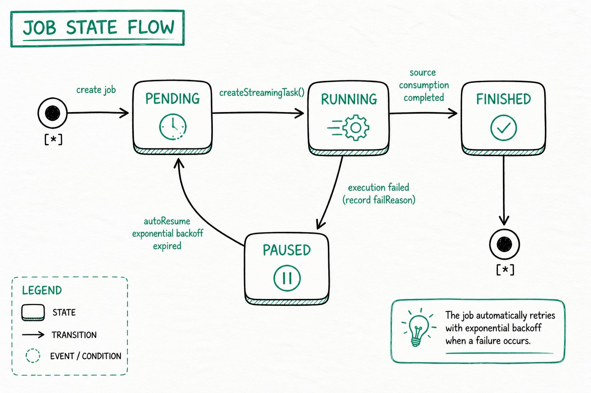

---
{
    "title": "Обзор непрерывной загрузки",
    "language": "ru",
    "sidebar_label": "Обзор",
    "description": "Узнайте о непрерывной загрузке Doris с помощью Streaming Job для MySQL, PostgreSQL, OceanBase и S3, включая выбор метода синхронизации, состояния заданий и распространённые операции.",
    "keywords": [
        "непрерывная загрузка Doris",
        "Streaming Job",
        "синхронизация MySQL в реальном времени",
        "синхронизация PostgreSQL в реальном времени",
        "синхронизация OceanBase в реальном времени",
        "непрерывная загрузка S3",
        "SQL Mapping Sync",
        "Auto Table Creation Sync",
        "exactly-once",
        "at-least-once",
        "autoResume"
    ]
}
---

:::caution Экспериментальная функция

Непрерывная загрузка Doris является экспериментальной функцией и поддерживается начиная с Doris 4.1.5.

:::

<!-- Knowledge type: Feature overview + architecture selection decision -->
<!-- Applicable scenarios: Real-time data ingestion selection / continuous load operations -->

Doris поддерживает непрерывную загрузку данных из нескольких источников в таблицы Doris с помощью **Streaming Job**. После отправки Job Doris продолжает выполнять задание загрузки, считывая данные из источника в реальном времени и записывая их в таблицу Doris.

Этот документ поможет ответить на следующие вопросы:

- Какие источники данных и режимы синхронизации поддерживает непрерывная загрузка?
- Как выбрать между SQL Mapping Sync и Auto Table Creation Sync?
- Как изменяются состояния задания и как работает автоматическое восстановление?
- Как в повседневной работе просматривать, приостанавливать, возобновлять и удалять задания загрузки?
- Каковы распространённые параметры конфигурации FE и Job?

## Поддерживаемые источники данных и режимы синхронизации {#supported-data-sources-and-sync-modes}

Непрерывная загрузка поддерживает следующие источники данных и режимы синхронизации. Уведомления S3 и однократная загрузка поддерживаются начиная с Doris 4.1.6:

| Источник данных | Поддерживаемые версии | SQL Mapping Sync                                                  | Auto Table Creation Sync                                                | Руководство по настройке                                                                                                               |
| :-------------- | :-------------------- | :---------------------------------------------------------------- | :---------------------------------------------------------------------- | :-------------------------------------------------------------------------------------------------------------------------------------- |
| MySQL           | 5.6, 5.7, 8.0.x       | [MySQL CDC с SQL Mapping](./continuous-load-mysql-table.md)       | [MySQL CDC с Auto Table Creation](./continuous-load-mysql-database.md) | [Amazon RDS MySQL](./prerequisites/amazon-rds-mysql.md) · [Amazon Aurora MySQL](./prerequisites/amazon-aurora-mysql.md)                |
| PostgreSQL      | 14, 15, 16, 17        | [PostgreSQL CDC с SQL Mapping](./continuous-load-postgresql-table.md) | [PostgreSQL CDC с Auto Table Creation](./continuous-load-postgresql-database.md) | [Amazon RDS PostgreSQL](./prerequisites/amazon-rds-postgresql.md) · [Amazon Aurora PostgreSQL](./prerequisites/amazon-aurora-postgresql.md) |
| OceanBase       | режим совместимости с MySQL | -                                                           | [OceanBase CDC с Auto Table Creation](./continuous-load-oceanbase-database.md) | -                                                                                                                                       |
| S3              | -                     | [Непрерывная загрузка S3](./continuous-load-s3.md)              | -                                                                       | -                                                                                                                                       |

Сведения о сопоставлении типов столбцов источника с типами Doris см. в разделах о сопоставлении типов данных для [MySQL](./data-type-mapping-mysql.md), [PostgreSQL](./data-type-mapping-postgresql.md) и [OceanBase](./data-type-mapping-oceanbase.md).

## Как выбрать метод синхронизации {#how-to-choose-a-sync-method}

<!-- Knowledge type: Architecture selection decision -->

SQL Mapping Sync и Auto Table Creation Sync — это два метода непрерывной загрузки с **полностью разными базовыми механизмами**, а не различие в «числе таблиц». **Auto Table Creation Sync также поддерживает синхронизацию только одной таблицы через `include_tables`**, поэтому выбор следует делать с учётом требуемых возможностей.

### Сравнение возможностей {#capability-comparison}

| Возможность                  | SQL Mapping Sync                                                | Auto Table Creation Sync                                  |
| :--------------------------- | :-------------------------------------------------------------- | :--------------------------------------------------------- |
| Базовый механизм             | Job + TVF (`INSERT INTO tbl SELECT * FROM tvf()`)              | Job + собственный DDL для всей базы данных (`FROM src TO DATABASE db`) |
| Уровень целевого объекта     | Существующая таблица Doris                                     | Контейнер базы данных Doris                               |
| Объём синхронизации          | Одна таблица                                                    | От одной до нескольких таблиц и всей базы данных (управляется через `include_tables`) |
| Автоматическое создание таблиц | Таблицы нужно создать заранее                              | Таблицы с первичным ключом создаются автоматически при первой синхронизации |
| Гибкость SQL                 | Поддерживает сопоставление столбцов, фильтрацию и преобразование (предложение SELECT) | Копирует как есть, ETL не поддерживается |
| Семантическая гарантия       | exactly-once                                                    | at-least-once                                             |
| Необходимые привилегии       | Load                                                           | Load + Create (при автоматическом создании таблиц)       |
| Типичные сценарии             | Синхронизация в реальном времени, требующая удаления столбцов, переименования полей, преобразования типов или условной фильтрации | Зеркальная репликация всей базы данных или группы таблиц, при которой схемы таблиц назначения должны автоматически следовать схемам источника |

### Рекомендации по выбору {#selection-recommendations}

- **Если нужно обработать данные с помощью SQL или предъявляются строгие требования к семантике exactly-once** → выберите **SQL Mapping Sync**
- **Если нужно, чтобы Doris автоматически создавал таблицы и синхронизировал группу таблиц одной настройкой** → выберите **Auto Table Creation Sync**
- **Если источником данных является OceanBase** → в настоящее время поддерживается только Auto Table Creation Sync в режиме совместимости с MySQL
- **Если источником данных является объектное хранилище S3** → поддерживается только SQL Mapping Sync (с использованием S3 TVF)

## Переходы между состояниями задания {#job-state-transitions}

<!-- Knowledge type: Runtime mechanism -->

Во время выполнения Streaming Job переходит между следующими состояниями. **SQL Mapping Sync и Auto Table Creation Sync используют одну и ту же машину состояний**:



### Описание состояний {#state-descriptions}

| Состояние    | Значение                                                                                                                  |
| :----------- | :------------------------------------------------------------------------------------------------------------------------ |
| **PENDING**  | Задание создано, но для него ещё не запланированы подзадачи; оно ожидает следующего цикла планирования для создания `StreamingTask`. |
| **RUNNING**  | Подзадача создана и выполняется: она считывает инкрементальные данные из источника и записывает их в Doris.              |
| **FINISHED** | Источник полностью обработан, и задание завершено. Задание S3 TVF переходит в это состояние после загрузки всех файлов. |
| **PAUSED**   | Подзадача завершилась с ошибкой, задание автоматически приостановлено, а `failReason` сохранён. Причину можно проверить в поле `ErrorMsg` результата `select * from jobs(...)`. |

### Автоматическое восстановление (autoResume) {#automatic-recovery-autoresume}

После перехода задания в состояние `PAUSED` планировщик периодически пытается восстановить его с помощью **стратегии экспоненциальной задержки**. При восстановлении задание возвращается в состояние `PENDING` и продолжает создавать подзадачи. **Ручное вмешательство не требуется: временные сбои (нестабильность сети, кратковременная недоступность источника и т. п.) устраняются автоматически.**

Используйте соответствующую команду для каждого сценария:

- **Немедленно возобновить или вручную запустить после устранения неполадок**: используйте [`RESUME JOB`](#resume-a-load-job)
- **Полностью остановить и прекратить планирование**: используйте [`PAUSE JOB`](#pause-a-load-job) (задание, приостановленное вручную, не активируется autoResume) или [`DROP JOB`](#delete-a-load-job)

### Идентификация задач CDC и обработка сбоев {#cdc-task-identity-and-failure-handling}

Начиная с 4.1.5 Streaming CDC использует идентификатор Doris создателя задания для записи данных, запросов метаданных таблиц и изменений схемы вместо фиксированного идентификатора администратора. Создателю нужны привилегии `LOAD` для целевых таблиц, `CREATE` для автоматического создания таблиц, а также соответствующие привилегии `ALTER` и просмотра таблиц для синхронизации схемы. Отзыв привилегий во время выполнения также влияет на последующие задачи. Проверьте выдачу прав для создателя, указанного в задании.

Неудачные задачи Streaming INSERT на основе `cdc_stream()` не переходят в обычный процесс повторных попыток. Проверьте ошибки в `jobs()` и `tasks()`, устраните проблемы с источником или привилегиями и возобновите выполнение в соответствии с состоянием задания. Не следует предполагать, что неудачная задача будет автоматически воспроизведена.

## Распространённые операции {#common-operations}

<!-- Knowledge type: Operational steps -->

### Просмотр состояния загрузки {#view-load-status}

Запросите все задания Insert типа Streaming:

```sql
select * from jobs("type"="insert") where ExecuteType = "STREAMING";
```

Столбцы результата:

| Столбец                  | Описание                                                               |
| ------------------------ | ---------------------------------------------------------------------- |
| ID                       | Идентификатор задания                                                  |
| NAME                     | Имя задания                                                            |
| Definer                  | Определитель задания                                                   |
| ExecuteType              | Тип планирования задания: *ONE_TIME/RECURRING/STREAMING/MANUAL*        |
| RecurringStrategy        | Стратегия повторения. Используется обычным Insert; при ExecuteType=Streaming пусто |
| Status                   | Состояние задания                                                      |
| ExecuteSql               | Оператор Insert SQL задания                                            |
| CreateTime               | Время создания задания                                                 |
| SucceedTaskCount         | Число успешных задач                                                   |
| FailedTaskCount          | Число неудачных задач                                                  |
| CanceledTaskCount        | Число отменённых задач                                                 |
| Comment                  | Комментарий задания                                                    |
| Properties               | Свойства задания                                                       |
| CurrentOffset            | Смещение, до которого задание завершило обработку. Задаётся только при ExecuteType=Streaming |
| EndOffset                | Максимальное EndOffset, полученное из источника данных. Задаётся только при ExecuteType=Streaming |
| LoadStatistic             | Статистика задания                                                     |
| ErrorMsg                 | Сообщение об ошибке задания                                            |
| JobRuntimeMsg            | Подсказки задания во время выполнения                                  |
| LagBytes                 | Число байтов отставания в журнале источника (binlog MySQL / OceanBase или WAL PostgreSQL). Значение `-1` означает, что оно сейчас недоступно, например для источника S3 или на этапе полного снимка. |
| LastSourceEventTimestamp | Метка времени (в секундах Unix) последнего события источника, записанного в зафиксированном смещении. Пусто, если значение недоступно. |
| LastTaskSuccessTime      | Время успешного завершения самой последней Task                          |

### Просмотр состояния задач {#view-task-status}

Запросите все подзадачи задания по его идентификатору:

```sql
select * from tasks("type"="insert") where jobId='<job_id>';
```

Столбцы результата:

| Столбец      | Описание                                                               |
| ------------ | ---------------------------------------------------------------------- |
| TaskId       | Идентификатор задачи                                                   |
| JobID        | JobID                                                                  |
| JobName      | Имя задания                                                            |
| Label        | Метка, используемая Task для загрузки                                  |
| Status       | Состояние Task                                                         |
| ErrorMsg     | Сообщение об ошибке Task                                                |
| CreateTime   | Время создания Task                                                     |
| StartTime    | Время запуска Task                                                      |
| FinishTime   | Время завершения Task                                                   |
| LoadStatistic | Статистика Task                                                        |
| User         | Исполнитель Task                                                        |
| RunningOffset | Информация о смещении, которое в данный момент синхронизируется задачей. Задаётся только при Job.ExecuteType=Streaming |

### Приостановка задания загрузки {#pause-a-load-job}

Вручную приостановите указанное задание (приостановленное задание не активируется autoResume):

```sql
PAUSE JOB WHERE jobname = <job_name>;
```

### Возобновление задания загрузки {#resume-a-load-job}

Возобновите задание, находящееся в состоянии `PAUSED`:

```sql
RESUME JOB WHERE jobName = <job_name>;
```

### Удаление задания загрузки {#delete-a-load-job}

Безвозвратно удалите указанное задание. После удаления оно больше не планируется:

```sql
DROP JOB WHERE jobName = <job_name>;
```

## Распространённые параметры {#common-parameters}

<!-- Knowledge type: Configuration parameters -->

### Параметры конфигурации FE {#fe-configuration-parameters}

| Параметр                          | Значение по умолчанию | Описание                                      |
| -------------------------------- | --------------------- | --------------------------------------------- |
| max_streaming_job_num            | 1024                  | Максимальное число Streaming Job              |
| job_streaming_task_exec_thread_num | 10                  | Число потоков для выполнения StreamingTask   |
| max_streaming_task_show_count    | 100                   | Максимальное число записей о выполнении StreamingTask, хранимых в памяти |

### Общие параметры конфигурации загрузки Job {#job-common-load-configuration-parameters}

| Параметр    | Значение по умолчанию | Описание                                            |
| ------------ | --------------------- | -------------------------------------------------- |
| max_interval | 10                    | Интервал простоя планировщика в секундах, когда в источнике нет новых данных. Принимается только целое число (количество секунд), например `10`; суффикс единицы измерения, такой как `10s`, не поддерживается. Значение должно быть >= 1. |

## Ограничения {#limitations}

<!-- Knowledge type: Limitations / unsupported boundaries -->

Объём синхронизации, автоматическое создание таблиц и семантические гарантии (exactly-once / at-least-once) описаны в разделе [Сравнение возможностей](#capability-comparison). В этом разделе перечислены только ограничения и варианты поведения, которые **не поддерживаются**.

### Таблицы с первичным ключом {#primary-key-tables}

Синхронизация поддерживается только для таблиц источника **с первичным ключом** (для обоих методов синхронизации). Соответствующая таблица Doris является таблицей **Unique Key**: в Auto Table Creation Sync она создаётся автоматически как таблица этого типа, а в SQL Mapping Sync её создаёте вы. Таблицы без первичного ключа не поддерживаются.

### Изменение схемы (DDL) {#schema-change-ddl}

Синхронизация DDL применяется **только к Auto Table Creation Sync**; SQL Mapping (TVF) не синхронизирует DDL — табличная функция `cdc_stream()` всегда принудительно устанавливает `schema_change_enabled` в `false`.

- **PostgreSQL**: синхронизируются только `ADD COLUMN` и `DROP COLUMN`. **Изменения типов столбцов, `RENAME COLUMN`, а также изменения ограничений, индексов и секционирования НЕ синхронизируются** — применяйте их вручную в Doris.
- **MySQL**: синхронизируются только `ADD COLUMN` и `DROP COLUMN`. **Изменения типов столбцов, `RENAME COLUMN`, а также изменения ограничений, индексов и секционирования НЕ синхронизируются** — применяйте их вручную в Doris.
- **OceanBase**: синхронизируются только `ADD COLUMN` и `DROP COLUMN`. **Изменения типов столбцов, `RENAME COLUMN`, первичного ключа, ограничений, индексов и секционирования НЕ синхронизируются** — применяйте их вручную в Doris.

Auto Table Creation Sync по умолчанию включает синхронизацию изменений схемы. В Doris 4.1 пока нет свойства SQL для её отключения.

:::caution Поведение изменения схемы

- Добавленный столбец **не наследует значение `DEFAULT` исходного столбца** (для MySQL, PostgreSQL и OceanBase). Новый столбец не имеет значения по умолчанию в Doris, а исторические строки не заполняются заново.
- Обнаружение изменений схемы PostgreSQL выполняется по событиям Relation: распознаются только `ADD COLUMN` и `DROP COLUMN`; изменение, которое одновременно добавляет и удаляет столбцы (возможно, `RENAME`), пропускается, как и изменения типов столбцов. Эта возможность применяется только к пути Auto Table Creation Sync (at-least-once); путь TVF / exactly-once её не поддерживает.

:::

## Часто задаваемые вопросы {#faq}

<!-- Knowledge type: FAQ / troubleshooting -->

### Ошибка подключения MySQL: Public Key Retrieval is not allowed {#mysql-connection-error-public-key-retrieval-is-not-allowed}

**Причина:** настроенный пользователь MySQL использует аутентификацию по паролю SHA256, которая требует передачи пароля по протоколу, например TLS.

**Решение 1:** добавьте параметр `allowPublicKeyRetrieval=true` в JDBC URL:

```
jdbc:mysql://127.0.0.1:3306?allowPublicKeyRetrieval=true
```

**Решение 2:** измените метод аутентификации пользователя MySQL на `mysql_native_password`:

```sql
ALTER USER 'username'@'%' IDENTIFIED WITH mysql_native_password BY 'password';
FLUSH PRIVILEGES;
```
