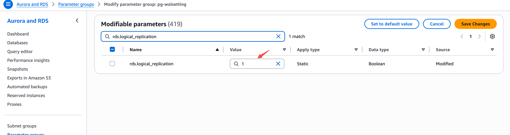

---
{
    "title": "Amazon RDS PostgreSQL",
    "language": "ru",
    "description": "Включите логическую репликацию в Amazon RDS PostgreSQL и настройте пользователя синхронизации и Publication, чтобы подготовить потоковую загрузку Doris.",
    "keywords": [
        "Amazon RDS PostgreSQL",
        "Doris streaming ingestion",
        "Logical Replication",
        "rds.logical_replication",
        "rds_replication",
        "Publication",
        "dbz_publication",
        "CDC sync"
    ]
}
---

:::caution Экспериментальная функция

Потоковая загрузка Doris является экспериментальной функцией и поддерживается начиная с Doris 4.1.5.

:::

<!-- Knowledge type: Procedure / Configuration parameters -->
<!-- Applicable scenario: Pre-deployment check / Environment preparation -->

Потоковая загрузка Doris поддерживает синхронизацию данных из **Amazon RDS PostgreSQL версии 14 и выше**. Перед запуском задачи синхронизации необходимо включить **логическую репликацию (Logical Replication)** на экземпляре RDS и настроить пользователя синхронизации, права доступа и Publication.

Этот документ предназначен для администраторов экземпляров RDS PostgreSQL и описывает предварительные шаги, необходимые для потоковой загрузки Doris.

### Предварительный контрольный список {#pre-check-checklist}

Перед началом настройки убедитесь в выполнении следующих условий:

| Проверяемый пункт | Требование |
| --- | --- |
| Версия RDS PostgreSQL | 14 и выше |
| Права на операции | Разрешения AWS на изменение групп параметров и перезапуск экземпляра |
| Права базы данных | Права на создание пользователей, выдачу привилегий и создание Publication |
| Окно обслуживания | Запланировано непиковое время (изменение параметров логической репликации требует перезапуска экземпляра) |

### Общая схема настройки {#configuration-flow-overview}

Общий процесс настройки выглядит следующим образом:

1. Проверьте текущее состояние `rds.logical_replication`
2. Создайте и настройте пользовательскую группу параметров (если репликация не включена)
3. Примените группу параметров к экземпляру и перезапустите его
4. Создайте пользователя синхронизации Doris и выдайте ему привилегии
5. Создайте Publication, на которую будет подписываться Doris

---

## Шаг 1: Проверка текущей конфигурации {#step-1-check-the-current-configuration}

<!-- Knowledge type: Procedure -->

**Цель**: убедиться, включена ли логическая репликация на экземпляре RDS, и определить, требуется ли изменение группы параметров.

Подключитесь к экземпляру RDS и выполните следующий SQL-запрос:

```sql
SHOW rds.logical_replication;
```

Выберите дальнейший путь в зависимости от результата:

| Возвращаемое значение | Значение | Следующий шаг |
| --- | --- | --- |
| `on` | Логическая репликация включена | Перейдите к [шагу 4: Создание пользователя синхронизации](#step-4-create-the-sync-user) |
| `off` | Логическая репликация не включена | Продолжите с [шага 2](#step-2-configure-the-parameter-group) |

---

## Шаг 2: Настройка группы параметров {#step-2-configure-the-parameter-group}

<!-- Knowledge type: Procedure / Configuration parameters -->

**Цель**: создать пользовательскую группу параметров и включить `rds.logical_replication`.

Шаги:

1. Войдите в [консоль AWS RDS](https://console.aws.amazon.com/rds/).
2. На левой панели навигации выберите **Группы параметров** и нажмите **Создать группу параметров**.
3. Выберите семейство версий PostgreSQL, соответствующее целевому экземпляру, и создайте новую группу параметров.
4. Измените группу параметров, найдите `rds.logical_replication` и установите для него значение `1`:

    

5. Нажмите **Сохранить изменения**.

Описание ключевого параметра:

| Параметр | Значение | Описание |
| --- | --- | --- |
| `rds.logical_replication` | `1` | Включает логическую репликацию; эквивалентно установке `wal_level` в значение `logical` |

---

## Шаг 3: Применение группы параметров и перезапуск {#step-3-apply-the-parameter-group-and-restart}

<!-- Knowledge type: Procedure -->

**Цель**: привязать новую группу параметров к экземпляру RDS и перезапустить его, чтобы конфигурация вступила в силу.

Шаги:

1. В консоли RDS выберите целевой экземпляр и нажмите **Изменить**.
2. В разделе **Группа параметров БД** выберите группу параметров, созданную на [шаге 2](#step-2-configure-the-parameter-group).
3. Выберите **Применить немедленно**, чтобы сразу применить изменение.
4. Перезапустите экземпляр RDS, чтобы конфигурация вступила в силу.

:::caution
Для применения изменения параметра `rds.logical_replication` необходимо перезапустить экземпляр RDS. Выполняйте эту операцию в непиковые часы.
:::

---

## Шаг 4: Создание пользователя синхронизации {#step-4-create-the-sync-user}

<!-- Knowledge type: Procedure / Configuration parameters -->

**Цель**: создать учетную запись базы данных, предназначенную для потоковой загрузки Doris, и выдать необходимые права на чтение и репликацию.

### 1. Создание пользователя {#1-create-the-user}

```sql
CREATE USER doris_sync PASSWORD '<password>';
```

### 2. Предоставление доступа к схеме {#2-grant-schema-access-privileges}

Ниже в качестве примера используется схема `public`. При необходимости замените ее целевой схемой:

```sql
GRANT USAGE ON SCHEMA "public" TO doris_sync;
GRANT SELECT ON ALL TABLES IN SCHEMA "public" TO doris_sync;
ALTER DEFAULT PRIVILEGES IN SCHEMA "public" GRANT SELECT ON TABLES TO doris_sync;
```

### 3. Предоставление привилегий репликации {#3-grant-replication-privileges}

```sql
GRANT rds_replication TO doris_sync;
```

:::tip
Amazon RDS PostgreSQL использует роль `rds_replication` для предоставления привилегий репликации, а не стандартный атрибут PostgreSQL `REPLICATION`.
:::

Обзор привилегий:

| Привилегия | Назначение |
| --- | --- |
| `USAGE ON SCHEMA` | Разрешает доступ к указанной схеме |
| `SELECT ON ALL TABLES` | Разрешает чтение всех существующих таблиц в схеме |
| `ALTER DEFAULT PRIVILEGES ... SELECT` | Автоматически предоставляет привилегию `SELECT` таблицам, добавленным в будущем |
| `rds_replication` | Роль, необходимая для выполнения логической репликации в RDS |

---

## Шаг 5: Создание Publication {#step-5-create-the-publication}

<!-- Knowledge type: Procedure / Configuration parameters -->

**Цель**: создать Publication, на которую подписывается Doris.

Выполните следующий SQL-запрос:

```sql
CREATE PUBLICATION dbz_publication FOR ALL TABLES;
```

:::caution
В настоящее время Doris поддерживает только Publication с именем `dbz_publication`, и ее необходимо создать с параметром `FOR ALL TABLES`. Пользовательские имена Publication и указание только части таблиц пока не поддерживаются.
:::

> **Примечание**: Если пользователь синхронизации имеет привилегии суперпользователя, например роль `rds_superuser`, Doris автоматически создаст эту Publication при запуске задачи, поэтому вручную выполнять этот шаг не нужно.

---

## FAQ {#faq}

<!-- Knowledge type: FAQ -->

**В1: Если `SHOW rds.logical_replication;` возвращает `on`, нужно ли все равно перезапускать экземпляр?**

Нет. Значение `on` означает, что логическая репликация уже действует, поэтому можно сразу перейти к [шагу 4: Создание пользователя синхронизации](#step-4-create-the-sync-user).

**В2: Можно ли использовать Publication с другим именем?**

Нет. В настоящее время Doris поддерживает только Publication с именем `dbz_publication`, и ее необходимо создать с параметром `FOR ALL TABLES`.

**В3: Обязательно ли использовать роль `rds_replication`?**

Да. По соображениям безопасности RDS PostgreSQL не разрешает использовать стандартный атрибут PostgreSQL `REPLICATION`. Необходимо предоставить привилегии с помощью `GRANT rds_replication`.

**В4: Обязательно ли создавать Publication вручную?**

Не обязательно. Если пользователь синхронизации имеет привилегии суперпользователя, например `rds_superuser`, Doris автоматически создаст `dbz_publication`, поэтому [шаг 5](#step-5-create-the-publication) можно пропустить.

---

## Устранение неполадок {#troubleshooting}

<!-- Knowledge type: Troubleshooting -->

| Симптом | Возможная причина | Решение |
| --- | --- | --- |
| `SHOW rds.logical_replication;` по-прежнему возвращает `off` | Группа параметров не привязана к экземпляру или экземпляр не был перезапущен | Проверьте, использует ли экземпляр новую группу параметров, и перезапустите его |
| При создании пользователя возникает ошибка прав доступа | У текущей учетной записи недостаточно привилегий | Используйте учетную запись администратора с правом создания пользователей |
| `GRANT rds_replication` возвращает ошибку | Текущая учетная запись не имеет права предоставлять эту роль | Используйте учетную запись `rds_superuser` или другую учетную запись с правом выдачи этой роли |
| Задача Doris сообщает, что Publication не существует | `dbz_publication` не создана или недостаточно привилегий | Вручную выполните [шаг 5](#step-5-create-the-publication) или предоставьте пользователю синхронизации привилегии суперпользователя |
| Изменения параметров не вступают в силу | Не выбран параметр **Применить немедленно** или экземпляр не был перезапущен | Повторно выполните [шаг 3](#step-3-apply-the-parameter-group-and-restart) |
