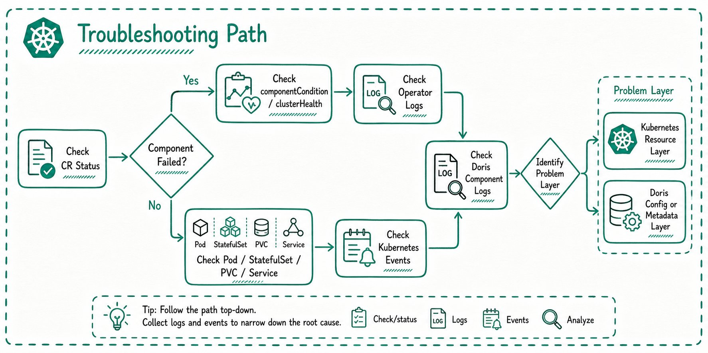

---
{
    "title": "Состояние Doris Operator и устранение неполадок",
    "sidebar_label": "Состояние и устранение неполадок",
    "language": "ru",
    "description": "Описание полей состояния Doris Operator, состояния кластера и способов устранения неполадок в кластерах Doris на Kubernetes.",
    "keywords": ["Doris Operator troubleshooting", "status", "clusterHealth", "DorisCluster", "DorisDisaggregatedCluster", "Kubernetes"]
}
---

Doris Operator записывает состояние компонентов в поле `status` пользовательских ресурсов Doris. При устранении неполадок Doris на Kubernetes сначала проверьте состояние CR, затем изучите журналы Operator, ресурсы Kubernetes и журналы компонентов Doris.

## Просмотр состояния ресурсов {#view-resource-status}

Кластеры с совмещёнными вычислениями и хранением используют `DorisCluster`, обычно сокращённо `dcr`:

```shell
kubectl get dcr -n ${namespace}
kubectl describe dcr ${cluster_name} -n ${namespace}
```

Кластеры с разделёнными вычислениями и хранением используют `DorisDisaggregatedCluster`, обычно сокращённо `ddc`:

```shell
kubectl get ddc -n ${namespace}
kubectl describe ddc ${cluster_name} -n ${namespace}
```

Если CR показывает, что компоненты не готовы, проверьте связанные ресурсы:

```shell
kubectl get pod,sts,svc,pvc -n ${namespace}
kubectl get event -n ${namespace} --sort-by=.lastTimestamp
```

## Состояние DorisCluster {#doriscluster-status}

`DorisCluster.status` содержит сводное состояние по компонентам:

| Поле | Описание |
| --- | --- |
| `feStatus` | Состояние FE |
| `beStatus` | Состояние BE |
| `cnStatus` | Состояние CN |
| `brokerStatus` | Состояние Broker |

Состояние каждого компонента обычно включает:

| Поле | Описание |
| --- | --- |
| `accessService` | Service для внешнего доступа к компоненту |
| `runningInstances` | Работающие экземпляры |
| `creatingInstances` | Создаваемые экземпляры |
| `failedInstances` | Экземпляры со сбоем |
| `componentCondition.phase` | Текущая фаза компонента |
| `componentCondition.reason` | Причина текущей фазы |
| `componentCondition.message` | Понятное человеку сообщение о состоянии |

Распространённые фазы:

| Фаза | Значение |
| --- | --- |
| `available` | Компонент доступен |
| `reconciling` | Operator согласовывает ресурсы с заданным состоянием |
| `waitScheduling` | Ожидание планирования или других ресурсов |
| `haveMemberFailed` | Произошёл сбой хотя бы одного экземпляра |
| `initializing` | Компонент инициализируется |
| `upgrading` | Компонент обновляется |
| `scaling` | Изменяется масштаб компонента |
| `restarting` | Компонент перезапускается |

## Состояние DorisDisaggregatedCluster {#dorisdisaggregatedcluster-status}

`DorisDisaggregatedCluster.status` содержит состояние компонентов и общее состояние кластера.

| Поле | Описание |
| --- | --- |
| `metaServiceStatus` | Состояние MetaService |
| `feStatus` | Состояние FE |
| `computeGroupStatuses` | Список состояний ComputeGroup |
| `clusterHealth` | Общее состояние кластера |
| `observedGeneration` | Поколение ресурса, обнаруженное Operator |

`clusterHealth` отражает общую доступность кластера:

| Поле | Описание |
| --- | --- |
| `health` | Общее состояние, например `green`, `yellow` или `red` |
| `feAvailable` | Доступен ли FE |
| `cgCount` | Количество ComputeGroup |
| `cgAvailableCount` | Количество доступных ComputeGroup |
| `cgFullAvailableCount` | Количество ComputeGroup, у которых доступны все Pod |

| Состояние | Значение |
| --- | --- |
| `green` | Основные компоненты доступны, а доступность ComputeGroup соответствует ожидаемой |
| `yellow` | Кластер частично доступен, но ещё не полностью готов |
| `red` | Основные компоненты недоступны или доступно слишком мало ComputeGroup |

Фазы ComputeGroup могут включать `Ready`, `Reconciling`, `Scaling`, `Decommissioning`, `ScaleDownFailed` и `Suspended`.

## Рекомендуемый порядок устранения неполадок {#recommended-troubleshooting-path}

Действуйте в следующем порядке:



## Распространённые ситуации {#common-entry-points}

### Pod остаётся в состоянии Pending {#pod-stays-pending}

Распространённые причины:

- На узлах недостаточно CPU или памяти.
- Не совпадают настройки выбора узла, affinity или toleration.
- Не удалось привязать PVC.

```shell
kubectl describe pod ${pod_name} -n ${namespace}
kubectl get event -n ${namespace} --sort-by=.lastTimestamp
kubectl get pvc -n ${namespace}
```

### Не удаётся привязать PVC {#pvc-cannot-be-bound}

Распространённые причины:

- StorageClass не существует.
- Недостаточно ёмкости хранилища.
- Не совпадают режимы доступа.

```shell
kubectl get storageclass
kubectl describe pvc ${pvc_name} -n ${namespace}
```

### Компонент постоянно перезапускается {#component-keeps-restarting}

Распространённые причины:

- Ошибка в конфигурации запуска Doris.
- Конфликт портов или неверная конфигурация FQDN.
- Проблемы с правами доступа к хранилищу или путём монтирования.
- Параметры JVM или системы не соответствуют требованиям.

```shell
kubectl logs ${pod_name} -n ${namespace}
kubectl describe pod ${pod_name} -n ${namespace}
```

Если Pod находится в состоянии `CrashLoopBackOff` и журналов недостаточно, воспользуйтесь процедурой Debug, описанной в разделе об эксплуатации кластера.

### Service недоступен {#service-is-not-accessible}

Распространённые причины:

- Внутренний Service используется как точка входа для внешнего доступа.
- Тип Service не соответствует среде, из которой выполняется доступ.
- Pod не готовы, поэтому Endpoints пусты.
- Не удалось создать облачный LoadBalancer.

```shell
kubectl get svc -n ${namespace}
kubectl get endpoints -n ${namespace}
kubectl describe svc ${service_name} -n ${namespace}
```

### Изменения конфигурации не вступают в силу {#configuration-changes-do-not-take-effect}

Распространённые причины:

- ConfigMap изменён, но компонент не перезапущен.
- Ключи ConfigMap не соответствуют требованиям компонента.
- CR неправильно ссылается на ConfigMap.
- Путь монтирования не совпадает с заданным путём к файлу.

```shell
kubectl get configmap -n ${namespace}
kubectl describe dcr ${cluster_name} -n ${namespace}
kubectl describe ddc ${cluster_name} -n ${namespace}
```

Для кластеров с совмещёнными вычислениями и хранением проверьте, настроен ли `enableRestartWhenConfigChange`, если вы ожидаете, что изменения основного ConfigMap запустят поочерёдный перезапуск.

### Проблемы с authSecret {#authsecret-problems}

Doris Operator могут потребоваться учётные данные для управления Doris при регистрации узлов, уменьшении масштаба, выводе узлов из эксплуатации и связанных операциях. Неправильная настройка `authSecret` может помешать выполнению этих действий.

Распространённые причины:

- Указанный Secret не существует или находится в другом пространстве имён.
- Неверны тип или ключи Secret.
- Имя пользователя или пароль не соответствуют учётной записи для управления Doris.
- У учётной записи для управления нет необходимых прав.

```shell
kubectl get secret ${auth_secret_name} -n ${namespace}
kubectl describe dcr ${cluster_name} -n ${namespace}
kubectl describe ddc ${cluster_name} -n ${namespace}
kubectl logs deployment/${operator_deployment_name} -n ${operator_namespace}
```

Если кластер использует нестандартную учётную запись для управления или пароль root уже задан, проверьте, что `authSecret` соответствует фактическим учётным данным Doris.

#### Сбои регистрации BE из-за учётных данных в кластере с разделёнными вычислениями и хранением {#be-registration-failures-caused-by-credentials-in-a-decoupled-cluster}

Следующие шаги относятся к образам BE, которые используют `authSecret` для входа в FE и регистрации узлов через SQL, например к Doris 4.1.5.

| Признак | Что проверить |
|---------|---------------|
| В событиях Pod появляется `FailedMount` с сообщением, что Secret не существует | Проверьте имя и пространство имён Secret; Secret должен находиться в том же пространстве имён, что и кластер |
| В журналах регистрации BE постоянно появляются `Access denied` / `1045`, а узел не присоединяется | Проверьте, что `username` и `password` в Secret соответствуют учётной записи базы данных; сначала скрипт пытается войти как root без пароля, поэтому одна ошибка ещё не означает, что последующая попытка с заданными учётными данными тоже не удалась |
| Учётная запись для управления позволяет войти в FE, но SQL для управления узлами отклоняется | Проверьте, есть ли у учётной записи необходимые права для управления узлами |
| Secret исправлен, но регистрация BE по-прежнему не удаётся из-за старых учётных данных | Скрипт запуска уже прочитал учётные данные в переменные и не перечитывает Secret при повторных попытках регистрации |

Сначала проверьте события и журналы регистрации целевого BE Pod:

```shell
kubectl describe pod ${be_pod_name} -n ${namespace}
kubectl logs ${be_pod_name} -c compute -n ${namespace}
```

Шаги восстановления:

1. Исправьте Secret и ссылку `spec.authSecret`, как описано в разделе [Настройка аутентификации](../separating-storage-compute/config-cluster.md). Используйте Secret типа `kubernetes.io/basic-auth` с ключами `username` и `password`. Если для root уже задан пароль, используйте существующую действующую учётную запись либо сначала попросите администратора создать учётную запись для управления и выдать ей права. Обновление Secret не меняет пароль базы данных.
2. Из среды, имеющей доступ к FE, подключитесь с той же учётной записью и проверьте пароль и необходимые операции управления, например `SHOW BACKENDS`. Следующая команда запросит пароль. `${fe_query_port}` — порт запросов FE (по умолчанию 9030):

   ```shell
   mysql -h ${fe_host} -P ${fe_query_port} -u ${management_user} -p
   ```

3. Если регистрация BE по-прежнему не удаётся из-за старых учётных данных, пересоздавайте соответствующие Pod по одному, чтобы скрипт запуска повторно прочитал Secret. `${be_pod_name}` должен указывать на Pod, для которого подтверждён сбой регистрации; не перезапускайте всю исправно работающую вычислительную группу:

   ```shell
   kubectl delete pod ${be_pod_name} -n ${namespace}
   ```

4. Дождитесь, пока StatefulSet пересоздаст Pod и тот перейдёт в состояние Ready. Выполните на FE следующий SQL и убедитесь, что соответствующий узел присоединился и значение его поля `Alive` равно `true`, прежде чем переходить к следующему Pod со сбоем:

   ```sql
   SHOW BACKENDS;
   ```

### Уменьшение масштаба ComputeGroup не завершается {#computegroup-scale-in-does-not-finish}

В кластерах с разделёнными вычислениями и хранением уменьшение масштаба ComputeGroup может остановиться на фазе `Decommissioning` или `ScaleDownFailed`.

Распространённые причины:

- Вывод из эксплуатации на уровне метаданных Doris ещё не завершён.
- FE недоступен.
- Неверные учётные данные для управления.
- На целевых узлах ещё выполняются задачи переноса данных или очистки.

```shell
kubectl describe ddc ${cluster_name} -n ${namespace}
kubectl logs deployment/${operator_deployment_name} -n ${operator_namespace}
```

Также может потребоваться проверить состояние узлов и ComputeGroup в Doris.

## Журналы Operator {#operator-logs}

Если состояния CR недостаточно для объяснения сбоя, проверьте журналы Doris Operator:

```shell
kubectl get pod -n ${operator_namespace}
kubectl logs ${operator_pod_name} -n ${operator_namespace}
```
