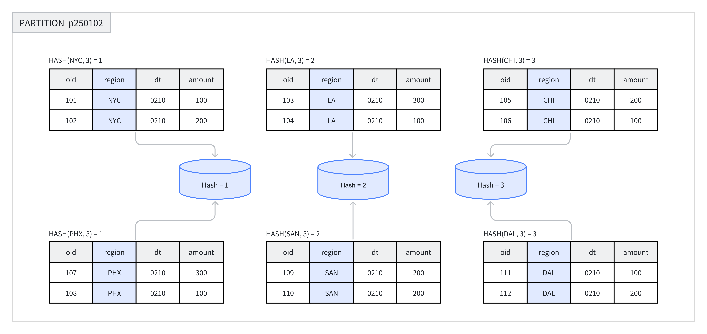
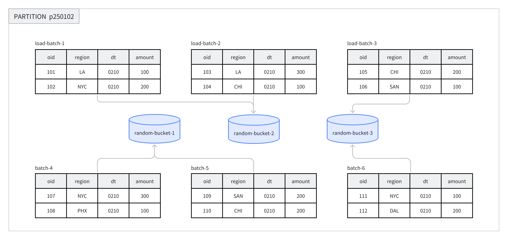

---
{
    "title": "Бакетирование данных",
    "language": "ru",
    "description": "Руководство по бакетированию данных в Doris: как выбрать между Hash- и Random-бакетированием, выбрать ключи бакетирования и определить количество бакетов для повышения производительности запросов и предотвращения перекоса данных.",
    "keywords": [
        "бакетирование данных Doris",
        "Hash-бакетирование",
        "Random-бакетирование",
        "выбор ключа бакетирования",
        "количество бакетов",
        "tablet",
        "перекос данных"
    ]
}
---

<!-- Knowledge type: Architecture decision / Configuration parameter -->
<!-- Applicable scenarios: Table design / Performance tuning / Data skew handling -->

Партицию можно дополнительно разделить на несколько бакетов данных в соответствии с бизнес-требованиями. Каждый бакет хранится как физический фрагмент данных (Tablet). Рациональная стратегия бакетирования позволяет эффективно сократить объём данных, сканируемых во время выполнения запроса, повысить производительность запросов и увеличить возможности параллельной обработки.

Документ организован в соответствии с последовательностью решений, принимаемых при создании таблицы: сначала выбирается способ бакетирования, затем ключ бакетирования и, наконец, количество бакетов и последующий подход к обслуживанию.

## Быстрый выбор {#quick-decision}

При создании таблицы проектирование бакетов можно выполнить в следующем порядке:

| Шаг | Решение | Основные факторы |
|------|------|----------|
| 1 | Выбрать способ бакетирования | Наличие часто используемых столбцов фильтрации, равномерность распределения данных и модель таблицы |
| 2 | Выбрать ключ бакетирования (только для Hash-бакетирования) | Условия фильтрации запросов, кардинальность столбцов, характеристики параллелизма и пропускной способности запросов |
| 3 | Определить количество бакетов | Размер данных в каждом Tablet, количество BE и дисков |
| 4 | Спланировать стратегию обслуживания бакетов | Тенденция роста данных и использование динамического секционирования |

## 1. Выбор способа бакетирования {#1-choose-the-bucketing-method}

Doris поддерживает два способа бакетирования: **Hash-бакетирование** и **Random-бакетирование**. Их основные различия приведены ниже:

| Параметр сравнения | Hash-бакетирование | Random-бакетирование |
|--------|----------|------------|
| Способ распределения данных | Разделение по Hash-значению ключа бакетирования | Случайное равномерное распределение |
| Требуется ли ключ бакетирования | Да | Нет |
| Поддерживается ли отсечение бакетов | Да | Нет |
| Поддерживаемые модели таблиц | DUPLICATE / UNIQUE / AGGREGATE | Только DUPLICATE |
| Риск перекоса данных | Зависит от выбора ключа бакетирования | Ниже |
| Подходящие сценарии | Точечные запросы, часто фильтрующие по определённому столбцу | Анализ по произвольным измерениям, данные, склонные к перекосу |

### 1. Hash-бакетирование {#1-hash-bucketing}

При создании таблицы или добавлении новой партиции необходимо выбрать один или несколько столбцов в качестве ключа бакетирования и явно указать количество бакетов. В пределах одной партиции система вычисляет Hash на основе ключа бакетирования и количества бакетов, а строки с одинаковым Hash-значением назначаются в один и тот же бакет.

Например, на рисунке ниже партиция `p250102` разделена на 3 бакета по столбцу `region`, а строки с одинаковым Hash-значением помещены в один бакет.



**Рекомендуемые сценарии:**

- Если бизнес-логика часто фильтрует по определённому полю, его можно использовать как ключ бакетирования и задействовать отсечение бакетов для повышения эффективности запросов.
- Данные в таблице распределены относительно равномерно и вряд ли будут перекошены.

**Пример:** создание таблицы с Hash-бакетированием. Подробный синтаксис см. в разделе [CREATE TABLE](../../sql-manual/sql-statements/table-and-view/table/CREATE-TABLE.md).

В приведённых ниже примерах имена таблиц дополнены базой данных `demo`; если этой базы нет в кластере, сначала создайте её:

```sql
CREATE DATABASE IF NOT EXISTS demo;
```

```sql
CREATE TABLE demo.hash_bucket_tbl(
    oid         BIGINT,
    dt          DATE,
    region      VARCHAR(10),
    amount      INT
)
DUPLICATE KEY(oid)
PARTITION BY RANGE(dt) (
    PARTITION p250101 VALUES LESS THAN("2025-01-01"),
    PARTITION p250102 VALUES LESS THAN("2025-01-02")
)
DISTRIBUTED BY HASH(region) BUCKETS 8;
```

В этом примере `DISTRIBUTED BY HASH(region)` задаёт Hash-бакетирование и выбирает столбец `region` как ключ бакетирования. `BUCKETS 8` задаёт создание 8 бакетов.

### 2. Random-бакетирование {#2-random-bucketing}

Random-бакетирование случайным образом распределяет данные по бакетам внутри каждой партиции, не используя Hash-значение какого-либо поля. Такой подход обеспечивает равномерное распределение данных и предотвращает перекос, вызванный неправильным выбором ключа бакетирования.

При загрузке данных каждая партия в рамках одного задания загрузки случайным образом записывается в Tablet, что обеспечивает равномерное распределение данных. Например, на рисунке ниже 8 партий данных случайным образом назначены 3 бакетам в партиции `p250102`.



При использовании Random-бакетирования можно включить режим загрузки в один Tablet (установить `load_to_single_tablet` в `true`), чтобы данные одной партии записывались только в один фрагмент данных. Это позволяет:

- Повысить параллелизм и пропускную способность крупномасштабных загрузок данных.
- Уменьшить усиление записи, вызванное загрузкой данных и операциями Compaction.
- Повысить стабильность кластера.

**Рекомендуемые сценарии:**

- Анализ по произвольным измерениям, когда в бизнес-логике нет фиксированных столбцов фильтрации или соединения.
- Распределение данных часто запрашиваемых столбцов или их комбинаций крайне неравномерно, и необходимо избежать перекоса данных.

**Неподходящие сценарии:**

- Точечные запросы: Random-бакетирование не может выполнять отсечение по ключу бакетирования, поэтому сканируются все данные в совпавших партициях.
- Таблицы UNIQUE и AGGREGATE: Random-бакетирование поддерживается только таблицами DUPLICATE.

**Пример:** создание таблицы с Random-бакетированием. Подробный синтаксис см. в разделе [CREATE TABLE](../../sql-manual/sql-statements/table-and-view/table/CREATE-TABLE.md).

```sql
CREATE TABLE demo.random_bucket_tbl(
    oid         BIGINT,
    dt          DATE,
    region      VARCHAR(10),
    amount      INT
)
DUPLICATE KEY(oid)
PARTITION BY RANGE(dt) (
    PARTITION p250101 VALUES LESS THAN("2025-01-01"),
    PARTITION p250102 VALUES LESS THAN("2025-01-02")
)
DISTRIBUTED BY RANDOM BUCKETS 8;
```

В этом примере `DISTRIBUTED BY RANDOM` задаёт Random-бакетирование и не требует выбора ключа бакетирования. `BUCKETS 8` задаёт создание 8 бакетов.

## 2. Выбор ключа бакетирования {#2-select-the-bucket-key}

:::tip Подсказка

Только Hash-бакетирование требует выбора ключа бакетирования. Для Random-бакетирования он не нужен.

:::

Ключ бакетирования может состоять из одного или нескольких столбцов. Для разных моделей таблиц действуют следующие ограничения:

| Модель таблицы | Допустимые ключи бакетирования |
|--------|----------|
| DUPLICATE | Любой столбец Key или Value |
| AGGREGATE / UNIQUE | Только столбцы Key (для обеспечения корректной агрегации данных) |

### Принципы выбора {#selection-principles}

При выборе ключа бакетирования учитывайте следующие принципы, исходя из характеристик бизнес-запросов:

| Принцип | Описание | Преимущество |
|------|------|------|
| Использовать условия фильтрации запросов | Выбирать в качестве ключа бакетирования столбцы, часто используемые как фильтры в запросах | Поддержка отсечения бакетов и уменьшение объёма сканируемых данных |
| Использовать столбцы с высокой кардинальностью | Выбирать столбцы с большим количеством различных значений | Равномерное распределение данных и предотвращение перекоса |
| Сценарии высококонкурентных точечных запросов | Выбирать один столбец или небольшое количество столбцов в качестве ключа бакетирования | Один запрос сканирует только один бакет, что уменьшает взаимное влияние запросов по вводу-выводу |
| Сценарии запросов с высокой пропускной способностью | Выбирать несколько столбцов в качестве ключа бакетирования | Более равномерное распределение данных; если условия запроса не полностью соответствуют условиям равенства, повышается общая пропускная способность |

## 3. Определение количества бакетов {#3-determine-the-number-of-buckets}

В Doris каждый Bucket хранится как физический файл (Tablet). Общее количество Tablet в таблице равно:

```text
Total Tablets = partition_num × bucket_num
```

:::caution Внимание

После указания количества бакетов для Partition изменить его нельзя. При определении количества бакетов заранее учитывайте будущее масштабирование машин.

:::

Начиная с версии 2.0 Doris поддерживает автоматическую установку количества бакетов в партиции на основе ресурсов машин и информации о кластере. В зависимости от требуемой точности оценки можно выбрать ручной или автоматический способ.

### 1. Ручная установка количества бакетов {#1-manually-set-the-number-of-buckets}

Укажите количество бакетов с помощью предложения `DISTRIBUTED`:

```sql
-- Set hash bucket num to 8
DISTRIBUTED BY HASH(region) BUCKETS 8

-- Set random bucket num to 8
DISTRIBUTED BY RANDOM BUCKETS 8
```

#### Принципы выбора {#decision-principles}

При определении количества бакетов соблюдайте два приведённых ниже принципа. При их конфликте **приоритет имеет принцип размера**:

1. **Принцип размера**: рекомендуется, чтобы размер сжатых данных каждого Tablet (без индексов) составлял от **1 ГБ до 20 ГБ**, а для таблиц с Unique Key — не более **10 ГБ**.
    - Слишком маленькие Tablet: агрегация менее эффективна, а накладные расходы на управление метаданными увеличиваются.
    - Слишком большие Tablet: усложняются миграция и восстановление реплик, а стоимость повторной попытки неудачного Schema Change возрастает.
    - Фактический размер Tablet можно проверить с помощью `SHOW TABLETS FROM your_table`.

2. **Принцип количества**: без учёта масштабирования рекомендуется, чтобы количество Tablet в таблице было немного больше общего количества дисков в кластере.

:::caution Учитывайте количество строк в каждом MOW Tablet

Для таблиц MOW Unique Key необходимо учитывать не только размер сжатых данных, но и физическое количество строк в каждом Tablet. Base Compaction создаёт карту преобразования rowid для физических входных строк, участвующих в слиянии; основное хранилище этой карты занимает примерно 8 байт на строку. В узких таблицах или таблицах с высокой степенью сжатия из-за большого количества строк во время Compaction может закончиться память, даже если размер Tablet соответствует приведённым выше рекомендациям. Оценки и рекомендации по устранению проблемы приведены в разделе [Накладные расходы памяти Compaction для больших MOW Tablet](../../admin-manual/trouble-shooting/compaction.md#mow-compaction-memory).

:::

Кроме того, учитывайте следующее:

- Количество бакетов должно быть целым кратным количеству BE, чтобы обеспечить равномерное распределение данных.
- Количество бакетов в одной партиции обычно не должно превышать **128**. Если требуется больше, сначала разделите таблицу на партиции.

#### Примеры рекомендуемой конфигурации {#recommended-configuration-examples}

Предположим, что в кластере 10 машин BE и на каждой по одному диску. Для установки количества бакетов можно использовать таблицу ниже:

| Размер сжатых данных партиции | Рекомендуемое количество бакетов |
|-----------------|-----------------|
| < 1 GB | 1 бакет |
| 1 - 10 GB | 10 бакетов |
| 10 - 200 GB | 10 - 20 бакетов |
| > 200 GB | Сначала разделите таблицу на партиции |

:::tip Подсказка

Размер данных таблицы можно проверить командой `SHOW DATA`. Для получения фактического размера данных таблицы результат необходимо разделить на количество реплик.

:::

### 2. Автоматическая установка количества бакетов {#2-automatically-set-the-number-of-buckets}

Функция автоматического вывода количества бакетов прогнозирует размеры будущих партиций на основе размеров партиций за недавний период и соответствующим образом определяет количество бакетов.

```sql
-- Set hash bucket auto
DISTRIBUTED BY HASH(region) BUCKETS AUTO
properties("estimate_partition_size" = "20G")

-- Set random bucket auto
DISTRIBUTED BY RANDOM BUCKETS AUTO
properties("estimate_partition_size" = "20G")
```

Свойство `estimate_partition_size` используется для корректировки исходной оценки размера партиции:

- Этот параметр необязателен. Если он не указан, используется значение по умолчанию `10GB`.
- Параметр влияет только на исходную оценку и не зависит от размера будущей партиции, который система позднее выводит из исторических данных о партициях.

Рассчитанное количество бакетов ограничивается конфигурациями FE `autobucket_min_buckets` и `autobucket_max_buckets`:

| Конфигурация FE | Значение по умолчанию | Описание |
|---|---|---|
| `autobucket_min_buckets` | 3 | Нижняя граница результата автоматического бакетирования. **В серии 4.0 значение по умолчанию изменилось с `1` на `3` в версии 4.0.8, а в серии 4.1 — в версии 4.1.4** |
| `autobucket_max_buckets` | 128 | Верхняя граница результата автоматического бакетирования |

:::caution Изменение поведения (4.0.8 / 4.1.4)

Значение `autobucket_min_buckets` по умолчанию изменилось с `1` на `3` в версии 4.0.8 (серия 4.0) и в версии 4.1.4 (серия 4.1). Ранее для небольшой партиции мог быть рассчитан один бакет, что приводило к недостаточному параллелизму и неравномерному распределению данных. После изменения автоматическое бакетирование никогда не создаёт менее 3 бакетов.

Изменение затрагивает только партиции, **созданные после** обновления; количество бакетов в существующих партициях не меняется. Чтобы сохранить прежнее поведение, явно установите `autobucket_min_buckets` обратно в `1`.

:::

## 4. Обслуживание бакетов данных {#4-maintain-data-bucketing}

:::tip Подсказка

В настоящее время Doris поддерживает изменение количества бакетов только для вновь добавляемых партиций. Следующие операции не поддерживаются:

1. Изменение типа бакетирования не поддерживается.
2. Изменение ключа бакетирования не поддерживается.
3. Изменение количества бакетов в уже созданных бакетах не поддерживается.

:::

При создании таблицы количество бакетов для каждой партиции единообразно задаётся предложением `DISTRIBUTED`. Для обработки роста или уменьшения объёма данных при динамическом добавлении партиций можно отдельно указать количество бакетов для новой партиции.

В следующих примерах показано, как изменить количество бакетов во вновь добавляемых партициях с помощью команды `ALTER TABLE`:

```sql
-- Modify hash bucket table
ALTER TABLE demo.hash_bucket_tbl
ADD PARTITION p250103 VALUES LESS THAN("2025-01-03")
DISTRIBUTED BY HASH(region) BUCKETS 16;

-- Modify random bucket table
ALTER TABLE demo.random_bucket_tbl
ADD PARTITION p250103 VALUES LESS THAN("2025-01-03")
DISTRIBUTED BY RANDOM BUCKETS 16;

-- Modify dynamic partition table
ALTER TABLE demo.dynamic_partition_tbl
SET ("dynamic_partition.buckets"="16");
```

После изменения количества бакетов результат можно проверить командой `SHOW PARTITION`.
