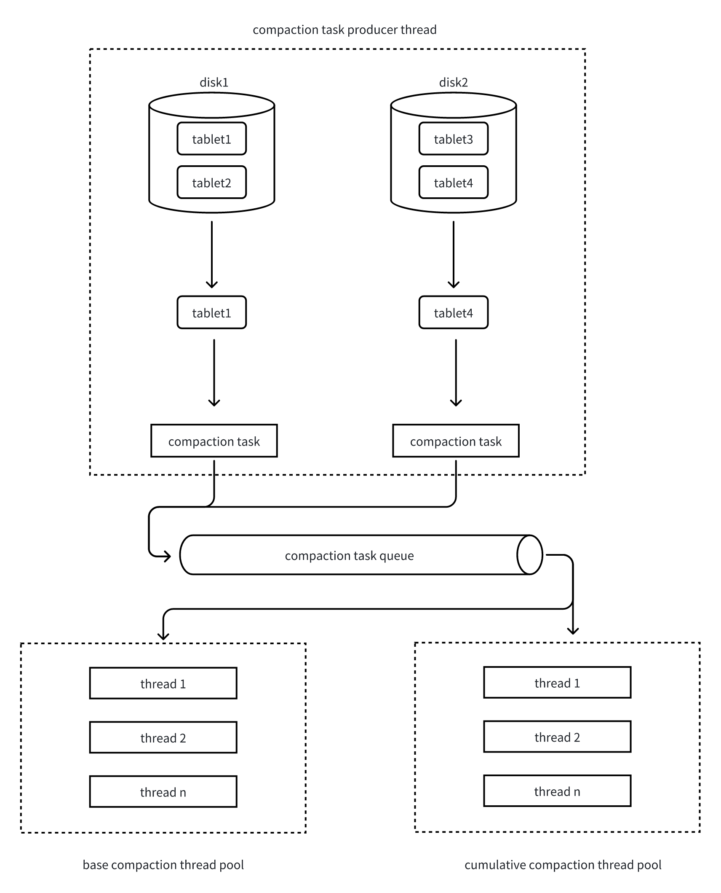

---
{
    "title": "Compaction 原理",
    "language": "zh-CN",
    "description": "Apache Doris 基于 LSM-Tree 的存储引擎，在数据写入时会顺序追加到新的数据文件中，而不是直接更新原有文件。 这种设计保证了高效的写入性能，但随着时间推移，不同版本、不同大小的数据文件会不断累积，带来以下问题："
}
---

## 1 compaction 的作用

Apache Doris 基于 LSM-Tree 的存储引擎，在数据写入时会顺序追加到新的数据文件中，而不是直接更新原有文件。
 这种设计保证了高效的写入性能，但随着时间推移，不同版本、不同大小的数据文件会不断累积，带来以下问题：
- 查询性能下降：查询时需要在多个文件间做多路归并排序；
- 存储空间浪费：存在过期待删除或重复的数据。
Compaction（数据压缩整理） 正是解决上述问题的关键机制。它会在后台自动合并和重写数据文件，将相同主键或相邻范围的数据聚合到更少、更有序的文件中，并清理已删除或过期的数据。
这样既能保持查询的高性能，也能优化存储空间利用率。
 在 Doris 中，Compaction 是一个 持续且自动运行 的过程，用户无需手动触发。但理解其原理和运行状态，有助于在高并发和大数据量场景下进行性能调优。

### 1.1 提升查询性能

Doris 的数据导入机制是：每次导入会在目标分区的每个 tablet 上生成一个 rowset。
- 每个 rowset 包含 0 到 n 个 segment；
- 每个 segment 对应磁盘上的一个有序文件。
在查询时，存储层需要返回聚合或去重后的结果，因此会对多个 rowset/segment 的数据执行 多路归并排序。
 随着 rowset 数量增加，归并的路数也会增加，从而导致查询效率下降。
Compaction 的作用：
 BE 节点在后台持续合并这些 rowset，减少归并路数，从而提升查询效率。
 Compaction 的执行粒度是 tablet。

### 1.2 清理数据

Compaction 除了提升性能，还承担着数据清理的职责：
1. 清理标记删除的数据
  - Doris 的 DELETE 操作并不会立即删除数据，而是生成一个 delete rowset（仅包含删除谓词，不存储实际数据），在 Compaction 过程中，会根据这些谓词过滤并真正删除符合条件的数据。
  - 对于 Merge-on-Write 类型的表，delete sign 标记的数据也会在 Compaction 阶段被清理。
2. 删除重复数据
  - Aggregate 模型：对相同 key 的行进行聚合；
  - Unique 模型：仅保留相同 key 的最新数据。
这样既能保证数据正确性，又能减少存储空间占用。

## 2. 关键概念

### 2.1 Compaction Score

Compaction Score 是衡量 tablet 数据乱序程度 的指标，同时也是判断 Compaction 优先级的依据。
 它等价于执行查询时该 tablet 需要参与多路归并的路数。
- Score 越高，查询开销越大；
- 因此 Compaction 会优先处理 Score 较高的 tablet。
示例：
"rowsets": [
        "[0-100] 3 DATA NONOVERLAPPING 0200000000001c30804822f519cf378fbe6f162b7de393a6 500.32 MB",
        "[101-101] 2 DATA OVERLAPPING 02000000000021d0804822f519cf378fbe6f162b7de393a6 180.46 MB",
        "[102-102] 1 DATA NONOVERLAPPING 0200000000002211804822f519cf378fbe6f162b7de393a6 50.59 MB"
 ]
- [0-100] 的 rowset 有 3 个 segment，但无重叠 → 占 1 路；
- [101-101] 的 rowset 有 2 个 segment，存在重叠 → 占 2 路；
- [102-102] 的 rowset 占 1 路。
因此该 tablet 的 Compaction Score = 4。

### 2.2 Compaction 类型

- Cumulative Compaction：选择 cumulative point 增量侧符合策略的 rowset 进行合并；
- Base Compaction：选择 cumulative point 之前符合条件的历史 rowset，可能只合并候选中的一部分；
- Full Compaction：选择完整的本地版本链进行合并，需要连续性及完整性检查；
- Cumulative Point：划分 Base 与 Cumulative 候选范围的边界。

## 3. Compaction 策略

### 3.1 Tablet 选择策略

Compaction 的目标是提升查询性能，因此优先选择 Compaction Score 最高的 tablet 进行处理。

### 3.2 Rowset 选择策略

选定 tablet 后，由对应的 Compaction 策略选择连续且符合条件的一组 rowset。tablet 的总 Score 不能直接当作每次任务固定的 rowset 数量限制。

- **Cumulative**：`size_based` 与 `time_series` 策略具有不同的大小、score 和时间条件。对于 size-based 策略，`cumulative_compaction_min_deltas`、`cumulative_compaction_max_deltas` 是 score 参数，而 promotion size 用于控制 cumulative point 的推进，不是每次 Cumulative 合并都必须先达到的门槛。
- **Base**：过滤候选并按 score 预算截取后，候选数量超过 `base_compaction_min_rowset_num`、其余候选总大小除以 base rowset 大小超过 `base_compaction_min_data_ratio`、或 base rowset 的存续时间超过 `base_compaction_interval_seconds_since_last_operation`，均可能使任务符合条件。这些是可替代的触发条件，不能统一写成“Score > 5”。
- **资源限制**：Base 的 score 预算为 `base_compaction_max_compaction_score`；Merge-on-Write 主键 tablet 使用 `mow_base_compaction_max_compaction_score`。一个 rowset 可能贡献多个 score 单位，而且按完整 rowset 选取，不能把这些预算描述为严格的 20 个或 1000 个 rowset 数量上限。


## 4. Compaction 流程



Compaction 的执行流程采用 生产者-消费者模型：
1. Tablet 扫描与任务生成
  - Compaction 任务生产者线程定期扫描所有 tablet，计算其 Compaction Score；
  - 每轮从每个磁盘中选出 Score 最高的 tablet；
  - 每 10 轮选择一次 Base Compaction，其余 9 轮为 Cumulative Compaction。
2. 并发控制
  - 判断当前磁盘的 Compaction 任务数是否超过配置上限；
  - 若未超限，则允许该 tablet 进入 Compaction。
3. Rowset 挑选
  - 选择连续且大小差距不大的 rowset 作为输入；
  - 避免因数据量悬殊导致多路归并效率低下。
4. 任务提交
  - 将 tablet 和候选 rowset 封装为 Compaction Task；
  - 根据任务类型（Base / Cumulative）提交到对应线程池队列。
5. 任务执行
  - Compaction 线程池从队列中取出任务；
  - 执行多路归并排序，将多个 rowset 合并为一个新的 rowset。

### 5. Compaction 常见参数
 
|参数名 |含义| 默认值|
|---    |--- |---    |
| cumulative_compaction_rounds_for_each_base_compaction_round | 每产生多少轮 cumulative compaction task 后产生一次 base compaction task，通过调节这个参数，可以调整 cumulative compaction task 和 base compaction task 的比例 | 9 |
| compaction_task_num_per_fast_disk | 每块 SSD 盘上，最多可以有多少个并发的 compaction task | 8 |
| compaction_task_num_per_disk | 每块 HDD 盘上，最多可以有多少个并发的 compaction task | 4 |
| max_base_compaction_threads | Base compaction 线程池的工作线程数 | 4 |
| max_cumu_compaction_threads | Cumulative线程池大小；存算一体BE中，-1取数据目录数与CPU核数/6的较大值（至少1），不是CPU配额 | -1 |
| base_compaction_min_rowset_num | Base候选数量触发阈值（与大小比例、等待时间条件为替代关系） | 5 |
| base_compaction_max_compaction_score | 非MOW主键tablet的Base候选score预算，按完整rowset截取，不是严格rowset数量上限 | 20 |
| mow_base_compaction_max_compaction_score | MOW主键tablet的Base候选score预算 | 200 |
| cumulative_compaction_min_deltas | 一次 cumulative compaction 中，参与 compaction 的 rowset 的 compaction score 的下限 | 5 |
| cumulative_compaction_max_deltas | 一次 cumulative compaction 中，参与 compaction 的 rowset 的 compaction score 的上限 | 1000 |

## 选择与手动触发 Compaction

通常应由后台自动合并。手动干预前，先通过 [Compaction 状态 API](../open-api/be-http/compaction-status) 检查 tablet 的 rowset、`cumulative point`、当前任务和错误，再按需要合并的数据范围选择操作：

| 操作 | 适用场景 | 限制 |
| --- | --- | --- |
| Cumulative | 减少 cumulative point 增量侧的小 rowset | 遵循表的 Compaction 策略及 rowset 选择规则，不合并全部历史数据 |
| Base | 合并 cumulative point 之前符合条件的历史 rowset | 候选过滤与 score 预算可能只选中部分历史数据，一次 Base 任务不保证把整个 tablet 合成一个 rowset |
| Full | 明确需要合并 tablet 完整的本地版本链 | 要求版本链完整、连续，不能补回丢失数据；重写数据更多，可能消耗较多 CPU、I/O 和内存 |

因此 Base 与 Full 不能等同。即使多次执行 Base，cumulative point 之后仍可能存在新的增量 rowset。Full 选择的是该次任务的输入版本链；之后到达的导入仍会生成新的 rowset。

Score 较低不代表只剩一个 rowset，也不代表完全没有可合并的数据。自动选择需要权衡读取成本、写放大、数据大小、时间与资源限制。例如，Base 可以由 rowset 数量、增量数据与 base 数据的大小比例，**或**等待时间条件触发，不能概括为“tablet 的 Score 不大于 5 后所有 Compaction 都停止”。手动请求 Base、Cumulative 仍需经过各自的选择检查，可能返回没有合适版本。只有在确实需要合并完整版本链且资源允许时才考虑 Full，不要在每次导入后都降低阈值或强制执行 Full。

### 手动 HTTP 示例

对于存算一体集群，使用具有 ADMIN 权限的账号，并确保可以访问 BE HTTP 端口。先通过 `SHOW TABLETS FROM db_name.table_name`、`SHOW TABLET tablet_id` 和 `SHOW BACKENDS` 确认 tablet 及副本所在 BE。BE HTTP 请求只作用于该 BE 上的副本，不会同时操作集群的全部副本。

```shell
# 选择操作前先查看 rowset 和 cumulative point。
curl -u '<user>:<password>' \
  'http://<be-host>:8040/api/compaction/show?tablet_id=<tablet-id>'

# 示例：确认版本链连续且资源允许后，合并完整版本链。
curl -u '<user>:<password>' -X POST \
  'http://<be-host>:8040/api/compaction/run?tablet_id=<tablet-id>&compact_type=full'

# 检查手动任务状态，之后再次查看 rowset。
curl -u '<user>:<password>' \
  'http://<be-host>:8040/api/compaction/run_status?tablet_id=<tablet-id>'
```

触发接口接受 `base`、`cumulative`、`full`。提交成功不代表合并完成：请检查任务状态、合并后的 rowset 及 BE 日志。版本缺口、任务冲突或没有有效输入都可能导致此次合并无法执行。响应字段详见[手动 Compaction API](../open-api/be-http/compaction-run)。

从 Doris 4.1.4 起，也可以使用 `ADMIN COMPACT TABLET <tablet_id> WHERE TYPE='FULL'` 触发单个 tablet 的 Full Compaction，该语句支持存算一体和存算分离。分区级 `ADMIN COMPACT TABLE` 仍只支持 Base/Cumulative，且仅适用于存算一体。语法与权限见 [COMPACT TABLE](../../sql-manual/sql-statements/table-and-view/data-and-status-management/COMPACT-TABLE)。
