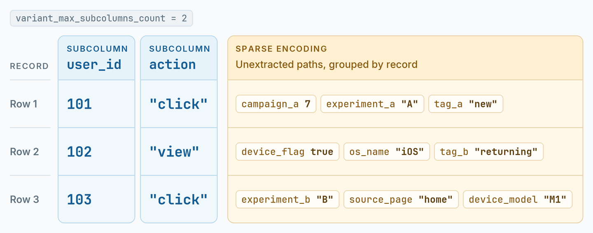
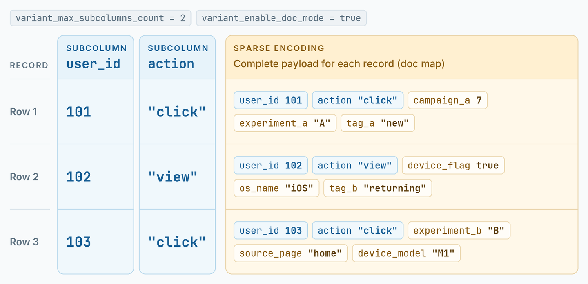

---
{
    "title": "VARIANT 存储原理与场景调优",
    "language": "zh-CN",
    "description": "VARIANT 如何把 JSON 路径拆成独立子列或采用稀疏编码保存，以及如何按场景设置 variant_max_subcolumns_count、variant_subcolumn_extraction_min_rows 和 variant_enable_doc_mode。"
}
---

VARIANT 可以在不预先定义所有字段的情况下存储和查询 JSON。为了兼顾字段查询速度与写入成本，Doris 将一部分高频出现的字段拆成独立子列，其余字段采用稀疏编码保存，兼顾存储空间与性能。用户仍然通过同一个 VARIANT 列访问这些数据。

VARIANT 的基本调优需要回答三个问题：最多自动拆多少个子列、什么时候拆列，以及是否额外保留完整文档。字段较少时，可以尽早拆列，获得列式查询的收益；字段非常多时，可以限制或推迟拆列，控制导入和 Compaction 的开销。

## 1. VARIANT 如何存储和读取数据

### 1.1 一份 JSON，两种字段存储方式

假设三条事件记录如下：

```json
{"user_id": 101, "action": "click", "campaign_a": 7, "experiment_a": "A", "tag_a": "new"}
{"user_id": 102, "action": "view",  "device_flag": true, "os_name": "iOS", "tag_b": "returning"}
{"user_id": 103, "action": "click", "experiment_b": "B", "source_page": "home", "device_model": "M1"}
```

`user_id` 和 `action` 每条记录都出现，其他字段只在部分记录中出现。如果自动拆列上限为 2，可以形成以下布局：



这里的“稀疏编码”指将未拆列路径及其值合并编码到稀疏列中，查询仍可按路径读取。Doris 表本身仍采用列式存储。

独立子列让同一个路径的数据按列组织。查询 `payload['user_id']` 时，可以读取对应子列，避免读取其他业务字段。未拆列的字段仍可按路径查询，但需要解析稀疏编码中的路径和值，通常会读取和处理更多数据。

因此，**拆列上限控制的是物理存储布局，不是允许写入的 JSON 字段总数。** 超过上限的路径采用稀疏编码保存，不会仅仅因为超过该上限而被丢弃或拒绝写入。

系统根据数据中的路径统计选择自动拆列的候选字段。这里的“高频”指字段在数据中的出现情况，不意味着系统根据 SQL 访问历史自动识别业务热点。

### 1.2 三个基本参数：拆多少、何时拆、是否保留完整文档

| 参数 | 回答的问题 | 调整后的主要影响 |
| --- | --- | --- |
| `variant_max_subcolumns_count` | 最多自动拆多少个子列？ | 增大上限，让更多路径有机会独立列存，同时增加写入、元数据与合并开销；`0` 表示关闭自动拆列 |
| `variant_subcolumn_extraction_min_rows` | 什么时候开始自动拆列？ | 提高阈值，减少行数较少的数据文件的自动拆列工作；这些数据的路径查询可能更多地读取稀疏编码中的数据 |
| `variant_enable_doc_mode` | 是否额外保留完整文档？ | 开启后，整条文档查询可以直接读取文档表示；同时增加存储与写入开销 |

下面用三个独立的例子说明参数变化。示例值用于解释规则，不是推荐默认值。

**拆多少：`variant_max_subcolumns_count`。** 假设某个满足拆列条件的数据文件中有 20 个不同路径。将 `variant_max_subcolumns_count` 设为 `2` 时，最多自动拆出 2 个子列，其余至少 18 个路径采用稀疏编码保存；调到 `8` 后，最多可以自动拆出 8 个，其余至少 12 个路径仍采用稀疏编码保存。设为 `0` 时，不自动拆列，20 个路径都采用稀疏编码保存；Schema Template 中声明的路径除外，它们仍然拆成独立子列。

:::note
`0` 表示关闭自动拆列，只适用于 4.2 及以后版本创建的列。4.2 之前创建的列在升级后保持原有行为：`0` 表示不限制子列数量，所有动态路径都拆成独立子列。参见 [稀疏列机制](./VARIANT.md#sparse-columns)。
:::

**什么时候拆：`variant_subcolumn_extraction_min_rows`。** `variant_subcolumn_extraction_min_rows = 0` 时，写入时就尝试自动拆列；设为 `1000000` 时，写出一个 50 万行的数据文件暂不自动拆列，后续 Compaction 写出 120 万行的数据文件时才尝试自动拆列。这个参数决定拆列时机，不决定最终拆出多少列。

**是否保留完整文档：`variant_enable_doc_mode`。** 假设 `payload` 已经拆出 128 个子列，查询经常执行 `SELECT payload`。`variant_enable_doc_mode = false` 时，整条文档需要从子列和稀疏编码中的数据重组；`variant_enable_doc_mode = true` 时，Doris 额外保存一份完整文档表示，查询可以直接读取它，代价是更多存储空间和写入工作。

这里的行数阈值按待写出的单个数据文件计算，不能按全表累计行数或一次导入任务的总行数判断。导入与 Compaction 都遵守同一阈值和子列上限；不满足行数条件或超过子列上限的动态路径采用稀疏编码保存。不同数据文件可能形成不同的子列布局。

### 1.3 查询方式决定拆列的价值

只读取少数路径时，独立子列通常更有优势。例如：

```sql
SELECT
    CAST(payload['action'] AS STRING) AS action,
    COUNT(*)
FROM events
GROUP BY CAST(payload['action'] AS STRING);
```

如果要返回完整 JSON，可以查询整个 VARIANT 列。例如，从前面的示例数据中取出 `user_id = 101` 的记录：

```sql
SELECT payload
FROM events
WHERE CAST(payload['user_id'] AS BIGINT) = 101;
```

过滤条件可以读取 `user_id` 子列；但 `SELECT payload` 需要还原该行的完整文档。没有完整文档副本时，Doris 还要读取 `action` 子列，以及稀疏编码中的 `campaign_a`、`experiment_a`、`tag_a`，再将这些路径和值合并成一个 JSON 结果。若一份文档拆出了上千个子列，返回整条文档时需要读取和重组的子列也会增多。

因此，增加子列有利于只访问少数路径的查询，也会增加写入和 Compaction 成本；对于经常执行 `SELECT payload` 的场景，还要评估整条文档的重组开销，以及是否启用 `variant_enable_doc_mode`。

## 2. 按场景选择配置

下面的例子以追加写入的事件数据为背景，使用完整的 `CREATE TABLE` 和典型查询说明如何选配置。`DUPLICATE KEY` 适合示例中的追加写入；`BUCKETS 8` 仅作为中等规模表的示例值，实际分桶数应按数据量和集群规模调整。示例省略分区与副本数配置，沿用集群默认值。

### 2.1 字段规模适中：让常用路径获得列式查询收益

**数据特征。** 一条用户行为事件包含几十个较稳定的字段，例如 `user_id`、`event_type`、`duration_ms`、`page`。多数记录都有这些字段，分析查询反复访问其中几个路径。例如一条 `payload` 为 `{"user_id":101,"event_type":"click","duration_ms":35,"page":"home"}`。

**建表配置。** 写入时就尝试自动拆列，并给动态路径一个有限的子列预算：

```sql
CREATE TABLE event_analysis (
    event_time DATETIME NOT NULL,
    event_id   BIGINT NOT NULL,
    payload    VARIANT<PROPERTIES(
        "variant_max_subcolumns_count" = "128",
        "variant_subcolumn_extraction_min_rows" = "0",
        "variant_enable_doc_mode" = "false"
    )>
)
DUPLICATE KEY(event_time, event_id)
DISTRIBUTED BY HASH(event_id) BUCKETS 8;
```

**典型查询。** 按事件类型统计一天内耗时不少于 30 毫秒的事件数，并只读取查询涉及的路径：

```sql
SELECT CAST(payload['event_type'] AS STRING) AS event_type,
       COUNT(*) AS event_count
FROM event_analysis
WHERE event_time >= '2026-11-04 00:00:00'
  AND event_time <  '2026-11-05 00:00:00'
  AND CAST(payload['duration_ms'] AS BIGINT) >= 30
GROUP BY CAST(payload['event_type'] AS STRING);
```

`variant_subcolumn_extraction_min_rows = 0` 表示不因数据文件行数推迟自动拆列；`variant_max_subcolumns_count = 128` 表示最多自动拆出 128 个动态子列。如果查询路径已成为独立子列，继续提高上限通常不会让这些路径变得更快。只有更多常查路径仍采用稀疏编码、路径查询成为瓶颈时，才考虑扩大上限。

用实际过滤和聚合 SQL 比较查询延迟、扫描量与导入吞吐，不要仅凭 JSON 的 key 数决定子列上限。

### 2.2 稀疏宽表：常见字段拆列，长尾字段采用稀疏编码保存

**数据特征。** 所有设备记录合计有数万种属性，但每条记录只有几十种。`region`、`model` 等字段大多出现，`sensor_x17`、`firmware_ext_b` 等字段只在少数设备上出现。例如两条记录分别含有 `{"region":"east","model":"M1","sensor_x17":8.2}` 和 `{"region":"west","model":"M2","firmware_ext_b":"r7"}`。这里的“宽”来自路径并集很大，不代表每条记录都很大。

为所有路径创建独立子列，会产生大量稀疏的物理列。每个子列仍然需要相应的写入、元数据和合并处理，即使它只包含少量有效值。

**建表配置。** 限制自动子列数量，让常见字段有机会独立列存，长尾字段采用稀疏编码保存：

```sql
CREATE TABLE device_events_sparse (
    event_time DATETIME NOT NULL,
    device_id  BIGINT NOT NULL,
    attributes VARIANT<PROPERTIES(
        "variant_max_subcolumns_count" = "128",
        "variant_subcolumn_extraction_min_rows" = "0",
        "variant_enable_doc_mode" = "false"
    )>
)
DUPLICATE KEY(event_time, device_id)
DISTRIBUTED BY HASH(device_id) BUCKETS 8;
```

**典型查询。** 业务报表主要按常见路径统计，也偶尔按单个设备读取长尾路径：

```sql
SELECT CAST(attributes['region'] AS STRING) AS region,
       COUNT(*) AS event_count
FROM device_events_sparse
WHERE event_time >= '2026-11-04 00:00:00'
  AND event_time <  '2026-11-05 00:00:00'
GROUP BY CAST(attributes['region'] AS STRING);

SELECT device_id,
       CAST(attributes['sensor_x17'] AS DOUBLE) AS sensor_x17
FROM device_events_sparse
WHERE device_id = 101;
```

假设某个数据文件中有 2 万种路径，128 的上限使绝大多数长尾路径采用稀疏编码保存。`region` 如果出现频率高，就更有机会成为独立子列；`sensor_x17` 如果只出现在少量记录中，通常解析稀疏编码中的数据。自动选择依据是数据中的路径分布，不是上述 SQL 的调用次数。

如果业务确实需要更多路径列存，可对比 128、512、1024 等上限。上限升高，常查路径可能获益，导入、元数据和 Compaction 的压力也可能增加。

### 2.3 单条记录很宽、导入慢：推迟或关闭自动拆列

**数据特征。** 每条采集记录都包含数千个字段，例如一份设备快照的 `payload` 含 `source` 和 `metric_0001` 到 `metric_5000`，`snapshot_id` 则作为表中的独立列。多数 `metric_*` 很少用于过滤；小批次持续写入时，子列构建或后续 Compaction 已经拖慢导入。这与上节“全表路径并集很大、单行却很窄”的稀疏场景不同。

先区分两个目标：小批次写入时暂时不拆列，还是整个数据生命周期都不自动拆列。

**目标一：行数较少的数据文件暂不拆列，达到阈值后再拆。** 建表时提高行数阈值：

```sql
CREATE TABLE wide_snapshots_deferred (
    snapshot_time DATETIME NOT NULL,
    snapshot_id   BIGINT NOT NULL,
    payload       VARIANT<PROPERTIES(
        "variant_max_subcolumns_count" = "128",
        "variant_subcolumn_extraction_min_rows" = "1000",
        "variant_enable_doc_mode" = "false"
    )>
)
DUPLICATE KEY(snapshot_time, snapshot_id)
DISTRIBUTED BY HASH(snapshot_id) BUCKETS 8;
```

例如写出 500 行的数据文件时，动态路径先采用稀疏编码保存；后续 Compaction 生成 1200 行的数据文件时，才尝试自动拆列，最多拆出 128 个子列。单行很宽时，数据文件能容纳的行数通常更少，`1000` 只是示例阈值，应结合实际数据文件行数和行宽调整。

**目标二：整个生命周期都不自动拆列。** 按目标设计，将子列上限设为 `0`：

```sql
CREATE TABLE wide_snapshots_row_only (
    snapshot_time DATETIME NOT NULL,
    snapshot_id   BIGINT NOT NULL,
    payload       VARIANT<PROPERTIES(
        "variant_max_subcolumns_count" = "0",
        "variant_subcolumn_extraction_min_rows" = "0",
        "variant_enable_doc_mode" = "false"
    )>
)
DUPLICATE KEY(snapshot_time, snapshot_id)
DISTRIBUTED BY HASH(snapshot_id) BUCKETS 8;
```

导入和 Compaction 都不自动拆出动态子列，路径采用稀疏编码保存。它可以减少超宽数据的拆列工作；按路径过滤或聚合时则需要解析稀疏编码中的数据，可能变慢。`variant_enable_doc_mode` 是否额外保留完整文档是另一项独立设置。

**典型查询。** 两种表都可执行下列 SQL；替换表名即可对比配置效果：

```sql
SELECT snapshot_id,
       CAST(payload['source'] AS STRING) AS source
FROM wide_snapshots_deferred
WHERE snapshot_time >= '2026-11-04 00:00:00'
  AND snapshot_time <  '2026-11-05 00:00:00'
  AND CAST(payload['source'] AS STRING) = 'collector-a';
```

对比即时拆列、推迟拆列和关闭自动拆列三组配置。分别记录导入刚结束与 Compaction 后的查询延迟，并在持续写入时记录吞吐、Compaction 开销和落盘大小；只测短时间导入速度，可能漏掉后台成本。

### 2.4 经常返回完整 JSON：评估是否保留完整文档副本

沿用之前的三条事件记录：`payload` 中都有 `user_id` 和 `action`，同时各自带有不同的活动、设备或实验字段。应用经常按 `user_id` 找到记录并返回整个 `payload`，也会按 `action` 做统计。



**建表配置。** 将自动子列上限设为 `2`，假设 `user_id` 和 `action` 被拆为独立子列。`variant_enable_doc_mode = true` 使稀疏编码保存每条记录的全部路径和值，包括已经拆出的 `user_id` 和 `action`：

```sql
CREATE TABLE event_documents (
    event_id BIGINT NOT NULL,
    payload  VARIANT<PROPERTIES(
        "variant_max_subcolumns_count" = "2",
        "variant_subcolumn_extraction_min_rows" = "0",
        "variant_enable_doc_mode" = "true"
    )>
)
DUPLICATE KEY(event_id)
DISTRIBUTED BY HASH(event_id) BUCKETS 8;
```

**典型查询。** 用 `user_id` 过滤后返回完整文档：

```sql
SELECT payload
FROM event_documents
WHERE CAST(payload['user_id'] AS BIGINT) = 101;
```

如果 `user_id` 和 `action` 已成为独立子列，这条 SQL 的过滤条件可以读取 `user_id` 子列，返回 `payload` 时则直接读取稀疏编码中的完整文档。

## 3. 高级设置

**`variant_sparse_hash_shard_count`：调整稀疏编码的分片数。** 这个参数控制稀疏编码使用的物理分片数，未拆列路径按 hash 映射到对应分片，默认值为 1。它与表的 BUCKETS、Tablet 数量无关。开启 `variant_enable_doc_mode` 时，完整文档同样按这个分片数拆分存储。

例如，有 18 个长尾路径采用稀疏编码保存。设置为 `4` 时，这些路径映射到 4 个可用 shard；设置为 `16` 时，映射到 16 个可用 shard。查询一个长尾路径时，Doris 可以定位它所在的 shard，减少读取其他路径的数据。查询整条文档仍可能需要读取多个 shard。
