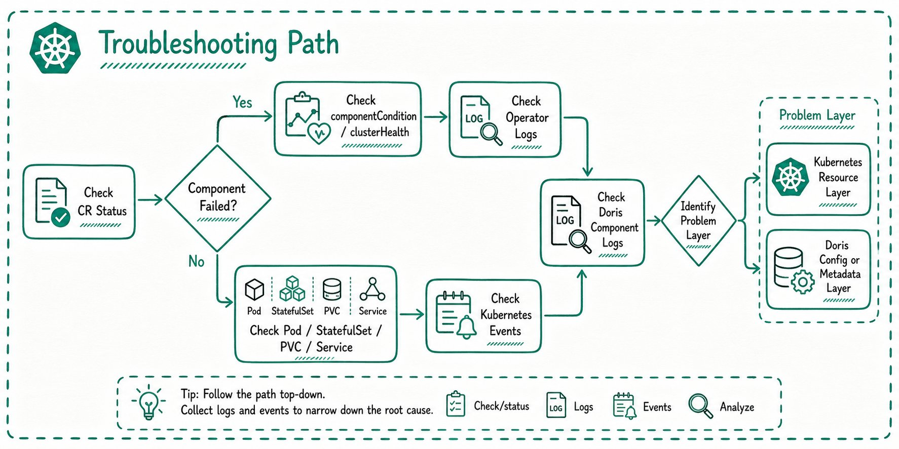

---
{
    "title": "Doris Operator Status and Troubleshooting",
    "sidebar_label": "Status and Troubleshooting",
    "language": "en",
    "description": "Explains Doris Operator status fields, cluster health, and practical troubleshooting paths for Doris clusters on Kubernetes.",
    "keywords": ["Doris Operator troubleshooting", "status", "clusterHealth", "DorisCluster", "DorisDisaggregatedCluster", "Kubernetes"]
}
---

Doris Operator writes component state into the `status` field of Doris custom resources. When troubleshooting Doris on Kubernetes, start with CR status, then continue with Operator logs, Kubernetes resources, and Doris component logs.

## View resource status

Compute-storage integrated clusters use `DorisCluster`, commonly abbreviated as `dcr`:

```shell
kubectl get dcr -n ${namespace}
kubectl describe dcr ${cluster_name} -n ${namespace}
```

Compute-storage decoupled clusters use `DorisDisaggregatedCluster`, commonly abbreviated as `ddc`:

```shell
kubectl get ddc -n ${namespace}
kubectl describe ddc ${cluster_name} -n ${namespace}
```

If the CR shows components are not ready, continue with underlying resources:

```shell
kubectl get pod,sts,svc,pvc -n ${namespace}
kubectl get event -n ${namespace} --sort-by=.lastTimestamp
```

## DorisCluster status

`DorisCluster.status` is aggregated by component:

| Field | Description |
| --- | --- |
| `feStatus` | FE status |
| `beStatus` | BE status |
| `cnStatus` | CN status |
| `brokerStatus` | Broker status |

Each component status usually includes:

| Field | Description |
| --- | --- |
| `accessService` | External access Service for the component |
| `runningInstances` | Running instances |
| `creatingInstances` | Instances being created |
| `failedInstances` | Failed instances |
| `componentCondition.phase` | Current component phase |
| `componentCondition.reason` | Reason for the phase |
| `componentCondition.message` | Human-readable status message |

Common phases include:

| Phase | Meaning |
| --- | --- |
| `available` | Component is available |
| `reconciling` | Operator is reconciling resources |
| `waitScheduling` | Waiting for scheduling or other resources |
| `haveMemberFailed` | At least one instance has failed |
| `initializing` | Component is initializing |
| `upgrading` | Component is upgrading |
| `scaling` | Component is scaling |
| `restarting` | Component is restarting |

## DorisDisaggregatedCluster status

`DorisDisaggregatedCluster.status` includes component status and overall cluster health.

| Field | Description |
| --- | --- |
| `metaServiceStatus` | MetaService status |
| `feStatus` | FE status |
| `computeGroupStatuses` | ComputeGroup status list |
| `clusterHealth` | Overall cluster health |
| `observedGeneration` | Generation observed by the Operator |

`clusterHealth` reflects overall cluster availability:

| Field | Description |
| --- | --- |
| `health` | Overall health, such as `green`, `yellow`, or `red` |
| `feAvailable` | Whether FE is available |
| `cgCount` | Number of ComputeGroups |
| `cgAvailableCount` | Number of available ComputeGroups |
| `cgFullAvailableCount` | Number of ComputeGroups whose Pods are all available |

| Health | Meaning |
| --- | --- |
| `green` | Core components are available and ComputeGroup availability is as expected |
| `yellow` | Cluster is partially available but not fully ready |
| `red` | Core components are unavailable or too few ComputeGroups are available |

ComputeGroup phases can include `Ready`, `Reconciling`, `Scaling`, `Decommissioning`, `ScaleDownFailed`, and `Suspended`.

## Recommended troubleshooting path

Use the following order:



## Common entry points

### Pod stays Pending

Common causes:

- Insufficient CPU or memory on nodes.
- Node selector, affinity, or toleration mismatch.
- PVC binding failure.

```shell
kubectl describe pod ${pod_name} -n ${namespace}
kubectl get event -n ${namespace} --sort-by=.lastTimestamp
kubectl get pvc -n ${namespace}
```

### PVC cannot be bound

Common causes:

- StorageClass does not exist.
- Insufficient storage capacity.
- Access mode mismatch.

```shell
kubectl get storageclass
kubectl describe pvc ${pvc_name} -n ${namespace}
```

### Component keeps restarting

Common causes:

- Invalid Doris startup configuration.
- Port conflict or invalid FQDN configuration.
- Storage permission or mount path problems.
- JVM or system parameters do not satisfy requirements.

```shell
kubectl logs ${pod_name} -n ${namespace}
kubectl describe pod ${pod_name} -n ${namespace}
```

If the Pod is in `CrashLoopBackOff` and logs are insufficient, use the Debug procedure described in cluster operations.

### Service is not accessible

Common causes:

- Using an internal Service as the external entry point.
- Service type does not match the access environment.
- Pods are not Ready, so Endpoints are empty.
- Cloud LoadBalancer creation failed.

```shell
kubectl get svc -n ${namespace}
kubectl get endpoints -n ${namespace}
kubectl describe svc ${service_name} -n ${namespace}
```

### Configuration changes do not take effect

Common causes:

- ConfigMap changed, but component did not restart.
- ConfigMap keys do not match component requirements.
- The CR does not reference the ConfigMap correctly.
- Mount path and configured file path do not match.

```shell
kubectl get configmap -n ${namespace}
kubectl describe dcr ${cluster_name} -n ${namespace}
kubectl describe ddc ${cluster_name} -n ${namespace}
```

For compute-storage integrated clusters, check whether `enableRestartWhenConfigChange` is configured when you expect core ConfigMap changes to trigger a rolling restart.

### authSecret problems

Doris Operator may need Doris management credentials for node registration, scale-in, decommissioning, and related operations. Incorrect `authSecret` configuration can prevent those actions from completing.

Common causes:

- The referenced Secret does not exist or is in the wrong namespace.
- Secret type or keys are incorrect.
- Username or password does not match the Doris management account.
- The management account lacks required privileges.

```shell
kubectl get secret ${auth_secret_name} -n ${namespace}
kubectl describe dcr ${cluster_name} -n ${namespace}
kubectl describe ddc ${cluster_name} -n ${namespace}
kubectl logs deployment/${operator_deployment_name} -n ${operator_namespace}
```

If the cluster uses a non-default management account or has already set a root password, verify that `authSecret` matches the actual Doris credentials.

#### BE registration failures caused by credentials in a decoupled cluster

The following steps apply to BE images that use `authSecret` to log in to FE and register nodes through SQL, such as Doris 4.1.5.

| Symptom | What to check |
|---------|---------------|
| Pod events show `FailedMount` and report that the Secret does not exist | Check the Secret name and namespace; the Secret must be in the same namespace as the cluster |
| BE registration logs repeatedly show `Access denied` / `1045` and the node does not join | Check that the Secret's `username` and `password` match the database account; the script first tries root without a password, so a single error does not necessarily mean the subsequent attempt with configured credentials failed |
| The management account can log in to FE, but node management SQL is rejected | Check that the account has the required node management privileges |
| The Secret is corrected, but BE still fails registration with old credentials | The startup script has already read the credentials into variables and does not reread the Secret during registration retries |

First inspect the target BE Pod's events and registration logs:

```shell
kubectl describe pod ${be_pod_name} -n ${namespace}
kubectl logs ${be_pod_name} -c compute -n ${namespace}
```

Recovery steps:

1. Correct the Secret and the `spec.authSecret` reference as described in [Configuring Authentication](../separating-storage-compute/config-cluster.md). Use a Secret of type `kubernetes.io/basic-auth` with `username` and `password`. If root already has a password, use an existing valid account or have an administrator create and grant privileges to a management account first. Updating the Secret does not change the database password.
2. From an environment that can reach FE, connect with the same account and verify the password and required management operations such as `SHOW BACKENDS`. The following command prompts for the password. `${fe_query_port}` is the FE query port (9030 by default):

   ```shell
   mysql -h ${fe_host} -P ${fe_query_port} -u ${management_user} -p
   ```

3. If BE still fails registration because of old credentials, recreate those Pods one at a time so that the startup script rereads the Secret. `${be_pod_name}` must identify a Pod confirmed to have failed registration; do not restart the entire healthy compute group:

   ```shell
   kubectl delete pod ${be_pod_name} -n ${namespace}
   ```

4. Wait for the StatefulSet to recreate the Pod and for it to become Ready. Run the following SQL on FE to confirm that the corresponding node has joined and its `Alive` field is `true` before proceeding to the next failed Pod:

   ```sql
   SHOW BACKENDS;
   ```

### ComputeGroup scale-in does not finish

In compute-storage decoupled clusters, ComputeGroup scale-in may stay in `Decommissioning` or `ScaleDownFailed`.

Common causes:

- Doris metadata-level decommission is not finished.
- FE is unavailable.
- Management credentials are incorrect.
- Target nodes still have data migration or cleanup tasks.

```shell
kubectl describe ddc ${cluster_name} -n ${namespace}
kubectl logs deployment/${operator_deployment_name} -n ${operator_namespace}
```

You may also need to inspect Doris-side node and ComputeGroup status.

## Operator logs

When CR status is not enough to explain the failure, check Doris Operator logs:

```shell
kubectl get pod -n ${operator_namespace}
kubectl logs ${operator_pod_name} -n ${operator_namespace}
```
